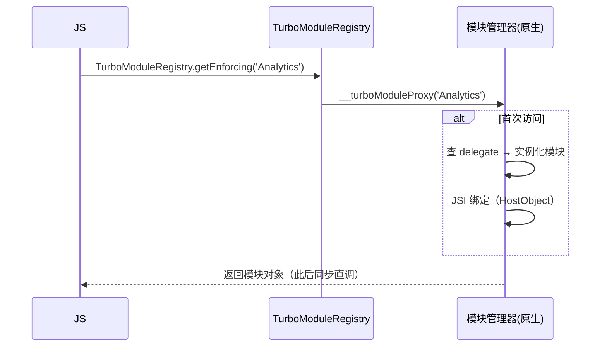
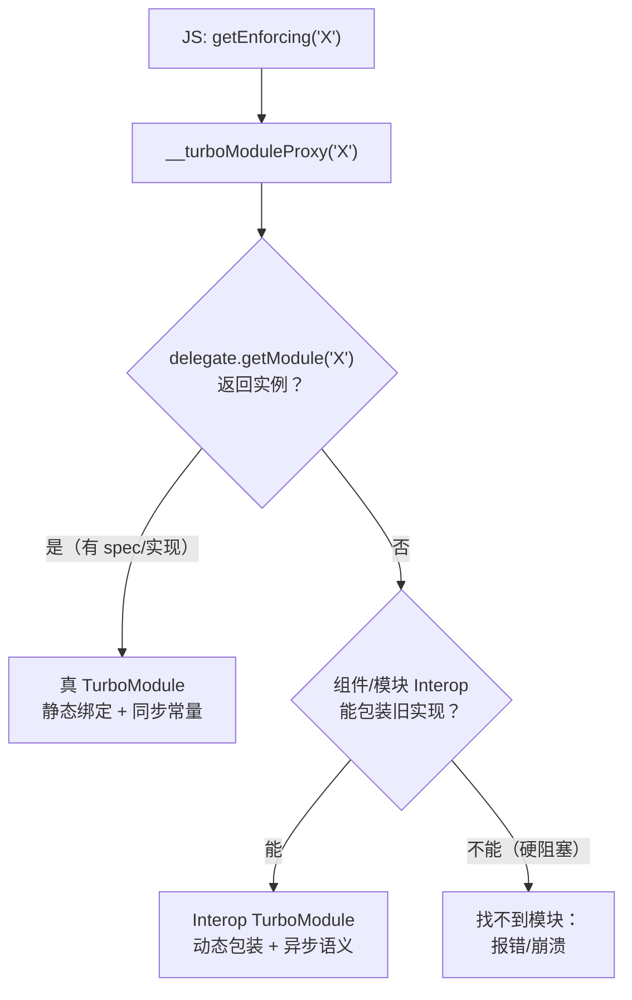
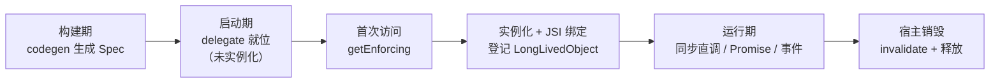
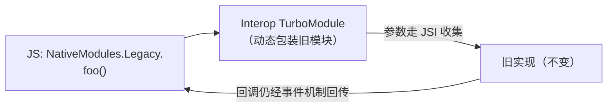

# TurboModules

> 模块四的 NativeModules 有三宗罪：**启动全量注册、JSON 动态调用、类型靠约定**。TurboModules 逐条替换：**按需实例化、JSI 同步绑定、Codegen 静态契约**。本篇拆它的加载机制、双平台模块管理器与兼容旧模块的 Interop 层。

## 1. 从"全量注册"到"按需实例化"

旧架构启动时要把所有 `@ReactMethod` 收集进注册表（模块二 01），因为 JS 代理需要编号表才能发消息。TurboModules 反过来：



- JS 侧 `NativeAnalytics.getEnforcing<Spec>('Analytics')` 触发 `__turboModuleProxy`；
- 原生按名字查 **TurboModuleManagerDelegate**，第一次访问才创建实例（**懒加载**），创建后进入 LongLivedObjectCollection（防 GC 回收跨端持有的对象——模块三 03 的 Handle 体系在模块层的体现）；
- 返回的对象是 JSI `HostObject`：**方法调用就是 C++ 函数调用**，常量读取同步返回。

启动收益：模块初始化成本从"启动时 N 个"变为"用到时 1 个"；调用收益：模块四 01 的三条死穴（异步/序列化/无类型）同步消失。

用一张表把"注册成本"账算清（衔接[模块二 01 · Android 启动链路](../rn-启动流程原理/01-Android启动链路.md)的 PROCESS_PACKAGES 打点）：

| 成本项 | 旧 NativeModules | TurboModules |
|--------|-----------------|--------------|
| 启动时扫描 | 反射/扫描全部 ReactPackage，收集所有模块与方法表 | 无（delegate 就位即可） |
| 启动时构建 | 每个模块实例化 + 方法编号表 + 常量快照 | 无 |
| 首次访问 | 无额外成本（早就建好） | 实例化 + JSI 绑定（一次） |
| 编译期 | 无静态检查，错配运行时炸 | Spec 抽象类/协议，漏写编译不过 |

注意这不是"成本消失"而是"成本搬家"：从**所有用户的所有启动**搬到**使用者的首次访问**——用不到的模块成本直接归零，这正是长尾模块（蓝牙、NFC、支付渠道……）最需要的那一刀。

### 1.1 懒加载协议的逐步表

把时序图拆成带"谁在做"的步骤表：

| 步 | 动作 | 层 | 首次访问后是否重复 |
|----|------|----|------------------|
| 1 | JS import spec 文件，调用 `getEnforcing('Analytics')` | JS | 只一次（模块顶层） |
| 2 | `TurboModuleRegistry` 调全局 `__turboModuleProxy('Analytics')` | JS → C++ | 只一次 |
| 3 | 按名字查 delegate（Android/iOS 各自的管理器） | 原生 | 只一次 |
| 4 | delegate 返回（或现场创建）模块实例 | 原生 | 只一次 |
| 5 | 生成 JSI 绑定：方法表、常量挂成 HostObject | C++ | 只一次 |
| 6 | 实例登记进 LongLivedObjectCollection | C++ | 只一次 |
| 7 | JS 拿到模块对象，缓存于 import 的模块作用域 | JS | — |
| 8 | 此后每次 `NativeAnalytics.logEvent(...)` | JS → C++ 直调 | 每次调用 |

注意第 7 步：**JS 侧的"缓存"来自模块系统本身**——ES module 只执行一次，顶层拿到的引用自然复用，不需要业务侧再写单例。

### 1.2 get 与 getEnforcing：两种失败哲学

| API | 模块不存在时 | 适用 |
|-----|-------------|------|
| `getEnforcing<Spec>('X')` | 直接抛错（fail fast） | 该模块是硬依赖（埋点、配置） |
| `get<Spec>('X')` | 返回 null | 可选能力（高配机型才有的原生特效） |

这个区分在迁移期很有用：Interop 形态的旧模块用 `get` 探测再降级，比一刀切的 try/catch 干净。

### 1.3 LongLivedObjectCollection：谁防止模块被回收

一个容易被忽略的细节：JSI 绑定对象由 JS 引擎的 GC 视角看是可回收的，而 TurboModule 的 C++ 实例需要活得和 App 一样长（或直到 invalidate）。LongLivedObjectCollection 就是这个"保险柜"：

- 模块实例创建后登记其中，C++ 侧持有强引用——GC 无法收走还挂着 HostObject 的实现；
- 宿主销毁（ReactHost/bridge teardown）时统一释放，并给模块 invalidate 机会（第 3 节）；
- 与模块三 03 讲的 JS 对象 Handle 体系是同一命题在模块层的落地：**跨语言的对象生命周期必须有一侧明确持有**。

## 2. 双平台的模块管理器

### Android：TurboModuleManagerDelegate

- 每个 TurboModule 提供 `getModule(String name)`，由 App 的 `TurboReactPackage`/delegate 实现；
- Codegen 生成的抽象类（如 `NativeAnalyticsSpec`）是**强类型基类**——实现类漏写方法，编译期报错（模块四时代的"运行时才炸"消失）；
- 每个模块可声明自己的执行线程（`getExecutorQueue`），与旧 `@ReactMethod` 固定 mqt 不同。

### iOS：RCTTurboModuleManager

- `RCTTurboModuleManagerDelegate` 按名字解析模块（`getTurboModule:forName:`）；
- 实现类遵循 Codegen 生成的 ObjC++ 协议（`NativeAnalyticsSpec` 协议 + `.mm` 实现）；
- 同样支持按模块指定 `getDispatchQueue`（串行队列隔离重 IO 模块）。

| | 旧 NativeModules | TurboModules |
|--|-----------------|--------------|
| 注册时机 | 启动全量 | 首次访问按需 |
| 调用通道 | Bridge 消息（JSON） | JSI HostObject 直调 |
| 类型契约 | 运行时编号约定 | Codegen 静态生成（04 篇） |
| 常量 | 创建时注入 | 同步 getConstants，任意时刻可读 |
| 线程 | 固定 mqt | 每模块可配 executor/queue |

### 2.1 Android 代码走读（Kotlin）

```kotlin
// App 侧的 delegate（骨架示意；完整流程见模块十 02）
class MyAppTurboModuleManagerDelegate(
  reactContext: ReactApplicationContext
) : TurboModuleManagerDelegate(reactContext) {

  override fun getModule(name: String): TurboModule? = when (name) {
    "Analytics" -> NativeAnalyticsModule(reactContext)  // 继承生成的 NativeAnalyticsSpec
    "KVStore"   -> NativeKVStoreModule(reactContext)
    else -> null   // 返回 null → 上层继续找（最终可能落到 Interop）
  }
}
```

读这段代码要抓三点：

1. **`name` 是全局键**：与 JS 端 `getEnforcing('Analytics')`、生成的 Spec 类名三位一体对齐（04 篇坑位清单第 2 条）；
2. **`when` 分支就是你的模块注册表**——它取代了旧架构的 Package 扫描，从"框架反射扫描"变成"开发者显式列举"，多写一行但少一层魔法；
3. **返回 null 是合法路径**：查不到不是崩溃，而是交给链路的下一环（Interop/报错），这让"部分模块已真迁移"的混跑成为可能。

### 2.2 iOS 代码走读（ObjC++）

```objc
// RCTTurboModuleManagerDelegate 的实现（骨架示意）
- (std::shared_ptr<facebook::react::TurboModule>)getTurboModule:
    (const facebook::react::ObjCTurboModule::InitParams &)params
    forName:(NSString *)name {
  if ([name isEqualToString:@"Analytics"]) {
    return std::make_shared<facebook::react::NativeAnalyticsSpecJSI>(
        params, [[NativeAnalyticsModule alloc] init]);
  }
  return nullptr;
}
```

iOS 侧多一个"JSI 包装层"概念：生成的 `NativeAnalyticsSpecJSI` 把 ObjC 方法适配成 C++ TurboModule 接口——这就是 Codegen 替你写掉的那部分"ObjC ↔ JSI 翻译"。开发者的实现类（`NativeAnalyticsModule`）只面向 ObjC 协议写业务。

### 2.3 执行线程的自主权

"每模块一个执行队列"不是装饰，它改写了旧架构的一类顽疾：

| 旧架构（固定 mqt） | TurboModules（自配 executor/queue） |
|-------------------|-----------------------------------|
| 所有模块方法挤一条 NativeModules 线程 | 重 IO 模块独占串行队列，互不干扰 |
| 一个慢模块拖慢所有模块的方法分发 | 慢只慢自己 |
| 想挪线程得靠模块内部再 dispatch | 线程模型成为模块声明的一部分 |

注意同步方法的特殊性：**同步方法必须在 JS 线程的调用栈内立即返回**（它没有"稍后回线程"的机会），所以同步方法只适合"读内存级"的操作——重活走 Promise，让实现扔到自己的 queue 再经 CallInvoker 回 JS（第 4 节）。

### 2.4 模块解析的完整链路

把"名字 → 实例"的解析全链路画出来，混跑期（真 TurboModule 与 Interop 并存）的行为一目了然：



三岔口的管理学：**同一个 App 里三种形态按模块共存**，判断任何一个模块行为前先确定它落在哪个分支——这是 06 篇排查方法论的第一问，答案就藏在这张图里。

## 3. 一个模块的完整生命周期

把 create → 访问 → 调用 → 销毁串成一张图：



各阶段的工程要点：

| 阶段 | 要点 | 常见错误 |
|------|------|---------|
| 构建 | spec 编译进 App，零运行时注册成本 | 忘配 codegenConfig（04 篇坑 4） |
| 启动 | delegate 就位即可，不实例化任何模块 | 在 delegate 构造里"预热"全部模块——把懒加载优势手动清零 |
| 实例化 | 构造函数应轻；重初始化放 `initialize()` 钩子 | 在构造里做 IO，拖慢首次调用 |
| 运行 | 方法按声明形态执行；事件经 EventEmitter | 跨线程直接碰 Runtime（模块七 01 的红线） |
| 销毁 | `invalidate()` 释放资源、停队列、取消订阅 | 忽略 invalidate，宿主重建后残留定时器/监听 |

一个例外通道：确有"必须启动即初始化"的模块（如需要在 Application 阶段就工作的推送），管理器提供 eager init 名单机制把它们提出来——**例外要显式声明，而不是退回全量注册**。

## 4. 参数、返回值与线程：一次调用的往返

### 4.1 同步方法的往返

同步方法（`() => DeviceInfo` 形态）的路径最短：JS 调 HostFunction → C++ 侧 codegen 生成的参数解码（jsi::Value → C++/Java/ObjC 类型）→ 业务实现 → 返回值编码回 jsi::Value → JS 拿到。全程一条栈，无跨线程。

约束因此极严：不能等待任何异步事物（锁、IO、其他线程的回复）——等待 = 卡死 JS 线程。

### 4.2 Promise 的往返：两条线程的一次接力

```ts
addEvent(a: string, b: number): Promise<void>;
```

Promise 形态的完整接力：

| 步 | 动作 | 线程 |
|----|------|------|
| 1 | JS 调用，拿到 Promise（立即返回） | JS |
| 2 | C++ 解码参数，转交模块执行 | JS 调用栈内 |
| 3 | 实现把任务 dispatch 到模块自己的 queue | 模块 queue |
| 4 | 任务完成，实现 resolve/reject Promise | 模块 queue |
| 5 | resolve 经 **CallInvoker** 调度回 JS 线程 | JS |
| 6 | then 回调执行 | JS |

第 5 步是命门：**resolve 必须切回 JS 线程**（Runtime 线程亲和，模块七 01）。Codegen/框架生成的胶水已经处理好这一步——但如果你在实现里"绕过 Promise 自己回调 JS 函数"，就必须自己走 CallInvoker，否则就是数据竞争。

### 4.3 回调与事件

- 一次性回调（`(success: bool) => void` 参数形态）：语义上等同"手动 Promise"，同样要经线程调度回 JS；**只应触发一次**，重复触发是未定义行为；
- 持续事件（进度、传感器流）：不要用多次回调的参数形态表达，用 EventEmitter 模型——spec 声明 listener 注册方法，原生持有 emitter 定向推送（模块十 02 有完整代码）；
- 判断口径直接复用[模块三 04 · 同步与异步的边界](../rn-JS引擎与线程模型/04-同步与异步的边界.md)：**不等谁的同步；等 IO 的 Promise；推送语义的事件**。

### 4.4 参数与返回值的转换账单

JSI 免掉了 JSON，但"值到目标语言类型"的转换仍在（由生成代码完成）。设计 spec 时心里有这本账：

| 数据形态 | 转换成本特征 | 设计建议 |
|---------|-------------|---------|
| number/boolean | 内联值，近乎零成本 | 放心用 |
| string | 每次跨越一次字符拷贝 | 高频小字符串可考虑数值/枚举替代 |
| 普通对象 | 逐字段转换（两侧结构对齐） | 字段宜少宜平，避免深嵌套 |
| 数组 | 长度 ∝ 转换量 | 大数组分页/分片推送 |
| ArrayBuffer/大块字节 | 可共享内存，免逐字段转换 | 二进制数据（图片/文件/加密块）首选 |

规律一句话：**结构化小数据随便传，大数据走字节，高频字符串要节制**——与模块七 01 的 JSI 成本模型完全一致。

## 5. Interop Layer：旧模块的兜底通道

迁移不可能一夜完成，新架构提供**Interop 层**把旧 `RCTBridgeModule`/`@ReactMethod` 模块包装成 TurboModule 形态：



- **语义保留**：旧模块的方法仍是异步回调——Interop 只是把消息通道从 Bridge 换成 JSI 包装，**不改变异步本质**（因为旧实现没有同步形态）；
- **代价**：享受不到静态类型与同步常量的全部收益，但迁移期内 App 可以整体切到 bridgeless 先跑起来；
- 策略：**核心高频模块优先真迁移，长尾模块靠 Interop 苟着**——05 篇迁移路线图的第一原则。

### 5.1 哪些旧模块能被兜住

Interop 的包装能力有边界，按"旧模块用了什么"分三档：

| 旧模块形态 | Interop 结果 |
|-----------|-------------|
| 标准 `@ReactMethod`/`RCT_EXPORT_METHOD`，Promise/回调返回 | 可用：方法调用、常量、事件桥接都走通 |
| 依赖 `RCTBridge` 实例做深度操作（bridge.batched? 等） | 部分：强假设桥存在的代码行为可能异常 |
| 直接操纵桥内部（消息队列、注册表 hack） | 不可用：这些内部机制在 bridgeless 下不存在 |

第三档就是 06 篇"硬阻塞"档的技术根源——Interop 能包装**接口**，不能复活**已拆除的内部结构**。

### 5.2 与 06 篇的分工

本节只讲机制；"如何系统性盘点依赖、如何在运行时确认某个模块此刻走的是真 TurboModule 还是 Interop、常见症状对照"整套工程流程在[06 · 迁移工程实践](06-迁移工程实践.md)第 2/3 节——排查问题时先读那篇的"第一问：此刻在哪个形态上跑"。

## 6. 支持的调用形态

一个 spec 里可以同时声明（模块十 02 有完整代码走查）：

```ts
export interface Spec extends TurboModule {
  readonly getDeviceInfo: () => DeviceInfo;        // 同步返回对象
  addEvent(a: string, b: number): Promise<void>;   // 异步 Promise
  onProgress(cb: (percent: number) => void): void; // 回调/事件
  // 常量：$getConstantsTyped 由 Codegen 处理
}
```

设计判断直接用模块三 04 的边界：**不等谁的同步；等 IO 的 Promise；推送语义的事件**。

补充两个实战判例：

- **同步返回大对象要克制**：同步意味着"在 JS 线程栈内完成编码"，超大结构会直接吃掉 JS 帧预算——大对象宁可 Promise（编码可分帧）或走事件分片；
- **常量也不是免费午餐**：`getConstants()` 同步读很爽，但每次读都要跨一次 JSI——初始化时读一次存进 JS 变量，别在 render 里反复读。

### 6.1 一个带事件与常量的完整 spec

三种形态与常量并存的典型样子（与模块十 02 的 NativeAnalytics 同型，可直接对照实现走读）：

```ts
// specs/NativeDownloader.ts
import type { TurboModule } from 'react-native';
import { TurboModuleRegistry } from 'react-native';

export interface Spec extends TurboModule {
  // 常量：构建期生成结构，运行期同步读
  readonly constants: {
    readonly maxConcurrent: number;
    readonly version: string;
  };
  // 同步：读内存级状态，不等任何东西
  getState(): 'idle' | 'running' | 'paused';
  // Promise：等 IO 的动作
  start(url: string, headers: object): Promise<string /* taskId */>;
  cancel(taskId: string): Promise<void>;
  // 事件：持续推送语义（配 NativeEventEmitter 消费）
  addListener(eventName: string): void;
  removeListeners(count: number): void;
}

export default TurboModuleRegistry.getEnforcing<Spec>('Downloader');
```

```js
// JS 侧消费事件的标准姿势（事件 + 查询双保险）
import NativeDownloader from './specs/NativeDownloader';
import { NativeEventEmitter } from 'react-native';

const emitter = new NativeEventEmitter(NativeDownloader);
emitter.addListener('onProgress', (e) => updateUI(e.taskId, e.percent));
// 注册完主动查一次当前状态，防"注册晚于首事件"
const state = NativeDownloader.getState(); // 同步读，无时序问题
```

这份样例把本篇要点全部串起：常量同步读、状态同步查、动作走 Promise、进度走事件、注册后补一次查询。

## 7. 常见坑与排查

| 现象 | 根因 | 处理 |
|------|------|------|
| `TurboModule with name 'X' couldn't be found` | 名字三位一体不一致 / delegate 返回 null / codegen 没跑 | 对照 04 篇坑 2/4；查 delegate 分支 |
| 首次调用卡顿明显 | 实例化做了重活（构造里 IO） | 构造只做轻活，重初始化挪到首次方法调用或显式 init |
| 同步方法里 crash（偶发） | 实现里等待了锁/IO，或碰了非线程安全结构 | 同步方法只做内存级操作 |
| Promise 永不 resolve | 实现 dispatch 后任务丢失 / invalidate 后才完成 | 检查 queue 生命周期；invalidate 里做未决 Promise 的清理 |
| 事件偶发丢失 | listener 注册晚于首事件 | 注册后主动查询一次当前状态（事件+查询双保险，06 篇 4.3） |
| 模块重复初始化 | JS 侧多处 `require` 不同入口各自 getEnforcing | 收敛到单一 spec 文件导出（模块系统本身保证单次） |
| 内存持续增长 | 模块持有订阅/缓存且 invalidate 未清理 | invalidate 里逐项释放；订阅要有取消路径 |

## 8. 与 JSI/Fabric 的关系定位

- **JSI 是通道**（模块七 01）：TurboModule 是"模块系统"建在这条通道上；
- **Codegen 是契约工厂**（04 篇）：没有静态生成，JSI 绑定就得手写 C++，规模不可控；
- **Fabric 管 UI**（02 篇）：TurboModules 管非 UI 能力——两者共同构成"新架构"，互不包含。

## 小结

- TurboModules 的三个替换：全量注册 → 按需实例化、Bridge 消息 → JSI HostObject 直调、运行时约定 → Codegen 静态契约；
- 双平台各有一个 delegate/manager 做名字 → 实例的解析，模块可自带执行队列；
- Interop 层让旧模块零改动跑在 bridgeless 下（仍是异步语义），是迁移的兜底通道；
- spec 中同步/ Promise /回调三种形态的取舍，就是模块三 04"需要等谁"边界观的直接应用；
- 生命周期五阶段各有纪律：构建零成本、启动零实例化、实例化轻构造、运行守线程、销毁必 invalidate。

## 自测

1. 从 JS import spec 到第一次方法调用，中间发生了哪几步？哪些只发生一次？
2. 为什么 TurboModule 实例要登记进 LongLivedObjectCollection？不登记会发生什么？
3. 同步方法、Promise、事件三种形态各自的"线程路径"是什么？哪一步必须经 CallInvoker？
4. Interop 层为什么不能把旧模块的异步方法变同步？这背后的"旧实现没有同步形态"指什么？
5. 一个 TurboModule 在 invalidate 里应该做哪些事？不做会留下什么隐患？
6. `get` 与 `getEnforcing` 的选型标准是什么？迁移期混跑时各扮演什么角色？
