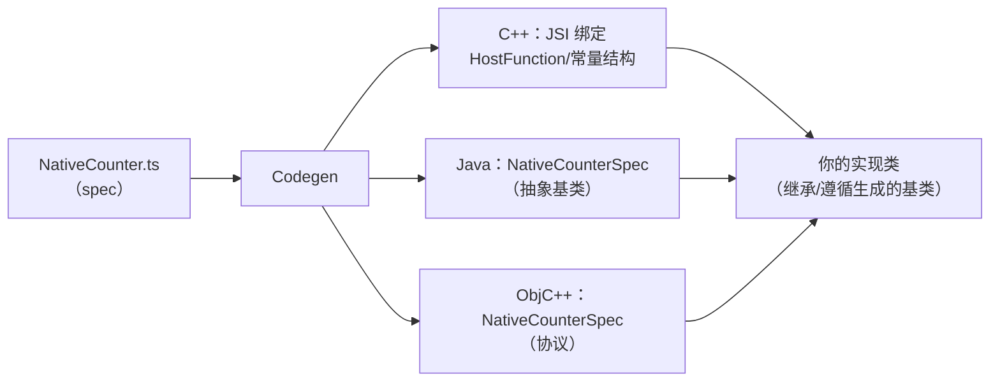
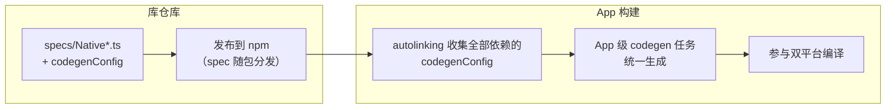
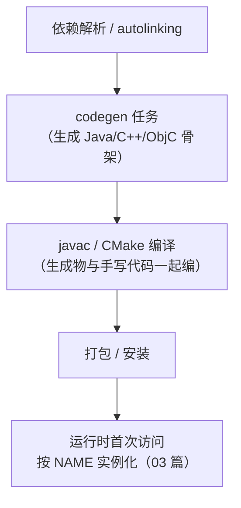
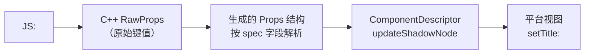

# Codegen

> 新架构里最没有"存在感"却最关键的一环：**把 TS/Flow 的接口定义编译成 C++ / Java / ObjC 的绑定代码**。JSI 提供同步通道，TurboModules/Fabric 提供系统结构，而把"JS 想要的接口"与"原生实现的代码"精确对齐的，是 Codegen。

## 1. 输入：一份 spec 文件

```ts
// NativeCounter.ts —— TurboModule 的 spec
import type { TurboModule } from 'react-native';
import { TurboModuleRegistry } from 'react-native';

export interface Spec extends TurboModule {
  increment(by: number): Promise<number>;
  getValue(): number; // 同步方法：JSI 直调
  readonly constants: { initial: number };
}

export default TurboModuleRegistry.getEnforcing<Spec>('Counter');
```

配套在 `package.json` 里声明让构建系统找到它：

```json
{ "codegenConfig": { "name": "AppSpecs", "type": "modules", "jsSrcsDir": "./specs" } }
```

规则要点（type: `modules` 对应 TurboModules，`components` 对应 Fabric 组件——模块十 03）：

- **只支持静态可推断的类型**：string/number/boolean、只读对象/数组、Promise、回调；不支持联合、泛型展开、函数属性等——**spec 是 IDL（接口描述语言），不是任意 TS**；
- 命名约定：文件必须 `Native*.ts`，导出的接口默认成为生成目标。

### 1.3 从 spec 文件到构建输入的路径

一份 spec 被消费的完整路径（看不见的管道，出问题时按站排查）：

| 站 | 动作 | 出错表现 |
|----|------|---------|
| 1. 发现 | autolinking/构建脚本扫描依赖的 `codegenConfig` | spec 根本没进流水（坑 4） |
| 2. 收集 | 汇总 `jsSrcsDir` 下所有 `Native*` 文件 | 文件命名不符 → 静默跳过 |
| 3. 解析 | 按 IDL 规则解析类型 | 类型非法 → codegen 阶段报错（坑 1） |
| 4. 生成 | 产出三语言骨架到 generated 目录 | 目录权限/缓存脏 → 构建诡异（06 篇 4.1） |
| 5. 编译 | 生成物随平台编译链参与构建 | 符号缺失 → 编译错误（坑 3） |
| 6. 运行 | 首次访问按 NAME 解析实例 | 名字不一致 → 运行时找不到（坑 2） |

这张表的价值在于**把"没生成/生成错/没用上"三种故障分开**——同样是"模块不工作"，站 1/2 的病开药方是配置，站 3 是 spec 语法，站 6 是命名，混在一起查会绕远路。

### 1.1 spec 的类型边界表

IDL 的核心约束是"每种类型都必须能映到三种目标语言的内存形态"。常用类型的通行映射（以实际版本的生成器输出为准，此处作设计参考）：

| spec 类型 | C++ 侧 | Java/Kotlin 侧 | ObjC 侧 |
|-----------|--------|----------------|---------|
| `string` | `std::string` / jsi::String | `String` | `NSString *` |
| `number` | `double` | `Double` | `NSNumber *` / 数值类型 |
| `boolean` | `bool` | `Boolean` | `BOOL` / `NSNumber *` |
| `T \| null` / 可选 | `std::optional<T>` | 可空包装 | 可空对象 |
| 只读对象 `{...}` | 生成的结构体 | 生成的 `WritableMap` 桥接 | 生成的字典/结构 |
| 只读数组 | `std::vector` 桥接 | `ReadableArray` | `NSArray` |
| `Promise<T>` | `Promise` 桥 | `Promise<T>` | `RCTPromiseResolveBlock` 一族 |
| 回调 `(x) => void` | `Callback<T>` 桥 | `Callback` | `RCTResponseSenderBlock` 一族 |

三条由此而来的设计守则：

1. **对象字段全部 `readonly`**——spec 里的对象是"数据契约"，可变性没有跨语言语义；
2. **联合类型用枚举 + 字符串字面量风格的精确接口替代**（IDL 不吃 `string | number`）；
3. **想清楚再写泛型**——展开不了就换成具体接口；省下的类型花哨，换来的是编译期就能对齐三端。

### 1.2 组件 spec 长什么样

TurboModule 之外，Fabric 组件的 spec 是另一种入口（模块十 03 的主线）：

```ts
// NativeMyView.ts —— Fabric 组件 spec（骨架示意）
import codegenNativeComponent from 'react-native/Libraries/Utilities/codegenNativeComponent';

export interface NativeProps {
  title?: string;
  enabled?: boolean;
  onToggle?: (state: boolean) => void;   // 事件：生成事件发射类型
}

export default codegenNativeComponent<NativeProps>('NativeMyView');
```

与模块 spec 的差异：

- 入口不是 `TurboModuleRegistry` 而是 `codegenNativeComponent`；
- props 与事件定义直接驱动生成的 `Props` 结构体和事件类型（第 5 节展开）；
- 原生侧产物不是"模块基类"而是 ComponentDescriptor 相关的一族文件。

## 2. 输出：三份语言的绑定代码



生成的不是实现，而是**骨架与类型**：

- C++ 侧：参数/返回值的转换器（JS 值 ↔ C++ 类型）、方法分发表——手写最容易错的部分；
- Java/ObjC 侧：抽象基类/协议，**你只填业务方法体**；
- Fabric 组件（模块十 03）：额外生成 Props 结构体、事件类型与 ComponentDescriptor。

### 2.1 Java 产物走读

```java
// build/generated/.../NativeCounterSpec.java（骨架示意）
public abstract class NativeCounterSpec extends TurboModule {
  public static final String NAME = "Counter";

  public NativeCounterSpec(ReactApplicationContext context) { super(context); }

  public abstract Promise<Double> increment(double by);  // 形态与 spec 一一对应
  public abstract double getValue();
  public abstract NativeCounterConstantsType getConstants(); // 常量结构同样生成
}
```

要点：

- `NAME` 常量就是解析键——与 JS 端 `getEnforcing('Counter')` 对齐（坑位 2）；
- 方法签名**由 spec 单向决定**：参数类型写错不是警告，是编译错误——契约的强制性落在 javac 上；
- 你的实现类 `extends NativeCounterSpec`，漏实现任何一个方法都是编译期红灯。

### 2.2 ObjC++ 产物走读

```objc
// build/generated/.../NativeCounterSpec.g.h（骨架示意）
@protocol NativeCounterSpec <RCTTurboModule>
- (void)increment:(double)by
          resolve:(RCTPromiseResolveBlock)resolve
           reject:(RCTPromiseRejectBlock)reject;
- (double)getValue;
- (NSDictionary *)getConstants;
@end
```

- Promise 在 ObjC 侧展开为 resolve/reject 两个 block——这就是"一次回调"语义的静态化；
- 实现类在 `.mm` 里 `@interface NativeCounter : NSObject <NativeCounterSpec>`，协议未实现会有编译警告/错误，取决于配置（迁移期建议开严格）。

### 2.3 C++ 产物走读

C++ 侧是"看不见但干重活"的部分：

- **方法分发**：把 JS 的函数调用路由到对应原生实现的跳表/模板代码；
- **参数解码/返回编码**：`jsi::Value` ↔ 目标类型（03 篇 4.4 的账单就在这里兑现）；
- **常量结构**：`getConstants()` 的内存布局构建；
- iOS 上还有 ObjC ↔ C++ 的 SpecJSI 适配层（03 篇 2.2 出现过的 `NativeAnalyticsSpecJSI` 一族）。

这层代码"每个方法一份转换样板"，正是手写时代的错误重灾区——Codegen 的第一价值就是把这片区域从人手里拿走。

## 3. 构建链路：生成物挂在哪一步

| 平台 | 触发点 | 产物位置 |
|------|--------|---------|
| Android | gradle 插件（`react-native-gradle-plugin`）的 codegen 任务 | `build/generated/...`（参与 javac/编译） |
| iOS | `pod install` 阶段执行 codegen 脚本 | `build/generated/...`（进入 Pods 工程） |

两个工程含义：

1. **生成物不进版本库**（generated 目录被忽略），每次构建按 spec 重新生成——spec 是唯一事实源；
2. **升级 RN 可能改变生成物结构**（生成代码与运行时强耦合）——三方库"还没跟上新架构"通常卡在这里：不是 JS 写不了，而是它的 gradle/pod 链路还没适配 codegen 输入输出。

### 3.1 App 如何消费依赖库的 codegen

三方库与 App 的 codegen 是**两级流水**：



三个推论：

- 库**不需要**把生成物提交或发布——App 构建时按当前 RN 版本的生成器现做（这也是"spec 是唯一契约源"的物理基础）；
- App 升级 RN 后，**所有库的生成物结构可能同时变化**——一次升级引发多库编译错误是常态，定位思路见坑位 3；
- `type` 字段决定生成方向（`modules`/`components`/`all`），填错会导致组件 spec 被当模块扫描（或反之），现象是"生成物里找不到预期文件"。

### 3.2 生成物的版本耦合为什么强

生成代码不是稳定 API，而是**运行时内部的形状镜像**：C++ 侧的绑定要与 `ReactCommon` 里的 TurboModule 基类、Props 基类的真实签名严丝合缝。RN 升级改动了这些基类，旧生成器产出的代码就可能与新运行时错位——表现为"找不到符号/协议"一类的编译错误，而非运行时错误。所以：

- 排查三方库编译错误时，**先对齐"库支持线 vs App RN 版本"**，再看代码；
- 锁版本策略在 codegen 语境下尤其重要（06 篇 3.2 的三档分类会复用这个判断）。

### 3.3 构建链路上的时间线

把一次完整构建中 codegen 的位置摆出来（Android 视角，iOS 同构）：



两个时间点值得记住：

- **B 在 C 之前**：所以 spec 的错误永远先于实现代码的编译错误出现——看日志顺序就能分清是契约问题还是实现问题；
- **E 在启动之后**：生成物再好，也只覆盖"绑定"；实例化时机由 TurboModule 懒加载协议决定（03 篇 1.1）——codegen 与懒加载是两件互补的事，前者管"绑定就绪"，后者管"何时实例化"。

## 4. 为什么静态生成能换来安全与性能

对照模块四 04 的五要素，Codegen 改写的是**契约维度**：

| | Bridge 时代（运行时契约） | Codegen（构建期契约） |
|--|------------------------|----------------------|
| 方法定位 | moduleID/methodID 查表（约定） | 编译期绑定的函数指针/虚表 |
| 参数校验 | 原生侧手工判断（漏判即崩溃/静默） | 生成代码自动转换，类型错编译期暴露 |
| 常量 | 注册时注入快照 | 结构体直接内存布局，同步读 |
| 启动成本 | 注册表构建 | 零（懒实例化 + 已生成绑定） |

一句话：**把运行时才能发现的错误搬到编译期，把运行时才能完成的绑定搬到构建期**——这就是"为什么代码生成值得"的完整答案。

### 4.1 "错误前移"的三个实例

对照表第一二行的具体形态：

| 场景 | 旧架构的表现 | Codegen 的表现 |
|------|-------------|---------------|
| 漏实现一个方法 | JS 调用到时运行时报"不可调用" | 编译错误（抽象方法未实现） |
| 参数类型不符（number 传成 string） | 原生侧强转崩溃或静默错值 | 生成转换层报错/拒绝，且多半在开发期暴露 |
| spec 与实现签名漂移（重构忘改一侧） | 两边各说各话，运行时数据错乱 | 一侧改动另一侧立即编译失败 |

第三条在多人协作里价值最大：**spec 成了强制 review 的接口文档**——改契约的 PR 天然要求两侧同改。

### 4.2 "绑定前移"的启动账

对照表最后一行的展开。旧架构的启动要为模块系统付三笔钱：

1. **扫描**：反射/遍历找齐所有模块类；
2. **构建注册表**：moduleID/methodID 编号、方法签名缓存；
3. **实例化**：模块对象与常量快照的创建。

Codegen 时代这三笔全部清零或转期：

| 旧启动的三笔钱 | Codegen 时代的去向 |
|---------------|-------------------|
| 扫描 | 构建期完成（autolinking 收集） |
| 注册表构建 | 构建期生成（骨架即注册表） |
| 实例化 | 运行期首次访问（03 篇懒加载） |

注意第三笔的功劳属于 TurboModules 而非 Codegen——两者常被并成一句话说，但账要分开记：**Codegen 管前两笔（构建期），懒加载管第三笔（运行期）**。这也是 05 篇六维对照里"模块"一行"启动全量注册 → 懒加载 + 静态契约"的精确拆分。

## 5. Fabric 组件的 Codegen

组件方向（`type: "components"`）的产物族比模块侧更丰富：

| 生成物 | 作用 | 谁来消费 |
|--------|------|---------|
| `Props` 结构体（C++） | 强类型的 props 集合与解析 | ComponentDescriptor 的 update 流程 |
| 事件类型/EventEmitter 辅助 | 事件的构造与发射 | 原生组件实现 |
| ComponentDescriptor 骨架 | 创建/克隆/更新 ShadowNode 的规则 | Fabric 组件表 |
| （Android/iOS）视图侧胶水 | props → 平台 View 属性的桥 | 平台实现文件 |

工作流（模块十 03 全程演示）：

1. 写组件 spec（1.2 的样子），声明 props 与事件；
2. 构建后到 `build/generated` 找到生成的 Props/事件结构，**按生成物的形状**写 C++ descriptor 与平台实现；
3. 注册进组件表，JS 侧直接 `<NativeMyView title=... onToggle=... />`。

关键认知：组件 codegen 的"契约强制"比模块更早一步——props 解析在 C++ 层完成（02 篇第 5 节），类型错误根本走不到 View 层。

### 5.1 一次 props 更新的生成物流



对照旧 ViewManager 的"注解 + 手写 setter + 手工判空"：这条链上每一步的类型都是 spec 推导的，多传一个没声明的 prop 会在解析层被识别为未知项（而不是一路撞到 View 层才炸）。事件方向同理：原生发射的事件 payload 也是生成类型，JS 侧回调拿到的字段与 spec 严格一致。

## 6. 手写 JSI 与 Codegen：两条路线的选型

并非所有原生能力都该走 Codegen。两条路线的边界：

| | 纯 JSI 库（mmkv/quick-sqlite 型） | Codegen 路线（TurboModule/Fabric 组件） |
|--|--------------------------------|---------------------------------------|
| 契约 | 手写 C++ 绑定，类型自理 | spec 静态生成，三端对齐 |
| 双平台成本 | C++ 一份核心 + 极薄平台胶水 | 需要分别实现 Java/ObjC 侧 |
| 线程/生命周期 | 全部自己管理 | 框架托管（executor/LongLivedObject） |
| 适合 | C++ 资产直通（存储、加密、音视频） | 平台 API 封装（蓝牙、支付、推送） |
| 代表 | react-native-mmkv | 官方核心模块、多数社区库 |

（两条路线的机制基础都在 01 篇：HostObject 与 HostFunction 既是手写 JSI 的工具箱，也是 Codegen 生成代码的目标形态。）

选型口径一句话：**离 C++ 近、无平台差异的，纯 JSI；离平台 API 近、要双端各写实现的，Codegen**。两条路线不互斥——同一个库里可以并存（核心用 JSI 直通，边角平台能力做成 TurboModule）。

## 7. 常见坑位清单

1. **类型不支持**：spec 里写了联合类型/泛型 → codegen 阶段直接失败；报错会指到具体字段，按提示改成可表达的形式（多用精确的只读接口）；
2. **命名不匹配**：JS 端 `getEnforcing('Counter')` 与原生注册名必须一致，Codegen 生成的骨架以此为键；
3. **版本错配**：库的 codegen 输出与 App 的 RN 版本生成器不一致——升级 RN 后三方库报"找不到符号/协议"多半是这个；
4. **忘了声明 codegenConfig**：spec 静静地不被生成，运行时 `getEnforcing` 抛"模块不存在"——先查构建输入，再查实现。

把四条整理成排查表：

| 症状 | 先查 | 再查 |
|------|------|------|
| codegen 阶段构建失败 | spec 类型的 IDL 合法性（1.1 表） | 依赖库里被误发布的坏 spec |
| 编译期"找不到符号/协议" | 库版本 vs RN 版本支持线（3.2） | 是否该库尚未适配新架构（06 篇三档） |
| 运行时"模块不存在" | package.json 的 codegenConfig | delegate 注册名（03 篇坑 1） |
| 生成物缺文件 | `type` 字段与 spec 种类匹配 | jsSrcsDir 路径 |
| 生成物与实现签名对不上 | 是否手改过 generated 目录（下次构建被覆盖） | spec 与实现版本是否同步演进 |

第五行是新人常踩的暗坑：**生成物是易失的**——任何直接对 generated 目录的手改都会在下一次构建被无声覆盖；发现"改了没用"先想想是不是改错了地方。正确路径永远是改 spec 或改实现，再让构建重生成。

## 小结

- Codegen 是 IDL 编译器：TS spec 进，C++/Java/ObjC 绑定骨架出，实现类只填业务；
- 生成物在构建期产生、不进版本库，spec 是唯一契约源——升级生态时"codegen 对齐"是三方库的核心成本；
- 它的价值 = 错误前移（运行时→编译期）+ 绑定前移（运行时→构建期）；
- 想上手：模块十 02 用一个埋点模块从 spec 走到双平台实现，全程可复现。
- 故障按站排查：没生成（配置）、生成错（IDL 语法）、编不过（版本耦合）、找不到（命名）——四类病四张药方。
- 路线选型记住分界：C++ 直通用纯 JSI，平台封装用 Codegen——两条路线在同一个库里可以并存。

## 自测

1. 为什么 spec 里不允许联合类型与泛型展开？这条限制与"三种目标语言的内存形态"有什么关系？
2. `codegenConfig` 的三个字段各自控制什么？忘了声明时的故障现象链条是什么？
3. 生成物为什么不进版本库？这个决定如何反过来定义了"三方库适配新架构"的工作量？
4. 升级 RN 后多库同时编译失败，为什么是"正常"现象？第一定位动作是什么？
5. 纯 JSI 库与 Codegen 库的选型口径是什么？react-native-mmkv 为什么不走 Codegen？
6. Codegen 如何把"改契约忘改另一侧"从运行时数据错乱变成编译失败？
7. "生成物是易失的"意味着什么？为什么直接改 generated 目录注定徒劳？
8. Fabric 组件的 codegen 产物比模块侧多出哪些角色？它们各自在渲染管线的哪一步被消费（回看 02 篇）？
