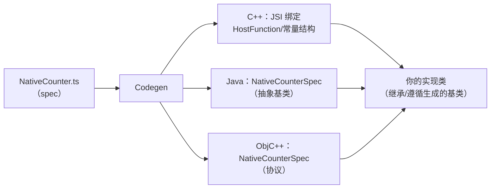

# Codegen

> 新架构里最没有"存在感"却最关键的一环：**把 TS/Flow 的接口定义编译成 C++ / Java / ObjC 的绑定代码**。JSI 提供同步通道，TurboModules/Fabric 提供系统结构，而把"JS 想要的接口"与"原生实现的代码"精确对齐的，是 Codegen。

## 1. 输入：一份 spec 文件

```ts
// NativeCounter.ts —— TurboModule 的 spec
import type { TurboModule } from 'react-native';
import { TurboModuleRegistry } from 'react-native';

export interface Spec extends TurboModule {
  increment(by: number): Promise<number>;
  getValue(): number; // 同步方法：JSI 直调
  readonly constants: { initial: number };
}

export default TurboModuleRegistry.getEnforcing<Spec>('Counter');
```

配套在 `package.json` 里声明让构建系统找到它：

```json
{ "codegenConfig": { "name": "AppSpecs", "type": "modules", "jsSrcsDir": "./specs" } }
```

规则要点（type: `modules` 对应 TurboModules，`components` 对应 Fabric 组件——模块十 03）：

- **只支持静态可推断的类型**：string/number/boolean、只读对象/数组、Promise、回调；不支持联合、泛型展开、函数属性等——**spec 是 IDL（接口描述语言），不是任意 TS**；
- 命名约定：文件必须 `Native*.ts`，导出的接口默认成为生成目标。

## 2. 输出：三份语言的绑定代码



生成的不是实现，而是**骨架与类型**：

- C++ 侧：参数/返回值的转换器（JS 值 ↔ C++ 类型）、方法分发表——手写最容易错的部分；
- Java/ObjC 侧：抽象基类/协议，**你只填业务方法体**；
- Fabric 组件（模块十 03）：额外生成 Props 结构体、事件类型与 ComponentDescriptor。

## 3. 构建链路：生成物挂在哪一步

| 平台 | 触发点 | 产物位置 |
|------|--------|---------|
| Android | gradle 插件（`react-native-gradle-plugin`）的 codegen 任务 | `build/generated/...`（参与 javac/编译） |
| iOS | `pod install` 阶段执行 codegen 脚本 | `build/generated/...`（进入 Pods 工程） |

两个工程含义：

1. **生成物不进版本库**（generated 目录被忽略），每次构建按 spec 重新生成——spec 是唯一事实源；
2. **升级 RN 可能改变生成物结构**（生成代码与运行时强耦合）——三方库"还没跟上新架构"通常卡在这里：不是 JS 写不了，而是它的 gradle/pod 链路还没适配 codegen 输入输出。

## 4. 为什么静态生成能换来安全与性能

对照模块四 04 的五要素，Codegen 改写的是**契约维度**：

| | Bridge 时代（运行时契约） | Codegen（构建期契约） |
|--|------------------------|----------------------|
| 方法定位 | moduleID/methodID 查表（约定） | 编译期绑定的函数指针/虚表 |
| 参数校验 | 原生侧手工判断（漏判即崩溃/静默） | 生成代码自动转换，类型错编译期暴露 |
| 常量 | 注册时注入快照 | 结构体直接内存布局，同步读 |
| 启动成本 | 注册表构建 | 零（懒实例化 + 已生成绑定） |

一句话：**把运行时才能发现的错误搬到编译期，把运行时才能完成的绑定搬到构建期**——这就是"为什么代码生成值得"的完整答案。

## 5. 常见坑位清单

1. **类型不支持**：spec 里写了联合类型/泛型 → codegen 阶段直接失败；报错会指到具体字段，按提示改成可表达的形式（多用精确的只读接口）；
2. **命名不匹配**：JS 端 `getEnforcing('Counter')` 与原生注册名必须一致，Codegen 生成的骨架以此为键；
3. **版本错配**：库的 codegen 输出与 App 的 RN 版本生成器不一致——升级 RN 后三方库报"找不到符号/协议"多半是这个；
4. **忘了声明 codegenConfig**：spec 静静地不被生成，运行时 `getEnforcing` 抛"模块不存在"——先查构建输入，再查实现。

## 小结

- Codegen 是 IDL 编译器：TS spec 进，C++/Java/ObjC 绑定骨架出，实现类只填业务；
- 生成物在构建期产生、不进版本库，spec 是唯一契约源——升级生态时"codegen 对齐"是三方库的核心成本；
- 它的价值 = 错误前移（运行时→编译期）+ 绑定前移（运行时→构建期）；
- 想上手：模块十 02 用一个埋点模块从 spec 走到双平台实现，全程可复现。
