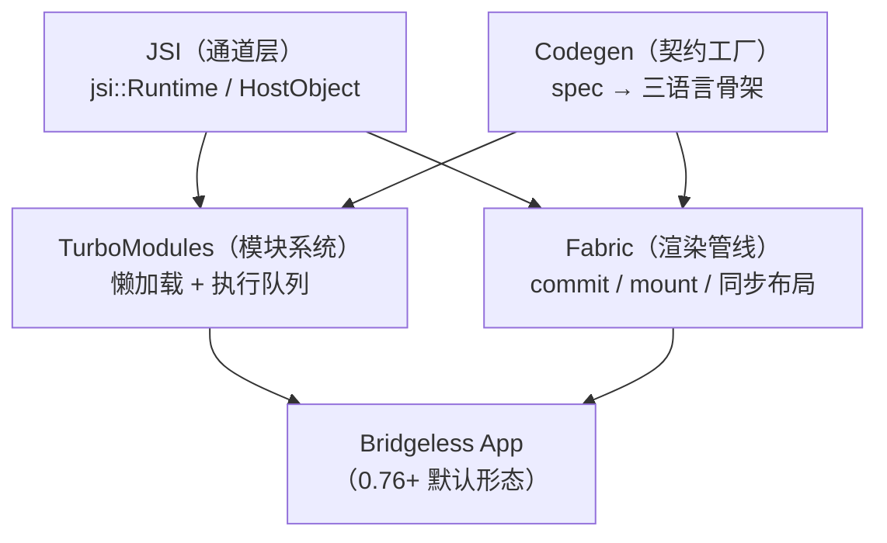
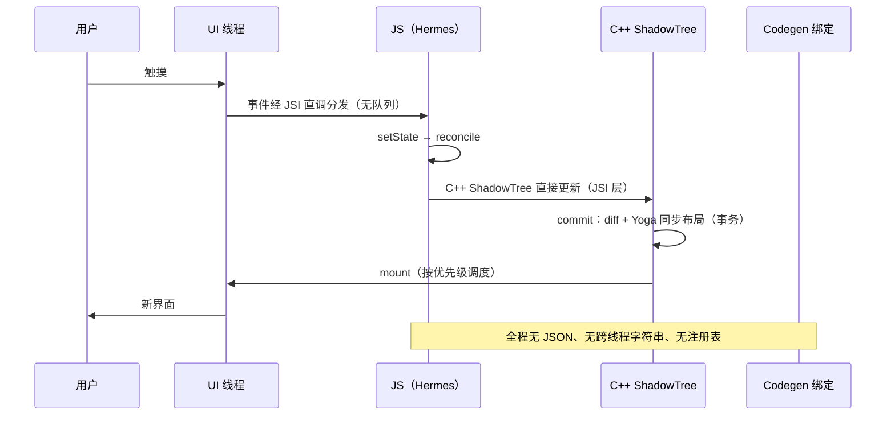

# 新旧架构对比与迁移

> 模块七收官：把 JSI、Fabric、TurboModules、Codegen 四件套放回一张对照表，复盘 0.76 bridgeless 下的完整数据流，最后给一条可执行的迁移路线。本篇也是全站的"汇合点"——前六个模块的问题在这里逐条销账。

## 1. 六维总对照

| 维度 | 旧架构（Bridge 时代） | 新架构（0.76 默认） | 问题销账 |
|------|---------------------|--------------------|---------|
| 通道 | MessageQueue：异步、批量、JSON | JSI：同步直调、对象引用 | 模块四 01 三条死穴 |
| 模块 | 启动全量注册、运行时编号 | TurboModules：懒加载、静态契约 | 模块二启动、模块四 02 |
| 渲染 | 影子树 + 异步布局 + 帧批挂载 | Fabric：C++ ShadowTree、commit/mount、同步布局 | 模块五 03 |
| 事件 | 全量过桥给 JS | 原生优先（RNGH/worklet），JSI 事件直调 | 模块六 |
| 并发 | 批处理不可中断 | lane 优先级、并发 root，React 18/19 特性可用 | 模块一 03 |
| 工具链 | 手写绑定、Flipper | Codegen 生成、RN DevTools（CDP 直连） | 模块四 02、模块十 04 |

### 1.1 逐维展开：每一行背后的"为什么"

六行表格每一行都能还原成一段完整论证，链接到本模块对应篇目：

1. **通道**：旧架构把"跨语言通信"实现成"跨线程消息"，异步/JSON/批量三个属性互相绑定；JSI 证明这三件事可以拆开——同步与引用传递是可能的，异步只在"确实要等"时才付（[01 · JSI 原理](01-JSI原理.md)、[模块四 04 · 跨语言通信的通用设计](../rn-Bridge通信原理/04-跨语言通信的通用设计.md)）。
2. **模块**：全量注册是为了给消息队列建编号表——通道一换，注册的存在理由就没了；懒加载 + Codegen 把成本从"所有人每次启动"搬到"使用者的首次访问"（[03 · TurboModules](03-TurboModules.md)）。
3. **渲染**：影子树从平台对象搬进 C++，换来不可变树与同步布局；挂载从"批量窗口"变"差异事务"——结构同名，语义全变（[02 · Fabric 渲染管线](02-Fabric渲染管线.md)）。
4. **事件**：旧架构一切事件必须过桥给 JS 处理，滚动与手势天然吃亏；新架构允许原生侧闭环 + 事件优先级通道（[模块六 01](../rn-事件系统原理/01-触摸事件链路与手势仲裁.md)、[02](../rn-事件系统原理/02-GestureHandler原理化.md)）。
5. **并发**：批量窗口里没有"插队"概念；lane 模型贯通到 commit/mount 后，React 18/19 的并发特性才在 RN 有落点（02 篇 4.4）。
6. **工具链**：绑定从手写变成生成物，调试从"桥上抓包"（Flipper）变成"协议直连"（RN DevTools/CDP）——工具跟随通道形态演进（[模块十 04 · 调试工具链原理](../rn-原理实战/04-调试工具链原理.md)）。

### 1.2 线程形态的对照

通道变化连带线程模型的改组（全景见[模块三 02 · 四线程模型](../rn-JS引擎与线程模型/02-四线程模型.md)）：

| 线程职责 | 旧架构 | 新架构（bridgeless） |
|---------|--------|--------------------|
| JS 执行 | JS 线程 | JS 线程（不变） |
| 模块方法执行 | 专用 NativeModules 线程（mqt） | 模块自配 executor/queue（03 篇 2.3） |
| 布局 | Shadow 线程（异步批次） | commit 调用栈内同步（02 篇 3.3） |
| 挂载 | UI 线程批量窗口 | UI 线程按事务（02 篇 4.1） |

注意"线程数变少"不是目标，"职责按需分配"才是：固定线程让位给可配置队列，隐藏在 shadow 线程里的布局成本显性化为 JS 线程可观测的 commit 段——**成本没有消失，但从暗处挪到了可打点的明处**。

### 1.3 内存形态的对照

| 对象 | 旧架构 | 新架构 |
|------|--------|--------|
| 影子节点 | 平台对象（Java/OC），就地改写 | C++ 不可变节点，版本链共享（02 篇 2） |
| 模块实例 | 启动全量创建并常驻 | 按需创建，LongLivedObject 持有（03 篇 1.3） |
| 通信缓冲 | 每批消息的 JSON 字符串 | 无常驻缓冲（调用栈上的 jsi::Value） |
| 跨界数据 | 序列化副本（两侧各一份） | 引用共享 + 按需转换（01 篇 4.2） |

两张表合起来读：新架构用"不可变 + 引用共享"换掉了"副本 + 暗线程"，内存行为更可预测，代价是克隆与转换成本显性化——这正是模块九性能方法论在新架构下依然完全适用的原因。

### 1.4 四件套的一张收束图

把六维对照压回四件套的结构关系，作为本模块的"总视图"：

读图三句话：JSI 是**被依赖的地基**（01 篇）；Codegen 是**横切的工厂**，同时喂模块与渲染两套骨架（04 篇）；TurboModules 与 Fabric 是**平行的两栋楼**——管非 UI 能力与管 UI，互不包含（03 篇第 8 节）。对照旧架构"一座 Bridge 大桥挑所有担子"，新架构是分工明确的立交系统：每件套都能单独讲清楚职责边界，也能单独演进。

## 2. Bridgeless 数据流复盘（0.76 默认形态）

以"点击按钮 → 状态更新 → 界面变化"走一遍无 Bridge 的全链路：

对照模块二 01 的旧启动链与模块三 02 的跨线程时序：**结构没变（事件→JS→影子→挂载），变的是每一段的"通道性质"**——队列换成函数表，JSON 换成引用，固定批次换成优先级事务。

### 2.1 逐步表：每个环节的"通道性质"

| 步 | 环节 | 旧架构同一时刻 | 通道性质的变化 |
|----|------|---------------|---------------|
| 1 | 触摸事件进系统 | 相同 | — |
| 2 | 事件送达 JS | 入 NativeQueue → 批量过桥 → JSQueue | JSI 直调，无队列、无 JSON |
| 3 | setState/reconcile | 相同（React 层无新旧之分） | — |
| 4 | 提交影子树 | 组装 createView 消息等待批量窗口 | JSI 同步 commit（C++ 调用栈） |
| 5 | 布局 | Shadow 线程下个批次 | commit 栈内同步（02 篇 3） |
| 6 | 挂载 | UI 线程消费消息批 | MountingTransaction 事务直投 |
| 7 | 上屏 | 相同 | — |

第 3 步值得单独强调：**React 本体在新旧架构下是同一套**——这也是"新架构是换底层不是换写法"的技术根据。业务组件代码几乎不动，动的是组件代码脚下的地板。

这张表也是"排查新旧架构差异类问题"的地图：现象落在第 2 步（事件丢失/延迟）查事件通道，落在 4–5 步（渲染时序/measure）查 commit，落在第 6 步（视图状态）查 mount 事务——**先定步，再进对应篇目的机制细节**（02/03 篇），不要一上来就翻 C++ 源码。

### 2.2 没有队列之后的"批处理"去哪了

旧架构的批量窗口有其合理性：把高频操作合并、摊薄跨线程成本。Bridgeless 不是丢弃批处理，而是把它**按语义重新安放**：

- **JS 侧**：React 自身的批处理（一次事件里的多次 setState 合并一次 render）照旧；
- **渲染侧**：commit 天然按"一次 React 提交"成批，MountingTransaction 把一批视图差异原子应用；
- **事件侧**：离散/连续两条通道（02 篇 4.3）承担"合并风暴"的职责。

差异在粒度与所有权：旧架构的批是**传输层全局批**（不区分内容），新架构的批是**语义层局部批**（render 批、事务批、事件通道各管各的）——合并发生在"懂内容的地方"，而不是"搬内容的地方"。

### 2.3 对照复盘：一次模块调用的两种世界

渲染之外，再拿"JS 调原生埋点模块"做同题对照（模块四 02 的完整旧链路）：

| 环节 | 旧架构（NativeModules） | 新架构（TurboModule） |
|------|------------------------|----------------------|
| JS 侧入口 | `NativeModules.Analytics.log()`（代理对象） | `NativeAnalytics.log()`（spec 导入） |
| 调用形态 | 构造消息入 JSQueue，返回 undefined | JSI 直调，同步返回或 Promise |
| 跨界数据 | 参数 JSON 序列化 | jsi::Value 按类型转换（03 篇 4.4） |
| 原生侧分发 | NativeQueue 批量取出 → moduleID/methodID 查表执行 | 生成绑定直呼实现方法 |
| 结果回传 | 回调再走一遍反向消息 | Promise 经 CallInvoker 回 JS 线程 |
| 启动前置 | 模块须已在注册表（全量） | 首次访问才实例化（懒加载） |

读表的方法：左列每个环节都是"为通道付的税"，右列不是"更快的税"，而是**税基被取消**——这就是"量级差异"的来源，也是为什么收益集中在高频调用场景（税随次数累积）。

### 2.4 版本地形速览：从 opt-in 到默认

复盘完数据流，迁移讨论还差一块前置拼图——版本地形。关键里程碑如下（详细的工程应对在 06 篇第 1 节）：

| 时点 | 里程碑 | 对团队的含义 |
|------|--------|-------------|
| 0.68 | 新架构首次开放 opt-in 试用 | 早期实验场：跑 demo、评估可行性 |
| 0.76 之前 | 需手动开启（开关默认关） | 双架构并行验证的最佳窗口 |
| 0.76 | 新架构（含 bridgeless）成为默认 | "不迁"的成本开始上升 |
| 0.80 | 旧架构冻结（只修关键问题） | 旧架构不再有新功能 |
| 0.82 起 | 新架构唯一，关闭开关被忽略 | 迁移从选择题变必答题 |
| 0.83 起 | 旧架构 API 分批移除 | 依赖旧内部 API 的库开始真正破碎 |

时间轴的读法不是"恐慌倒计时"，而是**风险定价**：越晚迁移，可用的官方支持与社区测试越少，回退空间越小（06 篇 6 节的护栏策略即由此展开）。

## 3. 迁移路线：四步走

**① 依赖盘点**：列出全部原生依赖，按"新架构原生支持 / 走 Interop / 需替换"三档分类（模块一 04 的健康度 checklist 直接复用）。任何"需替换"项都要先找到替代库或计划自研——这是唯一可能改变排期的一步。

**② 开启与兜底**：`gradle.properties` 的 `newArchEnabled=true` / Podfile `RCT_NEW_ARCH_ENABLED=1`，构建跑通后大部分旧模块经 Interop 层工作（模块七 03）。此阶段验收标准：**功能全通、性能不劣化**，而不是性能收益——兜底通道本来就有折损。

**③ 逐模块真迁移**：优先高频/启动路径模块（模块二 04、模块四 03 找出的热点），按模块十 02 流程写 spec → Codegen → 双平台实现。常踩的坑：

- 旧模块方法在 JS 里被同步调用过（靠时序巧合）——真迁移后仍是 Promise，语义要理顺（模块三 04）；
- 常量从注入快照变 `getConstants()` 同步读，个别库在模块未初始化时读常量会空——补懒初始化；
- 事件回传从"Bridge 事件"变 EventEmitter，listener 注册时机敏感的代码要复核。

**④ Fabric 组件与收尾**：自定义原生组件按模块十 03 迁移（ComponentDescriptor 注册）；最后关掉旧架构开关（0.76+ 已默认 bridgeless），清掉 Interop 依赖里的"可真迁移"项。

### 3.1 每一步的验收清单

| 步骤 | 必须通过 | 建议通过 |
|------|---------|---------|
| ① 盘点 | 三档清单落表；"需替换"项有方案与排期 | 盘点结果进代码仓库（不止 wiki） |
| ② 开启兜底 | 全功能回归通过；崩溃率不升；关键路径性能不劣化 | 双架构构建都留档（0.81 前可对照） |
| ③ 逐模块迁移 | 每模块：spec 双端实现 + 调用点改造 + 该模块回归 | 双跑对照（新旧实现输出比对） |
| ④ 收尾 | Interop 债务清单清零或显性化；旧架构开关相关配置清理 | 性能收益复盘（对照第 4 节预期表） |

验收纪律的一条总则：**每一步的验收对象都是"可观测指标"，不是"看起来能用"**——崩溃率、关键漏斗、启动分位数（模块九 04/05 的监控先于迁移铺好）。

### 3.2 迁移的并行度建议

四步是逻辑顺序，不必严格串行：

- ①→② 必须串行（没盘点就开开关等于盲飞）；
- ② 通过后，③④ 可按模块并行推进——每个模块独立走"spec → 实现 → 调用点 → 回归"小闭环；
- 团队分工按模块切（模块团队自治），比按"先全部 Android 后全部 iOS"的横向切法风险小——纵向闭环让每个模块始终有可用版本。

### 3.3 模块迁移的优先级怎么排

③"逐模块真迁移"的第一问是"先迁谁"。打分表（模块二 04 与模块四 03 的热点数据直接填进来）：

| 维度 | 高优先信号 | 数据来源 |
|------|-----------|---------|
| 调用频次 | 高频调用（埋点、存储、配置读取） | 调用埋点/trace 统计 |
| 启动路径 | 在首屏前被调用的模块 | 启动 trace（模块二 04） |
| 数据形态 | 大对象/高频字符串（interop 折损放大） | 03 篇 4.4 的成本模型 |
| 事件依赖 | 事件回传敏感（interop 事件桥接时序更敏感） | 06 篇 4.3 的行为期问题 |
| 业务风险 | 低（有充分回归覆盖）优先做，练手建立流程 | 测试覆盖 |

排序公式不必精细：**"高频 × 启动路径"的交集先做，"低频 × 高风险"的最后做**。第一个迁移的模块建议选"高频但业务简单"的（如埋点）——用最小风险把 spec → codegen → 双端实现 → 调用点改造的全流程走通，形成团队模板，后续模块按模板复制。

### 3.4 回退与灰度：每一步都要有保险

迁移路线能走稳，靠的是每步都有退路：

| 阶段 | 保险机制 | 说明 |
|------|---------|------|
| ② 开启兜底后 | 双架构构建对照（0.81 前） | 同一提交新旧架构各出一包，冒烟对照 |
| ③ 模块真迁移 | 新旧实现双跑 | 同一调用点同时打新旧两路，输出对照（06 篇 5 节） |
| 全程 | 按通道灰度 | 发布分批次放量，盯崩溃与漏斗（模块八 05 的 OTA 灰度设施直接复用） |
| 兜底底线 | 版本回退 | 0.81 及以前可关回旧架构——是保险丝不是家（0.82 起失效） |

设计原则：**任何一步失败都能停在"上一个已知良好状态"**，而不是"从头再来"。这也是 06 篇"变量隔离"（升 RN、升库、开开关分三个 PR）的哲学来源。

## 4. 性能预期管理

新架构不是"普遍提速开关"，收益集中在特定形态：

| 场景 | 预期 | 原因 |
|------|------|------|
| 启动 | 提升 | 懒加载模块 + Codegen 零注册成本 |
| 高频交互（手势/动画配合 worklet） | 显著提升 | 闭环不过 JS（模块六 02） |
| 长列表 | 中等 | 渲染管线更优，但 renderItem 本身成本仍在（模块九 02） |
| 普通页面跳转 | 变化不大 | 本来就不是 Bridge 瓶颈 |

**先归因（模块九 01），后迁移**——如果瓶颈是 JS 线程的长任务或列表设计，换架构救不了。

### 4.1 预期表的三个读法

1. **按瓶颈位置读**：表右列说明收益来源——收益出现在"旧架构通道成本占比高"的场景。通道成本占比低的地方（普通跳转），换通道自然感知不大；
2. **按指标读**：启动看 TTI 分段（模块二 04），交互看掉帧率与响应延迟（模块九 05），别用"感觉"验收；
3. **按时间读**：迁移期（Interop 兜底）性能可能**持平或略降**——这是预期内的事，收益在真迁移完成后逐块兑现。把迁移期当收益期来考核，会逼出"草率关停兜底"的错误动作。

### 4.2 用什么指标验收收益

预期表要落成指标才有意义：

| 场景 | 验收指标 | 采集方式 |
|------|---------|---------|
| 启动 | TTI 分位数（P50/P90） | ReactMarker / RCTPerformanceLogger 打点（模块二 04） |
| 高频交互 | 掉帧率、交互响应延迟 | Perfetto/systrace + 帧回调采样（模块九 05） |
| 长列表 | 滚动帧稳定性、内存水位 | 滚动场景 trace + 内存曲线（模块九 02/04） |
| 崩溃/稳定性 | 崩溃率、JS 错误率 | 常规监控（迁移护栏，06 篇 6 节） |

两条纪律：**release 模式采数**（dev 的数字没有可比性）；**先立基线再迁移**（没有基线的"变快了"是玄学）。

### 4.3 三个常见误区

| 误区 | 事实 |
|------|------|
| "上了新架构就不用做性能优化" | 模块九全部处方（列表、渲染、内存）在新架构下依然必要——管线更优不等于业务免费 |
| "Interop 只是临时贴纸，随时可撕" | 官方口径为可预见的未来保留（06 篇 1 节）；长尾模块靠它长期活着是合法终态 |
| "迁移必须一次全迁" | 三种形态按模块共存的混跑是设计内的常态（03 篇 2.4 的三岔口） |
| "同步方法越多越好" | 同步占用 JS 线程栈，滥用等于亲手制造卡顿——形态按"等不等"选（03 篇 4 节） |
| "新架构只影响原生团队" | spec 是 TS、调用点改造是 JS——前端同学同样是迁移的主力工种之一 |

## 5. 常见问题 FAQ

以下问题按"决策 → 机制 → 工程"排列，覆盖迁移讨论中最常被问到的十个问题；更细的故障排查见 06 篇第 4 节的问题四分类。

**Q1：新架构下我的业务 JS 代码要改吗？**
绝大多数纯 JS 业务代码零改动。需要动的三类：直接 import `NativeModules` 的调用点（改为 import spec）、依赖旧架构内部行为的 hack 代码、少数事件注册时序敏感的代码（06 篇 4.3）。

**Q0：先把术语对齐——"新架构"与"bridgeless"是一回事吗？**
不是。新架构 = JSI + Fabric + TurboModules + Codegen 的整体；bridgeless 特指"不再有 Bridge 消息层的运行形态"。0.76 起新架构默认开启且默认以 bridgeless 运行，两者在日常语境里几乎同现，但概念上：**新架构是零件清单，bridgeless 是组装结果**——理论上存在"新架构零件 + 旧桥兼容层"的过渡形态（迁移期的 Interop 正是为此存在）。

**Q2：bridgeless 后还有"线程切换"吗？**
有。JS 线程、UI 线程、模块队列依旧存在，跨线程调度依旧要 CallInvoker 一类机制——消掉的是"跨语言消息层"，不是线程本身（01 篇 4.1）。

**Q3：旧的三方库会不会直接崩？**
标准公开 API 写的旧模块经 Interop 包装可跑（异步语义不变）；操纵桥内部的会硬阻塞（06 篇 3.2 三档分类）。所以第一件事永远是盘点，不是升级。

**Q4：同步方法多了会不会反而卡？**
会，如果滥用的话。同步 = 占用 JS 线程栈，重活必须走 Promise/事件（03 篇 4 节的形态边界）。新架构给的是同步的**能力**，不是同步的**义务**。

**Q5：Fabric 下我的自定义组件必须重写吗？**
组件 Interop 能让多数纯展示组件先跑起来（06 篇 2.2），但要吃到同步布局、新 props 语义、并发保证，需要按 ComponentDescriptor 体系真迁移（模块十 03）。

**Q6：测试策略要变吗？**
单测/组件测试基本不变（[模块十一 01](../rn-测试体系/01-Jest单元测试与组件测试原理.md)）；E2E 在迁移期价值放大——形态混跑期的回归靠人肉过不完，关键路径自动化（[模块十一 02](../rn-测试体系/02-端到端测试与选型.md)）是迁移的安全网。

**Q7：新架构对包体有什么影响？**
方向上是中性偏正：C++ 渲染器/模块系统的加入带来原生体积变化，同时 Hermes 字节码、按需初始化等配套在启动侧有正贡献。结论随版本与依赖构成变化，用包体分析（模块八 04）以自己的 App 实测为准，不引用他人数字。

**Q8：混合开发（原生壳 + RN 页面）的宿主要改吗？**
要改：宿主创建 RN 环境的 API 从 ReactInstanceManager/RCTBridge 家族切到 ReactHost/RCTHost 家族（模块二 01/02 的新架构差异段）；业务页面层不动。集成模式与生命周期结论（[模块十二 01 · 原生工程集成与生命周期](../rn-混合开发/01-原生工程集成与生命周期.md)）在新架构下依然成立，换的是创建环境的入口 API。

**Q9：迁移期间能正常发版吗？**
能，而且应该正常发——这正是 Interop 兜底的设计意图：先让 App 整体跑在新架构上，再按模块还债。把迁移做成"长期分支憋大招"反而是最大忌讳（合并地狱 + 无法归因）。

**Q10：新架构下还需要 InteractionManager 吗？**
交互协调的需求仍在，但形态在变：lane 优先级接管了"渲染谁先谁后"的一部分职责，worklet/RNGH 接管了"手势不被 JS 阻塞"的一部分。老的 `InteractionManager.runAfterInteractions` 模式（模块三 04）仍是"把非关键初始化挪出启动/交互动线"的实用手段——按需求选工具，不按架构站队。

## 6. 回到全站地图

- 模块一给了"为什么要有新架构"的问题清单 → 本篇表格逐条销账；
- 模块二~六 每一篇的"旧架构短板"小结 → 都能在 05 的数据流复盘里找到对应改法；
- 模块八、九、十 不分新旧架构：Metro、性能方法论、实战流程在新架构下同样成立——**原理层知识比架构更耐久**；
- 06 篇（[迁移工程实践](06-迁移工程实践.md)）承接本篇的"下一步"：Interop 机制细节、依赖排查流程、问题四分类与真迁移检查单。

一张"问题 → 销账处"的索引表：

| 旧架构的问题（出处） | 本模块销账处 |
|--------------------|--------------|
| Bridge 三死穴（模块四 01） | 01 篇：JSI 同步直调 |
| 启动全量注册（模块二 01） | 03 篇：懒加载 + 04 篇：零注册成本 |
| 布局异步/首帧抖动（模块五 03） | 02 篇：同步布局 |
| 事件无优先级、滚动吃亏（模块六） | 02 篇 4.3/4.4：事件通道与 lane |
| 并发特性不可用（模块一 03） | 02 篇 4.4：优先级闭环 |
| 手写绑定难维护（模块四 02） | 04 篇：Codegen |

再补一张"知识耐久度"分层表——迁移完成后哪些学过的东西继续有效：

| 知识层 | 耐久度 | 原因 |
|--------|--------|------|
| Metro/打包/热更新（模块八） | 高 | 与架构无关的构建层 |
| 性能方法论（模块九） | 高 | 分段归因、打点、防回归是通用工程方法 |
| React 本体（组件、hooks、状态） | 高 | 新旧架构同一套 React |
| 三棵树/布局/事件的心智模型（模块五/六） | 中高 | 结构不变，通道细节换 |
| 模块系统与渲染管线细节（模块四/七） | 架构相关 | 旧架构细节逐步失效，但"对照学习"价值长期存在（理解设计为什么这样变） |

所以本站的读法从来不是"旧架构篇过时了"：**旧架构是理解新架构为什么这样设计的最短路径**——每一条新设计都能在旧架构的账单上找到动机。

## 小结

- 六维对照表是新旧架构的最短总结：通道、模块、渲染、事件、并发、工具链各换了什么、销了哪笔账；
- Bridgeless 全链路的本质变化是**通道性质**：队列→函数表、JSON→引用、批次→优先级事务；
- 迁移四步：盘点 → Interop 兜底跑通 → 热点模块真迁移 → 组件收尾；性能收益集中在启动与高频交互，先归因后迁移；
- 至此模块七完结：JSI 是通道、TurboModules 是模块系统、Fabric 是渲染管线、Codegen 是契约——四件套缺一不可；
- 迁移工程化的一圈（Interop 机制细节、依赖排查流程、问题四分类、真迁移检查单）在 06 篇继续下钻；
- 收益验收永远对着指标：TTI 分位数、掉帧率、崩溃率——没有基线的迁移是玄学工程。

## 自测

做题前先合上正文——本篇的每道题都能在前文找到"表 + 段落"两级答案。

1. 六维对照中每一维的"旧形态"分别对应哪个模块的哪篇？试着不看书复述销账关系。
2. "结构没变，通道性质变了"——用点击→渲染的八步表指出哪些步没变、哪些步换了通道。
3. 旧架构的批量窗口解决了什么问题？Bridgeless 用什么机制补上这个职责？
4. 迁移四步中哪一步可能改变排期？为什么？每一步的验收标准分别是什么量？
5. 为什么"迁移期性能持平或略降"是预期内的？把它当收益期考核会诱发什么错误动作？
6. 线程与内存两张对照表里，哪一项成本是"从暗处挪到明处"？这对性能优化工作流意味着什么？
7. 给一个假想 App 排迁移优先级：埋点（高频、简单）、蓝牙（低频、事件多）、支付（低频、高风险）——顺序是什么，理由？
8. "知识耐久度分层"里为什么说旧架构篇没有过时？用"设计动机"复述一条新架构决策。
