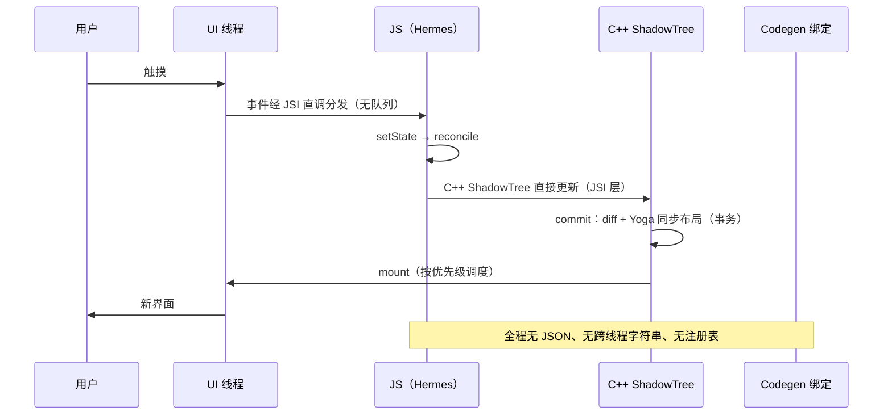

# 新旧架构对比与迁移

> 模块七收官：把 JSI、Fabric、TurboModules、Codegen 四件套放回一张对照表，复盘 0.76 bridgeless 下的完整数据流，最后给一条可执行的迁移路线。本篇也是全站的"汇合点"——前六个模块的问题在这里逐条销账。

## 1. 六维总对照

| 维度 | 旧架构（Bridge 时代） | 新架构（0.76 默认） | 问题销账 |
|------|---------------------|--------------------|---------|
| 通道 | MessageQueue：异步、批量、JSON | JSI：同步直调、对象引用 | 模块四 01 三条死穴 |
| 模块 | 启动全量注册、运行时编号 | TurboModules：懒加载、静态契约 | 模块二启动、模块四 02 |
| 渲染 | 影子树 + 异步布局 + 帧批挂载 | Fabric：C++ ShadowTree、commit/mount、同步布局 | 模块五 03 |
| 事件 | 全量过桥给 JS | 原生优先（RNGH/worklet），JSI 事件直调 | 模块六 |
| 并发 | 批处理不可中断 | lane 优先级、并发 root，React 18/19 特性可用 | 模块一 03 |
| 工具链 | 手写绑定、Flipper | Codegen 生成、RN DevTools（CDP 直连） | 模块四 02、模块十 04 |

## 2. Bridgeless 数据流复盘（0.76 默认形态）

以"点击按钮 → 状态更新 → 界面变化"走一遍无 Bridge 的全链路：

对照模块二 01 的旧启动链与模块三 02 的跨线程时序：**结构没变（事件→JS→影子→挂载），变的是每一段的"通道性质"**——队列换成函数表，JSON 换成引用，固定批次换成优先级事务。

## 3. 迁移路线：四步走

**① 依赖盘点**：列出全部原生依赖，按"新架构原生支持 / 走 Interop / 需替换"三档分类（模块一 04 的健康度 checklist 直接复用）。任何"需替换"项都要先找到替代库或计划自研——这是唯一可能改变排期的一步。

**② 开启与兜底**：`gradle.properties` 的 `newArchEnabled=true` / Podfile `RCT_NEW_ARCH_ENABLED=1`，构建跑通后大部分旧模块经 Interop 层工作（模块七 03）。此阶段验收标准：**功能全通、性能不劣化**，而不是性能收益——兜底通道本来就有折损。

**③ 逐模块真迁移**：优先高频/启动路径模块（模块二 04、模块四 03 找出的热点），按模块十 02 流程写 spec → Codegen → 双平台实现。常踩的坑：

- 旧模块方法在 JS 里被同步调用过（靠时序巧合）——真迁移后仍是 Promise，语义要理顺（模块三 04）；
- 常量从注入快照变 `getConstants()` 同步读，个别库在模块未初始化时读常量会空——补懒初始化；
- 事件回传从"Bridge 事件"变 EventEmitter，listener 注册时机敏感的代码要复核。

**④ Fabric 组件与收尾**：自定义原生组件按模块十 03 迁移（ComponentDescriptor 注册）；最后关掉旧架构开关（0.76+ 已默认 bridgeless），清掉 Interop 依赖里的"可真迁移"项。

## 4. 性能预期管理

新架构不是"普遍提速开关"，收益集中在特定形态：

| 场景 | 预期 | 原因 |
|------|------|------|
| 启动 | 提升 | 懒加载模块 + Codegen 零注册成本 |
| 高频交互（手势/动画配合 worklet） | 显著提升 | 闭环不过 JS（模块六 02） |
| 长列表 | 中等 | 渲染管线更优，但 renderItem 本身成本仍在（模块九 02） |
| 普通页面跳转 | 变化不大 | 本来就不是 Bridge 瓶颈 |

**先归因（模块九 01），后迁移**——如果瓶颈是 JS 线程的长任务或列表设计，换架构救不了。

## 5. 回到全站地图

- 模块一给了"为什么要有新架构"的问题清单 → 本篇表格逐条销账；
- 模块二~六 每一篇的"旧架构短板"小结 → 都能在 05 的数据流复盘里找到对应改法；
- 模块八、九、十 不分新旧架构：Metro、性能方法论、实战流程在新架构下同样成立——**原理层知识比架构更耐久**。

## 小结

- 六维对照表是新旧架构的最短总结：通道、模块、渲染、事件、并发、工具链各换了什么、销了哪笔账；
- Bridgeless 全链路的本质变化是**通道性质**：队列→函数表、JSON→引用、批次→优先级事务；
- 迁移四步：盘点 → Interop 兜底跑通 → 热点模块真迁移 → 组件收尾；性能收益集中在启动与高频交互，先归因后迁移；
- 至此模块七完结：JSI 是通道、TurboModules 是模块系统、Fabric 是渲染管线、Codegen 是契约——四件套缺一不可。
