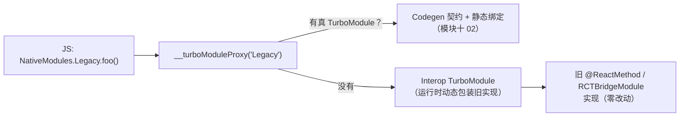
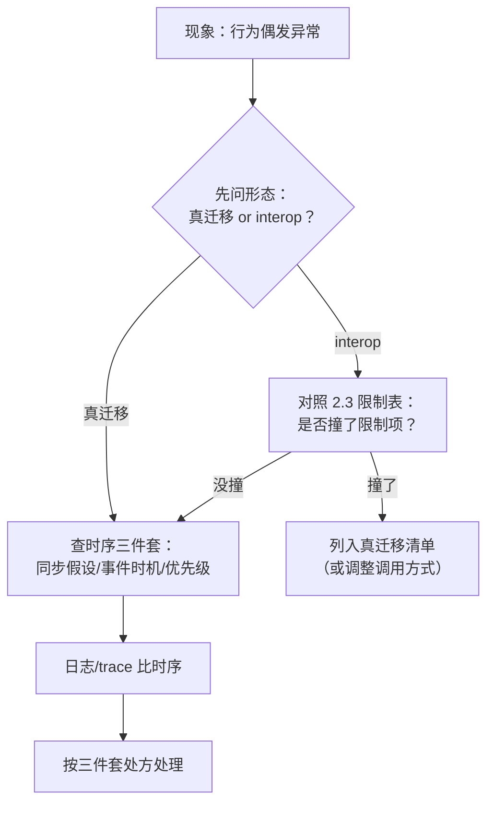

# 新架构迁移工程实践（Interop / 兼容性排查 / 常见问题）

> 05 篇给了原理级路线（盘点 → 开启兜底 → 真迁移 → 收尾）。本篇下钻到工程层：**Interop 层到底怎么工作、限制在哪**，第三方库兼容性怎么**系统性地**排查而不是撞一个查一个，以及把常见问题按"构建期/启动期/行为期/性能期"分类给处理思路。版本事实先行：新架构 0.76 起默认、0.82 起**唯一**（`newArchEnabled=false` 被忽略，旧架构代码自 0.83 起分批移除）——迁移已经不是"要不要"的选择题，而是"赶在自己被迫升级前做完"的工程题。

本篇五节的阅读地图（不同角色按需进入）：

| 你的处境 | 直达 |
|---------|------|
| 还没开始，想知道窗口多长 | 第 1 节 |
| 开关已打开，模块行为怪异 | 第 2 节 + 第 4 节 |
| 要产出迁移排期 | 第 3 节 + 05 篇 3.3 |
| 正在做某个模块的真迁移 | 第 5 节 |
| 管理迁移风险（发布/回退） | 第 6 节 |

## 1. 版本地形：你的迁移窗口有多长

| 版本 | 对迁移的含义 |
|------|-------------|
| ≤ 0.75 | 新架构需手动开启（`newArchEnabled=true` / `RCT_NEW_ARCH_ENABLED=1`），是**实验场**：双架构并行验证的最佳时期 |
| 0.76–0.81 | 新架构默认（bridgeless 也是默认），仍可显式关回旧架构——**迁移主窗口**：借着可回退的保险做真迁移 |
| 0.80 | 旧架构冻结（只修关键 bug） |
| 0.82+ | 唯一新架构：`newArchEnabled=false` 与 `RCT_NEW_ARCH_ENABLED=0` **被忽略**；旧架构 API 的移除从 0.83 起分批进行 |
| — | Interop 层官方口径：**为可预见的未来保留**（大量存量库靠它活着） |

工程结论：在 0.81 这条线上，"再等等"的空间已经用完；但仍有一个重要缓冲——**interop 兜底让你可以先跑起来、再慢慢还债**。这也是本篇的主线：先把兜底跑通（第 2 节），再排查真正的阻塞（第 3 节），再按优先级真迁移（第 5 节）。

### 1.1 时间轴视角：窗口在收窄


读这张图的正确姿势不是焦虑，而是**倒排工期**：

- 主窗口期内能完成"开启兜底 + 核心模块真迁移"，就已经拿到大部分收益；
- 窗口关闭（0.82+）后被迫做的事一样多，但少了回退保险与双架构对照能力——**同样工作量，风险更高**；
- 0.83 起的 API 移除意味着 interop 债务不是无限期债——依赖旧内部 API 的库会在某个版本点直接断裂，债务清单要有"到期日"意识（第 6 节护栏 3）。

### 1.2 三种团队画像与起步动作

| 画像 | 特征 | 起步动作 |
|------|------|---------|
| 新 App / 小依赖 | 依赖少、无历史包袱 | 直接最新版 + 全新架构起步，本篇只需读 2/5 节建立机制认知 |
| 成熟 App、依赖健康 | 大量依赖但主流库居多 | 盘点（3 节）→ 升级支持版本线 → 开开关 → 小步真迁移 |
| 成熟 App、依赖复杂 | 自研模块多 + 老旧三方库多 | 盘点重点找"硬阻塞"档；排期从替换/自研方案开始倒推 |

画像三的提醒：硬阻塞项的替换方案（换库/自研）经常是**整个迁移计划的关键路径**——它不走完，其他模块迁得再快也开不了开关。这也是 3.2 节强调"硬阻塞是唯一会改排期的档"的原因。

## 2. Interop 层：工作机制与限制清单

05 篇把 interop 定位成"旧模块的兜底通道"，这里把它拆开讲清楚——**因为你排查问题时，必须知道手上的模块此刻是不是在走 interop**。

### 2.1 模块侧：动态包装



工作机制要点：

- 查找顺序是**真的优先**：同名模块有 Codegen spec 走真 TurboModule，没有才落到 interop 包装；
- interop 包装是**运行时动态的**：没有 Codegen 契约，方法表在首次访问时从旧实现反射/收集而来——这正是它"零改动"的代价；
- 参数与回调经由 JSI 收集/回传，**不再走旧的 JSON 消息队列**——通道换了，但模块的**异步语义没换**（旧实现本来就没有同步形态，模块三 04 的边界不是包装层能改写的）。

把"动态包装"再拆细一层，理解它为什么享受不到静态契约的收益：

| 环节 | 真 TurboModule | Interop 包装 |
|------|---------------|--------------|
| 方法签名 | 构建期由 spec 生成 | 首次访问时从旧实现收集 |
| 参数类型 | 生成代码静态转换 | 运行时按旧约定试探转换 |
| 错误暴露 | 编译期 | 运行期（类型错可能静默/晚爆） |
| 常量 | 结构体同步读 | 走旧模块的常量注入路径 |

一句话：interop 把**通道**升级了（JSON 队列 → JSI），把**契约**留在了旧世界（运行时约定）——所以它是"能跑"，不是"变好"。

### 2.2 组件侧：旧 ViewManager 挂进 Fabric

旧的原生组件（ViewManager/`RCTViewManager` 形态）由组件 interop 层包装成 Fabric 可挂载的形态。要点与限制：

- **能挂载、能更新 props**：大多数纯展示组件零改动可用；
- **限制在"新能力"上**：同步测量、同步布局访问、Fabric 的部分新 props/事件语义、并发特性下的某些保证——interop 包装给不了（它本质上是把旧组件的异步世界观适配进新管线）。具体不支持清单随版本演进，以所用版本的官方 interop 文档/发布说明为准；
- **判断纪律**：组件走没走 interop，看现象也看来源——库没有 codegen 配置、没有 `<library>codegen` 产物、组件目录下没有 ComponentDescriptor/Codable 实现，就按 interop 形态对待，别对新能力抱期待。

### 2.3 Interop 的限制速查表

| 维度 | 真 TurboModule/Fabric | Interop 形态 |
|------|----------------------|-------------|
| 类型契约 | Codegen 静态生成（编译期报错） | 运行时动态（类型靠约定，错了运行时炸） |
| 同步方法/同步常量 | 支持（模块十 02） | **没有**（旧实现无同步形态） |
| 调用开销 | JSI 直调 + 静态分发 | 直调之上多一层动态包装 |
| 事件 | 新事件系统 | 需事件 interop 层桥接，监听时序更敏感 |
| 新能力（同步测量等） | 有 | 多数不可用 |

定位问题时的第一问：**"这个模块/组件此刻在哪个形态上跑？"**——同一个"不工作"，在两个形态下的原因完全不同。

### 2.4 运行时确认形态的实操手段

"第一问"要能答得上，得有手段。三个由轻到重的确认方式：

1. **仓库级判断（最快）**：看依赖的 `package.json` 有无 `codegenConfig`、Android 源码有无 `extends NativeXxxSpec`、iOS 有无 Spec 协议 conform——有即真迁移形态（3.1 节信息源 3）；
2. **日志级判断**：模块相关异常栈里出现 interop 包装类名（如 interop 相关的 wrapper 类），或"动态包装"特征的方法表构建日志——说明落在了 interop 分支；
3. **调试级判断**：在 delegate 的 `getModule` 返回处下断点——你的分支命中即真 TurboModule；从未命中但模块能用，即是 interop 在兜。

工程化建议：把判断结果**写进依赖台账**（3.4 节），而不是每次排查重新判断——形态是随库版本变化的，台账跟着升级走。

## 3. 第三方库兼容性：系统性排查

05 篇迁移第一步是"依赖盘点三档分类"，本节把它做成可执行的流程。

### 3.1 生成盘点清单

```bash
# 从 package.json 拿到带原生代码的依赖清单（纯 JS 库无所谓新旧架构）
/usr/bin/grep -l "codegenConfig\|react-native.config.js\|android/\|ios/" \
  node_modules/<lib>/package.json  # 或直接用 CLI 的依赖信息命令输出全量清单
```

对每个带原生的库回答三个问题（信息源按优先级）：

1. **库自己的声明**：README/release notes 是否声明新架构支持；`package.json` 有无 `codegenConfig`（模块十 02 讲过它的结构）——有 codegen 声明基本等于真迁移已做；
2. **社区目录**：reactnative.directory 对每个库标注新架构支持状态（三方维护，作参考不作保证）；
3. **源码形态**（前两者都没有时）：Android 侧有无 Codegen 生成基类的实现（`extends NativeXxxSpec`）、iOS 侧有无 Spec 协议 conform（`#ifdef RCT_NEW_ARCH_ENABLED` 包裹的 `<XxxSpec>` 声明）。

三个信息源的可靠性排序有讲究：**声明可能过时（README 没更新）、目录可能滞后（三方维护）、源码不会说谎**——所以对"关键依赖"（支付、推送、导航）永远用源码形态做最终确认，其余用前两源快速过。

### 3.2 三档分类与处置

| 档位 | 判据 | 处置 |
|------|------|------|
| 原生支持 | 有 codegen 声明或明确支持声明 | 直接升级到支持版本，正常验证 |
| Interop 可跑 | 旧形态模块/组件，不碰旧架构内部 API | 开启新架构后**实测**（第 3.3 节），列入"长尾债务清单" |
| 硬阻塞 | 依赖已移除/将移除的旧架构 API（直接操纵 bridge 内部、`RCTBridge` 强假设、被删类的子类） | 升级版本线、换库、或自研——**这是唯一会改排期的档** |

判断"硬阻塞"的检索手段：对库源码 grep 旧架构内部符号（`BatchedBridge`、`RCTBridge` 强依赖、`UIManager.*` 命令式旧接口的深度使用）。注意区分"用了旧公开 API（interop 能包）"与"操纵了内部机制（interop 救不了）"。

这条分界线的技术根据在 2.1 节：interop 包装的是**接口形态**（方法/回调/常量），复活的不是**内部结构**（消息队列、注册表、桥生命周期）——依赖后者生存的代码没有包装的着力点。

### 3.3 验证手段：不靠肉眼靠构建

- **金丝雀构建**：CI 上从 main 拉新架构构建（0.81 前可双架构对照跑冒烟测试）——模块十一 02 的 E2E 在这里价值最大（关键路径自动化验证，不依赖人肉过用例）；
- **逐档推进**：先升"原生支持"档的库到目标版本，再开新架构开关，最后处理 interop 档的实测问题——**一次只动一类变量**（模块九 01 的归因纪律在迁移里同样成立）；
- **JS 侧调用点审查**：grep 业务代码里 `NativeModules.X` 的直接用法（interop 形态能力受限，模块十 02 讲过），这些是后续真迁移的入口清单。

### 3.4 盘点产物：一张依赖台账

排查流程的输出不是"一堆结论"，是一张可持续维护的台账（建议进代码仓库而非 wiki）：

| 字段 | 示例 | 用途 |
|------|------|------|
| 库名/当前版本 | analytics-sdk@2.3 | 定位 |
| 档位 | 原生支持 / interop / 硬阻塞 | 处置策略 |
| 形态依据 | 有 codegenConfig（源码确认） | 复查时不必重判 |
| 调用点数量 | grep 命中 12 处 | 估真迁移工作量 |
| 处置动作 / 状态 | 升级到 3.0（进行中） | 跟踪 |
| 目标版本 / 到期风险 | 旧 API 0.83 批次移除 | 债务到期日 |

台账的三种消费场景：迁移排期（工作量 = 调用点 × 档位难度）、升级影响评估（每次升 RN 先扫"到期风险"列）、真迁移完成后的销账（状态流转留痕）。

## 4. 常见问题分类与处理思路

按出现阶段分四类，每类给"现象 → 定位 → 处理"。

### 4.1 构建期

| 现象 | 定位 | 处理 |
|------|------|------|
| Codegen 阶段失败（spec 类型错误） | 报错定位到具体库/字段 | 对照模块十 02 的类型边界表改 spec；是三方库则报 issue 并临时锁定 |
| Xcode 脚本退出非零 | DerivedData 里 codegen-<库>.log 看真实报错 | 按日志修（多为 spec 语法/依赖缺失） |
| CocoaPods 状态损坏 | codegen 产物与 Pods 不同步 | `pod deintegrate` 后重装；必要时删 Podfile.lock / node_modules 重来（官方 troubleshooting 的标准动作） |
| Android 构建内存耗尽 | gradle daemon OOM | `org.gradle.jvmargs` 提到 4g 级别 |
| 双架构切换后构建诡异 | 新旧产物混缓存 | clean + 删构建产物重来 |

构建期问题的共性：**报错信息通常指向具体文件与行**——这是四类里最好查的一类，先看全量日志再动手，不要看到第一个 error 就改。

### 4.2 启动/注册期

| 现象 | 定位 | 处理 |
|------|------|------|
| `TurboModule with name 'X' couldn't be found` | JS 侧 `getEnforcing('X')` 找不到实例 | 查名字一致性（`getName` ↔ spec 名）、delegate 是否返回实例（模块十 02 排错路线）；interop 档则查旧模块是否被正确注册 |
| 组件不渲染/`View config getter not found` | Fabric 组件表里没有该组件 | 库版本是否支持/是否走了组件 interop；组件 interop 未命中时先升级库 |
| 常量读取时序变化 | 常量从"注入快照"变"访问时读取" | 模块未初始化时读常量会空——补懒初始化（05 篇第 3 步的坑，仍然成立） |

### 4.3 行为期（最隐蔽的一类）

- **同步时序假设破产**：旧 bridge 全异步，个别代码靠"时序巧合"工作（调用后立即读全局状态）。新架构下事件直调、commit 更快，巧合不再成立。定位：现象表现为"数据偶发旧值"；处理：显式等待 Promise/事件（模块三 04 的边界观）；
- **事件监听时机**：事件从 bridge 事件变 EventEmitter/事件 interop，注册得比以前早/晚都会错过首批事件。定位：加日志比注册与首事件的时序；处理：拉起后主动查询一次当前状态（事件 + 查询双保险）；
- **手势/动画行为差异**：事件优先级与提交管线变了（模块七 02），偶发"手势比 JS 状态先到/后到"。定位：trace（模块九 05）看事件分发与 commit 时序；处理：优先升级手势库到新架构适配版本线。

行为期问题的定位流程固化成图：



### 4.4 性能期

- **interop 模块高频调用**：包装层开销在小数据高频场景可见——处理：优先真迁移热点模块（第 5 节）；
- **长列表回归**：Fabric 管线变化 + 组件 interop 叠加。定位：模块九 05 手册三色归因；处理：列表组件原生支持化、item 拆分与定高（模块九 02/03 的处方在新架构下依然适用）；
- **预期管理**（05 篇的表格继续有效）：先归因后动手，换架构不是银弹。

性能期与行为期的分界：**性能期"功能对但慢"，行为期"功能错"**——先分类再归因，避免把行为 bug 当性能问题优化（那会越优化越错）。

## 5. 真迁移一个模块：工程化检查单

以模块十 02 的全流程代码为底，补上工程化的一圈：

```text
1. 选点：从"高频调用 + 启动路径"里选（模块二 04、模块四 03 找热点）
2. 写 spec（TS）→ codegenConfig → 双平台实现（模块十 02 全流程）
3. JS 调用点改造：NativeModules.X.foo() → import spec 直调
   [ ] grep 业务代码里旧调用点，逐个改（编译器/类型帮你兜住遗漏）
4. 双跑验证（迁移期保险）：
   [ ] 同一场景新旧实现输出对照（关键返回值、事件时序）
   [ ] 埋点对照：调用量、耗时分布
5. 灰度发布：按发布通道（模块八 05）放量，盯崩溃与关键漏斗
6. 收尾：删旧实现与 interop 依赖里的这一项，更新债务清单
```

### 5.1 检查单逐条展开

| 步骤 | 常见翻车点 | 纪律 |
|------|-----------|------|
| 1 选点 | 选了"低频高危"模块练手，回归成本吞掉收益 | 第一个模块选"高频但业务简单"（05 篇 3.3 排序表） |
| 2 spec/实现 | 在旧实现上顺手"优化"了行为 | 迁移 PR 只搬形态不改行为——行为变更另开 PR |
| 3 调用点 | 靠全局搜索改漏（字符串拼接的方法名搜不到） | 以 spec 的 TS 类型为准：改完 import 后让编译器报错兜底 |
| 4 双跑 | 对照项选得太少 | 至少覆盖：关键返回值、错误路径、事件时序三类 |
| 5 灰度 | 一次放全量 | 按通道分批，每批盯崩溃率与关键漏斗再放下一批 |
| 6 收尾 | 忘了删旧实现，两套并存漂移 | 收尾动作进 checklist，删完 grep 确认零引用 |

第 2 条的纪律值得强调：**迁移 PR 与行为变更 PR 分离**是双跑对照可信的前提——如果迁移的同时改了行为，"输出不一致"就无法区分"迁移引入"还是"故意改的"。

### 给库作者的补充：双架构并存

如果同一份代码要服务还在旧架构的用户（库作者、多 App 团队），官方建议的双兼容形态：

- iOS：spec 相关代码用 `#ifdef RCT_NEW_ARCH_ENABLED` 包裹；podspec 用 `install_modules_dependencies` 自动按开关装依赖；
- Android：`src/oldarch` / `src/newarch` 两套源集 + 共享 `Impl` 实现类，gradle 按 `newArchEnabled` 选择源集。

工程意义：**把"架构差异"压缩到最薄的一层适配文件**，业务实现双架构共享——这既是库的双兼容方案，也是大型 App 内部"模块团队自治"的参考结构。

iOS 侧的最小示意（骨架）：

```objc
// NativeAnalyticsModule.mm（库作者双兼容骨架）
#import "NativeAnalytics.h"
#import <React/RCTBridgeModule.h>

#ifdef RCT_NEW_ARCH_ENABLED
#import <NativeAnalytics/NativeAnalyticsSpec.h>
@interface NativeAnalytics : NSObject <NativeAnalyticsSpec>
#else
@interface NativeAnalytics : NSObject <RCTBridgeModule>
#endif

// 两种形态共享的方法声明在这里……

#ifdef RCT_NEW_ARCH_ENABLED
- (void)logEvent:(NSString *)name
          params:(NSDictionary *)params
         resolve:(RCTPromiseResolveBlock)resolve
          reject:(RCTPromiseRejectBlock)reject;   // spec 协议形态
#else
RCT_EXPORT_METHOD(logEvent:(NSString *)name
                  params:(NSDictionary *)params
                  resolver:(RCTPromiseResolveBlock)resolve
                  rejecter:(RCTPromiseRejectBlock)reject)  // 旧宏形态
#endif
// 实现体统一转调共享的 Impl
@end
```

Android 侧的源集切分（gradle 骨架）：

```groovy
// build.gradle（库模块，骨架示意）
android {
  sourceSets {
    main { java.srcDirs = ['src/main/java'] }
    // newArchEnabled 由 App 侧 gradle.properties 传入
    if (project.hasProperty("newArchEnabled") &&
        project.property("newArchEnabled").toBoolean()) {
      main { java.srcDirs += 'src/newarch/java' }
    } else {
      main { java.srcDirs += 'src/oldarch/java' }
    }
  }
}
```

两个骨架的共同点：**架构差异只出现在"外壳"（协议/宏/源集），业务逻辑沉到共享 Impl**——外壳文件小而稳定，Impl 按普通模块演进，新架构彻底铺开后删外壳即可。

## 6. 迁移期的工程护栏

1. **升级顺序**：依赖库先升到"支持新架构的版本线"、再切 App 的新架构开关——库先行，App 跟上；
2. **变量隔离**：升 RN、升库、开新架构**分三个 PR/阶段**，每步可回退（模块九 01 的归因纪律再一次适用）；
3. **债务清单显性化**：interop 档的库进跟踪表（库 / 版本 / 形态 / 真迁移计划），避免"跑起来就忘"——0.83+ 的旧 API 移除会逐批兑现，欠债会过期；
4. **监控先行**：迁移前先把崩溃率与关键性能指标基线立起来（模块九 04/05），迁移效果用数据验收，而不是"感觉没变"；
5. **逃生通道**：0.81 及以前版本保留关回旧架构的能力——但把它当保险丝而不是家，0.82 起这根保险丝就没有了。

### 6.1 护栏之外：回退演练

护栏 5 的保险丝要真的保险，得演练过才算：

- **定期做回退构建**：主窗口期（0.76–0.81）里，CI 保留一个"关回旧架构"的构建任务定期跑——回退路径长期不跑，坏掉了都不知道（配置漂移、某个新依赖悄悄依赖了新架构）；
- **回退的代价写进预案**：回退 = 回到旧架构的已知问题集 + 已做真迁移的模块要兼容旧形态（双兼容骨架此时反向发挥作用，5 节末的库作者方案对 App 内部模块同样适用）；
- **演练频率与灰度联动**：大版本放量前演练一次，日常按季度即可。

### 6.2 护栏的一页总结

| 护栏 | 一句话 | 违反的后果 |
|------|--------|-----------|
| 升级顺序 | 库先行，App 跟上 | 开关打开即编译崩，不知道怪谁 |
| 变量隔离 | 一次只动一类变量 | 出问题无法归因，只能全部回滚 |
| 债务清单 | interop 债务有台账有到期日 | 0.83+ 某次升级突然断裂 |
| 监控先行 | 先基线后迁移 | "感觉没变"式验收，回归悄悄发生 |
| 逃生通道 | 保险丝要演练 | 关键时刻回不去 |

## 小结

- 版本地形决定策略：0.76–0.81 是有保险的主窗口，0.82 起新架构唯一、旧 API 分批移除——interop 兜底让你"先跑起来"，但债务会过期；
- Interop 的工作方式：查找上"真的优先"、包装上"运行时动态、无静态契约"、语义上"保留异步"；限制集中在**同步能力与新能力**——排查问题第一问是"此刻在哪个形态上跑"；
- 兼容性排查是流程不是玄学：盘点（声明/目录/源码三信息源）→ 三档分类 → 金丝雀构建实测 → 逐档推进；
- 问题四分类：构建期（codegen/环境）、启动期（注册与常量时序）、行为期（同步假设与事件时机，最隐蔽）、性能期（interop 开销与列表回归）——每类先定位形态再动手；
- 真迁移的工程化 = 模块十 02 的代码流程 + 调用点改造 + 双跑对照 + 灰度 + 债务清单收尾；
- 迁移 PR 与行为变更 PR 分离、回退要演练、护栏五条缺一不可——工程纪律本身就是迁移策略的一半。

## 自测

1. 同一个"模块调用没反应"，在真 TurboModule、interop、硬阻塞三种形态下各该怎么排查？第一问是什么？
2. interop 为什么能换通道却换不了语义？从"包装的是接口不是内部结构"展开。
3. 三档分类中哪档会改排期？它的判据如何用 grep 落地？注意区分哪两类用法？
4. 依赖台账至少要有哪些字段？它如何支撑"每次升 RN 先扫一遍"的动作？
5. 行为期三件套是什么？各自的定位与处理处方是什么？
6. 为什么"迁移 PR 与行为变更 PR 必须分离"？双跑对照的可信性依赖它吗？
7. 库作者的双兼容骨架里，"外壳"与"Impl"各承担什么？新架构全面铺开后删除哪部分？
8. 回退演练为什么必要？不演练的保险丝在什么时刻会暴露问题？
