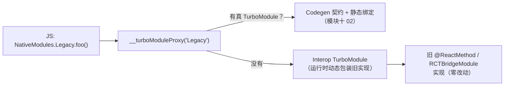

# 新架构迁移工程实践（Interop / 兼容性排查 / 常见问题）

> 05 篇给了原理级路线（盘点 → 开启兜底 → 真迁移 → 收尾）。本篇下钻到工程层：**Interop 层到底怎么工作、限制在哪**，第三方库兼容性怎么**系统性地**排查而不是撞一个查一个，以及把常见问题按"构建期/启动期/行为期/性能期"分类给处理思路。版本事实先行：新架构 0.76 起默认、0.82 起**唯一**（`newArchEnabled=false` 被忽略，旧架构代码自 0.83 起分批移除）——迁移已经不是"要不要"的选择题，而是"赶在自己被迫升级前做完"的工程题。

## 1. 版本地形：你的迁移窗口有多长

| 版本 | 对迁移的含义 |
|------|-------------|
| ≤ 0.75 | 新架构需手动开启（`newArchEnabled=true` / `RCT_NEW_ARCH_ENABLED=1`），是**实验场**：双架构并行验证的最佳时期 |
| 0.76–0.81 | 新架构默认（bridgeless 也是默认），仍可显式关回旧架构——**迁移主窗口**：借着可回退的保险做真迁移 |
| 0.80 | 旧架构冻结（只修关键 bug） |
| 0.82+ | 唯一新架构：`newArchEnabled=false` 与 `RCT_NEW_ARCH_ENABLED=0` **被忽略**；旧架构 API 的移除从 0.83 起分批进行 |
| — | Interop 层官方口径：**为可预见的未来保留**（大量存量库靠它活着） |

工程结论：在 0.81 这条线上，"再等等"的空间已经用完；但仍有一个重要缓冲——**interop 兜底让你可以先跑起来、再慢慢还债**。这也是本篇的主线：先把兜底跑通（第 2 节），再排查真正的阻塞（第 3 节），再按优先级真迁移（第 5 节）。

## 2. Interop 层：工作机制与限制清单

05 篇把 interop 定位成"旧模块的兜底通道"，这里把它拆开讲清楚——**因为你排查问题时，必须知道手上的模块此刻是不是在走 interop**。

### 2.1 模块侧：动态包装



工作机制要点：

- 查找顺序是**真的优先**：同名模块有 Codegen spec 走真 TurboModule，没有才落到 interop 包装；
- interop 包装是**运行时动态的**：没有 Codegen 契约，方法表在首次访问时从旧实现反射/收集而来——这正是它"零改动"的代价；
- 参数与回调经由 JSI 收集/回传，**不再走旧的 JSON 消息队列**——通道换了，但模块的**异步语义没换**（旧实现本来就没有同步形态，模块三 04 的边界不是包装层能改写的）。

### 2.2 组件侧：旧 ViewManager 挂进 Fabric

旧的原生组件（ViewManager/`RCTViewManager` 形态）由组件 interop 层包装成 Fabric 可挂载的形态。要点与限制：

- **能挂载、能更新 props**：大多数纯展示组件零改动可用；
- **限制在"新能力"上**：同步测量、同步布局访问、Fabric 的部分新 props/事件语义、并发特性下的某些保证——interop 包装给不了（它本质上是把旧组件的异步世界观适配进新管线）。具体不支持清单随版本演进，以所用版本的官方 interop 文档/发布说明为准；
- **判断纪律**：组件走没走 interop，看现象也看来源——库没有 codegen 配置、没有 `<library>codegen` 产物、组件目录下没有 ComponentDescriptor/Codable 实现，就按 interop 形态对待，别对新能力抱期待。

### 2.3 Interop 的限制速查表

| 维度 | 真 TurboModule/Fabric | Interop 形态 |
|------|----------------------|-------------|
| 类型契约 | Codegen 静态生成（编译期报错） | 运行时动态（类型靠约定，错了运行时炸） |
| 同步方法/同步常量 | 支持（模块十 02） | **没有**（旧实现无同步形态） |
| 调用开销 | JSI 直调 + 静态分发 | 直调之上多一层动态包装 |
| 事件 | 新事件系统 | 需事件 interop 层桥接，监听时序更敏感 |
| 新能力（同步测量等） | 有 | 多数不可用 |

定位问题时的第一问：**"这个模块/组件此刻在哪个形态上跑？"**——同一个"不工作"，在两个形态下的原因完全不同。

## 3. 第三方库兼容性：系统性排查

05 篇迁移第一步是"依赖盘点三档分类"，本节把它做成可执行的流程。

### 3.1 生成盘点清单

```bash
# 从 package.json 拿到带原生代码的依赖清单（纯 JS 库无所谓新旧架构）
/usr/bin/grep -l "codegenConfig\|react-native.config.js\|android/\|ios/" \
  node_modules/<lib>/package.json  # 或直接用 CLI 的依赖信息命令输出全量清单
```

对每个带原生的库回答三个问题（信息源按优先级）：

1. **库自己的声明**：README/release notes 是否声明新架构支持；`package.json` 有无 `codegenConfig`（模块十 02 讲过它的结构）——有 codegen 声明基本等于真迁移已做；
2. **社区目录**：reactnative.directory 对每个库标注新架构支持状态（三方维护，作参考不作保证）；
3. **源码形态**（前两者都没有时）：Android 侧有无 Codegen 生成基类的实现（`extends NativeXxxSpec`）、iOS 侧有无 Spec 协议 conform（`#ifdef RCT_NEW_ARCH_ENABLED` 包裹的 `<XxxSpec>` 声明）。

### 3.2 三档分类与处置

| 档位 | 判据 | 处置 |
|------|------|------|
| 原生支持 | 有 codegen 声明或明确支持声明 | 直接升级到支持版本，正常验证 |
| Interop 可跑 | 旧形态模块/组件，不碰旧架构内部 API | 开启新架构后**实测**（第 3.3 节），列入"长尾债务清单" |
| 硬阻塞 | 依赖已移除/将移除的旧架构 API（直接操纵 bridge 内部、`RCTBridge` 强假设、被删类的子类） | 升级版本线、换库、或自研——**这是唯一会改排期的档** |

判断"硬阻塞"的检索手段：对库源码 grep 旧架构内部符号（`BatchedBridge`、`RCTBridge` 强依赖、`UIManager.*` 命令式旧接口的深度使用）。注意区分"用了旧公开 API（interop 能包）"与"操纵了内部机制（interop 救不了）"。

### 3.3 验证手段：不靠肉眼靠构建

- **金丝雀构建**：CI 上从 main 拉新架构构建（0.81 前可双架构对照跑冒烟测试）——模块十一 02 的 E2E 在这里价值最大（关键路径自动化验证，不依赖人肉过用例）；
- **逐档推进**：先升"原生支持"档的库到目标版本，再开新架构开关，最后处理 interop 档的实测问题——**一次只动一类变量**（模块九 01 的归因纪律在迁移里同样成立）；
- **JS 侧调用点审查**：grep 业务代码里 `NativeModules.X` 的直接用法（interop 形态能力受限，模块十 02 讲过），这些是后续真迁移的入口清单。

## 4. 常见问题分类与处理思路

按出现阶段分四类，每类给"现象 → 定位 → 处理"。

### 4.1 构建期

| 现象 | 定位 | 处理 |
|------|------|------|
| Codegen 阶段失败（spec 类型错误） | 报错定位到具体库/字段 | 对照模块十 02 的类型边界表改 spec；是三方库则报 issue 并临时锁定 |
| Xcode 脚本退出非零 | DerivedData 里 codegen-<库>.log 看真实报错 | 按日志修（多为 spec 语法/依赖缺失） |
| CocoaPods 状态损坏 | codegen 产物与 Pods 不同步 | `pod deintegrate` 后重装；必要时删 Podfile.lock / node_modules 重来（官方 troubleshooting 的标准动作） |
| Android 构建内存耗尽 | gradle daemon OOM | `org.gradle.jvmargs` 提到 4g 级别 |
| 双架构切换后构建诡异 | 新旧产物混缓存 | clean + 删构建产物重来 |

### 4.2 启动/注册期

| 现象 | 定位 | 处理 |
|------|------|------|
| `TurboModule with name 'X' couldn't be found` | JS 侧 `getEnforcing('X')` 找不到实例 | 查名字一致性（`getName` ↔ spec 名）、delegate 是否返回实例（模块十 02 排错路线）；interop 档则查旧模块是否被正确注册 |
| 组件不渲染/`View config getter not found` | Fabric 组件表里没有该组件 | 库版本是否支持/是否走了组件 interop；组件 interop 未命中时先升级库 |
| 常量读取时序变化 | 常量从"注入快照"变"访问时读取" | 模块未初始化时读常量会空——补懒初始化（05 篇第 3 步的坑，仍然成立） |

### 4.3 行为期（最隐蔽的一类）

- **同步时序假设破产**：旧 bridge 全异步，个别代码靠"时序巧合"工作（调用后立即读全局状态）。新架构下事件直调、commit 更快，巧合不再成立。定位：现象表现为"数据偶发旧值"；处理：显式等待 Promise/事件（模块三 04 的边界观）；
- **事件监听时机**：事件从 bridge 事件变 EventEmitter/事件 interop，注册得比以前早/晚都会错过首批事件。定位：加日志比注册与首事件的时序；处理：拉起后主动查询一次当前状态（事件 + 查询双保险）；
- **手势/动画行为差异**：事件优先级与提交管线变了（模块七 02），偶发"手势比 JS 状态先到/后到"。定位：trace（模块九 05）看事件分发与 commit 时序；处理：优先升级手势库到新架构适配版本线。

### 4.4 性能期

- **interop 模块高频调用**：包装层开销在小数据高频场景可见——处理：优先真迁移热点模块（第 5 节）；
- **长列表回归**：Fabric 管线变化 + 组件 interop 叠加。定位：模块九 05 手册三色归因；处理：列表组件原生支持化、item 拆分与定高（模块九 02/03 的处方在新架构下依然适用）；
- **预期管理**（05 篇的表格继续有效）：先归因后动手，换架构不是银弹。

## 5. 真迁移一个模块：工程化检查单

以模块十 02 的全流程代码为底，补上工程化的一圈：

```text
1. 选点：从"高频调用 + 启动路径"里选（模块二 04、模块四 03 找热点）
2. 写 spec（TS）→ codegenConfig → 双平台实现（模块十 02 全流程）
3. JS 调用点改造：NativeModules.X.foo() → import spec 直调
   [ ] grep 业务代码里旧调用点，逐个改（编译器/类型帮你兜住遗漏）
4. 双跑验证（迁移期保险）：
   [ ] 同一场景新旧实现输出对照（关键返回值、事件时序）
   [ ] 埋点对照：调用量、耗时分布
5. 灰度发布：按发布通道（模块八 05）放量，盯崩溃与关键漏斗
6. 收尾：删旧实现与 interop 依赖里的这一项，更新债务清单
```

### 给库作者的补充：双架构并存

如果同一份代码要服务还在旧架构的用户（库作者、多 App 团队），官方建议的双兼容形态：

- iOS：spec 相关代码用 `#ifdef RCT_NEW_ARCH_ENABLED` 包裹；podspec 用 `install_modules_dependencies` 自动按开关装依赖；
- Android：`src/oldarch` / `src/newarch` 两套源集 + 共享 `Impl` 实现类，gradle 按 `newArchEnabled` 选择源集。

工程意义：**把"架构差异"压缩到最薄的一层适配文件**，业务实现双架构共享——这既是库的双兼容方案，也是大型 App 内部"模块团队自治"的参考结构。

## 6. 迁移期的工程护栏

1. **升级顺序**：依赖库先升到"支持新架构的版本线"、再切 App 的新架构开关——库先行，App 跟上；
2. **变量隔离**：升 RN、升库、开新架构**分三个 PR/阶段**，每步可回退（模块九 01 的归因纪律再一次适用）；
3. **债务清单显性化**：interop 档的库进跟踪表（库 / 版本 / 形态 / 真迁移计划），避免"跑起来就忘"——0.83+ 的旧 API 移除会逐批兑现，欠债会过期；
4. **监控先行**：迁移前先把崩溃率与关键性能指标基线立起来（模块九 04/05），迁移效果用数据验收，而不是"感觉没变"；
5. **逃生通道**：0.81 及以前版本保留关回旧架构的能力——但把它当保险丝而不是家，0.82 起这根保险丝就没有了。

## 小结

- 版本地形决定策略：0.76–0.81 是有保险的主窗口，0.82 起新架构唯一、旧 API 分批移除——interop 兜底让你"先跑起来"，但债务会过期；
- Interop 的工作方式：查找上"真的优先"、包装上"运行时动态、无静态契约"、语义上"保留异步"；限制集中在**同步能力与新能力**——排查问题第一问是"此刻在哪个形态上跑"；
- 兼容性排查是流程不是玄学：盘点（声明/目录/源码三信息源）→ 三档分类 → 金丝雀构建实测 → 逐档推进；
- 问题四分类：构建期（codegen/环境）、启动期（注册与常量时序）、行为期（同步假设与事件时机，最隐蔽）、性能期（interop 开销与列表回归）——每类先定位形态再动手；
- 真迁移的工程化 = 模块十 02 的代码流程 + 调用点改造 + 双跑对照 + 灰度 + 债务清单收尾。
