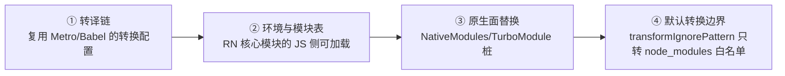
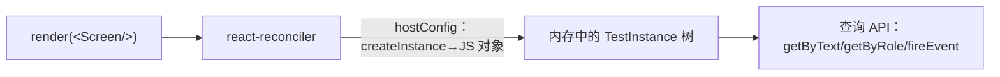

# Jest 单元测试与组件测试原理

> RN 的测试金字塔底两层共用一套 Jest 基建，但它们测的东西完全不同：单元测试在 Node 里跑**真 JS 逻辑**（原生依赖全部是假的），组件测试用一台**不画像素的渲染器**跑组件树（模块五 01 的 hostConfig 在这里第三次出场——前两次是 RN 本体和模块十的 mini-react-native）。理解这两条机制，工具怎么配、mock 怎么写、什么测得了什么测不了，全部自然推出。

## 1. 金字塔与边界：每层测什么

| 层 | 跑在哪 | 测什么 | 成本/反馈 |
|----|--------|--------|----------|
| 单元测试 | Node（无设备） | 纯 JS 逻辑：工具函数、hooks、状态机、数据变换 | 毫秒级，覆盖面最大 |
| 组件测试 | Node（无设备） | 组件的渲染输出与交互行为（JS 视角） | 秒级，隔离单组件 |
| 端到端 | 真机/模拟器 + release | 用户旅程（跨原生、跨线程） | 分钟级，只保关键路径（02 篇） |

RN 特有的一条边界线要先画出来：**JS 与原生的那条缝（模块四/模块七）**。这条缝以下（原生实现）单测与组件测试都是盲区——它们只测缝以上的 JS 侧，缝以下的正确性交给原生侧测试与 E2E。这不是缺陷而是分工：**每一层都只在自己够得着的范围内把问题挡住**。

## 2. Jest 在 RN 里是怎么跑起来的

问题：RN 的源码满是 JSX/TS 与 `require('react-native')`，`react-native` 的入口又会拉起原生模块注册——Node 里凭什么能跑？答案是官方 Jest 预设（现行以独立包 `@react-native/jest-preset` 提供，老工程以 `react-native/jest-preset` 路径引用；Expo 工程对应 `jest-expo`）。它做了四件事：



1. **转译链**：Jest 的 transform 用与 Metro 一致的 Babel 配置转译 JSX/TS——"测试与构建共享同一套语义"就是从这里来的（避免"构建能编译、测试不能"的漂移）；
2. **模块表**：`react-native` 包的 JS 部分（组件定义、类型）在 Node 里可用；
3. **原生面替换**：预设内置了一批原生模块的 mock 桩，`NativeModules.X` / `TurboModuleRegistry.get('X')` 不再炸——但桩多数是"空实现"，**业务语义要自己补**（第 4 节）；
4. **转换边界**：`transformIgnorePattern` 决定哪些 node_modules 也过 Babel（RN 生态不少库发的是未转译产物）——"某某库在 Jest 里语法报错"九成是这条边界没覆盖它。

配置的启动点（具体以工程模板为准，模板自带）：

```js
// jest.config.js —— RN CLI 模板自带；关键在 preset 与转换边界
module.exports = {
  preset: '@react-native/jest-preset', // 老工程写作 'react-native'
  transformIgnorePatterns: ['node_modules/(?!((jest-)?react-native|@react-native|你的未转译依赖)/)'],
};
```

## 3. 单元测试：对象与 mock 的纪律

### 3.1 适合单测的东西

纯 JS 世界的一切：业务规则、数据格式化、hooks（`renderHook`，组件测试库提供的入口）、状态管理、协议编解码。判据：**把原生依赖全部换成桩之后，逻辑仍自洽**——不自洽说明"逻辑"与"原生"耦合过深，先解耦（模块三 04 的边界观在测试侧的反向应用）。

### 3.2 mock 的纪律：mock 的是契约，不是实现

```ts
// specs/NativeAnalytics.ts（真契约，模块十 02）
export interface Spec extends TurboModule {
  logEvent(name: string, params: Object): Promise<void>;
}

// __tests__/useTrack.test.ts —— mock 按契约给行为，不模拟实现细节
jest.mock('../specs/NativeAnalytics', () => ({
  __esModule: true,
  default: { logEvent: jest.fn().mockResolvedValue(undefined) },
}));
```

三条纪律：

1. **mock 面向 spec（契约）**而不是面向实现：实现换了 mock 不用动；契约变了 mock 编译期就报——模块七 04 "错误前移"在测试侧的兑现；
2. **断言的是"我调了什么"而不是"它内部怎么做"**：`expect(logEvent).toHaveBeenCalledWith('page_view', {...})`——这与你产品代码该怎么依赖模块的哲学是同一条；
3. **能不 mock 就不 mock**：mock 掉的每一层都是测试与真实之间的缝隙。纯 JS 依赖（比如日期库）优先用注入（传入假时钟）而不是模块 mock。

## 4. 组件测试的渲染器：不画像素的 reconciler

这是本篇的核心机制，也是组件测试一切能力与边界的来源。

### 4.1 一台第三台 hostConfig 驱动的渲染器

模块五 01 讲过：React 的 reconciler 对平台一无所知，只认 hostConfig 合同；模块十 07 我们亲手写过一份合同驱动 mini 渲染器。组件测试的渲染器是同一个故事的最新一章——历史上这个角色由 `react-test-renderer` 扮演，但 React 已将它弃用（React 19 起进入弃用流程），现行的 React Native Testing Library（RNTL）改为使用独立维护的测试渲染器（新版本以 `test-renderer` 包承载：**用 react-reconciler 构建的纯 JS 渲染器，把宿主组件"渲染"成内存里的 JS 对象树**，不产出任何原生视图）：



对着真 RN 的 hostConfig（模块五 03）看差异，能力与边界同时读出：

| hostConfig 回调 | 真 RN（Fabric） | 测试渲染器 |
|----------------|----------------|-----------|
| createInstance(type, props) | 建 ShadowNode → mount 原生视图 | **记一个 JS 对象**（类型 + props + children） |
| commitUpdate | 更新影子树 → mount 指令 | 改 JS 对象的 props |
| 布局（Yoga） | 真布局，产出 x/y/w/h | **不发生**——style 只是 props，没有布局结果 |

由此推出组件测试的三条能力边界：

1. **测得了**：渲染输出的结构（文本、层级、条件分支）、props 传递、事件回调（fireEvent 直接触发 props 上的 handler）、状态驱动的重渲染、可访问性语义；
2. **测不了**：真布局（没有 Yoga 结果，"这个元素在不在视口内"无从谈起）、原生渲染与手势（模块六 的整条链路缺席）、性能；
3. **事件是"合成直调"**：`fireEvent.press(el)` 是直接调用组件 props 上的 onPress——**不经过**原生触摸分发与手势仲裁（模块六 01/02）。所以"点不到被遮挡的按钮"这类问题组件测试永远测不出，那是 E2E 的领地。

### 4.2 查询为什么以 role/文本为主

RNTL 的推荐查询顺序是 `getByRole`（可访问性角色）> `getByText` > `getByTestId`（最后手段）。这不是风格偏好：

- 查询走的是渲染器产出的**可访问性语义树**——与真机上的辅助功能、也与 02 篇 Maestro 的查询方式同源。**用 role 查询 = 顺带验证了组件的可访问性信息是完整的**；
- testID 只在两端测试基建里有效，用户永远看不见——过度依赖它意味着测试与真实用户视角脱节。

### 4.3 实操样例

```tsx
// __tests__/SearchBox.test.tsx
import { render, screen, fireEvent, waitFor } from '@testing-library/react-native';

test('清空按钮仅在有关键词时出现，点击后回调空值', () => {
  const onSearch = jest.fn();
  render(<SearchBox onSearch={onSearch} />);

  expect(screen.queryByText('清空')).toBeNull();      // 初始不出现

  fireEvent.changeText(screen.getByPlaceholderText('搜索关键词'), 'hermes');
  fireEvent.press(screen.getByText('清空'));

  expect(onSearch).toHaveBeenCalledWith('');
  expect(screen.queryByDisplayValue('hermes')).toBeNull();
});
```

要点：断言落在**用户可见的行为**（出现/消失/回调），不落在组件内部状态——内部状态是实现细节，改实现不改行为时测试不该红。异步行为（数据加载后渲染）用 `waitFor`/`findBy*` 等待，而不是假 sleep；假计时器与真计时器的选择按"被测的是超时逻辑还是加载流程"区分。

### 4.4 快照测试的边界

快照（`toMatchSnapshot`）适合**小而稳定**的结构（单个小组件的输出），不适合整页：整页快照任何无关改动都会让它红，团队很快养成"无脑 u 更新"的肌肉记忆——快照就从护栏变成了噪声。大结构用显式断言（出现/不出现/顺序），把快照留给真正"变即可疑"的小单元。

## 5. 组件测试测不到的，交给谁

| 缺口 | 补位 |
|------|------|
| 真布局/样式 | E2E 断言 + 视觉回归（平台侧） |
| 原生模块真实现 | 原生侧单测（Kotlin/Swift 各自生态） |
| 触摸链路/手势仲裁 | E2E（02 篇） |
| JS 与原生契约 | Codegen 类型（模块七 04）+ 集成冒烟 |

注意最后一行：模块十 02 讲过 Codegen 把类型错误前移到编译期——**类型系统也是一种测试**，金字塔的底座其实是静态检查。

## 小结

- Jest 能跑 RN 代码靠预设的四个部件：共享 Babel 链、模块表、原生桩、转换边界——"库在测试里语法报错"先查 transformIgnorePattern；
- 单元测试的纪律：mock 面向 spec 契约、断言行为而非实现、能注入就不 mock；
- 组件测试渲染器 = 第三台 hostConfig 驱动的纯 JS 渲染器（react-test-renderer 已弃用，现行由 test-renderer 包承载）：内存对象树、无布局、fireEvent 是合成直调——能力边界全部由此推出；
- 查询以 role/文本优先：与可访问性语义树同源，测试即无障碍检查；
- 快照宁小勿大；JS 与原生那条缝以下的正确性，交给原生侧测试与 E2E（02 篇）。
