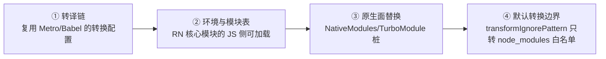
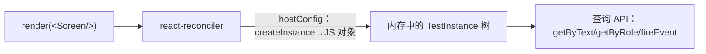

# Jest 单元测试与组件测试原理

> RN 的测试金字塔底两层共用一套 Jest 基建，但它们测的东西完全不同：单元测试在 Node 里跑**真 JS 逻辑**（原生依赖全部是假的），组件测试用一台**不画像素的渲染器**跑组件树（模块五 01 的 hostConfig 在这里第三次出场——前两次是 RN 本体和模块十的 mini-react-native）。理解这两条机制，工具怎么配、mock 怎么写、什么测得了什么测不了，全部自然推出。

## 1. 金字塔与边界：每层测什么

| 层 | 跑在哪 | 测什么 | 成本/反馈 |
|----|--------|--------|----------|
| 单元测试 | Node（无设备） | 纯 JS 逻辑：工具函数、hooks、状态机、数据变换 | 毫秒级，覆盖面最大 |
| 组件测试 | Node（无设备） | 组件的渲染输出与交互行为（JS 视角） | 秒级，隔离单组件 |
| 端到端 | 真机/模拟器 + release | 用户旅程（跨原生、跨线程） | 分钟级，只保关键路径（02 篇） |

RN 特有的一条边界线要先画出来：**JS 与原生的那条缝（模块四/模块七）**。这条缝以下（原生实现）单测与组件测试都是盲区——它们只测缝以上的 JS 侧，缝以下的正确性交给原生侧测试与 E2E。这不是缺陷而是分工：**每一层都只在自己够得着的范围内把问题挡住**。

### 1.1 RN 测试的两条缝：这条边界为什么画在这里

- **缝一：JS 与原生的缝**——就是上面画的那条。它决定"**测什么**"：缝以上是 JS 的逻辑与结构，缝以下是原生实现，底两层只管上半段；
- **缝二：异步的缝**——React 的更新是异步提交（模块五 01），`setState` 返回时界面还没变，测试里的断言与渲染之间存在时差。它决定"**怎么断言**"：一切等待原语（waitFor/findBy，4.6）都是为这条缝而生。

| 缝 | 谁看不见 | 谁补位 |
|----|---------|--------|
| JS/原生缝 | 底两层（只有 JS 侧） | 原生侧测试 + E2E（02 篇） |
| 异步缝 | 同步断言 | waitFor/findBy 等待原语 + 假计时器 |

推论：**底两层的一切"测不了"，都能从这两条缝推出来**——不是工具弱，是分工使然。后面各节的"能力边界"都请对着这两条缝读。

### 1.2 底两层为什么共享 Jest、顶层为什么不能

| 判断维度 | 底两层（单测/组件测试） | 顶层（E2E） |
|---------|----------------------|------------|
| 运行环境 | Node 进程，无设备 | 真机/模拟器 + release 构建 |
| 被测对象 | JS 逻辑、JS 组件树语义 | 跨 JS/原生/线程/网络的完整链路 |
| 桩与替身 | 原生面全部可桩（§2） | 不允许桩——桩掉哪层旅程就断在哪 |
| 反馈成本 | 秒级，每个提交跑全量 | 分钟级，只保关键路径 |

一句话：**金字塔的形状不是教条，是成本函数的等高线**——每上一层，单条用例的成本与脆弱度上升一个量级，数量自然要收敛。底两层共享 Jest 是因为它们共享"Node + 桩 + 内存渲染"这套基建；顶层换了一整个世界（真构建、真设备、真同步问题），基建随之更换（02 篇）。

## 2. Jest 在 RN 里是怎么跑起来的

问题：RN 的源码满是 JSX/TS 与 `require('react-native')`，`react-native` 的入口又会拉起原生模块注册——Node 里凭什么能跑？答案是官方 Jest 预设（现行以独立包 `@react-native/jest-preset` 提供，老工程以 `react-native/jest-preset` 路径引用；Expo 工程对应 `jest-expo`）。它做了四件事：



1. **转译链**：Jest 的 transform 用与 Metro 一致的 Babel 配置转译 JSX/TS——"测试与构建共享同一套语义"就是从这里来的（避免"构建能编译、测试不能"的漂移）；
2. **模块表**：`react-native` 包的 JS 部分（组件定义、类型）在 Node 里可用；
3. **原生面替换**：预设内置了一批原生模块的 mock 桩，`NativeModules.X` / `TurboModuleRegistry.get('X')` 不再炸——但桩多数是"空实现"，**业务语义要自己补**（第 4 节）；
4. **转换边界**：`transformIgnorePattern` 决定哪些 node_modules 也过 Babel（RN 生态不少库发的是未转译产物）——"某某库在 Jest 里语法报错"九成是这条边界没覆盖它。

配置的启动点（具体以工程模板为准，模板自带）：

```js
// jest.config.js —— RN CLI 模板自带；关键在 preset 与转换边界
module.exports = {
  preset: '@react-native/jest-preset', // 老工程写作 'react-native'
  transformIgnorePatterns: ['node_modules/(?!((jest-)?react-native|@react-native|你的未转译依赖)/)'],
};
```

### 2.1 转换边界的诊断法：从语法报错到白名单

先看症状（报错文案以实际环境为准，这里给的是形态）：

```text
SyntaxError: /node_modules/某依赖/dist/index.js: Unexpected token 'export'
```

机制：Jest 默认**不转译 node_modules**（假设它们是编译好的 CommonJS 产物），而 RN 生态不少包发布的是未转译产物（ESM、JSX、类型注解一应俱全）。`transformIgnorePatterns` 的负向前瞻正则语义是"node_modules 里**除了**这些都不转"——所以修法就是把未转译依赖加进白名单：

```js
// jest.config.js —— 把某个未转译依赖加进白名单（示意）
module.exports = {
  preset: '@react-native/jest-preset',
  transformIgnorePatterns: [
    'node_modules/(?!((jest-)?react-native|@react-native|@react-native-community|新依赖名)/)',
  ],
};
```

诊断口诀三步：① 报错路径在不在 `node_modules`？在 → ② 预设的正则白名单有没有盖住这个包名？没有 → ③ 把包名加进白名单、清 Jest 缓存重跑。两个反向提醒：**这不是"库坏了"，是转换边界的配置问题**；也不要图省事把整个 node_modules 放进白名单——全量转译会拖慢所有测试，白名单应保持最小。

### 2.2 原生桩的补法：提升机制与 manual mocks

预设给的桩是"空实现"，业务语义要自己补。补之前先理解两个机制细节：

1. **`jest.mock` 调用会被提升到文件最顶部**（先于所有 import 执行）——所以 mock 工厂里**不能引用作用域外的普通变量**（提升之后它们还没初始化）；被放行的例外是 `mock` 前缀命名的变量（Jest 的约定）。这也解释了"为什么 mock 里一引用外面的常量就报错"——不是玄学，是提升的副作用；
2. **manual mocks 的目录约定**：局部模块的桩放在模块同目录的 `__mocks__/` 下，用例里仍需 `jest.mock('../specs/NativeAnalytics')` 显式启用；node_modules 包的桩放在根级 `__mocks__/` 目录，**无需声明即自动生效**。跨用例复用的通用桩适合沉淀到目录约定——一次写、处处用。

```ts
// __mocks__/NativeAnalytics.ts（局部模块 manual mock：与真模块同目录的 __mocks__ 下）
// 用例侧 jest.mock('../specs/NativeAnalytics') 后自动取用这份实现
export const logEvent = jest.fn().mockResolvedValue(undefined);
export default { logEvent };
```

选择口径：**一次性、用例特定的桩写 `jest.mock` 工厂；跨用例复用的桩沉淀 `__mocks__`；只想"窥探不替换"用 `jest.spyOn`**（全景对照见 §6）。

## 3. 单元测试：对象与 mock 的纪律

### 3.1 适合单测的东西

纯 JS 世界的一切：业务规则、数据格式化、hooks（`renderHook`，组件测试库提供的入口）、状态管理、协议编解码。判据：**把原生依赖全部换成桩之后，逻辑仍自洽**——不自洽说明"逻辑"与"原生"耦合过深，先解耦（模块三 04 的边界观在测试侧的反向应用）。

### 3.2 mock 的纪律：mock 的是契约，不是实现

```ts
// specs/NativeAnalytics.ts（真契约，模块十 02）
export interface Spec extends TurboModule {
  logEvent(name: string, params: Object): Promise<void>;
}

// __tests__/useTrack.test.ts —— mock 按契约给行为，不模拟实现细节
jest.mock('../specs/NativeAnalytics', () => ({
  __esModule: true,
  default: { logEvent: jest.fn().mockResolvedValue(undefined) },
}));
```

三条纪律：

1. **mock 面向 spec（契约）**而不是面向实现：实现换了 mock 不用动；契约变了 mock 编译期就报——模块七 04 "错误前移"在测试侧的兑现；
2. **断言的是"我调了什么"而不是"它内部怎么做"**：`expect(logEvent).toHaveBeenCalledWith('page_view', {...})`——这与你产品代码该怎么依赖模块的哲学是同一条；
3. **能不 mock 就不 mock**：mock 掉的每一层都是测试与真实之间的缝隙。纯 JS 依赖（比如日期库）优先用注入（传入假时钟）而不是模块 mock。

### 3.3 hooks 的单测：renderHook 与"隐形宿主"

hooks 是纯逻辑，但它挂在组件系统上——测试库提供 `renderHook`：在内部挂一个**隐形宿主组件**来运行你的 hook，`result.current` 是值的出口：

```tsx
// __tests__/useDebouncedValue.test.tsx
import { renderHook, act } from '@testing-library/react-native';

test('debounce 只在静默期后吐出新值', () => {
  jest.useFakeTimers();
  const { result, rerender } = renderHook(
    ({ v }) => useDebouncedValue(v, 300),
    { initialProps: { v: 'a' } },
  );

  rerender({ v: 'ab' });              // 模拟 props 变化驱动 hook 更新
  act(() => {
    jest.advanceTimersByTime(300);    // 精确推进时间，而不是真等
  });

  expect(result.current).toBe('ab');
});
```

三个要点：**计时是逻辑的一部分**——防抖窗"300ms"就是被测行为，用假计时器把时间变成可控输入（4.7 细化）；`rerender` 驱动 props 变化；`act` 把"推进时间"包成一个已完成的更新批次。判据呼应 §3.1：**hook 与组件解耦得越彻底，renderHook 用例越好写**——写不出来，先解耦。

### 3.4 从"难测"到"先解耦"：测试作为架构反馈

§3.1 说"不自洽说明耦合过深，先解耦"。落到操作层面，三类典型信号与对应的解耦动作：

| 难测信号 | 根因 | 解耦动作 |
|---------|------|---------|
| 一测就碰网络/数据库 | 依赖在函数体内直接构造 | 依赖作为参数注入（构造外提到调用方） |
| 必须等真实时间/真实随机值 | 隐式输入：时钟、随机源 | 时间与随机作为参数传入 |
| 逻辑必须摸原生模块才能走 | 业务规则与原生副作用长在一起 | 规则收成纯函数，副作用留给外层 |

```ts
// src/promo.ts —— 时间作为参数注入：规则可测，副作用留在调用方
export function isPromoActive(startAt: number, endAt: number, now: number): boolean {
  return now >= startAt && now < endAt;
}

// __tests__/promo.test.ts —— 测试里时间是一个普通参数，想给几点给几点
test('活动边界：结束时刻不含', () => {
  expect(isPromoActive(1000, 2000, 2000)).toBe(false);
});
```

这就是"测试作为架构反馈"的完整含义：**写不出好测试的地方，架构有问题**；修测的过程就是解耦的过程——模块三 04 的边界观在测试侧的正向应用。

## 4. 组件测试的渲染器：不画像素的 reconciler

这是本篇的核心机制，也是组件测试一切能力与边界的来源。

### 4.1 一台第三台 hostConfig 驱动的渲染器

模块五 01 讲过：React 的 reconciler 对平台一无所知，只认 hostConfig 合同；模块十 07 我们亲手写过一份合同驱动 mini 渲染器。组件测试的渲染器是同一个故事的最新一章——历史上这个角色由 `react-test-renderer` 扮演，但 React 已将它弃用（React 19 起进入弃用流程），现行的 React Native Testing Library（RNTL）改为使用独立维护的测试渲染器（新版本以 `test-renderer` 包承载：**用 react-reconciler 构建的纯 JS 渲染器，把宿主组件"渲染"成内存里的 JS 对象树**，不产出任何原生视图）：



对着真 RN 的 hostConfig（模块五 03）看差异，能力与边界同时读出：

| hostConfig 回调 | 真 RN（Fabric） | 测试渲染器 |
|----------------|----------------|-----------|
| createInstance(type, props) | 建 ShadowNode → mount 原生视图 | **记一个 JS 对象**（类型 + props + children） |
| commitUpdate | 更新影子树 → mount 指令 | 改 JS 对象的 props |
| 布局（Yoga） | 真布局，产出 x/y/w/h | **不发生**——style 只是 props，没有布局结果 |

由此推出组件测试的三条能力边界：

1. **测得了**：渲染输出的结构（文本、层级、条件分支）、props 传递、事件回调（fireEvent 直接触发 props 上的 handler）、状态驱动的重渲染、可访问性语义；
2. **测不了**：真布局（没有 Yoga 结果，"这个元素在不在视口内"无从谈起）、原生渲染与手势（模块六 的整条链路缺席）、性能；
3. **事件是"合成直调"**：`fireEvent.press(el)` 是直接调用组件 props 上的 onPress——**不经过**原生触摸分发与手势仲裁（模块六 01/02）。所以"点不到被遮挡的按钮"这类问题组件测试永远测不出，那是 E2E 的领地。

### 4.2 查询为什么以 role/文本为主

RNTL 的推荐查询顺序是 `getByRole`（可访问性角色）> `getByText` > `getByTestId`（最后手段）。这不是风格偏好：

- 查询走的是渲染器产出的**可访问性语义树**——与真机上的辅助功能、也与 02 篇 Maestro 的查询方式同源。**用 role 查询 = 顺带验证了组件的可访问性信息是完整的**；
- testID 只在两端测试基建里有效，用户永远看不见——过度依赖它意味着测试与真实用户视角脱节。

### 4.3 实操样例

```tsx
// __tests__/SearchBox.test.tsx
import { render, screen, fireEvent, waitFor } from '@testing-library/react-native';

test('清空按钮仅在有关键词时出现，点击后回调空值', () => {
  const onSearch = jest.fn();
  render(<SearchBox onSearch={onSearch} />);

  expect(screen.queryByText('清空')).toBeNull();      // 初始不出现

  fireEvent.changeText(screen.getByPlaceholderText('搜索关键词'), 'hermes');
  fireEvent.press(screen.getByText('清空'));

  expect(onSearch).toHaveBeenCalledWith('');
  expect(screen.queryByDisplayValue('hermes')).toBeNull();
});
```

要点：断言落在**用户可见的行为**（出现/消失/回调），不落在组件内部状态——内部状态是实现细节，改实现不改行为时测试不该红。异步行为（数据加载后渲染）用 `waitFor`/`findBy*` 等待，而不是假 sleep；假计时器与真计时器的选择按"被测的是超时逻辑还是加载流程"区分。

### 4.4 快照测试的边界

快照（`toMatchSnapshot`）适合**小而稳定**的结构（单个小组件的输出），不适合整页：整页快照任何无关改动都会让它红，团队很快养成"无脑 u 更新"的肌肉记忆——快照就从护栏变成了噪声。大结构用显式断言（出现/不出现/顺序），把快照留给真正"变即可疑"的小单元。

### 4.5 交互入口的两个抽象层级：fireEvent 与 userEvent

RNTL 提供两个交互入口，抽象层级不同：

| 入口 | 抽象层级 | 机理（定性） | 适用 |
|------|---------|-------------|------|
| fireEvent | 单事件直调 | 在目标元素上直接派发指定事件、调用对应 prop | 常规断言：快、确定性强 |
| userEvent | 交互序列模拟 | 按更接近真实输入的序列派发（如输入前先聚焦、按下-抬起成对），并维护中间态 | 交互序列本身影响结果时（焦点管理、组合输入） |

判据：**默认 fireEvent；当"交互怎么发生的"会影响被测结果时，升级 userEvent**。注意两个入口都没有离开"合成直调"的本质——4.1 的能力边界（不经过原生触摸分发与手势仲裁）对两者同样成立。

### 4.6 异步断言的三种写法

缝二（1.1）说"断言与渲染之间有时差"，等待原语就是对付这条缝的手段：

| 写法 | 机理 | 适用 |
|------|------|------|
| `await screen.findByText('…')` | waitFor + getBy 的组合糖：出现即返回 | **首选**：等元素出现/消失 |
| `await waitFor(() => expect(...))` | 轮询断言直到通过或超时 | 复合条件、等"值"而不只是等"元素" |
| `queryBy` + 手写轮询 | 手工循环 + sleep | 反模式：等待散落进用例，退化为手工 sleep |

```tsx
// 数据加载完成后的断言：findBy 出现即返回，不猜时长
const item = await screen.findByText('加载完成');
expect(item).toBeOnTheScreen();
```

两条纪律：**等待条件必须绑定被测的状态信号**（文案出现、列表条数），而不是"再等 500ms 应该差不多了"；超时是断言的一部分——超时失败说明"状态没按预期到达"，这是有效信息，不要靠加长超时去"治"它。

### 4.7 假计时器：把时间变成可控输入

含 setTimeout/防抖/节流的逻辑在真计时器下只能真等（慢且抖）。假计时器把"时间"变成测试的可控输入：

```tsx
// 防抖输入框：推进时间而不是等待时间
jest.useFakeTimers();
fireEvent.changeText(screen.getByPlaceholderText('搜索'), 'rn');
expect(querySuggestions).not.toHaveBeenCalled();   // 静默期内未触发
act(() => { jest.advanceTimersByTime(400); });      // 精确推进 400ms
expect(querySuggestions).toHaveBeenCalledWith('rn');
```

选择判据（§4.3 末段的重述与细化）：**被测的是"时间逻辑本身"（防抖窗、节流间隔、超时阈值）→ 假计时器**，分钟级的真实等待被压成零成本的时间跳转；**被测的是"加载流程"（请求-渲染链路）→ 真计时器 + findBy**，此时时间只是载体、不是被测对象。混合使用注意假计时器会接管一切定时原语，用例收尾恢复真计时器，防止串味到别的用例。

### 4.8 一个组件测试用例的执行链路

把 4.1–4.7 的机制折叠成一次用例执行的完整链路：


三个观察点：**mock 生效在 import 之前**（提升机制），所以"模块加载时就执行的原生调用"也能被拦住；**渲染产物是内存对象树**，所以断言全部不落盘、毫秒级；**快照只是链路末端的旁路**（4.4），不是主体——主体永远是显式的行为断言。

## 5. 组件测试测不到的，交给谁

| 缺口 | 补位 |
|------|------|
| 真布局/样式 | E2E 断言 + 视觉回归（平台侧） |
| 原生模块真实现 | 原生侧单测（Kotlin/Swift 各自生态） |
| 触摸链路/手势仲裁 | E2E（02 篇） |
| JS 与原生契约 | Codegen 类型（模块七 04）+ 集成冒烟 |

注意最后一行：模块十 02 讲过 Codegen 把类型错误前移到编译期——**类型系统也是一种测试**，金字塔的底座其实是静态检查。

### 5.1 金字塔的"第零层"：类型与 lint

顺着最后一行往下挖，金字塔其实还有一层看不见的地基：

| 层 | 手段 | 挡住的错误类别 | 反馈时机 |
|----|------|--------------|---------|
| 第零层 | TypeScript / Codegen 类型（模块七 04）/ lint 规则 | 契约不符、低级笔误、危险模式 | 写代码时（编辑器内） |
| 第一层 | 单元测试 | 纯逻辑错误 | 秒级 |
| 第二层 | 组件测试 | 渲染结构与交互行为错误 | 秒级 |
| 第三层 | E2E（02 篇） | 跨层旅程错误 | 分钟级 |

读法：**越底层的"测试"越便宜、越早、越该厚**——类型系统挡掉的错误，一分钱运行时成本都不花。这也是为什么本站把 Codegen 契约（模块七 04）称为"错误前移"：它不是测试工具，却完成了测试最重要的使命（把错误挡在运行之前）。

## 6. mock 策略全景对照（§3.2 的延伸）

§3.2 给了纪律，这里给全景：每一种可替换的依赖都对应一种策略，**隔离面越大的策略，测试与真实之间的缝隙越宽**：

| 策略 | 机制 | 隔离面 | 维护成本 | 适用 |
|------|------|--------|---------|------|
| 依赖注入 | 依赖作为参数传入，测试传假实现 | 无需框架介入 | 低 | 时钟/随机/规则函数（首选） |
| spyOn 部分桩 | 保留原对象，只监听或替换单个方法 | 方法级 | 低 | "只窥探不替换"，或只改一个方法 |
| jest.mock 工厂 + 手写桩 | 模块加载时整体替换为手写实现 | 整个模块 | 中 | 原生模块接口（按契约给行为） |
| manual mock（__mocks__） | 目录约定提供替换实现 | 目录内模块 | 中 | 跨用例复用的通用桩 |
| 自动 mock（无工厂的 jest.mock） | 按模块形状自动生成全空桩 | 整个模块 | 低（但语义空） | 只断言"被调用过" |
| 网络层拦截 | 在 fetch/XHR 层替换响应 | 网络面 | 中 | 数据加载流程的响应编排 |

选择顺序：**注入 > spy > 工厂 mock > manual mock > 自动 mock**——每往下一级，缝隙宽一分。自动 mock 排最后：它的桩"什么都返回 undefined"，除"调没调"之外给不出任何业务语义，滥用它等于把契约检查全部删掉（纪律一的反面）。

## 7. 单测 flaky 的三个来源与消除

单元测试理论上不该 flaky——它们跑在确定性的 Node 里。出现 flaky，几乎都是**漏注入的隐式输入**：

| 来源 | 症状 | 消除 |
|------|------|------|
| 时间依赖 | 日期边界用例偶尔红（CI 在零点/时区边界跑） | 注入时钟（3.4）或假计时器（4.7） |
| 随机依赖 | id/顺序类断言偶尔不匹配 | 固定种子或 mock 随机源——随机要么是显式输入、要么是被注入的依赖 |
| 顺序/共享状态依赖 | 单跑绿、合跑红 | 用例间重置：清 mock 调用记录、恢复 spy、重置模块级单例 |

第三条值得展开：**模块级状态是单测里的"全局变量"**——store 单例、模块顶层缓存、mock 调用记录都会跨用例泄漏。纪律是每个用例从零开始（beforeEach 统一重置），这与 02 篇 E2E 的"每条流程从干净状态开始"（隔离）是同一条原则在金字塔不同层的投影：**隔离的粒度变了，原则没变**。

## 8. 常见误区

| 误区 | 事实 | 一句话纠正 |
|------|------|-----------|
| "mock 越多越稳" | mock 掉的每一层都是测试与真实之间的缝隙 | 能注入不 mock，能 spy 不整体替换 |
| "组件测试能验证布局效果" | 渲染器无 Yoga、无布局结果（4.1 表） | 布局问题去 E2E 与视觉回归 |
| "快照越大越保险" | 整页快照把无关改动都变红，逼出"无脑 u 更新"（4.4） | 快照宁小勿大 |
| "testID 是最好的查询方式" | role/文本查询顺带验证可访问性语义（4.2） | testID 是最后手段 |
| "Jest 里语法报错是库坏了" | 多为转换边界白名单没盖住（2.1） | 先查 transformIgnorePattern |
| "组件测试绿了原生交互就没问题" | 缝以下全是盲区（§1/§5） | 原生交互去 E2E 验证 |
| "fireEvent 等价于真实触摸" | 合成直调，不经过原生分发与手势仲裁（4.1） | 触摸链路问题去 E2E |
| "异步断言加 sleep 兜底" | sleep 等时间不等状态，把 flaky 引进单测（4.6） | 用 findBy/waitFor 绑定状态信号 |
| "覆盖率高就是测得好" | 覆盖率只回答"跑没跑到"，不回答"断言对不对" | 断言用户可见行为，覆盖率是探针不是 KPI |

## 9. 动手验证

- **拆开预设看部件**：在 RN 模板工程跑通一个最小组件测试，再临时去掉 preset 重跑——亲眼看四个部件各自缺了会报什么错（看完恢复配置）；
- **观察提升机制**：故意让 `jest.mock` 工厂引用外部普通变量，读提升相关的报错——理解 2.2 那条限制的来源；
- **对比两个交互入口**：对同一个含 TextInput 的组件分别用 fireEvent 与 userEvent 写"输入并提交"，体会 4.5 的抽象层级差别；
- **制造并消灭一个 flaky**：写一个直接读 `Date.now()` 的日期边界用例，在零点前后各跑一次观察偶发红；改成注入时钟后再跑——体感 3.4 的"测试作为架构反馈"；
- **边界实验**：把"点不到的遮挡按钮"场景分别放进组件测试与 E2E（02 篇），确认前者测不出、后者测得出——亲眼验证 4.1 的能力边界。

## 小结

- Jest 能跑 RN 代码靠预设的四个部件：共享 Babel 链、模块表、原生桩、转换边界——"库在测试里语法报错"先查 transformIgnorePattern；
- 单元测试的纪律：mock 面向 spec 契约、断言行为而非实现、能注入就不 mock；
- 组件测试渲染器 = 第三台 hostConfig 驱动的纯 JS 渲染器（react-test-renderer 已弃用，现行由 test-renderer 包承载）：内存对象树、无布局、fireEvent 是合成直调——能力边界全部由此推出；
- 查询以 role/文本优先：与可访问性语义树同源，测试即无障碍检查；
- 快照宁小勿大；JS 与原生那条缝以下的正确性，交给原生侧测试与 E2E（02 篇）。

## 自测

1. RN 测试的两条缝各是什么？哪条决定"测什么"、哪条决定"怎么断言"？（→ 1.1）
2. 金字塔形状的"成本函数"解释是什么？底两层共享 Jest 的原因？（→ 1.2）
3. Jest 预设的四个部件各解决什么问题？"库在测试里语法报错"的诊断三步？（→ §2/2.1）
4. jest.mock 的提升机制带来哪条编码限制？__mocks__ 目录对局部模块与 node 模块的生效规则差在哪？（→ 2.2）
5. mock 三条纪律是什么？"mock 的是契约"在断言代码上长什么样？（→ 3.2）
6. renderHook 的机制是什么？什么样的 hook 值得单独测？（→ 3.3）
7. 测试渲染器与真 RN 的 hostConfig 差异推出哪三条能力边界？fireEvent 的本质是什么？（→ 4.1）
8. 查询顺序为什么是 role > 文本 > testID？testID 滥用的代价是什么？（→ 4.2）
9. fireEvent 与 userEvent 的抽象层级差别？升级判据是什么？（→ 4.5）
10. findBy/waitFor/手写轮询三档怎么选？等待条件应该绑定什么信号？（→ 4.6）
11. 假计时器与真计时器的选择判据是什么？（→ 4.7）
12. mock 策略的优先级顺序？自动 mock 为什么排最后？（→ §6）
13. 单测 flaky 的三个来源与消除？"模块级状态"对应 E2E 的哪条纪律？（→ §7）
14. "第零层测试"指什么？为什么说类型系统挡错误不花运行时成本？（→ 5.1）
