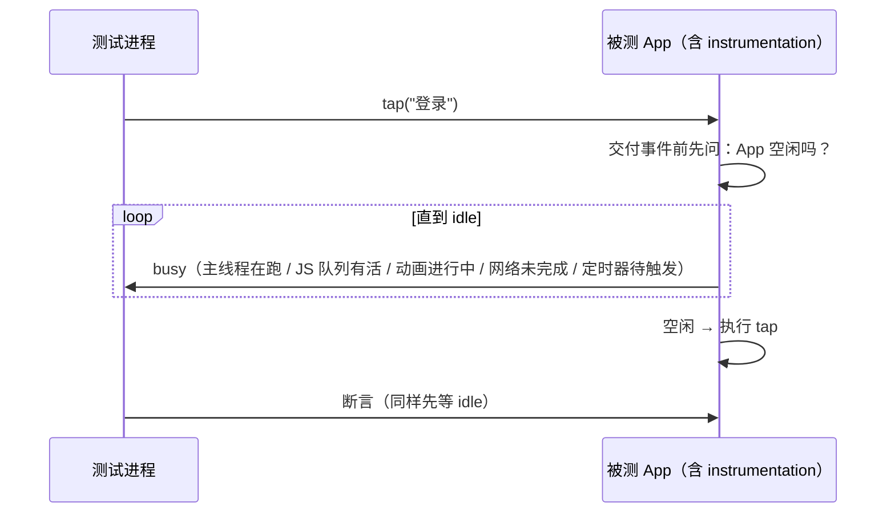

# 端到端测试与选型

> 金字塔顶层：真机/模拟器、release 构建、跑完整用户旅程。RN 的 E2E 框架看似三家打架（Detox / Maestro / Appium），其实各代表一种**同步哲学**——黑盒轮询（Appium）、灰盒空闲同步（Detox）、平台驱动器 + 可达性树（Maestro）。同步哲学决定了稳定性、速度与配置成本，选型先选哲学再选框架。本篇讲清三种机制的原理与代价，最后落到选型决策与 CI 配合。

## 1. E2E 的第一性问题：同步

E2E 脚本的本质是"对 UI 下指令 + 断言结果"。移动 App 永远是异步的：点登录 → JS 发请求 → 原生刷新视图——**指令执行时 UI 大概率还没就绪**。于是所有框架都逃不开同一个问题：**怎么知道"该等的时候在等、该走的时候在走"**。

最原始的答案是 sleep（等 2 秒再断言），它是 flaky 之父：等短了偶尔没就绪（假失败），等长了永远慢（假通过 + 流程拖沓），而且**它等的是时间而不是状态**。三个框架的差别，全在"拿什么替换 sleep"。

## 2. Detox：灰盒空闲同步

**定位**：为 RN 而生的 E2E 框架（Wix 开源）。"灰盒"指测试框架**进入 App 内部**：被测构建里链接了 Detox 的原生 instrumentation，框架能观测 App 的内部忙闲状态。

### 2.1 机制



核心机制是**空闲同步**：每条指令（tap/断言）执行前，Detox 等待 App 进入空闲——主线程没有排队的任务、JS 没有在跑的批次、动画结束、网络请求完成、没有即将到期的定时器。**等待的是"状态归零"而非固定时长**：慢机器多等、快机器少等，既不假失败也不假通过。

这条机制恰好治了 RN 的两个 E2E 顽疾：

- **JS 异步渲染**：断言时 reconcile/commit 还没完成 → idle 等待覆盖了它；
- **启动与导航的不确定性**：冷启动期间 native + JS 双端都忙，Detox 自动等忙完。

### 2.2 代价

- **需要 instrumented 构建**（专门的 configuration），不能拿线上包直接测；
- 空闲判定有盲区：自定义线程里的活、不经过已知通道的等待（比如自己 spin 的轮询）框架看不见——App 侧要配合暴露忙闲状态；
- 同步越强，**假阴性**越多：个别场景"永远不空闲"（持续动画的页面）需要显式配置豁免。

### 2.3 写法

```js
await element(by.id('username')).typeText('demo@site.dev');
await element(by.text('登录')).tap();
await waitFor(element(by.text('欢迎回来'))).toBeVisible();
```

`waitFor(...).whileElement(...)` 表达"边滚动边找"这类复合等待——但大部分场景里，空闲同步已经让显式等待降到最少。

## 3. Maestro：平台驱动器 + 可达性树

**定位**：通用移动 UI 测试（不专属 RN），主打"写得起、跑得稳"。机制三点：

1. **驱动器架构**：CLI 与设备上常驻的小驱动程序通信——Android 驱动基于 UiAutomator 体系，iOS 驱动基于 XCUITest 体系（都是平台官方的 UI 自动化通道）；
2. **查询走可达性树**：元素定位基于系统暴露的可访问性层级（与模块十一 01 的 role 查询同源思想）——文本、content label、testID 都经由这棵树；
3. **动作间自动稳定**：每步执行后等 UI 层级"稳定下来"（不再变化）再做下一步，外加重试容错。

写法是 YAML 流（flow）：

```yaml
appId: com.example.app
---
- launchApp
- tapOn: "用户名"          # 按可见文本定位（走可达性树）
- inputText: "demo@site.dev"
- tapOn: "登录"
- assertVisible: "欢迎回来"
```

特点与代价：

- **上手成本最低**：无需写原生测试目标、无需 instrumented 构建、命令即流程；非工程师（QA/PM）也能写；
- 同步粒度比 Detox 粗：等的是"UI 稳定"而不是"任务队列清空"，深异步场景（网络慢、JS 长任务）偶尔仍要显式 `waitFor`；
- 定位依赖**可见语义**（文本/可达性标签）——这既是约束（界面得有可读语义，顺带逼出无障碍质量）也是与黑盒工具的兼容面。

## 4. Appium：WebDriver 协议黑盒

**定位**：跨平台移动自动化的行业标准（WebDriver 协议），语言/平台/生态覆盖最广。机制上是**黑盒**：通过各平台的自动化服务（同样落在 UiAutomator/XCUITest 一类通道）操作 App，框架对 App 内部一无所知。

- 同步靠**显式等待**（explicit wait：轮询某条件成立，配超时）——条件写不对就退化为 sleep；
- 不要求改动 App 构建（纯黑盒），跨技术栈（原生/Flutter/RN/WebView 混合）一视同仁；
- RN 侧没有特殊优待：JS 渲染的异步性、原生组件的时序全靠等待策略兜——稳定性上限取决于等待纪律。

## 5. 对照与选型

| | Detox | Maestro | Appium |
|--|-------|---------|--------|
| 同步哲学 | 灰盒空闲同步（App 内 instrumentation） | 驱动器 + 可达性树，步骤间自动稳定 | 黑盒 + 显式等待 |
| 构建要求 | 专门 configuration | 常规构建即可 | 常规构建即可 |
| 语言 | JS/TS | YAML | 多语言 |
| RN 契合 | 专为 RN 设计 | 通用（可达性对 RN 友好） | 通用 |
| 上手/维护成本 | 中（配置 + 构建管线） | 低 | 中高（等待策略维护） |

选型决策（按顺序问）：

1. **只有精力保关键路径的 RN 团队** → Detox（同步最贴 RN 的异步本性）或 Maestro（成本最低、见效最快）——两者都能从"登录、下单、支付"三五条流程起步；
2. **已有 Appium 资产 / 混合技术栈团队（原生 + RN + WebView，模块十二的混合 App）** → Appium 一套框架覆盖全部界面，RN 页面按普通黑盒对待；
3. **要快速建立 E2E 文化、让 QA 参与写用例** → Maestro（YAML 门槛低）；
4. 混合路线完全合法：**Maestro 做日常冒烟 + Detox 做 RN 核心流程深验证**，分层按成本分配。

## 6. 与构建、CI 的配合

1. **必须测 release（或至少 production-like）构建**：dev 构建的 JS 未压缩、调试链路常驻，行为与性能都失真（模块九 01 的老规矩）；minify 后 testID 保留（它不是代码压缩目标），但**代码里忘了传 testID/语义标签，E2E 到运行期才发现**——把"可测性"（统一 testID 规范、关键元素带语义标签）当 lint 级纪律，比事后补标签便宜得多；
2. **CI 矩阵**：E2E 跑在模拟器/云设备池上，按"操作系统版本 × 关键机型"取一个小矩阵起步；release 构建产物在 CI 内构建一次、矩阵复跑（构建贵、跑用例相对便宜）；
3. **flaky 治理三板斧**：
   - **隔离**：每条流程从干净状态开始（重装/重置存储），流程间零依赖；
   - **归因**：失败分"产品 bug / 测试 bug / 环境抖动"三档记录，只对第三档用重跑策略掩盖，且重跑要有上限与报表——**无脑重跑会把真 bug 也盖住**；
   - **等待显式化审计**：代码库里每出现一个硬编码 sleep 都当作坏味道 review（三家的框架都提供了更好的原语）；
4. **与迁移/发布的联动**：模块七 06 的金丝雀构建、模块八 05 的 OTA 灰度，验收动作都是同一句"关键路径 E2E 绿"——E2E 是这些流程的守门员，先于它们存在。

## 小结

- E2E 的第一性问题是同步：sleep 等的是时间而不是状态，是一切 flaky 的源头；
- 三种同步哲学：Detox 灰盒空闲同步（instrumentation 观测忙闲，最贴 RN 的异步本性，代价是专门构建）；Maestro 平台驱动器 + 可达性树（步骤间自动稳定，上手成本最低）；Appium WebDriver 黑盒（显式等待，生态与覆盖最广）；
- 选型先选哲学：RN 关键流程 → Detox/Maestro；混合技术栈/已有资产 → Appium；分层混用合法；
- E2E 纪律四条：release 构建、小矩阵起步、状态隔离 + 失败三档归因、sleep 零容忍——它同时是架构迁移（模块七 06）与 OTA 灰度（模块八 05）的验收守门员。
