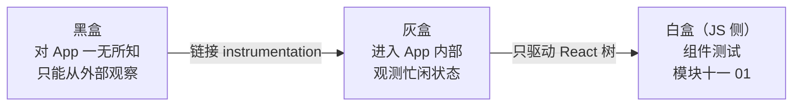
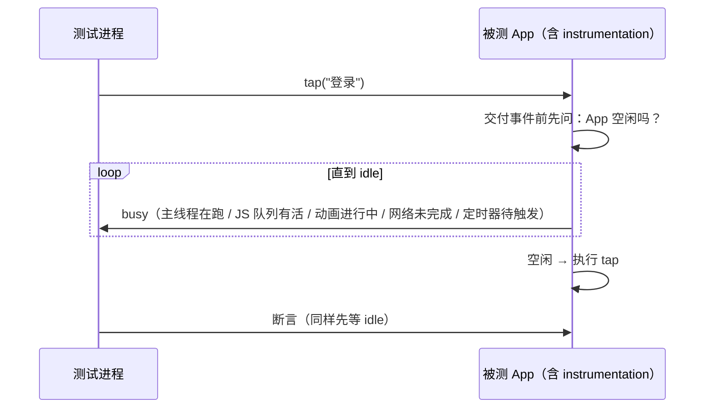
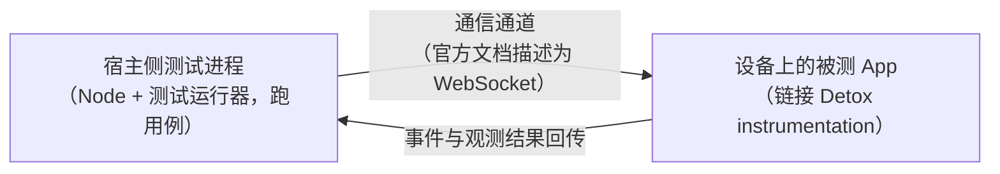
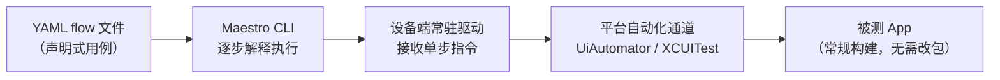
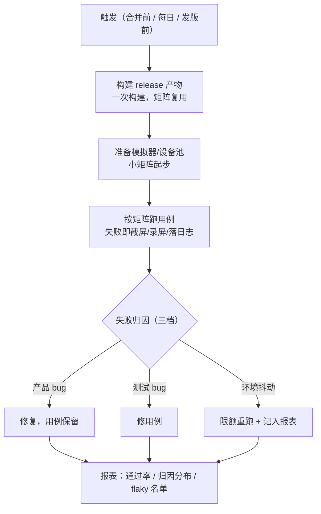

# 端到端测试与选型

> 金字塔顶层：真机/模拟器、release 构建、跑完整用户旅程。RN 的 E2E 框架看似三家打架（Detox / Maestro / Appium），其实各代表一种**同步哲学**——黑盒轮询（Appium）、灰盒空闲同步（Detox）、平台驱动器 + 可达性树（Maestro）。同步哲学决定了稳定性、速度与配置成本，选型先选哲学再选框架。本篇讲清三种机制的原理与代价，最后落到选型决策与 CI 配合。

## 1. E2E 的第一性问题：同步

E2E 脚本的本质是"对 UI 下指令 + 断言结果"。移动 App 永远是异步的：点登录 → JS 发请求 → 原生刷新视图——**指令执行时 UI 大概率还没就绪**。于是所有框架都逃不开同一个问题：**怎么知道"该等的时候在等、该走的时候在走"**。

最原始的答案是 sleep（等 2 秒再断言），它是 flaky 之父：等短了偶尔没就绪（假失败），等长了永远慢（假通过 + 流程拖沓），而且**它等的是时间而不是状态**。三个框架的差别，全在"拿什么替换 sleep"。

### 1.1 等待原语的光谱：从时间逼近状态

把"替换 sleep"的候选排成一条光谱，**等的东西越接近"状态"，flaky 越少、速度越贴真实**：

| 等待原语 | 等的是什么 | 失败模式 | 代表 |
|---------|-----------|---------|------|
| 固定 sleep | 一段固定时长 | 短了假失败、长了假通过，且永远慢 | 无框架裸写 |
| 显式等待 | 某个外部条件成立（轮询） | 条件写错就退化为 sleep | Appium |
| 稳定检测 | UI 层级连续不再变化 | "稳定"不等于"任务完成"，深异步仍要补等 | Maestro |
| 空闲同步 | App 内部任务队列归零 | 盲区需要 App 配合暴露 | Detox |

读法：从左到右，**等待的信息来源从"猜"逼近"观测"**——sleep 只能猜、显式等待猜条件、稳定检测猜变化、空闲同步直接看答案。后面三节就是这条光谱上的三个落点。

### 1.2 黑盒—灰盒光谱：同步能力与侵入性成正比

另一个正交的光谱是**框架对 App 内部的了解程度**：



- **黑盒**（Appium）：零侵入、任何包都能测，代价是同步全靠外部观察；
- **灰盒**（Detox）：要求专门构建（instrumentation），换来最准的忙闲观测；
- **白盒 JS 侧**（组件测试，模块十一 01）：对 React 树全知，但出不了 JS/原生那条缝。

一条工程推论：**同步精度的每一档提升，都用构建管线的耦合去换**——从"任何构建都能跑"到"专门 configuration"，再到"限定测试渲染器"。这不是缺点列表，是定价表：你要多准的同步，就付多深的侵入。

### 1.3 RN 的 E2E 为什么特别难：三个异步源

RN 的界面更新横跨三段异步，每一段都会让"指令后立刻断言"落空：

| 异步源 | 时序现象 | 谁最头疼 |
|--------|---------|---------|
| JS 异步渲染 | 断言时 reconcile/commit 还没完成 | 全部框架（黑盒最痛） |
| 原生时序 | 转场动画、输入法弹起、异步布局 | 全部框架 |
| 网络与数据 | 响应到达 → 状态更新 → 渲染完成，三段串行 | 全部框架 |

黑盒框架对三段只能逐个写等待条件；灰盒的空闲同步把三段**一起**纳入观测（JS 队列、动画、网络都是它登记的忙闲源）——这就是"Detox 同步最贴 RN 的异步本性"这句话的机制展开。

## 2. Detox：灰盒空闲同步

**定位**：为 RN 而生的 E2E 框架（Wix 开源）。"灰盒"指测试框架**进入 App 内部**：被测构建里链接了 Detox 的原生 instrumentation，框架能观测 App 的内部忙闲状态。

### 2.1 机制



核心机制是**空闲同步**：每条指令（tap/断言）执行前，Detox 等待 App 进入空闲——主线程没有排队的任务、JS 没有在跑的批次、动画结束、网络请求完成、没有即将到期的定时器。**等待的是"状态归零"而非固定时长**：慢机器多等、快机器少等，既不假失败也不假通过。

这条机制恰好治了 RN 的两个 E2E 顽疾：

- **JS 异步渲染**：断言时 reconcile/commit 还没完成 → idle 等待覆盖了它；
- **启动与导航的不确定性**：冷启动期间 native + JS 双端都忙，Detox 自动等忙完。

### 2.2 代价

- **需要 instrumented 构建**（专门的 configuration），不能拿线上包直接测；
- 空闲判定有盲区：自定义线程里的活、不经过已知通道的等待（比如自己 spin 的轮询）框架看不见——App 侧要配合暴露忙闲状态；
- 同步越强，**假阴性**越多：个别场景"永远不空闲"（持续动画的页面）需要显式配置豁免。

### 2.3 写法

```js
await element(by.id('username')).typeText('demo@site.dev');
await element(by.text('登录')).tap();
await waitFor(element(by.text('欢迎回来'))).toBeVisible();
```

`waitFor(...).whileElement(...)` 表达"边滚动边找"这类复合等待——但大部分场景里，空闲同步已经让显式等待降到最少。

### 2.4 双进程架构：两段命令与两套 configuration

把 §2 的机制落到工程面，先看清 Detox 的**双进程**形态：



- **用例跑在宿主 Node 进程**，指令经通信通道发往设备上的 App；App 内的 instrumentation 负责执行与忙闲观测，结果回传——1.2 说的"灰盒侵入"，物理形态就是 App 里多出来的这一层；
- **构建与测试分两段命令**（detox build / detox test）：先产出 instrumented 产物，再驱动它跑用例；
- **configuration 分 debug 与 release 两套**（配置文件里按平台声明）：debug 用于日常开发循环（可配合 dev 便利），release 用于贴近线上的验证——呼应 §6 第 1 条"必须测 release"。

一个运行纪律由此推出：**App 侧的 instrumentation 与宿主侧的测试库必须版本配套**——两端是同一个系统，升级时一起升，否则通道协议对不上（具体兼容面以官方文档为准）。

### 2.5 空闲同步的盲区清单（2.2 的展开）

2.2 的第二条"盲区"值得列成清单，每条盲区都对应"框架观测不到的忙闲源"：

| 盲区 | 为什么框架看不见 | 补法（定性） |
|------|----------------|-------------|
| 自定义线程里的工作 | 不在框架登记的线程清单里 | 用框架提供的同步配置注册自定义忙闲源 |
| 自旋轮询 / 裸 Promise 等待 | 不经过网络、定时器等已知通道 | 改造成框架可观测的通道，或显式 waitFor |
| 持续动画页面 | 动画不结束 = 永不空闲 | 对该场景显式豁免（同步配置） |
| 第三方 SDK 内部活动 | 闭源、无回调、无登记 | 观测 + 豁免的组合拳，逐个场景收编 |

判据：**空闲同步把"等"的责任从测试代码挪到了 App 内部——代价是 App 要"愿意被观测"**。凡是绕过已知通道的等待，都要么改造、要么登记、要么豁免，没有第四条路。

## 3. Maestro：平台驱动器 + 可达性树

**定位**：通用移动 UI 测试（不专属 RN），主打"写得起、跑得稳"。机制三点：

1. **驱动器架构**：CLI 与设备上常驻的小驱动程序通信——Android 驱动基于 UiAutomator 体系，iOS 驱动基于 XCUITest 体系（都是平台官方的 UI 自动化通道）；
2. **查询走可达性树**：元素定位基于系统暴露的可访问性层级（与模块十一 01 的 role 查询同源思想）——文本、content label、testID 都经由这棵树；
3. **动作间自动稳定**：每步执行后等 UI 层级"稳定下来"（不再变化）再做下一步，外加重试容错。

写法是 YAML 流（flow）：

```yaml
appId: com.example.app
---
- launchApp
- tapOn: "用户名"          # 按可见文本定位（走可达性树）
- inputText: "demo@site.dev"
- tapOn: "登录"
- assertVisible: "欢迎回来"
```

特点与代价：

- **上手成本最低**：无需写原生测试目标、无需 instrumented 构建、命令即流程；非工程师（QA/PM）也能写；
- 同步粒度比 Detox 粗：等的是"UI 稳定"而不是"任务队列清空"，深异步场景（网络慢、JS 长任务）偶尔仍要显式 `waitFor`；
- 定位依赖**可见语义**（文本/可达性标签）——这既是约束（界面得有可读语义，顺带逼出无障碍质量）也是与黑盒工具的兼容面。

### 3.1 驱动器架构：两条进程的对话

把机制三点画成一张图：



三个推论：

1. **用例是数据不是代码**（YAML）——非工程师可写、review diff 友好、用例之间的复用靠组合而不是函数；
2. **驱动常驻**——每步不需要重新建立连接，"重试容错"才有实现的空间（3.4 的重试语义）；
3. **走平台官方通道**——元素定位语义与系统 UI 层一致，这正是"可达性树"查询的地基（3.2）。

### 3.2 定位通道盘点：可达性树里有什么

可达性树对测试暴露的定位通道主要有三类：**可见文本、可访问性标签（accessibility label / content description 一类）、测试标识**。两条工程要点：

- **各框架对 testID 的解析路径不同**（走可访问性标识还是原生 tag，因框架与平台而异）——写用例前先用框架自带的元素拾取工具确认目标元素真的可达，别猜；
- **RN 侧要主动补语义**：关键元素补可访问性标签与语义角色，testID 规范化。这与模块十一 01 的"role 优先查询"是同一件事在 E2E 侧的投影：**语义完整度同时决定可测性与无障碍质量**——一处投入，两处收益。

### 3.3 迭代面与运行面

Maestro 的工程面有两块值得单列：

- **元素拾取工具**（Maestro Studio 一类）：交互式点选界面元素、生成定位片段——把"找元素"从翻日志变成点界面，YAML 用例的编写门槛进一步降低；
- **本地与云都能跑**：同一份 YAML 可以先在本地模拟器验证、再放进云设备池跑矩阵——与 §6 的"构建一次、矩阵复跑"天然衔接；
- **断言粒度**：以可见性/存在性为主，复杂条件组合的表达能力低于代码型框架——复杂逻辑（分支、循环、数据断言）还是留给代码层框架，别在 YAML 里硬写。

### 3.4 YAML 流的语义要点

把 flow 当"数据"读，有几个语义要点决定用例的组织方式：

- **单条 flow = 一段线性旅程**：从 launchApp 开始到断言结束，步骤顺序即执行顺序——所以"一条 flow 一个场景"是天然边界，别把多个场景塞进一条；
- **复用靠子流程**：公共步骤（登录、进入某页）抽成独立 flow 被引用（框架提供 flow 组合机制），避免复制粘贴造成语义漂移；
- **参数与环境变量**：同一流程在不同环境（测试账号、服务地址）下复跑——参数化让"流程"与"数据"分离，这条纪律与代码测试的用例参数化同构。

## 4. Appium：WebDriver 协议黑盒

**定位**：跨平台移动自动化的行业标准（WebDriver 协议），语言/平台/生态覆盖最广。机制上是**黑盒**：通过各平台的自动化服务（同样落在 UiAutomator/XCUITest 一类通道）操作 App，框架对 App 内部一无所知。

- 同步靠**显式等待**（explicit wait：轮询某条件成立，配超时）——条件写不对就退化为 sleep；
- 不要求改动 App 构建（纯黑盒），跨技术栈（原生/Flutter/RN/WebView 混合）一视同仁；
- RN 侧没有特殊优待：JS 渲染的异步性、原生组件的时序全靠等待策略兜——稳定性上限取决于等待纪律。

### 4.1 显式等待：正确姿势与退化为 sleep 的路径

显式等待是 Appium 一切稳定性的支点，值得把它的骨架与退化路径写全：

```js
// 伪代码：显式等待的骨架（WebDriver 语义）
await driver.wait(
  until.elementLocated(by.xpath('//android.widget.TextView[@text="欢迎回来"]')),
  TIMEOUT,
  '登录后未出现欢迎文案',
);
```

退化路径分两个方向，最终都长成 sleep 的混合体：

1. **条件太窄**：只等"元素存在"，而页面在元素出现后还有数据加载 → 偶发假失败 → 团队加 sleep 兜底 → 从此又慢又抖；
2. **条件太宽**：等一个"永远为真"的条件 → 等待形同虚设 → 假通过率上升。

纪律：**等待条件绑定"业务状态的可观测信号"**（文案出现、列表条数到位、元素变为可点），超时与错误信息显式给出。与 RN 的现实对齐（1.3 的三段异步）：黑盒下等待条件的枚举天然不完备——这正是"Appium 稳定性上限取决于等待纪律"（§4）的机制展开。

### 4.2 Appium 的 RN 侧体检清单

黑盒意味着 RN 的所有特殊性都要靠测试侧自己兜底，一份引用清单：

| RN 特殊性 | 黑盒下的表现 | 应对 |
|----------|-------------|------|
| JS 异步渲染（模块五） | 断言时机不稳定 | 显式等待绑定渲染结果信号 |
| 手势复杂仲裁（模块六） | 滑动/拖拽指令行为依实现而异 | 用平台坐标/手势 API 显式表达 |
| WebView 混合（模块十二） | 需要切换自动化上下文 | 用框架的上下文切换能力，别硬点 |
| OTA 后的 UI 变化（模块八） | 用例与 bundle 版本耦合 | 用例对"语义"断言，不对"像素"断言 |

读法：这张表是"黑盒成本"的具象化——**Appium 的覆盖面优势，是用"每个 RN 特殊性都要显式兜底"换来的**。

## 5. 对照与选型

| | Detox | Maestro | Appium |
|--|-------|---------|--------|
| 同步哲学 | 灰盒空闲同步（App 内 instrumentation） | 驱动器 + 可达性树，步骤间自动稳定 | 黑盒 + 显式等待 |
| 构建要求 | 专门 configuration | 常规构建即可 | 常规构建即可 |
| 语言 | JS/TS | YAML | 多语言 |
| RN 契合 | 专为 RN 设计 | 通用（可达性对 RN 友好） | 通用 |
| 上手/维护成本 | 中（配置 + 构建管线） | 低 | 中高（等待策略维护） |

选型决策（按顺序问）：

1. **只有精力保关键路径的 RN 团队** → Detox（同步最贴 RN 的异步本性）或 Maestro（成本最低、见效最快）——两者都能从"登录、下单、支付"三五条流程起步；
2. **已有 Appium 资产 / 混合技术栈团队（原生 + RN + WebView，模块十二的混合 App）** → Appium 一套框架覆盖全部界面，RN 页面按普通黑盒对待；
3. **要快速建立 E2E 文化、让 QA 参与写用例** → Maestro（YAML 门槛低）；
4. 混合路线完全合法：**Maestro 做日常冒烟 + Detox 做 RN 核心流程深验证**，分层按成本分配。

### 5.1 团队画像维度：给对照表补一组行列式

上面的表回答"框架之间差什么"，但选型还差一个变量：**你们团队的画像**。两类成本的性质不同——构建/配置成本是一次性投入，用例维护成本是持续付出；画像决定哪种成本更痛：

| 团队画像 | 倾向 | 关键理由 |
|---------|------|---------|
| RN 主导、前端工程师为主 | Detox 或 Maestro | JS/TS 或 YAML 心智近，同步问题最贴 RN |
| QA 主导、要快速建立用例库 | Maestro 起步，深流程逐步补 Detox | 门槛低先跑起来，按层补深度 |
| 大型组织、多技术栈并存 | Appium | 一套框架覆盖原生/RN/WebView |
| 平台工程师强、愿意养 instrumented 构建 | Detox | 灰盒收益吃满，构建成本有人接 |

### 5.2 分层混用的参考骨架

"混合路线完全合法"（决策第 4 条）落成一张骨架表——每层一个框架、一个频率、一个问题：

| 层 | 内容 | 框架（示例） | 频率 | 回答的问题 |
|----|------|-------------|------|-----------|
| 冒烟层 | 启动、登录、主路径 3–5 条 | Maestro | 每次提交 | "坏没坏？" |
| 核心流程层 | 下单/支付/设置变更全旅程 | Detox | 每日/合并前 | "对不对？" |
| 兼容矩阵层 | OS 版本 × 机型抽样 | Appium 或云设备池 | 发版前 | "到处都对吗？" |

读法：三层各守一个语义，**框架按层的同步需求分配**——冒烟不需要灰盒精度，核心流程要，矩阵层要覆盖面。层与层的用例不重复：同一条旅程升到哪层就留在哪层。

### 5.3 把选型写成可复盘的记录

与[模块一 04 的 ADR 骨架](../rn-全景与演进/04-RN生态与选型建议.md)同构：E2E 选型也值得一条 ADR，字段四个——**背景**（团队画像 + 被测 App 特征）、**候选与权衡**（§5 对照表的取舍）、**决策**（分层骨架 5.2 的分配）、**反悔条件**（如"冒烟层 flaky 率连续超标 → 重估同步哲学"）。E2E 选型的反悔成本高（用例是资产），所以"反悔条件"这一字段尤其重要：**它让重估有触发器，而不是等团队痛到才想起来**。

## 6. 与构建、CI 的配合

1. **必须测 release（或至少 production-like）构建**：dev 构建的 JS 未压缩、调试链路常驻，行为与性能都失真（模块九 01 的老规矩）；minify 后 testID 保留（它不是代码压缩目标），但**代码里忘了传 testID/语义标签，E2E 到运行期才发现**——把"可测性"（统一 testID 规范、关键元素带语义标签）当 lint 级纪律，比事后补标签便宜得多；
2. **CI 矩阵**：E2E 跑在模拟器/云设备池上，按"操作系统版本 × 关键机型"取一个小矩阵起步；release 构建产物在 CI 内构建一次、矩阵复跑（构建贵、跑用例相对便宜）；
3. **flaky 治理三板斧**：
   - **隔离**：每条流程从干净状态开始（重装/重置存储），流程间零依赖；
   - **归因**：失败分"产品 bug / 测试 bug / 环境抖动"三档记录，只对第三档用重跑策略掩盖，且重跑要有上限与报表——**无脑重跑会把真 bug 也盖住**；
   - **等待显式化审计**：代码库里每出现一个硬编码 sleep 都当作坏味道 review（三家的框架都提供了更好的原语）；
4. **与迁移/发布的联动**：模块七 06 的金丝雀构建、模块八 05 的 OTA 灰度，验收动作都是同一句"关键路径 E2E 绿"——E2E 是这些流程的守门员，先于它们存在。

### 6.1 一条 E2E 流程在 CI 里的生命周期

把 §6 四条装进一张流程图，就是 E2E 在 CI 里的完整一生：



两个工程要点：**构建一次、矩阵复跑**（第 2 条的经济学：构建是分钟级贵操作，跑用例相对便宜——复用比重复构建省得多）；**产物（截屏/录屏/日志）是归因的原料**——没有产物的失败等于没有归因线索，主流框架都支持失败时自动产出这三类产物，CI 里务必开启。

### 6.2 本地开发循环与 CI 的分工

E2E 的"开发循环"与"验收循环"要分开养：

| 场景 | 跑什么 | 目的 |
|------|--------|------|
| 写用例/调试时 | 本地单条流程 + 元素拾取工具 | 快速迭代定位与断言 |
| 提交前 | 本地冒烟层全量 | 挡住明显破坏 |
| CI 合并前/每日 | 分层骨架全量 + 小矩阵 | 归因、报表、守门 |
| 发版前 | 兼容矩阵层 | 覆盖面确认 |

分工的原则与金字塔同构：**越靠左越频繁越便宜，越靠右越全面越贵**——本地永远不跑全量矩阵（慢到没人会用），CI 永远不只跑单条（守门员失职）。

### 6.3 归因报表与 flaky 名单

三板斧的"归因"落成报表字段才算治理：**失败用例 / 归因档位 / 重跑次数 / 关联产物链接**。两条配套纪律：

- **flaky 名单（隔离区）**：连续多次被判"环境抖动"的用例进隔离区（quarantine）限时修复——隔离区不是垃圾桶，是带截止日期的待办队列，超期未修就该下线或重构；
- **重跑留痕**："重跑后通过"在报表里是独立字段，不与"通过"合并——否则重跑掩盖的一切又从报表里消失了。

判据：**治理 E2E 的对象不是"失败"，是"说不清楚的失败"**——三档归因把每条失败变成可讨论的数据，flaky 才有收敛的可能。

## 7. 常见误区

| 误区 | 事实 | 一句话纠正 |
|------|------|-----------|
| "E2E 覆盖越多越好" | 分钟级成本 + 高脆弱度，金字塔顶层只保关键路径 | E2E 是守门员不是主防线 |
| "加了 sleep 就稳了" | sleep 等时间不等状态，是 flaky 之父（§1） | 每个 sleep 换成框架的等待原语 |
| "Detox 空闲同步 = 永不 flaky" | 盲区与永不空闲场景需要显式配合（2.2/2.5） | 灰盒降低 flaky 率，不归零 |
| "Maestro 简单所以只能做 demo" | 同步粒度粗是边界，但冒烟与关键流程足够（5.2 分层） | 按层分配框架，不按"高级/低级" |
| "Appium 老所以过时" | 黑盒的代价是等待纪律，换来的是全覆盖与既有资产 | 它解决的是"多技术栈"问题，不是 RN 问题 |
| "dev 包也能测出线上问题" | dev 构建行为失真（§6 第 1 条） | E2E 必须 release（或 production-like） |
| "重跑是治 flaky 的手段" | 重跑只是掩盖，三档归因才是治理（§6 第 3 条） | 重跑限额 + 留痕 |
| "testID 随手写" | 语义标签是 E2E 的定位地基，语义缺失运行期才发现（§6 第 1 条） | 可测性当 lint 级纪律 |

## 小结

- E2E 的第一性问题是同步：sleep 等的是时间而不是状态，是一切 flaky 的源头；
- 三种同步哲学：Detox 灰盒空闲同步（instrumentation 观测忙闲，最贴 RN 的异步本性，代价是专门构建）；Maestro 平台驱动器 + 可达性树（步骤间自动稳定，上手成本最低）；Appium WebDriver 黑盒（显式等待，生态与覆盖最广）；
- 选型先选哲学：RN 关键流程 → Detox/Maestro；混合技术栈/已有资产 → Appium；分层混用合法；
- E2E 纪律四条：release 构建、小矩阵起步、状态隔离 + 失败三档归因、sleep 零容忍——它同时是架构迁移（模块七 06）与 OTA 灰度（模块八 05）的验收守门员。

## 自测

1. E2E 的第一性问题是什么？sleep 为什么是"flaky 之父"？（→ §1）
2. 四种等待原语各等的是什么？光谱如何从"猜"逼近"观测"？（→ 1.1）
3. 黑盒/灰盒/白盒的差别如何兑换成同步能力与构建侵入？定价表是什么？（→ 1.2）
4. RN 的 E2E 面对哪三个异步源？为什么说空闲同步把三段一起纳入观测？（→ 1.3）
5. Detox 空闲同步等的是哪些队列归零？双进程架构与两段命令各是什么？（→ 2.1/2.4）
6. 空闲同步的盲区清单有哪四类？各自的补法是什么？（→ 2.5）
7. Maestro 的三个机制点是什么？"用例是数据不是代码"带来哪些工程性质？（→ 3.1）
8. 为什么说语义完整度同时决定可测性与无障碍质量？（→ 3.2）
9. 显式等待的两条退化路径是什么？等待条件应该绑定什么？（→ 4.1）
10. 团队画像维度如何修正对照表的结论？"一次性成本"与"持续成本"怎么权衡？（→ 5.1）
11. 三层骨架各回答什么问题？框架按什么分配到层？（→ 5.2）
12. CI 里"构建一次、矩阵复跑"的经济学理由？失败三档归因如何落报表？（→ 6.1/6.3）
