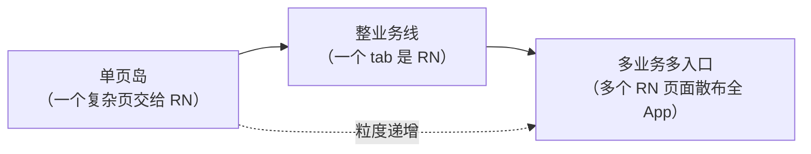
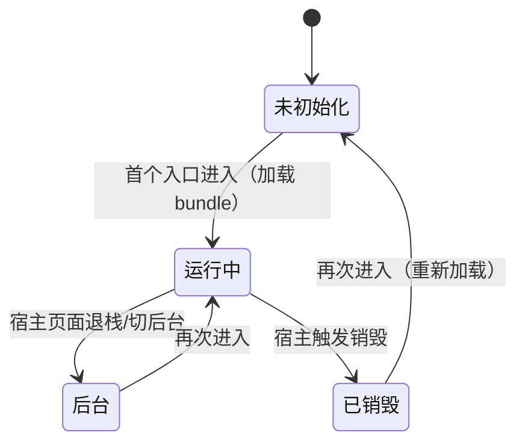

# 原生工程集成与生命周期

> 全站到此都默认"App 属于 RN"（RN 站在工程中央）；现实中大量 App 是反过来的——**原生工程为主，RN 以页面/业务块的形式嵌入**（brownfield，"棕地"）。动机各不相同：渐进迁移旧 App、部分业务要 RN 的迭代速度、多团队技术栈共存。本篇讲两端的集成方式、多实例与生命周期的真相——所有这些问题都指向同一个根源：**JS 运行时是进程级的重资源，天然是单例**。

## 1. 形态谱系：RN 以什么粒度进来



粒度决定后面所有问题的难度：单页岛的通信边界最小（甚至可以 initialProperties 打满）；多入口多业务才需要认真面对多实例、导航与生命周期。先想清楚目标形态，再往下读。

## 2. Android 集成

现行官方指南（Integration with Existing Apps）的主线，类名以所用版本文档为准：

```kotlin
// Application：实现 ReactApplication，提供 ReactHost（新架构的宿主对象）
class MainApplication : Application(), ReactApplication {
  override val reactHost: ReactHost by lazy {
    DefaultReactHost.getDefaultReactHost(applicationContext, reactNativeHost)
  }
  // reactNativeHost 提供 packages、入口模块名、dev 支持等配置
  override fun onCreate() {
    super.onCreate()
    SoLoader.init(this, OpenSourceMergedSoMapping)   // so 加载（新架构入口）
    if (BuildConfig.IS_NEW_ARCHITECTURE_ENABLED) load()  // DefaultNewArchitectureEntryPoint
  }
}
```

承载 RN 页面的最小路径是 **`ReactActivity` + `DefaultReactActivityDelegate`**（组件名与 JS 侧 `AppRegistry.registerComponent` 的名字对齐）；要嵌进既有 Activity/Fragment 时，官方另有"与 Fragment 集成"的指南——把 RN 视图作为 fragment 挂进任意容器，生命周期由宿主接线。

机制上的三个要点：

1. **构建接线是前置条件**：settings.gradle 应用 autolink 插件、app 模块应用 React Gradle 插件——autolinking（`react-native config` 驱动）负责把依赖里的原生模块接进工程（模块八 03 讲过它在解析侧的角色）；
2. **ReactHost 是进程级对象**（挂在 Application 上），Activity 只是"借"它渲染——这是第 4 节"单例"的工程体现；
3. dev 模式需要网络权限与 cleartext 配置（debug manifest），release 由 Gradle 插件自动处理 bundle 打包。

## 3. iOS 集成

现行指南（0.76+ 的样例）以 **factory 一族**为主线：`RCTReactNativeFactory` + factory delegate（提供 bundle URL 等配置）+ `RCTRootViewFactory` 创建根视图——这是对旧形态的封装与收编。存量代码里更常见的是**旧形态**：

```objc
// 旧形态（存量主力）：bridge 持有运行时，rootView 是它的一个"根"
NSURL *jsCodeLocation = [RCTBundleURLProvider jsBundleURLForBundleRoot:@"index"];
RCTBridge *bridge = [[RCTBridge alloc] initWithBundleURL:jsCodeLocation
                                        moduleProvider:nil
                                         launchOptions:nil];
RCTRootView *rootView = [[RCTRootView alloc] initWithBridge:bridge
                                                 moduleName:@"MyComponent"
                                          initialProperties:@{@"from": @"native"}];
[self.view addSubview:rootView];
```

要点：

1. **Podfile 接线**：`use_react_native!` 与新架构开关（`RCT_NEW_ARCH_ENABLED`）在 Podfile 侧生效，第三方库经 autolinking 装配；
2. 旧形态的 **bridge 生命周期要自己管**：谁创建谁持有、何时 invalidate——工厂形态把这套样板收进了工厂对象；
3. `moduleName` 与 JS 侧 `AppRegistry.registerComponent` 对齐，`initialProperties` 是原生化初始化参数（第 6 节）。

## 4. 引擎单例：多实例的真相

**一个 RN 实例 = 一个 JS 引擎 + 一份模块表 + 一个运行环境**，是进程级重资源。由此三条工程事实：

| 诉求 | 真相 |
|------|------|
| "多个 RN 页面" | 多个 root view **共享同一运行时**（Android 多 Activity 共享 ReactHost；iOS 多 rootView 共享 bridge/factory）——不是多实例 |
| "真正的多实例"（独立引擎） | 技术上可行（各自创建运行时），代价按份计：内存翻倍、启动按次付、模块状态彼此隔离——只用于隔离崩溃域、运行不同 bundle 等硬需求 |
| "页面级隔离" | 优先用**单实例 + 多 root/多 AppRegistry 入口**表达，而不是多实例 |

单实例多入口的设计推论：**所有 RN 入口共享一个 JS 命名空间**——全局补丁、单例状态（登录态、埋点队列）天然跨入口共享，这既是红利（免同步）也是坑（一个入口的 bug 污染所有入口）。入口间跳转要有明确的路由协议（模块十二 02）。

与 OTA 的联动：多实例（或未来分业务包）时，每个 bundle 有自己的兼容域（模块八 05 的 runtime version）——**实例数 × 兼容矩阵**是 brownfield 发布工程的复杂度来源。

## 5. 生命周期：状态机与白屏问题族



管理要点与常见事故：

1. **谁触发销毁**：Android 旧 `ReactInstanceManager` 时代要手动对齐 `onHostPause/Resume/Destroy`；新架构的 `ReactHost` 把生命周期收编进宿主对象，由 ReactActivity/Fragment 的接线喂事件——**brownfield 场景按官方 Fragment 指南接，不要绕过宿主自己管理**；
2. **dev 模式的额外居民**：开发菜单、红屏、Metro 连接是**进程级**的——多个 RN 入口在 dev 下共享一个 dev 菜单与一条 Metro 连接；宿主工程的 release 发布流程要确认这些不外泄；
3. **白屏问题族**（现象 → 根因）：
   - 销毁后重进白屏 → 销毁了运行时但复用了旧 root/旧引用（或反之，运行时活着但视图树已被拆）——销毁与重建必须成对；
   - 进入短暂白屏 → 运行时还在加载/执行 bundle（模块二 04 的启动链路）——入口页给加载态，而不是白屏硬等；
   - 只在特定入口白屏 → `moduleName` 与 `AppRegistry` 注册名不一致；
   - 偶发白屏 → 入口时序：在运行时就绪前触发了模块调用（加"就绪门"，第 6 节）。

## 6. 通信边界与初始化参数

brownfield 的"原生 → RN"有三条正规通道，按信息性质选：

| 通道 | 语义 | 适用 |
|------|------|------|
| `initialProperties`（构造参数） | 创建 root 时一次性传入 | 页面的初始上下文（ID、来源、配置）——**只读语义，变更不回传** |
| 原生模块方法（RN 调原生） | 服务调用 | 取数据、能力调用（登录态、支付）——模块四/模块七的正规军 |
| 事件（原生推 RN） | 广播 | 原生侧状态变化通知（登录过期、深链） |

纪律：initialProperties 不要当"持续状态同步"用（它只在创建时读一次）；入口就绪前（bundle 执行完成前）的原生调用需要"就绪门"——工程上常见的做法是 JS 侧启动后立刻回调一个 ready 事件/调用一个 ready 模块，宿主把它作为"可以派发深链/事件"的信号。

## 小结

- 集成的两端主线：Android 走 ReactApplication/ReactHost + ReactActivity（Fragment 指南嵌任意容器）；iOS 现行为 factory 一族（RCTReactNativeFactory/RCTRootViewFactory），存量代码以 RCTBridge/RCTRootView 形态为主；
- 多实例的真相：运行时是进程级重资源，"多页面"用单实例多 root 表达；真多实例只留给隔离崩溃域/多 bundle 的硬需求；
- 生命周期是显式状态机：销毁与重建成对、dev 居民是进程级的、白屏四问（销毁时序/加载态/名字对齐/就绪门）；
- 原生 → RN 三通道（initialProperties/模块/事件）各管一段，就绪门挡住"启动窗口期的调用"——通信边界的完整设计在 02 篇展开。
