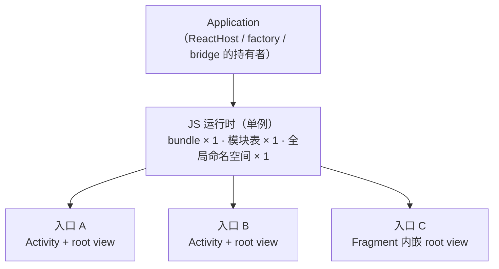
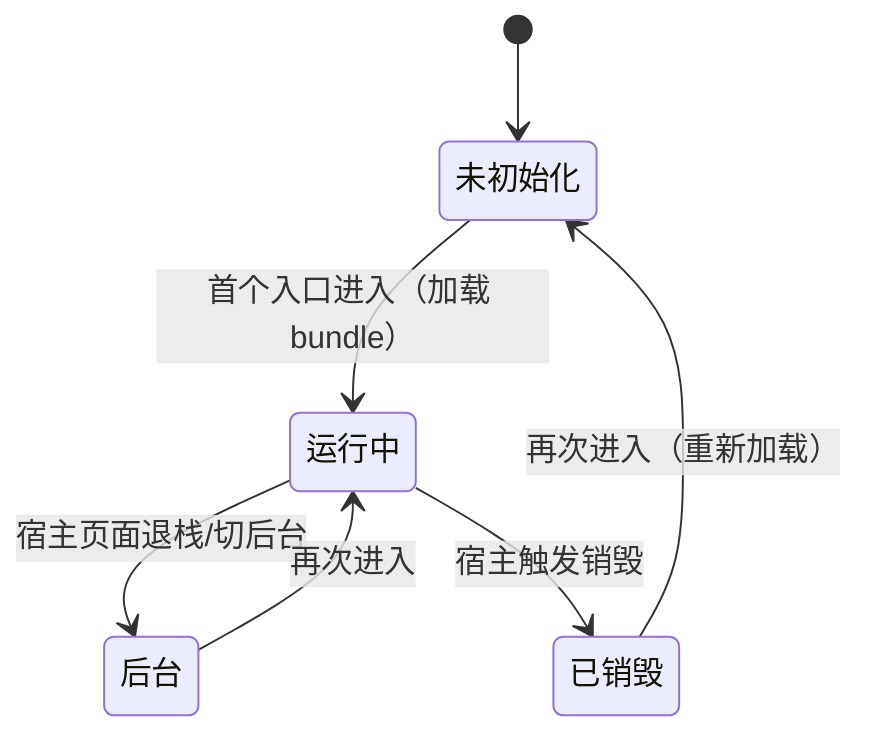

# 原生工程集成与生命周期

> 全站到此都默认"App 属于 RN"（RN 站在工程中央）；现实中大量 App 是反过来的——**原生工程为主，RN 以页面/业务块的形式嵌入**（brownfield，"棕地"）。动机各不相同：渐进迁移旧 App、部分业务要 RN 的迭代速度、多团队技术栈共存。本篇讲两端的集成方式、多实例与生命周期的真相——所有这些问题都指向同一个根源：**JS 运行时是进程级的重资源，天然是单例**。

## 1. 形态谱系：RN 以什么粒度进来


粒度决定后面所有问题的难度：单页岛的通信边界最小（甚至可以 initialProperties 打满）；多入口多业务才需要认真面对多实例、导航与生命周期。先想清楚目标形态，再往下读。

### 1.1 形态谱系的选型判据

"先想清楚目标形态"不是一句空话——粒度选错，后面多实例、导航、发布的复杂度全部加倍。选型时把三组变量摆上桌：

| 判断维度 | 偏向小粒度（单页岛） | 偏向大粒度（整业务线/多入口） |
|---------|---------------------|------------------------------|
| 页面数量 | 一两个重交互页（编辑器、播放器、复杂表单） | 一条业务线、一个 tab、乃至多个散布入口 |
| 迭代节奏 | 页面节奏与原生壳一致，随壳发版 | 业务要按自己的节奏 OTA 快跑（模块八 05） |
| 团队构成 | 原生团队为主，RN 是"外援" | 独立 RN 团队长期维护该业务 |

三问得出初步粒度后，先用第 4 节的硬约束校验一遍：**入口越多，越要依赖"单实例多 root"**——真多实例按份计价，不要被"每个业务一个引擎"的直觉带偏；再检查发布诉求（是否要独立 OTA），它决定 bundle 怎么拆（模块八 05 的兼容域）。

## 2. Android 集成

现行官方指南（Integration with Existing Apps）的主线，类名以所用版本文档为准：

```kotlin
// Application：实现 ReactApplication，提供 ReactHost（新架构的宿主对象）
class MainApplication : Application(), ReactApplication {
  override val reactHost: ReactHost by lazy {
    DefaultReactHost.getDefaultReactHost(applicationContext, reactNativeHost)
  }
  // reactNativeHost 提供 packages、入口模块名、dev 支持等配置
  override fun onCreate() {
    super.onCreate()
    SoLoader.init(this, OpenSourceMergedSoMapping)   // so 加载（新架构入口）
    if (BuildConfig.IS_NEW_ARCHITECTURE_ENABLED) load()  // DefaultNewArchitectureEntryPoint
  }
}
```

承载 RN 页面的最小路径是 **`ReactActivity` + `DefaultReactActivityDelegate`**（组件名与 JS 侧 `AppRegistry.registerComponent` 的名字对齐）；要嵌进既有 Activity/Fragment 时，官方另有"与 Fragment 集成"的指南——把 RN 视图作为 fragment 挂进任意容器，生命周期由宿主接线。

机制上的三个要点：

1. **构建接线是前置条件**：settings.gradle 应用 autolink 插件、app 模块应用 React Gradle 插件——autolinking（`react-native config` 驱动）负责把依赖里的原生模块接进工程（模块八 03 讲过它在解析侧的角色）；
2. **ReactHost 是进程级对象**（挂在 Application 上），Activity 只是"借"它渲染——这是第 4 节"单例"的工程体现；
3. dev 模式需要网络权限与 cleartext 配置（debug manifest），release 由 Gradle 插件自动处理 bundle 打包。

### 2.1 ReactActivity 与 Delegate：门面之下的接线

模板里的 `MainActivity` 几乎是空的——真正的工作全部转发给 delegate：

```kotlin
// MainActivity（骨架示意；与模块二 01 的 ReactActivityDelegate 是同一门面模式）
class MainActivity : ReactActivity() {
  // 组件名与 JS 侧 AppRegistry.registerComponent 的名字对齐（白屏排查第一站）
  override fun createReactActivityDelegate(): ReactActivityDelegate =
      DefaultReactActivityDelegate(this, mainComponentName, fabricEnabled)
}
```

读这段接线抓两点：

1. **delegate 是转发层**：onCreate/onResume/onPause/onDestroy 经它转给 ReactHost——第 5 节"按官方指南接线、不要绕过宿主"的"宿主接线"指的就是这一层；
2. **组件名三位一体**：`mainComponentName`、JS 侧 `AppRegistry` 注册名、多入口时的入口键共享同一名字空间——第 5 节白屏第 3 问的答案就落在这里。

### 2.2 Fragment 宿主的接线走读

嵌进既有 Activity/Fragment 时，没有 ReactActivity 帮你转发——**每个生命周期回调都要手工喂给宿主对象**，这正是官方 Fragment 指南的实质：

```kotlin
// RN Fragment 宿主的接线（骨架示意；对应官方"与 Fragment 集成"指南）
class MyRNPageFragment : Fragment() {
  private lateinit var reactDelegate: ReactDelegate

  override fun onViewCreated(view: View, savedInstanceState: Bundle?) {
    val reactHost = (requireActivity().application as MainApplication).reactHost
    // 入口名与初始参数（第 6 节 initialProperties 的构造时机就在这里）
    reactDelegate = ReactDelegate(requireActivity(), reactHost, "MyComponent", launchOptions)
    (view as ViewGroup).addView(reactDelegate.reactRootView)   // 根视图挂进自己的容器
  }

  override fun onResume()  { super.onResume();  reactDelegate.onHostResume(requireActivity()) }
  override fun onPause()   { super.onPause();   reactDelegate.onHostPause() }
  override fun onDestroy() { super.onDestroy(); reactDelegate.onHostDestroy() }
}
```

对照 ReactActivity 的自动接线，brownfield 的额外心智负担显现出来：**转发遗漏不会编译报错，只会在运行时以"生命周期串台"的形式出现**——onPause 忘喂，JS 定时器在后台照跑；onDestroy 忘喂，监听器残留（第 7 节）。工程纪律：把接线收进一个公共基类或封装，禁止各业务 Fragment 各自手写；返回键转发同理（[02 篇 3.1](02-混合导航与通信边界.md)）。

## 3. iOS 集成

现行指南（0.76+ 的样例）以 **factory 一族**为主线：`RCTReactNativeFactory` + factory delegate（提供 bundle URL 等配置）+ `RCTRootViewFactory` 创建根视图——这是对旧形态的封装与收编。存量代码里更常见的是**旧形态**：

```objc
// 旧形态（存量主力）：bridge 持有运行时，rootView 是它的一个"根"
NSURL *jsCodeLocation = [RCTBundleURLProvider jsBundleURLForBundleRoot:@"index"];
RCTBridge *bridge = [[RCTBridge alloc] initWithBundleURL:jsCodeLocation
                                        moduleProvider:nil
                                         launchOptions:nil];
RCTRootView *rootView = [[RCTRootView alloc] initWithBridge:bridge
                                                 moduleName:@"MyComponent"
                                          initialProperties:@{@"from": @"native"}];
[self.view addSubview:rootView];
```

要点：

1. **Podfile 接线**：`use_react_native!` 与新架构开关（`RCT_NEW_ARCH_ENABLED`）在 Podfile 侧生效，第三方库经 autolinking 装配；
2. 旧形态的 **bridge 生命周期要自己管**：谁创建谁持有、何时 invalidate——工厂形态把这套样板收进了工厂对象；
3. `moduleName` 与 JS 侧 `AppRegistry.registerComponent` 对齐，`initialProperties` 是原生化初始化参数（第 6 节）。

### 3.1 factory 形态的走读（Swift）

现行 factory 主线的最小用法：

```swift
// AppDelegate（骨架示意；现行模板的 RCTAppDelegate + RCTReactNativeFactory 组合）
@main
class AppDelegate: RCTAppDelegate {
  override func application(
    _ application: UIApplication,
    didFinishLaunchingWithOptions launchOptions: [UIApplication.LaunchOptionsKey: Any]? = nil
  ) -> Bool {
    reactNativeFactory = RCTReactNativeFactory(delegate: self)
    // modulename 与 JS 侧 AppRegistry.registerComponent 的名字对齐
    reactNativeFactory.startReactNative(withModuleName: "MyComponent", in: window)
    return super.application(application, didFinishLaunchingWithOptions: launchOptions)
  }
}
```

factory 把"bundle URL 从哪来、rootView 谁建、dev 支持怎么挂"这套样板收编成一个对象；delegate 协议是它的配置出口（bundle URL、新架构开关等）。理解 factory 的正确姿势：**它不是新机制，是旧形态的托管版**——第 4 节"运行时是进程级单例"的判断对两种形态同样成立。

### 3.2 旧形态的持有纪律与 rootView 的尺寸契约

存量 bridge 形态的三条持有纪律：

1. **持有层级决定生命周期层级**：bridge 挂在 Application/单例层 → 全 App 共享、不随页面销毁；bridge 挂在某个 ViewController → 随该 VC 生灭，多入口各自创建（≈ 第 4 节的"按份计价"）——先定持有层级，再谈 invalidate；
2. **invalidate 只做一次、只由持有者做**：多 rootView 共享同一 bridge 时，页面退栈只拆 root（removeFromSuperview），最后一个入口退场才 invalidate——提前 invalidate 会让其余入口瞬间失联（白屏问题族的"销毁时序"项）；
3. **rootView 有尺寸契约**：容器给的 frame 必须非零；需要"由内容撑高"时用 `sizeFlexibility`（flexibleWidth/flexibleHeight）声明，让 JS 布局结果反算 `intrinsicContentSize`——"RN 岛高度不刷新"多半是这份契约没接上。

第三条是 [02 篇](02-混合导航与通信边界.md)拓扑二的前置知识：岛的高度协商本质上是"native frame"与"JS 内容高度"两个权威的握手，契约没接上就只能靠猜。

## 4. 引擎单例：多实例的真相

**一个 RN 实例 = 一个 JS 引擎 + 一份模块表 + 一个运行环境**，是进程级重资源。由此三条工程事实：

| 诉求 | 真相 |
|------|------|
| "多个 RN 页面" | 多个 root view **共享同一运行时**（Android 多 Activity 共享 ReactHost；iOS 多 rootView 共享 bridge/factory）——不是多实例 |
| "真正的多实例"（独立引擎） | 技术上可行（各自创建运行时），代价按份计：内存翻倍、启动按次付、模块状态彼此隔离——只用于隔离崩溃域、运行不同 bundle 等硬需求 |
| "页面级隔离" | 优先用**单实例 + 多 root/多 AppRegistry 入口**表达，而不是多实例 |

单实例多入口的设计推论：**所有 RN 入口共享一个 JS 命名空间**——全局补丁、单例状态（登录态、埋点队列）天然跨入口共享，这既是红利（免同步）也是坑（一个入口的 bug 污染所有入口）。入口间跳转要有明确的路由协议（模块十二 02）。

与 OTA 的联动：多实例（或未来分业务包）时，每个 bundle 有自己的兼容域（[模块八 05 · OTA 更新工程实践](../rn-Metro打包与热更新/05-OTA更新工程实践.md)的 runtime version）——**实例数 × 兼容矩阵**是 brownfield 发布工程的复杂度来源。

### 4.1 单实例多入口的运行时结构

把"多入口共享运行时"画出来，第 4 节三条工程事实就有了空间感：



读图的三个推论：

1. **入口是轻的，运行时是重的**——进出入口只动 root 层，运行时层不重建（这正是"第二个 RN 页面进入很快"的原因）；
2. **全局命名空间是真正的共享面**——单例状态、补丁、缓存跨入口可见（第 4 节的红利与坑都在这一层发生）；
3. **宿主对象是唯一的单例点**——它决定销毁语义：销毁运行时 = 所有入口同时失联，所以"销毁运行时"永远是进程级决策，不是页面级决策。

### 4.2 多 root 与多实例的成本对照

| 维度 | 单实例多 root（默认） | 真多实例（各自运行时） |
|------|----------------------|----------------------|
| 内存 | 一份引擎 + 各入口视图树 | 引擎按份计，首份之外近乎翻倍 |
| 启动 | 后续入口近零成本（复用运行时） | 每个入口都走完整启动链（[模块二 01](../rn-启动流程原理/01-Android启动链路.md)） |
| 状态共享 | 天然共享（同一命名空间） | 彼此隔离，要自建通信 |
| 崩溃域 | 一个入口的 JS 异常波及所有入口 | 崩溃域隔离（真多实例的核心卖点） |
| bundle | 共享一份（或按入口分包） | 各自加载，兼容矩阵独立（模块八 05） |

选型口径回到第 4 节的表：默认答案永远是左列；右列只在"隔离崩溃域 / 运行不同 bundle"这类硬需求下启用，且启用前先算一遍内存与启动的按份账。

## 5. 生命周期：状态机与白屏问题族



管理要点与常见事故：

1. **谁触发销毁**：Android 旧 `ReactInstanceManager` 时代要手动对齐 `onHostPause/Resume/Destroy`；新架构的 `ReactHost` 把生命周期收编进宿主对象，由 ReactActivity/Fragment 的接线喂事件——**brownfield 场景按官方 Fragment 指南接，不要绕过宿主自己管理**；
2. **dev 模式的额外居民**：开发菜单、红屏、Metro 连接是**进程级**的——多个 RN 入口在 dev 下共享一个 dev 菜单与一条 Metro 连接；宿主工程的 release 发布流程要确认这些不外泄；
3. **白屏问题族**（现象 → 根因）：
   - 销毁后重进白屏 → 销毁了运行时但复用了旧 root/旧引用（或反之，运行时活着但视图树已被拆）——销毁与重建必须成对；
   - 进入短暂白屏 → 运行时还在加载/执行 bundle（模块二 04 的启动链路）——入口页给加载态，而不是白屏硬等；
   - 只在特定入口白屏 → `moduleName` 与 `AppRegistry` 注册名不一致；
   - 偶发白屏 → 入口时序：在运行时就绪前触发了模块调用（加"就绪门"，第 6 节）。

### 5.1 三层生命周期的交错时刻表

brownfield 排查时序问题的基本功：把**原生页面层**（Activity/Fragment）、**RN 容器层**（delegate/root view）、**JS 侧**（组件树、AppState、定时器）三层对齐到同一张表上（Android 主线；iOS 的对应关系见 5.3）：

| 时刻 | 原生页面层 | RN 容器层 | JS 侧 |
|------|-----------|----------|-------|
| t0 onCreate | 宿主布局与启动参数就绪 | delegate.onCreate：创建 root，发起 startReactApplication | bundle 尚未加载，JS 世界不存在 |
| t1 运行时窗口 | — | 运行时未就绪则构建（后台线程；单例在此刻付账，或被预热跳过，5.4） | — |
| t2 onResume | 宿主 onResume | delegate.onHostResume：把事件喂给宿主对象 | 定时器/动画从暂停转运行；AppState = active |
| t3 首帧 | 首帧上屏 | root 收到 JS 渲染结果并上屏 | 入口组件树提交完成 |
| t4 切后台 onPause | 宿主 onPause | delegate.onHostPause | JS 定时器暂停；AppState = background |
| t5 onStop | 宿主 onStop | — | — |
| t6 回前台 onRestart/onStart | 宿主 onStart | — | — |
| t7 onResume | 宿主 onResume | delegate.onHostResume | 定时器恢复；AppState = active |
| t8 退栈 onDestroy | 宿主 onDestroy | delegate.onHostDestroy：拆 root；运行时去留由宿主对象按"是否还有活跃入口"裁决 | 入口组件卸载（unmount）；未注销的监听器/定时器此刻成为残留（第 7 节） |

读表的四个要点：

1. **t2 与 t3 之间有缝**：onResume 不等于界面可见——bundle 还在加载时，resume 只是把状态喂给宿主，白屏时长由 t1 窗口决定（白屏第 2 问的处方：入口页给加载态）；
2. **暂停/恢复必须成对喂**：onHostPause/onHostResume 每次转场都要喂，漏喂一次，JS 定时器与 AppState 的认知就和真实状态脱节（2.2 的转发纪律）；
3. **销毁分两级**：页面级销毁（拆 root）与运行时级销毁（teardown 引擎）不是一回事——单实例多入口下，页面退栈通常只走前一级（4.1 读图推论 3）；
4. **JS 侧没有 onDestroy**：JS 感知"销毁"靠 AppState 事件与组件 unmount，所以"入口销毁时清理"在 JS 侧的等价物是 unmount 清理函数——第 7 节泄漏样本的机制根源。

### 5.2 Android：接线清单的对照表

ReactActivity 用户一行转发都不用写；Fragment 宿主（2.2）则要自己补全。两份职责并排：

| 时刻 | ReactActivity（自动） | Fragment 宿主（手工） |
|------|----------------------|----------------------|
| onCreate | delegate.onCreate 内部建 root | 自建 ReactDelegate 并挂 root |
| onResume | delegate.onResume → onHostResume | `reactDelegate.onHostResume(activity)` |
| onPause | delegate.onPause → onHostPause | `reactDelegate.onHostPause()` |
| onDestroy | delegate.onDestroy → onHostDestroy | `reactDelegate.onHostDestroy()` |
| 返回键 | delegate.onBackPressed | Activity 转发给当前 Fragment 的 delegate（02 篇 3.1） |

结论：**右列就是 Fragment 宿主的接线清单**——它也应作为 brownfield 页面的固定 code review 检查项；漏一项，5.1 表的对应时刻就断了链。

### 5.3 iOS：退场的两级时序

iOS 侧的生命周期经 AppDelegate/viewController 回调进入 factory/bridge，brownfield 里最容易出错的是**退场的两级结构**：

1. **第一级：视图退场**（viewWillDisappear / removeFromSuperview）：只拆 root view，运行时不动——同栈其他入口、下一个入口都还依赖它；
2. **第二级：运行时退场**（bridge invalidate）：由 bridge 的持有者（3.2 纪律 1）在"确认没有活跃入口"时调用，通常落在 App 即将终止或显式资源回收的路径上；
3. **两级绑死是经典事故**：把 invalidate 写进 VC 的 dealloc——第一个 RN 页面退出就把共享桥拆了，第二个入口白屏。对照 5.1 表：Android 由宿主对象自动裁决"运行时去留"，iOS 旧形态下这一裁决由你自己做——3.2 的持有纪律就是给这道裁决题预先写好的答案。

### 5.4 预热：把 t1 窗口从关键路径挪走

白屏第 2 问的根治手段之一是**预热**：在 Application 启动阶段就构建运行时（Android 的 ReactHost 支持提前创建；iOS 侧提前建 bridge/factory），让 t0 时刻 root 直接连上一个就绪的运行时：

- 收益：首个入口跳过 t1 的引擎构建窗口，bundle 加载与 App 启动的后台窗口重叠，用户感知等待缩短；
- 代价：内存提前付；若用户从不进入 RN 页，这次预热是纯浪费——预热时点要放进启动优化的分期决策（[模块二 04 · 启动优化原理](../rn-启动流程原理/04-启动优化原理.md)）里权衡，而不是无条件提前；
- 纪律：预热开关要可配置（甚至远端可关），低内存设备允许退化为"进入时构建"；dev 下预热会把开发菜单/Metro 连接一并提前拉起（第 5 节第 2 点的 dev 居民），联调时留意。

## 6. 通信边界与初始化参数

brownfield 的"原生 → RN"有三条正规通道，按信息性质选：

| 通道 | 语义 | 适用 |
|------|------|------|
| `initialProperties`（构造参数） | 创建 root 时一次性传入 | 页面的初始上下文（ID、来源、配置）——**只读语义，变更不回传** |
| 原生模块方法（RN 调原生） | 服务调用 | 取数据、能力调用（登录态、支付）——模块四/模块七的正规军 |
| 事件（原生推 RN） | 广播 | 原生侧状态变化通知（登录过期、深链） |

纪律：initialProperties 不要当"持续状态同步"用（它只在创建时读一次）；入口就绪前（bundle 执行完成前）的原生调用需要"就绪门"——工程上常见的做法是 JS 侧启动后立刻回调一个 ready 事件/调用一个 ready 模块，宿主把它作为"可以派发深链/事件"的信号。

## 7. 常见坑与排查：泄漏、残留与启动竞态

brownfield 的坑集中在三类高发区，根源是同一个——**运行时是进程级单例，比任何页面都活得久**：

| 现象 | 根因 | 处理 |
|------|------|------|
| 退出 RN 页后仍收到原生事件回调 | 监听器残留：订阅未随入口销毁注销 | 订阅与 unmount 成对（7.1） |
| 多次进出后同一事件触发多次回调 | 每次进入都 addListener、从不 remove | 订阅收敛到统一封装（7.1） |
| 内存随进出 RN 页面持续增长 | JS 闭包捕获原生引用；模块持有页面级 Context | 模块只持运行时级上下文（7.1） |
| 页面销毁后定时器仍在跑 | JS 运行时不随页面销毁，timer 链存活 | 入口 unmount 时 clear；timer 收敛到唯一管理点 |
| initialProperties 改了不生效 | 构造参数只在创建时读一次（第 6 节） | 变更走事件/模块方法 |
| 深链偶发丢失 | 运行时就绪前派发（就绪门缺失，第 6 节） | 就绪门 + 待派发队列 |
| 混合页偶发线程崩溃 | 非 JS 线程触碰运行时/JSI 对象 | 线程红线（[模块七 01 · JSI 原理](../rn-新架构/01-JSI原理.md)） |
| release 才出现的问题 | dev 居民与 bundle 来源差异（第 5 节第 2 点） | 用 release 构建复现（模块二 03 的教训） |

### 7.1 一个泄漏样本的解剖

```tsx
// 反例：订阅写在模块顶层——每个入口 import 一次就多一份监听，永不移除
import { NativeEventEmitter } from 'react-native';
import NativeAuth from './specs/NativeAuth';

const emitter = new NativeEventEmitter(NativeAuth);
emitter.addListener('auth.expired', () => logout());

// 正解：订阅与入口生命周期成对（unmount 即 5.1 表的 t8）
function useAuthExpired() {
  useEffect(() => {
    const sub = emitter.addListener('auth.expired', () => logout());
    return () => sub.remove();   // 少了这行，监听器随运行时存活全程
  }, []);
}
```

```kotlin
// 反例：模块把页面级引用存成字段——页面销毁后运行时仍持有它
class NativeAuthModule(reactContext: ReactApplicationContext) :
    NativeAuthSpec(reactContext) {
  private var activity: Activity? = null   // 泄漏源：运行时比页面活得久
}

// 正解：页面级对象现取不存（ReactApplicationContext 的 currentActivity 语义）
private val hostActivity: Activity? get() = currentActivity
```

解剖结论一句话：**判断"这个引用能不能存"，只看一个问题——它比运行时死得早还是活得一样久**。页面、View 这类"死得早"的对象只能现取不能存；能存的只有运行时级上下文本身。残留（订阅/定时器）与泄漏（引用）是同一根源的两种症状：前者是"该断的没断"，后者是"该忘的没忘"。

## 小结

- 集成的两端主线：Android 走 ReactApplication/ReactHost + ReactActivity（Fragment 指南嵌任意容器）；iOS 现行为 factory 一族（RCTReactNativeFactory/RCTRootViewFactory），存量代码以 RCTBridge/RCTRootView 形态为主；
- 多实例的真相：运行时是进程级重资源，"多页面"用单实例多 root 表达；真多实例只留给隔离崩溃域/多 bundle 的硬需求；
- 生命周期是显式状态机：销毁与重建成对、dev 居民是进程级的、白屏四问（销毁时序/加载态/名字对齐/就绪门）；
- 原生 → RN 三通道（initialProperties/模块/事件）各管一段，就绪门挡住"启动窗口期的调用"——通信边界的完整设计在 02 篇展开；
- 坑的三类高发区：监听器残留（订阅成对）、引用泄漏（只持运行时级上下文）、启动窗口竞态（就绪门）——排查从第 7 节的对照表进。

## 自测

1. 形态谱系的三个选型维度是什么？为什么粒度决定"后面所有问题的难度"？（→ 1.1）
2. ReactHost 挂在谁身上？Activity 与它是什么关系？Fragment 宿主要手工补全哪几个转发？（→ 2.1/2.2/5.2）
3. iOS factory 形态与旧形态各自谁持有运行时？invalidate 应由谁、在什么条件下调用？（→ 3.1/3.2/5.3）
4. "多页面"与"多实例"差在哪？单实例多入口的红利与坑各举一例。（→ §4/4.1/4.2）
5. 默写三层生命周期时刻表的 t2/t4/t8 三行：onPause 时 JS 侧发生什么？页面退栈一定销毁运行时吗？（→ 5.1）
6. 白屏四问各自的处方？预热解决的是哪一问，代价是什么？（→ §5/5.4）
7. initialProperties 为什么不能当持续同步用？就绪门挡住的是哪个窗口期的什么调用？（→ §6）
8. 监听器残留与引用泄漏的机制根源是什么？"判断引用能不能存"的口诀是什么？（→ §7/7.1）
