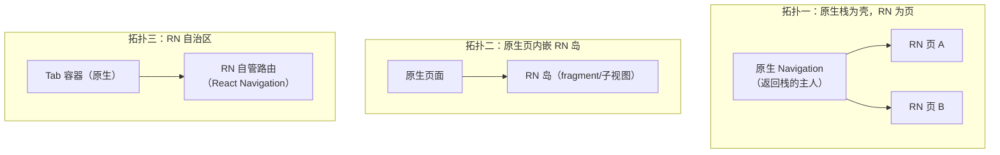
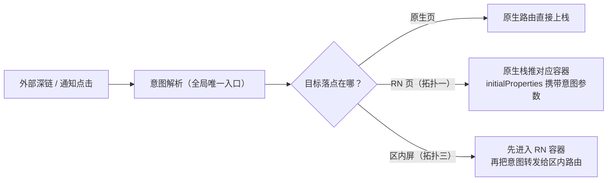
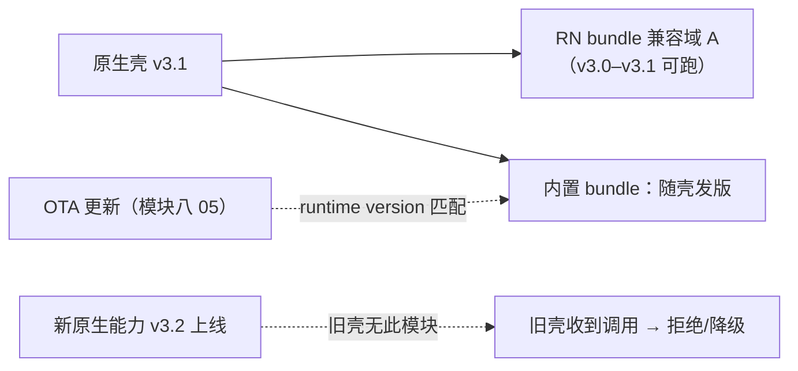

# 混合导航与通信边界

> 集成跑通（01 篇）之后，日常 80% 的坑不在"能不能跑"，而在两件事：**导航的归属**（谁拥有返回栈、路由状态放哪）与**通信边界的划分**（原生和 RN 之间该说多少话）。本篇给混合导航的三种拓扑、返回与手势的协作机制，以及一条可迁移的边界划分原则——最后落到发布与团队协同，因为 brownfield 的很多技术约束其实是组织边界。

## 1. 混合导航三拓扑



| 拓扑 | 路由归属 | 适用 | 风险 |
|------|---------|------|------|
| 一：原生壳推 RN 页 | 原生持有返回栈，RN 页"被动"上栈 | 少量 RN 页面嵌入成熟原生导航 | 页与页之间（尤其 RN→原生→RN）传参要走原生路由 |
| 二：原生页内 RN 岛 | 页面级导航在原生，岛内自治 | 混合页（原生壳 + RN 内容区） | 岛与宿主的生命周期联动（01 篇）与尺寸/安全区协商 |
| 三：RN 自治区 | 区内 RN 自管（React Navigation），区外原生 | 整个 tab 交给 RN | 区内外切换的深链与状态恢复 |

选择原则：**一次跨界（原生↔RN）是一次真实的上下文切换**——跨得越少越稳。宁可把一段连续业务整体划给某一端，也不要让一个流程在两端来回摆渡。

### 1.1 拓扑选型的操作化：数跨界次数

"跨界越少越稳"落到操作层面是一个可执行的算法：把业务流程写成步骤序列，每一步标注归属端（原生/RN），**相邻两步归属不同就是一次跨界**。三拓扑分别把跨界压在哪里：

| 流程形状 | 推荐拓扑 | 同一流程内的跨界次数 |
|---------|---------|---------------------|
| 一两个孤立页交给 RN（转场、返回栈都要原生质感） | 拓扑一 | 2 次（进 RN 页、出 RN 页） |
| 单个复杂页：原生壳 + 动态内容区 | 拓扑二 | 页面级 0 次；岛内数据交互按第 4 节计税 |
| 一条业务线整体交给 RN（tab 为入口） | 拓扑三 | 2 次（进区、出区），区内自由 |

反例的形状：一个下单流程走"原生商品页 → RN 订单页 → 原生支付页 → RN 结果页"——四次跨界、两套导航语义、三份传参协议。它不是"混合得充分"，是拓扑没选对或没敢把整段业务划给一端；修复方向永远是"合并归属段"，而不是"把跨界通道修得更顺滑"。

### 1.2 深链与通知点击：一个入口、三个落点

外部深链（push 通知点击、scheme、universal link）在三种拓扑里落点不同，但解析入口必须唯一（第 2 节原则 3 的空间表达）：



三个落点的共同纪律：**解析产出的是意图（打开订单 123），不是路由指令（把栈推到 X）**；落到 RN 的意图还要过就绪门（[01 篇第 6 节](01-原生工程集成与生命周期.md)）——bundle 未就绪时意图先进待派发队列，就绪信号到达后再派发，否则深链会在启动窗口期丢失。

## 2. 导航状态的归属：单一权威原则

混合导航最大的架构隐患是**路由状态双写**：原生返回栈记一份、RN 内部 state 又记一份，两者靠事件勉强同步——直到某天一处改了另一处没跟上。原则：

1. **每个层级只有一个权威**：原生栈是原生说了算；RN 自治区内部是 RN 说了算；岛内布局由宿主页决定；
2. **跨界只传"意图"不传"状态"**：原生想让 RN 导航，发的是"打开订单 123"的意图（深链式调用/事件），RN 自己决定落在区内哪个屏——而不是原生直接操纵 RN 的内部路由栈；
3. **恢复与深链走同一协议**：冷启动恢复、通知点击、外部深链统一走"意图 → 目标"的解析路径，只实现一遍。

React Navigation 在拓扑三/拓扑二里的嵌套（native stack 容器层级）遵循同样逻辑：它管区内、不管区外。

### 2.1 意图协议的最小形状

"跨界只传意图"落到代码上，两端各有一份最小实现：

```ts
// shared/contracts/navigation.ts —— 两端共享的意图契约（模块七 04"契约先行"在导航侧的落地）
export type NavIntent =
  | { kind: 'openOrder'; orderId: string; dedupKey?: string }  // dedupKey：深链可能重复投递
  | { kind: 'switchTab'; tab: 'home' | 'orders' | 'mine' };
```

```kotlin
// 原生 → RN：发意图事件（拓扑三的落点；骨架示意）
fun sendNavIntent(params: ReadableMap) {
  reactContext
    .getJSModule(DeviceEventManagerModule.RCTDeviceEventEmitter::class.java)
    .emit("nav.intent", params)
}
```

```ts
// RN → 原生：调模块方法（拓扑一/二里 RN 想"出去"的方向）
import NativeRouter from './specs/NativeRouter';
await NativeRouter.pushNative({ page: 'orderDetail', orderId }); // Promise 表达成败
```

三条协议纪律：

1. **方向决定通道**：原生→RN 的意图走事件（广播语义），RN→原生的意图走模块方法（请求-响应语义）——通道选错，失败路径就没有着落（4.2 的通道表）；
2. **意图带去重键**：深链与通知可能重复投递，消费端按 dedupKey 去重，避免"一次点击开两页"；
3. **意图必须自解释**：载荷带全部所需参数，不"叫一声再回头查"（4.3 纪律 3 在导航域的翻版）。

### 2.2 双写事故的解剖与自检

一个典型事故：拓扑三里，RN 自治区内部记录"用户在订单屏"，原生也基于返回栈记了一份"用户在 RN 区"；push 通知点击要"回到订单"——原生按自己的记录把 tab 切过去，区内却停在旧屏；用户再按返回，两份记录给出两个去处。这就是双写的代价：**两份状态各自演化，直到某一天对不上**。

自检三问（对应第 2 节三条原则）：

| 自检问题 | 对应原则 | 不过关的信号 |
|---------|---------|-------------|
| 这份路由状态有几个写入者？ | 原则 1：每层一个权威 | 两端都在写"当前位置" |
| 恢复路径有几个实现？ | 原则 3：恢复与深链同协议 | 冷启动恢复与通知点击各写了一套跳转 |
| 跨界传的是意图还是状态？ | 原则 2：只传意图 | 原生直接调 RN 内部的 navigate("...") |

## 3. 返回与手势：两条系统的分发链

**Android 返回键**：系统返回事件先到当前 Activity，`BackHandler`（RN）注册的监听在 RN 视图持有焦点时获得拦截机会——**返回true 表示 RN 已消化，返回 false/未注册则交回原生默认行为（通常出栈）**。工程纪律：

- RN 页内"再按一次退出编辑态"这类拦截要成对注册/注销（01 篇生命周期的推论：入口销毁不解绑，返回键行为会串到别的入口）；
- 拓扑一下，RN 页几乎不需要拦截返回（出栈是原生的职责）——**需要大面积拦截返回键，通常是拓扑选错了的信号**。

**iOS 侧滑返回**：边缘手势属于原生导航控制器；RN 页内若也有手势（滑动删除、抽屉），冲突仲裁回到模块六 02 的同一套机制（手势系统的优先级与协商）——brownfield 只是让"RN 手势"与"原生导航手势"同场竞技，原理不变。

### 3.1 Android 返回键的完整分发链

把上段的描述拆成步进表（细节以所用版本实现为准，链路骨架一致）：

| 步 | 发生什么 | 谁在处理 |
|----|---------|---------|
| 1 | 用户按返回键，系统派发给当前 Activity | 原生页面层 |
| 2 | ReactActivity/宿主转发（delegate.onBackPressed） | RN 容器层 |
| 3 | 宿主对象把 hardwareBackPress 事件发到 JS | 事件通道 |
| 4 | JS 侧 BackHandler 监听链依次询问：返回 true = 已消化 | JS 侧 |
| 5 | 无注册/全部返回 false → 交回原生默认行为（出栈/finish） | 原生页面层 |

三个推论：

1. **RN 的拦截权来自第 2 步的转发**——Fragment 宿主忘接返回键转发（01 篇 5.2 接线表的最后一行），JS 永远拿不到返回键；
2. **监听链挂在共享运行时上**（01 篇第 4 节）：A 入口注册不注销，B 入口按返回也会先问 A 的监听——串台的机制根源（3.2）；
3. **返回 false 不是错误**，是"我不消化、交还原生"的正常语义——把所有分支都写成 return true，拓扑一的出栈键就被卡死在 JS 里。

### 3.2 BackHandler 成对注册的代码纪律

```tsx
// 反例：注册在模块顶层，永不注销——退出本页后，返回键行为串到别的入口
BackHandler.addEventListener('hardwareBackPress', () => {
  if (editing) { exitEditing(); return true; }
  return false;
});

// 正解：监听与页面生命周期成对（cleanup 对应 01 篇 5.1 表的 t8）
useEffect(() => {
  const sub = BackHandler.addEventListener('hardwareBackPress', () => {
    if (editing) { exitEditing(); return true; }  // 只消化编辑态
    return false;                                  // 未消化 → 交回原生出栈
  });
  return () => sub.remove();
}, [editing]);
```

与 4.5 的事件订阅同理：**返回键监听也应收敛到统一封装**（如 useBackHandler），禁止散装 addListener——封装层顺手解决"重复注册"与"依赖变化重订阅"两个细节。

### 3.3 手势仲裁在混合场景的两个新增变量

模块六的仲裁原理不变，混合场景多两个变量：

1. **原生导航手势挂在容器层**（iOS 侧滑属于导航控制器，Android 的返回手势属于系统层），RN 手势挂在内容层——层级差是天然优先级：内容层手势与容器层手势同抢一条边缘时，先回答"这条边缘现在归谁管"，再进入模块六 02 的优先级细节；
2. **双端都开边缘手势必同抢**：RN 侧抽屉/滑动返回与原生侧滑返回共享同一条屏幕边缘——两种标准解法是错开激活区域，或按页面让渡一侧（RN 页内全屏横滑时临时禁用原生侧滑）。

仲裁表从一层变两层，原理没变——排查时先定位"手势挂在哪一层"，再套模块六的原有结论。

## 4. 通信边界怎么划

### 4.1 总原则：边界 = 模块面，不是聊天窗

原生与 RN 之间应该是**少数、稳定、有契约的能力接口**，而不是随手的双向消息流。每一笔跨边界通信都要付三重税：序列化/调度成本（模块四 03 的量化视角）、契约维护成本（两端发版耦合）、测试成本（两端都要测）。所以边界设计的第一问题是：**能不能不通信？**——能下沉原生的下沉原生（模块三 04），能用连续 UI 避免的就不切开。

### 4.2 三类正规通道与用途（承接 01 篇第 6 节）

| 通道 | 方向 | 定位 | 反模式 |
|------|------|------|--------|
| 原生模块（TurboModule/interop） | RN → 原生 | **能力服务**：auth、存储、支付、埋点、推送 | 高频细粒度调用（每帧问一次状态——改为事件推送或下沉） |
| 事件/EventEmitter | 原生 → RN | **状态广播**：登录过期、配置更新、深链 | 无命名空间的全局杂音总线；stale 语义不明的事件 |
| initialProperties | 原生 → RN（一次） | 创建参数 | 当持续状态同步用 |

### 4.3 事件总线纪律（跨端最容易腐化的地方）

1. **命名空间化**：`auth.expired`、`config.updated`——事件名是两端共享的公共 API，当它有版本；
2. **生命周期解绑**：入口/页面销毁必注销监听（01 篇白屏问题族的近亲：泄漏 + 串台）；
3. **事件携带数据要完整**：避免"事件只叫一声、RN 再回头查询"的竞态组合（除非查询本身幂等且有就绪门）；
4. **频率红线**：事件是低频语义信号；高频数据流（光标、滚动、传感器）要么下沉原生闭环（模块六 02 的 worklet 思路），要么认真评估专用通道。

### 4.4 数据的 source of truth

| 模式 | 适用 | 代价 |
|------|------|------|
| 原生为权威（RN 只读快照 + 事件刷新） | 登录态、支付能力、系统配置——原生本就持有 | RN 侧要处理快照过期 |
| RN 为权威（原生按需拉取） | 纯 RN 业务的数据 | 原生侧要有查询接口与缓存策略 |
| 分域权威（每域一个主人） | 大型混合 App 的常态 | 跨域一致性自己管 |

判据：**谁产生/维护这份数据，谁就是权威；另一方只通过接口访问**。避免"两端都写同一份数据"——那是双主，不是主从。

### 4.5 一个事件的完整契约：双端走查

把 4.3 的四条纪律落到双端代码上：

```kotlin
// 原生侧：命名空间化 + 载荷完整（骨架示意）
private fun emitAuthExpired(reason: String) {
  val params = Arguments.createMap().apply {
    putString("code", "auth.expired")             // 纪律 1：事件名是公共 API
    putString("reason", reason)                   // 纪律 3：自带结论，RN 不必回头查
    putDouble("ts", System.currentTimeMillis())   // 时间戳：给消费端一个丢弃 stale 事件的出口
  }
  reactContext
    .getJSModule(DeviceEventManagerModule.RCTDeviceEventEmitter::class.java)
    .emit("auth.expired", params)
}
```

```tsx
// JS 侧：生命周期安全的订阅封装（纪律 2 的代码化）
function useNativeEvent(name: string, handler: (e: AuthExpiredEvent) => void) {
  const ref = useRef(handler);
  ref.current = handler;                          // handler 存 ref：回调永远拿最新逻辑
  useEffect(() => {
    const sub = new NativeEventEmitter(NativeAuth).addListener(
      name,
      (e) => ref.current(e),
    );
    return () => sub.remove();                    // 入口卸载即注销（01 篇 5.1 表 t8）
  }, [name]);
}
```

走读三个要点：

1. **ts 字段是 stale 语义的出口**：4.2 表把"stale 语义不明的事件"列为反模式——带时间戳让消费端能主动丢弃过期事件，语义就明了；
2. **handler 走 ref 而不是依赖数组**：避免"每次渲染重订阅"，也避免闭包捕获旧 state——两个经典事故一个方案；
3. **封装收敛是纪律的执行器**：散装 addListener 无法 review；统一封装让"成对注销"从人的自觉变成结构保证。

### 4.6 通信设计的自检清单

评审一个跨端通信设计时的固定清单：

| 自检问题 | 不过关的信号 | 动作 |
|---------|-------------|------|
| 能不能不通信？ | 每帧/每秒级的跨端往返 | 下沉原生或合并调用（4.1） |
| 每条事件有无命名空间与所有者？ | 裸事件名、找不到声明处 | 建事件清单（6.1） |
| 订阅是否与生命周期成对？ | 退出页面仍收到回调 | 收敛 useNativeEvent 式封装（4.5） |
| 数据有无唯一权威？ | 两端都在写同一份数据 | 按 4.4 判据定主人 |
| 高频流是否错走了事件通道？ | 滚动/传感器数据用事件搬运 | 下沉原生闭环（4.3 纪律 4） |

清单的用法：逐行问、逐行答；任何一行答不上来，通信设计就还没到"可以开工"的状态。

## 5. 版本协同与发布矩阵

brownfield 里"App 版本"与"RN 产物版本"是两条相关的轴：



工程要求：

1. **原生模块的 JS 侧调用要容错旧壳**：模块不存在时的降级路径（模块十 02 的"module not found"在 brownfield 里是常态而非异常）；
2. OTA 的兼容矩阵比纯 RN App 更严：runtime version 要把"宿主 App 版本"算进去（模块八 05 第 3 节的 fingerprint 思想同样适用）；
3. **发布节奏解耦**：原生壳按应用商店节奏走，RN 更新走 OTA 节奏（模块八 05 第 6 节的协同矩阵）——但每次壳发版前，内置 bundle 要回归（它是 OTA 三层兜底的最后一层）。

### 5.1 兼容矩阵的四个象限

把"壳版本 × bundle"的组合摆全，每个象限的处理不同：

| 组合 | 性质 | 处理 |
|------|------|------|
| 新壳 + 新 bundle | 正常发布 | 常规回归 |
| 旧壳 + 新 bundle（bundle 调用了新模块） | **bundle 越界**：旧壳没有该原生模块 | JS 侧存在性探测 → 降级路径（§5 要求 1） |
| 新壳 + 旧 bundle | 通常兼容（壳向后兼容旧产物） | 壳发版前回归内置 bundle（§5 要求 3） |
| 旧壳 + OTA 推送的新 bundle | 高危组合 | runtime version 指纹把宿主版本算进去，OTA 侧直接拒发（模块八 05） |

读法：**矩阵是发布前的检查表，不是发布后的救火表**——前三个象限在"bundle 发布"与"壳发版"两个流程里各安排一次显式检查就能守住；唯一技术完全拦不住的是 OTA 象限（推送发生在用户侧），所以它必须在源头用指纹拒绝（模块八 05 第 3 节的 fingerprint 思想）。

## 6. 团队边界与工程化

brownfield 的很多约束是组织性的：原生团队与 RN 团队的接口就是通信边界。工程化手段：

1. **交付形态**：RN 侧产物化交付——bundle + 原生桥接模块（Android 的 aar/module、iOS 的 pod）版本化发布，宿主工程像依赖第三方 SDK 一样依赖它；
2. **契约先行**：通信接口（模块 spec、事件清单、initialProperties 结构）放在共享包里带类型定义，变更走 review——模块七 04 的 Codegen 思想在团队间的应用；
3. **独立开发**：RN 团队用 mock 原生模块（模块十一 01 的 mock 纪律）脱离宿主开发，宿主联调只在集成阶段；
4. **验收**：关键流程的 E2E（模块十一 02）落在**集成后的宿主**上跑，而不是 RN 单工程绿就算完——跨界缺陷只有集成态能暴露。

### 6.1 共享契约包的内容清单

"契约先行"落到仓库结构上是一个两端共同依赖的包，内容清单：

| 内容 | 形态 | 变更保护 |
|------|------|---------|
| 模块 spec | specs/*.ts（类型 + getEnforcing 导出） | 改类型 → 双端 Codegen 编译期报错（[模块七 04 · Codegen](../rn-新架构/04-Codegen.md)） |
| 事件清单 | 事件名/载荷/方向/所有者的常量表 | 事件名当 API 版本管理（4.3 纪律 1） |
| initialProperties 结构 | 类型定义 + 最小示例 | 只加字段向后兼容；删字段走废弃期 |
| 意图协议 | NavIntent 联合类型（2.1） | 新意图加分支，旧意图不下线 |
| mock 实现 | 与 spec 同包的桩（模块十一 01） | mock 与 spec 同源，防"桩与契约漂移" |

清单的深层作用：**契约包是两个团队之间唯一允许的接缝**——接缝越窄，跨界缺陷越少（第 6 节组织判断在仓库结构上的落点）。

## 7. 常见坑与排查

[01 篇第 7 节](01-原生工程集成与生命周期.md)管运行时侧的坑，本表聚焦导航与通信侧：

| 现象 | 根因 | 处理 |
|------|------|------|
| 退出 RN 页后原生仍回调 JS | 监听器残留：订阅未随入口销毁注销 | 4.5 的成对封装 |
| 返回键行为串到别的入口 | BackHandler 注册在共享运行时上未注销 | 3.2 的成对注册 |
| 同一深链打开两次页面 | 意图无去重键/重复投递 | dedupKey + 就绪门（2.1） |
| 冷启动恢复与深链行为不一致 | 两套跳转实现并存 | 恢复与深链走同一协议（§2 原则 3） |
| 事件偶发"第一次收不到" | 订阅晚于首事件 | 注册后主动查一次当前状态（事件 + 查询双保险） |
| 旧壳上新 bundle 崩溃 | 调用了旧壳没有的原生模块 | 存在性探测 + 降级（5.1 象限 2） |
| 混合页内存持续增长 | 订阅/闭包残留随进出累积 | 01 篇 7.1 样本 + 内存排查（[模块九 04 · 内存与稳定性](../rn-性能优化原理/04-内存与稳定性.md)） |
| 岛内手势与原生手势同抢边缘 | 双端都开了边缘手势 | 错开区域或按页让渡（3.3） |

排查的顺序纪律与全站一致：先分期（现象属于哪次跨界）、再对通道（事件/模块/initialProperties 走的是哪条）、最后对契约（两端的名字与载荷是否同源）。

## 小结

- 三拓扑（原生壳推 RN 页 / 原生页内 RN 岛 / RN 自治区）按"跨界次数最少"选；跨界只传意图不传状态，每层路由只有一个权威；
- 返回键与手势：Android BackHandler 成对注册、按拓扑判断是否该拦截；iOS 侧滑与 RN 手势的仲裁沿用模块六的手势机制；
- 通信边界 = 少数稳定的能力模块 + 命名空间化事件 + 一次性 initialProperties；高频细粒度通信是设计坏味道，数据按"谁维护谁权威"定 source of truth；
- 版本协同：模块调用容错旧壳、OTA 兼容矩阵把宿主版本算进去、壳发版前内置 bundle 必回归；
- 工程化四件套：产物化交付、契约先行（共享类型）、mock 解耦开发、集成态 E2E 验收——技术边界与团队边界对齐，混合开发才能长期健康发展；
- 事件与意图是两端共享的 API：命名空间化、载荷完整、订阅成对、契约包统一——第 7 节对照表是日常排查的第一站。

## 自测

1. 三拓扑的选择判据是什么？"数跨界次数"的算法怎么执行？（→ 1.1）
2. 深链解析为什么必须全局唯一入口？就绪门挡住了哪个窗口的什么丢失？（→ 1.2）
3. 路由单一权威的三条原则？双写事故的三个自检问题？（→ §2/2.2）
4. 默写 Android 返回键分发链五步：JS 返回 true/false 各发生什么？拦截权来自哪一步？（→ 3.1）
5. BackHandler 串台的机制根源是什么？成对注册的代码长什么样？（→ 3.2）
6. 三类正规通道各自的反模式？"能不能不通信"为什么是第一问？（→ §4）
7. 事件总线四条纪律？useNativeEvent 封装代码化了哪几条？handler 为什么走 ref？（→ 4.3/4.5）
8. source of truth 的判据？"双主"为什么不可接受？（→ 4.4）
9. 兼容矩阵四个象限各自的处理？为什么 OTA 象限必须在源头用指纹拒绝？（→ 5.1/§5）
10. 工程化四件套各解决什么组织问题？契约包清单里五项内容的变更保护分别是什么？（→ §6/6.1）
