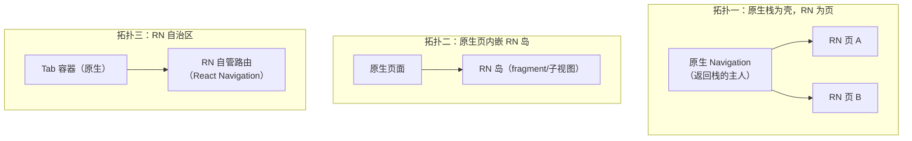
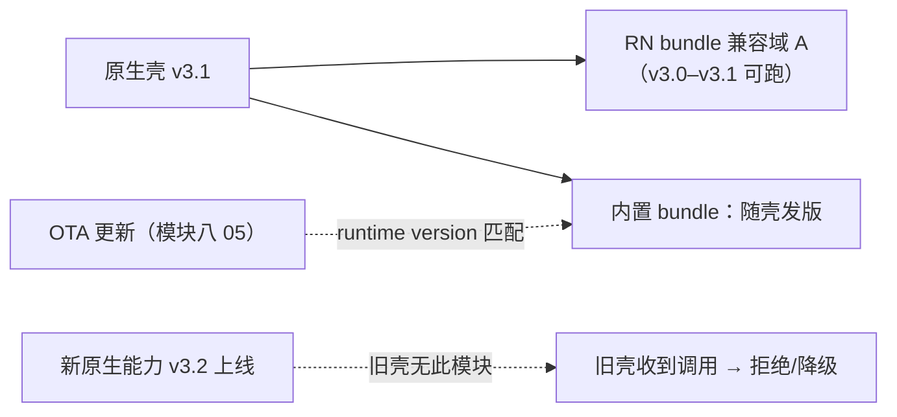

# 混合导航与通信边界

> 集成跑通（01 篇）之后，日常 80% 的坑不在"能不能跑"，而在两件事：**导航的归属**（谁拥有返回栈、路由状态放哪）与**通信边界的划分**（原生和 RN 之间该说多少话）。本篇给混合导航的三种拓扑、返回与手势的协作机制，以及一条可迁移的边界划分原则——最后落到发布与团队协同，因为 brownfield 的很多技术约束其实是组织边界。

## 1. 混合导航三拓扑

| 拓扑 | 路由归属 | 适用 | 风险 |
|------|---------|------|------|
| 一：原生壳推 RN 页 | 原生持有返回栈，RN 页"被动"上栈 | 少量 RN 页面嵌入成熟原生导航 | 页与页之间（尤其 RN→原生→RN）传参要走原生路由 |
| 二：原生页内 RN 岛 | 页面级导航在原生，岛内自治 | 混合页（原生壳 + RN 内容区） | 岛与宿主的生命周期联动（01 篇）与尺寸/安全区协商 |
| 三：RN 自治区 | 区内 RN 自管（React Navigation），区外原生 | 整个 tab 交给 RN | 区内外切换的深链与状态恢复 |

选择原则：**一次跨界（原生↔RN）是一次真实的上下文切换**——跨得越少越稳。宁可把一段连续业务整体划给某一端，也不要让一个流程在两端来回摆渡。

## 2. 导航状态的归属：单一权威原则

混合导航最大的架构隐患是**路由状态双写**：原生返回栈记一份、RN 内部 state 又记一份，两者靠事件勉强同步——直到某天一处改了另一处没跟上。原则：

1. **每个层级只有一个权威**：原生栈是原生说了算；RN 自治区内部是 RN 说了算；岛内布局由宿主页决定；
2. **跨界只传"意图"不传"状态"**：原生想让 RN 导航，发的是"打开订单 123"的意图（深链式调用/事件），RN 自己决定落在区内哪个屏——而不是原生直接操纵 RN 的内部路由栈；
3. **恢复与深链走同一协议**：冷启动恢复、通知点击、外部深链统一走"意图 → 目标"的解析路径，只实现一遍。

React Navigation 在拓扑三/拓扑二里的嵌套（native stack 容器层级）遵循同样逻辑：它管区内、不管区外。

## 3. 返回与手势：两条系统的分发链

**Android 返回键**：系统返回事件先到当前 Activity，`BackHandler`（RN）注册的监听在 RN 视图持有焦点时获得拦截机会——**返回true 表示 RN 已消化，返回 false/未注册则交回原生默认行为（通常出栈）**。工程纪律：

- RN 页内"再按一次退出编辑态"这类拦截要成对注册/注销（01 篇生命周期的推论：入口销毁不解绑，返回键行为会串到别的入口）；
- 拓扑一下，RN 页几乎不需要拦截返回（出栈是原生的职责）——**需要大面积拦截返回键，通常是拓扑选错了的信号**。

**iOS 侧滑返回**：边缘手势属于原生导航控制器；RN 页内若也有手势（滑动删除、抽屉），冲突仲裁回到模块六 02 的同一套机制（手势系统的优先级与协商）——brownfield 只是让"RN 手势"与"原生导航手势"同场竞技，原理不变。

## 4. 通信边界怎么划

### 4.1 总原则：边界 = 模块面，不是聊天窗

原生与 RN 之间应该是**少数、稳定、有契约的能力接口**，而不是随手的双向消息流。每一笔跨边界通信都要付三重税：序列化/调度成本（模块四 03 的量化视角）、契约维护成本（两端发版耦合）、测试成本（两端都要测）。所以边界设计的第一问题是：**能不能不通信？**——能下沉原生的下沉原生（模块三 04），能用连续 UI 避免的就不切开。

### 4.2 三类正规通道与用途（承接 01 篇第 6 节）

| 通道 | 方向 | 定位 | 反模式 |
|------|------|------|--------|
| 原生模块（TurboModule/interop） | RN → 原生 | **能力服务**：auth、存储、支付、埋点、推送 | 高频细粒度调用（每帧问一次状态——改为事件推送或下沉） |
| 事件/EventEmitter | 原生 → RN | **状态广播**：登录过期、配置更新、深链 | 无命名空间的全局杂音总线；stale 语义不明的事件 |
| initialProperties | 原生 → RN（一次） | 创建参数 | 当持续状态同步用 |

### 4.3 事件总线纪律（跨端最容易腐化的地方）

1. **命名空间化**：`auth.expired`、`config.updated`——事件名是两端共享的公共 API，当它有版本；
2. **生命周期解绑**：入口/页面销毁必注销监听（01 篇白屏问题族的近亲：泄漏 + 串台）；
3. **事件携带数据要完整**：避免"事件只叫一声、RN 再回头查询"的竞态组合（除非查询本身幂等且有就绪门）；
4. **频率红线**：事件是低频语义信号；高频数据流（光标、滚动、传感器）要么下沉原生闭环（模块六 02 的 worklet 思路），要么认真评估专用通道。

### 4.4 数据的 source of truth

| 模式 | 适用 | 代价 |
|------|------|------|
| 原生为权威（RN 只读快照 + 事件刷新） | 登录态、支付能力、系统配置——原生本就持有 | RN 侧要处理快照过期 |
| RN 为权威（原生按需拉取） | 纯 RN 业务的数据 | 原生侧要有查询接口与缓存策略 |
| 分域权威（每域一个主人） | 大型混合 App 的常态 | 跨域一致性自己管 |

判据：**谁产生/维护这份数据，谁就是权威；另一方只通过接口访问**。避免"两端都写同一份数据"——那是双主，不是主从。

## 5. 版本协同与发布矩阵

brownfield 里"App 版本"与"RN 产物版本"是两条相关的轴：

工程要求：

1. **原生模块的 JS 侧调用要容错旧壳**：模块不存在时的降级路径（模块十 02 的"module not found"在 brownfield 里是常态而非异常）；
2. OTA 的兼容矩阵比纯 RN App 更严：runtime version 要把"宿主 App 版本"算进去（模块八 05 第 3 节的 fingerprint 思想同样适用）；
3. **发布节奏解耦**：原生壳按应用商店节奏走，RN 更新走 OTA 节奏（模块八 05 第 6 节的协同矩阵）——但每次壳发版前，内置 bundle 要回归（它是 OTA 三层兜底的最后一层）。

## 6. 团队边界与工程化

brownfield 的很多约束是组织性的：原生团队与 RN 团队的接口就是通信边界。工程化手段：

1. **交付形态**：RN 侧产物化交付——bundle + 原生桥接模块（Android 的 aar/module、iOS 的 pod）版本化发布，宿主工程像依赖第三方 SDK 一样依赖它；
2. **契约先行**：通信接口（模块 spec、事件清单、initialProperties 结构）放在共享包里带类型定义，变更走 review——模块七 04 的 Codegen 思想在团队间的应用；
3. **独立开发**：RN 团队用 mock 原生模块（模块十一 01 的 mock 纪律）脱离宿主开发，宿主联调只在集成阶段；
4. **验收**：关键流程的 E2E（模块十一 02）落在**集成后的宿主**上跑，而不是 RN 单工程绿就算完——跨界缺陷只有集成态能暴露。

## 小结

- 三拓扑（原生壳推 RN 页 / 原生页内 RN 岛 / RN 自治区）按"跨界次数最少"选；跨界只传意图不传状态，每层路由只有一个权威；
- 返回键与手势：Android BackHandler 成对注册、按拓扑判断是否该拦截；iOS 侧滑与 RN 手势的仲裁沿用模块六的手势机制；
- 通信边界 = 少数稳定的能力模块 + 命名空间化事件 + 一次性 initialProperties；高频细粒度通信是设计坏味道，数据按"谁维护谁权威"定 source of truth；
- 版本协同：模块调用容错旧壳、OTA 兼容矩阵把宿主版本算进去、壳发版前内置 bundle 必回归；
- 工程化四件套：产物化交付、契约先行（共享类型）、mock 解耦开发、集成态 E2E 验收——技术边界与团队边界对齐，混合开发才能长期健康发展。
