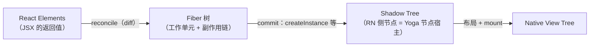
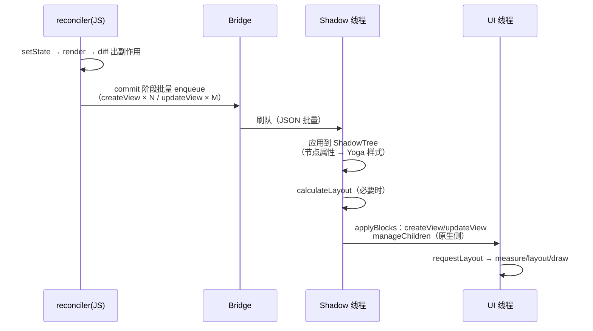
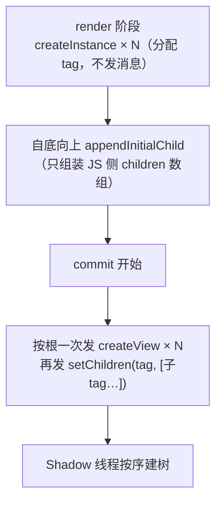
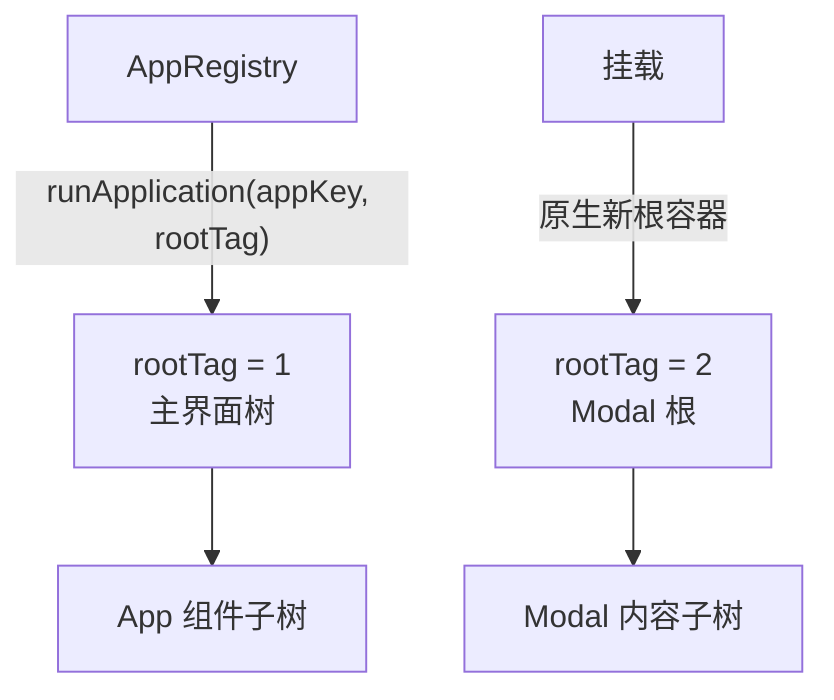

# 三棵树与 Reconciler

> RN 渲染的第一性问题：**React 怎么把组件树翻译成原生视图操作？** 答案是 react-reconciler 的宿主配置（hostConfig）——同一个 React，另一套"DOM API"。源码以 `Libraries/Renderer/` 为根。

## 1. react-reconciler：React 的可插拔心脏

React 16 之后，`react-reconciler` 包把"diff 算法"与"宿主操作"解耦：DOM、Native、测试渲染器（react-test-renderer）、终端（Ink）都是同一套 reconciler 的不同配置。

```js
// 伪代码：一个宿主要实现的关键回调
const hostConfig = {
  createInstance(type, props)   { /* 创建节点：DOM createElement / RN createView */ },
  appendChild(parent, child)    { /* 挂接 */ },
  removeChild(parent, child)    { /* 移除 */ },
  commitUpdate(inst, newProps)  { /* 更新属性 */ },
  prepareForCommit / resetAfterCommit / ...,
};
```

RN 的实现：`Libraries/Renderer/implementations/ReactFabric-{dev,prod}.js`（新架构）与 `ReactNativeRenderer-{dev,prod}.js`（旧架构），由 `Libraries/Renderer/shims/ReactNative` 按特性开关分发给 `React Fabric.render` / `React Native.render`。

### 1.1 回调按阶段分组：render 阶段与 commit 阶段

hostConfig 的几十个回调并不是一锅粥，它们被 reconciler 在两个性质完全不同的阶段调用，理解分组比记住全部名单重要：

| 阶段 | 代表回调 | 阶段性质 | 出错后果 |
|------|---------|---------|---------|
| render（reconcile）阶段 | `createInstance` / `shouldSetTextContent` / `prepareUpdate` | 纯计算，可被打断、可重放——reconciler 会先"彩排"出 Fiber 副作用 | 抛错可被错误边界捕获 |
| commit 阶段 | `appendChild` / `removeChild` / `commitUpdate` / `resetAfterCommit` | 不可打断，副作用必须一次做完 | 中途失败 = 树不一致，最危险 |

注意一个容易混淆的点：**在 Web 上 commit 阶段的回调直接操作真实 DOM，"commit = 上屏"**；而 RN 旧架构里 commit 阶段的回调只是**发消息**（见第 3 节），真正的"上屏"被推迟到 Shadow 线程与 UI 线程。这是同一套 reconciler 在两种宿主上语义发生的最大偏移。

### 1.2 谁在驱动 reconciler

`React Native.render(<App />, rootTag)` 做的事情：创建（或复用）FiberRoot，把根节点与宿主容器（rootTag）绑定，随后由 reconciler 自带的调度器驱动工作循环——按优先级取工作单元（Fiber 节点），执行 `beginWork`/`completeWork`，直到当前批次的副作用链收口，再进入 commit。旧架构以传统的同步批次为主；新架构（Fabric）挂载为并发根，可中断、可插队（详见[模块七 02 · Fabric 渲染管线](../rn-新架构/02-Fabric渲染管线.md)）。

换句话说：**React 负责决定"改哪些节点"，宿主配置负责决定"怎么改"**。RN 的一切渲染行为差异，最终都能落到 hostConfig 的实现差异上。

## 2. 三棵树的翻译流水线



关键对应关系：

| reconciler 回调 | 旧架构落到哪 |
|----------------|-------------|
| `createInstance` | `UIManager.createView(tag, viewName, rootTag, props)` → Shadow 线程建 ShadowNode |
| `appendInitialChild` / `appendChild` | `setChildren` 指令（数组一次提交） |
| `commitUpdate` | `updateView(tag, viewName, props)` |
| `removeChild` | `manageChildren(..., removeAtIndices)` |

**重点**：reconcile 在 JS 线程产出的是**指令（消息）**，不是视图本身——真正建节点发生在 Shadow 线程（模块三）。JS 与原生之间隔着 Bridge，"渲染"必须分两班倒。

### 2.1 更严格地说，是四棵树

"三棵树"是教学口径，把 Element 与 Fiber 分开数会更清楚。四棵树各有各的生命周期与"居住线程"：

| 树 | 本质 | 生命周期 | 所在位置 | 可变性 |
|----|------|---------|---------|--------|
| Element Tree | `React.createElement` 的普通对象（JSX 返回值） | 一次 render 即丢弃 | JS 堆 | 不可变（每次新建） |
| Fiber Tree | 工作单元链表：`return/child/sibling` + 副作用标记 | 跨 render 持久存在（双缓冲：current/workInProgress） | JS 堆 | 可变（reconciler 专用） |
| Shadow Tree | ShadowNode（旧架构为平台对象，持有 YGNode） | 与 Fiber 节点一一对应，随 commit 建立/销毁 | Shadow 线程 | 可变（受指令驱动） |
| Native View Tree | 平台视图（View/RCTView） | 随 mount 建立、随 removeChild 摘除 | UI 线程 | 平台所有 |

三个"错位"值得记住：

1. **Element 与 Fiber 是多对一流动**：每次 render 产生全新 Element 流，Fiber 是"旧树 + 新意图"的合并现场——diff 比较的是新旧 Element，修改的是 Fiber；
2. **Fiber 与 ShadowNode 靠 tag 弱关联**：Fiber 的 `stateNode` 在 RN 里存的是"实例句柄"（tag/viewName 等），不是原生对象（见 2.2）；
3. **Shadow Tree 与 View Tree 数量不总相等**：有些 ShadowNode 不产视图（纯布局容器在两端都可能有合成优化），有些视图一个 ShadowNode 展开成多个原生视图（Text 在两端都会拆成多段）。

### 2.2 Fiber 与 ShadowNode 的挂钩：stateNode 与 tag

Web 上 `fiber.stateNode` 直接存 DOM 节点；RN 旧架构的 `stateNode` 存的是一个**实例描述对象**（简化）：

```js
// ReactNativeRenderer（旧架构）createInstance 的返回（简化）
{
  nodeHandle: tag,        // 指向 ShadowNode/View 的整数句柄
  viewName: 'RCTView',    // 原生组件注册名
  currentProps: props,    // 最近一次提交的 props（供 diff 用）
  ...
}
```

tag 由渲染器内部计数器分配（rootTag 单独编段），跨 Bridge 传的从来只是这个整数——**JS 世界里没有原生对象引用，只有编号**。这与模块四 Bridge 的消息模型完全一致（[Bridge 本质与消息队列](../rn-Bridge通信原理/01-Bridge本质与消息队列.md)）：JS 侧既然拿不到对象，`commitUpdate(inst, ...)` 里能做的就只有"拿 inst 里的 tag 再发一条 updateView 消息"。

一个推论：**tag 的生命周期 = Fiber 的提交生命周期**。组件卸载时 reconciler 调 `removeChild`，消息驱动 Shadow 线程摘 ShadowNode、UI 线程 removeView——如果某条指令丢失或顺序错乱，就会出现"JS 以为删了、原生还挂着"的幽灵视图，这也是旧架构偶发白屏/残留视图要排查指令流的根本原因。

### 2.3 Fiber 节点长什么样

Fiber 是 reconciler 的私有数据结构，但读懂它的几个字段，后面所有"副作用""复用""双缓冲"的说法才有落点（字段名来自 react-reconciler 源码，注释为简化说明）：

```js
// react-reconciler 的 Fiber（节选关键字段）
{
  tag,            // 节点种类：FunctionComponent / HostComponent / HostText / HostRoot …
  type,           // 组件函数，或宿主类型字符串（'RCTView'）
  key,            // 列表 diff 的身份凭证
  stateNode,      // 宿主实例句柄（RN：{nodeHandle, viewName, …}）
  return,         // 父 Fiber
  child,          // 第一个子 Fiber
  sibling,        // 下一个兄弟 Fiber
  pendingProps,   // 本次 render 的新 props
  memoizedProps,  // 上次提交的 props（diff 的"旧值"）
  flags,          // 副作用标记：Placement / Update / Deletion …
  alternate,      // 双缓冲的另一半：current ↔ workInProgress
}
```

三个字段组合解释了 RN 渲染的大部分行为：

- **`alternate`（双缓冲）**：reconciler 在 workInProgress 树上"彩排"，彩排完成才切换 current 指针——所以 render 阶段可以丢弃重来，而不会破坏已上屏的状态；
- **`memoizedProps` vs `pendingProps`**：属性 diff 的两个输入，`prepareUpdate` 拿它们算出差量（第 4 节）；
- **`flags`**：commit 阶段只遍历带标记的节点——"变化量小，commit 就便宜"的结构根源。

`tag === HostComponent` 的 Fiber 才对应原生视图；函数组件、Context、Fragment 等 Fiber **没有 stateNode 对应的原生节点**，它们在 Shadow 树与 View 树里不留痕迹。这就是"组件树比视图树深得多"的原因：一个业务页面的 Fiber 数量通常远多于原生视图数量。

## 3. 一次更新的分班作业



对照 React（Web）：Web 的 commit 直接同步操作 DOM；**RN 旧架构的 commit 只是"发出消息"**，真正 commit 在两端各做一半——这是理解旧架构渲染延迟的钥匙。

### 3.1 逐步拆解：谁在做、做什么、产物是什么

把上面时序图落成可勾选的步骤表（线程职责详见[模块三 02 · 四线程模型](../rn-JS引擎与线程模型/02-四线程模型.md)）：

| 步 | 线程 | 动作 | 产物 | 可否被打断 |
|----|------|------|------|-----------|
| 1 | JS | 事件回调里 setState，进入调度 | 更新队列（lane/优先级） | 可（新架构）/按批次（旧架构） |
| 2 | JS | render：组件函数执行，产出新 Element | 新 Element 子树 | 可 |
| 3 | JS | diff 新旧 Element，标记 Fiber 副作用 | 副作用链（Placement/Update/Deletion） | 可 |
| 4 | JS | commit：执行 hostConfig 回调 | createView/updateView/… 消息入队 | 否（但只是发消息） |
| 5 | Bridge | 批量窗口到，序列化刷队 | JSON 文本 | — |
| 6 | Shadow | 应用指令：建/改 ShadowNode，属性 → YGStyle | 新的 Shadow 树状态 | 否 |
| 7 | Shadow | Yoga calculateLayout（脏子树） | 每节点 x/y/w/h | 否 |
| 8 | Shadow | 生成原生视图操作，投递 UI 线程 | UI 操作批 | — |
| 9 | UI | 执行批：createView/updateView/manageChildren | 原生树终态 | 否 |
| 10 | UI | requestLayout/invalidate → measure/layout/draw | 像素 | 平台管线 |

关键观察：**步骤 4 的"commit"很便宜（纯 JS 入队），而真正的重活分布在了 6~9 三条线程上**。所以旧架构里"JS commit 完成"和"用户看见"之间，天然隔着至少一次跨线程交接——端到端延迟的"底数"由此而来。

### 3.2 为什么必须两班倒

不是 React 想分班，是 Bridge 的物理约束逼出来的：

1. **JS 与原生不共享内存**：JS 引擎（JSC/Hermes）与原生运行时是两个世界，只能靠消息；消息是异步批量的（模块四 01），所以"同步建节点再返回"不可能；
2. **原生视图只能在其所属线程操作**：Android View 非 UI 线程碰不得、iOS 更是主线程独占——Shadow 线程做完布局，还必须把视图操作再投递一次；
3. **布局必须等树稳定**：Yoga 布局以整棵（脏）子树为输入，天然希望"这一帧的所有节点变更先攒齐再算"——批量窗口正好提供了这个汇合点。

新架构（Fabric）把 1 消灭了（JSI 同进程直调 C++ ShadowTree），2、3 保留但被事务化——所以 Fabric 的改进是"结构性的减法"，不是把旧链路调快（[模块七 01 · JSI 原理](../rn-新架构/01-JSI原理.md)）。

## 4. Diff 的产物：视图操作指令

RN 渲染器做了**指令级 diff**，reconciler 层算出 Fiber 副作用后，还要把"子树变化"翻译成最小的原生操作序列（`ReactNativeAttributePayload.diff` 对比新旧 props，只提交差异）：

- props 无变化 → 不产生消息；
- 子节点重排 → `manageChildren(moveFrom/To)` 而非全量重建；
- 文本更新 → `updateView` 只带 text 差异。

所以"re-render 不一定卡"：**React 层 re-render ≠ 桥上有流量，props diff 后没有差异就没有消息**。`React.memo` 的收益在省 reconcile，diff 机制则是第二道保险。

### 4.1 两道保险各挡住什么

| 保险 | 挡住的成本 | 挡不住的成本 |
|------|-----------|-------------|
| `React.memo`（props 浅比较跳过 render） | 组件函数执行、子树 Element 重建、reconcile 遍历 | props 真变了时的全部下游成本；浅比较本身的固定开销 |
| 属性 diff（`ReactNativeAttributePayload.diff`） | 跨桥消息与原生属性设置 | 已经发生过的 render/reconcile（JS 线程 CPU） |

工程含义：**省 JS 线程靠 memo/状态设计，省桥靠 diff 兜底，两道保险作用在不同段**（性能方法论见[模块九 03 · 渲染与状态优化](../rn-性能优化原理/03-渲染与状态优化.md)）。反过来，如果只依赖第二道保险——每次都全量 re-render 再靠 diff 归零——JS 线程已经被烧掉了，Bridge 空载也没用。

### 4.2 与 Web DOM diff 的三点不同

| 维度 | Web（react-dom） | RN（旧架构） |
|------|-----------------|--------------|
| 副作用落点 | 直接 DOM API（appendChild/setAttribute） | 消息（createView/updateView/…），异步生效 |
| 属性更新粒度 | 逐属性 setAttribute/removeAttribute | props 差量打包成一条 updateView 消息 |
| 删除时机 | commit 中同步 remove | 消息到 Shadow 线程后才真正摘除，视觉删除滞后 |

第三点常被忽略：**旧架构里"组件已卸载"是 JS 视角的说法**，原生侧要等批次到达并执行完才真的移除。若在卸载后立刻查询原生树（如测试快照、UI 自动化），可能看到"滞后一拍"的树。

## 5. 初挂载与更新：两条指令路径走查

hostConfig 的回调在不同场景下走的是**两条几乎不重叠的路径**。读渲染器源码或排查指令日志时，先分清当前批次走的是哪条。

### 5.1 初挂载：攒齐再一次性 setChildren



初挂载的特点：**createView 消息成串出现，且每个节点紧跟一条 setChildren**。消息序列大致是（示意）：

```text
createView(10, RCTView, 1, {…})      // 根容器下的第一个 View
createView(11, RCTText, 1, {…})
createView(12, RCTRawText, 1, {text: 'hi'})
setChildren(11, [12])
setChildren(10, [11])
createView(10, …) 后根节点收尾：setChildren(1, [10])
```

这就是首屏渲染的指令形态：**条数 ∝ 首屏节点数**，与 props 复杂度关系不大——首屏优化（模块九）里"首屏少渲染节点"的收益可以从这里直接推导。

### 5.2 更新：prepareUpdate 差量 + manageChildren 重排

更新路径不再有 createInstance（除非新增节点），核心是两个：

1. **属性更新**：`prepareUpdate` 比较新旧 props 产出 updatePayload（差量），commit 时发一条 `updateView(tag, viewName, 差量props)`；
2. **子节点增删移**：翻译成 `manageChildren`。它是旧架构最"重"的一条指令，签名（简化）：

```js
UIManager.manageChildren(
  containerTag,        // 父节点
  moveFromIndices,     // 要移动的子节点旧索引
  moveToIndices,       // 移动到的新索引
  addChildReactTags,   // 新增子节点的 tag 列表（需先 createView）
  addAtIndices,        // 新增子节点的插入位置
  removeAtIndices      // 要删除的子节点索引
);
```

一个列表重排实例：children 从 `[A, B, C]` 变为 `[A, C, B, D]`（D 为新增），理想情况下产生的指令是：

```text
updateView(B?, …)                      // 仅当 props 变化
createView(D_tag, …)                   // 新节点
manageChildren(parent,
  moveFromIndices:  [1, 2],            // B、C 的旧位置
  moveToIndices:    [2, 1],            // 交换
  addChildReactTags:[D_tag],
  addAtIndices:     [3],
  removeAtIndices:  [])
```

——**三次变化合成一条 manageChildren + 一条 createView**。若 key 不稳定（比如用数组索引当 key），同一份数据变化会被翻译成大面积 remove + create：tag 全换、ShadowNode 全重建、原生视图全重挂。**key 的价值在 RN 里比 Web 更"物理"——它直接决定原生视图是否重建**。

### 5.3 两条路径的对照表

| 维度 | 初挂载 | 更新 |
|------|--------|------|
| createInstance | 大量调用（逐节点） | 仅新增子树 |
| 父子关系指令 | `setChildren`（一次性全量顺序） | `manageChildren`（差量 move/insert/remove） |
| 属性指令 | 并入 createView 的 props（无 updateView） | `updateView` 只带差量 |
| Yoga 布局 | 整树计算 | 脏子树计算 |
| 常见性能问题 | 首屏节点数过多 | key 不稳定 / 大列表无虚拟化（模块九 02） |

## 6. hostConfig 全景：RN 每个回调落到哪

把旧架构的关键回调与它们的"落点"列全，方便读渲染器源码时对号入座：

| 回调 | 时机 | 旧架构实现要点 |
|------|------|---------------|
| `getRootHostContext` / `getChildHostContext` | 遍历前后 | RN 基本是常量/空（没有 DOM 那样的文档级上下文） |
| `createInstance(type, props, rootInstanceHandle)` | 新节点出现 | 分配 tag，返回实例句柄；**初挂载时不立即发消息**，攒到 complete 阶段 |
| `createTextInstance(text)` | 文本节点 | 同上，textInstance 记录文本与 tag |
| `appendInitialChild(parent, child)` | 初挂载自底向上组装 | 只维护 JS 侧父子关系（往 children 数组 push） |
| `finalizeInitialChildren` | 初挂载收尾 | 返回 false（RN 不用 return 绑定事件） |
| `prepareUpdate(inst, type, oldProps, newProps)` | 更新前 | 计算属性差量（diff 的入口），返回 updatePayload 或 null |
| `commitUpdate(inst, updatePayload, type, oldProps, newProps)` | commit | 用 inst.tag 发 `updateView`，带差量 props |
| `commitTextUpdate` | commit | 文本变更发文本更新 |
| `appendChild` / `removeChild` / `insertBefore` | commit（更新场景） | 翻译成 `manageChildren`/`setChildren` 的参数（move/insert/remove 索引） |
| `prepareForCommit` / `resetAfterCommit` | commit 前后 | 挂起/恢复批量、清空队列等收尾 |

读源码小技巧：先在 `ReactNativeRenderer-dev.js` 里搜 `createInstance:`，顺藤摸瓜看它在哪调 `UIManager.createView`——你会发现"UIManager"本身就是一个原生模块（模块四 02 的调用链在这里同样成立）：**旧架构的渲染指令，本质上是一批特殊的原生模块调用**。

```js
// ReactNativeRenderer（旧架构）commit 阶段的内核（高度简化，保留结构）
function commitUpdate(inst, updatePayload, type, oldProps, newProps) {
  // updatePayload 由 prepareUpdate 阶段的属性 diff 产出
  UIManager.updateView(inst.nodeHandle /* tag */, inst.viewName, updatePayload);
}
```

### 6.1 文本节点的特殊规则

文本在 RN 里不是"字符串属性"，而是**一串宿主组件**：`<Text>` 映射为 RCTText，嵌套的字符串与 `<Text>` 分别是 RCTRawText / RCTVirtualText。由此推出两条工程事实：

1. **裸字符串必须包在 `<Text>` 里**——不在文本组件内渲染字符串是 RN 的硬性 invariant（报错文案即"Text strings must be rendered within a <Text> component"），因为裸字符串在 Shadow 树里没有可对应的宿主节点类型；
2. **`shouldSetTextContent` 在 RN 上返回 false**：Web 用它把纯文本子树折叠成 textContent 单次写入，RN 的文本是节点树，不适用这条捷径——文本更新走的是"文本子树的 updateView"，这也是长文本频繁更新的成本高于直觉的原因。

## 7. tag、root 与多根树

RN 的"根"不是一个特殊标记，而是**真的多棵树并行**：

1. **AppRegistry 注册与 runApplication**：`AppRegistry.registerComponent('main', Component)` 之后，原生侧调用 JS 的 `AppRegistry.runApplication({appKey, rootTag})`，JS 内部执行 `React Native.render(<App />, rootTag)`——一次"原生调 JS"（模块四的反向链路）点燃整棵树；
2. **rootTag 编段**：每个原生根（Activity/ViewController 的根容器、Modal、部分全屏组件）持有独立 rootTag，Shadow 树以 rootTag 为单位组织，互不干扰；
3. **Modal 是第二棵树**：`<Modal>` 弹出时原生侧创建新的根容器（Android 上新的 View 层级/窗口，iOS 上新的 presentation 层），其内容在独立的 Shadow 子树中提交——这解释了为什么 Modal 的内容不参与其父级的布局，也解释了为什么 Modal 内外同帧更新会出现"两个批次"。



理解多根对排查问题很实用：Perf Monitor / 指令日志里看到的批次可能来自不同 rootTag，"多一个 Modal = 多一份批次开销"不是玄学，是树的物理结构。

## 8. 新架构预告：Fabric 变了哪一环

| 环节 | 旧 | Fabric |
|------|-----|--------|
| reconcile 产物 | Bridge 消息 | C++ 调用（JSI 直达） |
| ShadowTree | 平台对象（Java/OC） | C++ `ShadowNode`（clone-on-write） |
| commit 语义 | 两班倒（JS 半班 + Native 半班） | 单班：render/reconcile/commit 一体化 |
| 布局 | Shadow 线程异步 | commit 内同步，可按优先级中断 |

补几个同样关键的差异：

| 维度 | 旧架构 | Fabric |
|------|--------|--------|
| createInstance 落点 | 消息 → Shadow 线程建平台对象 | JSI 直调 C++ componentDescriptor，同步建 `ShadowNode` |
| 节点可变性 | 原地修改 ShadowNode | clone-on-write：提交即克隆新节点，旧树保持完整（可回滚/可并发） |
| 更新可见时机 | 两段批次后 | commit 事务原子完成（含布局），mount 阶段按优先级上屏 |
| 事件携带目标 | 只有 tag | 事件可直接携带组件句柄（eventTarget），冒泡路径完整 |

模块七第 2 篇展开 Fabric 管线细节（[Fabric 渲染管线](../rn-新架构/02-Fabric渲染管线.md)）。提前给一个读源码的锚点：Fabric 下 `createInstance` 不再发 `UIManager.createView`，而是直接 `new` 出 C++ ShadowNode 并挂进提交中的树——**同一个回调名，两种世界**。

## 9. 动手验证：看见指令流

- dev 菜单打开 `Show Perf Monitor` 观察 Bridge 流量；
- `UIManager.setViewHierarchyUpdateTimeout` 或直接在 `ReactFabric-prod.js` 打断点观察 `createInstance` 调用序列；
- 新架构可用 `React DevTools Profiler` 的 commit 信息对照。

补充三个更"源码向"的验证动作：

1. **打印指令**：`MessageQueue.spy` 挂上后过滤 `UIManager` 模块（方法见[模块四 03 · Bridge 瓶颈量化](../rn-Bridge通信原理/03-Bridge瓶颈量化.md)），可以看到每次交互实际发出的 createView/updateView/manageChildren 条数——亲眼确认"diff 只发差量"；
2. **验证第二道保险**：写一个每秒 setState 相同值的组件，spy 里应看不到 UIManager 流量；把值换成每次不同的对象（引用变化、内容相同），对比 reconcile 是否依然发生（JS 线程忙）而桥上无流量；
3. **数 rootTag**：弹出一个 Modal 再关掉，观察批次列表里 rootTag 的增减，验证第 6 节的多根模型。

## 10. 常见误区

| 误区 | 事实 | 纠正后的正确心智 |
|------|------|-----------------|
| "RN 有虚拟 DOM" | 没有 DOM，只有 Element/Fiber/Shadow/View 四棵树；diff 产物是消息 | 用"指令流"而非"DOM 补丁"理解渲染 |
| "re-render 就一定有原生开销" | 属性 diff 后无差量即无消息 | 性能归因要分清 JS 段与桥段（模块九 01） |
| "Fiber 树就是 Shadow 树" | 一个在 JS 堆、一个在 Shadow 线程，靠 tag 弱关联 | 树之间是"翻译"关系，不是同一棵 |
| "React.memo 万能" | memo 省 reconcile，不省已经发生的 props 构建与浅比较 | 双保险各管一段，配合使用 |
| "卸载组件原生立即消失" | 消息异步，原生摘除滞后一拍 | 测试/UI 自动化要考虑批次边界 |

## 自测题（答不上就回读对应小节）

1. hostConfig 的回调分哪两个阶段？两个阶段出错后果有什么本质区别？（→ 1.1）
2. 四棵树各自的生命周期与所在"地盘"是什么？Element 与 Fiber 是什么关系？（→ 2.1）
3. 为什么旧架构的 commit"只是发消息"？这个设计被哪三层物理约束逼出来？（→ 3.2）
4. `React.memo` 与属性 diff 分别挡住哪一段成本？为什么缺了第一道保险时第二道保险救不了 JS 线程？（→ 4.1）
5. `createInstance` 在旧架构返回什么？tag 的生命周期由谁决定？（→ 2.2 / 6）
6. 初挂载与更新的指令形态有何不同？`manageChildren` 的三组索引各管什么？（→ 5）
7. Modal 为什么是"另一棵树"？这对性能排查有什么实际影响？（→ 7）

## 小结

- RN 渲染 = react-reconciler 的宿主化 + 指令级 diff + 两班倒 commit。
- `createInstance/commitUpdate` 等回调最终变成 `createView/updateView` 消息——reconcile 与渲染被 Bridge 切成两段。
- props diff 是 re-render 的第二道保险：无差异即无消息、无跨线程、无原生开销。
- 树与树靠 tag 弱关联、多根并行（Modal 即新根）、旧架构"卸载"滞后一拍——这些结构性细节在排查白屏、残留视图与批次异常时都是第一手线索。
