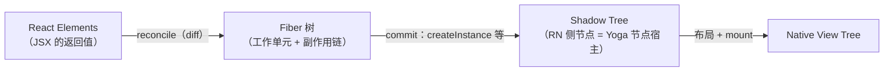
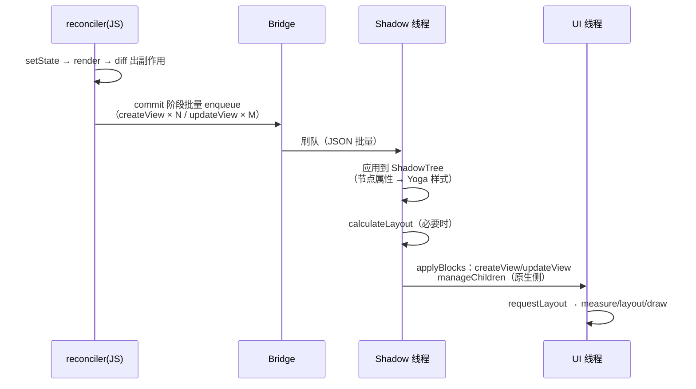

# 三棵树与 Reconciler

> RN 渲染的第一性问题：**React 怎么把组件树翻译成原生视图操作？** 答案是 react-reconciler 的宿主配置（hostConfig）——同一个 React，另一套"DOM API"。源码以 `Libraries/Renderer/` 为根。

## 1. react-reconciler：React 的可插拔心脏

React 16 之后，`react-reconciler` 包把"diff 算法"与"宿主操作"解耦：DOM、Native、测试渲染器（react-test-renderer）、终端（Ink）都是同一套 reconciler 的不同配置。

```js
// 伪代码：一个宿主要实现的关键回调
const hostConfig = {
  createInstance(type, props)   { /* 创建节点：DOM createElement / RN createView */ },
  appendChild(parent, child)    { /* 挂接 */ },
  removeChild(parent, child)    { /* 移除 */ },
  commitUpdate(inst, newProps)  { /* 更新属性 */ },
  prepareForCommit / resetAfterCommit / ...,
};
```

RN 的实现：`Libraries/Renderer/implementations/ReactFabric-{dev,prod}.js`（新架构）与 `ReactNativeRenderer-{dev,prod}.js`（旧架构），由 `Libraries/Renderer/shims/ReactNative` 按特性开关分发给 `React Fabric.render` / `React Native.render`。

## 2. 三棵树的翻译流水线



关键对应关系：

| reconciler 回调 | 旧架构落到哪 |
|----------------|-------------|
| `createInstance` | `UIManager.createView(tag, viewName, rootTag, props)` → Shadow 线程建 ShadowNode |
| `appendInitialChild` / `appendChild` | `setChildren` 指令（数组一次提交） |
| `commitUpdate` | `updateView(tag, viewName, props)` |
| `removeChild` | `manageChildren(..., removeAtIndices)` |

**重点**：reconcile 在 JS 线程产出的是**指令（消息）**，不是视图本身——真正建节点发生在 Shadow 线程（模块三）。JS 与原生之间隔着 Bridge，"渲染"必须分两班倒。

## 3. 一次更新的分班作业



对照 React（Web）：Web 的 commit 直接同步操作 DOM；**RN 旧架构的 commit 只是"发出消息"**，真正 commit 在两端各做一半——这是理解旧架构渲染延迟的钥匙。

## 4. Diff 的产物：视图操作指令

RN 渲染器做了**指令级 diff**，reconciler 层算出 Fiber 副作用后，还要把"子树变化"翻译成最小的原生操作序列（`ReactNativeAttributePayload.diff` 对比新旧 props，只提交差异）：

- props 无变化 → 不产生消息；
- 子节点重排 → `manageChildren(moveFrom/To)` 而非全量重建；
- 文本更新 → `updateView` 只带 text 差异。

所以"re-render 不一定卡"：**React 层 re-render ≠ 桥上有流量，props diff 后没有差异就没有消息**。`React.memo` 的收益在省 reconcile，diff 机制则是第二道保险。

## 5. 新架构预告：Fabric 变了哪一环

| 环节 | 旧 | Fabric |
|------|-----|--------|
| reconcile 产物 | Bridge 消息 | C++ 调用（JSI 直达） |
| ShadowTree | 平台对象（Java/OC） | C++ `ShadowNode`（clone-on-write） |
| commit 语义 | 两班倒（JS 半班 + Native 半班） | 单班：render/reconcile/commit 一体化 |
| 布局 | Shadow 线程异步 | commit 内同步，可按优先级中断 |

模块七第 2 篇展开 Fabric 管线细节。

## 6. 动手验证：看见指令流

- dev 菜单打开 `Show Perf Monitor` 观察 Bridge 流量；
- `UIManager.setViewHierarchyUpdateTimeout` 或直接在 `ReactFabric-prod.js` 打断点观察 `createInstance` 调用序列；
- 新架构可用 `React DevTools Profiler` 的 commit 信息对照。

## 小结

- RN 渲染 = react-reconciler 的宿主化 + 指令级 diff + 两班倒 commit。
- `createInstance/commitUpdate` 等回调最终变成 `createView/updateView` 消息——reconcile 与渲染被 Bridge 切成两段。
- props diff 是 re-render 的第二道保险：无差异即无消息、无跨线程、无原生开销。
