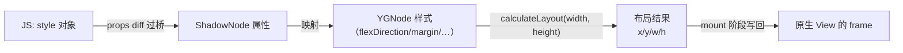
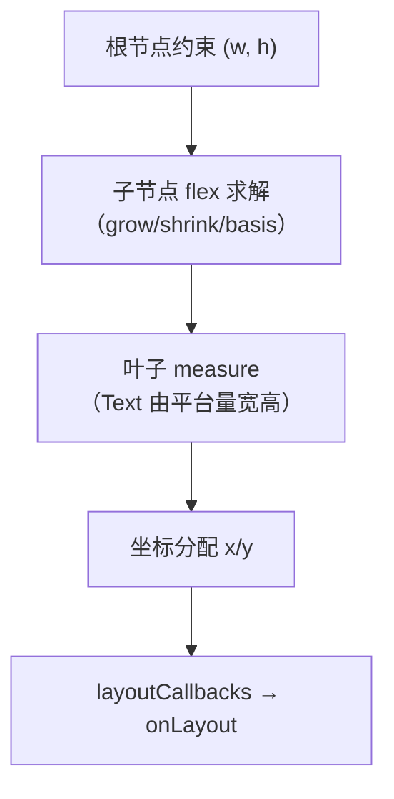
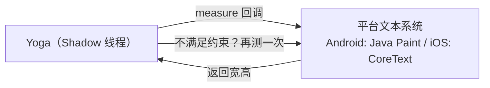
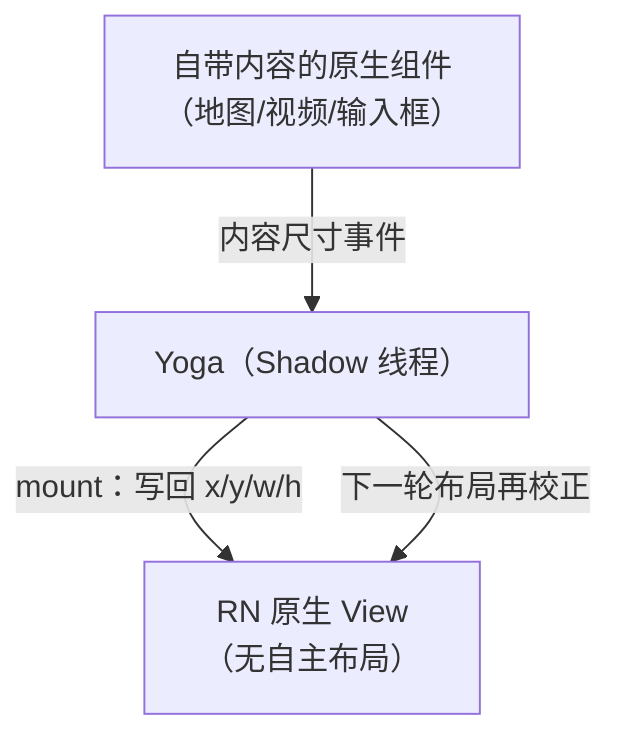

# Yoga 布局引擎

> CSS flexbox 是浏览器级的复杂规范，RN 却要在没有浏览器的两端跑同样的布局——答案是 Yoga：一个 C++ 写的、可移植的 flexbox 实现。本篇讲它在渲染管线里的位置、计算模型与性能特征。

## 1. Yoga 在管线中的位置



- 源码：`ReactCommon/yoga/`（Facebook 独立开源库 yoga）；
- 每个 ShadowNode 持有一个 YGNode，树结构与组件树同构；
- 布局触发点：mount 前、`onLayout` 依赖的祖先变化时、屏幕旋转等尺寸约束变化时。

### 1.1 源码地图与对象模型

Yoga 的核心对象只有三个（源码 `ReactCommon/yoga/yoga/`，C++ 命名以 YG 开头）：

| 对象 | 职责 | 备注 |
|------|------|------|
| `YGConfig` | 全局配置：logger、实验特性开关、scaleFactor | 每个根/容器一份，影响整棵树 |
| `YGNode` | 布局节点：持有 `YGStyle`、children、`YGLayout` 结果、可选 measureFunc | 与 ShadowNode 一一对应 |
| `YGStyle` | 样式数据的纯值结构：flexDirection/margin/padding/border/position… | 纯数据，无逻辑 |

几个"像 C 不像 C++"的设计值得注意：YGNode 的持有关系靠裸指针树（owner 指向父），样式是值语义结构体，布局结果（`YGLayout`）直接内嵌在节点里。这套设计服务于**无副作用、可缓存的计算**——布局函数可以反复跑同一棵树而不破坏上一次结果，这是缓存机制（第 4 节）的地基。

RN 侧的绑定：旧架构 Android 的 `ReactShadowNodeImpl` 直接继承 YogaNode（`ReactShadowNode extends YogaNode`），iOS 的 `RCTShadowView` 组合持有 YGNode；新架构统一为 C++ `ShadowNode` 家族持有 YGNode——**Yoga 从来不认识"React"，它只是被ShadowNode 顺手拎着的一颗计算内核**（三棵树模型见[01 · 三棵树与 Reconciler](01-三棵树与Reconciler.md)）。

## 2. 布局计算：一次自上而下的递归

`YGNodeCalculateLayout` 的经典三步：

1. **measure**：自上而下传递可用尺寸约束；
2. **resolve**：递归求解每个节点的最终尺寸（flex 行/列求解器）；
3. **assign**：自上而下分配 x/y 坐标，结果写进 `YGNodeLayout` 字段。



**文本是特例**：文字宽高依赖平台字体系统（Android `Paint.measureText` / iOS `NSAttributedString`），所以 Text/TextInput 节点挂平台 measure 函数（`TextMeasureMode`），Yoga 允许这类节点"自己量自己"，但代价是**跨语言回调**——旧架构的文本测量是布局性能黑洞之一，新架构把测量搬进 C++ 同步完成。

### 2.1 测量协议：约束怎么传、结果怎么回

Yoga 与叶子节点之间的契约是一组三元组：`(availableWidth, widthMode)`、`(availableHeight, heightMode)`，其中 mode 取三值：

| Mode | 语义 | 例子 |
|------|------|------|
| `Exactly` | 尺寸已定死，量了也是这个 | 父容器 `width: 100` 且不换行时的横向约束 |
| `AtMost` | 不许超过，可以更小 | 包裹型文本：宽度封顶、高度自然 |
| `Undefined` | 没有约束，按内容来 | 顶层根节点未给定尺寸 |

叶子节点的 measure 函数按这个契约返回"自己的尺寸"，Yoga 再拿返回值参与 flex 求解。C 接口形如（`ReactCommon/yoga/yoga/YGNode.h`）：

```cpp
// 简化的函数签名：Yoga 回调叶子节点"自己量自己"
typedef YGSize (*YGMeasureFunc)(
    YGNodeRef node,
    float width, YGMeasureMode widthMode,
    float height, YGMeasureMode heightMode);
```

工程上最有用的推论：**给文本节点稳定的约束，测量结果才可缓存**。`numberOfLines`、`maxWidth`、`adjustsFontSizeToFit` 这类属性都是在改测量输入；输入稳定 → 输出稳定 → Yoga 缓存命中（第 4 节）。反过来，"约束每帧都在变"的文本（比如跟随动画变宽的气泡）等于每次都触发真实的平台测量。

### 2.2 主轴求解分几步

以默认 `flexDirection: 'column'`（注意 RN 默认是 column，与 Web 相反）为例，一列子节点的纵向求解顺序：

1. **定主轴假设尺寸**：每个子节点按 `flexBasis`（默认 auto → 取内容尺寸或测量值）排初始尺寸；
2. **算总需求 vs 可用空间**：累加 basis + gap + padding/border，得出"剩余"或"超支"；
3. **grow/shrink 分摊**：超支时按 `flexShrink`（默认 0，不缩）比例压缩，剩余时按 `flexGrow`（默认 0，不长）比例分配——比例的分母是各子节点相应系数之和；
4. **min/max 夹逼**：任何分配结果都要被 `minHeight/maxHeight/minWidth/maxWidth` 夹回区间；
5. **定位**：`justifyContent` 分配主轴空隙，`alignItems/alignSelf` 决定交叉轴对齐（默认 stretch——这就是 View 默认"横向撑满父容器"的原因）；
6. **绝对定位收尾**：`position: 'absolute'` 的子节点不参与 1–5，直接按 inset 相对父容器内容盒定位。

这份"伪规范"的用处：出布局问题时按 1–6 逐条问"这一步我给了什么输入"。多数"为什么没撑开/为什么被压缩"的 bug，都能定位到第 3 步的默认值（`flexShrink` 默认 0，不写 shrink 的子节点**不会被压缩**——与很多框架不同）。

### 2.3 文本测量：从跨语言黑洞到 C++ 内联

文本测量为什么是"黑洞"？因为旧架构里每一次测量都是一次**跨语言往返**：



- 一次布局中同一文本节点可能被测多轮（不同约束组合下 Yoga 会试测）；
- 测量必须同步返回结果，但系统本身在另一侧——旧架构通过预注册的测量函数在 Shadow 线程内调用平台 API，Android 侧要经过 JNI、iOS 侧经过 OC 桥，成本远高于纯 C++ 计算；
- 新架构把文本排版统一到 C++ 层（`TextLayoutManager`，源码 `ReactCommon/textlayoutmanager/`），字体度量仍取自平台，但**布局循环内不再跨语言**，且测量结果可按"文本 + 字体 + 约束"为键缓存复用。

这也是新架构"长文本列表更顺滑"体感的来源之一（[Fabric 渲染管线](../rn-新架构/02-Fabric渲染管线.md)）。

### 2.4 一次递归的伪代码走读

把 `YGLayoutNodeInternal` 的骨架抽出来（简化，保留控制流）：

```cpp
// 伪代码：单个节点在给定约束下的布局
Size layoutNode(node, availW, modeW, availH, modeH) {
  // ① 查缓存：同约束组合算过就直接返回
  if (auto cached = node->lookupCache(availW, modeW, availH, modeH))
    return *cached;

  // ② 叶子且挂了 measureFunc：不递归，问平台要尺寸
  if (node->isLeaf() && node->hasMeasureFunc())
    return callMeasureFunc(node, availW, modeW, availH, modeH);

  // ③ 内部节点：先按样式推"假设尺寸"
  Size hypothetical = sizeFromStyle(node, availW, availH);

  // ④ 递归布局子节点（约束 = 假设尺寸扣掉 padding/border）
  for (child : node->children())
    layoutNode(child, innerW, modeFor(innerW), innerH, modeFor(innerH));

  // ⑤ flex 分摊：grow/shrink/basis 调整子节点尺寸
  resolveFlexLine(node);

  // ⑥ 定位：justifyContent/alignItems 写每个 child 的 x/y
  positionChildren(node);

  // ⑦ 汇总自身最终尺寸，写回 YGLayout 并登记缓存
  node->saveResult(availW, modeW, availH, modeH);
  return node->size();
}
```

读这段伪代码能直接得到三个结论：

1. **缓存检查在最前面**——命中时连叶子 measure 都不会发生，"文本不再测量"比"布局不再计算"更省；
2. **measure 只发生在叶子**——所以"深嵌套的 View"贵在递归与约束推导，"多而深的 Text"贵在 measure 回调，优化手段完全不同；
3. **子节点的约束由父节点的"假设尺寸"推导**——这解释了为什么改一个祖先的 padding 会让整条子树重算：推导链条从根上就变了。

## 3. 与 CSS flexbox 的差异清单

写惯 Web 的同学最容易踩的四条：

| 特性 | Web CSS | RN（Yoga） |
|------|---------|-----------|
| 单位 | px/em/rem/%… | 无单位（dp/pt）；仅部分属性支持百分比字符串 |
| 默认方向 | `flex-direction: row` | **`column`** |
| 级联/继承 | 有 | **无**（样式不继承，除 Text 子树字体属性的有限继承） |
| 盒模型切换 | `box-sizing` | 无（永远 border-box 语义） |

再补四条进阶差异（样式系统全景见[04 · 样式、DPI 与平台适配](04-样式DPI与平台适配.md)）：

| 特性 | Web CSS | RN（Yoga） | 备注 |
|------|---------|-----------|------|
| 逻辑属性 | `margin-inline-start` 等 | `start/end`（配合 RTL） | Yoga 以 direction（LTR/RTL）为布局输入之一 |
| 网格布局 | `display: grid` | 无 | 只 有 flex，网格需求要靠 Flex 组合或自绘 |
| `gap` | 支持全面 | 较新版本支持 | 老版本用 margin 代替时注意末尾元素多出的 margin |
| `aspectRatio` | 非标准（早期无） | 一等属性 | Yoga 特色：宽高比约束参与 min/max 夹逼 |
| `calc()` | 支持 | 无 | 尺寸要么常量、要么百分比，动态计算在 JS 里做 |

没有级联意味着"全局字号"要靠组件封装或主题 Context——这既是限制，也换来了样式计算的**局部性与可缓存性**。

### 3.1 默认值对照：最容易写错的一张表

除了"有没有某个特性"，**默认值差异**才是日常 bug 的高发区——代码看起来一样，行为却不同：

| 属性 | Web CSS 初始值 | Yoga/RN 默认 | 后果 |
|------|---------------|--------------|------|
| `flex-direction` | `row` | **`column`** | Web 老手惯性排错方向 |
| `flex-shrink` | `1`（可被压缩） | **`0`（不许压）** | 子元素总和超宽时**直接溢出**而非压缩——RN 最常见的"为什么没缩" |
| `flex-grow` | `0` | `0` | 一致；RN 里用 `flex: 1` 快捷写法补 |
| `align-items` | `stretch` | `stretch` | 一致：子 View 默认横向撑满 |
| `box-sizing` | `content-box`（可切） | **border-box 语义（固定）** | width 恒含 padding/border，Web 迁移的间距计算要重核 |

第二行值得展开：CSS 世界里"一排子元素总会被压缩塞进父容器"；Yoga 世界里**不写 flexShrink 就绝不压缩**。于是 Web 习以为常的"自适应压缩"在 RN 里必须显式声明。反过来，这也让 RN 的溢出更显式——压缩遮掩不了问题，宁可溢出给你看。

### 3.2 为什么"没有级联"反而是优点

浏览器样式引擎的大量成本花在级联上：收集选择器命中、按特异性排序、计算继承值、再物化成 computed style。RN 砍掉这一整套后：

1. 每个 YGStyle 只由该节点的 style props 决定——**样式输入是纯函数**，同 props 必得同样式；
2. 样式 diff 可以精确到属性级：props 没变，YGStyle 不用重算，直接进缓存路径；
3. 不存在"改一个全局类名、整树 recomputed style"的级联失效风暴。

代价则是表达力：主题系统、伪类、媒体查询都要自己在 JS 层造（`useWindowDimensions` 就是 RN 版的"媒体查询"，本质是订阅式状态而非声明式查询）。

### 3.3 `flex: 1` 简写到底展开了什么

`flex: 1` 等价于 `flexGrow: 1, flexShrink: 1, flexBasis: 0%`（与 CSS 的 `flex: 1` 一致）。关键在 basis=0：所有 basis 为 0 的子项**先不占空间**，再按 grow 比例分摊全部可用空间——多个 `flex: 1` 得到等分，`flex: 2` 与 `flex: 1` 按 2:1 分。而显式给了 `flexBasis` 的子项，grow 只分摊"扣除 basis 后的剩余空间"。**等分是 basis=0 的特例，不是 flex 布局的通则**——排查"为什么没等分"时先查 basis。

## 4. 布局缓存与失效

Yoga 的性能靠缓存：每个 YGNode 记录上次布局的约束与结果，约束不变直接复用（`YGLayoutNodeInternal` 的 cache 命中路径）。

失效传播规则：

- 样式变化 → 该节点及其子树 dirty；
- 文本变化 → 自底向上冒泡（尺寸可能影响祖先）；
- 窗口/父容器尺寸变化 → 受影响子树重算。

**推论**：列表 item 用固定 `height` 或合理的 key 稳定性，可以把重算压到 O(1)——这是 FlatList/FlashList 性能实践的理论根子。

### 4.1 缓存的键与限制

- 缓存键 ≈（可用宽度 + 宽度 mode、可用高度 + 高度 mode、布局方向）：**约束组合**才是键，不是"内容变了没"——内容变化走 dirty 标记主动失效，不能等缓存自然过期；
- 每个节点保留最近若干组约束的缓存结果（定长小数组），常见动画场景（宽度连续变化）能覆盖相邻几档约束；
- **dirty 只能由挂 measureFunc 的节点向上标记**（`YGNodeMarkDirty` 会断言节点是叶子）：因为只有叶子知道自己"内容变了"。样式变化的 dirty 由 RN 侧调 `markDirtyAndPropagate` 完成。

### 4.2 失效传播的工程代价

| 变更 | dirty 范围 | 缓存影响 |
|------|-----------|---------|
| 改某节点 margin | 该节点子树 | 子树全重算（约束链可能变） |
| 改文本内容 | 叶子 → 全部祖先链 | 沿途缓存全失效 |
| 改容器 justifyContent | 理论上只影响定位 | Yoga 实现按保守策略处理，视为可能影响测量 |
| 固定高度列表项内容变化 | 叶子 + 祖先链标记 dirty，但求解被 min/max 钳住 | 重算范围小、耗时稳定 |

第三行揭示一个直觉与实现的落差：**"只是挪位置"的变更不一定比"改尺寸"便宜**，Yoga 宁可保守重算也不冒险用错缓存。所以"布局抖动优化"的核心永远是"别让约束输入变"，而不是"只改不参与尺寸的属性"。

### 4.3 一次失效的完整传播实例

以"列表项的文字从一行变两行"为例，逐帧跟踪 dirty 的传播：

| 步 | 事件 | Yoga 内部状态 |
|----|------|--------------|
| 1 | JS 发 updateView，text props 变化 | Shadow 线程收到指令 |
| 2 | 文本叶子节点内容变化 | `markDirty`：叶子脏（只有它能判断"内容变了"） |
| 3 | 高度可能变化 | dirty 沿 owner 链向上冒泡至根：沿途节点全脏 |
| 4 | 重新 calculateLayout | 祖先链缓存失效，全部重算；兄弟子树**若约束未变则缓存命中** |
| 5 | 布局结果写回 | 该项及受影响祖先的 frame 变化 → mount 更新 |

这张表解释了两个现象：其一，**改一个文本会"弄脏"整条祖先链**，但同级兄弟子树不受牵连（缓存按约束隔离）；其二，若该列表项显式写了固定 `height`，第 3 步仍然冒泡（Yoga 不知道 min/max 会钳住结果），但第 4 步求解被钳制，实际位移为零、mount 无变化——**固定尺寸不能省 dirty 传播，但能省下游的视觉更新**。

## 5. Yoga 与平台布局系统的接缝

RN 的原生 View 不参与 Yoga 计算，但两者必须在 mount 时"对表"。理解这条接缝能解释一批平台差异 bug：

1. **RN 视图没有自己的布局算法**：普通 View/ViewGroup 的最终尺寸由 Shadow 树算好后直接设置（mount 写回 frame），平台的 onMeasure 被绕过/短路——所以"原生侧再怎么 measure 也改变不了 RN 的布局"；
2. **自带布局的原生组件是例外**：地图、视频、WebView 这类组件内部有自己的视图体系，RN 只控制它们的外框尺寸；外框由 Yoga 决定，内部与 Yoga 无关；
3. **两个布局世界的冲突**：把 RN 嵌进原生页面（混合栈，模块十二）或把原生视图塞进 RN（`requireNativeComponent`）时，尺寸协商都发生在"Yoga 算外框 → 原生自适应内容"这一层，谁的规则赢取决于具体实现；
4. **布局信息双向同步的例外**：TextInput 这类高度自适应内容的组件，原生内容尺寸变化要反馈回 Shadow 树（onContentSizeChange 事件链）再参与下一轮布局——这就是键盘/输入场景偶发布局跳动的结构性来源。



## 6. DPI 与逻辑像素

- RN 的样式数值 = **逻辑像素**（Android dp / iOS pt），与 Web 的 CSS px 概念对齐；
- `PixelRatio.get()` = 物理像素 / 逻辑像素（如 3x 屏返回 3）；
- 只有"物理量"才需要换算：图片按倍率选源（`@2x/@3x`）、hairline 宽 `1 / PixelRatio.get()`、Canvas/WebGL 绘图尺寸。

```jsx
const hairline = 1 / PixelRatio.get(); // 最细可见线宽
```

这层的完整展开（roundToNearestPixel、字体缩放与 PixelRatio 的区别、@2x/@3x 的内存账）在[04 · 样式、DPI 与平台适配](04-样式DPI与平台适配.md)。本篇只需要记住：**Yoga 全程工作在逻辑像素上**，DPI 换算发生在布局之后（mount 写回原生 frame）与资产选择时，两套单位在管线里不会混。

## 7. onLayout：回声，不是命令

`onLayout` 是 JS 拿到布局结果的唯一同步事件通道，它的机械原理值得单列：

1. **注册即监听**：只有传了 `onLayout` prop 的节点，其 ShadowNode 才登记布局回调——不写 onLayout 的节点布局变化不产生任何事件流量；
2. **变化才通知**：布局完成后比较该节点新旧 `x/y/width/height`，有变化才 dispatch；无变化静默；
3. **事件内容**：回调收到 `{layout: {x, y, width, height}, target}`，坐标是**相对父容器**的逻辑像素。

| 场景 | onLayout 触发？ |
|------|----------------|
| 父容器 padding 变化导致本节点位移 | 触发（x/y 变了） |
| 兄弟节点变化但本节点 frame 未变 | 不触发 |
| 只改了背景色 | 不触发（与布局无关） |
| 首次挂载 | 触发一次（0 → 实际值） |

经典反模式：在 `onLayout` 里 `setState` 存尺寸再参与渲染——形成"布局 → 事件 → setState → 再布局"的回环，每帧两轮布局。需要"先量再放"的场景，优先用 flex 本身表达（`alignItems`/`aspectRatio`），确需测量时用同步 measure API（新架构）或把结果缓存住避免链式 setState（模块三 04 讲同步/异步边界时展开）。

## 8. 布局性能特征与优化要点

1. **树深比树宽贵**：deep nest 的约束传播链长，扁平化 JSX（去掉无谓包装 View）收益直接；
2. **避免布局抖动**：频繁变更宽高约束（如跟随键盘动画的容器）会让缓存反复失效；
3. **onLayout 是回声不是命令**：`onLayout` 回调来自布局完成后的通知，别在回调里同步 setState 造成布局-渲染循环；
4. **新架构红利**：Fabric 下测量与布局同步在 C++ 完成，文本测量不再跨语言，`measure` 类 API 可同步返回。

### 8.1 性能坑清单（按出现频率）

| 坑 | 机制定位 | 修法 |
|----|---------|------|
| 列表项不写尺寸 | 每次回收复用都重测文本 + 重算布局 | 固定 height 或估算高度 |
| key 用 index 且顺序变化 | 复用错位 → 大面积样式失效 | 稳定 key（数据 id） |
| 深层包装 View（每层一个 Flex） | 约束传播链长、缓存命中率低 | 扁平化、删掉纯布局壳 |
| 动画驱动 width/height | 每帧整条约束链失效 | transform 代替（不参与布局） |
| onLayout 里 setState | 布局-渲染回环 | flex 表达或缓存测量结果 |
| 大段富文本频繁更新 | 文本测量跨语言 + 多轮试测 | 拆小文本块 / 降频更新 |

### 8.2 动手验证

- **看 Shadow 线程负载**：Perfetto 抓 trace 后看 Shadow/布局线程的活跃段是否跨帧（方法见[模块九 05 · 性能剖析操作手册](../rn-性能优化原理/05-性能剖析操作手册.md)）；
- **对照实验**：同屏 100 个固定高度 View vs 不定高度含文本 View，观察布局段时长差异（自己测，结论以你的设备为准）；
- **隔离文本成本**：把长 Text 换成等量固定高度 View，若掉帧消失，说明瓶颈在测量而非布局结构。

### 8.3 Yoga 的边界：什么时候不该用 Flex

Flex 是通用工具，不是唯一工具。以下场景继续硬上 Flex，往往是把 O(1) 的问题做成 O(树)：

| 场景 | Flex 的问题 | 更合适的工具 |
|------|------------|--------------|
| 大量重叠元素（画布/图表标注） | 每个元素都是布局节点，树膨胀 | absolute 定位 + transform，或自绘（Skia/Canvas） |
| 密集网格（日历、表格） | Flex 组合嵌套深、约束链长 | 计算坐标直接 absolute 摆放 |
| 高频位移动画 | 每帧布局失效 | transform（不参与布局，走合成路径） |
| 依赖文字精确换行的复杂排版 | 文本测量多轮试测 | 交给平台富文本组件或 WebView |

判断口径：**如果坐标可以离线算出来（不依赖兄弟节点尺寸），就不需要 Flex 在运行时算**——Flex 的价值在"内容不定、相互影响"的自适应场景。

## 9. 与模块内其他篇目的关系

- 上游：[01 · 三棵树与 Reconciler](01-三棵树与Reconciler.md)——Yoga 的输入（YGStyle）来自 reconciler 的 props diff；
- 下游：[03 · 视图提交与批量挂载](03-视图提交与批量挂载.md)——布局结果如何在 mount 阶段写回原生 frame；
- 旁路：[04 · 样式、DPI 与平台适配](04-样式DPI与平台适配.md)——样式对象如何一步步变成 YGStyle；
- 线程视角：布局跑在 Shadow 段（[模块三 02 · 四线程模型](../rn-JS引擎与线程模型/02-四线程模型.md)），列表场景的布局实践见[模块九 02 · 列表虚拟化原理](../rn-性能优化原理/02-列表虚拟化原理.md)。

## 10. 常见误区

| 误区 | 事实 | 一句话纠正 |
|------|------|-----------|
| "布局在 JS 线程算" | Yoga 跑在 Shadow 段的线程上下文，JS 只生产样式输入 | 卡 JS 线程 ≠ 卡布局，先归因线程（模块三 02） |
| "子元素多了会自动压缩" | `flexShrink` 默认 0，不写就溢出 | 想压缩显式写 shrink 或用 flex 简写 |
| "样式写在 StyleSheet.create 里布局就快" | 布局成本只看 YGStyle 值，不看对象从哪来 | StyleSheet 省的是 JS 对象成本（模块五 04） |
| "onLayout 能当测量命令用" | 它是布局完成后的回声事件 | 需要同步测量用 measure API（新架构） |
| "percent 随处可用" | 百分比字符串仅部分属性接受 | 单位越界直接不生效，不报错 |
| "Yoga 是 CSS 引擎" | 它只实现 flexbox 布局，没有选择器/级联/媒体查询 | 心智模型对齐"带缓存的布局求解器" |

## 自测题（答不上就回读对应小节）

1. YGConfig/YGNode/YGStyle 各管什么？为什么说 Yoga "不认识 React"？（→ 1.1）
2. 测量协议的三种 mode 各是什么语义？"给文本稳定约束"为什么能提升性能？（→ 2.1）
3. 主轴求解的六个步骤里，`flexShrink` 默认值是多少？它如何解释"子元素溢出父容器"现象？（→ 2.2）
4. 文本测量在旧架构为什么贵？新架构改了什么？（→ 2.3）
5. 布局缓存的键是什么？为什么 dirty 标记只能从叶子发起？（→ 4.1）
6. onLayout 什么情况下触发、什么情况不触发？为什么在回调里 setState 危险？（→ 7）
7. "动画驱动 width/height"为什么是布局性能坑？（→ 8.1）
8. RN 的原生 View 有自己的布局算法吗？自带内容的原生组件如何与 Yoga 协商尺寸？（→ 5）

## 小结

- Yoga = C++ flexbox：ShadowNode 持 YGNode，mount 前算好 x/y/w/h，再写回原生 frame。
- 布局成本来自约束传播与文本测量，缓存命中是性能生命线。
- 无单位、无级联、默认 column——差异清单即避坑清单。
- 测量协议（三 mode）与失效规则（叶子起爆、向上冒泡）是分析一切"布局为什么慢"的两把尺子。
