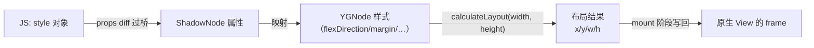
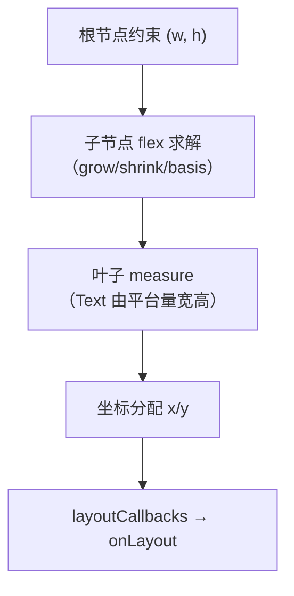

# Yoga 布局引擎

> CSS flexbox 是浏览器级的复杂规范，RN 却要在没有浏览器的两端跑同样的布局——答案是 Yoga：一个 C++ 写的、可移植的 flexbox 实现。本篇讲它在渲染管线里的位置、计算模型与性能特征。

## 1. Yoga 在管线中的位置



- 源码：`ReactCommon/yoga/`（Facebook 独立开源库 yoga）；
- 每个 ShadowNode 持有一个 YGNode，树结构与组件树同构；
- 布局触发点：mount 前、`onLayout` 依赖的祖先变化时、屏幕旋转等尺寸约束变化时。

## 2. 布局计算：一次自上而下的递归

`YGNodeCalculateLayout` 的经典三步：

1. **measure**：自上而下传递可用尺寸约束；
2. **resolve**：递归求解每个节点的最终尺寸（flex 行/列求解器）；
3. **assign**：自上而下分配 x/y 坐标，结果写进 `YGNodeLayout` 字段。



**文本是特例**：文字宽高依赖平台字体系统（Android `Paint.measureText` / iOS `NSAttributedString`），所以 Text/TextInput 节点挂平台 measure 函数（`TextMeasureMode`），Yoga 允许这类节点"自己量自己"，但代价是**跨语言回调**——旧架构的文本测量是布局性能黑洞之一，新架构把测量搬进 C++ 同步完成。

## 3. 与 CSS flexbox 的差异清单

写惯 Web 的同学最容易踩的四条：

| 特性 | Web CSS | RN（Yoga） |
|------|---------|-----------|
| 单位 | px/em/rem/%… | 无单位（dp/pt）；仅部分属性支持百分比字符串 |
| 默认方向 | `flex-direction: row` | **`column`** |
| 级联/继承 | 有 | **无**（样式不继承，除 Text 子树字体属性的有限继承） |
| 盒模型切换 | `box-sizing` | 无（永远 border-box 语义） |

没有级联意味着"全局字号"要靠组件封装或主题 Context——这既是限制，也换来了样式计算的**局部性与可缓存性**。

## 4. 布局缓存与失效

Yoga 的性能靠缓存：每个 YGNode 记录上次布局的约束与结果，约束不变直接复用（`YGLayoutNodeInternal` 的 cache 命中路径）。

失效传播规则：

- 样式变化 → 该节点及其子树 dirty；
- 文本变化 → 自底向上冒泡（尺寸可能影响祖先）；
- 窗口/父容器尺寸变化 → 受影响子树重算。

**推论**：列表 item 用固定 `height` 或合理的 key 稳定性，可以把重算压到 O(1)——这是 FlatList/FlashList 性能实践的理论根子。

## 5. DPI 与逻辑像素

- RN 的样式数值 = **逻辑像素**（Android dp / iOS pt），与 Web 的 CSS px 概念对齐；
- `PixelRatio.get()` = 物理像素 / 逻辑像素（如 3x 屏返回 3）；
- 只有"物理量"才需要换算：图片按倍率选源（`@2x/@3x`）、hairline 宽 `1 / PixelRatio.get()`、Canvas/WebGL 绘图尺寸。

```jsx
const hairline = 1 / PixelRatio.get(); // 最细可见线宽
```

## 6. 布局性能特征与优化要点

1. **树深比树宽贵**：deep nest 的约束传播链长，扁平化 JSX（去掉无谓包装 View）收益直接；
2. **避免布局抖动**：频繁变更宽高约束（如跟随键盘动画的容器）会让缓存反复失效；
3. **onLayout 是回声不是命令**：`onLayout` 回调来自布局完成后的通知，别在回调里同步 setState 造成布局-渲染循环；
4. **新架构红利**：Fabric 下测量与布局同步在 C++ 完成，文本测量不再跨语言，`measure` 类 API 可同步返回。

## 小结

- Yoga = C++ flexbox：ShadowNode 持 YGNode，mount 前算好 x/y/w/h，再写回原生 frame。
- 布局成本来自约束传播与文本测量，缓存命中是性能生命线。
- 无单位、无级联、默认 column——差异清单即避坑清单。
