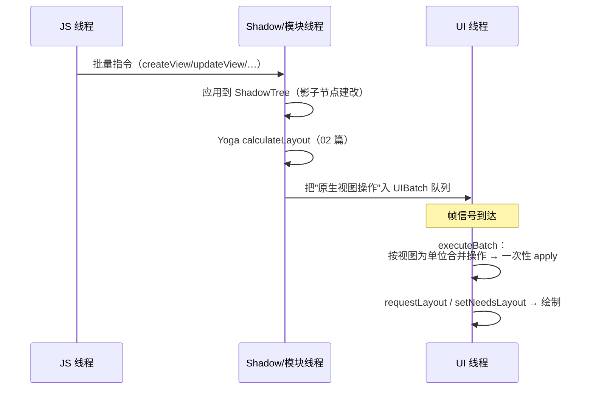
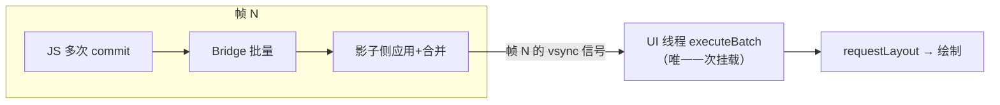
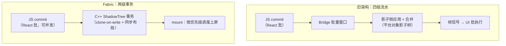

# 视图提交与批量挂载

> 模块五前两篇讲了"树的形态"（三棵树）与"布局计算"（Yoga）。本篇讲**树怎么落到屏幕上**：JS 侧的视图操作如何被收集成批、在哪个线程被合并成最小原生调用集、又如何一次性挂载。源码主路径：Android `UIManagerModule` / `UIViewOperationQueue`，iOS `RCTUIManager`。

## 1. 从 reconcile 到"操作指令"

react-reconciler 不直接改原生树，它产出的是**操作指令流**（01 篇的 diff 结果），经由 Bridge 批量下发：

| 指令 | 语义 |
|------|------|
| `createView(viewID, className, rootID, props)` | 在影子树上建节点 |
| `updateView(viewID, className, props)` | 改 props（只含变化项） |
| `setChildren(viewID, childrenIDs)` | 首次设定子节点顺序 |
| `manageChildren(viewID, …indices)` | 增/删/移动子节点的通用操作 |
| `removeRootView / setLayoutAnimationEnabled …` | 杂项控制 |

关键点：**指令带的是 viewID + props 差量**，不是整棵树——传输成本与"变化量"成正比，与树大小无关。

### 1.1 揭秘：UIManager 本身就是一个原生模块

初学者常以为"渲染指令"走什么特殊通道——没有。**UIManager（Android `UIManagerModule` / iOS `RCTUIManager`）就是又一个注册进 Bridge 的原生模块**，`createView/updateView/manageChildren` 都是它身上的普通方法：

```js
// ReactNativeRenderer（旧架构）内部（简化）
import NativeModules from 'react-native';
const UIManager = NativeModules.UIManager;

function createInstance(type, props, rootTag) {
  const tag = allocateTag();
  UIManager.createView(tag, viewConfig.uiViewClassName, rootTag, props);
  return {nodeHandle: tag, viewName: type, ...};
}
```

这意味着模块四讲的一切机制对渲染指令**全部适用**：编号寻址、批量窗口、JSON 序列化、跨线程分发（[Bridge 本质与消息队列](../rn-Bridge通信原理/01-Bridge本质与消息队列.md)、[NativeModules 调用链](../rn-Bridge通信原理/02-NativeModules调用链.md)）。渲染没有"VIP 通道"，它只是 Bridge 上流量最大的一路客户——这也直接解释了模块四 03 量化出的"渲染指令挤占普通模块调用"现象。

与普通模块的差别只有两处：它的方法名是框架协议（reconciler 的 hostConfig 直接调）；它的执行端有一套影子树与操作合并的专职流水线（本篇第 2、3 节）。

## 2. 两级批处理：影子线程积攒，UI 线程消费



为什么这样分线程（模块三 02 的守则落到渲染上）：

1. **影子树修改与布局放在非 UI 线程**：最重的两件事（树 diff + Yoga）不占主线程；
2. **原生视图操作必须回 UI 线程**：平台铁律（Android view 非线程安全 / iOS UI 线程独占）；
3. **批的意义**：一次帧内多次 setState 的最终结果，应表现为**一次**挂载——用户看到的是终态，不是中间态。

### 2.1 Android 源码走读：四级接力

Android 旧架构的视图提交是一条四级流水线（路径：`ReactAndroid/src/main/java/com/facebook/react/uimanager/`）：

| 级 | 类 | 职责 |
|----|-----|------|
| ① | `UIManagerModule` | @ReactMethod 入口：createView/updateView/manageChildren…，转给 UIImplementation |
| ② | `UIImplementation` | 影子树维护者：建/改 `ReactShadowNode`，触发 `calculateLayout`，生成视图操作 |
| ③ | `UIViewOperationQueue` | 视图操作队列：CreateViewOperation/UpdatePropertiesOperation… 按帧调度执行 |
| ④ | `NativeViewHierarchyManager` | 真正动 View：createView 找 ViewManager 实例化、setText/addView/removeView |

```java
// ①级入口的样子（简化自 UIManagerModule.java）
@ReactMethod
public void createView(int tag, String className, int rootViewTag, ReadableMap initialProps) {
  // 转给影子树维护者：在 Shadow 线程上下文里建 ReactShadowNode 并挂到 root
  mUIImplementation.createView(tag, className, rootViewTag, initialProps, ...
      /* themesProvider */ null, null);
}

@ReactMethod
public void manageChildren(int tag,
    ReadableArray moveFrom, ReadableArray moveTo,
    ReadableArray addChildTags, ReadableArray addAtIndexes,
    ReadableArray removeAt) {
  mUIImplementation.manageChildren(tag, moveFrom, moveTo, addChildTags, addAtIndexes, removeAt);
}
```

值得注意的设计：`UIManagerModule` 的方法体本身跑在原生模块线程（mqt，模块四 02 的线程标注），它把影子树工作**同步做完**（或投递到影子队列），再把"视图操作"塞进 `UIViewOperationQueue`，等待帧信号到来后整批切到主线程执行——**"影子侧同步积攒、视图侧按帧消费"在这一级代码里一目了然**。

### 2.2 iOS 源码走读：两个队列的接力

iOS 旧架构对应物是 `RCTUIManager`（路径：`React/Base/` 与 `React/Views/`），用 GCD 队列代替线程类：

```objc
// RCTUIManager.m 的方法形态（简化）
RCT_EXPORT_METHOD(createView:(NSNumber *)reactTag
                  viewName:(NSString *)viewName
                  rootTag:(NSNumber *)rootTag
                  props:(NSDictionary *)props)
{
  RCTShadowView *shadowView = [self shadowViewForTag:reactTag];  // 影子视图
  shadowView.viewName = viewName;
  // props 交给 RCTViewManager 的影子方法解析 → Yoga 样式
  [shadowView setProps:props];
  // 注册"批次末需要处理"的工作
}
```

执行模型：`RCTUIManager` 的方法都跑在一个专用串行队列（"shadow queue"，即模块三讲的 Shadow 段），每个批次结束时不直接碰 UI，而是把视图操作打包，**在帧边界 dispatch 到主队列**执行；主队列执行完毕再回填必要信息。影子队列与主队列的交接点是 `batchDidComplete` 一类的回调钩子——Android 的 `UIViewOperationQueue` 与 iOS 的这套 dispatch 逻辑是同构的。

两端的共同要害：**影子侧永远不持主线程等待**（除了极少数同步方法），主线程只在帧内收到"一次合并好的操作集"。

### 2.3 影子树的持久形态

指令流的应用对象——影子树——在两端各有实体：

| 平台 | 影子节点 | 持有什么 |
|------|---------|---------|
| Android | `ReactShadowNode`（继承 YogaNode） | YGStyle、布局结果、props、子节点索引、（可选）指向真实 View 的弱关联 |
| iOS | `RCTShadowView`（组合 YGNode） | 同上，外加 OC 侧的新旧 frame 比较 |

三条共性决定了它的行为：

1. **每 rootTag 一棵**：多个根（主界面 + Modal，见 01 篇第 7 节）各自维护影子树，互不合并批次；
2. **影子节点 ≠ 视图节点的镜像**：有些影子节点只参与布局不产视图（纯容器），有些产多个视图（Text 拆段）——指令数、影子节点数、视图数三者不严格相等；
3. **线程归属**：影子树只允许在其所属队列上改（Android mqt 上下文 / iOS shadow queue），JS 与 UI 线程都不能直接碰——一切修改必须"翻译成队列上的工作"。这就是模块三 02 强调"职责比线程名重要"的具体落点（[四线程模型](../rn-JS引擎与线程模型/02-四线程模型.md)）。

顺带一个容易误会的命名："Shadow"在这里是"影子/代理"（真实视图的布局替身），与 JS 引擎术语里的 ShadowRealm、设计模式里的 Shadow DOM 都没有关系。

## 3. 操作合并：把指令流压成最小原生调用

影子线程在应用指令的同时，把它们**翻译成以视图为单位的原生操作**并做合并：

- 同一帧内 `createView` + `updateView` + 再 `updateView` → 合并为**一次带终态 props 的创建**；
- `manageChildren` 的多个移动被规约为**一次最小重排**（类似列表 diff）；
- 布局结果直接并入操作参数（x/y/w/h），UI 线程不需要再计算。

Android 侧对应 `UIViewOperationQueue` 里按 ViewOperation 积攒、`NativeViewHierarchyManager` 执行；iOS 侧 `RCTUIManager` 在 batch 末 `scheduleBatch` 到主队列。**"批量挂载"的'批量'，指的就是这一批合并后的视图操作**。

### 3.1 合并的三条规则

把"合并"讲得更可操作，它其实是三条确定性的规则：

| 规则 | 输入 | 输出 |
|------|------|------|
| 同一 tag 的连续写合并 | createView(t) → updateView(t) → updateView(t) | createView(t, 终态 props) |
| 同一父节点的结构操作合并 | 多个 manageChildren 指向同一父 | 一组最小 move/insert/remove 索引 |
| 布局与属性合并 | 布局算出的 x/y/w/h | 直接并入视图操作的参数，UI 线程零计算 |

推论：**中间态对 UI 线程不可见**不是靠"运气好没赶上"，而是靠合并规则在结构上保证——UI 线程每帧只见到一个一致的操作集。

### 3.2 合并发生在哪一级

| 层 | 合并内容 | 证据（源码位置感） |
|----|---------|-------------------|
| JS 侧（reconciler） | 一帧内多次 setState → 一次 reconcile/commit（React 批处理） | react-reconciler 的 lane/batch 机制 |
| Bridge 侧 | 多条指令攒成一个 JSON 批 | MessageQueue 批量窗口（模块四 01） |
| 影子侧 | 指令 → 以视图为单位的原生操作，同 tag 连写合并 | `UIImplementation` / `RCTUIManager` batch 流程 |
| UI 侧 | 操作集一次性 apply，帧内不重复 traversal | `UIViewOperationQueue` / 主队列批执行 |

四级合起来才是完整的"批量"——只调其中一级（比如只用 React.memo）看到的收益，可能被下一级的批处理"吸收"掉一部分。

## 4. 一个完整例子：setState 两次，挂载一次

```jsx
function Demo() {
  const [n, setN] = useState(0);
  const onTap = () => {
    setN(1);            // 触发 reconcile #1
    setN(2);            // React 18 自动合并；即便两次 flush，
                        // 影子线程也在同一帧内合并为终态
  };
  return <Text onPress={onTap}>{n}</Text>;
}
```

指令流视角：两次（或合并后一次）`updateView(id, Text, {text: '2'})` → 影子树更新 + 布局 → UI 线程一次 `setText` + 一次 layout。**中间态 '1' 从未到达原生层**——这就是"批处理"对正确性与性能的双重意义。

### 4.1 逐步跟踪表

| 步 | 位置 | 发生什么 | 可见性 |
|----|------|---------|--------|
| 1 | JS：onPress 回调 | setN(1)、setN(2) 入调度 | 用户不可见 |
| 2 | JS：render | 一次（或两次）reconcile，diff 出 text 差量 | 不可见 |
| 3 | JS：commit | updateView 消息入队（可能两条，或 React 合并为一条） | 不可见 |
| 4 | Bridge | 批量窗口刷队 | 不可见 |
| 5 | 影子线程 | 逐条应用：ShadowNode 的 text 属性被覆盖为终态 | 不可见 |
| 6 | 影子线程 | Yoga 重算文本节点及受影响祖先 | 不可见 |
| 7 | 影子 → UI | 视图操作入 UI 批（同 tag 合并） | 不可见 |
| 8 | UI 线程（帧内） | 一次 setText + 一次 layout + 绘制 | **可见** |

注意第 5 步：即便 React 层没有合并（两次独立 commit、两条消息），影子侧"后写覆盖前写 + 同 tag 合并"仍会把中间态吃掉——**两级保险共同保证"一帧一态"**。反过来，若两次更新分跨两帧（如 setTimeout 间隔一帧以上），用户就会看到两个状态——批处理只消化同帧内的中间态，不消灭时间上分离的状态。

## 5. 帧对齐：批次的节拍器

"等帧信号"具体是谁在打拍子？

- **Android**：`ReactChoreographer`（基于系统 Choreographer 的帧回调注册）驱动视图批次调度——影子侧每完成一批，就把 UI 操作提交挂到下一个帧回调里执行；
- **iOS**：`RCTUIManager` 通过帧更新时机（display link 一类的帧驱动源）把批次 dispatch 到主队列；
- **共同点**：UI 批的执行天然与 vsync 对齐，**每帧最多一次挂载**；帧预算内的多次提交在下一次帧信号前都会被合并吸收。



一个实用推论：**掉帧时"UI 批执行"本身可能是元凶**——一批要挂载/更新大量视图时，executeBatch 的耗时直接吃掉帧预算，表现为 UI 线程掉帧（模块三 02 的"画笔"过载）。此时优化方向是"减小批量"（分帧挂载，如列表 initialNumToRender），而不是"让 JS 更快"。

### 5.1 批处理的边界：removeClippedSubviews

一个与"批次大小"直接相关的经典优化能反证本篇的模型：`removeClippedSubviews`（ScrollView/FlatList 的属性）。它的做法不是减少 JS 更新，而是在**原生视图层把屏幕外的子视图从视图树上摘下**（保留影子节点，只卸载真实 View 的挂载）：

- 收益：视图树变浅 → UI 线程的 layout/draw 遍历变便宜（批次执行与绘制都快了）；
- 代价：摘挂时机不可控会引入空白/事件命中等边界 bug（社区长期的槽点来源）；
- 定位：它是**在"挂载结果"上做的优化**，与虚拟化（在 JS 层减少渲染，模块九 02）作用在不同层。

这个例子说明：批量挂载管到"视图挂上树"为止，**挂上之后树有多重是绘制管线的事**——两层问题要用两层手段。

## 6. LayoutAnimation：批量挂载的副产品

批量挂载还有一个用户可感知的副产品——**布局动画**。它的机制恰好依赖"批次"这个单位：

1. **JS 配置**：`LayoutAnimation.configureNext(config, onAnimationEnd)` 下发"下一批变化如何过渡"的参数（duration/easing/type）；
2. **影子侧记录**：影子层拿到批次前的布局快照与批次后的目标布局，识别出"哪些节点发生了 布局变化/新增/删除"；
3. **UI 侧应用**：mount 批执行时不是直接落到终态，而是交给平台的过渡机制（Android 的 LayoutAnimationController 一类、iOS 的隐式动画层）从旧状态动画到新状态。

```jsx
import { LayoutAnimation, UIManager, Platform } from 'react-native';
if (Platform.OS === 'android') {
  UIManager.setLayoutAnimationEnabledExperimental?.(true); // Android 需显式开启
}
// 之后任何"下一批"里的布局变化都会带动画
LayoutAnimation.configureNext(LayoutAnimation.Presets.easeInEaseOut);
setExpanded(!expanded);
```

配置的三种动画类型（config 的 `type`/`updateType`/`deleteType`/`createType` 字段）：

| type | 语义 | 典型用途 |
|------|------|---------|
| `spring` | 弹簧（可调 damping/springs 参数） | 展开/收起 |
| `easeInEaseOut` / `linear` / `easeIn` / `easeOut` | 标准插值 | 通用布局过渡 |
| `auto` | 平台自选 | 让系统决定 |

三条工程须知：

- **动画以"批"为单位生效**——configureNext 只影响"下一次批次"，这既是它的简洁之处，也是"有时没生效"的常见原因（配置与变更没落在同一批）；
- **两端默认策略不同**：iOS 默认可用，Android 需要上面的实验开关（历史 API 名就叫 setLayoutAnimationEnabledExperimental）；
- **新架构支持滞后**：Fabric 的 commit/mount 管线重做了事务模型，LayoutAnimation 的支持在逐步补齐——迁移中的项目要为这条 API 准备降级方案（[新旧架构对比与迁移](../rn-新架构/05-新旧架构对比与迁移.md)）。

## 7. 与 Fabric 的 commit / mount 对照

旧架构的两级批处理有结构性短板：指令跨桥（模块四 03 的成本）、影子树更新与布局虽离主线程但仍异步分段、无优先级（滚动时新提交不能插队）。Fabric（模块七 02）保留"影子层计算 + UI 线程挂载"的骨架，改了三点：

| | 旧架构（本篇） | Fabric |
|--|---------------|--------|
| 指令通道 | Bridge JSON 指令流 | C++ 内部直接更新 ShadowTree（JSI） |
| 提交单位 | 帧批，无优先级 | **commit 事务**，带 lane 优先级（交互优先插队） |
| 挂载 | 固定批次 apply | mount 阶段按优先级调度，支持同步布局 |

补一行更本质的对照：

| 维度 | 旧架构 | Fabric |
|------|--------|--------|
| 影子树位置 | 平台对象（Java/OC），分居两端 | C++ `ShadowNode`，两端共享一套 |
| "批"的语义 | 帧对齐的队列批次（被动攒） | 事务（atomic commit，主动提交，clone-on-write） |
| 中间态消化点 | JS 批 + Bridge 批 + 影子合并（四级） | React 批 + C++ 事务（两级，链路更短） |

用一张图把两条管线并排画出来（细节在模块七 02）：



注意两条管线右端的差别：旧架构的"帧信号"是唯一的节拍器，所有提交排队等帧；Fabric 的 mount 也对齐帧，但**哪个提交先上屏由优先级决定**——用户正在交互的那条路径可以插队。

> 学习建议：先把本篇的"指令 → 影子 → 布局 → 批量挂载"四步记牢，再看 Fabric 会发现**它是同一骨架的强化版**，而不是另起炉灶。

## 8. 常见误区与性能坑

| 误区/坑 | 真相 | 处置 |
|---------|------|------|
| "一帧内两次 setState 一定挂载两次" | 四级批处理消化中间态 | 同帧多状态变更无需手工 debounce |
| "跨帧的两次更新也会合并" | 不会——批处理只消化同帧 | 需要连续动画时用 Animated/驱动器，别依赖合并 |
| "白屏/卡在 loading 是 JS 慢" | 可能是首批 createView 指令太多，影子/UI 批执行超帧 | 分帧挂载（initialNumToRender）、InteractionManager 延后非首屏 |
| "LayoutAnimation 没生效" | Android 未开开关；或配置与变更不在同一批 | 检查开关与批次归属 |
| "操作合并能救任何更新风暴" | 合并救"写放大"，救不了"读放大"（reconcile 本身） | 更新风暴要在状态设计层解决（模块九 03） |
| "批次大小无关紧要" | UI 批过大 → executeBatch 超帧预算 | 大列表增量挂载、Suspense 分段 |

### 8.1 两个典型 bug 的归因走查

**Bug 模式一：切换 Tab 白屏一闪。** 现象：切页瞬间白屏再出内容。按本篇链路归因：切换意味着旧根卸载 + 新根首挂载，两批指令都走 Bridge；若新页首屏节点多，首批 createView × N 会让影子侧建树 + 布局 + UI 批挂载集中在同一帧，UI 批超预算 → 该帧绘制被推后 → 白屏一闪。修法：新页首屏减节点/分帧挂载，或让切换动画先行掩盖挂载耗时。

**Bug 模式二：列表项删除后点击穿透。** 现象：JS 已 setState 移除某项，但点击仍命中旧区域。归因：JS 侧"已删除"只代表指令发出（01 篇 4.2 的滞后一拍），原生 removeView 要等本帧批次执行；若手势处理跑在批次之前的帧间隙，事件命中测试用的还是旧视图树。修法：避免在删除当帧立刻依赖"原生已更新"的假设；测试自动化里给批次边界留一拍。

两个走查共同的教训：**旧架构里"JS 状态"与"原生现实"隔着一整个批次管线，任何跨边界的时序假设都要显式确认**。

## 9. 动手验证

1. **数指令**：用 MessageQueue spy（模块四 03）过滤 `UIManager` 模块，观察一次"展开/收起"面板各产生多少条 createView/updateView/manageChildren；
2. **观察帧对齐**：Perfetto 抓 trace（[模块九 05 · 性能剖析操作手册](../rn-性能优化原理/05-性能剖析操作手册.md)），主线程上应看到**每帧至多一段**视图批次执行段；同帧两次 setState 在 trace 里只有一段；
3. **制造大批次**：一次性渲染一个很长的列表，观察 UI 线程第一个批次的执行时长与掉帧行为，再改成 `initialNumToRender` 分帧挂载对比（列表虚拟化原理见[模块九 02](../rn-性能优化原理/02-列表虚拟化原理.md)）；
4. **验证 LayoutAnimation 批次归属**：把 `configureNext` 与状态变更分别放进两个 setTimeout，观察动画是否丢失；
5. **观察滞后一拍**：setState 删除列表项后立刻用 UI 自动化（模块十一 02）查询原生元素数量，看它是否要等一帧才减少——给 8.1 的走查亲手找证据。

## 自测题（答不上就回读对应小节）

1. 为什么说"渲染指令没有 VIP 通道"？UIManager 与普通原生模块的差别在哪两处？（→ 1.1）
2. Android 四级接力各级的类名与职责是什么？iOS 用什么机制对应？（→ 2.1 / 2.2）
3. 操作合并的三条规则分别是什么？"中间态不可见"由哪几级共同保证？（→ 3.1 / 4.1）
4. 批次的节拍器是谁？为什么说"批处理只消化同帧内的中间态"？（→ 5 / 4.1）
5. LayoutAnimation 为什么依赖"批次"这个单位？Android 上要额外做什么？（→ 6）
6. Fabric 在"批"的语义上改了什么？（→ 7）
7. UI 线程掉帧但 JS 线程空闲，怀疑点应该是什么？（→ 5 / 8）

## 小结

- reconcile 产出的是**带 viewID 的差量指令**，成本正比于变化量而非树大小；
- 两级批处理：影子线程建改 + 布局，UI 线程按帧消费合并后的视图操作——中间态在批内被消化；
- "批量挂载"的本质是**以视图为单位的操作合并**，一次帧一次 apply；
- Fabric 继承同一骨架，用 JSI 通道、commit 事务与优先级调度替换了它的三个短板。
- UIManager 只是 Bridge 上的一个普通模块——渲染流量与业务流量共用同一套队列与序列化，这是理解旧架构性能问题的总开关。
- "JS 状态"与"原生现实"隔着一整个批次管线：同帧中间态会被消化，跨帧的状态、删除后的命中测试都要显式考虑滞后一拍。
