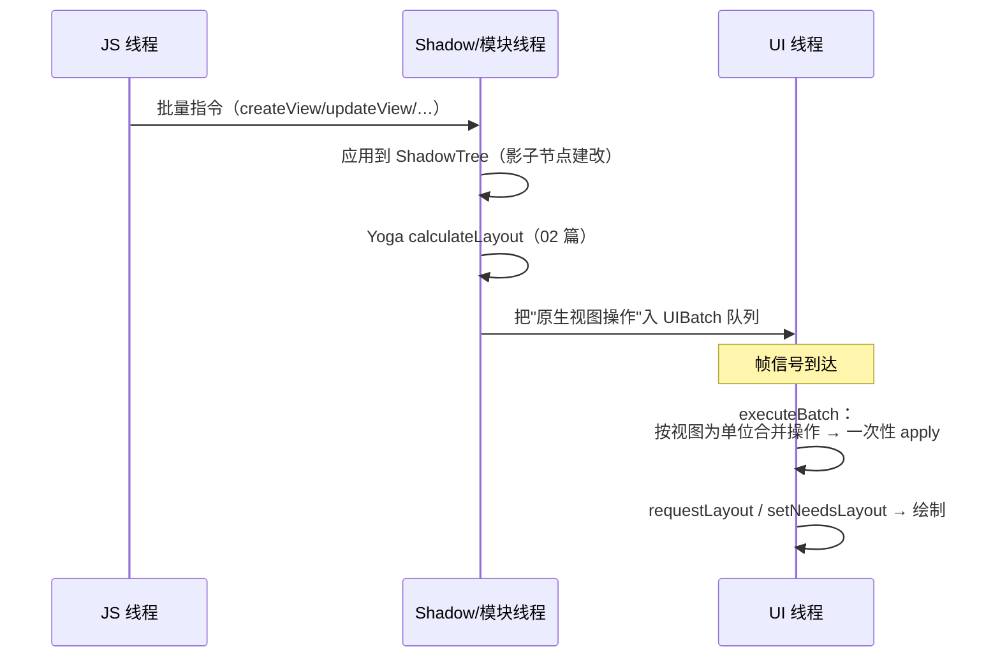

# 视图提交与批量挂载

> 模块五前两篇讲了"树的形态"（三棵树）与"布局计算"（Yoga）。本篇讲**树怎么落到屏幕上**：JS 侧的视图操作如何被收集成批、在哪个线程被合并成最小原生调用集、又如何一次性挂载。源码主路径：Android `UIManagerModule` / `UIViewOperationQueue`，iOS `RCTUIManager`。

## 1. 从 reconcile 到"操作指令"

react-reconciler 不直接改原生树，它产出的是**操作指令流**（01 篇的 diff 结果），经由 Bridge 批量下发：

| 指令 | 语义 |
|------|------|
| `createView(viewID, className, rootID, props)` | 在影子树上建节点 |
| `updateView(viewID, className, props)` | 改 props（只含变化项） |
| `setChildren(viewID, childrenIDs)` | 首次设定子节点顺序 |
| `manageChildren(viewID, …indices)` | 增/删/移动子节点的通用操作 |
| `removeRootView / setLayoutAnimationEnabled …` | 杂项控制 |

关键点：**指令带的是 viewID + props 差量**，不是整棵树——传输成本与"变化量"成正比，与树大小无关。

## 2. 两级批处理：影子线程积攒，UI 线程消费



为什么这样分线程（模块三 02 的守则落到渲染上）：

1. **影子树修改与布局放在非 UI 线程**：最重的两件事（树 diff + Yoga）不占主线程；
2. **原生视图操作必须回 UI 线程**：平台铁律（Android view 非线程安全 / iOS UI 线程独占）；
3. **批的意义**：一次帧内多次 setState 的最终结果，应表现为**一次**挂载——用户看到的是终态，不是中间态。

## 3. 操作合并：把指令流压成最小原生调用

影子线程在应用指令的同时，把它们**翻译成以视图为单位的原生操作**并做合并：

- 同一帧内 `createView` + `updateView` + 再 `updateView` → 合并为**一次带终态 props 的创建**；
- `manageChildren` 的多个移动被规约为**一次最小重排**（类似列表 diff）；
- 布局结果直接并入操作参数（x/y/w/h），UI 线程不需要再计算。

Android 侧对应 `UIViewOperationQueue` 里按 ViewOperation 积攒、`NativeViewHierarchyManager` 执行；iOS 侧 `RCTUIManager` 在 batch 末 `scheduleBatch` 到主队列。**"批量挂载"的'批量'，指的就是这一批合并后的视图操作**。

## 4. 一个完整例子：setState 两次，挂载一次

```jsx
function Demo() {
  const [n, setN] = useState(0);
  const onTap = () => {
    setN(1);            // 触发 reconcile #1
    setN(2);            // React 18 自动合并；即便两次 flush，
                        // 影子线程也在同一帧内合并为终态
  };
  return <Text onPress={onTap}>{n}</Text>;
}
```

指令流视角：两次（或合并后一次）`updateView(id, Text, {text: '2'})` → 影子树更新 + 布局 → UI 线程一次 `setText` + 一次 layout。**中间态 '1' 从未到达原生层**——这就是"批处理"对正确性与性能的双重意义。

## 5. 与 Fabric 的 commit / mount 对照

旧架构的两级批处理有结构性短板：指令跨桥（模块四 03 的成本）、影子树更新与布局虽离主线程但仍异步分段、无优先级（滚动时新提交不能插队）。Fabric（模块七 02）保留"影子层计算 + UI 线程挂载"的骨架，改了三点：

| | 旧架构（本篇） | Fabric |
|--|---------------|--------|
| 指令通道 | Bridge JSON 指令流 | C++ 内部直接更新 ShadowTree（JSI） |
| 提交单位 | 帧批，无优先级 | **commit 事务**，带 lane 优先级（交互优先插队） |
| 挂载 | 固定批次 apply | mount 阶段按优先级调度，支持同步布局 |

> 学习建议：先把本篇的"指令 → 影子 → 布局 → 批量挂载"四步记牢，再看 Fabric 会发现**它是同一骨架的强化版**，而不是另起炉灶。

## 小结

- reconcile 产出的是**带 viewID 的差量指令**，成本正比于变化量而非树大小；
- 两级批处理：影子线程建改 + 布局，UI 线程按帧消费合并后的视图操作——中间态在批内被消化；
- "批量挂载"的本质是**以视图为单位的操作合并**，一次帧一次 apply；
- Fabric 继承同一骨架，用 JSI 通道、commit 事务与优先级调度替换了它的三个短板。
