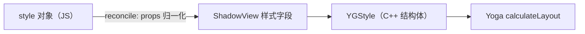
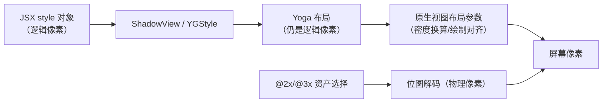

# 样式、DPI 与平台适配

> RN 没有 CSS。样式是**普通 JS 对象 → 影子节点属性 → YGStyle** 的直通映射；像素是**逻辑单位**，与物理像素之间隔着一层 PixelRatio。理解这两件事，样式行为（为什么没有级联、为什么图片要 @2x/@3x、为什么有 1px 毛边）都能推导出来。

## 1. 样式对象 → YGStyle：没有 CSS 引擎

```jsx
<View style={{ flexDirection: 'row', padding: 8 }} />
```

链路：JSX props → shadow view 的样式属性 setter → Yoga 节点的 `YGStyle` 字段（02 篇）。要点：

1. **无级联（no cascade）**：Web CSS 的继承、选择器、特异性在 RN 里不存在。样式只作用于该节点自身；唯一"准继承"是 `<Text>` 嵌套——内层 Text 沿用外层未覆盖的文字属性（文字属性沿文本树传播，不是 CSS 意义上的继承）；
2. **数组样式 = 后者覆盖前者**：`style={[s.base, s.highlight]}` 按序浅合并，规则极其简单——也因此**覆盖不了"嵌套属性"**（`base` 里的 `padding` 不会被 `highlight` 的 `paddingTop` 部分清除，因为它们本就是同一个展开后的字段）；
3. **样式计算发生在 reconcile 之外**：布局（Yoga）在影子线程，但样式对象本身的创建/合并是纯 JS——这就是"把 style 写成内联对象 vs 常量"影响 re-render 成本的直接原因（模块九 03）。



### 1.1 StyleSheet.create 的真相：它不是"样式引擎"

新人最容易高估的 API。`StyleSheet.create({...})` 的实际行为：

| 环境 | 行为 | 收益 |
|------|------|------|
| dev | 对每个样式对象做冻结/编号，误用（拼写错的 key、复用内部引用）会得到告警 | 调试保护 |
| prod | 基本等于恒等函数——对象原样返回，**没有注册表、没有缓存索引** | 几乎为零 |

所以"StyleSheet.create 能提升布局性能"是流传最广的误解：**布局层根本不知道样式对象从哪来**（YGStyle 只看值）。它真正的价值是：把样式收敛成模块级常量（避免每次 render 新建对象）、dev 期的错误检查、以及团队风格统一。换句话说，它是** JS 层的组织工具**，不是跨端加速器。

配套的正确实践：

```jsx
// 常量样式提到组件外：每次 render 不再新建对象，props 浅比较才有机会相等
const styles = StyleSheet.create({
  row: { flexDirection: 'row', padding: 8 },
});

function Row({ title }) {
  // 依赖 props 的样式无可避免要内联，尽量少、尽量扁平
  return <View style={[styles.row, { opacity: title ? 1 : 0.5 }]} />;
}
```

### 1.2 属性预处理：颜色与 transform

在进入影子节点之前，有两类属性会被框架**预处理**成更"原生友好"的形态：

1. **颜色**：`processColor` 把 `'#fff'`、`'rgba(...)'`、`'red'` 统一转成一个 ARGB 整数——跨桥传的是 number，不是字符串。颜色因此**不能参与插值动画**（字符串→数字是一次性转换），Animated 里颜色动画要靠 `interpolateColor` 生成离散值序列；
2. **transform**：`transform: [{translateX: 8}, {rotate: '45deg'}]` 这类声明式数组会被合成为一个**变换矩阵**再下发——平台只应用一个矩阵，不需要理解每种变换。这也是 transform 动画高效的原因之一：矩阵插值可以完全在原生侧完成，视图无需重排（02 篇 8.3 的"合成路径"）。

### 1.3 "样式不生效"排查清单

RN 样式失效大多不是 bug，是能力边界。高频条目：

| 现象 | 原因 | 处置 |
|------|------|------|
| `overflow: 'visible'` 在 Android 不生效 | Android 视图系统历史上强制裁剪子视图（长期限制，新版本在改善） | 用负 margin 外移、或原生组件 |
| `zIndex` 生效但布局没变 | zIndex 只改兄弟**绘制顺序**，不参与布局 | 层叠需求全靠 zIndex + absolute 组合 |
| 渐变色没效果 | 核心 `<View>` 没有渐变属性 | 引入库（原生实现）或图片 |
| `filter: blur(...)` 无效 | 无滤镜体系 | 原生方案或图像预处理 |
| 阴影两端不一致 | iOS 用 shadowOffset 家族，Android 用 elevation；boxShadow 是较新版本才补的统一属性 | 平台分支（第 4 节） |
| transformOrigin 不生效 | transformOrigin 是较新版本引入的属性 | 老版本用 translate±rotate±translate 三明治模拟 |
| `padding` 想被 `paddingTop` "部分覆盖" | 数组浅合并不理解属性嵌套（本节要点 2） | 拆成独立字段或函数生成样式 |

排查心法：**先问"这是 CSS 里存在而 RN 没有的能力"，再问"这是两端实现差异"，最后才怀疑 bug**——三类问题的解法完全不同。

### 1.4 样式属性的三条去处：不是所有样式都去 Yoga

"style → YGStyle"是主线但不是全部。一个 style 对象里的属性按去向分三类：

| 类别 | 代表属性 | 去处 | 生效环节 |
|------|---------|------|---------|
| 布局属性 | flex/margin/padding/width/height/position/aspectRatio | YGStyle | Yoga 布局（影子线程） |
| 视图外观属性 | backgroundColor/borderRadius/opacity/overflow | 视图属性（view props） | mount 时设置到原生 View（UI 线程） |
| 平台合成属性 | transform/elevation/shadow*/boxShadow | 预处理后转视图属性 | mount 时设置 |

这张表解释了几个现象：

1. **改背景色不触发布局**：视图外观属性不进 YGStyle，Yoga 约束没变 → 缓存命中 → 只有一次视图属性更新。所以"高频变色"（如呼吸灯）比"高频变尺寸"便宜得多；
2. **opacity 是合成友好的**：它映射到平台视图的透明度通道，可走合成路径，不需要重绘内容（动画优先选它）；
3. **判断某个属性的"价格"先看它去哪一类**：布局属性可能引发子树重算，外观属性只更新自身——同样一次 setState，改哪类属性代价差一个量级。

```jsx
// 同样是"动起来"，两条价格完全不同的路
<Animated.View style={{ opacity: x }} />      // 外观属性：合成路径，便宜
<Animated.View style={{ width: x }} />        // 布局属性：每帧约束链失效（02 篇）
```

## 2. 逻辑像素与物理像素：dp / pt / PixelRatio

RN 的所有尺寸都是**设备无关像素**（Android 称 dp，iOS 称 pt）：

```
物理像素 = 逻辑像素 × PixelRatio.get()
```

| 需求 | API | 典型用法 |
|------|-----|---------|
| 拿到倍率 | `PixelRatio.get()` | 手动画细线：`1 / PixelRatio.get()` 才是物理 1px |
| 逻辑 → 物理取整 | `PixelRatio.roundToNearestPixel(size)` | 避免亚像素模糊 |
| 字体缩放 | `PixelRatio.getFontScale()` | 尊重系统字号设置 |

三个经典现象的原理：

1. **细线变虚**：`height: 1` 在 3x 屏是 3 物理像素且可能落在半个像素上——需 roundToNearestPixel 对齐；
2. **Android 的 pixel rounding**：历史版本对尺寸做过"取整到物理像素"的适配（prop 控制），0.75 起转向**分数像素度量（fractional metrics）**：允许更精确的布局但渲染时对齐——两端策略趋同于"计算精确、绘制对齐"；
3. **横竖屏/折叠屏**：逻辑宽度变了 → 布局重算（useWindowDimensions），不是缩放。

### 2.1 PixelRatio 家族全表

| API | 语义 | 什么时候真的需要它 |
|-----|------|------------------|
| `get()` | 密度倍率（物理/逻辑） | 细线、Canvas 尺寸、手动选图 |
| `roundToNearestPixel(dp)` | 向最近物理像素取整 | 需要"锐利边缘"的尺寸（边框、栅格） |
| `floorToNearestPixel(dp)` | 向下取整 | 不允许溢出容器时 |
| `getPixelSizeForLayoutSize(dp)` | 逻辑→物理 | 告诉原生 API 物理尺寸时 |
| `getFontScale()` | 字体缩放系数（用户系统设置） | 读它做特殊排版；**别拿它替代布局** |

注意 `getFontScale()` 与 `get()` 是两个独立维度：密度不变、字号放大时，前者变后者不变——把字号缩放折算进布局尺寸是常见错误（应当让 Text 自己变大，布局自适应）。

### 2.2 亚像素问题：为什么"看起来糊"

物理像素是离散栅格，逻辑尺寸可以任意小数。绘制时若一个逻辑 1px 的边落在两个物理像素的交界（3x 屏上 0.33/0.67 的覆盖），抗锯齿会把它摊成两条半透明线——这就是毛边。处理方式只有两类：

1. **对齐**：`roundToNearestPixel` 把尺寸推到整数物理像素；
2. **最细线**：hairline（`1 / PixelRatio.get()` 逻辑像素 = 1 物理像素）从源头保证覆盖单个像素。

其余的"糊"多数来自**图片源尺寸与显示尺寸不匹配**（第 3 节）——两种糊的成因不同，放大镜下形态也不同（栅格毛边 vs 采样模糊）。

### 2.3 屏幕尺寸的三个来源与各自的坑

| 来源 | 形态 | 坑 |
|------|------|-----|
| `Dimensions.get('window'/'screen')` | 命令式读取 | 启动极早期可能拿到未稳定的初始值；旋转/折叠后需监听 `change` 事件手动刷新 |
| `useWindowDimensions()` | Hook，随窗口变化自动更新 | 每次变化触发 re-render——频繁旋转场景注意级联 |
| SafeAreaView / safe-area 库 | 处理刘海/手势条 insets | 核心 SafeAreaView 仅 iOS；Android 打孔屏建议用社区库统一 |

原则：**响应式布局用 Hook，一次性计算用 Dimensions 并接受其初始值可能滞后**；把 `Dimensions.get().width` 写死在模块顶层（import 时求值）是反模式——那是启动早期最不可靠的时刻。

### 2.4 单位速查表

| 场景 | 该用的单位 | 反例 |
|------|-----------|------|
| 布局尺寸/间距 | 无单位 dp（或百分比字符串） | 物理像素数值 |
| 最细边框 | `1 / PixelRatio.get()` | `0.5`（2x 屏上不是物理整像素） |
| 字号 | 无单位 dp + 允许 fontScale | 乘 getFontScale 的手工缩放 |
| Canvas/WebGL 画布 | `size * PixelRatio.get()` | 直接用逻辑尺寸（糊） |
| 与原生 API 交换尺寸 | getPixelSizeForLayoutSize | 传逻辑像素过去 |

## 3. 图片的倍率选择：@2x / @3x 的机械原理

静态资源按后缀提供多份，`resolveAssetSource` 按 PixelRatio 选择：

```
logo@1x.png  logo@2x.png  logo@3x.png
```

- 引擎拿 `PixelRatio.get()`（如 3）→ 优先 `@3x`；
- 选定的是**解码进内存的源文件**——在 3x 屏用 @1x 图会糊，用 @3x 图显示小尺寸则**浪费内存**（解码尺寸是文件尺寸，模块九 04 会算这笔账）；
- 动态尺寸场景宁可用"够用的倍率 + resize 模式"，也不要无脑全上 @3x 大图。

### 3.1 选择算法与来源类型

`AssetSourceResolver`（`Libraries/Image/AssetSourceResolver.js`）做两件事：

1. **选 scale**：优先精确匹配当前倍率；找不到时就近选择（有更高倍率则向下兼容优先清晰度），最后兜底 1x；
2. **定来源**：根据运行环境给出资源地址——release 包内文件（file）、Android 的 drawable/res 资源（resource）、开发服务器的 http URL 等。同一行 `require('./logo.png')` 在 dev 与 release 下解析出的路径不同，这正是"图片只在 release 模糊/丢失"类问题要查的第一个分叉。

### 3.2 解码内存的账

位图解码后的内存占用近似为（理论值，RGBA）：

```
内存 ≈ 解码宽度(px) × 解码高度(px) × 4 字节
```

注意是**解码尺寸**（源文件像素），不是显示尺寸。一张 3x 的 1080×1080 图显示成 36dp 方块（3x 屏上 108 物理像素），内存仍按 1080² 计。工程结论：

1. 显示尺寸远小于源尺寸 → 换更小的倍率源，或服务端下发适配尺寸（远程图加 resize 参数）；
2. 长列表头像/封面 → 统一走缩略图源；
3. 大图用 `Image` 的 `resizeMethod`（Android）控制解码策略——`resize` 在解码期缩放，比解码后 `scale` 省内存（模块九 04 的内存排查会用到）。

### 3.3 resizeMode：两套平台语义的翻译层

`resizeMode: 'cover' | 'contain' | 'stretch' | 'center' | 'repeat'` 在两端分别映射到 Android ImageView 的 ScaleType 与 iOS 的 contentMode——RN 属性是两套语义的"最大公约数"。因此个别极端行为两端有差（如 repeat 的实现方式），全屏背景、头像裁切这类主流用法一致。选型口径：**cover 保覆盖牺牲裁切、contain 保完整留空白、stretch 保填充失比例**。

### 3.4 本地图与远程图的链路分岔

`require('./logo.png')` 与 `{uri: 'https://…/logo.png'}` 走的是两条链：

| 环节 | require 本地图 | uri 远程图 |
|------|---------------|-----------|
| 尺寸信息 | 打包期已知（@1x 尺寸），无需加载即可推算显示尺寸 | 未知，加载前宽高为 0（需 onLoad 或固定容器） |
| 倍率选择 | AssetSourceResolver 选 @2x/@3x | 服务端决定（可用 URL 参数请求目标尺寸） |
| 缓存 | 文件系统直接读 | 平台网络图缓存（iOS 系统缓存/Android 各实现差异） |
| 占位 | 同步可用 | 需要 loading/fade-in 策略 |

工程推论：**首屏关键视觉尽量 require**（同步、可预算）；**大面积列表图走远程 + 服务端缩放**（省包体、省内存）。远程图的问题（加载闪动、高度跳动）本质都来自"尺寸未知"——给容器固定比例（aspectRatio）是标准解。

## 4. 平台分支：三层机制

| 层 | 机制 | 原理落点 |
|----|------|---------|
| 代码层 | `Platform.select({ ios: x, android: y })` / `Platform.OS` | 运行时分支，两端代码都打进包 |
| 文件层 | `Foo.ios.js` / `Foo.android.js` | **Metro resolver 的平台扩展名解析**——打包期就选定了文件，另一端代码不进包（模块八 03） |
| 样式层 | 上述两者组合 | 无独立机制，就是 JS 分支 |

工程含义：**文件层分支优于代码层分支**——分支代码不进包，包体与执行路径都更干净；`Platform.select` 适合小差异（一两个样式值）。

### 4.1 文件层细节：解析顺序与变体

Metro 的平台扩展解析大致按"最具体优先"：

```text
Foo.ios.tsx → Foo.ios.ts → Foo.android.tsx → Foo.native.tsx → Foo.tsx
（同目录下按扩展名 specificity 逐级回退；.native 供跨端共享默认实现）
```

配套事实与技巧：

1. **import 语句永远写 `./Foo`**，不带后缀——resolver 自动挑文件，业务代码对平台无感；
2. TS 下 `Platform.select` 的返回类型是各分支的联合，需要窄化时给对象加 `as const` 或显式标注；
3. 测试（Jest）环境没有真平台，preset 会指定默认平台（模块十 01）——测试跑的是某一端的文件分支，跨端行为差异测试要显式配置双端矩阵；
4. 文件层分支也会漏：两端文件渐行渐远却共享同一个对外接口，重构时容易"改了一端忘了另一端"——接口约定（类型/注释）要刻意维护。

### 4.2 决策表：哪种差异用哪层

| 差异类型 | 推荐层 | 例子 |
|---------|--------|------|
| 一个样式值/文案 | 代码层 `Platform.select` | 阴影、间距微调 |
| 一小段组件实现 | 代码层分支（组件内 if） | 平台专属小控件 |
| 整个组件/模块的实现 | 文件层 | 平台专属 WebView 封装 |
| 依赖的库本身不同 | 文件层 + 各自 import | 用不同推送 SDK |
| 构建配置/产物形态 | 工程层（gradle/Xcode，模块八） | 混淆、签名 |

经验阈值：**分支代码超过一个屏幕，就该考虑文件层**——代码层长分支会让两端行为耦合在同一个函数里，测试与 review 都难受。

### 4.3 Platform 的版本与常量检测

除了 `Platform.OS`，还有两个常用信号源：

1. **`Platform.Version`**：两端形态不同——Android 是系统 SDK 整数（可直接 `>= 31` 比较）；iOS 的返回形态随 RN 版本演进过（早期甚至拿不到），**用它做分支前先在你的目标 RN 版本上验证取值**；
2. **`Platform.constants`**：来自原生模块常量注入（模块三 04 讲过的同步特例），Android 侧含 Release/VersionCode/Model 等，iOS 侧有 forceTouchAvailable 这类能力位——**能力检测优于版本检测**（有 forceTouchAvailable 就用，比"iOS 且版本≥x"更稳）。

版本分支的正确姿势：能力优先、版本兜底、分支集中（写一个 `supportsXxx()` 的工具函数，别在业务代码里散落比较表达式）。

## 5. 把三块拼回渲染链路



- 样式：JS 对象直通 YGStyle，无 CSS 引擎、无级联，覆盖规则 = 数组浅合并；
- 像素：全程逻辑像素，只在资产选择与最终绘制处碰物理像素；
- 适配：Platform.select（运行时）与平台后缀（打包期）各司其职，优先后者。

逐步标注这条链路上的"单位与格式转换"：

| 站点 | 输入 | 转换 | 输出 |
|------|------|------|------|
| props 归一化 | 字符串颜色、transform 数组 | processColor / 矩阵合成 | number、矩阵 |
| YGStyle 写入 | dp 数值、百分比字符串 | 属性级映射 | YGStyle 字段 |
| Yoga 计算 | YGStyle + 约束 | 布局求解 | 逻辑像素 x/y/w/h |
| mount 写回 | 逻辑 frame | 平台密度换算、绘制对齐 | 原生布局参数 |
| 资产 | require(...) | 倍率选择 + 解码 | 物理像素位图 |

**单位与格式只在明确的站点转换，中途不变身**——这是排查"尺寸不对/颜色不对/图不对"时定位环节的路线图。

### 5.1 实战：从设计稿数值到 RN 样式

设计稿通常以某个逻辑宽度为基准出图（如 375 宽的 iOS 稿）。换算只有一步除法：

```jsx
// 设计稿基准宽 375，当前设备逻辑宽 W
const scale = useWindowDimensions().width / 375;

const styles = StyleSheet.create({
  card: {
    width: 343 * scale,      // 设计稿 343pt → 当前设备逻辑像素
    padding: 16 * scale,
  },
});
```

三个工程判断（比公式本身重要）：

1. **布局优先用 Flex 自适应**，比例换算只用于"必须视觉锁死"的尺寸（插画间距、头像尺寸）；全量 `* scale` 会把布局退化成绝对布局，旋转/折叠屏全崩；
2. **字体要不要随屏宽缩放是产品决策**：跟随 scale 会破坏系统字号设置的用户预期（无障碍问题），常见做法是字体不缩放、间距缩放；
3. **最小单位对齐**：scale 后的小数尺寸注意 `roundToNearestPixel`，避免 2.2 节的毛边。

## 6. 常见误区

| 误区 | 事实 | 一句话纠正 |
|------|------|-----------|
| "StyleSheet.create 能加速渲染" | prod 下近乎恒等函数 | 它是 JS 组织工具，布局层无感 |
| "颜色传字符串给原生" | processColor 先转 ARGB 整数 | 颜色插值用 interpolateColor |
| "Dimensions.get 永远可靠" | 启动极早期与旋转场景有滞后风险 | 响应式用 useWindowDimensions |
| "@3x 万事大吉" | 解码内存按源尺寸算 | 按显示尺寸选倍率 |
| "zIndex 能改变布局" | 只改绘制顺序 | 布局仍由 Flex 决定 |
| "样式不生效是框架 bug" | 多数是能力边界或平台差异 | 先查清单（1.3）再怀疑 bug |
| "本地图远程图没区别" | 尺寸信息、缓存、倍率链路全不同 | 首屏关键视觉 require，列表图远程（3.4） |
| "transform 也要走布局" | 合成为矩阵后只作用于视图属性 | transform 动画走合成路径，便宜（1.2/1.4） |

## 7. 动手验证

1. **StyleSheet 真相**：在 release 包里 `console.log(StyleSheet.create({a: {color: 'red'}}))`，对照 dev 输出，亲手确认 prod 下没有额外结构；
2. **毛边实验**：同一根分隔线分别用 `height: 1`、`height: 1 / PixelRatio.get()`、`roundToNearestPixel(0.7)` 渲染，放大看边缘差异；
3. **图片内存账**：找一张大图，分别以 @1x 源与 @3x 源显示同一尺寸，用平台内存工具（模块九 04）对比解码内存差值，验证 3.2 的公式量级；
4. **平台分支验证**：写 `Foo.ios.js / Foo.android.js`，dev 模式切平台（模块八）确认互不加载；再打印 Metro 解析结果（resolver 日志）看 .native 回退；
5. **颜色预处理**：断点/日志观察 `processColor('#ff0000')` 的返回值类型，确认跨桥前已是整数。

## 自测题（答不上就回读对应小节）

1. 为什么说 StyleSheet.create 不是"样式引擎"？它在 dev 与 prod 下分别做什么？（→ 1.1）
2. processColor 与 transform 各做了什么预处理？为什么颜色不能直接插值？（→ 1.2）
3. `flexShrink` 默认值、数组浅合并各踩什么坑？（→ 1 / 02 篇 3.1）
4. getFontScale 与 PixelRatio.get 的区别是什么？细线为什么要 `1 / PixelRatio.get()`？（→ 2.1）
5. Dimensions 的三个来源各有什么坑？（→ 2.3）
6. resolveAssetSource 的两步是什么？为什么"图糊"与"毛边"要分开归因？（→ 3.1 / 2.2）
7. 文件层平台分支的解析顺序如何？什么差异应该升级到文件层？（→ 4.1 / 4.2）
8. opacity 与 width 的动画为什么价格差一个量级？（→ 1.4）
9. 设计稿换算的正确姿势是什么？哪类尺寸不该 scale？（→ 5.1）

## 小结

- RN 样式的三条铁律：无级联（Text 嵌套除外）、数组浅合并、样式对象创建是纯 JS 成本；
- 一切尺寸是逻辑像素，`物理 = 逻辑 × PixelRatio`；细线、毛边、图片内存问题都能用这层换算解释；
- @2x/@3x 是"按屏选源文件"的资产机制，选大图 = 糊选小图浪费内存；
- 样式属性分三类去处（布局/外观/合成），改哪一类决定这次更新的价格量级；
- 平台分支优先用文件后缀（打包期裁剪），Platform.select 留给小差异；能力检测优于版本检测。
