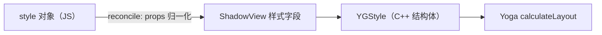
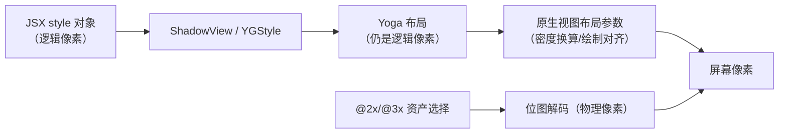

# 样式、DPI 与平台适配

> RN 没有 CSS。样式是**普通 JS 对象 → 影子节点属性 → YGStyle** 的直通映射；像素是**逻辑单位**，与物理像素之间隔着一层 PixelRatio。理解这两件事，样式行为（为什么没有级联、为什么图片要 @2x/@3x、为什么有 1px 毛边）都能推导出来。

## 1. 样式对象 → YGStyle：没有 CSS 引擎

```jsx
<View style={{ flexDirection: 'row', padding: 8 }} />
```

链路：JSX props → shadow view 的样式属性 setter → Yoga 节点的 `YGStyle` 字段（02 篇）。要点：

1. **无级联（no cascade）**：Web CSS 的继承、选择器、特异性在 RN 里不存在。样式只作用于该节点自身；唯一"准继承"是 `<Text>` 嵌套——内层 Text 沿用外层未覆盖的文字属性（文字属性沿文本树传播，不是 CSS 意义上的继承）；
2. **数组样式 = 后者覆盖前者**：`style={[s.base, s.highlight]}` 按序浅合并，规则极其简单——也因此**覆盖不了"嵌套属性"**（`base` 里的 `padding` 不会被 `highlight` 的 `paddingTop` 部分清除，因为它们本就是同一个展开后的字段）；
3. **样式计算发生在 reconcile 之外**：布局（Yoga）在影子线程，但样式对象本身的创建/合并是纯 JS——这就是"把 style 写成内联对象 vs 常量"影响 re-render 成本的直接原因（模块九 03）。



## 2. 逻辑像素与物理像素：dp / pt / PixelRatio

RN 的所有尺寸都是**设备无关像素**（Android 称 dp，iOS 称 pt）：

```
物理像素 = 逻辑像素 × PixelRatio.get()
```

| 需求 | API | 典型用法 |
|------|-----|---------|
| 拿到倍率 | `PixelRatio.get()` | 手动画细线：`1 / PixelRatio.get()` 才是物理 1px |
| 逻辑 → 物理取整 | `PixelRatio.roundToNearestPixel(size)` | 避免亚像素模糊 |
| 字体缩放 | `PixelRatio.getFontScale()` | 尊重系统字号设置 |

三个经典现象的原理：

1. **细线变虚**：`height: 1` 在 3x 屏是 3 物理像素且可能落在半个像素上——需 roundToNearestPixel 对齐；
2. **Android 的 pixel rounding**：历史版本对尺寸做过"取整到物理像素"的适配（prop 控制），0.75 起转向**分数像素度量（fractional metrics）**：允许更精确的布局但渲染时对齐——两端策略趋同于"计算精确、绘制对齐"；
3. **横竖屏/折叠屏**：逻辑宽度变了 → 布局重算（useWindowDimensions），不是缩放。

## 3. 图片的倍率选择：@2x / @3x 的机械原理

静态资源按后缀提供多份，`resolveAssetSource` 按 PixelRatio 选择：

```
logo@1x.png  logo@2x.png  logo@3x.png
```

- 引擎拿 `PixelRatio.get()`（如 3）→ 优先 `@3x`；
- 选定的是**解码进内存的源文件**——在 3x 屏用 @1x 图会糊，用 @3x 图显示小尺寸则**浪费内存**（解码尺寸是文件尺寸，模块九 04 会算这笔账）；
- 动态尺寸场景宁可用"够用的倍率 + resize 模式"，也不要无脑全上 @3x 大图。

## 4. 平台分支：三层机制

| 层 | 机制 | 原理落点 |
|----|------|---------|
| 代码层 | `Platform.select({ ios: x, android: y })` / `Platform.OS` | 运行时分支，两端代码都打进包 |
| 文件层 | `Foo.ios.js` / `Foo.android.js` | **Metro resolver 的平台扩展名解析**——打包期就选定了文件，另一端代码不进包（模块八 03） |
| 样式层 | 上述两者组合 | 无独立机制，就是 JS 分支 |

工程含义：**文件层分支优于代码层分支**——分支代码不进包，包体与执行路径都更干净；`Platform.select` 适合小差异（一两个样式值）。

## 5. 把三块拼回渲染链路



- 样式：JS 对象直通 YGStyle，无 CSS 引擎、无级联，覆盖规则 = 数组浅合并；
- 像素：全程逻辑像素，只在资产选择与最终绘制处碰物理像素；
- 适配：Platform.select（运行时）与平台后缀（打包期）各司其职，优先后者。

## 小结

- RN 样式的三条铁律：无级联（Text 嵌套除外）、数组浅合并、样式对象创建是纯 JS 成本；
- 一切尺寸是逻辑像素，`物理 = 逻辑 × PixelRatio`；细线、毛边、图片内存问题都能用这层换算解释；
- @2x/@3x 是"按屏选源文件"的资产机制，选大图 = 糊选小图浪费内存；
- 平台分支优先用文件后缀（打包期裁剪），Platform.select 留给小差异。
