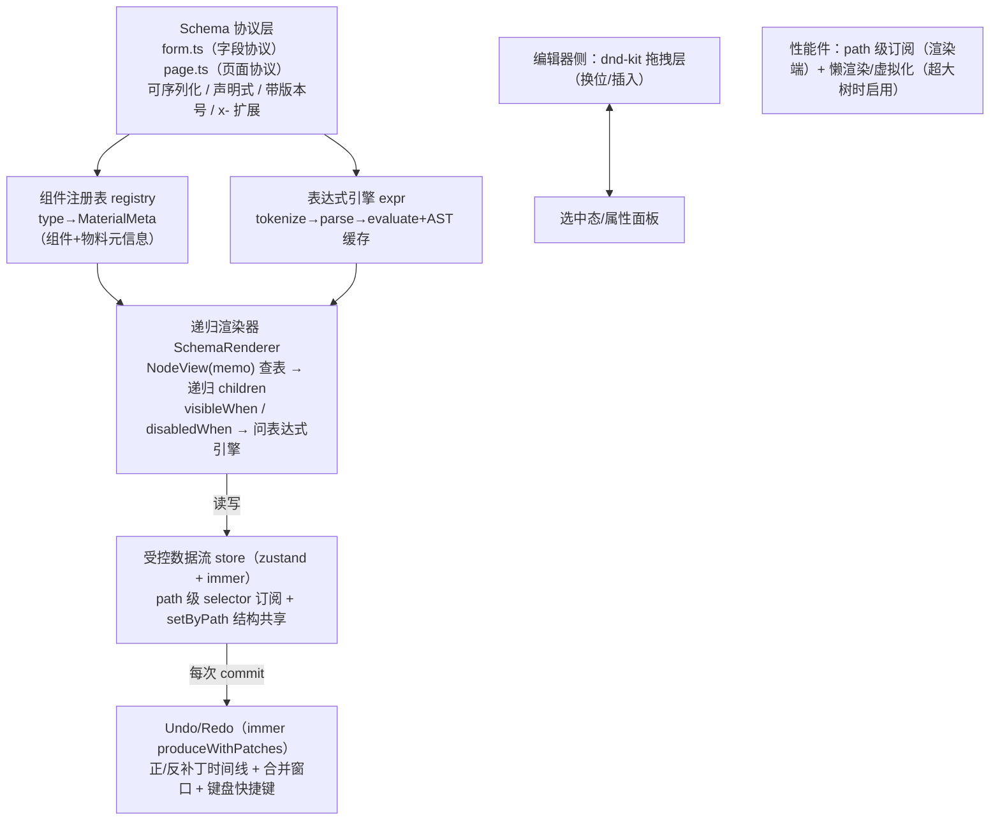

# 公共底座复刻手册

> 一句话目标：从零复刻一套"schema 协议 → 组件注册表 → 递归渲染器 → 表达式引擎 → 受控数据流 → Undo/Redo → 拖拽 → 大树性能"的通用底座——它是后面五个项目（动态表单/设计器/仪表盘/JSON 编辑器/低代码平台）共同的内核。预计工期：1.5 周。前置要求：React 18 基础（hooks/受控组件）、Vite + TypeScript 环境、会用 npm 装依赖。学习大纲版讲解见 [1. 通用底座](../react-进阶大纲-复杂场景/03-1-通用底座-1-5-周-先于一切场景.md)。

## 0. 最终效果与验收清单

复刻完成的判定标准——每条都是一个可运行的验证，逐条打勾：

- [ ] **协议可序列化**：`JSON.parse(JSON.stringify(schema))` 结果与原对象深度相等（vitest `expect(cloned).toEqual(schema)` 通过）
- [ ] **注册表可插拔**：注册一个新 `type: 'stat'` 物料后，渲染器不改一行代码就能渲染含 `stat` 节点的 schema
- [ ] **递归渲染不白屏**：schema 里混入未注册的 `type: 'unknown-x'`，页面其余部分照常渲染，只在该位置显示红色占位
- [ ] **表达式联动**：`$form.city == 'bj'` 控制的字段，切换城市下拉后 1 帧内显隐切换
- [ ] **受控数据流**：外部 `getFormValues()` 拿到实时数据；`setValue()` 改某个字段后只有该字段组件重渲染
- [ ] **Undo/Redo**：连续 10 次操作，`ctrl+z` 逐步回退、`ctrl+y` 逐步前进（含连续输入合并）
- [ ] **拖拽排序**：dnd-kit 列表拖拽换位，松手后数据与视图一致
- [ ] **大树性能**：1000 节点树 + 单字段更新，React DevTools Highlight 只亮 1 个组件；Profiler update < 2ms
- [ ] **联调 Demo**：一个页面同时跑通"渲染器 + 表达式 + 历史 + 拖拽"四件套

## 1. 架构总览



数据流一句话：**schema（纯数据）进渲染器，渲染器查注册表拿组件、问表达式引擎算显隐、通过 path 级订阅读写 store；每次对 schema 的修改经 immer 生成正/反补丁进历史栈。**

技术选型表：

| 库 | 版本 | 用途 | 选型理由 | 替代项 | license |
|---|---|---|---|---|---|
| react | 18/19 | UI 框架 | 课程主线 | — | MIT |
| typescript | ≥5.2 | 类型系统 | discriminated union 收窄是协议安全的根基 | — | Apache-2.0 |
| zustand | ≥4 | 状态管理 | selector 订阅天然适合 path 级订阅 | jotai / valtio | MIT |
| immer | ≥10 | 不可变更新 + patches | `produceWithPatches` 免费得到撤销补丁 | immutable-js（重） | MIT |
| nanoid | ≥5 | 节点 id | 短、快、非自增（避免 id 复用撞 key） | uuid | MIT |
| @dnd-kit/core + sortable | ≥6 | 拖拽 | 现代传感器模型、无障碍、可控碰撞算法 | react-dnd（老化）、原生 HTML5 DnD（移动端不可用） | MIT |
| vitest | ≥1 | 单测（可选） | 与 Vite 同构、启动快 | jest | MIT |

## 2. 数据模型与协议

协议是整个体系唯一的契约，先定协议再写任何逻辑。五条设计原则：**可序列化（纯 JSON）、声明式（无函数，逻辑走表达式）、带版本号、`x-` 扩展字段、节点有稳定 id**——每条的"为什么"在 M2 代码注释与 §5 坑清单里反复兑现。完整类型定义即里程碑 M2 的产出（`src/schema/form.ts` / `src/schema/page.ts`），此处先给两份最小示例 JSON 建立直觉。

**示例 1：带联动的表单 schema（简单）**

```json
{
  "schemaVersion": "1.0.0",
  "fields": [
    { "id": "f_name", "type": "input", "fieldPath": "name", "label": "姓名", "required": true,
      "props": { "placeholder": "请输入姓名", "maxLength": 20 } },
    { "id": "f_city", "type": "select", "fieldPath": "city", "label": "城市",
      "props": { "mode": "single",
        "options": [{ "label": "北京", "value": "bj" }, { "label": "上海", "value": "sh" }] } },
    { "id": "f_district", "type": "input", "fieldPath": "district", "label": "区县",
      "visibleWhen": "$form.city == 'bj'",
      "props": { "placeholder": "仅城市选北京时显示" } }
  ]
}
```

**示例 2：嵌套容器 + 表达式绑定的页面 schema（进阶）**

```json
{
  "schemaVersion": "1.2.0",
  "root": {
    "id": "n_root", "type": "page",
    "children": [
      { "id": "n_title", "type": "text", "props": { "content": "活动报名", "level": 2 } },
      { "id": "n_grid", "type": "grid", "props": { "columns": 2, "gap": 12 },
        "children": [
          { "id": "n_name", "type": "input", "props": { "fieldPath": "name", "placeholder": "姓名" } },
          { "id": "n_phone", "type": "input", "props": { "fieldPath": "phone", "placeholder": "手机号" } }
        ] },
      { "id": "n_vip", "type": "card", "props": { "title": "会员中心" },
        "visibleWhen": "$user.vip",
        "x-designer": { "locked": true },
        "children": [
          { "id": "n_renew", "type": "button",
            "props": { "text": "续费" },
            "events": [{ "event": "click", "action": "openModal", "args": { "id": "renew" } }] }
        ] }
    ]
  }
}
```

## 3. 复刻主线路径：里程碑 M1–M9

### M1 工程脚手架

**目标**：空项目跑起来，依赖装齐，目录骨架就位。

**完整代码**：

```bash
npm create vite@latest lowcode-kernel -- --template react-ts
cd lowcode-kernel
npm install zustand immer nanoid @dnd-kit/core @dnd-kit/sortable @dnd-kit/utilities
npm install -D vitest
npm run dev
```

目录骨架（后续里程碑逐个填充）：

```text
src/
  schema/        # M2 协议：form.ts / page.ts
  kernel/        # M3-M5 内核：registry.ts / renderer.tsx / expression.ts / useExpression.ts
  store/         # M6-M7 数据流：path.ts / formStore.ts / historyStore.ts / useHistoryHotkeys.ts
  dnd/           # M8 拖拽：SortableList.tsx
  demo/          # M9 联调：App.tsx / genStressSchema.ts / 表达式试验场
```

**验证**：`npm run dev` 打开 http://localhost:5173 看到 Vite 默认页；`npx tsc --noEmit` 零报错。

**常见报错与修复**：

1. `error TS2307: Cannot find module 'zustand'`——依赖没装上或装错了工作区。修复：确认在项目根执行 `npm install zustand`，然后重启 TS Server（VS Code：Cmd+Shift+P → TypeScript: Restart TS Server）。
2. 裸跑 `tsc xx.tsx` 报 `The JSX syntax requires 'jsx' flag`。修复：日常用 `npm run dev` / `npm run build`（走 Vite），tsconfig 确认 `"jsx": "react-jsx"`。

### M2 Schema 协议与类型定义

**目标**：两份协议类型 + 容器守卫 + 序列化测试通过，能徒手写出合法样例 JSON。

**完整代码**：

```ts
// src/schema/form.ts —— 协议一：动态表单字段协议

/** 所有字段共享的公共基座 */
export interface FieldBase {
  /** 节点稳定 id：渲染 key、编辑器选中、撤销补丁定位全靠它（生成后永不变化、永不复用） */
  id: string
  /** 该字段绑定到 formData 的路径，如 "profile.name" */
  fieldPath: string
  /** 显示名 */
  label: string
  /** 是否必填——注意这是"校验声明"，不是校验逻辑本身 */
  required?: boolean
  /** 显示条件：表达式字符串，运行时由表达式引擎求值 */
  visibleWhen?: string
  /** 禁用条件：同上 */
  disabledWhen?: string
  /** x- 前缀扩展字段：协议内核不解释、原样保留（官方永不占用该命名空间） */
  [extra: `x-${string}`]: unknown
}

interface InputFieldProps { placeholder?: string; maxLength?: number; allowClear?: boolean }
interface TextareaFieldProps { placeholder?: string; rows?: number }
interface NumberFieldProps { min?: number; max?: number; step?: number }
interface SelectFieldProps {
  options: { label: string; value: string | number }[]
  mode?: 'single' | 'multiple'
}
interface DateFieldProps { format?: string }

/** 字段协议本体：discriminated union，type 是标签——非法的 type+props 组合在编译期就不存在 */
export type FormFieldSchema =
  | (FieldBase & { type: 'input'; props: InputFieldProps })
  | (FieldBase & { type: 'textarea'; props: TextareaFieldProps })
  | (FieldBase & { type: 'number'; props: NumberFieldProps })
  | (FieldBase & { type: 'select'; props: SelectFieldProps })
  | (FieldBase & { type: 'date'; props: DateFieldProps })

export interface FormSchema {
  /** 语义化版本：升级协议必须升这里，配合 migration 链使用 */
  schemaVersion: string
  fields: FormFieldSchema[]
}
```

```ts
// src/schema/page.ts —— 协议二：页面节点协议（容器可嵌套）

interface AtomBase {
  id: string
  /** 显示条件：表达式 */
  visibleWhen?: string
  /** prop 级表达式绑定：哪个 prop 由哪个表达式驱动（1.2.0 新增，旧渲染器忽略不认识的字段照常工作） */
  bindings?: Record<string, string>
  /** 事件-动作绑定：action 是动作注册表里的字符串键，不是函数 */
  events?: { event: string; action: string; args?: Record<string, unknown> }[]
  [extra: `x-${string}`]: unknown
}

interface ContainerBase extends AtomBase {
  children: PageNode[]
}

type AtomNode =
  | (AtomBase & { type: 'text'; props: { content: string; level?: 1 | 2 | 3 } })
  | (AtomBase & { type: 'input'; props: { fieldPath: string; placeholder?: string } })
  | (AtomBase & { type: 'button'; props: { text: string; onClickAction?: string } })

type ContainerNode =
  | (ContainerBase & { type: 'page' })
  | (ContainerBase & { type: 'grid'; props: { columns: number; gap?: number } })
  | (ContainerBase & { type: 'card'; props: { title?: string } })

export type PageNode = AtomNode | ContainerNode

export interface PageSchema {
  schemaVersion: string
  root: PageNode
}

/** 从 PageNode 联合中提取"带 children 属性"的成员类型 */
export type ContainerOf<N> = Extract<N, { children: unknown }>

/** 容器判定守卫：true 时 TS 自动收窄，.children 可直接访问 */
export function isContainer(node: PageNode): node is ContainerOf<PageNode> {
  return 'children' in node
}
```

```ts
// src/schema/schema.spec.ts —— 序列化无损测试（vitest）
import { describe, expect, it } from 'vitest'
import type { FormSchema } from './form'

const form: FormSchema = {
  schemaVersion: '1.0.0',
  fields: [
    { id: 'f1', type: 'input', fieldPath: 'name', label: '姓名', props: { placeholder: 'x' } },
  ],
}

describe('schema 协议', () => {
  it('可序列化：round-trip 无损', () => {
    expect(JSON.parse(JSON.stringify(form))).toEqual(form)
  })
  it('x- 扩展字段透传', () => {
    const withX = { ...form.fields[0], 'x-track': { exposure: 'name' } }
    expect(JSON.parse(JSON.stringify(withX))['x-track']).toEqual({ exposure: 'name' })
  })
})
```

**验证**：`npx vitest run` 两条测试通过；把 §2 两份示例 JSON 存为 `demo/*.sample.json`，临时写个 `JSON.parse` + 手动窄化确认与类型匹配。

**常见报错与修复**：

1. `Type ... is not assignable to 'FormFieldSchema'`——input 的 props 里写了 select 的 `options`。这**正是** discriminated union 在工作，不要图省心改成 `Record<string, any>`；修复 `type` 与 `props` 的配套关系。
2. `Property 'children' does not exist on type 'AtomNode'`——对联合类型直接访问 `.children`。修复：先过 `isContainer(node)` 守卫再访问。

### M3 组件注册表

**目标**：`type → 组件 + 物料元信息`的注册表；新增物料零侵入（渲染器永远不写 `if (type === 'input')`）。

**完整代码**：

```ts
// src/kernel/registry.ts
import type { ComponentType } from 'react'

/** 每种物料的渲染 props 形状——整个注册表类型安全的源头 */
export interface WidgetPropsMap {
  input: { value: string; onChange: (v: string) => void; placeholder?: string; disabled?: boolean }
  textarea: { value: string; onChange: (v: string) => void; rows?: number; disabled?: boolean }
  number: { value: number | undefined; onChange: (v: number | undefined) => void
            min?: number; max?: number; disabled?: boolean }
  select: { value: string | number | undefined
            onChange: (v: string | number | undefined) => void
            options: { label: string; value: string | number }[]; disabled?: boolean }
  date: { value: string | undefined; onChange: (v: string | undefined) => void; disabled?: boolean }
  text: { content: string; level?: 1 | 2 | 3 }
  button: { text: string }
  page: { children?: React.ReactNode }
  grid: { columns: number; gap?: number; children?: React.ReactNode }
  card: { title?: string; children?: React.ReactNode }
}

export type WidgetType = keyof WidgetPropsMap

/** setter 声明：属性面板（项目二）靠它知道每个物料可配置什么；setter 本身也是一层注册表 */
export interface SetterDeclaration {
  /** 作用于节点数据的哪个键，如 "label" / "props.placeholder" */
  key: string
  /** 用哪种 setter 控件渲染 */
  setter: 'string' | 'number' | 'boolean' | 'select' | 'json'
  /** setter 的额外配置（select 的 options 等） */
  props?: Record<string, unknown>
}

/** 物料元信息：注册一条 = 组件 + 一堆"关于组件的描述数据" */
export interface MaterialMeta<K extends WidgetType = WidgetType> {
  type: K
  /** 渲染用组件：props 形状由 WidgetPropsMap[K] 约束 */
  component: ComponentType<WidgetPropsMap[K]>
  /** 物料分组与显示名（编辑器物料区用） */
  group: string
  label: string
  /** 新拖入画布时的默认节点数据 */
  createDefault: () => Record<string, unknown>
  /** 可配置项声明（属性面板用，本里程碑只定义结构） */
  setters?: SetterDeclaration[]
}

const registry = new Map<string, MaterialMeta>()

/** 注册一种物料（幂等：重复注册后者覆盖，方便开发期热替换） */
export function registerMaterial(meta: MaterialMeta): void {
  registry.set(meta.type, meta as MaterialMeta)
}

export function getMaterial(type: string): MaterialMeta | undefined {
  return registry.get(type)
}

/** 物料区分组展示用 */
export function listMaterialsByGroup(): Record<string, MaterialMeta[]> {
  const groups: Record<string, MaterialMeta[]> = {}
  for (const meta of registry.values()) {
    ;(groups[meta.group] ??= []).push(meta)
  }
  return groups
}
```

```tsx
// src/kernel/builtins.tsx —— 注册首批内置物料
import { nanoid } from 'nanoid'
import { registerMaterial } from './registry'

function InputWidget(p: { value: string; onChange: (v: string) => void
                          placeholder?: string; disabled?: boolean }) {
  return (
    <input
      value={p.value}
      placeholder={p.placeholder}
      disabled={p.disabled}
      onChange={(e) => p.onChange(e.target.value)}
      style={{ padding: '4px 8px', border: '1px solid #ccc', borderRadius: 4 }}
    />
  )
}

registerMaterial({
  type: 'input',
  component: InputWidget,
  group: '基础字段',
  label: '单行输入',
  createDefault: () => ({
    id: `f_${nanoid(6)}`, type: 'input', fieldPath: `field_${nanoid(4)}`,
    label: '单行输入', props: { placeholder: '请输入' },
  }),
  setters: [
    { key: 'label', setter: 'string' },
    { key: 'props.placeholder', setter: 'string' },
    { key: 'props.maxLength', setter: 'number' },
  ],
})

// textarea / number / select / date 同构注册（各 10–20 行组件），此处不重复占篇幅。
// 页面容器（page/grid/card/text/button）也注册进同一张表，见 M4。
```

**验证**：临时页面 `console.log(listMaterialsByGroup())` 打印出分组；再注册一个 `type: 'stat'` 的物料，确认无需改任何其他文件。

**常见报错与修复**：

1. `Type 'ComponentType<X>' is not assignable to 'ComponentType<WidgetPropsMap[...]>'`——组件签名与 `WidgetPropsMap` 中该 type 的形状不一致（典型：onChange 参数写反）。修复：以 `WidgetPropsMap[type]` 为准改组件签名，禁止 `as any` 逃逸。
2. HMR 后注册表出现旧物料残留——模块级 `Map` 在热更新下不清空。注册幂等（覆盖式）已天然兼容；若见"幽灵重复"，检查是否存在循环 import 导致 registry 模块被实例化两份。

### M4 递归渲染器

**目标**：`<SchemaRenderer schema={...} />` 渲染任意合法 schema；未注册类型渲染占位、单点损坏不白屏。

**完整代码**：

```tsx
// src/kernel/renderer.tsx
import { memo } from 'react'
import { getMaterial } from './registry'
import { isContainer, type PageNode, type PageSchema } from '../schema/page'

/** 单节点渲染：查表 → 渲染；未注册类型渲染占位而不是抛错——单节点损坏不能白屏整棵树 */
function NodeViewImpl({ node }: { node: PageNode }) {
  const meta = getMaterial(node.type)
  if (!meta) {
    return <div style={{ color: 'red' }}>未注册的组件类型：{String(node.type)}</div>
  }
  const Widget = meta.component as React.ComponentType<Record<string, unknown>>
  if (isContainer(node)) {
    return (
      <Widget {...(node.props ?? {})} data-node-id={node.id}>
        {node.children.map((child) => (
          <NodeView key={child.id} node={child} />
        ))}
      </Widget>
    )
  }
  return <Widget {...(node.props ?? {})} data-node-id={node.id} />
}

/** memo：兄弟节点变化时，node 引用不变的节点跳过重渲染——大树性能第一道闸 */
export const NodeView = memo(NodeViewImpl)

/** 渲染入口：从 root 开始递归 */
export function SchemaRenderer({ schema }: { schema: PageSchema }) {
  return <NodeView node={schema.root} />
}
```

配合 M3 的 `builtins.tsx` 补注册页面容器（`GridWidget` 接收 `columns/gap/children`，样式 `display:grid`；`Card`/`text`/`button` 同理，各 10 行内），§2 示例 2 即可整体渲染。

**验证**：渲染示例 2——看到标题、两列输入、会员卡片；把任一节点 type 改成 `unknown-x`，其余部分照常渲染且该位置显示红色提示。

**常见报错与修复**：

1. 页面空白或 `Maximum update depth exceeded`——容器物料内部又对 children 做 map/clone 造出新节点，与 NodeView 递归互相触发。修复：容器只接收并直接渲染 `children`，递归完全交给 NodeView。
2. key 警告——用数组下标当了 key。一律 `key={child.id}`；若 id 缺失，回去修 schema 生成器而不是换 key 策略。
3. 类型层面容器与字段共用一张表出现的 props 不匹配——本阶段用受控联合表（`WidgetPropsMap` 已同时含两类）兼容；工程化拆分 `fieldRegistry` / `blockRegistry` 两张表放到项目二做（届时属性面板需要更强的类型区分）。

### M5 表达式引擎

**目标**：`evaluateExpression("$form.city == 'bj'", ctx)` 可求值；AST 缓存；非法表达式返回 `SyntaxError` 不炸页面；`useExpression` 订阅上下文自动重算。支持语法：`== != > < >= <= && || !`、`+ - * /`、数字/字符串/布尔、`$` 变量路径、括号。

**完整代码**（分词 → 递归下降解析 → 求值三段）：

```ts
// src/kernel/expression.ts

// ---------- 1. 分词 ----------
type Token =
  | { kind: 'num'; value: number }
  | { kind: 'str'; value: string }
  | { kind: 'bool'; value: boolean }
  | { kind: 'var'; path: string }   // $form.city → path: "form.city"
  | { kind: 'op'; value: string }
  | { kind: 'punct'; value: '(' | ')' }

const RE = /\s*(?:(\d+(?:\.\d+)?)|'([^']*)'|"([^"]*)"|\$( [A-Za-z_][\w.]* )|([A-Za-z_]\w*)|(==|!=|>=|<=|&&|\|\||[!><+\-*/])|([()]))/y
// 注意：上面 $ 组内的空格仅为排版可读，实际写成 \$([A-Za-z_][\w.]*)，见下方实现说明
const TOKEN_RE = /\s*(?:(\d+(?:\.\d+)?)|'([^']*)'|"([^"]*)"|\$([A-Za-z_][\w.]*)|([A-Za-z_]\w*)|(==|!=|>=|<=|&&|\|\||[!><+\-*/])|([()]))/y

export function tokenize(src: string): Token[] {
  const tokens: Token[] = []
  let pos = 0
  TOKEN_RE.lastIndex = 0
  while (pos < src.length) {
    TOKEN_RE.lastIndex = pos
    const m = TOKEN_RE.exec(src)
    if (!m || m[0].trim() === '') {
      if (m && m[0].trim() === '') { pos = TOKEN_RE.lastIndex; continue } // 纯空白跳过
      throw new SyntaxError(`表达式词法错误 @${pos}: ${JSON.stringify(src.slice(pos, pos + 10))}`)
    }
    pos = TOKEN_RE.lastIndex
    if (m[1] !== undefined) tokens.push({ kind: 'num', value: Number(m[1]) })
    else if (m[2] !== undefined) tokens.push({ kind: 'str', value: m[2] })
    else if (m[3] !== undefined) tokens.push({ kind: 'str', value: m[3] })
    else if (m[4] !== undefined) tokens.push({ kind: 'var', path: m[4] })
    else if (m[5] === 'true' || m[5] === 'false') tokens.push({ kind: 'bool', value: m[5] === 'true' })
    else if (m[6] !== undefined) tokens.push({ kind: 'op', value: m[6] })
    else if (m[7] !== undefined) tokens.push({ kind: 'punct', value: m[7] as '(' | ')' })
  }
  return tokens
}

// ---------- 2. 递归下降解析 → AST ----------
type Ast =
  | { type: 'lit'; value: unknown }
  | { type: 'var'; path: string }
  | { type: 'unary'; op: '!'; arg: Ast }
  | { type: 'bin'; op: string; left: Ast; right: Ast }

class Parser {
  private i = 0
  constructor(private toks: Token[]) {}
  private peek() { return this.toks[this.i] }
  private eat() { return this.toks[this.i++] }
  parse(): Ast {
    const ast = this.or()
    if (this.i < this.toks.length) throw new SyntaxError('表达式尾部有无法解析的内容')
    return ast
  }
  // 优先级爬升：|| < && < 比较 < 加减 < 乘除 < 一元 < 原子
  private or(): Ast { let l = this.and(); while (this.isOp('||')) { this.eat(); l = { type: 'bin', op: '||', left: l, right: this.and() } } return l }
  private and(): Ast { let l = this.cmp(); while (this.isOp('&&')) { this.eat(); l = { type: 'bin', op: '&&', left: l, right: this.cmp() } } return l }
  private cmp(): Ast {
    let l = this.add()
    while (this.isOp(['==', '!=', '>', '<', '>=', '<='])) {
      const op = (this.eat() as { value: string }).value
      l = { type: 'bin', op, left: l, right: this.add() }
    }
    return l
  }
  private add(): Ast {
    let l = this.mul()
    while (this.isOp(['+', '-'])) {
      const op = (this.eat() as { value: string }).value
      l = { type: 'bin', op, left: l, right: this.mul() }
    }
    return l
  }
  private mul(): Ast {
    let l = this.unary()
    while (this.isOp(['*', '/'])) {
      const op = (this.eat() as { value: string }).value
      l = { type: 'bin', op, left: l, right: this.unary() }
    }
    return l
  }
  private unary(): Ast {
    if (this.isOp('!')) { this.eat(); return { type: 'unary', op: '!', arg: this.unary() } }
    return this.atom()
  }
  private atom(): Ast {
    const t = this.eat()
    if (!t) throw new SyntaxError('表达式意外结束')
    if (t.kind === 'num' || t.kind === 'str' || t.kind === 'bool') return { type: 'lit', value: t.value }
    if (t.kind === 'var') return { type: 'var', path: t.path }
    if (t.kind === 'punct' && t.value === '(') {
      const inner = this.or()
      const close = this.eat()
      if (!close || close.kind !== 'punct' || close.value !== ')') throw new SyntaxError('缺少右括号')
      return inner
    }
    throw new SyntaxError(`意外的记号: ${JSON.stringify(t)}`)
  }
  private isOp(ops: string | string[]): boolean {
    const t = this.peek()
    if (!t || t.kind !== 'op') return false
    return Array.isArray(ops) ? ops.includes(t.value) : t.value === ops
  }
}

export function parse(src: string): Ast {
  return new Parser(tokenize(src)).parse()
}

// ---------- 3. 求值 ----------
function toBool(v: unknown): boolean {
  return Array.isArray(v) ? v.length > 0 : !!v
}

function getByPath(ctx: Record<string, unknown>, path: string): unknown {
  return path.split('.').reduce<unknown>((acc, key) =>
    acc != null && typeof acc === 'object' ? (acc as Record<string, unknown>)[key] : undefined, ctx)
}

export function evaluate(ast: Ast, ctx: Record<string, unknown>): unknown {
  switch (ast.type) {
    case 'lit': return ast.value
    case 'var': return getByPath(ctx, ast.path)
    case 'unary': return !toBool(evaluate(ast.arg, ctx))
    case 'bin': {
      const l = evaluate(ast.left, ctx)
      if (ast.op === '&&') return toBool(l) ? evaluate(ast.right, ctx) : l  // 短路
      if (ast.op === '||') return toBool(l) ? l : evaluate(ast.right, ctx)  // 短路
      const r = evaluate(ast.right, ctx)
      switch (ast.op) {
        case '==': return l === r || String(l) === String(r)  // 宽松等：表单值常是字符串
        case '!=': return !(l === r || String(l) === String(r))
        case '>': return Number(l) > Number(r)
        case '<': return Number(l) < Number(r)
        case '>=': return Number(l) >= Number(r)
        case '<=': return Number(l) <= Number(r)
        case '+': return typeof l === 'string' || typeof r === 'string'
          ? String(l) + String(r) : Number(l) + Number(r)
        case '-': return Number(l) - Number(r)
        case '*': return Number(l) * Number(r)
        case '/': return Number(l) / Number(r)
        default: throw new Error(`未实现的运算符: ${ast.op}`)
      }
    }
  }
}

// ---------- 4. AST 缓存 + 门面 ----------
const astCache = new Map<string, Ast>()

export function evaluateExpression(src: string, ctx: Record<string, unknown>): unknown {
  let ast = astCache.get(src)
  if (!ast) { ast = parse(src); astCache.set(src, ast) }
  return evaluate(ast, ctx)
}

/** 静态检查：编辑器输入表达式时实时反馈（不抛出，返回错误对象） */
export function checkExpression(src: string): SyntaxError | null {
  try { parse(src); return null } catch (e) { return e as SyntaxError }
}
```

```ts
// src/kernel/useExpression.ts —— React 绑定：上下文变化自动重算
import { useMemo } from 'react'
import { evaluateExpression } from './expression'

export function useExpression<T = unknown>(
  src: string | undefined,
  ctx: Record<string, unknown>,
  fallback: T,
): T {
  return useMemo(
    () => (src ? ((evaluateExpression(src, ctx) as T) ?? fallback) : fallback),
    [src, JSON.stringify(ctx)], // 用序列化做依赖比较；深层频繁变化时改由 store selector 传原始值
  )
}
```

**验证**：写一个 `demo/ExprPlayground.tsx`——左输入表达式、右编辑上下文 JSON、实时显示结果或错误。至少测：`"$form.city == 'bj'"`（true）、`"1 + 2 * 3"`（7，优先级）、`"$a && ($b > 10)"`（短路）；`checkExpression("$form.city ==")` 返回 SyntaxError 对象。

**常见报错与修复**：

1. `表达式词法错误 @0`——常见是中文引号/全角空格混入。修复：在编辑器输入层做归一化（全角→半角）并高亮错误位置；引擎本身宁可报错不可静默算错。
2. 循环联动卡死（A 的 visibleWhen 依赖 B，B 又被含 A 的表达式驱动）——求值器无循环检测。修复：架构约束"表达式只读 ctx、联动单向（数据 → 表达式 → UI）"；编辑器保存时解析 AST 收集 var 依赖画 DAG 检环。
3. `useExpression` 结果不更新——ctx 没接到响应源（组件本地 useState 陈旧闭包）。修复：ctx 必须来自 store 的 selector 或 state 派生链。

### M6 受控数据流（path 级 store）

**目标**：`useFormStore` 读写表单数据；任何单字段更新只有订阅该路径的组件重渲染。

**完整代码**：

```ts
// src/store/path.ts —— 按路径读写 + 结构共享
import { produce } from 'immer'

/** immer 实现结构共享的 set：只换"路径上的祖先引用"，兄弟分支保持原引用 */
export function setByPath<T>(obj: T, path: string, value: unknown): T {
  return produce(obj, (draft) => {
    const keys = path.split('.')
    let cur = draft as Record<string, unknown>
    for (let i = 0; i < keys.length - 1; i++) {
      if (cur[keys[i]] == null || typeof cur[keys[i]] !== 'object') cur[keys[i]] = {}
      cur = cur[keys[i]] as Record<string, unknown>
    }
    cur[keys[keys.length - 1]] = value
  })
}

export function getByPath(obj: unknown, path: string): unknown {
  return path.split('.').reduce<unknown>((acc, key) =>
    acc != null && typeof acc === 'object' ? (acc as Record<string, unknown>)[key] : undefined, obj)
}
```

```ts
// src/store/formStore.ts
import { create } from 'zustand'
import { setByPath, getByPath } from './path'

interface FormStore {
  formData: Record<string, unknown>
  /** path 级更新：setByPath 产生结构共享的新对象——只有该路径上的引用换新 */
  setValue: (path: string, value: unknown) => void
  reset: (obj?: Record<string, unknown>) => void
}

export const useFormStore = create<FormStore>()((set) => ({
  formData: {},
  setValue: (path, value) => set((s) => ({ formData: setByPath(s.formData, path, value) })),
  reset: (obj) => set({ formData: obj ?? {} }),
}))

/** 外部命令式读取（提交/校验用），不订阅 */
export const getFormValues = () => useFormStore.getState().formData
export const getValueByPath = (path: string) => getByPath(useFormStore.getState().formData, path)
```

```tsx
// src/store/Field.tsx —— 字段组件：path 级订阅的标准姿势
import { useFormStore } from './formStore'
import { getMaterial } from '../kernel/registry'
import type { FormFieldSchema } from '../schema/form'
import { useExpression } from '../kernel/useExpression'

/** selector 辅助：返回原始值（比较最便宜），绝不在 selector 里造新对象 */
function pick(data: Record<string, unknown>, path: string): unknown {
  return path.split('.').reduce<unknown>((acc, key) =>
    acc != null && typeof acc === 'object' ? (acc as Record<string, unknown>)[key] : undefined, data)
}

export function Field({ schema }: { schema: FormFieldSchema }) {
  const value = useFormStore((s) => pick(s.formData, schema.fieldPath))
  const setValue = useFormStore((s) => s.setValue)
  const formData = useFormStore((s) => s.formData) // 仅为拼表达式上下文；生产中用 selector 拼局部
  const visible = useExpression(schema.visibleWhen, { $form: formData }, true)
  const disabled = useExpression(schema.disabledWhen, { $form: formData }, false)
  const meta = getMaterial(schema.type)
  if (!visible || !meta) return null
  const Widget = meta.component as React.ComponentType<Record<string, unknown>>
  return (
    <label style={{ display: 'block', margin: '8px 0' }}>
      <span style={{ marginRight: 8 }}>{schema.label}</span>
      <Widget {...schema.props} value={value as never} disabled={disabled}
              onChange={(v: unknown) => setValue(schema.fieldPath, v)} />
    </label>
  )
}
```

**验证**：渲染 50 个字段的表单，开启 React DevTools "Highlight updates when components render"——在任一输入框打字，**只有该 Field 高亮**；Console 执行 `getFormValues()` 返回实时数据；改 city 为 `'bj'`，district 字段出现（表达式联动通）。

**常见报错与修复**：

1. 打字卡顿、所有字段闪烁——selector 粒度太粗（选了整棵 `formData`）或 selector 返回了新对象。修复：selector 只返回 `pick(...)` 的原始值。
2. `Cannot read properties of undefined (reading 'split')`——`fieldPath` 为空。修复：渲染前置检查拦截空 fieldPath，Field 对空 path 直接 return null。
3. 字段隐藏再显示后值丢失——见 §5 坑 12 的底座约定：显隐只控制渲染，不清数据。

### M7 Undo/Redo（immer patches 方案）

**目标**：`createHistoryStore` 任意状态时间线：commit 自动记录正/反补丁、undo/redo、合并窗口、键盘快捷键。

**完整代码**：

```ts
// src/store/historyStore.ts
import { create } from 'zustand'
import { applyPatches, enablePatches, produceWithPatches, type Patch } from 'immer'

enablePatches() // 必须最先调用，否则 produceWithPatches 返回空补丁数组

interface HistoryEntry {
  label: string    // 操作名（面板显示"撤销 新增节点"）
  patches: Patch[] // 正向补丁：redo 时应用
  inverse: Patch[] // 反向补丁：undo 时应用
  at: number       // 时间戳（合并窗口判断）
}

interface HistoryStore<T> {
  present: T
  past: HistoryEntry[]
  future: HistoryEntry[]
  /** 提交一次变更：recipe 内写"可变"代码，immer 自动算补丁 */
  commit: (label: string, recipe: (draft: T) => void, opts?: { mergeWindow?: number }) => void
  undo: () => void
  redo: () => void
}

/** 泛型工厂：同一套历史机制可挂到 schema 状态、布局状态…… */
export function createHistoryStore<T>(initial: T) {
  return create<HistoryStore<T>>()((
    set,
    get,
  ) => ({
    present: initial,
    past: [],
    future: [],
    commit: (label, recipe, opts) => {
      const { present, past } = get()
      const [next, patches, inverse] = produceWithPatches(present, recipe)
      if (patches.length === 0) return // 无实际变更不进历史
      // 合并窗口：500ms 内的同名操作（连续输入）合并成一条，避免"撤销要按 30 次"
      const win = opts?.mergeWindow ?? 0
      const last = past[past.length - 1]
      const merged = win > 0 && last && last.label === label && Date.now() - last.at < win
      set({
        present: next,
        past: merged
          ? [...past.slice(0, -1), {
              label, at: Date.now(),
              patches: [...last.patches, ...patches], // 正补丁顺序拼
              inverse: [...inverse, ...last.inverse], // 反补丁倒序拼（先回滚最新的）
            }]
          : [...past, { label, patches, inverse, at: Date.now() }],
        future: [], // 新操作清空重做分支
      })
    },
    undo: () => {
      const { present, past, future } = get()
      const last = past[past.length - 1]
      if (!last) return
      set({ present: applyPatches(present, last.inverse),
            past: past.slice(0, -1), future: [last, ...future] })
    },
    redo: () => {
      const { present, past, future } = get()
      const next = future[0]
      if (!next) return
      set({ present: applyPatches(present, next.patches),
            past: [...past, next], future: future.slice(1) })
    },
  }))
}

/** 本课程的 schema 状态历史实例（项目二/三直接复用） */
export const useHistoryStore = createHistoryStore<{ root: unknown } | null>(null)
```

```ts
// src/store/useHistoryHotkeys.ts —— 全局快捷键（含清理逻辑）
import { useEffect } from 'react'
import { useHistoryStore } from './historyStore'

export function useHistoryHotkeys(enabled = true) {
  useEffect(() => {
    if (!enabled) return
    const onKey = (e: KeyboardEvent) => {
      const mod = e.metaKey || e.ctrlKey
      if (!mod || e.key.toLowerCase() !== 'z') return
      e.preventDefault()
      if (e.shiftKey) useHistoryStore.getState().redo() // ctrl+shift+z → redo
      else useHistoryStore.getState().undo()
    }
    window.addEventListener('keydown', onKey)
    return () => window.removeEventListener('keydown', onKey) // 卸载必须移除
  }, [enabled])
}
```

**验证**：demo 里 commit 三次（改 title → 加节点 → 删节点），`ctrl+z` 三次逐步回退、`ctrl+shift+z`（Mac 为 `cmd+shift+z`，本 hook 只监听 z 键位）三次恢复；500ms 内连续 commit 同名 label，`past` 只增一条。

**常见报错与修复**：

1. undo 后状态"跳两步"或错乱——合并时反向补丁拼接顺序写反。口诀：**正补丁顺序拼、反补丁倒序拼**（新的 inverse 在前，因为 undo 先回滚最新变更）。
2. `produceWithPatches` 返回的 patches 恒为空——忘了 `enablePatches()`（immer 9+ 必须显式开启）。在应用入口第一行调用一次。
3. 输入一个字符一条历史——没用合并窗口。属性编辑类 commit 传 `{ mergeWindow: 500 }`；结构性操作（增删节点/移动）不合并。

### M8 拖拽（dnd-kit 精简内核）

**目标**：可复用的排序列表：拖拽换位、数据与视图一致；吃透传感器/碰撞/DragOverlay 三概念，项目二/三在此之上扩展。

**完整代码**：

```tsx
// src/dnd/SortableList.tsx
import {
  DndContext, PointerSensor, KeyboardSensor, useSensor, useSensors,
  closestCenter, type DragEndEvent,
} from '@dnd-kit/core'
import { useSortable, verticalListSortingStrategy, arrayMove, SortableContext } from '@dnd-kit/sortable'
import { CSS } from '@dnd-kit/utilities'

function SortableItem({ id, children }: { id: string; children: React.ReactNode }) {
  const { attributes, listeners, setNodeRef, transform, transition, isDragging } = useSortable({ id })
  return (
    <li
      ref={setNodeRef}
      style={{
        transform: CSS.Transform.toString(transform),
        transition,
        opacity: isDragging ? 0.5 : 1,
        cursor: 'grab',
        listStyle: 'none',
        padding: '8px 12px',
        border: '1px solid #ddd',
        borderRadius: 4,
        marginBottom: 4,
        background: '#fff',
        touchAction: 'none', // PointerSensor 在移动端必需
      }}
      {...attributes}
      {...listeners}
    >
      {children}
    </li>
  )
}

export function SortableList<T extends { id: string }>({
  items, onReorder, renderItem,
}: {
  items: T[]
  onReorder: (next: T[]) => void
  renderItem: (item: T, index: number) => React.ReactNode
}) {
  // 传感器：distance 5px 区分"点击"与"拖拽"——不设则列表内的按钮永远点不到
  const sensors = useSensors(
    useSensor(PointerSensor, { activationConstraint: { distance: 5 } }),
    useSensor(KeyboardSensor), // 无障碍：空格拾起、方向键移动
  )
  const onDragEnd = (e: DragEndEvent) => {
    const { active, over } = e
    if (!over || active.id === over.id) return
    const oldIndex = items.findIndex((i) => i.id === active.id)
    const newIndex = items.findIndex((i) => i.id === over.id)
    onReorder(arrayMove(items, oldIndex, newIndex))
  }
  return (
    <DndContext sensors={sensors} collisionDetection={closestCenter} onDragEnd={onDragEnd}>
      <SortableContext items={items} strategy={verticalListSortingStrategy}>
        <ul style={{ padding: 0, margin: 0 }}>
          {items.map((item, i) => (
            <SortableItem key={item.id} id={item.id}>{renderItem(item, i)}</SortableItem>
          ))}
        </ul>
      </SortableContext>
    </DndContext>
  )
}
```

**验证**：demo 渲染 5 项列表拖拽换位；拖拽中按 `Esc` 取消（dnd-kit 内建）；Console 打印 items 确认数据顺序与 DOM 一致。

**常见报错与修复**：

1. 列表项里的按钮点不了——PointerSensor 无 activationConstraint，按下即拖拽、click 被吞。修复：`activationConstraint: { distance: 5 }`；交互复杂的项改用"拖拽把手"（listeners 只绑把手元素）。
2. 拖拽时页面滚动错乱/落点漂移——容器 measuring 时机问题。修复：滚动容器场景给 DndContext 加 `measuring={{ droppable: { strategy: MeasuringStrategy.Always } }}`；嵌套容器落点误判见 §5 坑 8。
3. 移动端拖不动——缺 `touchAction: 'none'`。

### M9 大树性能 + 底座联调 Demo

**目标**：1000 节点压测通过；四件套（渲染器/表达式/历史/拖拽）同页协同。

**完整代码**：

```ts
// src/demo/genStressSchema.ts —— 生成 1000 节点压测页面
import type { PageSchema, PageNode } from '../schema/page'

export function genStressSchema(fieldsPerCard = 20, cards = 50): PageSchema {
  const cardNodes: PageNode[] = Array.from({ length: cards }, (_, c) => ({
    id: `n_card_${c}`,
    type: 'card' as const,
    props: { title: `卡片 ${c}` },
    children: Array.from({ length: fieldsPerCard }, (_, f) => ({
      id: `n_${c}_${f}`,
      type: 'input' as const,
      props: { fieldPath: `card${c}.field${f}`, placeholder: `c${c}-f${f}` },
    })),
  }))
  return { schemaVersion: '1.2.0', root: { id: 'n_root', type: 'page', children: cardNodes } }
}
```

```tsx
// src/demo/App.tsx —— 底座联调：左边压测树，右边调试面板
import { useMemo, useState } from 'react'
import { Profiler } from 'react'
import { SchemaRenderer } from '../kernel/renderer'
import { useFormStore } from '../store/formStore'
import { useHistoryStore } from '../store/historyStore'
import { useHistoryHotkeys } from '../store/useHistoryHotkeys'
import { genStressSchema } from './genStressSchema'

export default function App() {
  useHistoryHotkeys()
  const [schema] = useState(() => genStressSchema())
  // ⚠️ 全量订阅只允许出现在调试面板组件内——业务树内一律 path 级（§5 坑 15）
  const formData = useFormStore((s) => s.formData)
  const past = useHistoryStore((s) => s.past.length)
  const future = useHistoryStore((s) => s.future.length)
  const undo = useHistoryStore((s) => s.undo)
  const redo = useHistoryStore((s) => s.redo)

  const heavy = useMemo(() => (
    <Profiler id="stress" onRender={(_, phase, duration) =>
      console.log(`[Profiler:stress] ${phase} ${duration.toFixed(2)}ms`)}>
      <SchemaRenderer schema={schema} />
    </Profiler>
  ), [schema])

  return (
    <div style={{ display: 'grid', gridTemplateColumns: '1fr 320px', gap: 16, padding: 16 }}>
      <div>{heavy}</div>
      <aside style={{ position: 'sticky', top: 16, height: '80vh', overflow: 'auto' }}>
        <h3>底座调试面板</h3>
        <p>past: {past} / future: {future}</p>
        <button onClick={undo}>撤销</button>{' '}
        <button onClick={redo}>重做</button>
        <hr />
        <pre style={{ fontSize: 12 }}>{JSON.stringify(formData, null, 2).slice(0, 2000)}</pre>
      </aside>
    </div>
  )
}
```

**验证**：1000 输入节点首屏 < 500ms；任一输入框打字，Profiler 输出 `update` 且 duration < 2ms、DevTools Highlight 只亮一个组件；`commit` 十次属性修改后 ctrl+z 十次全部回退；拖拽 demo 列表换位正常。

**常见报错与修复**：

1. 首屏数秒、打字上百 ms——三连排查：`NodeView` 没 memo / selector 全量订阅 / 容器每次渲染重建 children。用 Profiler 组件树直接定位"谁在渲染"。
2. Profiler 显示整树 update——某个高层组件全量订阅把 memo 打穿。把全量订阅隔离到调试面板（如 App.tsx 的写法），业务树内一律 path 级。

## 4. 进阶扩展（可选）

1. **协议版本迁移链**：`migrations: Record<'1.0.0→1.1.0', (old) => new>` 纯函数链 + 入口 `migrate(doc)` 逐级升级；配套历史 schema 批量迁移脚本（读库 → 迁移 → 写回）。铁律：迁移函数必须原样保留所有 `x-` 字段（round-trip 不丢）。
2. **远程物料注册**：物料代码不进主包，运行时 `import(/* @vite-ignore */ url)` 拉取 ESM 并 `registerMaterial`。骨架：`registerRemoteMaterial(type, url)` → 动态 import → 校验导出形状（component 是函数、createDefault 返回带合法 id 的节点）→ 注册；失败渲染占位并上报，绝不让远程组件白屏页面。
3. **表达式沙箱**：把 `evaluate` 挪进 Web Worker（主线程永不卡）或 quickjs-emscripten（隔离第三方 schema 的恶意表达式）；再进一步支持函数白名单（`LEN($x)`、`NOW()`），复用同一套 tokenize/parse。
4. **时间旅行调试面板**：把 `past` 渲染成可点击时间线，点任意历史节点 = 循环 applyPatches 回滚到该点（undo 的循环版），对齐 React DevTools 的 commit 概念。
5. **协同地基**：把 immer Patch 映射为 JSON Patch（RFC 6902），为 Yjs/CRDT 或 OT 做准备——本地 undo 已是补丁流，只差一层映射。

## 5. 复刻坑清单

1. **schema 塞函数，序列化后变 undefined**：`JSON.stringify` 静默丢弃函数键，保存的页面按钮全失效。→ 逻辑全部进注册表，schema 只存字符串键（`onClickAction: 'openModal'`）。
2. **id 用自增计数器且删除后回退复用**：撤销时新旧节点撞 key、组件状态错乱。→ id 只生成不回收（`nanoid()`）；绝不用数组下标当 id。
3. **协议没带版本号，升级后旧页面白屏**。→ 第一天就带 `schemaVersion` + 入口 migrate；渲染器对读不到的字段全部容错（`props.title ?? ''`）。
4. **递归渲染 context 丢失**：深层物料拿不到 Context 传的编辑态/选中态（中间组件 memo 了 props 不含 context 值、或物料内部又开新 Context）。→ 底座原则：跨树全局状态走 zustand 外部 store，不走 Context；Context 只用于同子树局部数据。
5. **`NodeView` memo 失效**：父组件渲染期现场拼 schema（`children.map` 造新对象）导致引用全变。→ schema 是不可变数据，"改哪个节点只换哪条路径的引用"（结构共享）；不要在渲染期构造 schema。
6. **表达式循环联动死循环**：A 显隐依赖 B、B 又被含 A 的表达式驱动。→ 表达式只读 ctx、联动单向；编辑器保存时解析 AST 收集 var 依赖画 DAG 找环。
7. **undo 合并抖动**：连续输入不合并则撤销按到手酸；乱合并则改三个字段只回退一个。→ 按操作语义选策略：属性编辑 500ms 合并、结构操作不合并；反补丁倒序拼接。
8. **dnd 嵌套容器 drop 误判**：拖进卡片 A 却落到卡片 B（closestCenter 命中外层容器）。→ 嵌套场景换 `rectIntersection` + 给内层 droppable 更高优先级（自定义 collisionDetection 读 `droppable.data.priority`）；项目二画布会专门处理。
9. **不可变更新写错引用**：手写多层 `{ ...node, children: [...] }` 漏换某层引用，memo 判等跳过更新，"改了没反应"。→ 全部用 immer `produce` / `setByPath`，禁止手写多层展开。
10. **`enablePatches()` 调用晚于首次 produceWithPatches**：部分补丁丢失、undo 错乱。→ 应用入口（main.tsx 第一行）调用一次。
11. **受控/非受控切换警告**：`value` 在 `undefined` 与字符串间跳（清空字段）。→ Widget 层 `value ?? ''` 归一化，永远给受控值。
12. **动态字段 unmount 丢值**：字段隐藏即卸载，值要不要清？→ 底座约定：显隐只控渲染、不清数据（提交前按可见字段过滤是业务层职责）；确要清数据走显式 removeValue 动作。
13. **1000 节点首屏白屏**：一次性渲染全树。→ 折叠容器懒渲染（collapsed 的 card 不渲染 children）+ 树虚拟化（react-arborist）；首屏只渲染前两屏。
14. **HMR 后注册表幽灵物料**：模块级 Map 热更新残留。→ 注册幂等已兼容；若重复，排查循环 import 导致 registry 双实例。
15. **selector 里返回新对象**：`useFormStore((s) => ({ a: s.a, b: s.b }))` 每次新引用、永远重渲染。→ 用 `useShallow`（zustand v4.4+）或拆成多个 selector。

## 6. 与五个项目的衔接

底座暴露给后续项目的接口清单：

| 接口 | 位置 | 项目一 动态表单 | 项目二 设计器 | 项目三 仪表盘 | 项目四 JSON 编辑器 | 项目五 平台 |
|---|---|---|---|---|---|---|
| `FormSchema` / `FormFieldSchema` | schema/form.ts | ● 协议本体 | ● 导出目标 | ○ | ○ 校验对象 | ● 页面协议引用 |
| `PageSchema` / `PageNode` / `isContainer` | schema/page.ts | ○ | ● 画布数据 | ○（布局自行扩展） | ● 树模型参照 | ● 运行态协议 |
| `registerMaterial` / `getMaterial` / `listMaterialsByGroup` | kernel/registry.ts | ● 注册表单控件 | ● 物料区+属性面板 | ● 图表卡片注册 | ○ | ● 物料中心 |
| `SchemaRenderer` / `NodeView` | kernel/renderer.tsx | ● 渲染入口 | ● 画布（包编辑壳） | ○ 容器自研 | ● 树视图参照 | ● 运行态渲染 |
| `evaluateExpression` / `checkExpression` / `useExpression` | kernel/expression.ts | ● 显隐/禁用联动 | ● 表达式 setter 校验 | ○ 数据源过滤 | ○ | ● 数据绑定 |
| `useFormStore` / `setByPath` / `getByPath` | store/ | ● 受控数据流 | ○ | ○ | ● 树路径操作 | ● |
| `createHistoryStore` / `useHistoryHotkeys` | store/historyStore.ts | ○ | ● 全部编辑操作 | ● 布局操作 | ● 双视图历史 | ● 版本回滚参照 |
| `SortableList` + dnd 内核 | dnd/ | ○ | ● 拖入/排序/嵌套 | ● 卡片换位 | ● 节点移动 | ○ |
| path 级订阅范式 + Profiler 压测法 | M6/M9 | ● 大表单 | ● 大画布 | ● 百卡大盘 | ● 10k 节点树 | ● |

（● 直接复用为主机制；○ 按需取用。）

**推荐复刻顺序**：项目一（动态表单）→ 项目二/三（设计器、仪表盘二选一先做）→ 项目四（JSON 编辑器，可与二并行）→ 项目五（平台整合毕业项目）。各项目手册第 6 节均有回到本手册的"按模块取用"清单。

---

## 附：ASCII 图替换清单

本文档图形化改版，原 ASCII 字符图与 Mermaid 图表对应关系如下：

| 原图位置 / 标题 | 处理结果 |
| --- | --- |
| §1 架构总览：Schema 协议层 → 组件注册表/表达式引擎 → 递归渲染器 → 受控数据流 store → Undo/Redo 分层图（附编辑器侧两件、性能件） | 替换为 flowchart TD |
