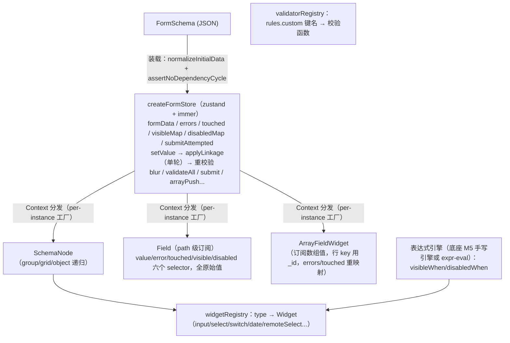

# 项目一：Schema 动态表单复刻手册

> 一句话目标：从零复刻一个"输入 JSON、输出行为完整的表单"的渲染引擎——取值、联动、校验、数组字段、异步 options、提交全链路，性能标准是"输入任意一个字符，Profiler 里只有该字段重渲染"（mini formily）。预计工期：2 周。前置要求：已完成《[00-公共底座复刻手册](00-公共底座-复刻手册.md)》的 M1–M6（协议思想、注册表、渲染器骨架、表达式引擎、受控数据流、path 级 store）——本项目在其上"表单化"。学习大纲版讲解见 [2. Schema 动态表单](../react-进阶大纲-复杂场景/10-2-Schema-动态表单-2-周.md)。

## 0. 最终效果与验收清单

- [ ] 一份 20+ 字段的 JSON schema，覆盖 group / grid / object / array / 联动（visibleWhen + disabledWhen）/ 异步 options / 自定义校验器（registry 键名），**不写任何字段级 JSX** 即可渲染
- [ ] 联动正确：userType 切 person ↔ company 时公司信息组显隐切换；装载（编辑回显）时显隐即正确
- [ ] clearOnHide 两种策略各自验证：true 的字段隐藏后提交数据中不存在该键；false 的字段隐藏后提交数据被 filterByVisible 过滤
- [ ] 校验三档时机：失焦即报、提交全量报、报错后修改即时转正；提交失败焦点落到第一个错误字段
- [ ] 数组字段增删行/上移下移后：行内容不错位、校验错误跟着行走、行 key 为稳定 `_id`
- [ ] 远程搜索 select：连续输入 5 个字符只发出 1 个请求（Network 面板验证）；响应乱序时结果与最后一次输入一致
- [ ] 性能验收：Profiler 录制任意字段输入一个字符，重渲染的 Field 恰为 1 个（联动目标字段另计）
- [ ] 提交输出的 formData：无 `_id`、无隐藏字段值、无 undefined 键
- [ ] `assertNoDependencyCycle` 装载期跑通：构造 a↔b 循环依赖的 schema 能报出环路径而不是运行时振荡

## 1. 架构总览



数据流主线：**用户输入 → `setValue(path, v)` → 同一次 produce 内：① 按路径写值（结构共享）② 单轮重算 visibleMap/disabledMap + clearOnHide ③ touched 字段重校验 → zustand 通知 → 每个 Field 跑 selector → `Object.is` 判重 → 只有值变的字段重渲染。**

技术选型表：

| 库 | 用途 | 选型理由 | 替代项 |
|---|---|---|---|
| zustand | 表单 store | selector 订阅天然支持 path 级订阅 | jotai；自研 Context+useSyncExternalStore |
| immer | 不可变更新 | 结构共享是订阅判重的物理基础 | 手写展开（坑多） |
| expr-eval | 表达式求值（可选） | 一行接入、语法够用（注意只支持 `==` 不支持 `===`） | 底座 M5 手写引擎（零依赖，推荐先用手写的） |
| crypto.randomUUID | 行 `_id` | 浏览器原生 | nanoid |

与底座的关系：底座给出"注册表 + 渲染器 + 表达式 + path store"的通用件；本项目把它们**表单化**——store 多了 errors/touched/visibleMap/disabledMap/submitAttempted 五张表，渲染器多了布局字段与字段壳（label/错误/必填标记）。

## 2. 数据模型与协议

字段协议全集（`src/types.ts`）——在底座"discriminated union + 可序列化 + 版本号"原则上的表单特化：

```ts
// types.ts —— 字段协议全集
export type FieldType =
  | 'input' | 'textarea' | 'number' | 'select' | 'switch' | 'date'
  | 'array' | 'object'      // 值字段
  | 'group' | 'grid'        // 布局字段（不产生数据）

export interface OptionItem {
  label: string
  value: string | number
}

/** 远程 options 的可序列化描述：只有字符串/数字，没有任何函数 */
export interface RemoteOptionsSpec {
  /** URL 模板，{keyword} 会被替换为搜索词，如 '/api/users?q={keyword}' */
  urlTemplate: string
  /** 响应里取数组的路径，如 'data.list' */
  resultPath?: string
  /** 从数组元素里取 label/value 的字段名 */
  labelField?: string
  valueField?: string
  /** 依赖的字段路径（如省 → 市），该字段变化时重新加载 */
  dependsOn?: string
  /** 搜索防抖毫秒数，默认 300 */
  debounce?: number
}

/** 校验规则。custom 是 validatorRegistry 的键名——协议里绝不放函数 */
export interface ValidationRules {
  required?: boolean
  requiredMessage?: string
  /** 正则源字符串，如 '^1\\d{10}$'（JSON 里必须双反斜杠） */
  pattern?: string
  patternMessage?: string
  minLength?: number
  maxLength?: number
  min?: number
  max?: number
  /** 指向 validatorRegistry 中注册的校验器键名 */
  custom?: string
  /** 本字段何时校验：blur（默认）| change | submit */
  trigger?: 'blur' | 'change' | 'submit'
}

/** 所有字段共享的公共属性 */
export interface BaseFieldSchema {
  /** 字段名，同时是 formData 的键；只允许字母数字下划线（点号是路径分隔符） */
  name: string
  label: string
  required?: boolean
  /** 初始值；缺省时按类型补空白值（normalizeInitialData） */
  default?: unknown
  placeholder?: string
  /** 显隐表达式。求值上下文 { $form, $item }（$item 仅数组行内字段可用）。统一用 == */
  visibleWhen?: string
  disabledWhen?: string
  /** 隐藏后是否清空已填值。false=保留（默认），true=清空 */
  clearOnHide?: boolean
  rules?: ValidationRules
  /** 预留扩展：协议演进时不破坏旧 schema */
  'x-props'?: Record<string, unknown>
}

export interface InputFieldSchema extends BaseFieldSchema {
  type: 'input' | 'textarea' | 'date'
  maxLength?: number
}
export interface NumberFieldSchema extends BaseFieldSchema {
  type: 'number'
  min?: number
  max?: number
}
export interface SelectFieldSchema extends BaseFieldSchema {
  type: 'select'
  options?: OptionItem[]
  remote?: RemoteOptionsSpec
}
export interface SwitchFieldSchema extends BaseFieldSchema { type: 'switch' }
/** 数组字段：item 是"一行"的字段模板，运行时按行数展开 */
export interface ArrayFieldSchema extends BaseFieldSchema {
  type: 'array'
  item: ObjectFieldSchema
  maxItems?: number
}
/** 嵌套对象字段：子字段路径自动加前缀，如 company.name */
export interface ObjectFieldSchema extends BaseFieldSchema {
  type: 'object'
  fields: FieldSchema[]
}
/** 布局：分组（带标题的 fieldset），不产生数据 */
export interface GroupFieldSchema extends BaseFieldSchema {
  type: 'group'
  collapsible?: boolean
  fields: FieldSchema[]
}
/** 布局：栅格，columns 列 + 每字段 span */
export interface GridFieldSchema extends BaseFieldSchema {
  type: 'grid'
  columns?: number
  fields: Array<FieldSchema & { span?: number }>
}

export type FieldSchema =
  | InputFieldSchema | NumberFieldSchema | SelectFieldSchema | SwitchFieldSchema
  | ArrayFieldSchema | ObjectFieldSchema | GroupFieldSchema | GridFieldSchema

export interface FormSchema {
  formId: string
  /** 协议版本号：从第一天就带上，为将来 migration 链留口子 */
  version: string
  fields: FieldSchema[]
}

export type FormData = Record<string, unknown>
```

最小合法 schema（联动示例，综合大示例见 M10）：

```json
{
  "formId": "employee-onboarding",
  "version": "1.0.0",
  "fields": [
    { "type": "select", "name": "userType", "label": "人员类型", "required": true,
      "options": [{ "label": "个人", "value": "person" }, { "label": "企业", "value": "company" }] },
    { "type": "input", "name": "companyName", "label": "公司名称",
      "visibleWhen": "$form.userType == 'company'", "clearOnHide": true,
      "rules": { "required": true } }
  ]
}
```

## 3. 复刻主线路径：里程碑 M1–M10

依赖链说明：没有协议（M1）就没有渲染依据，没有 widget（M2）就没有地方挂字段，没有 store（M3）字段无处读写，没有订阅模式（M4）性能不达标，联动（M5）和校验（M6）建立在"值变化 → 精确通知"之上，数组（M7）是路径系统进阶，异步 options（M8）是字段最后的能力缺口，布局（M9）纯渲染层升级，性能与联调（M10）收官。

### M1 工程与类型定义

**目标**：项目就位，协议类型 + 路径工具 + 装载期校验三件套全部落地。

**完整代码**：

```bash
npm create vite@latest schema-form -- --template react-ts
cd schema-form && npm install zustand immer && npm install -D vitest
# 表达式引擎二选一：直接复用底座 M5 的手写引擎（推荐，零依赖），或：
npm install expr-eval
```

路径工具（全项目复用，含在底座 `store/path.ts` 已有版本上补充的 setPath draft 版）：

```ts
// form/path.ts
import type { FormData } from '../types'

/** 按点路径读值：getPath(data, 'users.2.name')；任何一层缺失返回 undefined */
export function getPath(root: unknown, path: string): unknown {
  return path.split('.').reduce<unknown>((acc, key) => {
    if (acc != null && typeof acc === 'object') {
      return (acc as Record<string, unknown>)[key]
    }
    return undefined
  }, root)
}

/** 按点路径写值（配合 immer draft 使用）。中间层缺失时补空对象 */
export function setPath(root: FormData, path: string, value: unknown): void {
  const keys = path.split('.')
  const last = keys.pop()!
  let cur: Record<string, unknown> = root
  for (const k of keys) {
    const next = cur[k]
    // 中间层是 null/标量时补 {}，避免 'company.name' 在 company 未初始化时崩掉
    if (next == null || typeof next !== 'object') cur[k] = {}
    cur = cur[k] as Record<string, unknown>
  }
  cur[last] = value
}
```

**验证**：`npx tsc --noEmit` 通过；vitest 里对 `getPath/setPath` 写 3 条用例（嵌套读、缺失层写、数组下标 `users.2.name`）。

**常见报错与修复**：

1. 字段名带点（`"tax.id"`）取到嵌套对象——点路径语法与键名冲突。修复：协议层约束 `name` 只允许 `[A-Za-z0-9_]`（装载期校验报配置错误），不引入转义语法。
2. `setPath` 把中间层数组覆盖成 `{}`——先 `getPath` 确认父层是数组时按下标写。本项目数组操作走专门的 arrayActions（M7），不裸用 setPath 写数组内部。

### M2 widget 注册表与内置控件

**目标**：widget props 契约 + 注册表 + 6 个基础控件，`value` 边界处理到位。

**完整代码**：

```ts
// widgets/types.ts
import type { ReactElement } from 'react'
import type { FieldSchema } from '../types'

/** 所有输入组件统一遵守的 props 契约 */
export interface WidgetProps<T = unknown> {
  /** 字段完整路径，同时用作 label/htmlFor 关联与错误定位的 data-path */
  id: string
  schema: FieldSchema
  value: T
  disabled: boolean
  onChange: (value: T) => void
  onBlur: () => void
}

export type WidgetComponent = (props: WidgetProps<any>) => ReactElement
```

```tsx
// widgets/InputWidget.tsx
import type { WidgetProps } from './types'

export function InputWidget({ id, schema, value, disabled, onChange, onBlur }: WidgetProps<string>) {
  return (
    <input
      id={id}
      className="widget-input"
      // 关键：value 永远是 string。undefined 会让 input 变非受控组件，触发 React 告警
      value={typeof value === 'string' ? value : value == null ? '' : String(value)}
      placeholder={schema.placeholder}
      disabled={disabled}
      onChange={(e) => onChange(e.target.value)}
      onBlur={onBlur}
    />
  )
}
```

```tsx
// widgets/SwitchWidget.tsx
import type { WidgetProps } from './types'

export function SwitchWidget({ id, value, disabled, onChange, onBlur }: WidgetProps<boolean>) {
  return (
    <input
      id={id}
      type="checkbox"
      className="widget-switch"
      checked={value === true}
      disabled={disabled}
      onChange={(e) => onChange(e.target.checked)}
      onBlur={onBlur}
    />
  )
}
```

```ts
// widgets/registry.ts
import type { WidgetComponent } from './types'

/**
 * 注册表：type 字符串 → widget 组件。
 * 故意用 Record<string, ...> 而不是穷举映射——注册表必须是开放的，
 * 类型收窄交给调用处的 fallback UI 兜底（未注册渲染占位）。
 */
export const widgetRegistry: Record<string, WidgetComponent> = {
  input: InputWidget,
  textarea: TextareaWidget,
  number: NumberWidget,
  select: SelectWidget,
  switch: SwitchWidget,
  date: InputWidget, // 简化：date 先复用 input
}
```

**验证**：Storybook 或临时页面直接渲染 `<InputWidget id="x" schema={anyField} value="" .../>`，输入/清空/禁用三态正常。

**常见报错与修复**：

1. `A component is changing an uncontrolled input to be controlled`——value 为 `undefined/null` 直传。修复：widget 内归一化（见 InputWidget 的三元表达式），三条军规见 §5 坑 3。
2. 两个表单页字段 type 撞名（同 `'input'` 但要不同样式）——全局注册表把语义类型与实现焊死。修复：`createFormRenderer(registry)` 工厂按需生成，或键加命名空间（`'antd.input'`）。

### M3 formData store（zustand + immer 单 store）

**目标**：`createFormStore` 工厂 + `setValue/blur` 两个核心 action；formData/errors/touched/visibleMap/disabledMap 五张表同店管理。

**完整代码**：

```ts
// form/store.ts
import { create } from 'zustand'
import { produce } from 'immer'
import type { FormSchema, FormData } from '../types'
import { getPath, setPath } from './path'

export interface FormStoreState {
  schema: FormSchema
  formData: FormData
  /** 键为字段完整路径，只在"确有错误"时存在该键 */
  errors: Record<string, string>
  /** 用户碰过（失焦过）的字段路径集合 */
  touched: Record<string, boolean>
  /** 显隐/禁用 map：只有声明了表达式的字段才会出现在 map 里 */
  visibleMap: Record<string, boolean>
  disabledMap: Record<string, boolean>
  submitAttempted: boolean
  setValue: (path: string, value: unknown) => void
  blur: (path: string) => void
  // validateAll / submit / arrayPush / arrayRemove / arrayMove 在 M6/M7 追加
}

export const createFormStore = (schema: FormSchema, initial?: FormData) =>
  create<FormStoreState>()((set, get) => {
    const initialData = normalizeInitialData(schema, initial)   // M9 给全码
    return {
      schema,
      formData: initialData,
      errors: {},
      touched: {},
      // 装载时对初始数据先求一轮显隐/禁用（编辑回显时 userType 可能一开始就是"企业"）
      visibleMap: evaluateLinkageMap(schema, initialData, 'visibleWhen'),
      disabledMap: evaluateLinkageMap(schema, initialData, 'disabledWhen'),
      submitAttempted: false,

      setValue: (path, value) =>
        set((s) =>
          produce(s, (draft) => {
            // ① 按路径写值：只有路径上的对象换新引用（结构共享）
            setPath(draft.formData, path, value)
            // ② 联动单轮重算 + clearOnHide + touched 重校验（M5 展开）
            applyLinkage(draft)
          }),
        ),
      blur: (path) =>
        set((s) =>
          produce(s, (draft) => {
            draft.touched[path] = true
            const field = findFieldByPath(draft.schema, path)
            if (field) {
              const msg = validateOne(field, getPath(draft.formData, path), draft.formData)
              if (msg) draft.errors[path] = msg
              else delete draft.errors[path]
            }
          }),
        ),
    }
  })
```

为什么显式 `produce` 而不用 zustand immer 中间件：一次 set = 一次原子更新——formData、errors、visibleMap 同一次 produce 一起变，不会出现"值更新了但显隐 map 还是旧的"的中间态。

**验证**：vitest 直接调 store：`const s = createFormStore(miniSchema)`；`s.getState().setValue('userType', 'company')` 后 `getState().formData.userType === 'company'`（applyLinkage 未实现前先注释该行）。

**常见报错与修复**：

1. 编辑回显时联动字段显隐错误——装载期没跑第一轮 `evaluateLinkageMap`。修复：工厂函数体内先算 initialData 与两 map（上面代码已含）。
2. 两处 set 之间出现撕裂帧（值新 map 旧）——把联动算进 setValue 的同一次 produce（见 M5）。

### M4 Field 组件与 path 级订阅（灵魂里程碑）

**目标**：四环链路（store 工厂 → Context 分发 → Field 订阅 → widget），单字段输入只有该 Field 重渲染。

**完整代码**：

```tsx
// form/FormProvider.tsx
import { createContext, useState, type ReactNode } from 'react'
import { createFormStore, type FormStoreState } from './store'
import type { FormSchema, FormData } from '../types'

type FormStoreApi = ReturnType<typeof createFormStore>

const FormStoreContext = createContext<FormStoreApi | null>(null)

export function FormProvider({ schema, initial, children }: {
  schema: FormSchema; initial?: FormData; children: ReactNode }) {
  // useState 惰性初始化：store 只建一次。schema 变化需要重建实例时，由外层用 key 控制
  const [store] = useState(() => createFormStore(schema, initial))
  return <FormStoreContext.Provider value={store}>{children}</FormStoreContext.Provider>
}

/** 每个字段组件都通过它拿 store 并声明自己的 selector */
export function useFormStore<T>(selector: (s: FormStoreState) => T): T {
  const store = useContext(FormStoreContext)
  if (!store) throw new Error('useFormStore 必须在 <FormProvider> 内使用')
  return store(selector)
}
```

```tsx
// form/Field.tsx
import { memo, useContext } from 'react'
import { FormStoreContext } from './FormProvider'
import { getPath } from './path'
import { widgetRegistry } from './widgets/registry'
import type { FieldSchema } from '../types'

/**
 * Field：一个字段 = 一个订阅单元。
 * ① memo：容器重渲染时，props（schema/path 引用稳定）没变就跳过
 * ② 全部 selector 只返回原始值：Object.is 一比即知变没变
 */
export const Field = memo(function Field({ schema, path }: { schema: FieldSchema; path: string }) {
  const useStore = useContext(FormStoreContext)!
  // ↓↓↓ path 级订阅：每个字段只读自己路径下的值与状态 + 两个 action
  const value = useStore((s) => getPath(s.formData, path))
  const error = useStore((s) => s.errors[path])
  const touched = useStore((s) => s.touched[path] === true)
  const visible = useStore((s) => s.visibleMap[path] ?? true)
  const disabled = useStore((s) => s.disabledMap[path] ?? false)
  const submitAttempted = useStore((s) => s.submitAttempted)
  const setValue = useStore((s) => s.setValue)   // action 引用固定，订阅永远稳定
  const blur = useStore((s) => s.blur)

  if (!visible) return null

  const Widget = widgetRegistry[schema.type]
  if (!Widget) {
    return <div className="field-unknown">未注册的字段类型：{String(schema.type)}</div>
  }

  const showError = (touched || submitAttempted) && !!error
  return (
    <div className={'field' + (showError ? ' field--invalid' : '')} data-path={path}>
      <label className="field-label" htmlFor={path}>
        {schema.label}
        {schema.required === true && <span className="field-required"> *</span>}
      </label>
      <Widget id={path} schema={schema} value={value} disabled={disabled}
              onChange={(v) => setValue(path, v)} onBlur={() => blur(path)} />
      {showError && <div className="field-error" role="alert">{error}</div>}
    </div>
  )
})
```

```tsx
// DynamicForm.tsx —— 使用方式：四环链路的最小例
import { FormProvider } from './form/FormProvider'
import { SchemaNode } from './form/SchemaNode'

export function DynamicForm({ schema }: { schema: FormSchema }) {
  return (
    <FormProvider schema={schema}>
      <form className="dynamic-form">
        {schema.fields.map((f) => (
          <SchemaNode key={f.name} schema={f} path={f.name} />
        ))}
      </form>
    </FormProvider>
  )
}
```

（`SchemaNode` 本里程碑先用骨架版：`({ schema, path }) => <Field schema={schema} path={path} />`，布局分支 M9 补全。）

**验证**（Profiler 观察法）：DevTools Profiler 录制 → 输入框打一个字符 → 停止。火焰图应只有 1 个 Field commit；点开它看 "Why did this render?" = "state changed"。CI 用 `React.Profiler` onRender 计数断言只有当前路径 > 0。

**常见报错与修复**：

1. selector 返回新对象导致恒重渲染——`useStore((s) => ({ v: ... }))` 每次新引用。修复：拆成多个 selector 返回原始值；必须对象时 `useShallow`（`zustand/react/shallow`）。
2. 容器组件订阅 formData——分组/栅格整组重渲染。修复：容器只渲染结构，数据读取全部下沉到 Field。
3. Field 没 memo——容器因其他原因重渲染时全军覆没。修复：`memo(Field)` 且保证 schema/path props 引用稳定（来自配置对象，天然稳定）。

### M5 表达式联动（visibleWhen / disabledWhen / clearOnHide）

**目标**：联动引擎三函数（evalCondition / evaluateLinkageMap / applyLinkage）+ 依赖环检测。

**完整代码**：

```ts
// form/linkage.ts
// 表达式引擎二选一：expr-eval 或底座 M5 手写 evaluateExpression。
// 下例用底座手写引擎（错误时返回 undefined 而非抛错，一个配置笔误不瘫痪整表）
import { evaluateExpression } from '../kernel/expression'
import { getPath, setPath } from './path'
import { validateOne } from './validate'

/** 求值上下文：$form = 表单数据，$item = 数组行数据 */
export function evalCondition(expr: string, formData: FormData, item?: unknown): boolean {
  try {
    return evaluateExpression(expr, { $form: formData, $item: item }) === true
  } catch {
    return false
  }
}

/** 遍历静态 schema 的叶子字段（group/grid 递归不改前缀，object 加前缀，array 视为叶子） */
export function walkLeafFields(
  fields: FieldSchema[], prefix: string,
  cb: (field: FieldSchema, path: string) => void,
): void {
  for (const f of fields) {
    const path = prefix ? `${prefix}.${f.name}` : f.name
    if (f.type === 'group' || f.type === 'grid') {
      walkLeafFields(f.fields, prefix, cb)
    } else if (f.type === 'object') {
      walkLeafFields(f.fields, path, cb)
    } else {
      cb(f, path)
    }
  }
}

export function evaluateLinkageMap(
  schema: FormSchema, formData: FormData,
  exprKey: 'visibleWhen' | 'disabledWhen',
): Record<string, boolean> {
  const map: Record<string, boolean> = {}
  walkLeafFields(schema.fields, '', (field, path) => {
    const expr = field[exprKey]
    if (typeof expr === 'string') map[path] = evalCondition(expr, formData)
    // 没写表达式的字段不进 map，Field 侧 `?? true` / `?? false` 兜底
  })
  return map
}

/** setValue 内的联动单轮重算：操作 produce 的 draft，全部改动合并进同一次 set */
function applyLinkage(draft: FormStoreState): void {
  const nextVisible = evaluateLinkageMap(draft.schema, draft.formData, 'visibleWhen')

  // clearOnHide：对"刚刚隐藏"的字段按策略清值
  for (const path of Object.keys(nextVisible)) {
    const wasVisible = draft.visibleMap[path] ?? true
    const nowVisible = nextVisible[path]
    if (wasVisible && !nowVisible) {
      const field = findFieldByPath(draft.schema, path)
      if (field?.clearOnHide) {
        setPath(draft.formData, path, field.default ?? blankOf(field.type))
        delete draft.errors[path]
        delete draft.touched[path]
      }
    }
  }

  draft.visibleMap = nextVisible
  draft.disabledMap = evaluateLinkageMap(draft.schema, draft.formData, 'disabledWhen')

  // touched / submitAttempted 的字段重校验：值或显隐变了，错误信息可能过时
  walkLeafFields(draft.schema.fields, '', (field, path) => {
    if (draft.touched[path] || draft.submitAttempted) {
      const msg = validateOne(field, getPath(draft.formData, path), draft.formData)
      if (msg) draft.errors[path] = msg
      else delete draft.errors[path]
    }
  })
}

export function findFieldByPath(schema: FormSchema, target: string): FieldSchema | undefined {
  let hit: FieldSchema | undefined
  walkLeafFields(schema.fields, '', (field, path) => { if (path === target) hit = field })
  return hit
}
```

依赖环检测（装载期，静态炸弹变配置期报错）：

```ts
// form/dependencyGraph.ts
/** 从表达式文本提取 $form.xxx 引用：'$form.a.b > 1 && $form.c == 2' → ['a.b', 'c'] */
export function extractDeps(expr: string): string[] {
  const re = /\$form\.([A-Za-z0-9_.]+)/g
  return [...expr.matchAll(re)].map((m) => m[1])
}

/** schema 级环检测：显隐依赖成环直接报配置错误（三色标记 DFS） */
export function assertNoDependencyCycle(schema: FormSchema): void {
  const graph = new Map<string, string[]>()
  walkLeafFields(schema.fields, '', (field, path) => {
    const exprs = [field.visibleWhen, field.disabledWhen].filter(Boolean) as string[]
    graph.set(path, [...new Set(exprs.flatMap(extractDeps))].filter((dep) => dep !== path))
  })
  const state = new Map<string, 1 | 2>()
  const stack: string[] = []
  const visit = (node: string): void => {
    const s = state.get(node)
    if (s === 1) throw new Error(`联动存在循环依赖：${[...stack, node].join(' → ')}`)
    if (s === 2) return
    state.set(node, 1); stack.push(node)
    for (const dep of graph.get(node) ?? []) if (graph.has(dep)) visit(dep)
    stack.pop(); state.set(node, 2)
  }
  for (const node of graph.keys()) visit(node)
}
```

**验证**：最小 schema 里切 userType——公司字段显隐切换；装载期构造 a↔b 循环 schema，`assertNoDependencyCycle` 抛出 `联动存在循环依赖：a → b → a`。

**常见报错与修复**：

1. 控制台刷 `Maximum update depth exceeded`、字段值来回跳——存在"effect 写回 store"的派生环。修复：三层防线——架构层派生值不写回（applyLinkage 单轮收敛）；装载期 assertNoDependencyCycle；求值加轮数上限（5 轮超限告警）。
2. 表达式一律算 false——引擎对未注册变量/语法错误静默返回。修复：编辑/装载期用底座 `checkExpression` 做静态检查并告警，运行期保持静默容错（宁可联动失效不瘫痪输入）。
3. `==` 与 `===`：expr-eval 不支持 `===`，协议统一写 `==`（若用底座手写引擎同样只实现 `==`）。

### M6 校验体系与提交流

**目标**：validatorRegistry + validateOne + validateAll/submit + touched 状态机。

**完整代码**：

```ts
// form/validators.ts
import type { FormData } from '../types'

/** 自定义校验器：返回错误文案表示不通过，undefined 表示通过 */
export type CustomValidator = (value: unknown, formData: FormData) => string | undefined

export const validatorRegistry: Record<string, CustomValidator> = {
  phone: (v) => (/^1\d{10}$/.test(String(v)) ? undefined : '手机号格式不正确'),
  idCard: (v) => (/^\d{17}[\dXx]$/.test(String(v)) ? undefined : '身份证号格式不正确'),
  // 跨字段校验也放这里：formData 全量在手
  greaterThanStartDate: (v, formData) =>
    v && formData.startDate && String(v) < String(formData.startDate)
      ? '结束时间不能早于开始时间' : undefined,
}
```

```ts
// form/validate.ts
import { validatorRegistry } from './validators'
import type { FieldSchema, FormData } from '../types'

function isEmpty(v: unknown): boolean {
  return v === undefined || v === null || v === '' || (Array.isArray(v) && v.length === 0)
}

/** 单字段校验：优先级 required > pattern > 长度/范围 > custom */
export function validateOne(field: FieldSchema, value: unknown, formData: FormData): string | undefined {
  const r = field.rules ?? {}
  if (r.required && isEmpty(value)) return r.requiredMessage ?? `${field.label}不能为空`
  // 空值且非必填：不继续跑格式校验（空手机号不该报"格式不正确"）
  if (!isEmpty(value)) {
    if (r.pattern && !new RegExp(r.pattern).test(String(value))) {
      return r.patternMessage ?? `${field.label}格式不正确`
    }
    if (r.minLength != null && String(value).length < r.minLength) {
      return `${field.label}至少 ${r.minLength} 个字符`
    }
    if (r.maxLength != null && String(value).length > r.maxLength) {
      return `${field.label}最多 ${r.maxLength} 个字符`
    }
    if (r.custom) {
      const fn = validatorRegistry[r.custom]
      if (!fn) console.error(`未注册的自定义校验器：${r.custom}`)
      else {
        const msg = fn(value, formData)
        if (msg) return msg
      }
    }
  }
  return undefined
}
```

```ts
// form/submitFilter.ts —— 保留策略下保证提交数据干净
import type { FormData } from '../types'
import { setPath } from './path'

/** 提交前：把当前不可见字段的值从数据里剥掉 */
export function filterByVisible(data: FormData, visibleMap: Record<string, boolean>): FormData {
  const out: FormData = structuredClone(data)
  for (const [path, visible] of Object.entries(visibleMap)) {
    if (!visible) setPath(out, path, undefined)
  }
  return out
}

/** 提交前剥掉 _id 等内部键（递归） */
export function transformSubmitData(value: unknown): unknown {
  if (Array.isArray(value)) return value.map(transformSubmitData)
  if (value && typeof value === 'object') {
    const out: Record<string, unknown> = {}
    for (const [k, v] of Object.entries(value as Record<string, unknown>)) {
      if (k === '_id') continue
      out[k] = transformSubmitData(v)
    }
    return out
  }
  return value
}
```

```ts
// form/store.ts 追加：validateAll 与 submit
  validateAll: () => {
    let firstErrorPath = ''
    set((s) =>
      produce(s, (draft) => {
        draft.errors = {}
        walkLeafFields(draft.schema.fields, '', (field, path) => {
          const msg = validateOne(field, getPath(draft.formData, path), draft.formData)
          if (msg) { draft.errors[path] = msg; firstErrorPath ||= path }
        })
        draft.submitAttempted = true
      }),
    )
    if (firstErrorPath) {
      // data-path 是 Field 渲染时打上的锚点，据此定位 DOM 聚焦
      const el = document.querySelector<HTMLElement>(`[data-path="${CSS.escape(firstErrorPath)}"]`)
      el?.focus()
      el?.scrollIntoView({ block: 'center' })
      return false
    }
    return true
  },

  submit: () => {
    const ok = get().validateAll()
    if (!ok) return null
    const { formData, visibleMap } = get()
    return transformSubmitData(filterByVisible(formData, visibleMap)) as FormData
  },
```

时机策略表（三条规则，别多加）：

| 时机 | 做什么 | 不做什么 |
|---|---|---|
| onChange（setValue 内） | touched 或 submitAttempted 的字段重校验 | 没 touch 过的字段不校验（用户还在打字） |
| onBlur | 标记 touched + 立即校验该字段 | 不校验别的字段 |
| onSubmit | validateAll 全量、置 submitAttempted、聚焦第一个错误 | 不清空用户已填内容 |

**验证**：必填/正则/自定义三档各配一个字段：失焦即报 → 提交全量报 → 报错后修改即时转正；提交失败焦点落到第一个错误字段。

**常见报错与修复**：

1. `pattern` 配了 11 位数字正则仍报格式错——JSON 里 `\d` 必须写 `\\d`（单反斜杠被 JSON 解析吞掉）。修复：装载期对 `rules.pattern` 跑 `new RegExp(r.pattern)` 冒烟测试，非法/行为异常在加载期报配置错误。
2. 提交报错→改好→另一个错误不显示——submitAttempted 被中途复位。修复：submitAttempted 置位后保持到成功提交或 reset。

### M7 数组字段（增删/上移下移/状态重映射）

**目标**：arrayPush/Remove/Move 三 action + errors/touched 路径重映射 + ArrayFieldWidget/ArrayRow。

**完整代码**：

```ts
// form/arrayOps.ts —— 数组操作 + 状态重映射工具
/** move：把 from 行移到 to 行，errors/touched 的路径同步重排 */
export function remapIndexed(
  map: Record<string, unknown>, basePath: string, from: number, to: number,
): Record<string, unknown> {
  const out: Record<string, unknown> = {}
  const prefix = `${basePath}.`
  for (const [key, val] of Object.entries(map)) {
    if (!key.startsWith(prefix)) { out[key] = val; continue }
    const m = key.slice(prefix.length).match(/^(\d+)\.(.+)$/)
    if (!m) { out[key] = val; continue }
    let idx = Number(m[1])
    if (idx === from) idx = to
    else if (from < to && idx > from && idx <= to) idx -= 1
    else if (from > to && idx >= to && idx < from) idx += 1
    out[`${prefix}${idx}.${m[2]}`] = val
  }
  return out
}

/** remove：删掉第 removedIndex 行，其后行的下标整体 -1 */
export function shiftIndexedAfter(
  map: Record<string, unknown>, basePath: string, removedIndex: number,
): Record<string, unknown> {
  const out: Record<string, unknown> = {}
  const prefix = `${basePath}.`
  for (const [key, val] of Object.entries(map)) {
    if (!key.startsWith(prefix)) { out[key] = val; continue }
    const m = key.slice(prefix.length).match(/^(\d+)\.(.+)$/)
    if (!m) { out[key] = val; continue }
    const idx = Number(m[1])
    if (idx === removedIndex) continue
    out[`${prefix}${idx > removedIndex ? idx - 1 : idx}.${m[2]}`] = val
  }
  return out
}
```

```ts
// form/store.ts 追加：三个数组 action（都走 produce，一次 set 原子完成）
  arrayPush: (path, item) =>
    set((s) => produce(s, (draft) => {
      const arr = getPath(draft.formData, path)
      if (Array.isArray(arr)) arr.push(item)
    })),

  arrayRemove: (path, index) =>
    set((s) => produce(s, (draft) => {
      const arr = getPath(draft.formData, path)
      if (Array.isArray(arr)) arr.splice(index, 1)
      draft.errors = shiftIndexedAfter(draft.errors, path, index)
      draft.touched = shiftIndexedAfter(draft.touched, path, index)
    })),

  arrayMove: (path, from, to) =>
    set((s) => produce(s, (draft) => {
      const arr = getPath(draft.formData, path)
      if (!Array.isArray(arr)) return
      if (from < 0 || from >= arr.length || to < 0 || to >= arr.length) return
      const [moved] = arr.splice(from, 1)
      arr.splice(to, 0, moved)
      draft.errors = remapIndexed(draft.errors, path, from, to)
      draft.touched = remapIndexed(draft.touched, path, from, to)
    })),
```

```tsx
// widgets/ArrayFieldWidget.tsx（节选关键设计）
// ① 行 key 用 _id（crypto.randomUUID()）绝不用下标——增删行时实例与状态跟数据走
// ② FieldArray 只订阅数组值本身（行内字段是独立的 Field，各自 path 订阅），
//    若发现行内打字导致整组重渲染，改为订阅 length + 行数据用索引现场取
export const ArrayFieldWidget = memo(function ArrayFieldWidget({
  id, schema, value, disabled,
}: WidgetProps<unknown[]>) {
  const useStore = useContext(FormStoreContext)!
  const items = Array.isArray(value) ? value : []
  const arraySchema = schema as ArrayFieldSchema
  const arrayPush = useStore((s) => s.arrayPush)
  const arrayRemove = useStore((s) => s.arrayRemove)
  const arrayMove = useStore((s) => s.arrayMove)
  const atLimit = arraySchema.maxItems != null && items.length >= arraySchema.maxItems

  return (
    <fieldset className="field-array" data-path={id}>
      <legend>{schema.label}{schema.required === true && <span className="field-required"> *</span>}</legend>
      {items.map((row, i) => (
        <ArrayRow
          key={(row as Record<string, unknown>)._id as string}   // ← 稳定 key
          arrayPath={id} index={i} total={items.length}
          itemSchema={arraySchema.item} row={row as Record<string, unknown>}
          onRemove={() => arrayRemove(id, i)}
          onMoveUp={i > 0 ? () => arrayMove(id, i, i - 1) : undefined}
          onMoveDown={i < items.length - 1 ? () => arrayMove(id, i, i + 1) : undefined}
        />
      ))}
      <button type="button" disabled={disabled || atLimit}
              onClick={() => arrayPush(id, createDefaultItem(arraySchema.item))}>
        + 新增{schema.label}
      </button>
    </fieldset>
  )
})

function createDefaultItem(item: ObjectFieldSchema): Record<string, unknown> {
  const row: Record<string, unknown> = { _id: globalThis.crypto.randomUUID() }
  for (const f of item.fields) {
    row[f.name] = f.default ?? (f.type === 'switch' ? false
      : f.type === 'select' || f.type === 'number' ? null
      : f.type === 'array' ? [] : '')
  }
  return row
}
```

```tsx
// widgets/ArrayRow.tsx —— 一行 = item 模板展开 + 行操作条
export const ArrayRow = memo(function ArrayRow({
  arrayPath, index, total, itemSchema, row, onRemove, onMoveUp, onMoveDown,
}: { ... }) {
  return (
    <div className="field-array__row">
      <div className="field-array__row-main">
        {/* 子字段路径 = `${arrayPath}.${index}.${name}`，Field 按此路径订阅与校验 */}
        {itemSchema.fields.map((f) => (
          <Field key={f.name} schema={f} path={`${arrayPath}.${index}.${f.name}`} />
        ))}
      </div>
      <div className="field-array__row-ops">
        <span>{index + 1}/{total}</span>
        <button type="button" aria-label="上移" disabled={!onMoveUp} onClick={onMoveUp}>↑</button>
        <button type="button" aria-label="下移" disabled={!onMoveDown} onClick={onMoveDown}>↓</button>
        <button type="button" aria-label="删除" onClick={onRemove}>✕</button>
      </div>
    </div>
  )
})
```

行内字段的 visibleWhen 全局 map 覆盖不到（下标是运行时的），在 ArrayRow 里现场求值（读 `$form` + `$item`）：

```tsx
const visible = f.visibleWhen
  ? evalCondition(f.visibleWhen, useStore.getState().formData, row)  // $item 注入行数据
  : true
return visible ? <Field key={f.name} schema={f} path={...} /> : null
```

validateAll 需要展开数组行（错误键形如 `users.2.name`）：walkLeafFields 后对 array 字段按当前行数逐行 cb 子字段（`walkAllFieldsIncludingRows`，完整实现见大纲第 2 章步骤 7）。

**验证**：两行各填不同内容，让第 2 行某字段报错；删第 1 行——原第 2 行内容与错误都正确落到第 1 行位置；上移下移同理；行 key 为稳定 `_id`（React DevTools 无 key 警告、输入焦点不乱）。

**常见报错与修复**：

1. 删第 1 行后第 2 行的错误显示在第 1 行——errors 以旧路径存着、数组平移没重映射。修复：`shiftIndexedAfter`/`remapIndexed` 必须与增删/移动同一次 produce 执行。
2. 行内输入焦点乱跳——key 用了下标。修复：行对象生成时注入 `_id`，提交时 transformSubmitData 剥掉。

### M8 远程 options（防抖 + AbortController）

**目标**：RemoteSelectWidget：防抖发请求、竞态取消、dependsOn 联动重载、回显。

**完整代码**：

```tsx
// widgets/RemoteSelectWidget.tsx（核心 effect）
export function RemoteSelectWidget({ id, schema, value, disabled, onChange, onBlur }: WidgetProps<string | number | null>) {
  const useStore = useContext(FormStoreContext)!
  const spec = (schema as SelectFieldSchema).remote

  const [keyword, setKeyword] = useState('')
  const [options, setOptions] = useState<OptionItem[]>(schema.options ?? [])
  const [loading, setLoading] = useState(false)

  // 依赖字段的当前值（如"省"变化触发"市"重载）
  const dependsValue = spec?.dependsOn ? useStore((s) => getPath(s.formData, spec.dependsOn)) : undefined

  useEffect(() => {
    if (!spec) return
    const ac = new AbortController()           // 本次 effect 生命周期专属取消器
    const timer = setTimeout(async () => {     // 防抖：300ms 内连续输入只发最后一个请求
      setLoading(true)
      try {
        const url = spec.urlTemplate
          .replace('{keyword}', encodeURIComponent(keyword))
          .replace('{depends}', encodeURIComponent(String(dependsValue ?? '')))
        const res = await fetch(url, { signal: ac.signal })  // ← 竞态解药：换词即取消上一个
        const raw = await res.json()
        setOptions(resolveOptions(spec, raw))  // 按 resultPath/labelField/valueField 解析
      } catch (e) {
        if ((e as Error).name !== 'AbortError') setOptions([])  // 真错误清空候选；正常取消静默
      } finally {
        if (!ac.signal.aborted) setLoading(false)
      }
    }, spec.debounce ?? 300)

    return () => {
      clearTimeout(timer)  // 防抖窗口内又输入：定时器取消，请求根本不会发出
      ac.abort()           // 请求在途：中止，迟到的响应不会再 setOptions
    }
  }, [keyword, dependsValue, spec])

  // 渲染：搜索输入框 + 选择下拉（无 spec 时退化为静态 select，代码见大纲第 2 章步骤 8）
  /* ... */
}
```

竞态解剖：输入 `张` → 300ms 后发 R1；200ms 时输入 `张国` → effect 重跑，cleanup 先执行——R1 若已发出则 `ac.abort()` 把它置为 AbortError（哪怕服务端已返回，`res.json()` 处抛错被静默）；R2 带着 `张国` 正常返回。没有 abort 时：R1 慢 R2 快，用户看到"张"的结果却以为在搜"张国"。

**验证**：Network 面板连打 5 个字符只有 1 个请求；DevTools 网络限速 Slow 3G 验证乱序下结果与最后一次输入一致；省→市 dependsOn 切换时市级选项自动重载。

**常见报错与修复**：

1. 回显显示裸 value（`310000`）而不是 label（`上海市`）——options 初始为空找不到匹配。修复：协议 `options` 预置回显项（`echoOption` 思路），搜索结果按 value 去重合并。
2. 卸载后 setState 告警——组件卸载时 effect cleanup 已 abort，但 `setLoading(false)` 可能在 finally 里晚到。修复：finally 里判 `ac.signal.aborted` 再 set（上面代码已含）。

### M9 布局升级（group / grid / object）

**目标**：SchemaNode 完整版 + normalizeInitialData 递归初始化；内核零改动验证解耦设计。

**完整代码**：

```tsx
// form/SchemaNode.tsx —— 完整版
import { Field } from './Field'
import type { FieldSchema } from '../types'

export function SchemaNode({ schema, path }: { schema: FieldSchema; path: string }) {
  switch (schema.type) {
    case 'group':
      // 分组：fieldset + 可折叠。collapsed 是纯 UI 态，原生 details 零状态实现
      return (
        <details className="form-group" open={!schema.collapsible ? true : undefined}>
          <summary className="form-group__title">{schema.label}</summary>
          <div className="form-group__body">
            {schema.fields.map((f) => (
              <SchemaNode key={f.name} schema={f} path={joinPath(path, f.name)} />
            ))}
          </div>
        </details>
      )
    case 'grid':
      return (
        <div className="form-grid"
             style={{ display: 'grid', gridTemplateColumns: `repeat(${schema.columns ?? 2}, 1fr)`, gap: 12 }}>
          {schema.fields.map((f) => (
            <div key={f.name} style={{ gridColumn: `span ${'span' in f ? (f.span ?? 1) : 1}` }}>
              <SchemaNode schema={f} path={joinPath(path, f.name)} />
            </div>
          ))}
        </div>
      )
    case 'object':
      return (
        <fieldset className="form-object">
          <legend>{schema.label}</legend>
          {schema.fields.map((f) => (
            <SchemaNode key={f.name} schema={f} path={joinPath(path, f.name)} />
          ))}
        </fieldset>
      )
    default:
      return <Field schema={schema} path={path} />
  }
}

/** group/grid 不产生数据层前缀，object 也不追加（object 的 name 只是壳）——
    与 walkLeafFields 的规则保持一字不差：布局/对象节点透传父前缀，叶子用 f.name 拼接。
    注意：本实现里 object 的子字段路径 = 父前缀.子name（object 自身 name 不进路径），
    若你的数据契约要求 company.name 形态，改为 object 分支加前缀，并同步改 walkLeafFields/normalize。 */
function joinPath(prefix: string, name: string): string {
  return prefix ? `${prefix}.${name}` : name
}
```

```ts
// form/normalize.ts —— 初始化必经：三条军规第一条
import type { FormSchema, FormData, FieldSchema } from '../types'
import { getPath, setPath } from './path'

function blankOf(type: FieldSchema['type']): unknown {
  switch (type) {
    case 'switch': return false
    case 'number': return null        // null = 未填，与合法值 0 区分
    case 'select': return null        // null = 显示 placeholder
    case 'array': return []
    case 'object': return {}
    case 'group': case 'grid': return undefined   // 布局节点不进 formData
    default: return ''                // input / textarea / date
  }
}

export function normalizeInitialData(schema: FormSchema, initial?: FormData): FormData {
  const data: FormData = { ...(initial ?? {}) }
  initFields(schema.fields, '', data)
  return data
}

function initFields(fields: FieldSchema[], prefix: string, data: FormData): void {
  for (const f of fields) {
    const path = prefix ? `${prefix}.${f.name}` : f.name
    if (f.type === 'group' || f.type === 'grid') {
      initFields(f.fields, prefix, data)          // 布局：不加前缀直接下钻
    } else if (f.type === 'object') {
      if (getPath(data, path) == null) setPath(data, path, {})
      initFields(f.fields, path, data)            // 对象：加前缀下钻（与 joinPath 规则同步）
    } else if (f.type === 'array') {
      if (getPath(data, path) == null) setPath(data, path, [])
    } else {
      if (getPath(data, path) === undefined) setPath(data, path, f.default ?? blankOf(f.type))
    }
  }
}
```

**验证**：渲染 §2 联动 schema + 一份 group/grid/object/array 全覆盖的综合 schema（大纲第 2 章步骤 9 有完整 20 字段版本），检查初始化后的 formData 形如 `{ name: '', age: null, userType: null, company: {...}, contacts: [] }`——隐藏字段的值也初始化了（显隐是渲染层概念，数据层结构稳定）。

**常见报错与修复**：

1. grid 里字段隐藏后出现空洞——`Field` 返回 null 但 span 包装 div 还占格。修复：包装 div 自己订阅 `visibleMap[childPath]` 条件渲染，保持"布局职责在布局组件"。
2. visibleMap 键与 Field 订阅路径对不上（显隐失灵）——SchemaNode 与 walkLeafFields 的路径规则不一致。修复：两处规则抽成同一个 `childPath(parentPath, field)` 共用。

### M10 性能压测与联调收尾

**目标**：20 字段综合表单全链路跑通 + Profiler 定量验收。

**完整代码**：

```tsx
// __tests__/perf.tsx —— CI 用 React.Profiler 计数
import { Profiler } from 'react'

const renderCounts: Record<string, number> = {}

export function CountingField(props: { path: string; children: React.ReactNode }) {
  return (
    <Profiler id={props.path} onRender={(id) => { renderCounts[id] = (renderCounts[id] ?? 0) + 1 }}>
      {props.children}
    </Profiler>
  )
}

// 断言：在 'finance.amount' 输入一个字符后
// expect(Object.keys(renderCounts).filter((p) => renderCounts[p] > 0)).toEqual(['finance.amount'])
```

联调清单（对应 §0 验收逐条）：渲染综合 schema → 切 userType 验证显隐与 clearOnHide → 三档校验时序 → 数组增删移 → 远程搜索（限速）→ Profiler 录制 → 提交数据逐键检查（无 `_id`/无隐藏值/无 undefined）。

**验证**：§0 九条验收全勾。

**常见报错与修复**：

1. 压测时发现统计栏/其他分组也在火焰图里闪——有人订阅了粗粒度数据（整棵 formData 或整个 errors）。用 "Why did this render?" 面板定位是 props 还是 context 泄漏，顺藤摸瓜收窄 selector。
2. 数组行多（50+ 行）时增删卡顿——每行 memo 但 props 里传了 `row` 对象（行内任一输入都换 row 引用）。修复：ArrayRow 只接 index/path 类原始 props，行数据由内部 Field 自己订阅。

## 4. 进阶扩展（可选）

1. **schema 版本迁移**：复用底座 §4 的 migration 链，入口 `loadForm(doc)` = `migrate → assertNoDependencyCycle → normalizeInitialData`。
2. **远程 schema 加载与缓存**：URL 参数 → fetch schema → SWR 缓存 + 骨架屏；失败降级为 JSON 编辑器兜底（衔接项目四）。
3. **向导式分步表单**：在 group 上加 `step` 元数据，分步只是"每步渲染部分字段 + 提交前 validateAll"，内核零改动。
4. **字段间自动计算（computed）**：`bindings: { value: "$form.price * $form.count" }`——把 applyLinkage 扩展出 bindingsMap，求值时机与显隐同轮（注意纳入依赖图环检测）。
5. **与后端协议对接**：`transformSubmitData` 换成可配置的 key 映射表（前端 `userType` ↔ 后端 `user_type`），保持协议层单点转换。

## 5. 复刻坑清单

1. **输入一个字符、全表 50 个字段重渲染**（最高频）：props 下发整棵 formData / Context 存 formData / selector 返回新对象 / Field 没 memo / FieldArray 订阅整个数组——五个泄漏点按命中率排查，全部修法见 M4 检查单。验收以 Profiler 为准，不靠"感觉不卡"。
2. **联动循环依赖**：effect 写回派生值是罪魁祸首。三层防线：架构（单轮收敛）→ 装载期依赖图检环 → 运行时轮数上限。
3. **undefined / null / '' 三种空混用**：受控告警、回显丢失、"没填过"提交出 `''`。三条军规：初始化必经 normalizeInitialData（空白值表全项目唯一）；widget 边界兜底（`value ?? ''` 归一化）；提交前统一 transform（`''`/null 都视为未填）。
4. **隐藏字段的值语义**：保留（体验好但脏数据混入提交）vs 清空（契约严格但重填烦）。推荐组合拳：默认保留 + 提交 filterByVisible + 敏感字段显式 `clearOnHide: true`。
5. **JSON 正则双反斜杠**：`'^1\\d{10}$'` 写成 `'^1\d{10}$'` 时 JSON 解析后正则非法或语义漂移。装载期 `new RegExp(pattern)` 冒烟测试。
6. **删行后错误错位**：errors/touched 没跟着数组平移重映射。增删/移动必须与 remapIndexed/shiftIndexedAfter 同一次 produce。
7. **远程搜索竞态**："搜 a 出了 b 的结果"。AbortController + cleanup，见 M8 解剖。
8. **回显裸 value**：远程 select 初始 options 为空。options 预置回显项 + 按 value 去重合并。
9. **布局节点路径规则不一致**：SchemaNode 拼路径与 walkLeafFields 规则必须一字不差（抽同一函数），否则 visibleMap 键与订阅路径对不上、显隐失灵。
10. **grid 隐藏空洞**：span 包装 div 不随字段隐藏。包装 div 订阅 visibleMap。
11. **submitAttempted 状态机**：只在提交置位、成功提交或 reset 复位；中途复位会出现"改好了另一个错误不显示"。
12. **多表单实例**：一个页面主表单 + 弹窗表单并存时，模块级单例 store 会串数据。createFormStore 工厂 + FormProvider Context 是标准搭配，schema 变更重建实例用外层 key 控制。

## 6. 与底座/其他项目的衔接

底座模块使用清单：

| 底座模块 | 本项目用法 |
|---|---|
| 表达式引擎（M5 手写版） | `evaluateExpression`/`checkExpression` 直接驱动 visibleWhen/disabledWhen/binding；依赖图检测基于其 AST |
| path 工具（M6 setByPath/getByPath） | formData 全部读写；数组行路径 `users.2.name` |
| 注册表思想（M3） | widgetRegistry + validatorRegistry 两张表，schema 永远只存键名 |
| Profiler 压测法（M9） | 性能验收唯一标准 |

对后续项目的输出：

- **项目二（Form Builder）**：本项目的 `FormSchema` 即设计器的导出产物；`widgetRegistry` + 物料元信息（setters 声明）即物料区数据源；设计器画布 = SchemaNode 外包编辑壳。
- **项目四（JSON 编辑器）**：schema 校验管道复用（结构校验）+ 作为 schema 的兜底编辑器。
- **项目五（平台）**：DynamicForm 就是平台运行态的表单区块渲染器；`submit` 输出协议对接平台数据源绑定。

---

## 附：ASCII 图替换清单

本文档图形化改版，原 ASCII 字符图与 Mermaid 图表对应关系如下：

| 原图位置 / 标题 | 处理结果 |
| --- | --- |
| §1 架构总览：FormSchema → createFormStore → SchemaNode/Field/ArrayFieldWidget → widgetRegistry 架构图（附表达式引擎、validatorRegistry） | 替换为 flowchart TD |
