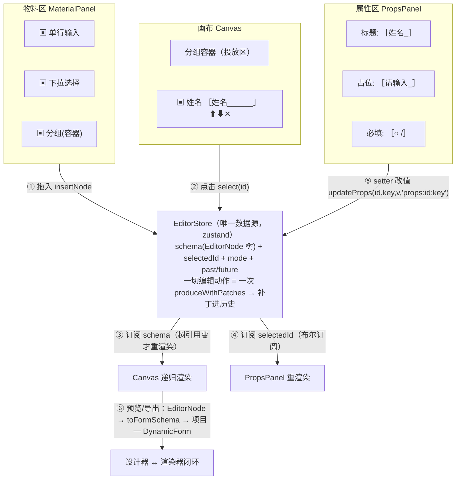

# 项目二：拖拽式表单设计器（Form Builder）复刻手册

> 一句话目标：复刻一个"运营拖组件、配属性，导出 schema"的三栏表单设计器——画布拖拽建结构、属性面板改配置、undo/redo 全局安全网、预览跑真实渲染器（与项目一闭环）。预计工期：2 周。前置要求：已完成《[00-公共底座复刻手册](00-公共底座-复刻手册.md)》（dnd-kit、immer patches）与《[01-Schema 动态表单复刻手册](01-项目一-Schema-动态表单-复刻手册.md)》（属性面板直接复用其引擎）。学习大纲版讲解见 [3. 拖拽式表单设计器](../react-进阶大纲-复杂场景/11-3-拖拽式表单设计器-Form-Builder-2-周.md)。

角色分工是理解本章的钥匙：**运营**负责"搭"（拖组件、配属性），**开发者**负责"撑"（做物料、做渲染器）。判断做得好不好，就看运营能否完全不碰代码、从零搭出一份能提交的表单。

## 0. 最终效果与验收清单

- [ ] 三栏工作台：物料区（分组展示可拖物料）／画布（递归渲染 + 编辑壳）／属性面板（随选中动态生成）
- [ ] 拖入：物料拖到容器投放区/节点前后正确插入；**空容器也能接收拖放**（独立 droppable）
- [ ] 排序与移动：同容器内拖拽换位（arrayMove）；拖到另一容器 = 摘出再插入
- [ ] 编辑态组件 inert：select 不弹下拉、date 不弹日历、点击 = 选中（pointer-events: none + 捕获拦截双防线）
- [ ] 选中态：outline + 类型角标 + 悬浮操作条（复制/删除/上移/下移）；点空白取消选中
- [ ] Setter 自举：属性面板本身就是一张用项目一引擎渲染的 schema 表单（options/expression 等自定义 widget 可用）
- [ ] undo/redo：Cmd+Z / Cmd+Shift+Z；setter 连续输入**一次撤销整词回退**（mergeKey 300ms 合并）；结构操作独立成条
- [ ] 快捷键：Delete 删除、Cmd+D 复制选中节点
- [ ] 预览：EditorNode 树 → toFormSchema → 项目一渲染器真实运行，可填可校验可提交
- [ ] 导入/导出：schema JSON 文件双向；导出文件可直接喂给项目一 `DynamicForm`

## 1. 架构总览



两条铁律：

1. **单一数据源**：一切编辑动作（拖入/删除/排序/改属性）都是对 EditorStore 中 schema 树的一次 produce 更新；画布与属性面板不持有任何自己的状态。任何绕过 store 的直改 DOM 都是 undo 管不到的盲区。
2. **两种 schema**：设计器内部的 `EditorNode`（带 id/children/componentName，为编辑服务）与渲染器的 `FormSchema`（字段声明，为渲染服务）是两个协议，预览/导出时经 `toFormSchema` 转换。别用一份协议伺候两个主人。

技术选型：zustand（store）+ immer（补丁）+ @dnd-kit（三种拖放统一 DndContext）——全部复用底座，无新增依赖。

## 2. 数据模型与协议

**物料协议**（`designer/materials/types.ts`）——描述"一种可拖入画布的组件"的全部元信息：

```ts
import type { ReactNode } from 'react'
import type { OptionItem } from '../../chapter2/types'

/** Setter 种类：本质是"属性面板这张表单的字段类型"（复用项目一 FieldType 思想） */
export type SetterKind =
  | 'text' | 'textarea' | 'number' | 'switch' | 'select'
  | 'options'      // 选项编辑器（编辑下拉候选，自定义 widget）
  | 'expression'   // 表达式编辑（联动条件，自定义 widget）

export interface SetterDecl {
  /** 对应物料 props 的键名，如 'label' / 'placeholder' / 'required' */
  prop: string
  label: string
  setter: SetterKind
  setterProps?: {
    options?: OptionItem[]
    placeholder?: string
    min?: number
    max?: number
  }
  /** 该属性在面板里的显隐条件（求值上下文是 props，如 "required == true"） */
  visibleWhen?: string
  defaultValue?: unknown
}

export interface MaterialMeta {
  /** 物料唯一名，等于 EditorNode.componentName */
  name: string
  label: string
  icon: ReactNode
  /** 容器物料：可接收子节点（分组），画布上高亮投放区 */
  isContainer?: boolean
  /** 拖入画布时的初始 props */
  defaultProps: Record<string, unknown>
  /** 属性面板的声明（决定了面板长什么样——见 M6 自举） */
  setters: SetterDecl[]
}
```

**编辑器节点与初始树**：

```ts
// designer/materials/createNode.ts
export interface EditorNode {
  /** 节点稳定 id：React key、拖拽 id、选中定位全靠它，创建后永不改变 */
  id: string
  componentName: string
  props: Record<string, unknown>
  children?: EditorNode[]
}

export function createNodeFromMaterial(meta: MaterialMeta): EditorNode {
  const node: EditorNode = {
    id: globalThis.crypto.randomUUID(),
    componentName: meta.name,
    props: structuredClone(meta.defaultProps),   // 深拷贝！否则数组型 props（如 options）跨节点共享引用
  }
  if (meta.isContainer) node.children = []
  return node
}
```

物料注册表条目示例（input / select / number / switch / textarea / section 各一条，`section` 是容器物料，`isContainer: true`、`defaultProps: { label: '分组标题' }`）：见大纲第 3 章路线 1 的完整 registry，逐条照抄即可。

## 3. 复刻主线路径：里程碑 M1–M9

### M1 工程与物料库

**目标**：物料协议 + 注册表 + createNode 工厂 + 6 个基础物料就位。

**完整代码**：§2 的 types/createNode + 大纲第 3 章路线 1 的 materialRegistry（input/select/number/switch/textarea/section 六条）。注意 registry 是 `Record<string, MaterialMeta>` 开放结构——未来加物料零侵入。

**验证**：Console 打印 `materialRegistry`，六条齐全；连续两次 `createNodeFromMaterial(registry.select)` 得到的两个节点 `props.options` 是**不同引用**（`expect(a.props.options).not.toBe(b.props.options)`）。

**常见报错与修复**：

1. 拖两个"下拉选择"，编辑 A 的候选 B 也变了——`defaultProps` 浅拷贝/直接引用，两节点共享 options 数组。修复：`structuredClone(meta.defaultProps)`（上面代码已做）。
2. 物料图标/文案错位——registry 键与 `meta.name` 不一致。注册键必须等于 `name`（即 componentName 的查找键）。

### M2 EditorStore（唯一数据源 + 历史骨架）

**目标**：schema/selectedId/mode/past/future 五块状态 + insert/remove/duplicate/move/updateProps/select 六个 action，全部走 produceWithPatches。

**完整代码**：

```ts
// designer/store.ts
import { create } from 'zustand'
import { enablePatches, produceWithPatches, applyPatches, type Patch } from 'immer'
import type { EditorNode } from './materials/createNode'

enablePatches()   // immer v9+ 必须显式开启

export interface HistoryEntry {
  patches: Patch[]
  inversePatches: Patch[]
  /** 同一 mergeKey 且 300ms 内的操作合并为一条历史（setter 连续输入的关键，见 M7） */
  mergeKey?: string
  at: number
}

export type EditorMode = 'edit' | 'preview'

export interface EditorState {
  schema: EditorNode    // 根：{ id: 'root', componentName: 'FormRoot', children: [...] }
  selectedId: string | null
  mode: EditorMode
  past: HistoryEntry[]
  future: HistoryEntry[]

  select(id: string | null): void
  setMode(m: EditorMode): void
  insertNode(containerId: string, node: EditorNode, index?: number): void
  removeNode(id: string): void
  duplicateNode(id: string): void
  moveNodeByStep(id: string, dir: -1 | 1): void
  moveNode(id: string, toContainerId: string, toIndex: number): void
  updateProps(id: string, key: string, value: unknown, mergeKey?: string): void
  undo(): void
  redo(): void
}

/** 树工具：在 draft 上定位/操作节点（immer draft 可变操作） */
function findNode(root: EditorNode, id: string): EditorNode | undefined {
  if (root.id === id) return root
  for (const c of root.children ?? []) {
    const hit = findNode(c, id)
    if (hit) return hit
  }
  return undefined
}
function findParent(root: EditorNode, id: string): EditorNode | undefined {
  for (const c of root.children ?? []) {
    if (c.id === id) return root
    const hit = findParent(c, id)
    if (hit) return hit
  }
  return undefined
}

export const useEditorStore = create<EditorState>()((set, get) => {
  /** 所有变更的统一入口：mutate 内写可变代码，补丁自动入历史（合并规则见 M7） */
  const mutate = (label: string, mergeKey: string | undefined, recipe: (draft: EditorNode) => void) => {
    const { schema, past } = get()
    const [next, patches, inversePatches] = produceWithPatches(schema, recipe)
    if (patches.length === 0) return
    const MERGE_WINDOW = 300
    const last = past[past.length - 1]
    const mergeable = !!mergeKey && !!last && last.mergeKey === mergeKey
      && Date.now() - last.at < MERGE_WINDOW
    set({
      schema: next,
      past: mergeable
        ? [...past.slice(0, -1), {
            // 顺序规则：正补丁按时间序拼；逆补丁新的在前（undo 先回滚最新变更）——见 M7 图解
            patches: [...last.patches, ...patches],
            inversePatches: [...inversePatches, ...last.inversePatches],
            mergeKey, at: Date.now(),
          }]
        : [...past, { patches, inversePatches, mergeKey, at: Date.now() }],
      future: [],   // 新操作清空重做分支
    })
  }

  return {
    schema: { id: 'root', componentName: 'FormRoot', children: [] },
    selectedId: null,
    mode: 'edit',
    past: [],
    future: [],

    select: (id) => set({ selectedId: id }),
    setMode: (m) => set({ mode: m }),

    insertNode: (containerId, node, index) =>
      mutate('insert', undefined, (d) => {
        const container = findNode(d, containerId)
        if (!container?.children) return
        const i = index ?? container.children.length
        container.children.splice(i, 0, node)
      }),

    removeNode: (id) =>
      mutate('remove', undefined, (d) => {
        const parent = findParent(d, id)
        if (!parent?.children) return
        parent.children = parent.children.filter((c) => c.id !== id)
      }),

    duplicateNode: (id) =>
      mutate('duplicate', undefined, (d) => {
        const parent = findParent(d, id)
        if (!parent?.children) return
        const i = parent.children.findIndex((c) => c.id === id)
        if (i < 0) return
        // 深拷贝 + 递归换 id：新旧节点 id 绝不能撞（撤销与 key 都依赖唯一性）
        const clone = JSON.parse(JSON.stringify(parent.children[i])) as EditorNode
        const reId = (n: EditorNode) => {
          n.id = globalThis.crypto.randomUUID()
          n.children?.forEach(reId)
        }
        reId(clone)
        parent.children.splice(i + 1, 0, clone)
      }),

    moveNodeByStep: (id, dir) =>
      mutate('move', undefined, (d) => {
        const parent = findParent(d, id)
        if (!parent?.children) return
        const i = parent.children.findIndex((c) => c.id === id)
        const j = i + dir
        if (i < 0 || j < 0 || j >= parent.children.length) return
        ;[parent.children[i], parent.children[j]] = [parent.children[j], parent.children[i]]
      }),

    moveNode: (id, toContainerId, toIndex) =>
      mutate('move', undefined, (d) => {
        const parent = findParent(d, id)
        const target = findNode(d, toContainerId)
        if (!parent?.children || !target?.children) return
        // 不允许把容器拖进自己的子孙（形成环）
        if (isDescendantOrSelf(target, id)) return
        const i = parent.children.findIndex((c) => c.id === id)
        const [node] = parent.children.splice(i, 1)
        target.children.splice(toIndex, 0, node)
      }),

    updateProps: (id, key, value, mergeKey) =>
      mutate('props', mergeKey, (d) => {
        const node = findNode(d, id)
        if (node) node.props[key] = value
      }),

    undo: () => {
      const { schema, past, future } = get()
      const last = past[past.length - 1]
      if (!last) return
      set({
        schema: applyPatches(schema, last.inversePatches),
        past: past.slice(0, -1),
        future: [last, ...future],
      })
    },
    redo: () => {
      const { schema, past, future } = get()
      const next = future[0]
      if (!next) return
      set({
        schema: applyPatches(schema, next.patches),
        past: [...past, next],
        future: future.slice(1),
      })
    },
  }
})

function isDescendantOrSelf(node: EditorNode, id: string): boolean {
  if (node.id === id) return true
  return (node.children ?? []).some((c) => isDescendantOrSelf(c, id))
}
```

**验证**：vitest 直调 store——insert 两个节点后 `schema.children.length === 2`；undo 一次回到 1；redo 回到 2；remove 第一个后 children 正确；duplicate 后两节点 id 不同。

**常见报错与修复**：

1. undo 后 id 撞车/React key 重复——duplicate 没递归换 id。修复：`reId` 递归重发（上面已含）。
2. `produceWithPatches` 补丁恒为空——`enablePatches()` 没在最前面调用。
3. moveNode 把容器拖进自己子孙——树成环，递归栈溢出。修复：`isDescendantOrSelf` 前置拦截（上面已含）。

### M3 画布渲染与编辑壳（pointer-events 双防线）

**目标**：Canvas 递归渲染 EditorNode；编辑模式下组件内容 inert，遮罩接管点击/拖拽。

**完整代码**：

```tsx
// designer/canvas/EditableShell.tsx —— 节点编辑壳：sortable + 选中 + 遮罩
import { memo } from 'react'
import { useSortable } from '@dnd-kit/sortable'
import { CSS } from '@dnd-kit/utilities'
import { useEditorStore } from '../store'
import type { EditorNode } from '../materials/createNode'

export const EditableShell = memo(function EditableShell({
  node, children,
}: { node: EditorNode; children: React.ReactNode }) {
  const selected = useEditorStore((s) => s.selectedId === node.id)  // 布尔订阅：只有新旧选中两个节点重渲染
  const select = useEditorStore((s) => s.select)
  const editing = useEditorStore((s) => s.mode === 'edit')

  const { attributes, listeners, setNodeRef, setActivatorNodeRef, transform, transition, isDragging } =
    useSortable({ id: node.id, data: { kind: 'node' } })

  return (
    <div
      ref={setNodeRef}
      className={'editable-node' + (selected ? ' editable-node--selected' : '')
                 + (isDragging ? ' editable-node--dragging' : '')}
      style={{ transform: CSS.Transform.toString(transform), transition }}
    >
      {/* 组件内容：编辑模式不吃指针事件（第 1 道防线在此落地） */}
      <div className="editable-node__content">{children}</div>

      {/* 遮罩层：仅编辑模式渲染，显式恢复 pointer-events，接管点击/拖拽（拖拽把手=遮罩本身） */}
      {editing && (
        <div
          ref={setActivatorNodeRef}
          className="editable-node__mask"
          style={{ pointerEvents: 'auto' }}
          {...attributes}
          {...listeners}
          onClick={(e) => { e.stopPropagation(); select(node.id) }}
        />
      )}
    </div>
  )
})
```

```tsx
// designer/canvas/Canvas.tsx —— 递归渲染
export function Canvas() {
  const schema = useEditorStore((s) => s.schema)
  const select = useEditorStore((s) => s.select)
  return (
    <main className="canvas" onClick={() => select(null)}>   {/* 点空白取消选中 */}
      <CanvasChildren node={schema} />
    </main>
  )
}

function CanvasChildren({ node }: { node: EditorNode }) {
  const ids = (node.children ?? []).map((c) => c.id)
  return (
    <SortableArea ids={ids}>
      {node.children?.map((child) => (
        <EditableShell key={child.id} node={child}>
          <NodePreview node={child}>
            {materialRegistry[child.componentName]?.isContainer && <CanvasChildren node={child} />}
          </NodePreview>
        </EditableShell>
      ))}
    </SortableArea>
  )
}

/** 组件 inert 预览：编辑模式给内容层 pointer-events:none（CSS） */
function NodePreview({ node, children }: { node: EditorNode; children?: React.ReactNode }) {
  const editing = useEditorStore((s) => s.mode === 'edit')
  return (
    <div style={editing ? { pointerEvents: 'none', userSelect: 'none' } : undefined}>
      {/* 按 componentName 渲染只读预览（label/placeholder/options 等 props 展示） */}
      <MaterialPreview node={node} />
      {children}
    </div>
  )
}
```

第 2 道防线（捕获拦截，治漏网——第三方库挂 document 的监听、键盘焦点）：Canvas 容器上 `onClickCapture={(e) => { if (editing) e.stopPropagation() }}`，并按需同理拦截 focus 事件。

**验证**：手动拖入一个 select 预览，点击它 = 选中（下拉不弹出）；点画布空白 = 取消选中；preview 模式下组件恢复可交互。

**常见报错与修复**：

1. 编辑模式点 select 弹出下拉——content 层忘了 `pointer-events: none` 或遮罩没盖满。修复：遮罩绝对定位铺满节点、`z-index` 高于内容。
2. 点击总是选不中/总是取消选中——事件冒泡顺序问题：遮罩 `stopPropagation` 后再 select；画布空白点击才走取消。注意 React 17+ 事件委托到 root，仍按冒泡模型处理。

### M4 三种拖放语义（一套 DndContext）

**目标**：物料区→画布插入、同容器排序、跨容器移动，全部在 onDragEnd 统一解析。

三种拖放的语义表：

| 拖放 | active | over | 语义 |
|---|---|---|---|
| 物料区 → 画布 | `material:xxx` | 容器投放区或节点 | 新建节点插入 schema |
| 画布内排序 | 节点（useSortable） | 兄弟节点 | 同容器 arrayMove |
| 跨容器移动 | 节点（useSortable） | 容器投放区/节点 | 摘出再插入目标容器 |

**完整代码**：

```tsx
// designer/panels/MaterialPanel.tsx —— 物料区：每项 draggable
import { useDraggable } from '@dnd-kit/core'

function MaterialItem({ meta }: { meta: MaterialMeta }) {
  const { setNodeRef, listeners, isDragging } = useDraggable({
    id: `material:${meta.name}`,
    data: { kind: 'material', meta },   // data 随拖拽携带，onDragEnd 里取回
  })
  return (
    <div ref={setNodeRef} {...listeners}
         className={'material-item' + (isDragging ? ' material-item--dragging' : '')}>
      <span className="material-item__icon">{meta.icon}</span>
      <span>{meta.label}</span>
    </div>
  )
}
```

```tsx
// designer/canvas/ContainerDropZone.tsx —— 容器投放区（空容器也能接收拖放的关键）
import { useDroppable } from '@dnd-kit/core'

export function ContainerDropZone({ node, children }: { node: EditorNode; children?: React.ReactNode }) {
  const { setNodeRef, isOver } = useDroppable({
    id: `container:${node.id}`,
    data: { kind: 'container', containerId: node.id },
  })
  const empty = !(node.children ?? []).length
  return (
    <div ref={setNodeRef}
         className={'drop-zone' + (isOver ? ' drop-zone--over' : '') + (empty ? ' drop-zone--empty' : '')}>
      {children}
      {empty && <div className="drop-zone__hint">拖入组件到这里</div>}
    </div>
  )
}
```

为什么容器要独立 droppable：SortableContext 只对 items 里的节点生效，**空容器没有任何 sortable 项**，没有独立 droppable 就无法接收任何拖放——"空分组拖不进东西"是新手实现最常见的断路。

```tsx
// designer/DndHost.tsx —— 统一 onDragEnd 解析三种语义
import { DndContext, PointerSensor, KeyboardSensor, useSensor, useSensors,
         closestCenter, type DragEndEvent } from '@dnd-kit/core'

export function DndHost({ children }: { children: React.ReactNode }) {
  const sensors = useSensors(
    useSensor(PointerSensor, { activationConstraint: { distance: 5 } }),
    useSensor(KeyboardSensor),
  )
  return (
    <DndContext sensors={sensors} collisionDetection={closestCenter} onDragEnd={onDragEnd}>
      {children}
    </DndContext>
  )
}

function onDragEnd({ active, over }: DragEndEvent) {
  if (!over) return
  const st = useEditorStore.getState()
  const aData = active.data.current as { kind: string; meta?: MaterialMeta } | undefined
  const oData = over.data.current as
    | { kind: 'container'; containerId: string }
    | { kind: 'node' }
    | undefined
  const overId = String(over.id)

  // ── 语义 1：物料 → 画布：新建插入 ──
  if (aData?.kind === 'material' && aData.meta) {
    const node = createNodeFromMaterial(aData.meta)
    if (oData?.kind === 'container') {
      st.insertNode(oData.containerId, node)                 // 拖到容器空白：追加末尾
    } else {
      const parent = findParentOf(st.schema, overId)         // 拖到节点上：插到它前面
      const idx = parent ? indexOfChild(st.schema, parent.id, overId) : undefined
      if (parent) st.insertNode(parent.id, node, idx)
      else st.insertNode('root', node)                       // 兜底：根容器末尾
    }
    st.select(node.id)
    return
  }

  // ── 语义 2/3：画布节点拖动（排序 or 跨容器）──
  if (aData?.kind === 'node') {
    const activeId = String(active.id)
    if (activeId === overId) return
    if (oData?.kind === 'container') {
      // 跨容器：追加到目标容器末尾（toIndex = 目标当前孩子数）
      const target = findNode(st.schema, oData.containerId)
      st.moveNode(activeId, oData.containerId, target?.children?.length ?? 0)
    } else {
      const parent = findParentOf(st.schema, overId)
      const activeParent = findParentOf(st.schema, activeId)
      if (parent && activeParent?.id === parent.id) {
        // 同容器：arrayMove
        const from = indexOfChild(st.schema, parent.id, activeId)
        const to = indexOfChild(st.schema, parent.id, overId)
        st.moveNode(activeId, parent.id, to + (from < to ? 1 : 0))   // 插到目标后面
      } else if (parent) {
        const to = indexOfChild(st.schema, parent.id, overId)
        st.moveNode(activeId, parent.id, to)
      }
    }
  }
}
```

（`findParentOf/indexOfChild` 为 store 同款树工具的只读版本，可从 store.ts 导出复用。）

**验证**：空分组拖入一个 input（空容器投放区高亮）；同容器拖拽换位；把节点拖进另一分组；把分组拖进自己的子分组应被拒绝（无反应且树不环）。

**常见报错与修复**：

1. 嵌套容器"拖到哪个容器里"判定错误——closestCenter 命中外层容器而非视觉上的内层。修复：自定义 collisionDetection：`rectIntersection` + droppable data 带 `priority`（内层容器优先）；或只允许"节点 over + 容器空白 over"两类目标，命中多个时取与拖拽点矩形交集面积最大者。
2. 拖拽 ghost 与落点偏移——transform 动画与 Droppable 测量时机冲突。给 DndContext 加 `measuring={{ droppable: { strategy: MeasuringStrategy.Always } }}`。
3. 拖拽期间画布滚动落点漂移——同上 measuring 修复 + 滚动容器避免 transform 动画作用于容器本身。

### M5 选中态与悬浮操作条

**目标**：outline + 类型角标 + 操作条（复制/删除/上移/下移），全部走 store action。

**完整代码**（EditableShell 遮罩层扩展）：

```tsx
{editing && selected && (
  <div className="editable-node__badge">{materialRegistry[node.componentName]?.label}</div>
)}
{editing && selected && (
  <div className="editable-node__actions" onClick={(e) => e.stopPropagation()}>
    <button aria-label="上移" onClick={() => moveNodeByStep(node.id, -1)}>↑</button>
    <button aria-label="下移" onClick={() => moveNodeByStep(node.id, 1)}>↓</button>
    <button aria-label="复制" onClick={() => duplicateNode(node.id)}>⧉</button>
    <button aria-label="删除" onClick={() => removeNode(node.id)}>✕</button>
  </div>
)}
```

（moveNodeByStep/duplicateNode/removeNode 均为 `useEditorStore((s) => s.xxx)` 取 action。）删除后选中态处理：removeNode 后若 `selectedId === id` 则 `select(null)`（在 UI 层处理或封装进 action）。

**验证**：选中节点显示角标与操作条；四个按钮功能正确且各自可被 Cmd+Z 撤销；删除选中节点后无悬空选中态。

**常见报错与修复**：

1. 撤销后选中悬空——被删节点恢复但 selectedId 已清/指向别处。修复：undo 后校验 selectedId 对应节点是否存在，不存在则置 null；或把选中态视为派生 UI 态不入历史（推荐后者：选中不改 schema，就不该产生补丁）。

### M6 Setter 体系（属性面板自举）

**目标**：属性面板 = 用项目一的动态表单引擎渲染 `setters` 声明——**面板本身就是一张 schema 表单（自举闭环）**。

**完整代码**：

```ts
// designer/panels/settersToSchema.ts —— SetterDecl[] → 项目一 FieldSchema[]
import type { FieldSchema, FormSchema } from '../../chapter2/types'
import type { SetterDecl } from '../materials/types'

/** SetterKind → 项目一 FieldType 的映射；options/expression 两个自定义 widget
    用项目一的 widgetRegistry 注册（registry 是开放的，正是底座 M3 的设计红利） */
export function settersToSchema(setters: SetterDecl[], props: Record<string, unknown>): FormSchema {
  return {
    formId: 'props-panel',
    version: '1.0.0',
    fields: setters.map((s) => {
      const base = { name: s.prop, label: s.label, visibleWhen: s.visibleWhen }
      switch (s.setter) {
        case 'text': return { type: 'input', ...base, placeholder: s.setterProps?.placeholder } as FieldSchema
        case 'textarea': return { type: 'textarea', ...base } as FieldSchema
        case 'number': return { type: 'number', ...base, min: s.setterProps?.min, max: s.setterProps?.max } as FieldSchema
        case 'switch': return { type: 'switch', ...base } as FieldSchema
        case 'select': return { type: 'select', ...base,
          options: s.setterProps?.options ?? [] } as FieldSchema
        case 'options': return { type: 'options', ...base } as FieldSchema   // 自定义 widget：选项编辑器
        case 'expression': return { type: 'expression', ...base } as FieldSchema // 自定义 widget：表达式编辑
        default: return { type: 'input', ...base } as FieldSchema
      }
    }),
  }
}
```

```tsx
// designer/panels/PropsPanel.tsx
import { FormProvider, useFormStore } from '../../chapter2/FormProvider'
import { SchemaNode } from '../../chapter2/SchemaNode'
import { settersToSchema } from './settersToSchema'
import { materialRegistry } from '../materials/registry'

export function PropsPanel() {
  const selectedId = useEditorStore((s) => s.selectedId)
  const node = useEditorStore((s) => (s.selectedId ? findNodeById(s.schema, s.selectedId) : null))
  const updateProps = useEditorStore((s) => s.updateProps)
  const meta = node ? materialRegistry[node.componentName] : undefined

  if (!node || !meta) return <aside className="props-panel">未选中节点</aside>

  const schema = settersToSchema(meta.setters, node.props)
  return (
    <aside className="props-panel">
      <h3>{meta.label} 属性</h3>
      <FormProvider schema={schema} initial={node.props}>
        {/* setter 改值 → mergeKey 合并 → 补丁入历史（M7 的关键接线） */}
        <PropsSync nodeId={node.id} />
      </FormProvider>
    </aside>
  )
}

/** 把面板表单的 setValue 桥接到 EditorStore.updateProps */
function PropsSync({ nodeId }: { nodeId: string }) {
  const updateProps = useEditorStore((s) => s.updateProps)
  const setValue = useFormStore((s) => s.setValue)
  // 面板内每个字段的 onChange 走桥接组件；简化实现：自定义 FieldShell 拦截 onChange，
  // 调 updateProps(nodeId, key, v, `props:${nodeId}:${key}`) 而不是面板自己的 store
  return null
}
```

桥接要点：面板表单不真正持有数据（初始值 = node.props 的快照），每次 setter 变更直接调 `updateProps(nodeId, key, value, 'props:' + nodeId + ':' + key)`——mergeKey 让连续输入合并成一条历史。面板值与画布值的同步方向是**单向的**（面板 → EditorStore → 画布重渲染），面板自身不回写，避免双向同步成环；选中变化时用 `key={selectedId}` 重建 FormProvider 实例。

**验证**：选中 input 节点，面板出现标题/占位/必填/最大长度/显隐条件五行；改"标题"画布即时更新；`required == true` 类 visibleWhen 条件生效（配一个试）；自定义 options/expression setter 可编辑（widgetRegistry 注册后）。

**常见报错与修复**：

1. 面板改值画布不动——桥接写反（写进了面板自己的 store）。修复：onChange 必须落到 `updateProps`。
2. 切换选中节点面板显示旧数据——FormProvider 实例未重建。修复：`<FormProvider key={selectedId} ...>`。

### M7 undo/redo 补丁合并与快捷键

**目标**：mergeKey 合并窗口生效（整词回退）+ 全局快捷键。

合并顺序规则（最易写错的一行，用"先输入 'a' 再改成 'ab'"图解）：

```text
编辑1：patches: [label: '' → 'a']     inverse: [label: 'a' → '']
编辑2：patches: [label: 'a' → 'ab']   inverse: [label: 'ab' → 'a']
合并后：
patches:        [编辑1.patches, 编辑2.patches]     → redo 按时间序：'' → 'a' → 'ab' ✓
inversePatches: [编辑2.inverse, 编辑1.inverse]     → undo 先应用新的逆：'ab' → 'a' → '' ✓
（若 inverse 也按时间序：undo 会得 'a' 而不是 ''——错）
```

immer 的 `applyPatches` 按数组顺序执行，所以**逆补丁必须新在前**。M2 的 mutate 已实现该规则。

```ts
// designer/useHotkeys.ts
import { useEffect } from 'react'
import { useEditorStore } from './store'

export function useEditorHotkeys() {
  useEffect(() => {
    const onKey = (e: KeyboardEvent) => {
      const mod = e.metaKey || e.ctrlKey
      const st = useEditorStore.getState()
      // 输入框内的按键不拦截（除 Cmd+Z：输入中的撤销交给面板 mergeKey 逻辑）
      if (mod && e.key.toLowerCase() === 'z') {
        e.preventDefault()
        e.shiftKey ? st.redo() : st.undo()
        return
      }
      const target = e.target as HTMLElement
      if (target.tagName === 'INPUT' || target.tagName === 'TEXTAREA') return
      if ((e.key === 'Delete' || e.key === 'Backspace') && st.selectedId) {
        e.preventDefault(); st.removeNode(st.selectedId)
      }
      if (mod && e.key.toLowerCase() === 'd' && st.selectedId) {
        e.preventDefault(); st.duplicateNode(st.selectedId)
      }
    }
    window.addEventListener('keydown', onKey)
    return () => window.removeEventListener('keydown', onKey)
  }, [])
}
```

**验证**：三个手测用例——(1) setter 连续输入"员工姓名"，一次 Cmd+Z 整词回退；(2) 拖拽移动节点，Cmd+Z 回原位、Cmd+Shift+Z 又移过去；(3) 输入"姓名"后立刻删节点再 Cmd+Z 两次：第一次恢复节点（连带 props），第二次回退输入（两条独立历史互不干扰）。

**常见报错与修复**：

1. 撤销逐字符——updateProps 没传 mergeKey 或合并窗口判断漏了 `last.mergeKey === mergeKey`。
2. 合并后 undo 结果差一步——逆补丁拼接顺序写反（见上图解）。
3. 300ms 手感不对——击键间隔因人而异，把 MERGE_WINDOW 提成常量可调（200–500ms 试验）。

### M8 预览与导入导出（toFormSchema 闭环）

**目标**：EditorNode 树 → FormSchema → 项目一渲染器真实运行；JSON 导入导出。

**完整代码**：

```ts
// designer/preview/toFormSchema.ts
import type { EditorNode } from '../materials/createNode'
import { materialRegistry } from '../materials/registry'
import type { FieldSchema, FormSchema, OptionItem } from '../../chapter2/types'

export function toFormSchema(root: EditorNode): FormSchema {
  return { formId: 'designed-form', version: '1.0.0', fields: nodeToFields(root) }
}

function nodeToFields(container: EditorNode): FieldSchema[] {
  const out: FieldSchema[] = []
  for (const child of container.children ?? []) {
    const meta = materialRegistry[child.componentName]
    const p = child.props
    if (meta?.isContainer) {
      out.push({
        type: 'group',
        name: `group_${child.id.slice(0, 6)}`,   // 布局节点 name 只需唯一，不进数据
        label: String(p.label ?? meta.label),
        fields: nodeToFields(child),
      })
    } else {
      out.push(leafToField(child))
    }
  }
  return out
}

function leafToField(node: EditorNode): FieldSchema {
  const p = node.props
  const base = {
    name: `field_${node.id.slice(0, 6)}`,   // 导出时按 id 生成字段名；需要语义化名就给物料加 fieldName setter
    label: String(p.label ?? ''),
    required: p.required === true,
    placeholder: typeof p.placeholder === 'string' ? p.placeholder : undefined,
    visibleWhen: typeof p.visibleWhen === 'string' && p.visibleWhen ? p.visibleWhen : undefined,
  }
  switch (node.componentName) {
    case 'input': return { type: 'input', ...base,
      maxLength: typeof p.maxLength === 'number' ? p.maxLength : undefined }
    case 'textarea': return { type: 'textarea', ...base }
    case 'number': return { type: 'number', ...base,
      min: typeof p.min === 'number' ? p.min : undefined,
      max: typeof p.max === 'number' ? p.max : undefined }
    case 'switch': return { type: 'switch', ...base }
    case 'select': return { type: 'select', ...base,
      options: Array.isArray(p.options) ? (p.options as OptionItem[]) : [] }
    default: return { type: 'input', ...base }
  }
}
```

```tsx
// designer/preview/PreviewPanel.tsx
import { useMemo } from 'react'
import { useEditorStore } from '../store'
import { toFormSchema } from './toFormSchema'
import { FormProvider } from '../../chapter2/FormProvider'
import { SchemaNode } from '../../chapter2/SchemaNode'

export function PreviewPanel() {
  const schema = useEditorStore((s) => s.schema)
  // 分屏预览：schema 变化即重转换（树引用稳定，无谓重渲染已被订阅挡住）
  const formSchema = useMemo(() => toFormSchema(schema), [schema])
  return (
    <FormProvider schema={formSchema}>
      <form className="preview-form">
        {formSchema.fields.map((f) => (
          <SchemaNode key={f.name} schema={f} path={f.name} />
        ))}
      </form>
    </FormProvider>
  )
}
```

导入/导出：导出 = `Blob([JSON.stringify(toFormSchema(schema), null, 2)])` 下载；导入 = 文件读取 → JSON.parse → 结构校验（children/componentName 逐层检查）→ 直接作为 EditorStore.schema 装载（或反向 fromFormSchema，按需实现）。

**验证**：拖出"分组 > input + select + 开关"，预览模式真实可填可校验；导出 JSON 后新建会话导入，画布还原一致；把导出文件直接喂给项目一的 `DynamicForm` 渲染结果一致（设计器↔渲染器解耦的实证）。

**常见报错与修复**：

1. 预览报"未注册的字段类型"——自定义 setter 类型（options/expression）混进了 FormSchema。toFormSchema 只输出渲染协议认得的类型；自定义 setter 是面板的事，不是渲染的事。
2. 导入后画布空白——导入的 JSON 是 FormSchema（渲染协议）而不是 EditorNode 树。两种 JSON 不要混；文件里带 `formId`/`version` 的按渲染协议处理，带 `componentName` 的按编辑树处理。

### M9 联调验收

**目标**：§0 十条逐条打勾；三分钟"运营冒烟测试"——不碰代码，从空画布搭出"员工信息表单（分组 + 5 字段 + 一个联动显隐）"，预览提交成功。

**验证清单**：见 §0。重点回归三个易碎点：空容器拖入、undo 三用例（M7）、导出文件在项目一渲染。

**常见报错与修复**：

1. 冒烟测试中运营迷惑"拖到节点上是插前面还是后面"——落点指示不明。给拖拽 hover 目标加插入位置指示线（上边线=插前，下边线=插后）。
2. 大画布（50+ 节点）拖拽掉帧——EditableShell 的 memo 失效（props 里传了每次新建的回调）。用 store action 直取（`useEditorStore.getState()`）或稳定引用。

## 4. 进阶扩展（可选）

1. **栅格布局物料**：isContainer + `columns` prop 的 grid 容器，子节点带 `span`；导出映射到项目一的 grid 字段。
2. **多选与框选**：selectedIds: Set，Shift 点选/画布拖框批量删除、批量移动——历史条目按"一次批量操作一条"。
3. **右键菜单**：contextmenu 事件在遮罩上拦截，菜单项复用操作条 actions。
4. **schema 快照对比**：导出时附带 `EditorNode` 树的 hash，协作场景下检测"别人改过没"。
5. **远程物料**：materialRegistry 运行时注册（底座 §4 远程物料方案），设计器自动出现新物料。

## 5. 复刻坑清单

1. **defaultProps 引用共享**：两个 select 的 options 联动变化。实例化必须 `structuredClone`。
2. **空容器接不到拖放**：SortableContext 只管 items。容器必须有自己的 `useDroppable` 投放区。
3. **编辑模式组件自身行为触发**（select 弹下拉/链接跳页）：`pointer-events: none` 治本 + 捕获拦截兜底（第三方库挂 document 的监听）。
4. **嵌套容器 drop 判定错误**：closestCenter 命中外层。自定义 collisionDetection + 内层优先（§M4 修法）。
5. **undo 逐字符**：updateProps 必须带 `props:id:key` 形态的 mergeKey + 300ms 窗口合并。
6. **合并后撤销差一步**：逆补丁拼接顺序——新逆在前（M7 图解）。
7. **duplicate 后 id 撞车**：克隆必须递归换 id（撤销与 key 都依赖唯一性）。
8. **容器拖进自己的子孙**：树成环栈溢出。moveNode 前置 `isDescendantOrSelf` 拦截。
9. **选中态入历史**：选中不改 schema，不该产生补丁；undo 恢复节点后校验 selectedId 存在性。
10. **面板与画布双向同步成环**：面板→EditorStore 单向；选中切换用 key 重建面板实例。
11. **两种 schema 混用**：EditorNode（编辑）与 FormSchema（渲染）各自完整，仅靠 toFormSchema 单向翻译。
12. **拖拽期间滚动落点漂移**：DndContext measuring Always + 滚动容器不做 transform 动画。

## 6. 与底座/其他项目的衔接

| 依赖 | 来源 | 用法 |
|---|---|---|
| dnd-kit 内核 | 底座 M8 | 三种拖放语义在 SortableList 基础上扩展出 ContainerDropZone 与统一 onDragEnd |
| immer patches 历史 | 底座 M7 | EditorStore 的 mutate = 底座 createHistoryStore 思想的内联版（多了 mergeKey） |
| 注册表模式 | 底座 M3 | materialRegistry + setter 的 widgetRegistry 两张开放表 |
| 动态表单引擎 | 项目一全部 | PropsPanel = settersToSchema + FormProvider/SchemaNode 原样复用；预览 = toFormSchema + DynamicForm |

对后续项目：**项目三**复用"三栏工作台 + EditorStore + dnd 语义表"骨架（画布换布局引擎）；**项目五**把本项目的设计态整体接入平台（页面协议的表单区块由本设计器产出），导出的 FormSchema 即平台页面协议的组成部分。

---

## 附：ASCII 图替换清单

本文档图形化改版，原 ASCII 字符图与 Mermaid 图表对应关系如下：

| 原图位置 / 标题 | 处理结果 |
| --- | --- |
| §1 架构总览：三栏工作台（物料区/画布/属性区）与 EditorStore 的 ①–⑥ 数据流闭环 | 替换为 flowchart TD（三栏各用一个 subgraph） |
