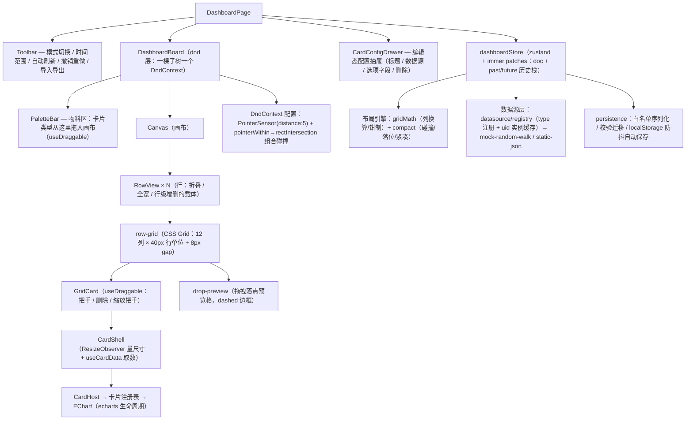

# 项目三：Grafana 式拖拽仪表盘复刻手册

> 一句话目标：从零复刻一个"编辑态拖拽配布局、查看态定时刷数据"的监控大盘——自研行-列-高度三层布局引擎 + dnd-kit 拖拽层 + echarts 适配层 + 可插拔数据源层，布局协议带版本号、可持久化、可撤销。预计工期：2 周。前置要求：已完成《00-公共底座-复刻手册》；若未完成，按本手册 §6.1 的底座复用清单先补三块——组件注册表（00 手册 1.2，即进阶大纲 04 号文件）、Undo/Redo 的 immer patches 方案（07 号文件）、dnd-kit 拖拽原理（08 号文件）；大 Schema 树性能（09 号文件）可在 M10 联调前再读。

## 0. 最终效果与验收清单

全部打勾即复刻完成，每条都给出可运行的验证动作。

- [ ] **物料拖入**：编辑态从物料区拖"折线图/柱状图/单值卡片"进任意行，松手落在虚线预览格并自动紧凑。验证：切编辑态 → 拖入 → 卡片出现，Console 无报错。
- [ ] **拖拽换位**：卡片行内换位、跨行拖拽；拖动全程有落点预览；拖走后源行其余卡片上浮补洞。验证：把 QPS 卡拖到第二行 → 松手落位 → Cmd+Z 一次回原位。
- [ ] **碰撞与 compact**：把一张卡拖到另一张正上方，被压的卡自动落到障碍物下方空位，不留重叠。验证：拖一张宽卡横跨两张已有卡 → 松手后三者无重叠。
- [ ] **调整大小**：右下角把手缩放，小于 minW/minH 时被钳制。验证：把单值卡缩到最小宽度（2 列）后继续向内拖，宽度不再变化。
- [ ] **行折叠与全宽行**：行头箭头折叠/展开；"全宽"按钮让行体铺满视口两侧。验证：折叠后只剩行头，展开恢复；全宽行两贴边。
- [ ] **图表与数据源切换**：echarts 正常渲染，窗口/栅格缩放自适应；配置抽屉切换数据源立即按新源重查，查不到显示"暂无数据"。
- [ ] **时间范围与自动刷新**：切"最近 15 分钟"全卡重查且旧图不闪 loading；5s 刷新在 Network 每拍一批请求；切走标签页请求停止，切回立即补一刷且曲线接得上。
- [ ] **布局持久化**：改动后刷新页面布局恢复；导出 JSON 与协议字段一一对应（无运行时内部字段）；导入坏文件得到中文报错或被自动清洗，不白屏。
- [ ] **undo/redo**：拖拽/缩放/删除/折叠各产生一条历史；抽屉连续输入合并为一条；Cmd+Z / Cmd+Shift+Z 可用态正确。
- [ ] **响应式降级**：画布 <1080px 降 8 列、<720px 降 4 列、<480px 单列堆叠；降级态禁止拖拽（防把 12 列基准坐标写坏）。
- [ ] **性能基线**：Profiler 里一个刷新 tick 只有数据变化的卡片组件亮起；拖拽跟手无明显掉帧。

## 1. 架构总览

### 1.1 模块图



五个模块的职责边界：**布局引擎**只管"在哪"（坐标换算、碰撞、紧凑，纯函数无 React）；**卡片注册表**只管"是什么"（type → 组件 + 元信息）；**图表适配层**只管"怎么画"（echarts 生命周期纪律）；**数据源层**只管"数据从哪来"（query 返回列式帧）；**dnd 层**只管"怎么拖"（传感器、碰撞裁决、会话回调）。层间只靠协议（第 2 节类型）与 id 关联。

### 1.2 布局模型：行-列-高度三层模型 vs 纯自由坐标

```text
三层模型（本手册采用）                    纯自由坐标（对比）
doc.layout.rows[k]                       items[]（全局绝对像素坐标）
  └ items[]: x/w（列）                    拖拽 = 任意像素落点
             y/h（行高单位，行内）         响应式 = 像素是绝对值，无法换算
行 = 折叠 / 全宽 / 分组的显式载体          分组折叠需要额外搭树结构
```

选三层模型的三个理由：① 坐标是整数格，天然可 JSON 序列化与撤销补丁化；② 响应式只需换列数按比例重算（自由坐标做不到）；③ "行"是用户心智里真实存在的分组单位——折叠、全宽、按行增删都顺理成章。代价是行内自由度低于画布（面板不嵌套、不重叠），而监控大盘恰恰不需要嵌套。

### 1.3 技术选型

布局方案：

| 方案 | 体积（gzip，约） | License | 优点 | 代价 | 结论 |
|---|---|---|---|---|---|
| react-grid-layout | ≈ 40 KB | MIT | 量化网格+碰撞+compact+响应式开箱即用，生产成熟 | 行折叠/全宽/行分组要自己搭；落点预览与把手定制受限；拖拽体系与 dnd-kit 两套心智 | 生产原型首选，但绕开了本项目要学的算法 |
| gridstack | ≈ 50 KB | MIT | 不绑 React、支持嵌套子网格 | 命令式 API 与 React 受控状态互相打架，init/addWidget 要手动同步 | 同上 |
| 自研 CSS Grid + dnd-kit（本手册） | ≈ 14 KB（core ≈12 + utilities ≈2） | MIT | 协议完全自持；行模型/折叠/全宽自由实现；碰撞与 compact 亲手复刻——正是本章教学目标 | 碰撞/compact/落点换算要自己写（本手册共约 100 行纯函数） | 选它 |

图表库：

| 方案 | 体积（gzip，约） | License | 优点 | 代价 | 结论 |
|---|---|---|---|---|---|
| echarts | 全量 ≈ 330 KB；按需 ≈ 180 KB | Apache-2.0 | 图型覆盖最广；内置 lttb 降采样、tooltip、dataZoom | 体积最大；命令式 API 必须做生命周期封装（M7 正要做） | 选它 |
| recharts | ≈ 95 KB | MIT | 声明式 React 组件，心智最顺 | 大数据量（>5k 点）与监控图型（热力/关系图）弱 | 快速搭后台可看 |
| visx | ≈ 20–60 KB（按模块） | MIT | d3 原语 + React，体积可控、完全自由 | tooltip/图例/缩放全要自己拼，监控大盘做不全 | 可视化团队自建底座 |

## 2. 数据模型与协议

### 2.1 协议类型（保存为 src/dashboard/types.ts，全文唯一来源）

```ts
// ───────────────── 卡片（是什么） ─────────────────
export type CardType = 'line' | 'bar' | 'stat';

/** 数据查询：卡片声明"我要什么数据"，payload 是数据源私有的，核心代码不解释它 */
export interface DataQuery {
  refId: string;                      // 卡片内唯一；一张卡可发多条查询（A/B/C…）
  payload: Record<string, unknown>;   // 数据源私有查询体：mock 参数、PromQL、SQL……
}

export interface LineOptions { unit?: string; area?: boolean; legend?: boolean }
export interface BarOptions  { unit?: string; stack?: boolean; legend?: boolean }
export interface StatOptions { unit?: string; decimals?: number; dangerAbove?: number }

export interface CardBase {
  id: string;            // 稳定 id（nanoid），渲染 key / 选中 / 撤销补丁定位全靠它
  title: string;
  datasourceUid: string; // 指向 datasources[].uid
  query: DataQuery;
}

/** discriminated union：type 字面量决定 options 形状，TS 自动收窄 */
export type ChartCardConfig =
  | (CardBase & { type: 'line'; options: LineOptions })
  | (CardBase & { type: 'bar';  options: BarOptions })
  | (CardBase & { type: 'stat'; options: StatOptions });

// ───────────────── 布局（在哪里） ─────────────────
/** 布局条目：与卡片用 i === cards[].id 关联 */
export interface LayoutItem {
  i: string;        // 关联键 = 卡片 id（与 react-grid-layout 的 Layout 同形，便于迁移）
  x: number;        // 列坐标，0 起算，单位 = 列（不是像素）
  y: number;        // 行内垂直偏移，单位 = 行高单位；碰撞/compact 参与计算，紧凑后多为 0
  w: number;        // 宽，单位 = 列
  h: number;        // 高，单位 = 行高单位（1 单位 = ROW_UNIT px，见 gridMath）
  minW?: number;    // 缩放下限：防止把折线图缩成 1 列宽的"电线杆"
  minH?: number;
}

/** 行：布局的分组载体——折叠 / 全宽 / 行级增删都作用在它身上 */
export interface RowLayout {
  id: string;
  title: string;
  collapsed?: boolean;  // 折叠：只显示行头，行内卡片不渲染
  fullBleed?: boolean;  // 全宽：行体向两侧铺满视口（负 margin），适合顶部告警横幅
  items: LayoutItem[];
}

export interface DashboardLayout {
  rows: RowLayout[];    // 行-列-高度三层模型的第一层：行序即视觉上下序
}

// ───────────────── 数据源与时间（数据从哪来） ─────────────────
/** 全局时间范围：epoch ms 绝对时间戳，可序列化、可与 URL 参数互转、无时区歧义 */
export interface TimeRange { from: number; to: number }

export interface DataSourceRef {
  uid: string;                       // 大盘内唯一，卡片通过 datasourceUid 引用
  type: string;                      // 'mock-random-walk' | 'static-json' | 未来的 'prometheus'
  options: Record<string, unknown>;  // 数据源连接配置（mock 为空对象）
}

/** 卡片 → 数据源的上下文：卡片把自己的渲染约束告诉数据源 */
export interface QueryContext {
  range: TimeRange;
  maxDataPoints: number;  // 按卡片像素宽估算的点数上限，数据源据此降采样
  intervalMs: number;     // 期望最小采样间隔，防止 1s 刷新把后端打爆
}

export interface Field {
  name: string;
  type: 'time' | 'number' | 'string' | 'boolean';
  values: Array<number | string | boolean | null>;  // 列式：一个字段一个大数组
}

/** 列式数据帧：一个 Frame ≈ 一条 echarts series（time 字段做 x 轴，number 字段做 y 轴） */
export interface SeriesFrame {
  refId: string;   // 来自哪条查询
  name: string;    // 序列名（图例文字）
  fields: Field[];
}

/** 数据源接口：query 是唯一必须实现的能力；实时刷新由外层节拍器驱动，接口本身无状态 */
export interface DataSource<Q extends DataQuery = DataQuery> {
  readonly type: string;
  query(queries: Q[], ctx: QueryContext): Promise<SeriesFrame[]>;
  healthCheck?(): Promise<void>;  // 可选：配置页"测试连接"
}

// ───────────────── 文档（协议本体，序列化的根） ─────────────────
export interface DashboardDoc {
  version: 1;   // 协议版本号：第一天就带上；将来 v2 在 persistence 的 migrations 里挂迁移函数
  meta: { title: string; updatedAt: number };
  time: { from: number; to: number; refreshMs: number };  // 大盘默认时间范围与刷新间隔（运行时值在 timeRangeStore，URL 参数优先）
  datasources: DataSourceRef[];
  cards: ChartCardConfig[];   // 卡片 = 是什么
  layout: DashboardLayout;    // 布局 = 在哪里；两份数据用 id 关联
}
```

### 2.2 最小示例布局 JSON

```json
{
  "version": 1,
  "meta": { "title": "交易核心大盘", "updatedAt": 1760000000000 },
  "time": { "from": 1759996400000, "to": 1760000000000, "refreshMs": 30000 },
  "datasources": [{ "uid": "ds-walk", "type": "mock-random-walk", "options": {} }],
  "cards": [
    {
      "id": "p_qps", "type": "line", "title": "QPS", "datasourceUid": "ds-walk",
      "query": { "refId": "A", "payload": { "seriesName": "qps", "seriesCount": 3, "volatility": 12, "baseline": 800 } },
      "options": { "unit": "req/s", "area": true, "legend": true }
    },
    {
      "id": "p_err", "type": "stat", "title": "错误率", "datasourceUid": "ds-walk",
      "query": { "refId": "A", "payload": { "seriesName": "err", "seriesCount": 1, "volatility": 2, "baseline": 3 } },
      "options": { "unit": "%", "decimals": 2, "dangerAbove": 5 }
    }
  ],
  "layout": {
    "rows": [
      {
        "id": "row-1", "title": "流量概览", "collapsed": false, "fullBleed": false,
        "items": [
          { "i": "p_qps", "x": 0, "y": 0, "w": 9, "h": 6, "minW": 3, "minH": 3 },
          { "i": "p_err", "x": 9, "y": 0, "w": 3, "h": 6, "minW": 2, "minH": 3 }
        ]
      }
    ]
  }
}
```

### 2.3 协议设计理由

- **cards 与 layout 拆两份、用 id 关联**：查看态渲染只关心 cards，编辑器拖动只改 layout，两份变更互不制造无谓 diff。代价是删除卡片必须两处同删——这个风险用 store 单一 action 封死（M3），导入时再清洗兜底（M9）。
- **为什么行模型**：折叠、全宽、按行增删是监控大盘的显式产品语义，行是它们的天然载体；纯平面栅格要表达它们只能靠约定俗成。`y` 保留的原因：碰撞与 compact 的完整算法依赖二维坐标，拖拽落位过程中 y 会临时大于 0，紧凑后回到 0；同时它与 Grafana 的 gridPos `{x,y,w,h}` 同形。
- **time 放大盘级、timeRangeStore 放运行时**：doc.time 是"打开大盘的默认值"（随 JSON 持久化），运行时全局范围在 timeRangeStore，分享链接的 URL 参数优先级最高（4.1）。
- **版本号与迁移字段**：`version` 是迁移链的前提；`migrateToLatest` 逐级把旧文档升到最新（M9 实现框架，当前 LATEST_VERSION = 1）。

## 3. 复刻主线路径：M1 → M10

| 里程碑 | 新增/改动文件 | 做完能看到 |
|---|---|---|
| M1 | vite 工程 + index.css / main.tsx / App.tsx | 空画布骨架与全套样式变量 |
| M2 | types.ts（§2）/ gridMath.ts / compact.ts / sampleDoc.ts | tsc 通过 + 换算公式 Console 对拍 |
| M3 | cardRegistry / dashboardStore / CardShell / App | 写死布局的查看态：行 + 卡片网格 |
| M4 | GridCard / RowView / PaletteBar / DashboardBoard | 编辑态：拖入 / 行内换位 / 跨行拖拽 + 落点预览 |
| M5 | useCardResize + GridCard 改动段 | 右下角把手缩放，minW/minH 生效 |
| M6 | RowView 最终版 + 新增行按钮 | 行折叠 / 全宽 / 增删行 |
| M7 | EChart / cards.tsx / main.tsx（+1 行） | 真 echarts 图表渲染与生命周期纪律 |
| M8 | datasource/* / timeRangeStore / useCardData / useAutoRefresh / Toolbar / CardConfigDrawer | 时间联动 + 自动刷新 + 数据源切换 |
| M9 | persistence / HistoryBar / Toolbar 改动段 / DashboardPage 最终版 | 持久化 + undo/redo + 导入导出 |
| M10 | useResponsiveCols + 三处集成段 | 窄屏降级 + 全链路验收 |

### M1 工程与栅格 CSS

**目标**：建好 Vite + React 18/19 + TS 工程，装齐依赖，写完全套样式基线（栅格、卡片、行、抽屉、物料区）。本步做完页面是带样式的空画布——后面九个里程碑不再碰 CSS。

**完整代码**：

```bash
npm create vite@latest dashboard-lab -- --template react-ts
cd dashboard-lab
npm i
npm i zustand immer nanoid @dnd-kit/core @dnd-kit/utilities echarts
npm run dev
```

```css
/* src/index.css —— 全套样式基线，一次写完 */
:root { --gap: 8px; --border: #d9d9d9; --primary: #1677ff; }
* { box-sizing: border-box; }
html, body, #root { height: 100%; margin: 0; }
body { font-family: system-ui, -apple-system, "PingFang SC", "Microsoft YaHei", sans-serif; color: #262626; background: #f5f6f8; }
button { cursor: pointer; }
.page { display: flex; flex-direction: column; height: 100%; }
.toolbar { display: flex; gap: 8px; align-items: center; padding: 8px 16px; background: #fff; border-bottom: 1px solid var(--border); }
.toolbar-spacer { margin-left: auto; }
.page-lower { flex: 1; display: flex; min-height: 0; }
.page-main { flex: 1; display: flex; min-height: 0; }
.palette { width: 160px; flex: none; padding: 12px; background: #fff; border-right: 1px solid var(--border); }
.palette-title { font-size: 12px; color: #8c8c8c; margin-bottom: 8px; }
.palette-item { display: block; width: 100%; margin-bottom: 8px; padding: 8px; border: 1px dashed var(--border); border-radius: 6px; background: #fafafa; text-align: left; touch-action: none; }
.canvas { flex: 1; min-width: 0; padding: 12px 16px; overflow-y: auto; }
.row { margin-bottom: 12px; background: #fff; border: 1px solid var(--border); border-radius: 8px; overflow: hidden; }
.row--fullbleed { margin-left: -16px; margin-right: -16px; border-radius: 0; border-left: none; border-right: none; }
.row-head { display: flex; align-items: center; gap: 8px; padding: 6px 12px; background: #fafafa; border-bottom: 1px solid var(--border); font-size: 13px; font-weight: 600; }
.row-fold { border: none; background: none; font-size: 12px; }
.row-tools { margin-left: auto; display: flex; gap: 6px; }
.row-tools button, .card-toolbar button { font-size: 12px; padding: 2px 6px; border: 1px solid var(--border); border-radius: 4px; background: #fff; }
.row-body { padding: 8px; }
.grid-card { position: relative; min-width: 0; min-height: 0; background: #fff; border: 1px solid var(--border); border-radius: 6px; overflow: hidden; }
.grid-card--selected { border-color: var(--primary); box-shadow: 0 0 0 2px rgba(22, 119, 255, 0.15); }
.card-toolbar { position: absolute; top: 4px; right: 6px; display: flex; gap: 4px; z-index: 5; }
.card-drag-handle { cursor: grab; touch-action: none; user-select: none; }
.card-resize-handle { position: absolute; right: 0; bottom: 0; width: 14px; height: 14px; cursor: nwse-resize; touch-action: none; background: linear-gradient(135deg, transparent 50%, var(--border) 50%); }
.card-shell { display: flex; flex-direction: column; height: 100%; }
.card-title { padding: 6px 10px; font-size: 13px; font-weight: 600; border-bottom: 1px solid #f0f0f0; }
.card-body { flex: 1; min-height: 0; padding: 4px; position: relative; }
.drop-preview { border: 2px dashed var(--primary); border-radius: 6px; background: rgba(22, 119, 255, 0.08); pointer-events: none; }
.echart-wrap { position: relative; width: 100%; height: 100%; }
.echart-dom { position: absolute; inset: 0; }
.echart-empty { position: absolute; inset: 0; display: flex; align-items: center; justify-content: center; color: #bfbfbf; font-size: 13px; }
.card-unknown { padding: 16px; color: #faad14; font-size: 13px; }
.stat-body { height: 100%; display: flex; flex-direction: column; justify-content: center; padding-left: 14px; }
.stat-value { font-weight: 700; font-size: 40px; line-height: 1.1; }
.stat-unit { font-size: 13px; margin-left: 4px; color: #8c8c8c; font-weight: 400; }
.stat-name { color: #8c8c8c; font-size: 12px; margin-top: 4px; }
.drawer { width: 300px; flex: none; padding: 14px; background: #fff; border-left: 1px solid var(--border); overflow-y: auto; display: flex; flex-direction: column; gap: 10px; }
.drawer label { display: flex; flex-direction: column; gap: 4px; font-size: 12px; color: #595959; }
.drawer input, .drawer select { padding: 4px 6px; border: 1px solid var(--border); border-radius: 4px; }
.drawer .danger { color: #cf1322; border-color: #ffa39e; }
.history-bar button:disabled { opacity: 0.4; cursor: not-allowed; }
```

```tsx
// src/main.tsx
import { StrictMode } from 'react';
import { createRoot } from 'react-dom/client';
import './index.css';
import App from './App';

createRoot(document.getElementById('root')!).render(
  <StrictMode>
    <App />
  </StrictMode>,
);
```

```tsx
// src/App.tsx —— M1：空画布骨架，确认样式基线
export default function App() {
  return <main className="canvas">画布骨架（M3 起填充内容）</main>;
}
```

**验证**：`npm run dev` 打开 `http://localhost:5173`，页面是灰底空画布；DevTools Elements 里 `#root` 高度 100%；`npx tsc --noEmit` 零报错。

**常见报错与修复**：

1. 报错 `error TS6133: 'useState' is declared but its value is never read.` → 原因：vite react-ts 模板开启 `noUnusedLocals`，import 没用就报错（后面里程碑也常见）。→ 修复：删掉未使用的 import。
2. 报错 `The requested module '/src/App.tsx' does not provide an export named 'default'.` → 原因：App 只写了命名导出而 main.tsx 用默认导入。→ 修复：补 `export default App;`，两处保持一致。

### M2 布局引擎数据结构与列计算

**目标**：协议落地（§2.1 类型存为文件），布局引擎纯函数层就位——像素与网格坐标互算、越界钳制、碰撞/落位/紧凑。本步没有 UI 变化，价值在于：后面所有里程碑（拖拽换算、缩放、响应式）只调这几个函数，公式只写一遍。

**完整代码**：把 §2.1 的两段类型合并保存为 `src/dashboard/types.ts`（协议唯一来源，后续所有 import 都指向它）。

```ts
// src/dashboard/gridMath.ts —— 列换算与钳制（布局引擎的纯函数层）
export const COLS = 12;        // 桌面基准列数（协议列数，见第 2 节）
export const ROW_UNIT = 40;    // 一个高度单位的像素（grid-auto-rows）
export const GAP = 8;          // 卡片间距，水平/垂直同值

/** 列坐标钳制：保证 x ≥ 0 且 x + w ≤ cols（不越出画布右缘） */
export function clampX(x: number, w: number, cols: number = COLS): number {
  return Math.max(0, Math.min(x, cols - w));
}

/** 宽度钳制：不低于 minW 且不超过画布列数 */
export function clampW(w: number, minW: number, cols: number = COLS): number {
  return Math.max(Math.min(minW, cols), Math.min(w, cols));
}

/** 容器宽 → 单列宽。0 宽返回 NaN，上层必须用 Number.isFinite 守卫（坑 №3/№13 同源） */
export function measureColWidth(containerWidth: number, cols: number = COLS): number {
  if (containerWidth <= 0) return NaN;
  return (containerWidth - (cols - 1) * GAP) / cols;
}

/** 像素 → 网格坐标：px 是相对网格容器左上角的偏移，pitch 是一格步距（格宽 + gap） */
export function pxToCell(px: number, pitch: number): number {
  return Math.round(px / pitch);
}
```

```ts
// src/dashboard/compact.ts —— 碰撞 / 落位 / 紧凑（布局引擎核心，语义对照 react-grid-layout）
import type { LayoutItem } from './types';
import { clampX } from './gridMath';

/** 碰撞定义：两个网格矩形相交 */
export function overlaps(a: LayoutItem, b: LayoutItem): boolean {
  return a.x < b.x + b.w && b.x < a.x + a.w && a.y < b.y + b.h && b.y < a.y + a.h;
}

/** 落位：从锚点开始向下逐格找第一个不与现有卡片重叠的位置（语义同"被压面板向下推"） */
export function findDropPosition(items: LayoutItem[], anchor: { x: number; y: number }, w: number, h: number): { x: number; y: number } {
  let x = clampX(anchor.x, w);
  let y = Math.max(0, anchor.y);
  for (let guard = 0; guard < 200; guard++) {
    const probe: LayoutItem = { i: '__probe', x, y, w, h };
    const hit = items.find((o) => overlaps(probe, o));
    if (!hit) return { x, y };
    y = hit.y + hit.h; // 压到障碍物正下方，继续探测
  }
  return { x, y };
}

/** 紧凑：按 (y, x) 排序，逐个把 y 上移到极限——语义同 vertical compact；横向空隙不参与，永远保留 */
export function compactItems(items: LayoutItem[]): LayoutItem[] {
  const sorted = [...items].sort((a, b) => a.y - b.y || a.x - b.x);
  const placed: LayoutItem[] = [];
  for (const it of sorted) {
    let y = it.y;
    while (y > 0) {
      const up: LayoutItem = { ...it, y: y - 1 };
      if (placed.some((p) => overlaps(up, p))) break;
      y -= 1;
    }
    placed.push({ ...it, y });
  }
  return placed;
}
```

```ts
// src/dashboard/sampleDoc.ts —— 内置样例大盘（开发期默认文档，M3 的 store 用它初始化）
import type { DashboardDoc } from './types';

export function createSampleDoc(): DashboardDoc {
  const now = Date.now();
  const staticJson = Array.from({ length: 24 }, (_, i) => ({
    time: now - (23 - i) * 3600_000,
    wx: 40 + Math.round(Math.sin(i / 3) * 10),
    app: 60 + Math.round(Math.cos(i / 4) * 15),
  }));
  return {
    version: 1,
    meta: { title: '交易核心大盘', updatedAt: now },
    time: { from: now - 6 * 3600_000, to: now, refreshMs: 30_000 },
    datasources: [
      { uid: 'ds-walk', type: 'mock-random-walk', options: {} },
      { uid: 'ds-static', type: 'static-json', options: {} },
    ],
    cards: [
      {
        id: 'p_qps', type: 'line', title: 'QPS', datasourceUid: 'ds-walk',
        query: { refId: 'A', payload: { seriesName: 'qps', seriesCount: 3, volatility: 12, baseline: 800 } },
        options: { unit: 'req/s', area: true, legend: true },
      },
      {
        id: 'p_err', type: 'stat', title: '错误率', datasourceUid: 'ds-walk',
        query: { refId: 'A', payload: { seriesName: 'err', seriesCount: 1, volatility: 2, baseline: 3 } },
        options: { unit: '%', decimals: 2, dangerAbove: 5 },
      },
      {
        id: 'p_order', type: 'bar', title: '订单渠道分布', datasourceUid: 'ds-static',
        query: { refId: 'A', payload: { json: staticJson, timeField: 'time', valueFields: ['wx', 'app'] } },
        options: { unit: '单', legend: true },
      },
    ],
    layout: {
      rows: [
        {
          id: 'row-1', title: '流量概览', items: [
            { i: 'p_qps', x: 0, y: 0, w: 9, h: 6, minW: 3, minH: 3 },
            { i: 'p_err', x: 9, y: 0, w: 3, h: 6, minW: 2, minH: 3 },
          ],
        },
        {
          id: 'row-2', title: '渠道分析', items: [
            { i: 'p_order', x: 0, y: 0, w: 6, h: 5, minW: 3, minH: 3 },
          ],
        },
      ],
    },
  };
}
```

**验证**：`npx tsc --noEmit` 零报错；浏览器 Console 对拍换算公式（对应 CSS Grid `repeat(12, minmax(0,1fr)) + gap 8px` 的真实分配）：

```js
const COLS = 12, GAP = 8;
const colWidth = (W) => (W - (COLS - 1) * GAP) / COLS;
// 容器 1184px：单列宽 91.33px；x=3 的卡片起点像素 = 3 * (91.33 + 8) = 298
console.log(colWidth(1184), 3 * (colWidth(1184) + GAP)); // 91.33333333333333 298
```

**常见报错与修复**：

1. 报错 `error TS2307: Cannot find module './types' or its corresponding type declarations.` → 原因：§2.1 的类型没有真的保存为 src/dashboard/types.ts，或文件名大小写不符（macOS 不区分、构建工具区分）。→ 修复：路径与 import 大小写完全一致。
2. 报错 `error TS2324: Property 'datasourceUid' is missing in type '{ id: string; type: string; title: string; ... }' but required in type 'CardBase'.` → 原因：手写样例卡片漏了必填字段，discriminated union 在编译期拦下协议违例。→ 修复：按 CardBase 补齐 `datasourceUid`（以及 `query`）。

### M3 卡片渲染与注册表

**目标**：先做渲染器再做编辑器（总原则）。本步做完：写死布局的查看态跑起来——两行三卡按 12 列栅格摆好，行头、卡片外壳、注册表兜底就位；store 提供 commit/undo/redo 内核（immer patches，底座 1.5）与全部卡片/行动作，编辑动作（M4 起）只调它们。

**完整代码**：

```ts
// src/dashboard/cardRegistry.ts —— 卡片注册表（底座 1.2 的复用：物料从表单控件换成图表面板）
import type { ComponentType } from 'react';
import type { ChartCardConfig, SeriesFrame } from './types';

/** 卡片组件拿到的输入：卡片声明 + 查询结果。组件是纯渲染者，不自己发请求 */
export interface CardData {
  status: 'loading' | 'ok' | 'error' | 'empty';
  frames: SeriesFrame[];
  error?: string;
}

export interface CardComponentProps {
  card: ChartCardConfig;
  data: CardData;
  /** 卡片内容区实时像素尺寸（CardShell 用 ResizeObserver 量好后传入） */
  width: number;
  height: number;
}

/** 一种卡片类型 = 物料元信息 + 组件 + 配置字段声明（配置抽屉按它自动生成表单） */
export interface CardDefinition {
  type: string;
  label: string;
  defaultW: number;
  defaultH: number;
  minW: number;
  minH: number;
  defaultOptions: Record<string, unknown>;
  optionFields: Array<{ key: string; label: string; kind: 'text' | 'number' | 'switch' }>;
  Component: ComponentType<CardComponentProps>;
}

const registry = new Map<string, CardDefinition>();

export function registerCard(def: CardDefinition): void {
  if (registry.has(def.type)) console.warn(`卡片类型重复注册：${def.type}，后注册的覆盖前者`);
  registry.set(def.type, def);
}
export function getCardDefinition(type: string): CardDefinition | undefined {
  return registry.get(type);
}
export function listCardTypes(): CardDefinition[] {
  return [...registry.values()];
}
```

```ts
// src/dashboard/dashboardStore.ts —— 第 1 块：状态骨架与撤销内核
import { create } from 'zustand';
import { applyPatches, enablePatches, produceWithPatches, type Draft, type Patch } from 'immer';
import { nanoid } from 'nanoid';
import type { ChartCardConfig, DashboardDoc } from './types';
import { createSampleDoc } from './sampleDoc';
import { compactItems, findDropPosition } from './compact'; // M2 已给出的布局引擎纯函数
import { getCardDefinition } from './cardRegistry';
import { clampX, clampW } from './gridMath';

enablePatches();

const MERGE_WINDOW = 300; // ms：同一 mergeKey 的连续变更合并为一条历史

export interface HistoryEntry {
  patches: Patch[];         // 正向：从"改前"到"改后"
  inversePatches: Patch[];  // 反向：从"改后"回"改前"
  label: string;            // 操作名
  mergeKey?: string;        // 合并键：同一输入源才合并
  time: number;             // 提交时间：判断是否落在合并窗口内
}

export interface CardPatch {
  title?: string;
  datasourceUid?: string;
  options?: Record<string, unknown>;
}

interface DashboardState {
  doc: DashboardDoc;
  mode: 'view' | 'edit';
  selectedCardId: string | null;
  tick: number;             // 自动刷新节拍器（M8）
  past: HistoryEntry[];
  future: HistoryEntry[];
  commit: (label: string, recipe: (draft: Draft<DashboardDoc>) => void, mergeKey?: string) => void;
  undo: () => void;
  redo: () => void;
  setMode: (mode: 'view' | 'edit') => void;
  selectCard: (id: string | null) => void;
  bumpTick: () => void;
  addCard: (type: string, rowId: string, x: number, y: number) => void;
  moveCard: (cardId: string, toRowId: string, x: number, y: number) => void;
  resizeCard: (cardId: string, w: number, h: number) => void;
  removeCard: (cardId: string) => void;
  updateCard: (id: string, patch: CardPatch, mergeKey?: string) => void;
  setRowCollapsed: (rowId: string, collapsed: boolean) => void;
  setRowFullBleed: (rowId: string, fullBleed: boolean) => void;
  addRow: () => void;
  removeRow: (rowId: string) => void;
  replaceDoc: (doc: DashboardDoc) => void;
}

export const useDashboardStore = create<DashboardState>()((set, get) => ({
  doc: createSampleDoc(),
  mode: 'view',
  selectedCardId: null,
  tick: 0,
  past: [],
  future: [],

  /** 所有 doc 变更的唯一入口：正向逻辑写一遍，正/反补丁自动生成；瞬态（mode/选中/tick）不进历史 */
  commit: (label, recipe, mergeKey) => {
    const { doc, past } = get();
    const [next, patches, inversePatches] = produceWithPatches(doc, recipe);
    if (patches.length === 0) return;   // 状态没变不入历史（空撤销防护）
    const now = Date.now();
    const last = past[past.length - 1];
    if (mergeKey && last?.mergeKey === mergeKey && now - last.time <= MERGE_WINDOW) {
      const merged: HistoryEntry = {
        patches: [...last.patches, ...patches],                      // 正向按发生顺序重放
        inversePatches: [...inversePatches, ...last.inversePatches], // 反向逆序回退
        label: last.label,
        mergeKey,
        time: now, // 窗口从最后一次输入重新计时
      };
      set({ doc: next, past: [...past.slice(0, -1), merged], future: [] });
    } else {
      set({ doc: next, past: [...past, { patches, inversePatches, label, mergeKey, time: now }], future: [] });
    }
  },

  undo: () => {
    const { doc, past, future } = get();
    const last = past[past.length - 1];
    if (!last) return;
    set({ doc: applyPatches(doc, last.inversePatches), past: past.slice(0, -1), future: [last, ...future] });
  },

  redo: () => {
    const { doc, past, future } = get();
    const [entry, ...rest] = future;
    if (!entry) return;
    set({ doc: applyPatches(doc, entry.patches), past: [...past, entry], future: rest });
  },

  setMode: (mode) => set({ mode, selectedCardId: null }), // 切模式清空选中，避免抽屉残留
  selectCard: (id) => set({ selectedCardId: id }),
  bumpTick: () => set((s) => ({ tick: s.tick + 1 })),
```

```ts
// src/dashboard/dashboardStore.ts —— 第 2 块：卡片动作（同一文件继续）
  addCard: (type, rowId, x, y) => {
    const def = getCardDefinition(type);
    if (!def) { console.warn(`未注册的卡片类型：${type}`); return; }
    if (type !== 'line' && type !== 'bar' && type !== 'stat') { console.warn(`未知协议类型：${type}`); return; }
    const id = nanoid(8);
    get().commit('新增卡片', (draft) => {
      draft.cards.push({
        id,
        type,   // 已收窄为 'line' | 'bar' | 'stat'
        title: def.label,
        datasourceUid: draft.datasources[0]?.uid ?? '',
        query: { refId: 'A', payload: { seriesName: def.label } },
        options: { ...def.defaultOptions },
      } as ChartCardConfig); // Record → 具体分支的边界转换在这里一次完成
      const row = draft.layout.rows.find((r) => r.id === rowId);
      if (!row) return;
      const pos = findDropPosition(row.items, { x, y }, def.defaultW, def.defaultH);
      row.items.push({ i: id, x: pos.x, y: pos.y, w: def.defaultW, h: def.defaultH, minW: def.minW, minH: def.minH });
      row.items = compactItems(row.items); // 插入后整行紧凑一次
    });
  },

  moveCard: (cardId, toRowId, x, y) => {
    get().commit('移动卡片', (draft) => {
      const fromRow = draft.layout.rows.find((r) => r.items.some((it) => it.i === cardId));
      const toRow = draft.layout.rows.find((r) => r.id === toRowId);
      if (!fromRow || !toRow) return;
      const item = fromRow.items.find((it) => it.i === cardId);
      if (!item) return;
      // 找空位时把自己排除，否则会被自己旧位置挡住
      const pos = findDropPosition(toRow.items.filter((it) => it.i !== cardId), { x, y }, item.w, item.h);
      const nx = clampX(pos.x, item.w);
      const ny = Math.max(0, pos.y);
      if (fromRow.id === toRowId) {
        item.x = nx;
        item.y = ny;
        toRow.items = compactItems(toRow.items);
      } else {
        const { i, w, h, minW, minH } = item;
        fromRow.items = compactItems(fromRow.items.filter((it) => it.i !== cardId)); // 源行移除后补洞
        toRow.items.push({ i, x: nx, y: ny, w, h, minW, minH });
        toRow.items = compactItems(toRow.items);
      }
    });
  },

  resizeCard: (cardId, w, h) => {
    get().commit('调整卡片大小', (draft) => {
      for (const row of draft.layout.rows) {
        const item = row.items.find((it) => it.i === cardId);
        if (!item) continue;
        item.w = clampW(w, item.minW ?? 1);
        item.h = Math.max(item.minH ?? 1, h);
        row.items = compactItems(row.items);
        break;
      }
    });
  },

  removeCard: (cardId) => {
    get().commit('删除卡片', (draft) => {
      draft.cards = draft.cards.filter((c) => c.id !== cardId);       // ★ cards 与 layout 两处同删，
      for (const row of draft.layout.rows) {                          //   全应用只有这一个删除入口（坑 №7）
        row.items = row.items.filter((it) => it.i !== cardId);
      }
    });
    if (get().selectedCardId === cardId) set({ selectedCardId: null });
  },

  updateCard: (id, patch, mergeKey) => {
    get().commit('修改卡片配置', (draft) => {
      const card = draft.cards.find((c) => c.id === id);
      if (!card) return;
      if (patch.title !== undefined) card.title = patch.title;
      if (patch.datasourceUid !== undefined) card.datasourceUid = patch.datasourceUid;
      if (patch.options) {
        const merged = { ...(card.options as Record<string, unknown>), ...patch.options };
        (card as { options: Record<string, unknown> }).options = merged;
      }
    }, mergeKey);
  },
```

```ts
// src/dashboard/dashboardStore.ts —— 第 3 块：行动作与文档替换（同一文件收尾）
  setRowCollapsed: (rowId, collapsed) => {
    get().commit(collapsed ? '折叠行' : '展开行', (draft) => {
      const row = draft.layout.rows.find((r) => r.id === rowId);
      if (row) row.collapsed = collapsed;
    });
  },

  setRowFullBleed: (rowId, fullBleed) => {
    get().commit(fullBleed ? '设置全宽行' : '取消全宽行', (draft) => {
      const row = draft.layout.rows.find((r) => r.id === rowId);
      if (row) row.fullBleed = fullBleed;
    });
  },

  addRow: () => {
    get().commit('新增行', (draft) => {
      draft.layout.rows.push({ id: nanoid(6), title: `行 ${draft.layout.rows.length + 1}`, items: [] });
    });
  },

  removeRow: (rowId) => {
    get().commit('删除行', (draft) => {
      const row = draft.layout.rows.find((r) => r.id === rowId);
      if (!row) return;
      const ids = new Set(row.items.map((it) => it.i));
      draft.cards = draft.cards.filter((c) => !ids.has(c.id));        // 行内卡片连带删除：一个入口两处清理
      draft.layout.rows = draft.layout.rows.filter((r) => r.id !== rowId);
    });
  },

  /** 导入/套模板：整体替换并重置历史（旧补丁针对旧文档，续用会打到错误路径上） */
  replaceDoc: (doc) => set({ doc, past: [], future: [], selectedCardId: null }),
}));
```

```tsx
// src/dashboard/CardShell.tsx —— 卡片外壳：量尺寸 + 托管注册表组件
import { useEffect, useRef, useState } from 'react';
import { getCardDefinition } from './cardRegistry';
import type { CardData } from './cardRegistry';
import type { ChartCardConfig } from './types';

const EMPTY_DATA: CardData = { status: 'empty', frames: [] }; // M8 换成 useCardData(card)

export function CardShell({ card }: { card: ChartCardConfig }) {
  const bodyRef = useRef<HTMLDivElement>(null);
  const [size, setSize] = useState({ width: 0, height: 0 });
  useEffect(() => {
    const el = bodyRef.current;
    if (!el) return;
    const ro = new ResizeObserver(() => setSize({ width: el.clientWidth, height: el.clientHeight }));
    ro.observe(el);
    return () => ro.disconnect(); // cleanup：RO 不 disconnect 就是泄漏
  }, []);
  const def = getCardDefinition(card.type);
  return (
    <div className="card-shell">
      <div className="card-title">{card.title}</div>
      <div ref={bodyRef} className="card-body">
        {def
          ? <def.Component card={card} data={EMPTY_DATA} width={size.width} height={size.height} />
          : <div className="card-unknown">未知卡片类型：{card.type}</div>}
      </div>
    </div>
  );
}
```

```tsx
// src/App.tsx —— M3：写死布局的查看态
import { useDashboardStore } from './dashboard/dashboardStore';
import { CardShell } from './dashboard/CardShell';
import { COLS, GAP, ROW_UNIT } from './dashboard/gridMath';

export default function App() {
  const rows = useDashboardStore((s) => s.doc.layout.rows);
  const cards = useDashboardStore((s) => s.doc.cards);
  return (
    <main className="canvas">
      {rows.map((row) => (
        <section className="row" key={row.id}>
          <header className="row-head"><span className="row-title">{row.title}</span></header>
          <div className="row-body">
            <div
              className="row-grid"
              style={{ display: 'grid', gridTemplateColumns: `repeat(${COLS}, minmax(0, 1fr))`, gridAutoRows: ROW_UNIT, gap: GAP }}
            >
              {row.items.map((item) => {
                const card = cards.find((c) => c.id === item.i);
                if (!card) return null; // 防御性渲染：无卡片的布局条目跳过（坑 №7 最后一道保险）
                return (
                  <div
                    key={item.i}
                    className="grid-card"
                    style={{ gridColumn: `${item.x + 1} / span ${item.w}`, gridRow: `${item.y + 1} / span ${item.h}` }}
                  >
                    <CardShell card={card} />
                  </div>
                );
              })}
            </div>
          </div>
        </section>
      ))}
    </main>
  );
}
```

**验证**：`npm run dev` 后页面出现两行三卡：第一行 QPS（9 列宽）+ 错误率（3 列宽），第二行订单渠道（6 列宽）；卡片标题正常、内容区显示"暂无数据"（数据层在 M8）。DevTools：inspect `.row-grid`，computed `grid-template-columns` 是 12 等分；Console 无 React 告警；`npx tsc --noEmit` 通过。

**常见报错与修复**：

1. 报错 `Warning: Each child in a list should have a unique "key" prop. Check the render method of \`App\`.` → 原因：列表用 `key={card.title}`（标题可重复/可改）或没写 key，diff 时组件状态串位。→ 修复：一律 `key={item.i}`（稳定 id 纪律），标题、下标都不能当 key。
2. 报错 `[Immer] An immer producer returned a new value *and* modified its draft. Either return a new value *or* modify the draft.` → 原因：commit 的 recipe 既改 draft 又 return 新对象，例如 `(draft) => { draft.meta.updatedAt = ...; return { ...draft }; }`。→ 修复：二选一——只 mutate draft 返回 undefined（本手册全部 recipe 的写法），或只 return 新对象不碰 draft。
3. 报错 `The requested module '/src/dashboard/dashboardStore.ts' does not provide an export named 'useDashboardStore'.` → 原因：store 写成 `export default create(...)` 而组件是命名导入。→ 修复：统一 `export const useDashboardStore = ...`（本手册所有 store 都是命名导出）。

### M4 拖拽换位（碰撞与 compact 算法）

**目标**：编辑态上线。物料区卡片可拖入任意行；已有卡片从标题栏把手拖动，行内换位、跨行搬家；拖动全程显示虚线落点预览；松手才提交（一次拖拽一条历史）。机制要点：碰撞 = 矩形相交（`overlaps`，M2 已给）；落位 = 锚点向下找空位（`findDropPosition`，语义同"被压面板向下推"）；紧凑 = 按 (y,x) 排序逐个上浮（`compactItems`，语义同 vertical compact）。落点换算是"像素 → 网格坐标"的逆运算：指针相对行容器的偏移除以格步距。

**完整代码**：

```tsx
// src/dashboard/PaletteBar.tsx —— 物料区：每个注册类型一个可拖入条目
import { useDraggable } from '@dnd-kit/core';
import { listCardTypes } from './cardRegistry';

export function PaletteBar() {
  return (
    <aside className="palette">
      <div className="palette-title">图表物料（拖入画布）</div>
      {listCardTypes().map((def) => (
        <PaletteItem key={def.type} type={def.type} label={def.label} />
      ))}
    </aside>
  );
}

function PaletteItem({ type, label }: { type: string; label: string }) {
  const { attributes, listeners, setNodeRef, isDragging } = useDraggable({
    id: `palette:${type}`,
    data: { kind: 'new-card', type },   // onDragStart/Move 里用 kind 区分"新卡片"与"移动卡片"
  });
  return (
    <button ref={setNodeRef} {...listeners} {...attributes} className="palette-item" style={{ opacity: isDragging ? 0.5 : 1 }}>
      {label}
    </button>
  );
}
```

```tsx
// src/dashboard/GridCard.tsx —— M4 版：拖拽把手 + 删除；网格定位 + 跟随位移
import { useDraggable } from '@dnd-kit/core';
import { CSS } from '@dnd-kit/utilities';
import { useDashboardStore } from './dashboardStore';
import { CardShell } from './CardShell';
import type { ChartCardConfig, LayoutItem } from './types';

export function GridCard({ card, item }: { card: ChartCardConfig; item: LayoutItem }) {
  const mode = useDashboardStore((s) => s.mode);
  const selected = useDashboardStore((s) => s.selectedCardId === card.id);
  const selectCard = useDashboardStore((s) => s.selectCard);
  const removeCard = useDashboardStore((s) => s.removeCard);
  const { attributes, listeners, setNodeRef, transform, isDragging } = useDraggable({
    id: card.id,
    disabled: mode !== 'edit',
    data: { kind: 'move-card', cardId: card.id },
  });
  return (
    <div
      ref={setNodeRef}
      className={`grid-card${selected ? ' grid-card--selected' : ''}`}
      style={{
        gridColumn: `${item.x + 1} / span ${item.w}`,
        gridRow: `${item.y + 1} / span ${item.h}`,
        transform: CSS.Translate.toString(transform), // 位移只走合成层，不触发 layout
        opacity: isDragging ? 0.4 : 1,               // 原元素留位变淡——网格坐标驱动布局，兄弟纹丝不动
        zIndex: isDragging ? 20 : 1,
      }}
      onClick={() => { if (mode === 'edit') selectCard(card.id); }}
    >
      <CardShell card={card} />
      {mode === 'edit' && (
        <span className="card-toolbar">
          <button className="card-drag-handle" {...listeners} {...attributes} title="拖拽换位">⠿</button>
          <button onClick={(e) => { e.stopPropagation(); removeCard(card.id); }} title="删除卡片">×</button>
        </span>
      )}
    </div>
  );
}
```

```tsx
// src/dashboard/RowView.tsx —— M4 版：行渲染 + 行体 droppable + 落点预览
import { useDroppable } from '@dnd-kit/core';
import { GridCard } from './GridCard';
import { COLS, GAP, ROW_UNIT } from './gridMath';
import type { ChartCardConfig, RowLayout } from './types';
import type { DropPreview } from './DashboardBoard';

export function RowView({ row, cards, preview }: {
  row: RowLayout;
  cards: ChartCardConfig[];
  preview: DropPreview | null;
}) {
  const { setNodeRef } = useDroppable({ id: row.id, data: { rowId: row.id } });
  return (
    <section className={`row${row.fullBleed ? ' row--fullbleed' : ''}`}>
      <header className="row-head">
        <span className="row-title">{row.title}</span>
      </header>
      {!row.collapsed && (
        <div className="row-body">
          <div
            ref={setNodeRef}
            className="row-grid"
            data-row-body={row.id}
            style={{
              display: 'grid',
              gridTemplateColumns: `repeat(${COLS}, minmax(0, 1fr))`,
              gridAutoRows: ROW_UNIT,
              gap: GAP,
              minHeight: row.items.length === 0 ? 96 : undefined, // 空行也要有落点
            }}
          >
            {row.items.map((item) => {
              const card = cards.find((c) => c.id === item.i);
              if (!card) return null;
              return <GridCard key={item.i} card={card} item={item} />;
            })}
            {preview?.rowId === row.id && (
              <div
                className="drop-preview"
                style={{ gridColumn: `${preview.x + 1} / span ${preview.w}`, gridRow: `${preview.y + 1} / span ${preview.h}` }}
              />
            )}
          </div>
        </div>
      )}
    </section>
  );
}
```

```tsx
// src/dashboard/DashboardBoard.tsx —— 第 1 块：DndContext 会话状态与落点换算
import { useRef, useState } from 'react';
import {
  DndContext, PointerSensor, pointerWithin, rectIntersection,
  useSensor, useSensors,
  type CollisionDetection, type DragMoveEvent, type DragStartEvent,
} from '@dnd-kit/core';
import { useDashboardStore } from './dashboardStore';
import { getCardDefinition } from './cardRegistry';
import { GAP, ROW_UNIT, measureColWidth, pxToCell, clampX } from './gridMath';
import { PaletteBar } from './PaletteBar';
import { RowView } from './RowView';

export interface DropPreview { rowId: string; x: number; y: number; w: number; h: number }

export function DashboardBoard() {
  const rows = useDashboardStore((s) => s.doc.layout.rows);
  const cards = useDashboardStore((s) => s.doc.cards);
  const mode = useDashboardStore((s) => s.mode);
  const [preview, setPreview] = useState<DropPreview | null>(null);   // 预览只放本地 state（坑 №6）
  const previewRef = useRef<DropPreview | null>(null);
  const draggingCardIdRef = useRef<string | null>(null);
  const dragNewTypeRef = useRef<string | null>(null);

  const sensors = useSensors(useSensor(PointerSensor, { activationConstraint: { distance: 5 } }));
  const collisionDetection: CollisionDetection = (args) => {
    const hits = pointerWithin(args);                        // 1. 指针包含优先（底座 1.6 组合策略）
    return hits.length > 0 ? hits : rectIntersection(args);  // 2. 快速甩动兜底：矩形相交
  };

  function applyPreview(p: DropPreview | null) { previewRef.current = p; setPreview(p); }

  function handleDragStart(e: DragStartEvent) {
    const d = e.active.data.current as { kind?: string; type?: string } | undefined;
    draggingCardIdRef.current = d?.kind === 'move-card' ? String(e.active.id) : null;
    dragNewTypeRef.current = d?.kind === 'new-card' ? (d.type ?? null) : null;
  }

  /** 拖拽矩形/指针 → 行内网格坐标。移动卡片用其跟随矩形左上角；新卡片用指针位置（把手偏移见坑 №2） */
  function computePreview(e: DragMoveEvent): DropPreview | null {
    const over = e.over;
    if (!over) return null;
    const rowId = (over.data.current as { rowId?: string } | undefined)?.rowId;
    if (!rowId) return null;
    const el = document.querySelector<HTMLElement>(`[data-row-body="${rowId}"]`);
    if (!el) return null;
    const rect = el.getBoundingClientRect();
    const colWidth = measureColWidth(rect.width);
    if (!Number.isFinite(colWidth)) return null;
    const doc = useDashboardStore.getState().doc;
    let w: number, h: number;
    let cardId: string | null = null;
    if (draggingCardIdRef.current) {
      cardId = draggingCardIdRef.current;
      const item = doc.layout.rows.flatMap((r) => r.items).find((it) => it.i === cardId);
      if (!item) return null;
      w = item.w;
      h = item.h;
    } else {
      const def = getCardDefinition(dragNewTypeRef.current ?? '');
      if (!def) return null;
      w = def.defaultW;
      h = def.defaultH;
    }
    let ax: number, ay: number;
    if (cardId) {
      const t = e.active.rect.current.translated;   // 拖拽物位移后的实时矩形
      if (!t) return null;
      ax = t.left - rect.left;
      ay = t.top - rect.top;
    } else {
      const start = e.activatorEvent as PointerEvent;
      ax = start.clientX + e.delta.x - rect.left;   // 指针当前位置 = 按下位置 + 位移
      ay = start.clientY + e.delta.y - rect.top;
    }
    return {
      rowId,
      x: clampX(pxToCell(ax, colWidth + GAP), w),
      y: Math.max(0, pxToCell(ay, ROW_UNIT + GAP)),
      w, h,
    };
  }
```

```tsx
// src/dashboard/DashboardBoard.tsx —— 第 2 块：提交落位与 JSX（同一文件收尾）
  function handleDragEnd() {
    const p = previewRef.current;                      // onDragEnd 不再重算，用最近一帧的预览
    const store = useDashboardStore.getState();
    if (p && draggingCardIdRef.current) {
      store.moveCard(draggingCardIdRef.current, p.rowId, p.x, p.y);   // store 内部找空位 + compact
    } else if (p && dragNewTypeRef.current) {
      store.addCard(dragNewTypeRef.current, p.rowId, p.x, p.y);
    }
    applyPreview(null);
    draggingCardIdRef.current = null;
    dragNewTypeRef.current = null;
  }

  const interactive = mode === 'edit';
  return (
    <DndContext
      sensors={sensors}
      collisionDetection={collisionDetection}
      onDragStart={handleDragStart}
      onDragMove={(e) => applyPreview(computePreview(e))}
      onDragEnd={handleDragEnd}
      onDragCancel={() => { applyPreview(null); draggingCardIdRef.current = null; dragNewTypeRef.current = null; }}
    >
      <div className="page-main">
        {interactive && <PaletteBar />}
        <main className="canvas">
          {rows.map((row) => (
            <RowView key={row.id} row={row} cards={cards} preview={interactive ? preview : null} />
          ))}
        </main>
      </div>
    </DndContext>
  );
}
```

```tsx
// src/dashboard/DashboardPage.tsx —— 页面壳：工具条（模式切换）+ 拼装区
import { useDashboardStore } from './dashboardStore';
import { DashboardBoard } from './DashboardBoard';

export function DashboardPage() {
  const mode = useDashboardStore((s) => s.mode);
  const setMode = useDashboardStore((s) => s.setMode);
  return (
    <div className="page">
      <header className="toolbar">
        <strong>交易核心大盘</strong>
        <button onClick={() => setMode(mode === 'edit' ? 'view' : 'edit')}>
          {mode === 'edit' ? '完成编辑' : '编辑大盘'}
        </button>
      </header>
      <DashboardBoard />
    </div>
  );
}
```

```tsx
// src/App.tsx —— M4：入口换成仪表盘页面
import { DashboardPage } from './dashboard/DashboardPage';

export default function App() {
  return <DashboardPage />;
}
```

**验证**：`npm run dev` → 点"编辑大盘"：左侧出现物料区；拖"折线图"进第一行，虚线格跟随指针按 12 列吸附，松手卡片出现且撤销按钮点亮一次（一条历史）。拖已有卡片到另一张正上方 → 松手后被压的卡落到障碍物下方；删除一张卡 → 其余卡片上浮补洞；跨行拖一张卡 → 源行补洞、目标行紧凑。每步操作后 Cmd+Z 恰好回退一步。

**常见报错与修复**：

1. 报错 `Uncaught TypeError: Cannot read properties of null (reading 'getBoundingClientRect')` → 原因：`document.querySelector('[data-row-body="…"]')` 返回 null——data 属性名拼错、行在拖拽中被并发删除、或把选择器写在了 `.row-body` 而属性挂在 `.row-grid` 上。→ 修复：统一选择器为 `[data-row-body="${rowId}"]` 且属性只挂网格容器；对 el 做 null 守卫（上面代码的 `if (!el) return null`）；拖拽中禁止触发删除行。
2. 报错 `Warning: Cannot update a component (\`DashboardBoard\`) while rendering a different component (\`GridCard\`).` → 原因：在 GridCard 渲染体内直接调用 `selectCard(...)`（把 onClick 的调用写到了 JSX 求值时），渲染期间触发别的组件 setState。→ 修复：所有 setState 放进事件回调 `onClick={() => selectCard(card.id)}`，不在渲染路径上调用。

### M5 拖拽调整大小

**目标**：编辑态卡片右下角出现缩放把手，按住拖动实时预览新尺寸，宽度按列吸附、高度按行单位吸附，minW/minH 钳制生效；松手才 commit——一次缩放一条历史。实现用原生 pointer 事件 + setPointerCapture（不占用 dnd-kit 会话，两套手势互不干扰）；预览尺寸放卡片本地 state，只有这一张卡重渲。

**完整代码**：

```ts
// src/dashboard/useCardResize.ts —— 原生 pointer 事件实现缩放
import { useRef, useState, type PointerEvent as ReactPointerEvent } from 'react';
import { useDashboardStore } from './dashboardStore';
import { COLS, GAP, ROW_UNIT, measureColWidth } from './gridMath';

export interface ResizePreview { w: number; h: number }

export function useCardResize(cardId: string, base: { w: number; h: number; minW: number; minH: number }) {
  const [preview, setPreview] = useState<ResizePreview | null>(null);
  const previewRef = useRef<ResizePreview | null>(null);
  const startRef = useRef<{ px: number; py: number; w: number; h: number; colPitch: number } | null>(null);

  function onPointerDown(e: ReactPointerEvent<HTMLSpanElement>) {
    if (e.button !== 0) return;
    // currentTarget 必须在同步代码里读完：事件对象回收后再读是 null（本步报错 2）
    const grid = e.currentTarget.closest('.row-grid') as HTMLElement | null;
    const rect = grid?.getBoundingClientRect();
    const colWidth = rect ? measureColWidth(rect.width) : NaN;
    if (!Number.isFinite(colWidth)) return;
    startRef.current = { px: e.clientX, py: e.clientY, w: base.w, h: base.h, colPitch: colWidth + GAP };
    e.currentTarget.setPointerCapture(e.pointerId); // 后续 move/up 都派发到这个元素，指针移出也不丢
    e.stopPropagation(); // 不触发外层卡片选中
    e.preventDefault();
  }

  function onPointerMove(e: ReactPointerEvent<HTMLSpanElement>) {
    const s = startRef.current;
    if (!s) return;
    const w = Math.max(base.minW, Math.min(COLS, s.w + Math.round((e.clientX - s.px) / s.colPitch)));
    const h = Math.max(base.minH, s.h + Math.round((e.clientY - s.py) / (ROW_UNIT + GAP)));
    const next = { w, h };
    previewRef.current = next;
    setPreview(next); // 本地 state：全局 store 不动（坑 №6 的正确姿势）
  }

  function onPointerUp() {
    const p = previewRef.current;
    startRef.current = null;
    previewRef.current = null;
    setPreview(null);
    if (p && (p.w !== base.w || p.h !== base.h)) {
      useDashboardStore.getState().resizeCard(cardId, p.w, p.h); // 松手才 commit：一次拖拽一条历史
    }
  }

  return { preview, handleProps: { onPointerDown, onPointerMove, onPointerUp, onPointerCancel: onPointerUp } };
}
```

GridCard.tsx 在 M4 版基础上做三处改动（改动后的完整代码段，其余行不动）：

```tsx
// ① import 区追加一行：
import { useCardResize } from './useCardResize';

// ② 组件体内追加（放在 useDraggable 之后）：
const { preview, handleProps } = useCardResize(card.id, {
  w: item.w, h: item.h, minW: item.minW ?? 2, minH: item.minH ?? 3,
});
const w = preview?.w ?? item.w;   // 预览期覆盖尺寸；松手后回到 item（store 已提交新值）
const h = preview?.h ?? item.h;
// 并把根 div style 里的两行改为：
//   gridColumn: `${item.x + 1} / span ${w}`,
//   gridRow: `${item.y + 1} / span ${h}`,

// ③ 根 div 的闭合标签前追加缩放把手（与 card-toolbar 并列）：
{mode === 'edit' && <span className="card-resize-handle" {...handleProps} />}
```

**验证**：编辑态每张卡右下角出现斜纹把手；拖大 QPS 卡宽度，卡片逐列跳变（吸附），缩到 minW 后不再变小；高度最小 3 个行单位。松手后 Cmd+Z 一次恢复原尺寸。Profiler 录制一次缩放：只有被拖的 GridCard 与其 CardShell 亮起，其余卡片全灰。

**常见报错与修复**：

1. 报错 `DOMException: Failed to execute 'setPointerCapture' on 'Element': No active pointer with the given id is found.` → 原因：在 pointerdown 之外（如 pointerup 里）调用 setPointerCapture，或调用前元素已被 React 重渲染替换（列表 key 不稳导致节点重建）。→ 修复：只在 onPointerDown 同步调用（如上代码）；确认列表 key 是稳定 id。
2. 报错 `Uncaught TypeError: Cannot read properties of null (reading 'closest')` → 原因：把 `e.currentTarget` 存进 ref/闭包，在异步回调（rAF、setTimeout）里再读——React 合成事件对象回收后 currentTarget 变 null。→ 修复：在事件回调的同步段就把需要的值（rect、clientX/Y）提取成纯数字存起来，闭包只持有数字不持有 DOM 引用。

### M6 行折叠与增删行

**目标**：行成为可管理的分组单位：行头箭头折叠/展开（折叠走 commit，可撤销）；编辑态可把行设为全宽（负 margin 铺满视口两侧）；可新增行、删除行（连带删除行内卡片且从单一入口走）。store 的行动作 M3 已就位，本步补齐 UI。

**完整代码**：

```tsx
// src/dashboard/RowView.tsx —— M6 最终版（完整替换 M4 版）：行头加入折叠 / 全宽 / 删除
import { useDroppable } from '@dnd-kit/core';
import { useDashboardStore } from './dashboardStore';
import { GridCard } from './GridCard';
import { COLS, GAP, ROW_UNIT } from './gridMath';
import type { ChartCardConfig, RowLayout } from './types';
import type { DropPreview } from './DashboardBoard';

export function RowView({ row, cards, preview }: {
  row: RowLayout;
  cards: ChartCardConfig[];
  preview: DropPreview | null;
}) {
  const mode = useDashboardStore((s) => s.mode);
  const setRowCollapsed = useDashboardStore((s) => s.setRowCollapsed);
  const setRowFullBleed = useDashboardStore((s) => s.setRowFullBleed);
  const removeRow = useDashboardStore((s) => s.removeRow);
  const { setNodeRef } = useDroppable({ id: row.id, data: { rowId: row.id } });
  return (
    <section className={`row${row.fullBleed ? ' row--fullbleed' : ''}`}>
      <header className="row-head">
        <button className="row-fold" onClick={() => setRowCollapsed(row.id, !row.collapsed)}>
          {row.collapsed ? '▸' : '▾'}
        </button>
        <span className="row-title">{row.title}</span>
        {mode === 'edit' && (
          <span className="row-tools">
            <button onClick={() => setRowFullBleed(row.id, !row.fullBleed)}>{row.fullBleed ? '取消全宽' : '全宽'}</button>
            <button onClick={() => removeRow(row.id)}>删除行</button>
          </span>
        )}
      </header>
      {!row.collapsed && (
        <div className="row-body">
          <div
            ref={setNodeRef}
            className="row-grid"
            data-row-body={row.id}
            style={{
              display: 'grid',
              gridTemplateColumns: `repeat(${COLS}, minmax(0, 1fr))`,
              gridAutoRows: ROW_UNIT,
              gap: GAP,
              minHeight: row.items.length === 0 ? 96 : undefined,
            }}
          >
            {row.items.map((item) => {
              const card = cards.find((c) => c.id === item.i);
              if (!card) return null;
              return <GridCard key={item.i} card={card} item={item} />;
            })}
            {preview?.rowId === row.id && (
              <div
                className="drop-preview"
                style={{ gridColumn: `${preview.x + 1} / span ${preview.w}`, gridRow: `${preview.y + 1} / span ${preview.h}` }}
              />
            )}
          </div>
        </div>
      )}
    </section>
  );
}
```

```tsx
// src/dashboard/DashboardPage.tsx 的工具条追加"新增行"（两处改动）：
// ① 组件体内补一行 selector：
const addRow = useDashboardStore((s) => s.addRow);
// ② <header className="toolbar"> 内追加：
<button onClick={addRow}>新增行</button>
```

**验证**：编辑态点"新增行"→ 画布底部出现空行（96px 落点区，可拖卡进去）；点行头箭头 → 行体消失只剩行头，再点恢复；点"全宽"→ 该行左右贴住视口边缘（`.row--fullbleed` 负 margin 生效）；"删除行"→ 行与行内卡片一起消失。每步 Cmd+Z 均可回退（折叠也是历史条目）。

**常见报错与修复**：

1. 报错 `Uncaught TypeError: Cannot read properties of undefined (reading 'items')` → 原因：删除全部行后调用 addCard，代码写 `const row = draft.layout.rows.find(...) ?? draft.layout.rows[0]`——空数组的 `[0]` 是 undefined，接着 `row.items` 就崩。→ 修复：find 之后显式判空 `if (!row) return;`（store 第 2 块的写法），不要用 `?? rows[0]` 兜底一个可能不存在的行。
2. 报错 `error TS2322: Type 'string | undefined' is not assignable to type 'boolean'.` → 原因：折叠状态想从 DOM 读回来，写 `setRowCollapsed(row.id, e.currentTarget.dataset.collapsed)`——dataset 的值永远是 string | undefined。→ 修复：状态以 store 为唯一事实源，DOM 只做展示：`onClick={() => setRowCollapsed(row.id, !row.collapsed)}`。

### M7 图表适配层（echarts 生命周期封装）

**目标**：卡片里出现真 echarts 图表。折线/柱状共用一个 option 转换器（列式帧 → series），单值卡片用纯 DOM。统一封装 `EChart` 固化四条生命周期纪律：init 一次 dispose 一次（StrictMode 双挂载也不泄漏）；resize 跟随容器（RO 而非 window，rAF 合帧防"拖拽期间重复 resize"）；setOption 区分 merge/notMerge（structureKey 判结构变化，防幽灵序列）；空态用覆盖层而非换 DOM（换 DOM 会让实例悬空）。

**完整代码**：

```tsx
// src/dashboard/EChart.tsx —— echarts 统一封装
import { useEffect, useRef } from 'react';
import * as echarts from 'echarts';

type EChartsInstance = ReturnType<typeof echarts.init>;

export interface EChartProps {
  option: echarts.EChartsOption;
  /** 结构签名：变了才 notMerge 全量替换；没变走 merge 增量更新 */
  structureKey: string;
  loading?: boolean;
  empty?: boolean;
}

export function EChart({ option, structureKey, loading = false, empty = false }: EChartProps) {
  const containerRef = useRef<HTMLDivElement>(null);
  const chartRef = useRef<EChartsInstance | null>(null);
  const rafRef = useRef(0);
  const prevStructureRef = useRef(structureKey);

  // 生命周期：init 一次、dispose 一次；resize 跟随容器而不是 window
  useEffect(() => {
    const el = containerRef.current;
    if (!el) return;
    const chart = echarts.init(el);
    chartRef.current = chart;
    const ro = new ResizeObserver(() => {
      if (rafRef.current) return;   // rAF 合帧：拖拽缩放每帧都改盒尺寸，不合并就是每帧 chart.resize（坑 №5）
      rafRef.current = requestAnimationFrame(() => {
        rafRef.current = 0;
        if (el.clientWidth > 0 && el.clientHeight > 0) chart.resize(); // 0 尺寸守卫（坑 №3）
      });
    });
    ro.observe(el);
    return () => {
      cancelAnimationFrame(rafRef.current);
      ro.disconnect();
      chart.dispose();   // 释放 canvas 上下文、事件监听、动画定时器；不 dispose 就是内存泄漏
      chartRef.current = null;
    };
  }, []);

  // 数据/结构更新：loading 由 React 状态驱动；option 按 structureKey 区分 merge / notMerge
  useEffect(() => {
    const chart = chartRef.current;
    if (!chart || empty) return;
    const notMerge = structureKey !== prevStructureRef.current;
    prevStructureRef.current = structureKey;
    if (loading) chart.showLoading('default', { text: '', color: '#c0c4cc', maskColor: 'rgba(255,255,255,0)' });
    else chart.hideLoading();
    chart.setOption(option, { notMerge });
  }, [option, structureKey, loading, empty]);

  // 空态用覆盖层而不是条件渲染换容器：换了 DOM，echarts 实例就悬空在游离节点上
  return (
    <div className="echart-wrap">
      <div ref={containerRef} className="echart-dom" />
      {empty && <div className="echart-empty">暂无数据</div>}
    </div>
  );
}
```

```tsx
// src/dashboard/cards.tsx —— 第 1 块：帧集合 → 折线/柱状 option + 图表卡片组件
import { useMemo } from 'react';
import * as echarts from 'echarts';
import { EChart } from './EChart';
import { registerCard } from './cardRegistry';
import type { CardComponentProps } from './cardRegistry';
import type { SeriesFrame } from './types';

/** line 与 bar 只差 series.type，共用一个转换器 */
function framesToOption(
  frames: SeriesFrame[],
  kind: 'line' | 'bar',
  opts: { area?: boolean; legend?: boolean; unit?: string },
): echarts.EChartsOption {
  const series = frames.map((f) => {
    const time = (f.fields.find((x) => x.type === 'time')?.values ?? []) as number[];
    const num = (f.fields.find((x) => x.type === 'number')?.values ?? []) as number[];
    return {
      name: f.name,
      type: kind,
      smooth: true,
      showSymbol: false,
      sampling: 'lttb' as const,   // 内置 LTTB 降采样：点再多也只画视觉保真的若干点（坑 №13 主力手段）
      areaStyle: kind === 'line' && opts.area ? {} : undefined,
      data: num.map((v, i) => [time[i] ?? 0, v] as [number, number]),
    };
  });
  return {
    animation: false,              // 高频刷新场景关动画：每 5s 重播一次入场动画是灾难
    grid: { left: 48, right: 16, top: opts.legend === false ? 16 : 40, bottom: 28 },
    legend: opts.legend === false ? undefined : {},
    tooltip: { trigger: 'axis', showDelay: 40, valueFormatter: (v) => (opts.unit ? `${v} ${opts.unit}` : `${v}`) },
    xAxis: { type: 'time' },
    yAxis: {},
    series,
  };
}

function ChartCard({ card, data }: CardComponentProps) {
  const kind = card.type === 'bar' ? 'bar' : 'line';
  const opts = card.options as { area?: boolean; legend?: boolean; unit?: string };
  const option = useMemo(() => framesToOption(data.frames, kind, opts), [data.frames, kind, opts]);
  // 结构签名 = 卡片 id + 图型 + 序列名集合：序列增删/换图型 → notMerge；纯数据刷新 → merge
  const structureKey = `${card.id}:${kind}:${data.frames.map((f) => f.name).join('|')}`;
  return (
    <EChart
      option={option}
      structureKey={structureKey}
      loading={data.status === 'loading'}
      empty={data.status === 'empty'}
    />
  );
}
```

```tsx
// src/dashboard/cards.tsx —— 第 2 块：单值卡片 + 注册（同一文件收尾）
function StatCard({ card, data }: CardComponentProps) {
  const frame = data.frames[0];
  const latest = useMemo(() => {
    const num = frame?.fields.find((f) => f.type === 'number');
    if (!num || num.values.length === 0) return null;
    return num.values[num.values.length - 1] as number; // 时间序列最后一个点 = "当前值"
  }, [frame]);
  const o = card.options as { unit?: string; decimals?: number; dangerAbove?: number };
  if (latest === null) return <div className="echart-empty">暂无数据</div>;
  const danger = o.dangerAbove !== undefined && latest > o.dangerAbove;
  return (
    <div className="stat-body">
      <div className="stat-value" style={{ color: danger ? '#cf1322' : '#262626' }}>
        {latest.toFixed(o.decimals ?? 0)}
        <span className="stat-unit">{o.unit ?? ''}</span>
      </div>
      <div className="stat-name">{frame?.name}</div>
    </div>
  );
}

// —— 注册：新增卡片类型 = 在这里加一段，别处零改动 ——
registerCard({
  type: 'line', label: '折线图', defaultW: 6, defaultH: 6, minW: 3, minH: 3,
  defaultOptions: { unit: '', area: false, legend: true },
  optionFields: [
    { key: 'unit', label: '单位', kind: 'text' },
    { key: 'area', label: '面积填充', kind: 'switch' },
    { key: 'legend', label: '显示图例', kind: 'switch' },
  ],
  Component: ChartCard,
});
registerCard({
  type: 'bar', label: '柱状图', defaultW: 6, defaultH: 6, minW: 3, minH: 3,
  defaultOptions: { unit: '', stack: false, legend: true },
  optionFields: [
    { key: 'unit', label: '单位', kind: 'text' },
    { key: 'legend', label: '显示图例', kind: 'switch' },
  ],
  Component: ChartCard, // 同一组件：kind 由 card.type 推出
});
registerCard({
  type: 'stat', label: '单值卡片', defaultW: 3, defaultH: 4, minW: 2, minH: 3,
  defaultOptions: { unit: '', decimals: 0 },
  optionFields: [
    { key: 'unit', label: '单位', kind: 'text' },
    { key: 'decimals', label: '小数位', kind: 'number' },
    { key: 'dangerAbove', label: '超阈值标红', kind: 'number' },
  ],
  Component: StatCard,
});
```

```tsx
// src/main.tsx 追加一行副作用 import（物料注册必须在渲染前求值）：
import './dashboard/cards';
```

**验证**：三张卡片渲染出内容：QPS 区域出现 echarts canvas（数据仍是 M3 的空态，图上盖"暂无数据"）；Console 无 `There is a chart instance already initialized on the dom.` 告警（StrictMode 双挂载下 dispose 纪律生效）；拖拽窗口改变宽度，inspect `.echart-dom canvas` 的 width 属性跟随变化；编辑态缩放一张卡片，canvas 尺寸逐帧跟随不撕裂。

**常见报错与修复**：

1. 报错 `There is a chart instance already initialized on the dom.` → 原因：对同一个 DOM 调了两次 echarts.init——常见于把 init 写在渲染体内，或 effect 里 init 但 cleanup 没 dispose（StrictMode 第二次 init 撞上第一次的实例）。→ 修复：init 只出现在 useEffect 内，cleanup 里 `chart.dispose()`（EChart 已固化）；绝不把 `echarts.init(containerRef.current!)` 写在渲染体。
2. 报错 `Uncaught Error: Initialize failed: invalid dom.` → 原因：init 传入的不是已挂载元素——ref 还没附着（init 写在渲染体）、或容器被条件渲染从树上摘掉。→ 修复：init 前 `if (!el) return` 守卫 + 容器常驻（空态用覆盖层，不条件渲染掉 `.echart-dom`）。

### M8 数据源与实时刷新

**目标**：数据链路全线贯通。列式帧协议 + 数据源注册表（type 注册、uid 实例缓存、工厂懒加载）+ 两个实现（随机游走 / 静态 JSON）；全局时间范围 store 驱动所有卡片重查；全局节拍器自动刷新（页面隐藏暂停、回前台补刷）；卡片级 in-flight 去重与最小间隔节流；配置抽屉可改标题、数据源与选项。

**完整代码**：

```ts
// src/datasource/registry.ts —— 数据源注册表：type → 工厂（懒加载），uid → 实例（缓存）
import type { DataSource, DataQuery, DataSourceRef } from '../dashboard/types';

type AnyDataSource = DataSource<DataQuery>;
export type DataSourceFactory = () => Promise<AnyDataSource>;

const factories = new Map<string, DataSourceFactory>();
const instances = new Map<string, Promise<AnyDataSource>>(); // 缓存 Promise 本身，避免并发重复创建

export function registerDataSource(type: string, factory: DataSourceFactory): void {
  factories.set(type, factory);
}

export async function getDataSource(ref: DataSourceRef): Promise<AnyDataSource> {
  const hit = instances.get(ref.uid);
  if (hit) return hit;
  const factory = factories.get(ref.type);
  if (!factory) throw new Error(`未注册的数据源类型：${ref.type}`);
  const creating = factory(); // 工厂里可以 dynamic import()：重的数据源 SDK 不进主包
  instances.set(ref.uid, creating);
  return creating;
}

export function listDataSourceTypes(): string[] {
  return [...factories.keys()];
}
```

```ts
// src/datasource/RandomWalkDataSource.ts —— 随机游走 mock：曲线连续、有噪声、像真的
import type { DataSource, QueryContext, SeriesFrame, DataQuery } from '../dashboard/types';

interface WalkPayload { seriesName?: string; seriesCount?: number; volatility?: number; baseline?: number }
const sleep = (ms: number) => new Promise((r) => setTimeout(r, ms));

export class RandomWalkDataSource implements DataSource<DataQuery> {
  readonly type = 'mock-random-walk';
  /** refId/序号 → 上次末值：自动刷新的曲线前后拼接、连续生长 */
  private last = new Map<string, number>();

  async query(queries: DataQuery[], ctx: QueryContext): Promise<SeriesFrame[]> {
    await sleep(120 + Math.random() * 180); // 模拟网络延迟：用于验证 loading 态与 in-flight 去重
    return queries.flatMap((q) => this.walkOne(q.refId, q.payload as WalkPayload, ctx));
  }

  private walkOne(refId: string, p: WalkPayload, ctx: QueryContext): SeriesFrame[] {
    const name = p.seriesName ?? 'series';
    const count = p.seriesCount ?? 1;
    const volatility = p.volatility ?? 8;
    // 点数 = 跨度/间隔，但不超过卡片建议上限——降采样从源头做（坑 №13 第一道闸）
    const points = Math.max(60, Math.min(ctx.maxDataPoints, Math.floor((ctx.range.to - ctx.range.from) / Math.max(1000, ctx.intervalMs))));
    const step = (ctx.range.to - ctx.range.from) / points;
    return Array.from({ length: count }, (_, si) => {
      const key = `${refId}/${si}`;
      let v = this.last.get(key) ?? (p.baseline ?? 50) + si * 15;
      const times: number[] = [];
      const values: number[] = [];
      for (let i = 0; i <= points; i++) {
        v = Math.min(1000, Math.max(0, v + (Math.random() - 0.5) * volatility));
        times.push(ctx.range.from + Math.round(step * i));
        values.push(Number(v.toFixed(2)));
      }
      this.last.set(key, v);
      return {
        refId,
        name: si === 0 ? name : `${name}-${si}`,
        fields: [
          { name: 'time', type: 'time' as const, values: times },
          { name, type: 'number' as const, values },
        ],
      };
    });
  }
}
```

```ts
// src/datasource/StaticJsonDataSource.ts —— 静态 JSON：运营演示 / 离线环境 / 单测用
import type { DataSource, QueryContext, SeriesFrame, DataQuery } from '../dashboard/types';

interface StaticPayload { json?: Array<Record<string, number | string>>; timeField?: string; valueFields?: string[] }

export class StaticJsonDataSource implements DataSource<DataQuery> {
  readonly type = 'static-json';

  async query(queries: DataQuery[], ctx: QueryContext): Promise<SeriesFrame[]> {
    return queries.map((q) => {
      const p = q.payload as StaticPayload;
      const list = Array.isArray(p.json) ? p.json : [];          // payload 与数据源不匹配时空处理，不崩
      const timeField = p.timeField ?? 'time';
      const valueFields = p.valueFields ?? Object.keys(list[0] ?? {}).filter((k) => k !== timeField);
      // 时间范围过滤：静态数据也要响应全局时间范围，否则联动是假的
      const rows = list.filter((r) => Number(r[timeField]) >= ctx.range.from && Number(r[timeField]) <= ctx.range.to);
      return {
        refId: q.refId,
        name: 'static',
        fields: [
          { name: timeField, type: 'time' as const, values: rows.map((r) => Number(r[timeField])) },
          ...valueFields.map((vf) => ({ name: vf, type: 'number' as const, values: rows.map((r) => Number(r[vf])) })),
        ],
      };
    });
  }
}
```

```ts
// src/datasource/register.ts —— 装配（应用入口副作用 import 一次）
import { registerDataSource } from './registry';
import { RandomWalkDataSource } from './RandomWalkDataSource';
import { StaticJsonDataSource } from './StaticJsonDataSource';

registerDataSource('mock-random-walk', async () => new RandomWalkDataSource());
registerDataSource('static-json', async () => new StaticJsonDataSource());
// 将来接真数据源：registerDataSource('prometheus', async () => (await import('./PrometheusDataSource')).PrometheusDataSource);
// —— 卡片、布局、时间范围、刷新、抽屉一行都不用改：N×M 胶水变 N+M
```

```ts
// src/dashboard/timeRangeStore.ts —— 全局时间范围（运行态；doc.time 只是默认值）
import { create } from 'zustand';

interface TimeRangeState {
  from: number;
  to: number;
  setRange: (from: number, to: number) => void;
}

export const useTimeRange = create<TimeRangeState>()((set) => ({
  from: Date.now() - 6 * 3600_000,
  to: Date.now(),
  setRange: (from, to) => set({ from, to }),
}));
```

```ts
// src/dashboard/useCardData.ts —— 卡片取数：tick/时间范围/数据源驱动 + 两道闸
import { useCallback, useEffect, useRef, useState } from 'react';
import { useDashboardStore } from './dashboardStore';
import { useTimeRange } from './timeRangeStore';
import { getDataSource } from '../datasource/registry';
import type { CardData } from './cardRegistry';
import type { ChartCardConfig } from './types';

const MIN_INTERVAL_MS = 3000; // 卡片级最小刷新间隔（真实项目做成卡片配置项）

export function useCardData(card: ChartCardConfig): CardData {
  const tick = useDashboardStore((s) => s.tick);
  const datasources = useDashboardStore((s) => s.doc.datasources);
  const { from, to } = useTimeRange();
  const [data, setData] = useState<CardData>({ status: 'loading', frames: [] });
  const inFlight = useRef(false);   // 闸 1：并发去重——上一拍没回来就丢弃本拍，绝不叠加请求
  const lastRunAt = useRef(0);      // 闸 2：最小间隔节流
  const lastInputRef = useRef('');

  const load = useCallback(async (force: boolean) => {
    if (inFlight.current) return;
    if (!force && lastRunAt.current > 0 && Date.now() - lastRunAt.current < MIN_INTERVAL_MS) return;
    inFlight.current = true;
    lastRunAt.current = Date.now();
    try {
      const ref = datasources.find((d) => d.uid === card.datasourceUid);
      if (!ref) throw new Error(`数据源不存在：${card.datasourceUid}`);
      const ds = await getDataSource(ref);
      const frames = await ds.query([card.query], {
        range: { from, to },
        maxDataPoints: 600,                              // 点数上限：性能的第一道闸
        intervalMs: Math.max(1000, (to - from) / 600),
      });
      setData(frames.length > 0 ? { status: 'ok', frames } : { status: 'empty', frames: [] });
    } catch (e) {
      setData({ status: 'error', frames: [], error: String(e) });
    } finally {
      inFlight.current = false;                          // 无论成败都放行：错误不能把卡片永久卡死
    }
  }, [from, to, card.query, card.datasourceUid, datasources]);

  useEffect(() => {
    // 查询输入（时间/数据源/查询体）变化 → 强制刷新；仅 tick 变 → 保持旧图无感替换
    const inputKey = JSON.stringify([from, to, card.datasourceUid, card.query]);
    const inputChanged = lastInputRef.current !== inputKey;
    lastInputRef.current = inputKey;
    setData((prev) => (prev.frames.length > 0 ? { ...prev, status: 'loading' } : { status: 'loading', frames: [] }));
    void load(inputChanged);
  }, [tick, load, card.datasourceUid, card.query, from, to]);

  return data;
}
```

```ts
// src/dashboard/useAutoRefresh.ts —— 全局节拍器：interval + visibilitychange
import { useEffect } from 'react';
import { useDashboardStore } from './dashboardStore';

/** 编辑态传 false：拖布局时数据在旁边闪，体验差且浪费查询 */
export function useAutoRefresh(enabled: boolean) {
  const refreshMs = useDashboardStore((s) => s.doc.time.refreshMs);
  useEffect(() => {
    if (!enabled || refreshMs <= 0) return;
    let timer: number | undefined;
    const fire = () => useDashboardStore.getState().bumpTick();
    const start = () => {
      window.clearInterval(timer);
      timer = window.setInterval(fire, refreshMs);   // 每次启动都重置相位
    };
    const onVisibility = () => {
      if (document.hidden) {
        window.clearInterval(timer);                 // 后台停表：定时器节流 + 无谓查询 + 相位漂移一次解决
      } else {
        fire();   // 切回前台立刻补一刷：数据可能已经陈旧了整个隐藏期
        start();  // 重置相位：下一拍是"从现在起"的完整周期
      }
    };
    start();
    document.addEventListener('visibilitychange', onVisibility);
    return () => {
      window.clearInterval(timer);
      document.removeEventListener('visibilitychange', onVisibility);
    };
  }, [refreshMs, enabled]);
}
```

```tsx
// src/dashboard/Toolbar.tsx —— M8 版：时间范围 + 自动刷新 + 模式 + 新增行
import { useDashboardStore } from './dashboardStore';
import { useTimeRange } from './timeRangeStore';

const TIME_PRESETS = [
  { label: '最近 15 分钟', ms: 15 * 60_000 },
  { label: '最近 1 小时', ms: 60 * 60_000 },
  { label: '最近 6 小时', ms: 6 * 60 * 60_000 },
  { label: '最近 24 小时', ms: 24 * 60 * 60_000 },
];
const REFRESH_OPTIONS = [
  { label: '关闭', ms: 0 }, { label: '5s', ms: 5_000 }, { label: '30s', ms: 30_000 }, { label: '5m', ms: 300_000 },
];

export function Toolbar() {
  const mode = useDashboardStore((s) => s.mode);
  const setMode = useDashboardStore((s) => s.setMode);
  const addRow = useDashboardStore((s) => s.addRow);
  const title = useDashboardStore((s) => s.doc.meta.title);
  const refreshMs = useDashboardStore((s) => s.doc.time.refreshMs);
  const setRange = useTimeRange((s) => s.setRange);
  return (
    <header className="toolbar">
      <strong>{title}</strong>
      <select defaultValue={String(6 * 60 * 60_000)} onChange={(e) => { const to = Date.now(); setRange(to - Number(e.target.value), to); }}>
        {TIME_PRESETS.map((p) => <option key={p.ms} value={p.ms}>{p.label}</option>)}
      </select>
      <select
        value={refreshMs}
        onChange={(e) => useDashboardStore.getState().commit('修改刷新间隔', (draft) => { draft.time.refreshMs = Number(e.target.value); })}
      >
        {REFRESH_OPTIONS.map((o) => <option key={o.ms} value={o.ms}>{o.label}</option>)}
      </select>
      <button onClick={addRow}>新增行</button>
      <button onClick={() => setMode(mode === 'edit' ? 'view' : 'edit')}>
        {mode === 'edit' ? '完成编辑' : '编辑大盘'}
      </button>
    </header>
  );
}
```

```tsx
// src/dashboard/CardConfigDrawer.tsx —— 编辑态配置抽屉（标题 / 数据源 / 选项 / 删除）
import { useDashboardStore } from './dashboardStore';
import { getCardDefinition } from './cardRegistry';

export function CardConfigDrawer() {
  const selectedId = useDashboardStore((s) => s.selectedCardId);
  const card = useDashboardStore((s) => s.doc.cards.find((c) => c.id === s.selectedCardId));
  const datasources = useDashboardStore((s) => s.doc.datasources);
  const updateCard = useDashboardStore((s) => s.updateCard);
  const removeCard = useDashboardStore((s) => s.removeCard);
  const selectCard = useDashboardStore((s) => s.selectCard);
  if (!selectedId || !card) return null;
  const def = getCardDefinition(card.type);
  const options = card.options as Record<string, unknown>;
  return (
    <aside className="drawer">
      <h3>卡片配置</h3>
      <label>标题
        <input value={card.title} onChange={(e) => updateCard(card.id, { title: e.target.value }, `title:${card.id}`)} />
      </label>
      <label>数据源（切换后立即按新数据源重查）
        <select value={card.datasourceUid} onChange={(e) => updateCard(card.id, { datasourceUid: e.target.value })}>
          {datasources.map((d) => <option key={d.uid} value={d.uid}>{d.uid}（{d.type}）</option>)}
        </select>
      </label>
      {(def?.optionFields ?? []).map((f) => (
        <label key={f.key}>{f.label}
          {f.kind === 'switch' ? (
            <input type="checkbox" checked={Boolean(options[f.key])}
              onChange={(e) => updateCard(card.id, { options: { [f.key]: e.target.checked } })} />
          ) : (
            <input
              type={f.kind === 'number' ? 'number' : 'text'}
              value={String(options[f.key] ?? '')}
              onChange={(e) => updateCard(card.id, { options: { [f.key]: f.kind === 'number' ? Number(e.target.value) : e.target.value } }, `options:${card.id}:${f.key}`)}
            />
          )}
        </label>
      ))}
      <button onClick={() => selectCard(null)}>关闭</button>
      <button className="danger" onClick={() => removeCard(card.id)}>删除卡片</button>
    </aside>
  );
}
```

三处收尾改动：

```tsx
// ① src/main.tsx 再追加一行（数据源装配必须在任何取数前求值）：
import './datasource/register';

// ② src/dashboard/CardShell.tsx：把 M3 的空数据换成真实取数——
//    删掉 `const EMPTY_DATA: CardData = ...` 一行与 CardData 的 type import，
//    增加 `import { useCardData } from './useCardData';`，组件体内写：
const data = useCardData(card);
//    并把 <def.Component ... data={EMPTY_DATA} .../> 的 data 换成 data={data}

// ③ src/dashboard/DashboardPage.tsx —— M8 最终版（完整替换 M4 版）：
import { useDashboardStore } from './dashboardStore';
import { useAutoRefresh } from './useAutoRefresh';
import { DashboardBoard } from './DashboardBoard';
import { Toolbar } from './Toolbar';
import { CardConfigDrawer } from './CardConfigDrawer';

export function DashboardPage() {
  const mode = useDashboardStore((s) => s.mode);
  const selectedCardId = useDashboardStore((s) => s.selectedCardId);
  useAutoRefresh(mode === 'view'); // 编辑态暂停自动刷新
  return (
    <div className="page">
      <Toolbar />
      <div className="page-lower">
        <DashboardBoard />
        {mode === 'edit' && selectedCardId && <CardConfigDrawer />}
      </div>
    </div>
  );
}
```

**验证**：刷新页面后 QPS 出现三条连续折线（随机游走）、错误率显示单值（超 5 变红）、订单渠道出现双柱序列（静态 JSON）。切"最近 15 分钟"→ 所有卡片重查且旧图无闪动。刷新间隔设为 5s → Network 每 5s 一批请求；切到别的标签页 30 秒 → 请求停止；切回 → 立即补一刷且曲线与隐藏前拼接连续。编辑态点卡片 → 右侧抽屉弹出；切换数据源为 ds-static → 折线卡立即变"暂无数据"（payload 与静态源不匹配是预期，说明链路已通），切回 ds-walk 图表恢复；"单位"输入框连续输入 5 个字符 → 撤销按钮只点亮一次（mergeKey 合并生效）。

**常见报错与修复**：

1. 报错 `Uncaught (in promise) Error: 未注册的数据源类型：static-json` → 原因：src/datasource/register.ts 存在但没被 import——副作用注册代码不进模块图就永不执行，注册表是空的。→ 修复：main.tsx 顶部 `import './datasource/register';`（副作用 import 不需要绑定名）。
2. 报错 `Warning: Maximum update depth exceeded.` → 原因：取数 hook 的依赖对象每次渲染都是新引用，比如调用处写 `useCardData({ ...card, query: buildQuery(card) })`——load 的 useCallback 依赖每渲染必变 → effect 每渲染必跑 → setData → 再渲染 → 死循环。→ 修复：卡片对象一律来自 store 原引用（selector 拿到什么传什么），派生数据放进 useMemo 或由数据源处理。

### M9 布局持久化 + undo/redo

**目标**：大盘成为可保存、可分享的文档。localStorage 防抖自动保存（刷新不丢现场，启动时校验+迁移后恢复）；导出/导入 JSON（白名单序列化 + 三层处理：语法错、未知类型、layout 残卡清洗）；undo/redo 挂上按钮与快捷键（输入框内不抢浏览器原生撤销）。

**完整代码**：

```ts
// src/dashboard/persistence.ts —— 序列化 / 校验迁移 / 自动保存
import type { DashboardDoc } from './types';
import { getCardDefinition, listCardTypes } from './cardRegistry';
import { useDashboardStore } from './dashboardStore';

const LATEST_VERSION = 1;

/** 版本迁移链：vN → vN+1 逐级升档；将来 v2 在这里追加一格，v1 文件永远打得开 */
const migrations: Record<number, (doc: Record<string, unknown>) => Record<string, unknown>> = {
  // 1: (doc) => ({ ...doc, version: 2, /* v1 → v2 的字段搬迁 */ }),
};

export function migrateToLatest(raw: Record<string, unknown>): DashboardDoc {
  let cur = raw;
  let guard = 0;
  while ((cur.version as number) < LATEST_VERSION && guard < 10) {
    const step = migrations[cur.version as number];
    if (!step) throw new Error(`缺少 v${cur.version} → 下一版本的迁移函数`);
    cur = step(cur);
    guard += 1;
  }
  return cur as unknown as DashboardDoc;
}

/** 白名单序列化：只保留协议字段，运行时内部字段绝不落盘 */
export function serializeDoc(doc: DashboardDoc): DashboardDoc {
  return {
    ...doc,
    meta: { ...doc.meta, updatedAt: Date.now() },
    cards: doc.cards.map((c) => ({ ...c })),
    layout: {
      rows: doc.layout.rows.map((r) => ({
        id: r.id,
        title: r.title,
        collapsed: r.collapsed,
        fullBleed: r.fullBleed,
        items: r.items.map(({ i, x, y, w, h, minW, minH }) => ({
          i, x, y, w, h,
          ...(minW !== undefined ? { minW } : {}),
          ...(minH !== undefined ? { minH } : {}),
        })),
      })),
    },
  };
}

export function validateDashboard(raw: unknown): DashboardDoc {
  if (typeof raw !== 'object' || raw === null || Array.isArray(raw)) throw new Error('根元素必须是对象');
  const doc = raw as DashboardDoc;
  if (typeof doc.version !== 'number') throw new Error('缺少 version 字段');
  if (doc.version > LATEST_VERSION) throw new Error(`不支持的协议版本：${doc.version}（当前支持 ≤ ${LATEST_VERSION}）`);
  const migrated = migrateToLatest(doc as unknown as Record<string, unknown>);
  if (!Array.isArray(migrated.cards)) throw new Error('缺少 cards 数组');
  if (!migrated.layout || !Array.isArray(migrated.layout.rows)) throw new Error('缺少 layout.rows 数组');
  const known = new Set(listCardTypes().map((d) => d.type));
  for (const c of migrated.cards) {
    if (!c.id || !c.type) throw new Error('存在缺少 id/type 的卡片');
    if (!known.has(c.type)) throw new Error(`未知卡片类型：${c.type}（请先注册物料，或检查文件是否来自别的大盘）`);
  }
  // 清洗 1：layout 里没有对应卡片的条目剔除（坑 №7 的兜底——上游残留也进不了渲染）
  const ids = new Set(migrated.cards.map((c) => c.id));
  for (const r of migrated.layout.rows) {
    r.items = (r.items ?? []).filter((it) => ids.has(it.i));
  }
  // 清洗 2：有卡片但缺布局条目的，按物料默认尺寸补到第一行
  const laid = new Set(migrated.layout.rows.flatMap((r) => r.items.map((it) => it.i)));
  for (const c of migrated.cards) {
    if (laid.has(c.id)) continue;
    const def = getCardDefinition(c.type);
    const row = migrated.layout.rows[0];
    if (!row) continue;
    row.items.push({ i: c.id, x: 0, y: 0, w: def?.defaultW ?? 6, h: def?.defaultH ?? 6, minW: def?.minW, minH: def?.minH });
  }
  return migrated;
}

export function exportDashboard(): void {
  const doc = serializeDoc(useDashboardStore.getState().doc);
  const blob = new Blob([JSON.stringify(doc, null, 2)], { type: 'application/json' });
  const url = URL.createObjectURL(blob);
  const a = document.createElement('a');
  a.href = url;
  a.download = `${doc.meta.title || 'dashboard'}.json`;
  a.click();
  URL.revokeObjectURL(url); // 用完立刻释放 blob 引用
}

export async function importDashboardFile(file: File): Promise<DashboardDoc> {
  const text = await file.text();
  let raw: unknown;
  try {
    raw = JSON.parse(text);       // 第一层：JSON 语法错在这里抛
  } catch (e) {
    throw new Error(`不是合法 JSON：${String(e)}`);
  }
  return validateDashboard(raw);  // 第二层：结构校验 + 脏数据清洗
}

const STORAGE_KEY = 'dashboard-doc-v1';

/** doc 变更后 800ms 防抖落盘；返回卸载函数（取消订阅 + 立刻存一次） */
export function enableAutoSave(): () => void {
  let timer: number | undefined;
  const save = () => {
    try {
      window.localStorage.setItem(STORAGE_KEY, JSON.stringify(serializeDoc(useDashboardStore.getState().doc)));
    } catch (e) {
      console.warn('自动保存失败（隐私模式或配额满）：', e);
    }
  };
  const unsub = useDashboardStore.subscribe((state, prev) => {
    if (state.doc === prev.doc) return; // 只关心 doc；tick / 选中态变化不落盘
    window.clearTimeout(timer);
    timer = window.setTimeout(save, 800); // 拖一次布局触发若干次 commit，只存最后一次
  });
  return () => { unsub(); window.clearTimeout(timer); save(); };
}

export function loadSavedDoc(): DashboardDoc | null {
  const text = window.localStorage.getItem(STORAGE_KEY);
  if (!text) return null;
  try {
    return validateDashboard(JSON.parse(text));
  } catch {
    return null; // 存档损坏就丢弃，回到内置样例
  }
}
```

```tsx
// src/dashboard/HistoryBar.tsx —— 撤销/重做按钮 + 快捷键（输入框内不抢原生撤销）
import { useEffect } from 'react';
import { useDashboardStore } from './dashboardStore';

export function HistoryBar() {
  const undo = useDashboardStore((s) => s.undo);
  const redo = useDashboardStore((s) => s.redo);
  const canUndo = useDashboardStore((s) => s.past.length > 0);
  const canRedo = useDashboardStore((s) => s.future.length > 0);
  useEffect(() => {
    const onKey = (e: KeyboardEvent) => {
      const meta = e.metaKey || e.ctrlKey;
      if (!meta || e.key.toLowerCase() !== 'z') return;
      const el = document.activeElement as HTMLElement | null;
      if (el && (el.tagName === 'INPUT' || el.tagName === 'TEXTAREA' || el.isContentEditable)) return; // 双轨冲突防护
      e.preventDefault();
      const { undo: u, redo: r } = useDashboardStore.getState();
      if (e.shiftKey) r(); else u(); // Cmd+Z 撤销 / Cmd+Shift+Z 重做
    };
    window.addEventListener('keydown', onKey);
    return () => window.removeEventListener('keydown', onKey);
  }, []);
  return (
    <span className="history-bar">
      <button disabled={!canUndo} onClick={undo} title="Cmd+Z">撤销</button>
      <button disabled={!canRedo} onClick={redo} title="Cmd+Shift+Z">重做</button>
    </span>
  );
}
```

Toolbar.tsx 在 M8 版基础上追加导入导出与撤销重做（改动后的完整代码段）：

```tsx
// ① import 区追加三行：
import { useRef } from 'react';
import { HistoryBar } from './HistoryBar';
import { exportDashboard, importDashboardFile } from './persistence';

// ② 组件体内追加一行：
const fileRef = useRef<HTMLInputElement>(null);

// ③ JSX 里"编辑大盘"按钮之后追加（占满工具条剩余空间）：
<span className="toolbar-spacer" />
<HistoryBar />
<button onClick={() => exportDashboard()}>导出 JSON</button>
<button onClick={() => fileRef.current?.click()}>导入 JSON</button>
<input
  ref={fileRef}
  type="file"
  accept="application/json,.json"
  hidden
  onChange={async (e) => {
    const f = e.target.files?.[0];
    if (!f) return;
    try {
      const doc = await importDashboardFile(f);
      useDashboardStore.getState().replaceDoc(doc); // 导入 = 整体替换并重置历史
    } catch (err) {
      alert(`导入失败：${err instanceof Error ? err.message : String(err)}`);
    }
    e.target.value = ''; // 允许连续导入同一个文件
  }}
/>
```

```tsx
// src/dashboard/DashboardPage.tsx —— M9 最终版（完整替换 M8 版）：启动恢复存档 + 自动保存
import { useEffect } from 'react';
import { useDashboardStore } from './dashboardStore';
import { useAutoRefresh } from './useAutoRefresh';
import { DashboardBoard } from './DashboardBoard';
import { Toolbar } from './Toolbar';
import { CardConfigDrawer } from './CardConfigDrawer';
import { enableAutoSave, loadSavedDoc } from './persistence';

export function DashboardPage() {
  const mode = useDashboardStore((s) => s.mode);
  const selectedCardId = useDashboardStore((s) => s.selectedCardId);
  const replaceDoc = useDashboardStore((s) => s.replaceDoc);
  useAutoRefresh(mode === 'view');
  useEffect(() => {
    const saved = loadSavedDoc();       // 本地存档优先（已过校验与迁移）
    if (saved) replaceDoc(saved);
    return enableAutoSave();            // 卸载时取消订阅并立刻存一次
  }, [replaceDoc]);
  return (
    <div className="page">
      <Toolbar />
      <div className="page-lower">
        <DashboardBoard />
        {mode === 'edit' && selectedCardId && <CardConfigDrawer />}
      </div>
    </div>
  );
}
```

**验证**：拖一张卡 → DevTools Application → Local Storage 出现 `dashboard-doc-v1`，值里没有任何运行时内部字段；刷新页面布局原样恢复。导出 JSON 与 §2.2 字段一一对应；三种坏文件分别导入——语法错（把文件改成 HTML）弹出"导入失败：不是合法 JSON：…"、未知 type 弹出"未知卡片类型：…"、删掉一个卡片但保留其 layout 条目 → 导入成功且空洞被自动清洗。编辑态做拖拽/缩放/删除/折叠各一次，撤销按钮累计点亮 4 次，Cmd+Z 逐条回退、Cmd+Shift+Z 重做；undo 后立刻做一次新操作 → 重做按钮置灰（新操作清空 redo 栈，防补丁打到错误路径）。

**常见报错与修复**：

1. 报错 `SyntaxError: Unexpected token '<', "<!DOCTYPE html>" is not valid JSON` → 原因：导入的"JSON 文件"其实是 HTML（file.text() 拿到 `<!DOCTYPE html>`），JSON.parse 第一层就抛。→ 修复：这层报错已被 importDashboardFile 转成中文提示；再用 `accept="application/json,.json"` 收窄文件选择。
2. 报错 `DOMException: Failed to execute 'setItem' on 'Storage': Setting the value of 'dashboard-doc-v1' exceeded the quota.` → 原因：文档过大（静态 JSON payload 越来越胖）或 Safari 隐私模式 0 配额，不捕获会中断保存链路。→ 修复：save 已包 try/catch 降级为 console.warn；真实项目再补"配额满提示用户改用导出文件"的 UI。
3. 报错 `Error: 不支持的协议版本：2（当前支持 ≤ 1）` → 原因：导入方比导出方旧（别人用 v2 协议导出），validateDashboard 按设计抛出可读中文错误。→ 修复：升级依赖方版本；或确认 migrations 里 v1→v2 迁移函数已挂上再放开 LATEST_VERSION。

### M10 响应式与收尾联调

**目标**：12 列基准在窄屏降级：画布 <1080px 用 8 列、<720px 用 4 列、<480px 单列堆叠；列坐标按比例换算且不回写协议（降级是纯查看态，编辑只在 12 列基准下开放，防止把基准坐标写坏）。最后按第 0 节清单全链路过一遍 + Profiler 验证性能基线。

**完整代码**：

```ts
// src/dashboard/useResponsiveCols.ts —— 容器宽 → 列数；窄屏等比缩放列坐标
import { useEffect, useRef, useState } from 'react';
import { COLS, clampX } from './gridMath';
import type { LayoutItem } from './types';

const BREAKPOINTS: Array<{ min: number; cols: number }> = [
  { min: 1080, cols: 12 },
  { min: 720, cols: 8 },
  { min: 0, cols: 4 },
];

/** 12 列基准坐标 → 目标列数坐标（等比换算 + 钳制）。只用于查看降级，不回写协议 */
export function scaleItems(items: LayoutItem[], to: number): LayoutItem[] {
  const k = to / COLS;
  return items.map((it) => {
    const w = Math.max(1, Math.min(to, Math.round(it.w * k)));
    return { ...it, w, x: clampX(Math.round(it.x * k), w, to) };
  });
}

export function useResponsiveCols() {
  const canvasRef = useRef<HTMLDivElement | null>(null);
  const [cols, setCols] = useState(COLS);
  const [stacked, setStacked] = useState(false);
  useEffect(() => {
    const el = canvasRef.current;
    if (!el) return;
    const measure = () => {
      const w = el.clientWidth;
      setCols((BREAKPOINTS.find((b) => w >= b.min) ?? BREAKPOINTS[BREAKPOINTS.length - 1]).cols);
      setStacked(w > 0 && w < 480);
    };
    measure();
    const ro = new ResizeObserver(measure);
    ro.observe(el);
    return () => ro.disconnect();
  }, []);
  return { canvasRef, cols, stacked };
}
```

三处集成（改动后的完整代码段）：

```tsx
// ① src/dashboard/DashboardBoard.tsx
// import 区追加：import { useResponsiveCols } from './useResponsiveCols';（COLS 已在 import 里）
// 组件体内追加并修改 interactive：
const { canvasRef, cols, stacked } = useResponsiveCols();
const interactive = mode === 'edit' && cols === COLS && !stacked; // 非基准列数 → 只读降级
// computePreview 函数体第一行追加守卫：
if (!interactive) return null;
// JSX 渲染区替换为：
<div className="page-main" ref={canvasRef}>
  {interactive && <PaletteBar />}
  <main className="canvas">
    {rows.map((row) => (
      <RowView
        key={row.id}
        row={row}
        cards={cards}
        preview={interactive ? preview : null}
        cols={cols}
        stacked={stacked}
        interactive={interactive}
      />
    ))}
  </main>
</div>
```

```tsx
// ② src/dashboard/RowView.tsx —— props 与渲染段的改动（其余不动）
// import 区追加：import { useMemo } from 'react'; 与 import { scaleItems } from './useResponsiveCols'; 与 type LayoutItem；
// props 签名替换为：
export function RowView({ row, cards, preview, cols, stacked, interactive }: {
  row: RowLayout;
  cards: ChartCardConfig[];
  preview: DropPreview | null;
  cols: number;        // 当前生效列数（12 = 基准）
  stacked: boolean;    // 极窄屏单列堆叠
  interactive: boolean;
}) {
  // 组件体内追加（在 useDroppable 之前或之后均可）：
  const items = useMemo(
    () => (cols === COLS ? row.items : scaleItems(row.items, cols)),
    [row.items, cols],
  );
  const placement = (it: LayoutItem) =>
    stacked
      ? { gridColumn: '1 / -1', gridRow: 'auto' }   // 单列堆叠：每卡占满一行
      : { gridColumn: `${it.x + 1} / span ${it.w}`, gridRow: `${it.y + 1} / span ${it.h}` };
  // row-grid 的 style 里两处替换：
  //   gridTemplateColumns: `repeat(${cols}, minmax(0, 1fr))`
  // 卡片渲染改为：
  //   <GridCard key={item.i} card={card} item={item} placement={placement(item)} interactive={interactive} />
}
```

```tsx
// ③ src/dashboard/GridCard.tsx —— props 与定位段的改动（其余不动）
// props 签名替换为：
export function GridCard({ card, item, placement, interactive }: {
  card: ChartCardConfig;
  item: LayoutItem;
  placement: React.CSSProperties; // 由 RowView 算好的网格定位（含 stacked 形态）
  interactive: boolean;           // = 编辑态且处于 12 列基准
}) {
  // ① useDraggable 的 disabled 改为：disabled: !interactive
  // ② M5 加的 useCardResize 基准不变；根 div 的 style 删掉 gridColumn/gridRow 两行，改为展开 placement：
  //    style={{ ...placement, transform: CSS.Translate.toString(transform), opacity: isDragging ? 0.4 : 1, zIndex: isDragging ? 20 : 1 }}
  //    （注意：M5 预览期覆盖 w/h 的 gridColumn/gridRow 两行随 placement 移除后，
  //     预览尺寸改为通过 style.width/height 不做——保持简单：预览期由 placement 恢复 item 值，
  //     缩放预览仍生效，因为 span w/h 来自 item，而把手松手才提交）
  // ③ 卡片工具条与缩放把手的渲染条件改为：{interactive && (...)}
  // ④ onClick 守卫改为：if (interactive) selectCard(card.id);
}
```

**验证**：DevTools 设备工具栏把视口拖到 1000px → 列数变 8（inspect `.row-grid` 的 grid-template-columns 是 8 等分，卡片位置等比换算无重叠）；拖到 600px → 4 列；拖到 420px → 每卡独占一行垂直堆叠。降级态下把手与物料区消失、拖拽失效（若在 8 列下强行拖拽会按 8 列写 x，回 12 列就全乱——这正是禁用编辑的原因）。收尾按第 0 节清单逐条打勾；性能基线用 React DevTools Profiler：勾选 "Record why each component rendered" → 录制一个 5s 刷新 tick → 火焰图里只有数据变化的卡片及其 CardShell 亮起，其余全灰；若"路径外"组件亮起，看右侧 "Why did this render?" 归因到订阅泄漏并修 selector 粒度。

**常见报错与修复**：

1. 报错 `ResizeObserver loop completed with undelivered notifications.` → 原因：RO 回调里同步改动了会反过来影响自身盒尺寸的东西（回调里 setState 改布局，本帧布局未收敛，浏览器下一帧再通知）。→ 修复：RO 回调只做"读尺寸 + rAF 合帧的 chart.resize"这类不改变布局的动作（EChart 已如此）；确需在回调里 setState 时，把量测与写状态拆到两帧。
2. 报错 `The result of getSnapshot should be cached to avoid an infinite loop.` → 原因：zustand 的 selector 每次执行都返回新对象，例如 `useDashboardStore((s) => ({ rows: scaleRows(s.doc.layout.rows, 8) }))`——React 的 useSyncExternalStore 要求 getSnapshot 结果稳定。→ 修复：selector 只返回原始值或 state 里的既有引用；要派生对象时用 `useShallow`（zustand v5 从 `zustand/react/shallow` 导入）包装，或把派生计算挪到 useMemo。

## 4. 进阶扩展（可选）

### 4.1 时间范围与 URL 双向同步（相对时间表达式）

思路：URL 存原始表达式 `?from=now-6h&to=now`，打开页面的那一刻才解析成绝对时间——链接发出去 10 分钟后，接收者看到的仍是"相对他自己现在"的窗口。store → URL 用 `replaceState`（时间选择是高频操作，pushState 会灌满后退记录）；URL → store 监听 `popstate`。无死循环的原因：replaceState 不触发 popstate，popstate 写回 store 后 store → URL 再写一遍相同值（幂等）。

```ts
// src/dashboard/useTimeRangeUrlSync.ts（骨架）
import { useEffect } from 'react';
import { useTimeRange } from './timeRangeStore';

/** now-6h / now-30m / now-2d → 绝对时间戳；非法输入回退 */
export function resolveTimeParam(raw: string | null, fallback: number): number {
  if (raw === null) return fallback;
  const rel = /^now-(\d+)([mhd])$/.exec(raw);
  if (rel) {
    const unitMs = { m: 60_000, h: 3_600_000, d: 86_400_000 }[rel[2] as 'm' | 'h' | 'd'];
    return Date.now() - Number(rel[1]) * unitMs;
  }
  const abs = Number(raw);
  return Number.isFinite(abs) ? abs : fallback;
}

function readAndApply() {
  const sp = new URLSearchParams(window.location.search);
  const s = useTimeRange.getState();
  s.setRange(resolveTimeParam(sp.get('from'), s.from), resolveTimeParam(sp.get('to'), s.to));
}

export function useTimeRangeUrlSync() {
  useEffect(() => { readAndApply(); }, []);                        // 初始化：URL 优先
  useEffect(() => useTimeRange.subscribe((s) => {                  // store → URL
    const sp = new URLSearchParams(window.location.search);
    sp.set('from', String(s.from));
    sp.set('to', String(s.to));
    window.history.replaceState(null, '', `?${sp.toString()}`);
  }), []);
  useEffect(() => {                                                // URL → store
    const onPop = () => readAndApply();
    window.addEventListener('popstate', onPop);
    return () => window.removeEventListener('popstate', onPop);
  }, []);
}
```

### 4.2 图表联动钻取

思路：单值卡片点击后把全局时间范围收窄到峰值前后 1 小时，其他卡片全部重查——它们都订阅同一个 timeRangeStore，联动是免费的。关键约定：钻取只改运行态 store，不写 doc.time（协议态），与 undo/持久化解耦。

```tsx
// StatCard 内：找到最大值点的时间戳，值区包一层 button（骨架）
const peak = useMemo(() => {
  const t = frame?.fields.find((f) => f.type === 'time')?.values as number[] | undefined;
  const n = frame?.fields.find((f) => f.type === 'number')?.values as number[] | undefined;
  if (!t || !n || n.length === 0) return null;
  let idx = 0;
  n.forEach((v, i) => { if (v > n[idx]!) idx = i; });
  return t[idx];
}, [frame]);
// 渲染：<button className="stat-body"
//   onClick={() => peak && useTimeRange.getState().setRange(peak - 3600_000, peak + 3600_000)}>
```

### 4.3 大屏模式与自动缩放

思路：大屏分辨率固定（1920×1080），实际屏幕尺寸不一——外层按比例整体 transform: scale，布局协议与网格坐标完全不动。

```ts
// src/dashboard/useStageScale.ts（骨架）
import { useEffect, useState } from 'react';

export function useStageScale(baseline = { w: 1920, h: 1080 }) {
  const [scale, setScale] = useState(1);
  useEffect(() => {
    const el = document.getElementById('stage');
    if (!el) return;
    const ro = new ResizeObserver(([entry]) => {
      setScale(Math.min(entry.contentRect.width / baseline.w, entry.contentRect.height / baseline.h));
    });
    ro.observe(el);
    return () => ro.disconnect();
  }, [baseline.w, baseline.h]);
  return scale;
}
// 用法：<div id="stage" style={{ flex: 1, overflow: 'hidden' }}>
//   <div style={{ width: 1920, height: 1080, transform: `scale(${scale})`, transformOrigin: 'left top' }}>
//     <DashboardBoard />  ← cols 恒为 12，编辑与查看共用一套坐标
//   </div>
// </div>
```

### 4.4 模板市场与布局 diff 上报

思路：dashboard JSON 即模板——内置模板列表 + `replaceDoc` 一键套用（历史随之重置）；undo 栈顶的 immer patches 本身就是结构化操作记录，直接序列化成埋点，不用另写 diff。

```ts
// src/dashboard/templates.ts（骨架）
import type { DashboardDoc } from './types';
import { validateDashboard } from './persistence';
import { useDashboardStore } from './dashboardStore';

const TEMPLATES: Array<{ name: string; doc: DashboardDoc }> = [
  // 内置模板或远程拉取；套用前先走 validateDashboard 清洗
];
export function applyTemplate(t: { doc: DashboardDoc }): void {
  useDashboardStore.getState().replaceDoc(validateDashboard(t.doc));
}

// 布局 diff 上报：订阅历史栈，栈深 +1 即一次提交
useDashboardStore.subscribe((s, prev) => {
  if (s.past.length === prev.past.length + 1) {
    const top = s.past[s.past.length - 1]!;
    report('dashboard_edit', { label: top.label, ops: top.patches.length, mergeKey: top.mergeKey ?? null });
  }
});
```

## 5. 复刻坑清单

1. **compact 把用户布局压乱**：现象——用户留好的横向空隙被填平、卡片顺序被重排。原因——误以为 compact 会"整理一切"，或在拖拽预览期每帧跑 compact。解法——compact 只在 store 的结构变更入口（add/move/resize/remove）调用一次；它的语义只有"垂直上浮填洞"，横向位置从不参与，预览期只渲染占位格不碰真布局；想保留空洞就提供 strict 开关跳过 compactItems。
2. **拖拽 ghost 与实际落点偏移**：现象——预览虚线格与拖拽替身差几列/几行。原因——移动卡片用指针位置当锚点，但把手在卡片右上角（抓取点 ≠ 卡片左上角）；物料条目有自身尺寸（chip 约 100px 宽）；行容器 rect 在滚动/缩放后过期。解法——移动卡片锚点用 `active.rect.current.translated` 左上角（替身与卡片同形，天然对齐）；新卡片用"按下位置 + delta"的纯指针锚点；每次 dragMove 现场 getBoundingClientRect，不缓存。
3. **echarts 容器高度为 0 初始化白屏**：现象——卡片首次渲染白/黑块，`Uncaught Error: Initialize failed: invalid dom.` 或 canvas 尺寸 0。原因——外壳 flex 未撑高、父链没有 `min-height: 0`、容器 `display:none`（切 tab），init 拿到 0×0。解法——`.echart-dom` 用 `position:absolute; inset:0` 从外壳借尺寸；RO 回调里 `clientWidth > 0 && clientHeight > 0` 才 resize；外壳先量出非零尺寸再挂图。
4. **ResizeObserver 循环报错**：现象——Console 刷 `ResizeObserver loop completed with undelivered notifications.`。原因——RO 回调同步改动了自身盒尺寸（回调里 setState 改布局），本帧布局未收敛。解法——回调里只读尺寸 + rAF 合帧做 chart.resize，不在回调里改布局；确需写状态拆到下一帧。
5. **拖拽期间图表重复 resize**：现象——缩放/拖动卡片时明显掉帧，Profile 里全是 echarts resize 与重绘。原因——每帧改 grid 尺寸 → RO 每帧触发 → 每帧 chart.resize（内部清空重绘 canvas）。解法——RO 回调 rAF 合帧（一帧最多一次 resize）；拖拽预览期跳过 resize，落定 commit 后由 RO 自然补一次。
6. **布局变更风暴触发全量重渲**：现象——拖动一个卡片，全部卡片跟着重渲。原因——拖拽预览位置放进了全局 store（每帧 setState），或 selector 粒度太粗（选了整个 doc）。解法——preview 放 DashboardBoard 本地 state；组件按 id/路径级 selector 订阅（`s.selectedCardId === card.id`、`s.doc.cards.find(...)` 返回稳定引用）；GridCard/CardShell 的 memo 前提是 props 引用稳定。
7. **删除卡片后 layout 残留脏数据**：现象——原位置留"鬼格"，导出 JSON 越用越大。原因——cards 与 layout 两份数据只删了一处，残留条目仍参与碰撞与序列化。解法——唯一删除入口 `removeCard` 两处同删；`validateDashboard` 导入清洗无主条目；渲染前 `if (!card) return null` 兜底。
8. **setOption merge 幽灵序列**：现象——序列从 4 条变 2 条后旧线还在；line 切 bar 图变成"半折线半柱状"。原因——`setOption` 默认 merge：只增不改不删，series 减少时旧 series 残留。解法——structureKey（id + 图型 + 序列名集合）变化 → `setOption(option, { notMerge: true })`；签名不变走 merge 保住图例/缩放状态；局部场景用 `replaceMerge: ['series']`。
9. **undo 把瞬态也撤了**：现象——撤销一次拖拽，选中框/抽屉也消失，或刷新节拍被回退。原因——mode/selectedCardId/tick 混进了历史追踪的 doc。解法——瞬态全部是 store 顶层独立字段，commit 只包 doc；折叠走 commit（它是布局语义），选中态绝不进。
10. **自动刷新请求叠加并发**：现象——慢网络 + 5s 刷新时 Network 里请求越积越多。原因——每 tick 无条件发新请求，上一个还没回来。解法——useCardData 的 in-flight ref 去重（未返回就丢弃本拍）+ 卡片级 MIN_INTERVAL_MS 节流；只有查询输入变化才强制刷新。
11. **后台标签页刷新漂移与浪费**：现象——后台 8 小时的 tab 回来看曲线断档，或后端被无人看的查询打爆。原因——浏览器对后台定时器强制节流（可低至每分钟一次），"5s 一刷"名存实亡。解法——visibilitychange 隐藏时 clearInterval，回前台 fire() 补一刷并重置相位。
12. **StrictMode 双挂载 echarts 双实例**：现象——Console 出现 `There is a chart instance already initialized on the dom.`，JS Heap 阶梯上涨。原因——开发模式故意挂载 → 卸载 → 再挂载，cleanup 没写对。解法——init 只在 effect、cleanup 必有 `chart.dispose()` + `ro.disconnect()`（M7 固化）。
13. **高频刷新 + 大数据量 tooltip 卡顿**：现象——1s 刷新的大盘悬停半秒才出 tooltip，CPU 常驻。原因——万点级 series 全量 setOption + axis tooltip 全量最近点查找 + 大数组 GC。解法——按性价比依次：源头限点（maxDataPoints）→ echarts `sampling: 'lttb'` → `animation: false` + `tooltip.showDelay: 40` → 后台暂停（收益最大）。
14. **CSS Grid 内容撑爆列宽**：现象——图表 canvas 把 1fr 列撑宽，12 列等分失效、卡片互相挤压。原因——grid 子项默认 `min-width: auto`，内容的最小内容宽度参与轨道分配。解法——轨道用 `minmax(0, 1fr)`；`.grid-card` 设 `min-width: 0; min-height: 0; overflow: hidden`。

## 6. 与底座/其他项目的衔接

### 6.1 底座复用清单

| 底座模块（00 手册） | 本项目落点 | 复用差异 |
|---|---|---|
| 组件注册表（1.2，04 号文件） | src/dashboard/cardRegistry.ts | 物料元信息多了 defaultW/H、minW/H、optionFields；"新增 gauge 零侵入"验收同款 |
| Undo/Redo（1.5，07 号文件，immer patches 主方案） | dashboardStore 的 commit/undo/redo + HistoryBar.tsx | recipe 直接写 DashboardDoc；mergeKey 用于抽屉文本输入；瞬态不进历史 |
| 拖拽原理（1.6，08 号文件，dnd-kit） | DashboardBoard 的 DndContext + GridCard 把手 | 不用 useSortable：网格落位自己算（碰撞 = 矩形相交，不是列表排序）；pointerWithin→rectIntersection 组合碰撞与激活约束原样复用 |
| 大 Schema 树性能（1.7，09 号文件） | GridCard/CardShell 的 path 级 selector + Profiler 验收 | 本项目"树"退化为深度 1 的平铺卡片，但"selector 全跑、组件不渲染"的判据与 Profiler 步骤原样迁移 |

### 6.2 与项目五（低代码平台整合）的接口约定

dashboard JSON 是平台页面协议的一个子协议——项目五里"数据面板节点"的 props 就是本手册的 `DashboardDoc` 原样内嵌：

```json
{
  "id": "node_dash_1",
  "type": "dashboard",
  "props": { "doc": { "version": 1, "meta": { "title": "交易核心大盘" }, "cards": [], "layout": { "rows": [] } } },
  "x-dashboard": { "editable": true }
}
```

三条约定：① **注册表命名空间**——卡片/数据源并入平台注册表时 type 加 `dashboard.` 前缀（如 `dashboard.line`），避免与表单控件、低代码节点的 type 冲突；CardDefinition 增补平台元信息（icon/分组）不动本手册结构。② **迁移链统一**——平台 PageDoc 有自己的 version 段，dashboard 子协议的 `version: 1` 独立升档；平台导出时递归调用各子协议的 `migrateToLatest`，谁的孩子谁负责升级。③ **编辑器能力位**——`x-dashboard.editable` 决定平台画布里该节点是否挂 DashboardBoard 的编辑态；时间范围与刷新属于运行态（URL/store），不进平台页面协议，与 §2.3 "doc.time 只是默认值"的约定一致。

---

## 附：ASCII 图替换清单

本文档图形化改版，原 ASCII 字符图与 Mermaid 图表对应关系如下：

| 原图位置 / 标题 | 处理结果 |
| --- | --- |
| §1.1 模块图：DashboardPage 下 Toolbar/DashboardBoard/CardConfigDrawer/dashboardStore 组件层级树 | 替换为 flowchart TD（层级以父子箭头表达） |
