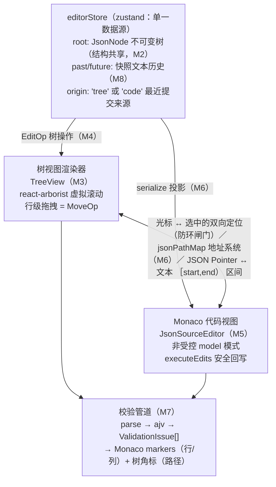

# 项目四：JSON 编辑器复刻手册

> 一句话目标：从零复刻一个"树形视图 + Monaco 代码视图"双模式编辑、双向同步的 JSON 编辑器——不可变树文档模型、节点增删改/复制粘贴/拖拽移动、ajv schema 校验（错误定位到行与路径）、万级节点虚拟滚动、undo/redo 覆盖双视图。预计工期：1 周。前置要求：已完成《00-公共底座-复刻手册》；若未完成，按本手册 §6.1 的底座复用清单先补三块——递归渲染器（进阶大纲 05 号文件）、Undo/Redo 的三种实现（07 号文件，本手册取"快照栈"变体）、大 Schema 树性能（09 号文件）。

## 0. 最终效果与验收清单

全部打勾即复刻完成，每条都给出可运行的验证动作。

- [ ] **双模式编辑**：顶部切"树 / 代码 / 分栏"三态，两种视图都能改同一份 JSON。验证：切分栏 → 树上把 `title` 的值改成 `"新标题"` → 代码区同位置立即变为新文本（Cmd+Z 可撤销这次修改）。
- [ ] **双向同步**：代码区光标点进 `"refreshMs"` 的值 → 左树自动展开祖先并高亮 `$.time.refreshMs` 对应行；点树上 `/panels/1/title` → 代码区选中该值并黄色高亮。来回切换 10 次无抖动循环（Console 无 `Maximum update depth` 警告）。
- [ ] **节点增删改**：树行内双击键名改名（对象）、双击值进入编辑（支持 `123` / `"str"` / `true` / `null` / `{}` 字面量）、`+` 插入子节点、`删` 删除子树。验证：对 `panels[0]` 点 `+` 两次 → 出现 `field1`、`field2`；双击 `field1` 值输入 `{"a":1}` 回车 → 该节点变成可展开的对象。
- [ ] **复制粘贴**：`复` 复制子树到内部剪贴板，选中容器后点 `贴` 粘贴为子节点；`副` 复制为兄弟节点（对象自动改名 `xxx1`，数组插入紧邻的下一格）。验证：复制 `/panels/0` 后选中 `/panels` 粘贴 → 数组多出一项且后续下标全部重排。
- [ ] **拖拽移动**：树行按住拖动，可跨容器移动与调序。验证：把 `/layout/0` 拖到 `/layout/2` 之后 → 顺序变化；把 `/panels/0` 拖进 `/panels/0/options`（自己的子树）→ 弹出"不能移动到自己的子树下"，树不变。
- [ ] **语法错误定位**：代码区删掉一个逗号 → 底部出现"第 N 行第 M 列"错误，点击跳转并聚焦；红标随输入防抖更新；树冻结在上一次合法状态而不是白屏。
- [ ] **schema 校验标错**：把 `panels[0].type` 改成 `"pie"` → 代码区该值出现红波浪线、树行出现红色角标、底部错误面板显示 `/panels/0/type 取值必须是 line / bar / stat / table 之一`；点击错误条目同时定位树与代码。删掉 `version` 字段 → 根节点角标 + `根 缺少必填字段 version`。
- [ ] **保存闸门**：JSON 语法非法时"导出"按钮 disabled。
- [ ] **大 JSON 流畅**：点"载入 10k 节点"（生成约 10 500 个节点）→ 树滚动、展开、折叠无肉眼卡顿；Console 执行 `document.querySelectorAll('.je-row').length` 得到 20 左右（虚拟滚动只渲染视口行）；Profiler 录制一次折叠操作 commit 耗时在个位数毫秒。
- [ ] **undo/redo 覆盖双视图**：树上连续 3 次结构操作 → 工具栏"撤销（3）"；在代码区连续打字 → 合并为一条历史（一次 Cmd+Z 回退整串）；在代码区按 Cmd+Z 撤销的是全局历史（树同步回退）；树/代码任意一侧编辑，另一侧跟随回退。
- [ ] **工程验收**：`npm run build` 产物含独立 worker chunk（`json.worker-*.js`）；DevTools Network 无 CDN 请求（本地化 monaco 生效）；Console 无报错、无 key 警告。

## 1. 架构总览

### 1.1 模块图



五个模块的职责边界：**文档模型**（tree-model/ops）是纯函数，只回答"树长什么样、怎么不可变地改"；**树视图**只管把 JsonNode 画成虚拟化行并收集用户意图为 EditOp；**代码视图**只管文本与非受控编辑器纪律；**同步层**（DualView + store.origin）只管两套坐标系换算与投影方向；**校验管道**只读文本与 schema，产出结构化 issues。层与层之间只靠 JSON Pointer 与 `serialize/toValue` 两个边界函数通信。

### 1.2 双视图同步的两种架构

| | 各自维护、互相推送 | 单一数据源、双向投影（本手册采用） |
|---|---|---|
| 数据 | 树状态 + 文本状态两份，各自是 source of truth | 只有 `root: JsonNode` 是 source of truth；文本是 root 的投影（serialize） |
| 同步 | A 改完调 B 的 setter，B 再调 A 对账 | 提交带来源标记 `origin`；同步层只允许"代码→树（parse）"与"树→代码（投影回写）"两个单向闸门 |
| 成环风险 | 高：setter 互相触发，经典 `Maximum update depth exceeded` | 结构性免疫：回写用 `executeEdits`，编辑器回声（文本 === 最近投影）直接忽略 |
| undo | 两套历史或难合并的混合历史 | 一套快照历史天然覆盖双视图 |
| 一致性 | 格式漂移、状态漂移要靠对账逻辑修补 | 代码侧提交后"用户格式即正典"，树侧提交后投影覆盖 |

选择后者的决定性理由：undo/redo 必须覆盖双视图，而"两份真相"永远解释不清"撤销到底撤哪份"。代价是必须直面"外部文本写回不破坏光标与撤销栈"（M5 的 `setValueSafely`）和"投影方向裁决"（M6 的 origin 闸门）两个难题——这正是本项目要练的内核。

### 1.3 技术选型

代码编辑器：

| 方案 | 体积（gzip，约） | SSR 友好度 | 优点 | 代价 | 结论 |
|---|---|---|---|---|---|
| Monaco（@monaco-editor/react + 本地 monaco） | 核心 + json worker ≈ 300–500 KB；worker 独立 chunk 首屏可不入 | 差：强依赖 DOM 与 worker，SSR 必须动态 import；CDN 模式还有外网依赖 | VSCode 同款体验（撤销栈语义、find/replace、folding）；官方 json worker 补全/校验 | 打包必须配 worker 分发（M5 坑 1） | 选它（大纲主线，且项目五源码模式复用） |
| CodeMirror 6 | core + JSON 语言 ≈ 150–250 KB，tree-shakable | 较好：纯 ESM 小包，仍需 client-only | 增量解析、主线程零 worker 配置、移动端好 | diff/minimap 要自己拼；schema 能力为社区扩展 | 嵌入轻量业务系统时替换（见 §5 坑 12） |

树视图虚拟滚动：

| 方案 | 体积 | 优点 | 代价 | 结论 |
|---|---|---|---|---|
| react-arborist | ≈ 30 KB | 专为树设计：虚拟滚动 + 行级拖拽 + 受控选中开箱 | 行高必须固定；数据要转成 id/children 形 | 选它 |
| react-window + 手写树拍平 | ≈ 8 KB | 极轻 | 展开态、缩进、拖拽全要自己实现（约 200 行） | 已有自研树组件时 |
| @tanstack/virtual + 手写 | ≈ 3 KB | 虚拟化原语最灵活 | 同上，且树语义全自己搭 | 需要异构行高时 |

## 2. 数据模型与协议

### 2.1 协议类型（保存为 src/json-editor/types.ts，全文唯一来源）

```ts
// src/json-editor/types.ts
export type JsonKind = 'object' | 'array' | 'string' | 'number' | 'boolean' | 'null';

/** 不可变树节点：一次编辑只沿修改路径换新引用，未动的分支保持原引用（结构共享） */
export interface JsonNode {
  key: string;      // 本节点在父容器中的键：对象为属性名，数组为下标字符串（'0'、'12'）；根为 ''
  path: string;     // JSON Pointer（RFC 6901）：根为 ''，如 /panels/0/title；见 2.2 转义规则
  kind: JsonKind;   // 判别字段：容器（object/array）有 children，叶子有 value
  value?: string | number | boolean | null; // 叶子值；容器节点恒为 undefined
  children?: JsonNode[];                    // 容器子节点；叶子恒为 undefined
}

/** 最小编辑操作单元：所有树视图交互最终都归约为这六种之一 */
export type EditOp =
  | { type: 'replace'; path: string; value: unknown }   // 改值或整棵替换子树（path '' = 换根）
  | { type: 'rename'; path: string; newKey: string }    // 对象键重命名（数组下标不可改名）
  | { type: 'insert'; parentPath: string; key: string; index?: number; value: unknown }
  // insert：对象按 key 追加；数组按 index 插入（index 超界 = 追加），key 由 restamp 重排
  | { type: 'remove'; path: string }                    // 删除子树（根不可删）
  | { type: 'move'; fromPath: string; toParentPath: string; toIndex: number } // 拖拽移动的产物
  | { type: 'duplicate'; path: string };                // 复制为兄弟节点（对象自动改名、数组插到下一格）

export type Severity = 'error' | 'warning';

/** 校验问题：同一份结构同时驱动代码 markers 与树角标 */
export interface ValidationIssue {
  pointer: string;                    // 出错实例位置（JSON Pointer，'' = 根）——与 ajv 的 instancePath 同款
  line: number;                       // 代码视图行号（1 起）；文本映射不到时为 0
  column: number;                     // 列号（1 起）；同上
  message: string;                    // 中文人类可读消息
  severity: Severity;
  source: 'syntax' | 'schema';        // 语法层（JSON.parse）或语义层（ajv）
}
```

### 2.2 JSON Pointer 路径协议（RFC 6901）

- 根为空字符串 `''`；每个孩子一段：对象用属性名、数组用十进制下标，段间用 `/` 连接。
- 属性名里的 `~` 转义为 `~0`、`/` 转义为 `~1`——否则 `a/b` 这种键会撕裂路径。本项目 `esc()/unescapeSeg()`（M2）负责双向转换。
- 为什么选 Pointer 而不是 JSONPath（`$.a.b[0]`）：ajv 的 `instancePath` 原生就是 Pointer，schema 错误到树/代码的定位零转换；序列化后还直接可用于 JSON Patch（§4.1）。

### 2.3 最小示例

输入 JSON：

```json
{ "version": 1, "meta": { "title": "示例" }, "a/b": [true, null] }
```

产出的 JsonNode（截选，`a/b` 演示转义）：

```text
{ key:'', path:'', kind:'object', children:[
  { key:'version', path:'/version', kind:'number', value:1 },
  { key:'meta', path:'/meta', kind:'object', children:[
    { key:'title', path:'/meta/title', kind:'string', value:'示例' } ] },
  { key:'a/b', path:'/a~1b', kind:'array', children:[
    { key:'0', path:'/a~1b/0', kind:'boolean', value:true },
    { key:'1', path:'/a~1b/1', kind:'null', value:null } ] } ] }
```

一次"把标题改成 'X'"的 EditOp 与由此产生的 ValidationIssue（对着 §2.1 的 schema）：

```json
{ "type": "replace", "path": "/meta/title", "value": "" }
```

```json
{ "pointer": "/meta/title", "line": 1, "column": 29, "message": "/meta/title 长度至少 1", "severity": "error", "source": "schema" }
```

## 3. 复刻主线路径：里程碑 M1 → M8

| 里程碑 | 主题 | 新增/改动文件 | 建议天 |
|---|---|---|---|
| M1 | 工程与 JSON 解析/序列化 | index.css / main.tsx / App.tsx / serialize.ts / samples.ts | 第 1 天上午 |
| M2 | 不可变树模型与路径工具 | types.ts / tree-model.ts | 第 1 天下午 |
| M3 | 树视图递归渲染（虚拟滚动） | editorStore.ts / TreeView.tsx / samples.ts(改) / App.tsx(改) | 第 2 天 |
| M4 | 节点编辑操作（增删改/移动） | ops.ts / editorStore.ts(改) / TreeView.tsx(改) | 第 3 天 |
| M5 | Monaco 集成与错误标注 | monaco-setup.ts / JsonSourceEditor.tsx / useJsonValidity.ts / useParseMarkers.ts / main.tsx(改) / App.tsx(改) | 第 4 天 |
| M6 | 双视图同步（编辑操作双向转换） | jsonPathMap.ts / DualView.tsx / editorStore.ts(改) / TreeView.tsx(改) / App.tsx(改) / index.css(补) | 第 5 天 |
| M7 | schema 校验管道 | validation.ts / sampleSchema.ts / DualView.tsx(改) / TreeView.tsx(改) | 第 6 天 |
| M8 | undo/redo 与收尾联调 | editorStore.ts(改) / HistoryBar.tsx / DualView.tsx(改) / App.tsx(最终) | 第 7 天 |

### M1 工程与 JSON 解析/序列化

**目标**：Vite + React + TS 工程跑起来，写完文本边界层——`parseJson`（带行/列定位的解析）与 `safeStringify`（带循环引用检测的序列化），页面显示一份合法 JSON 的序列化结果和一份坏 JSON 的错误行列。

**完整代码**：

```bash
npm create vite@latest json-editor-lab -- --template react-ts
cd json-editor-lab
npm i
npm i zustand react-arborist @monaco-editor/react monaco-editor ajv
npm run dev
```

（版本参考：monaco-editor 0.52.x、@monaco-editor/react 4.7.x、react-arborist 3.4.x、ajv 8.x、zustand 5.x；React 18/19 皆可。）

```ts
// src/json-editor/serialize.ts —— 文本边界：进出编辑器的唯一通道
export interface ParseSuccess { ok: true; value: unknown }
export interface ParseFailure { ok: false; message: string; line: number; column: number }
export type ParseResult = ParseSuccess | ParseFailure

/** JSON.parse 的报错只有 message（各引擎格式不一），行/列要自己从 position 换算 */
export function positionToLineCol(text: string, position: number): { line: number; column: number } {
  const lines = text.slice(0, position).split('\n')
  return { line: lines.length, column: lines[lines.length - 1]!.length + 1 }
}

function extractError(err: unknown, raw: string): { message: string; line: number; column: number } {
  const msg = err instanceof Error ? err.message : String(err)
  const pos = /position (\d+)/.exec(msg)                    // V8 老格式：... at position 42
  if (pos) return { message: msg, ...positionToLineCol(raw, Number(pos[1])) }
  const lc = /line (\d+) column (\d+)/.exec(msg)            // 部分新引擎自带行列
  if (lc) return { message: msg, line: Number(lc[1]), column: Number(lc[2]) }
  return { message: msg, line: 1, column: 1 }               // 兜底：跳到开头
}

export function parseJson(text: string): ParseResult {
  if (!text.trim()) return { ok: true, value: null }        // 空文档按 null 处理，不让 UI 崩
  try {
    return { ok: true, value: JSON.parse(text) }
  } catch (e) {
    return { ok: false, ...extractError(e, text) }
  }
}

/** 只检测"真正的祖先环"：进入子树时入栈、离开时出栈，DAG 重复引用不误报 */
function detectCycle(value: unknown): boolean {
  const stack = new Set<object>()
  function walk(v: unknown): boolean {
    if (typeof v !== 'object' || v === null) return false
    if (stack.has(v)) return true
    stack.add(v)
    const children = Array.isArray(v) ? v : Object.values(v as Record<string, unknown>)
    for (const c of children) if (walk(c)) return true
    stack.delete(v)
    return false
  }
  return walk(value)
}

/** 序列化：树模型的输出一定无环，但"从运行时对象导入"（如把组件 state 存进来）可能成环 */
export function safeStringify(value: unknown, space = 2): string {
  if (detectCycle(value)) throw new TypeError('循环引用：对象是自己的祖先，无法序列化为 JSON')
  return JSON.stringify(value, null, space)
}
```

```ts
// src/json-editor/samples.ts —— 示例文档（与第 4 章大纲的 dashboard 协议同构）
export const sampleDoc = {
  version: 1,
  meta: { title: '示例配置', updatedAt: 1760000000000 },
  time: { from: 1759996400000, to: 1760000000000, refreshMs: 30000 },
  panels: [
    { id: 'p_qps', type: 'line', title: 'QPS', options: { unit: 'req/s' } },
    { id: 'p_err', type: 'stat', title: '错误率', options: { unit: '%' } },
  ],
  layout: [
    { i: 'p_qps', x: 0, y: 0, w: 9, h: 6 },
    { i: 'p_err', x: 9, y: 0, w: 3, h: 6 },
  ],
}
```

```tsx
// src/main.tsx
import { StrictMode } from 'react'
import { createRoot } from 'react-dom/client'
import './index.css'
import App from './App'

createRoot(document.getElementById('root')!).render(
  <StrictMode>
    <App />
  </StrictMode>,
)
```

```tsx
// src/App.tsx —— M1 版：验证解析/序列化边界
import { parseJson, safeStringify } from './json-editor/serialize'
import { sampleDoc } from './json-editor/samples'

const ok = parseJson(safeStringify(sampleDoc))
const bad = parseJson('{\n  "a": 1,\n}')

export default function App() {
  return (
    <div style={{ padding: 16 }}>
      <h3>M1：解析 / 序列化</h3>
      <pre>{ok.ok ? safeStringify(ok.value) : ok.message}</pre>
      <p style={{ color: '#cf1322' }}>
        坏样例：{bad.ok ? '合法' : `${bad.message}（第 ${bad.line} 行第 ${bad.column} 列）`}
      </p>
    </div>
  )
}
```

```css
/* src/index.css —— 全套样式基线，一次写完，后面里程碑不再碰 CSS */
:root { --border: #d9d9d9; --primary: #1677ff; --danger: #cf1322; }
* { box-sizing: border-box; }
html, body, #root { height: 100%; margin: 0; }
body { font-family: system-ui, -apple-system, 'PingFang SC', sans-serif; font-size: 13px; color: #262626; background: #fff; }
button { cursor: pointer; font-size: 12px; }
.page { display: flex; flex-direction: column; height: 100%; }
.toolbar { display: flex; gap: 8px; align-items: center; padding: 8px 16px; border-bottom: 1px solid var(--border); }
.toolbar-spacer { margin-left: auto; color: #8c8c8c; }
.dual { display: flex; flex: 1; min-height: 0; }
.pane { overflow: auto; }
.pane.tree { width: 320px; border-right: 1px solid var(--border); }
.pane.code { flex: 1; min-width: 0; display: flex; flex-direction: column; }
.pane-bar { display: flex; gap: 8px; align-items: center; padding: 4px 8px; border-bottom: 1px solid var(--border); }
.je-row { display: flex; align-items: center; gap: 4px; padding-right: 6px; white-space: nowrap; }
.je-row:hover { background: #f5f6f8; }
.je-toggle { width: 14px; text-align: center; color: #8c8c8c; cursor: pointer; flex: none; }
.je-key { color: #262626; }
.je-kind-object, .je-kind-array { font-weight: 600; }
.je-kind-string { color: #389e0d; } .je-kind-number { color: #7c3aed; }
.je-kind-boolean { color: #d46b08; } .je-kind-null { color: #8c8c8c; }
.je-count { color: #8c8c8c; font-weight: 400; margin-left: 2px; }
.je-preview { color: #595959; overflow: hidden; text-overflow: ellipsis; }
.je-acts { display: none; margin-left: auto; gap: 2px; }
.je-row:hover .je-acts { display: inline-flex; }
.je-acts button { border: 1px solid var(--border); background: #fff; padding: 0 4px; }
.je-input { font: inherit; border: 1px solid var(--primary); padding: 0 2px; width: 110px; }
.je-badge { background: var(--danger); color: #fff; border-radius: 8px; padding: 0 5px; font-size: 11px; margin-left: auto; }
.je-row:hover .je-badge { margin-left: 4px; }
.issues { border-top: 1px solid var(--border); max-height: 120px; overflow: auto; padding: 4px 8px; display: flex; flex-direction: column; gap: 2px; }
.issues button { text-align: left; border: none; background: none; color: var(--danger); padding: 2px 0; }
.issues button:hover { text-decoration: underline; }
.je-highlight { background: #fff3bf; outline: 1px solid #f5c518; }
```

**验证**：`npm run dev` 打开页面 → 看到格式化 JSON 与"Unexpected end of JSON input（第 2 行第 1 列）"一类红字（注意：老 V8 报 `position 16`，新 V8 直接报行列，两条路径都被 `extractError` 覆盖）。`npx tsc --noEmit` 通过。

**常见报错与修复**：

- `TypeError: Converting circular structure to JSON\n    at JSON.stringify (<anonymous>)`——把带环的运行时对象（例如把 DOM 节点或组件实例塞进了文档）直接 `JSON.stringify`。修复：一律走 `safeStringify`，它在 stringify 前用祖先栈检测并抛出中文错误，UI 层捕获后提示用户，不再产出半截字符串。
- `SyntaxError: Unexpected end of JSON input`——用户把代码全删了再输入，防抖期解析到空/残缺文本。修复：`parseJson` 开头 `if (!text.trim()) return { ok: true, value: null }`，把空文档当合法 `null`，下游 UI 不崩。

### M2 不可变树模型与路径工具

**目标**：把 §2.1 的类型落成文件，并实现 Pointer 工具（转义/父段/祖先链）与树的构建/查询/不可变重建（结构共享的 restamp 机制）。本步做完，Console 里可以对一棵树做"改一个值 → 比较引用"的实验。

**完整代码**：

```ts
// src/json-editor/tree-model.ts —— 第一部分：Pointer 工具 + 构建/查询
import type { JsonKind, JsonNode } from './types'

export function esc(seg: string): string { return seg.replace(/~/g, '~0').replace(/\//g, '~1') }
export function unescapeSeg(seg: string): string { return seg.replace(/~1/g, '/').replace(/~0/g, '~') }
export function joinPointer(parent: string, key: string): string { return `${parent}/${esc(key)}` }
export function pointerSegments(pointer: string): string[] {
  return pointer === '' ? [] : pointer.slice(1).split('/').map(unescapeSeg)
}
export function parentOf(pointer: string): string {
  const i = pointer.lastIndexOf('/')
  return i < 0 ? '' : pointer.slice(0, i)
}
/** '/panels/0/title' → ['/panels', '/panels/0', '/panels/0/title']（保持转义形态，供树展开祖先） */
export function ancestorPaths(pointer: string): string[] {
  const out: string[] = []
  let cur = ''
  for (const seg of pointer === '' ? [] : pointer.slice(1).split('/')) { cur += `/${seg}`; out.push(cur) }
  return out
}

export function kindOf(value: unknown): JsonKind {
  if (value === null) return 'null'
  if (Array.isArray(value)) return 'array'
  if (typeof value === 'object') return 'object'
  return typeof value as JsonKind // 'string' | 'number' | 'boolean'
}

export function buildNode(value: unknown, key: string, path: string): JsonNode {
  const kind = kindOf(value)
  if (kind === 'object' || kind === 'array') {
    const children = kind === 'array'
      ? (value as unknown[]).map((v, i) => buildNode(v, String(i), joinPointer(path, String(i))))
      : Object.entries(value as Record<string, unknown>).map(([k, v]) => buildNode(v, k, joinPointer(path, k)))
    return { key, path, kind, children }
  }
  return { key, path, kind, value: value as string | number | boolean | null }
}
export const buildRoot = (value: unknown): JsonNode => buildNode(value, '', '')

/** 树 → 普通值（复制/粘贴/序列化都要它） */
export function toValue(node: JsonNode): unknown {
  if (!node.children) return node.value ?? null
  if (node.kind === 'array') return node.children.map(toValue)
  return Object.fromEntries(node.children.map((c) => [c.key, toValue(c)]))
}

export function getNode(root: JsonNode, pointer: string): JsonNode | null {
  let cur: JsonNode | undefined = root
  for (const seg of pointerSegments(pointer)) {
    cur = cur?.children?.find((c) => c.key === seg) // 空容器/叶子没有 children，?. 链自然返回 undefined
    if (!cur) return null
  }
  return cur ?? null
}

export function countNodes(node: JsonNode): number {
  return 1 + (node.children?.reduce((sum, c) => sum + countNodes(c), 0) ?? 0)
}
```

```ts
// src/json-editor/tree-model.ts —— 第二部分：结构共享的重建（增删改移动的地基；与第一部分合并保存为同一文件）

/**
 * 重刷孩子列表的 key/path（数组插入/删除后，后续兄弟的下标整体漂移）。
 * 关键性质：位置没变的子树直接返回原引用 —— memo 与 selector 订阅靠它活命。
 */
function restampChildren(children: JsonNode[], parentPath: string, parentKind: 'object' | 'array'): JsonNode[] {
  return children.map((c, i) => {
    const key = parentKind === 'array' ? String(i) : c.key
    const path = joinPointer(parentPath, key)
    if (c.key === key && c.path === path) return c // 未漂移：原引用复用
    return restampSubtree(c, key, path)
  })
}

export function restampSubtree(node: JsonNode, key: string, path: string): JsonNode {
  if (!node.children) return { ...node, key, path }
  return { ...node, key, path, children: restampChildren(node.children, path, node.kind as 'object' | 'array') }
}

/** 在 parentPath 的孩子列表上应用一次结构变更，沿途只重建祖先链（不可变） */
export function editChildren(root: JsonNode, parentPath: string, fn: (children: JsonNode[]) => JsonNode[]): JsonNode {
  const segs = pointerSegments(parentPath)
  const walk = (node: JsonNode, depth: number): JsonNode => {
    if (depth === segs.length) {
      if (!node.children) throw new Error(`目标不是容器：${node.path || '(根)'}`)
      return { ...node, children: restampChildren(fn(node.children), node.path, node.kind as 'object' | 'array') }
    }
    if (!node.children) throw new Error(`路径中断：${node.path || '(根)'} 不是容器`)
    const seg = segs[depth]!
    const child = node.children.find((c) => c.key === seg)
    if (!child) throw new Error(`路径不存在：${joinPointer(node.path, seg)}`)
    return { ...node, children: node.children.map((c) => (c === child ? walk(child, depth + 1) : c)) }
  }
  return walk(root, 0)
}

/** 给对象容器生成不冲突的新键：field、field1、field2…… */
export function nextKey(parent: JsonNode, base = 'field'): string {
  const keys = new Set((parent.children ?? []).map((c) => c.key))
  if (!keys.has(base)) return base
  let i = 1
  while (keys.has(`${base}${i}`)) i++
  return `${base}${i}`
}
```

**验证**：`npx tsc --noEmit` 通过。在浏览器 Console 执行（Vite 页面上 store 还没有，用模块函数直测）：

```js
const m = await import('/src/json-editor/tree-model.ts')
const root = m.buildRoot({ a: { x: 1 }, b: [10, 20] })
const next = m.editChildren(root, '/b', (cs) => [...cs.slice(0, 1), m.buildNode(99, '2', '/b/2'), ...cs.slice(1)])
next.children[1].children[1].path        // '/b/2'（原 20 从 /b/1 漂到 /b/2）
next.children[1].children[0] === root.children[1].children[0] // true：未漂移子树保持原引用
m.getNode(next, '/a/x')?.value           // 1
```

**常见报错与修复**：

- `TypeError: Cannot read properties of null (reading 'children')`——对 `/a/x/b` 这种穿过叶子的指针做 `node.children.find(...)`。修复：`getNode` 全程 `cur?.children?.find`，查不到返回 `null`，调用方判空（M4 的 ops 都先 `getNode` 判空再动手）。
- `error TS2339: Property 'children' does not exist on type 'JsonNode'.`——`children` 是可选字段，直接访问编译不过。修复：一律先判 `if (node.children)` 再访问（`editChildren` 里的两处 throw 就是这个守卫），或用 `node.children ?? []`。

### M3 树视图递归渲染（虚拟滚动）

**目标**：zustand store 持有 root，react-arborist 把它渲染成虚拟化树：折叠/展开、点击选中、10k 节点滚动流畅。本步做完页面左侧是一棵可导航的 JSON 树。

**完整代码**：

```ts
// src/json-editor/editorStore.ts —— M3 版骨架
import { create } from 'zustand'
import { buildRoot } from './tree-model'
import { sampleDoc } from './samples'
import type { JsonNode } from './types'

interface EditorState {
  root: JsonNode                // 单一数据源：树与代码都是它的投影
  view: 'split' | 'tree' | 'code'
  selectedPath: string | null
  setView: (view: EditorState['view']) => void
  select: (path: string | null) => void
  loadValue: (value: unknown) => void
}

export const useEditorStore = create<EditorState>()((set) => ({
  root: buildRoot(sampleDoc),
  view: 'split',
  selectedPath: null,
  setView: (view) => set({ view }),
  select: (selectedPath) => set({ selectedPath }),
  loadValue: (value) => set({ root: buildRoot(value), selectedPath: null }),
}))
```

```tsx
// src/json-editor/TreeView.tsx —— M3 版：递归数据转换 + 虚拟滚动 + 受控选中
import { useEffect, useMemo, useRef } from 'react'
import type { CSSProperties, Ref } from 'react'
import { Tree, type NodeApi, type TreeApi } from 'react-arborist'
import { useEditorStore } from './editorStore'
import type { JsonNode, ValidationIssue } from './types'

/** arborist 的行数据约定：id/name/children；id = JsonNode.path（同步层靠它换算坐标系） */
export interface RowData {
  id: string
  name: string
  kind: string
  preview?: string
  children?: RowData[]
}

function toRows(node: JsonNode): RowData {
  if (!node.children) {
    const preview = typeof node.value === 'string'
      ? `"${node.value}"`
      : String(node.value ?? 'null')
    return { id: node.path, name: node.key, kind: node.kind, preview }
  }
  // 空容器的 children 记为 undefined：arborist 视其为叶子（增删子节点的按钮仍按 kind 判定）
  return { id: node.path, name: node.key, kind: node.kind, children: node.children.map(toRows) }
}

interface RowProps {
  node: NodeApi
  style: CSSProperties
  dragHandle?: Ref<HTMLDivElement>
  issues?: ValidationIssue[]
}

function Row({ node, style, dragHandle }: RowProps) {
  const d = node.data as RowData
  return (
    <div ref={dragHandle} className="je-row" style={{ ...style }}>
      <span className="je-toggle" onClick={(e) => { e.stopPropagation(); if (!node.isLeaf) node.toggle() }}>
        {node.isLeaf ? '·' : node.isOpen ? '▾' : '▸'}
      </span>
      <span className={`je-key je-kind-${d.kind}`}>
        {d.name === '' ? '(root)' : d.name}
        {(d.kind === 'object' || d.kind === 'array') && (
          <span className="je-count">{d.kind === 'array' ? `[${d.children?.length ?? 0}]` : `{${d.children?.length ?? 0}}`}</span>
        )}
      </span>
      {d.preview !== undefined && <span className="je-preview">: {d.preview}</span>}
    </div>
  )
}

export function TreeView({ width = 320, height = 560, apiRef }: {
  width?: number; height?: number; apiRef?: React.RefObject<TreeApi | null>
}) {
  const root = useEditorStore((s) => s.root)
  const selectedPath = useEditorStore((s) => s.selectedPath)
  const select = useEditorStore((s) => s.select)
  const treeRef = useRef<TreeApi | null>(null)
  const data = useMemo(() => [toRows(root)], [root]) // 树 → 行数据，root 引用不变则不重算

  useEffect(() => { if (apiRef) apiRef.current = treeRef.current }) // 每次渲染后同步给父组件（M6 光标定位用）

  return (
    <Tree
      ref={treeRef}
      data={data}
      width={width}
      height={height}
      rowHeight={26}                                   // 虚拟滚动的数学基础，必须与实际行高一致
      indent={16}
      openByDefault={false}
      initialOpenState={{ '': true }}                  // 默认只展开根
      selection={selectedPath ?? undefined}            // 受控选中：代码视图光标会改它（M6）
      onSelectionChange={(ids) => select(ids[0] === undefined ? null : String(ids[0]))}
    >
      {(renderProps) => <Row {...renderProps} />}
    </Tree>
  )
}
```

```tsx
// src/App.tsx —— M3 版
import { useMemo } from 'react'
import { useEditorStore } from './json-editor/editorStore'
import { TreeView } from './json-editor/TreeView'
import { countNodes } from './json-editor/tree-model'
import { genBigDoc, sampleDoc } from './json-editor/samples'

export default function App() {
  const loadValue = useEditorStore((s) => s.loadValue)
  const root = useEditorStore((s) => s.root)
  const nodeCount = useMemo(() => countNodes(root), [root])
  return (
    <div className="page">
      <div className="toolbar">
        <button onClick={() => loadValue(sampleDoc)}>载入示例</button>
        <button onClick={() => loadValue(genBigDoc(10500))}>载入 10k 节点</button>
        <span className="toolbar-spacer">节点数：{nodeCount}</span>
      </div>
      <TreeView height={560} />
    </div>
  )
}
```

```ts
// src/json-editor/samples.ts 追加 —— 大文档生成器（每条 row 约 10 个节点）
export function genBigDoc(targetNodes: number): unknown {
  const rows = Math.max(1, Math.ceil(targetNodes / 10))
  return {
    version: 1,
    rows: Array.from({ length: rows }, (_, i) => ({
      id: `row-${i}`,
      name: `第 ${i} 行`,
      tags: [`t${i}`, `u${i}`],
      metrics: { cpu: i % 100, mem: (i * 7) % 100, ok: i % 2 === 0 },
    })),
  }
}
```

**验证**：页面出现示例树，展开 `/panels`、点行高亮选中；点"载入 10k 节点"后工具栏显示约 10501；滚动流畅；Console 执行 `document.querySelectorAll('.je-row').length` 得 20 左右（视口内行数，虚拟滚动生效）；React DevTools Profiler 录制一次展开/折叠，commit 耗时个位数毫秒。

**常见报错与修复**：

- `error TS2741: Property 'width' is missing in type ... but required in type 'Required<TreeProps>'.`——arborist 的 `width/height` 是必填数字（虚拟化要按像素算可见行）。修复：`<TreeView width={320} height={560} />` 显式传入，且容器 CSS 不要再额外压缩（`.pane.tree` 宽度与之一致）。
- 树区域整片空白、Console 无报错——传了 `height={0}`（例如想用 `100%` 撑满却给了数字 0）或外层 flex 没撑高。修复：height 用固定像素（本手册 560），要自适应时用 ResizeObserver 量高后再传，不要猜。
- `Warning: Encountered two children with the same key, ''.`——`toRows` 给根之外还有节点 path 为 `''`（一般是 buildRoot 时传错了 key/path）。修复：只有根允许空 path，检查 `buildNode(value, '', '')` 只在 `buildRoot` 里调用。

### M4 节点编辑操作（增删改/移动）

**目标**：六种 EditOp 全部落地：行内改名/改值、插入子节点、删除、复制（内部剪贴板）、复制为兄弟、拖拽移动（含"不能移进自己子树"守卫）。本步做完，树是一台完整的编辑器。

**完整代码**：

```ts
// src/json-editor/ops.ts —— 第一部分：decodeKey + replace / rename / insert / remove
import { buildNode, editChildren, getNode, joinPointer, nextKey, parentOf, restampSubtree, toValue, unescapeSeg } from './tree-model'
import type { EditOp, JsonNode } from './types'

/** 取指针最后一段并解转义：'/meta/a~1b' → 'a/b'（这是该节点在父容器 children 里的 key） */
function decodeKey(pointer: string): string {
  return unescapeSeg(pointer.slice(pointer.lastIndexOf('/') + 1))
}

export function applyEditOp(root: JsonNode, op: EditOp): JsonNode {
  switch (op.type) {
    case 'replace': {
      if (op.path === '') return buildNode(op.value, '', '') // 根替换 = 换整棵树
      const parent = getNode(root, parentOf(op.path))
      if (!parent) throw new Error(`replace：父路径不存在 ${op.path}`)
      const key = decodeKey(op.path)
      return editChildren(root, parentOf(op.path), (cs) =>
        cs.map((c) => (c.key === key ? buildNode(op.value, key, joinPointer(parent.path, key)) : c)))
    }
    case 'rename': {
      const parent = getNode(root, parentOf(op.path))
      if (!parent || parent.kind !== 'object') throw new Error('rename：只能重命名对象的键（数组下标由位置决定）')
      if ((parent.children ?? []).some((c) => c.key === op.newKey)) throw new Error(`重名键：${op.newKey}`)
      const key = decodeKey(op.path)
      // restampSubtree：改名后整棵子树的 path 前缀都要换新——"路径引用在移动/改名后失效"的正面处理
      return editChildren(root, parentOf(op.path), (cs) =>
        cs.map((c) => (c.key === key ? restampSubtree(c, op.newKey, joinPointer(parent.path, op.newKey)) : c)))
    }
    case 'insert': {
      const parent = getNode(root, op.parentPath)
      if (!parent) throw new Error(`insert：父路径不存在 ${op.parentPath}`)
      if (parent.kind === 'array') {
        const idx = op.index ?? parent.children!.length // index 超界时 slice 自动钳到末尾 = 追加
        const child = buildNode(op.value, String(idx), joinPointer(parent.path, String(idx)))
        return editChildren(root, op.parentPath, (cs) => [...cs.slice(0, idx), child, ...cs.slice(idx)])
      }
      const child = buildNode(op.value, op.key, joinPointer(parent.path, op.key))
      return editChildren(root, op.parentPath, (cs) => [...cs, child])
    }
    case 'remove': {
      if (op.path === '') throw new Error('根节点不可删除（可用"替换整棵树"）')
      const key = decodeKey(op.path)
      return editChildren(root, parentOf(op.path), (cs) => cs.filter((c) => c.key !== key))
    }
  }
}
```

在同一个 `switch` 里（`case 'remove'` 之后）继续追加 move / duplicate 两个 case：

```ts
// src/json-editor/ops.ts —— 第二部分：move / duplicate（追加进同一个 switch）
    case 'move': {
      if (op.fromPath === '') throw new Error('根节点不可移动')
      if (op.toParentPath === op.fromPath || op.toParentPath.startsWith(op.fromPath + '/'))
        throw new Error('不能把节点移动到它自己的子树下') // 必须拼 '/'：否则 /a 会误伤 /abc
      const from = getNode(root, op.fromPath)
      if (!from) throw new Error(`move：源路径不存在 ${op.fromPath}`)
      const value = toValue(from)
      const removed = applyEditOp(root, { type: 'remove', path: op.fromPath })
      const sameParent = parentOf(op.fromPath) === op.toParentPath
      const fromIndex = Number(from.key)
      // 同一父容器内向后拖：先删除已让目标索引前移一位，不补偿就会"拖不动"
      const toIndex = sameParent && fromIndex < op.toIndex ? op.toIndex - 1 : op.toIndex
      return applyEditOp(removed, {
        type: 'insert', parentPath: op.toParentPath, key: from.key, index: toIndex, value,
      })
    }
    case 'duplicate': {
      if (op.path === '') throw new Error('根节点不可复制')
      const node = getNode(root, op.path)
      const parent = getNode(root, parentOf(op.path))
      if (!node || !parent) throw new Error(`duplicate：路径不存在 ${op.path}`)
      const value = toValue(node)
      if (parent.kind === 'array')
        return applyEditOp(root, { type: 'insert', parentPath: parent.path, key: node.key, index: Number(node.key) + 1, value })
      return applyEditOp(root, { type: 'insert', parentPath: parent.path, key: nextKey(parent, node.key), value })
    }
  }
}
```

```ts
// src/json-editor/editorStore.ts 追加 —— M4 改动段：操作入口 + 剪贴板
import { applyEditOp } from './ops'
import { getNode, nextKey, toValue } from './tree-model'
import type { EditOp } from './types'

// state 新增字段：
//   clipboard: unknown
// interface 新增动作：
//   applyOp(op: EditOp): void
//   commitRoot(next: JsonNode): void   // M8 会把它升级成"推历史后替换"
//   copy(path: string): void
//   paste(parentPath: string): void

  clipboard: null,
  commitRoot: (next) => set({ root: next }),
  applyOp: (op) => get().commitRoot(applyEditOp(get().root, op)),
  copy: (path) => {
    const node = getNode(get().root, path)
    if (node) set({ clipboard: toValue(node) })
  },
  paste: (parentPath) => {
    const parent = getNode(get().root, parentPath)
    const clip = get().clipboard
    if (!parent || clip == null) return
    if (parent.kind === 'array') get().applyOp({ type: 'insert', parentPath, key: '0', value: clip })
    else get().applyOp({ type: 'insert', parentPath, key: nextKey(parent), value: clip })
  },

/** UI 统一走这里：ops 的守卫错误（重名键、移进子树……）转成提示，不炸页面 */
export function runOp(op: EditOp): void {
  try {
    useEditorStore.getState().applyOp(op)
  } catch (e) {
    console.error('[json-editor]', e)
    window.alert((e as Error).message)
  }
}
```

```tsx
// src/json-editor/TreeView.tsx 改动段 —— M4：Row 升级（行内编辑 + 操作按钮）与拖拽
// 顶部 import 区改为：
//   import { useEffect, useMemo, useRef, useState } from 'react'
//   import type { ChangeEvent, KeyboardEvent, MouseEvent as ReactMouseEvent, CSSProperties, Ref } from 'react'
//   import { getNode, nextKey } from './tree-model'
//   import { parseLiteral } from './ops'
//   import { runOp, useEditorStore } from './editorStore'

// 1) Tree 组件追加 onMove（放在 onSelectionChange 之后）：
//      onMove={({ dragIds, parentId, index }) => {
//        const fromPath = String(dragIds[0] ?? '')
//        if (!fromPath) return
//        runOp({ type: 'move', fromPath, toParentPath: parentId == null ? '' : String(parentId), toIndex: index ?? 9999 })
//      }}
// 2) Row 组件整体替换为下面的实现：

function Row({ node, style, dragHandle }: RowProps) {
  const d = node.data as RowData
  const root = useEditorStore((s) => s.root)
  const copy = useEditorStore((s) => s.copy)
  const paste = useEditorStore((s) => s.paste)
  const [editing, setEditing] = useState<null | 'key' | 'value'>(null)
  const [draft, setDraft] = useState('')
  const path = String(node.id)
  const isContainer = d.kind === 'object' || d.kind === 'array'

  const beginEdit = (which: 'key' | 'value') => {
    setDraft(which === 'key' ? d.name : (d.preview ?? '').replace(/^"|"$/g, ''))
    setEditing(which)
  }
  const commit = () => {
    if (editing === 'key' && draft.trim() !== '') runOp({ type: 'rename', path, newKey: draft.trim() })
    if (editing === 'value') runOp({ type: 'replace', path, value: parseLiteral(draft) })
    setEditing(null)
  }
  const insertChild = () => {
    const parent = getNode(root, path)
    if (!parent) return
    if (parent.kind === 'array') runOp({ type: 'insert', parentPath: parent.path, key: '0', value: null })
    else runOp({ type: 'insert', parentPath: parent.path, key: nextKey(parent), value: null })
  }
  const inputProps = {
    autoFocus: true, className: 'je-input', value: draft,
    onChange: (e: React.ChangeEvent<HTMLInputElement>) => setDraft(e.target.value),
    onBlur: commit,
    onClick: (e: React.MouseEvent) => e.stopPropagation(),
    onKeyDown: (e: React.KeyboardEvent) => { if (e.key === 'Enter') commit(); if (e.key === 'Escape') setEditing(null) },
  }
  return (
    <div ref={dragHandle} className="je-row" style={{ ...style }}>
      <span className="je-toggle" onClick={(e) => { e.stopPropagation(); if (!node.isLeaf) node.toggle() }}>
        {node.isLeaf ? '·' : node.isOpen ? '▾' : '▸'}
      </span>
      {editing === 'key' ? <input {...inputProps} /> : (
        <span className={`je-key je-kind-${d.kind}`} onDoubleClick={(e) => { if (d.name !== '') { e.stopPropagation(); beginEdit('key') } }}>
          {d.name === '' ? '(root)' : d.name}
          {isContainer && <span className="je-count">{d.kind === 'array' ? `[${d.children?.length ?? 0}]` : `{${d.children?.length ?? 0}}`}</span>}
        </span>
      )}
      {editing === 'value' ? <input {...inputProps} /> : (
        d.preview !== undefined && (
          <span className="je-preview" onDoubleClick={(e) => { e.stopPropagation(); beginEdit('value') }}>: {d.preview}</span>
        )
      )}
      <span className="je-acts">
        {isContainer && <button title="插入子节点" onClick={(e) => { e.stopPropagation(); insertChild() }}>+</button>}
        {isContainer && <button title="粘贴剪贴板子树" onClick={(e) => { e.stopPropagation(); paste(path) }}>贴</button>}
        <button title="复制到剪贴板" onClick={(e) => { e.stopPropagation(); copy(path) }}>复</button>
        <button title="复制为兄弟节点" onClick={(e) => { e.stopPropagation(); runOp({ type: 'duplicate', path }) }}>副</button>
        {d.name !== '' && <button title="删除子树" onClick={(e) => { e.stopPropagation(); runOp({ type: 'remove', path }) }}>删</button>}
      </span>
    </div>
  )
}
```

（`TreeView.tsx` 顶部正确写法：`import { getNode, nextKey } from './tree-model'`、`import { parseLiteral, runOp 的引用如上 }`；`parseLiteral` 放进 `ops.ts`：）

```ts
// src/json-editor/ops.ts 追加 —— 行内值编辑的宽松解析：能按 JSON 字面量解析就解析，否则原样作为字符串
export function parseLiteral(input: string): unknown {
  const t = input.trim()
  if (t === '') return ''
  try { return JSON.parse(t) } catch { return input }
}
```

**验证**：展开 `/meta` → 双击 `title` 值输入 `"新标题"` 回车 → 预览变化；双击键名 `title` 改成 `headline` → 键与子路径同步（Console 里 `useEditorStore.getState().root` 检查 `/meta/headline`）；对 `panels` 点 `+` 两次出现 `field1/field2`；`复` 制 `/panels/0` 后选中 `/panels` 点 `贴` → 数组变 3 项且 `[2]` 的 path 正确；拖 `/layout/0` 到行 3 之后顺序变化；把 `/panels/0` 拖进自己的 `options` → alert 拦截。

**常见报错与修复**：

- `Uncaught Error: 不能把节点移动到它自己的子树下`——arborist 允许把行拖到任何容器上，包括自己的子孙。修复：`move` 分支开头的 `startsWith(fromPath + '/')` 守卫抛错，`runOp` 捕获后 alert，文档不变（注意必须拼 `/`，否则 `/a` 会误伤 `/abc`）。
- `Uncaught Error: 重名键：title`——重命名成已有键。修复：`rename` 分支查重抛错；产品化可改为自动落格：`runOp` 前用 `nextKey(parent, draft)` 生成不冲突名。
- 拖到"原位置后一格"看起来没动——同父容器后移时先删后插，目标索引已被删除动作前移。修复：`move` 分支的 `toIndex - 1` 补偿（代码已含），这是所有"remove + insert 实现移动"的通用坑。

### M5 Monaco 集成与错误标注

**目标**：本地化 Monaco（worker 分发、不走 CDN），实现非受控 model 模式的 `JsonSourceEditor`（项目五直接复用的组件）：外部安全回写、格式化、跳转；接入语法错误 marker 与"合法/错误"状态条。本步做完页面变成一个带错误标注的代码编辑器。

**完整代码**：

```ts
// src/monaco-setup.ts —— 本地化 monaco + worker 分发，应用入口 import 一次
import { loader } from '@monaco-editor/react'
import * as monaco from 'monaco-editor'
import editorWorker from 'monaco-editor/esm/vs/editor/editor.worker?worker'
import jsonWorker from 'monaco-editor/esm/vs/language/json/json.worker?worker'

declare global {
  interface Window { MonacoEnvironment?: monaco.Environment }
}

window.MonacoEnvironment = {
  // label 是语言 id：json 语言服务跑在 json worker 线程，大文档校验不阻塞输入
  getWorker(_workerId: string, label: string): Worker {
    if (label === 'json') return new jsonWorker()
    return new editorWorker()
  },
}

loader.config({ monaco }) // ★ 不走 CDN（jsdelivr），内网/离线环境必须
export {}
```

```tsx
// src/main.tsx 改动段 —— monaco-setup 必须先于任何 <Editor /> 执行
import './monaco-setup' // 加在 import App 之前
```

```tsx
// src/json-editor/JsonSourceEditor.tsx —— 非受控 model 模式（项目五按此签名复用）
import { forwardRef, useImperativeHandle, useRef, useEffect } from 'react'
import Editor, { type OnMount } from '@monaco-editor/react'
import type { editor as monacoEditor, IDisposable } from 'monaco-editor'

export interface JsonSourceEditorHandle {
  getValue(): string
  /** 外部数据安全写回（保撤销栈、保光标）：一切"可视化侧 → 源码侧"的同步都走它 */
  setValueSafely(next: string): void
  format(): void
  reveal(line: number, column: number): void
}

interface Props {
  /** 同一文档固定一个 path：@monaco-editor/react 按 path 建/复用 model（source of truth 在 model 上） */
  path?: string
  defaultValue?: string
  readOnly?: boolean
  onChange?: (value: string) => void
  onMount?: OnMount
  options?: monacoEditor.IStandaloneEditorConstructionOptions
  onUndoShortcut?: () => void   // M8 接线：编辑器内 Cmd+Z 路由到全局历史
  onRedoShortcut?: () => void   // M8 接线：Cmd+Shift+Z / Cmd+Y
}

export const JsonSourceEditor = forwardRef<JsonSourceEditorHandle, Props>(
  function JsonSourceEditor(
    { path = 'config.json', defaultValue = '{\n  \n}', readOnly = false, onChange, onMount, options, onUndoShortcut, onRedoShortcut },
    ref,
  ) {
    const editorRef = useRef<monacoEditor.IStandaloneCodeEditor | null>(null)
    const cmdRef = useRef<Array<IDisposable | undefined>>([])

    const handleMount: OnMount = (editor, monaco) => {
      editorRef.current = editor
      onMount?.(editor, monaco)
      if (onUndoShortcut) cmdRef.current.push(editor.addCommand(monaco.KeyMod.CtrlCmd | monaco.KeyCode.KeyZ, onUndoShortcut))
      if (onRedoShortcut) {
        cmdRef.current.push(editor.addCommand(monaco.KeyMod.CtrlCmd | monaco.KeyMod.Shift | monaco.KeyCode.KeyZ, onRedoShortcut))
        cmdRef.current.push(editor.addCommand(monaco.KeyMod.CtrlCmd | monaco.KeyCode.KeyY, onRedoShortcut))
      }
    }

    useEffect(() => () => { cmdRef.current.forEach((d) => d?.dispose()); cmdRef.current = [] }, []) // 卸载清理命令绑定

    useImperativeHandle(ref, () => ({
      getValue: () => editorRef.current?.getValue() ?? '',
      setValueSafely: (next) => {
        const editor = editorRef.current
        const model = editor?.getModel()
        if (!editor || !model || model.getValue() === next) return
        // 全量替换但走 executeEdits：它是"一次正常编辑"，入撤销栈，Cmd+Z 可回退这次外部写入。
        // 绝不用 model.setValue：它会清空撤销栈并重置光标（对照表见 §5 坑 12）
        editor.executeEdits('external-update', [
          { range: model.getFullModelRange(), text: next, forceMoveMarkers: true },
        ])
      },
      format: () => { void editorRef.current?.getAction('editor.action.formatDocument')?.run() },
      reveal: (line, column) => {
        const editor = editorRef.current
        if (!editor) return
        editor.setPosition({ lineNumber: line, column })
        editor.revealLineInCenter(line)
        editor.focus() // 三件套缺一不可：不 focus 光标不可见，体感像"没反应"
      },
    }), [])

    return (
      <Editor
        path={path}                     // ← 关键：按 path 建 model，同 path 复用同一 model
        defaultLanguage="json"
        defaultValue={defaultValue}     // 只在 model 首次创建时生效，此后 React 不再干预文本
        readOnly={readOnly}
        onMount={handleMount}
        onChange={(v) => onChange?.(v ?? '')} // 单向通知：编辑器 → 外部。外部只读，绝不回灌 value
        height="100%"
        options={{
          automaticLayout: true, tabSize: 2, scrollBeyondLastLine: false,
          minimap: { enabled: false }, ...options,
        }}
      />
    )
  },
)
```

```ts
// src/json-editor/useJsonValidity.ts —— 防抖 → JSON.parse → 状态机（保存闸门的数据源）
import { useEffect, useState } from 'react'

export type ValidityState =
  | { kind: 'idle' }
  | { kind: 'checking' }
  | { kind: 'valid' }
  | { kind: 'invalid'; message: string; line: number; column: number }

export function useJsonValidity(raw: string, delay = 300): ValidityState {
  const [state, setState] = useState<ValidityState>({ kind: 'idle' })
  useEffect(() => {
    if (!raw.trim()) { setState({ kind: 'idle' }); return }
    setState({ kind: 'checking' })
    const t = window.setTimeout(async () => {
      const { parseJson } = await import('./serialize') // 动态引入避免与热更新打架；也可顶部静态 import
      const res = parseJson(raw)
      setState(res.ok ? { kind: 'valid' } : { kind: 'invalid', ...res })
    }, delay)
    return () => window.clearTimeout(t) // 300ms 内继续输入 → 上一次的 parse 取消
  }, [raw, delay])
  return state
}
```

```tsx
// src/json-editor/useParseMarkers.ts —— 把解析错误画成 Monaco 红标
import { useEffect } from 'react'
import type { editor as monacoEditor } from 'monaco-editor'
import type { ValidityState } from './useJsonValidity'

export function useParseMarkers(
  editorRef: React.RefObject<monacoEditor.IStandaloneCodeEditor | null>,
  monacoRef: React.RefObject<typeof import('monaco-editor') | null>,
  validity: ValidityState,
) {
  useEffect(() => {
    const monaco = monacoRef.current
    const model = editorRef.current?.getModel()
    if (!monaco || !model) return
    if (validity.kind !== 'invalid') {
      monaco.editor.setModelMarkers(model, 'parse', []) // 清除
      return
    }
    monaco.editor.setModelMarkers(model, 'parse', [{
      startLineNumber: validity.line, startColumn: validity.column,
      endLineNumber: validity.line, endColumn: validity.column + 1,
      message: validity.message, severity: monaco.MarkerSeverity.Error,
    }])
  }, [validity, editorRef, monacoRef])
}
```

```tsx
// src/App.tsx 改动段 —— M5 版：单代码视图验证（M6 会整体换成 DualView）
import { useRef, useState } from 'react'
import type { editor as monacoEditor } from 'monaco-editor'
import { JsonSourceEditor, type JsonSourceEditorHandle } from './json-editor/JsonSourceEditor'
import { useJsonValidity } from './json-editor/useJsonValidity'
import { useParseMarkers } from './json-editor/useParseMarkers'
import { safeStringify } from './json-editor/serialize'
import { sampleDoc } from './json-editor/samples'

export default function App() {
  const handleRef = useRef<JsonSourceEditorHandle | null>(null)
  const editorRef = useRef<monacoEditor.IStandaloneCodeEditor | null>(null)
  const monacoRef = useRef<typeof import('monaco-editor') | null>(null)
  const initial = safeStringify(sampleDoc)
  const [raw, setRaw] = useState(initial)
  const validity = useJsonValidity(raw)
  useParseMarkers(editorRef, monacoRef, validity)
  return (
    <div className="page">
      <div className="toolbar">
        <button onClick={() => handleRef.current?.format()}>格式化</button>
        {validity.kind === 'checking' && <span style={{ color: '#999' }}>校验中…</span>}
        {validity.kind === 'valid' && <span style={{ color: '#389e0d' }}>JSON 合法</span>}
        {validity.kind === 'invalid' && (
          <button style={{ color: '#cf1322' }} onClick={() => handleRef.current?.reveal(validity.line, validity.column)}>
            JSON 错误：{validity.message}（第 {validity.line} 行第 {validity.column} 列，点击跳转）
          </button>
        )}
      </div>
      <div style={{ flex: 1, minHeight: 0 }}>
        <JsonSourceEditor
          ref={handleRef}
          path="sample.config.json"
          defaultValue={initial}
          onChange={setRaw}
          onMount={(editor, monaco) => { editorRef.current = editor; monacoRef.current = monaco }}
        />
      </div>
    </div>
  )
}
```

**验证**：连续打字 30 秒 → 光标无闪跳、Cmd+Z 逐键回退（非受控生效）；删掉一个逗号 → 状态条出现行/列，点击跳转聚焦，红标在出错处；点"格式化" → 全文 2 空格缩进且 Cmd+Z 可回退格式化；Network 的 JS 筛选可见 `json.worker-*.js` 独立请求、无 jsdelivr 请求；打非法 JSON 后 1 秒内出现 json worker 的红波浪线（`Unexpected token` 一类，worker 语法校验与我们的 parse 管线并存）。

**常见报错与修复**：

- `You must define a function MonacoEnvironment.getWorkerUrl or MonacoEnvironment.getWorker`（或弹窗 `Could not create web worker`）——monaco 的语言服务跑在独立 worker 线程，运行时按 `MonacoEnvironment.getWorker(label)` 要构造器，没配置就没有 json worker（能打字但没有红波浪线/补全）。修复：M5 第一个文件 `monaco-setup.ts` + `main.tsx` 顶部 import。
- `Uncaught (in promise) Error: Could not create web worker.` 且 Network 有 jsdelivr 请求——`@monaco-editor/react` 默认从 CDN 拉 monaco，内网不可达。修复：`loader.config({ monaco })` 切到本地包（已含在 monaco-setup.ts）。
- `error TS2305: Module '"monaco-editor"' has no exported member 'OnMount'.`——`OnMount` 类型在 `@monaco-editor/react` 里。修复：`import Editor, { type OnMount } from '@monaco-editor/react'`；monaco 侧类型用 `import type { editor as monacoEditor } from 'monaco-editor'`。

### M6 双视图同步（编辑操作双向转换）

**目标**：建立"JSON Pointer ↔ 文本区间"地址系统，把树和代码拼成分栏双视图：代码编辑防抖提交回树、树操作投影写回代码；光标 ↔ 选中双向定位、防环闸门。这是全项目的枢纽里程碑，分三小步。

**第 1 步：地址系统 jsonPathMap.ts（扫描器上半部）**

```ts
// src/json-editor/jsonPathMap.ts —— 第一部分：扫描器（文本 → token 表 + 解析值）
export interface JsonTokenRef {
  pointer: string   // '' 表示根
  isKey: boolean    // true = 键名 token（"title"），false = 值或容器
  start: number     // 文本中的 [start, end) 字符区间
  end: number
}
export interface PathMapResult { tokens: JsonTokenRef[]; value: unknown }

const literalRe = /(?:true|false|null|-?\d+(?:\.\d+)?(?:[eE][+-]?\d+)?)/y // sticky：从 lastIndex 处锚定匹配，避免每次 slice 整段文本（大文档 O(n²)）

function joinPtr(parent: string, key: string): string {
  return `${parent}/${key.replace(/~/g, '~0').replace(/\//g, '~1')}`
}

export function buildPathMap(text: string): PathMapResult | null {
  let pos = 0
  const tokens: JsonTokenRef[] = []
  const skipWs = () => { while (pos < text.length && ' \t\r\n'.includes(text[pos]!)) pos++ }
  const peek = () => text[pos]

  function parseString(): { value: string; start: number; end: number } {
    const start = pos
    pos++ // 开头引号
    let raw = ''
    while (pos < text.length && text[pos] !== '"') {
      if (text[pos] === '\\' && pos + 1 < text.length) { raw += text[pos]! + text[pos + 1]!; pos += 2 } // 转义序列原样保留
      else { raw += text[pos]!; pos++ }
    }
    if (peek() !== '"') throw new Error('字符串未闭合')
    pos++
    return { value: JSON.parse(`"${raw}"`), start, end: pos } // 反转义交给 JSON.parse，规则零漂移
  }

  function parseValue(pointer: string): unknown {
    skipWs()
    const c = peek()
    if (c === '{') return parseContainer(pointer, 'object')
    if (c === '[') return parseContainer(pointer, 'array')
    if (c === '"') {
      const s = parseString()
      tokens.push({ pointer, isKey: false, start: s.start, end: s.end })
      return s.value
    }
    literalRe.lastIndex = pos
    const m = literalRe.exec(text)
    if (!m) throw new Error(`位置 ${pos} 出现意外字符：${c ?? 'EOF'}`)
    tokens.push({ pointer, isKey: false, start: pos, end: pos + m[0].length })
    pos += m[0].length
    return m[0] === 'true' ? true : m[0] === 'false' ? false : m[0] === 'null' ? null : Number(m[0])
  }

  function parseContainer(pointer: string, kind: 'object' | 'array'): unknown {
    const start = pos
    pos++
    const containerIdx = tokens.length
    tokens.push({ pointer, isKey: false, start, end: -1 }) // 容器的 end 解析完回填
    const out = kind === 'array' ? [] as unknown[] : {} as Record<string, unknown>
    const close = kind === 'array' ? ']' : '}'
    skipWs()
    if (peek() === close) { pos++; tokens[containerIdx]!.end = pos; return out }
    for (;;) {
      skipWs()
      if (kind === 'array') {
        const i = (out as unknown[]).length
        ;(out as unknown[]).push(parseValue(joinPtr(pointer, String(i))))
      } else {
        const key = parseString()
        tokens.push({ pointer: joinPtr(pointer, key.value), isKey: true, start: key.start, end: key.end })
        skipWs()
        if (peek() !== ':') throw new Error('对象缺少 :')
        pos++
        out[key.value] = parseValue(joinPtr(pointer, key.value))
      }
      skipWs()
      if (peek() === ',') { pos++; continue }
      if (peek() === close) { pos++; break }
      throw new Error(`位置 ${pos} 出现意外字符：${peek() ?? 'EOF'}`)
    }
    tokens[containerIdx]!.end = pos
    return out
  }

  try {
    skipWs()
    const value = parseValue('')
    skipWs()
    if (pos !== text.length) throw new Error('JSON 根元素后存在多余内容')
    return { tokens, value }
  } catch {
    return null // 编辑中间态（删了一半的括号）很常见：返回 null，调用方沿用旧映射（树冻结）
  }
}
```

**第 2 步：地址系统下半部（查询函数）+ store 升级**

```ts
// src/json-editor/jsonPathMap.ts —— 第二部分：两个方向的查询
import type { JsonTokenRef } from './jsonPathMap'

/** 光标 offset → 所在最深节点的 pointer（token 按 start 升序，线性扫描取最后命中的最深层） */
export function pointerAtOffset(tokens: JsonTokenRef[], offset: number): string | null {
  let hit: JsonTokenRef | null = null
  for (const t of tokens) {
    if (t.start > offset) break
    if (offset < t.end) hit = t
  }
  return hit?.pointer ?? null
}

/** 某 pointer 的文本区间（优先值 token，退回键 token）——树→代码跳转、schema 错误定位都用它 */
export function tokenRange(tokens: JsonTokenRef[], pointer: string): JsonTokenRef | null {
  let value: JsonTokenRef | null = null
  let key: JsonTokenRef | null = null
  for (const t of tokens) {
    if (t.pointer !== pointer) continue
    if (t.isKey) key = t
    else if (!value || t.start < value.start) value = t
  }
  return value ?? key
}
```

```ts
// src/json-editor/editorStore.ts 改动段 —— M6：origin 溯源 + 代码侧提交入口
import { buildRoot as _buildRoot } from './tree-model' // 若已 import buildRoot 则不必重复

// state 新增：
//   origin: 'tree' | 'code'      最近一次提交来源，同步层据此决定投影方向（防环的结构性闸门）
//   selectedFrom: 'tree' | 'code' 选中来源，双向定位据此避免"光标跳转又被当成用户移动"
// select 签名升级、新增 commitCodeValue：

  origin: 'tree',
  selectedFrom: 'tree',
  select: (selectedPath, selectedFrom) => set({ selectedPath, selectedFrom }),
  commitCodeValue: (value: unknown) => {
    set({ origin: 'code' })
    get().commitRoot(buildRoot(value)) // M8 升级 commitRoot 后自动带上（'代码编辑', 'code'）
  },
```

（`interface` 里同步改成 `select: (path: string | null, from: 'tree' | 'code') => void`；`TreeView.tsx` 的 `onSelectionChange` 改为 `select(..., 'tree')`。）

**第 3 步：DualView 组件（同步层本体）**

```tsx
// src/json-editor/DualView.tsx —— 第一部分：状态与"代码 → 树"提交
import { useEffect, useMemo, useRef, useState } from 'react'
import type { editor as monacoEditor, IDisposable } from 'monaco-editor'
import type { TreeApi } from 'react-arborist'
import { JsonSourceEditor, type JsonSourceEditorHandle } from './JsonSourceEditor'
import { TreeView } from './TreeView'
import { useEditorStore } from './editorStore'
import { buildPathMap, pointerAtOffset, tokenRange } from './jsonPathMap'
import { parseJson, safeStringify } from './serialize'
import { ancestorPaths, toValue } from './tree-model'
import { useJsonValidity } from './useJsonValidity'
import { useParseMarkers } from './useParseMarkers'

export function DualView() {
  const root = useEditorStore((s) => s.root)
  const view = useEditorStore((s) => s.view)
  const selectedPath = useEditorStore((s) => s.selectedPath)
  const selectedFrom = useEditorStore((s) => s.selectedFrom)
  const select = useEditorStore((s) => s.select)

  const handleRef = useRef<JsonSourceEditorHandle | null>(null)
  const editorRef = useRef<monacoEditor.IStandaloneCodeEditor | null>(null)
  const monacoRef = useRef<typeof import('monaco-editor') | null>(null)
  const decorationsRef = useRef<monacoEditor.IEditorDecorationsCollection | null>(null)
  const disposablesRef = useRef<IDisposable[]>([])
  const treeApiRef = useRef<TreeApi | null>(null)
  const lastSyncedTextRef = useRef<string>('')     // 最近一次"投影一致"的文本：回声判定基准
  const suppressCursorSyncUntilRef = useRef(0)     // 程序化定位后的光标事件忽略窗口
  const mapRef = useRef<ReturnType<typeof buildPathMap>>(null)

  const initialText = useMemo(() => safeStringify(toValue(root)), []) // 仅初值，依赖故意为空
  const [rawText, setRawText] = useState(initialText)
  const [debouncedText, setDebouncedText] = useState(initialText)
  lastSyncedTextRef.current === '' && (lastSyncedTextRef.current = initialText) // 首次初始化

  const validity = useJsonValidity(rawText)
  useParseMarkers(editorRef, monacoRef, validity)

  useEffect(() => { // 防抖重建地址映射：输入停 300ms 才扫（大 JSON 扫描不便宜）
    const t = window.setTimeout(() => setDebouncedText(rawText), 300)
    return () => window.clearTimeout(t)
  }, [rawText])
  const pathMap = useMemo(() => buildPathMap(debouncedText), [debouncedText])
  useEffect(() => { mapRef.current = pathMap }, [pathMap]) // 光标事件读最新合法映射

  useEffect(() => { // 代码 → 树：防抖后解析，合法才提交（不合法树冻结在旧状态）
    if (useEditorStore.getState().origin !== 'code') return
    if (debouncedText !== lastSyncedTextRef.current) {
      const res = parseJson(debouncedText)
      if (res.ok) {
        lastSyncedTextRef.current = debouncedText
        useEditorStore.getState().commitCodeValue(res.value)
      }
    }
  }, [debouncedText, pathMap])
```

```tsx
// src/json-editor/DualView.tsx —— 第二部分：树 → 代码投影、双向定位与 JSX
  useEffect(() => { // 树（或 undo，M8）→ 代码：投影写回；代码来源则接受用户格式为正典
    const projected = safeStringify(toValue(root))
    if (projected === lastSyncedTextRef.current) return
    if (useEditorStore.getState().origin === 'code') {
      lastSyncedTextRef.current = handleRef.current?.getValue() ?? projected // 用户文本即正典，不回写
      return
    }
    lastSyncedTextRef.current = projected
    setRawText(projected)                       // 镜像与映射层跟上
    handleRef.current?.setValueSafely(projected) // executeEdits：保撤销栈与光标
  }, [root, useEditorStore((s) => s.origin)])

  useEffect(() => () => { disposablesRef.current.forEach((d) => d.dispose()); disposablesRef.current = [] }, [])

  const handleEditorMount: Parameters<NonNullable<React.ComponentProps<typeof JsonSourceEditor>['onMount']>>[0] =
    (editor, monaco) => {
      editorRef.current = editor
      monacoRef.current = monaco
      decorationsRef.current = editor.createDecorationsCollection([])
      disposablesRef.current.push(
        editor.onDidChangeCursorPosition((e) => { // 方向一：光标 → 树
          if (Date.now() < suppressCursorSyncUntilRef.current) return // 防环闸门：忽略程序化定位
          const model = editor.getModel()
          const map = mapRef.current
          if (!model || !map) return
          const p = pointerAtOffset(map.tokens, model.getOffsetAt(e.position))
          if (!p) return
          select(p, 'code')
          treeApiRef.current?.open(ancestorPaths(p)) // 祖先链全部展开
        }),
      )
    }

  useEffect(() => { // 方向二：树选中（来自点击）→ 代码选区 + 高亮
    const editor = editorRef.current
    const monaco = monacoRef.current
    const model = editor?.getModel()
    const map = mapRef.current
    if (!editor || !monaco || !model || !map || selectedFrom !== 'tree' || !selectedPath) return
    const token = tokenRange(map.tokens, selectedPath)
    if (!token) return
    suppressCursorSyncUntilRef.current = Date.now() + 150 // 150ms 内忽略 onDidChangeCursorPosition
    const start = model.getPositionAt(token.start)        // offset → 行/列（1 起）
    const end = model.getPositionAt(token.end)
    const range = new monaco.Range(start.lineNumber, start.column, end.lineNumber, end.column)
    editor.setSelection(range)
    editor.revealRangeInCenter(range)
    decorationsRef.current?.set([{ range, options: { className: 'je-highlight', overviewRuler: { color: '#f5c518', position: 4 } } }])
  }, [selectedPath, selectedFrom])

  const handleChange = (text: string) => {
    if (text === lastSyncedTextRef.current) return // 我们自己写回的回声：吞掉，成环的第一道闸门
    useEditorStore.setState({ origin: 'code' })    // 标记来源：投影方向裁决的第二道闸门
    setRawText(text)
  }

  const validityText = validity.kind === 'valid' ? 'JSON 合法'
    : validity.kind === 'checking' ? '校验中…'
    : validity.kind === 'invalid' ? `JSON 错误：${validity.message}（第 ${validity.line} 行）` : '空文档'

  return (
    <div className="dual">
      {view !== 'code' && <div className="pane tree"><TreeView apiRef={treeApiRef} /></div>}
      {view !== 'tree' && (
        <div className="pane code">
          <div className="pane-bar">
            <button onClick={() => handleRef.current?.format()}>格式化</button>
            <span style={{ color: validity.kind === 'valid' ? '#389e0d' : validity.kind === 'invalid' ? '#cf1322' : '#999' }}>
              {validityText}
            </span>
            {validity.kind === 'invalid' && (
              <button onClick={() => handleRef.current?.reveal(validity.line, validity.column)}>跳到错误</button>
            )}
          </div>
          <div style={{ flex: 1, minHeight: 0 }}>
            <JsonSourceEditor
              ref={handleRef}
              path="sample.config.json"
              defaultValue={initialText}
              onChange={handleChange}
              onMount={handleEditorMount}
            />
          </div>
        </div>
      )}
    </div>
  )
}
```

```tsx
// src/App.tsx 改动段 —— M6 版：接入 DualView 与视图切换
// toolbar 里追加：
//   <select value={view} onChange={(e) => setView(e.target.value as 'split' | 'tree' | 'code')}>
//     <option value="split">分栏</option><option value="tree">树</option><option value="code">代码</option>
//   </select>
// <TreeView height={560} /> 替换为 <div style={{ flex: 1, minHeight: 0 }}><DualView /></div>
// 顶部补：import { DualView } from './json-editor/DualView'; const view = useEditorStore((s) => s.view); const setView = useEditorStore((s) => s.setView)
```

**验证**：分栏态树上双击 `refreshMs` 的值改成 `5000` → 约 300ms 后代码区同位置文本更新（Cmd+Z 可回退）；代码区把 `30000` 改成 `5000` → 树对应预览更新；光标点进代码里 `"QPS"` 字符串 → 左树展开 `/panels/0` 并高亮该行；点树上 `title` → 代码区选中 `"QPS"` 并黄色高亮；来回 20 次无抖动、Console 无 `Maximum update depth`；删掉一个逗号 → 树冻结、错误条出现，补回逗号后树恢复跟随。

**常见报错与修复**：

- `Warning: Maximum update depth exceeded`——双向同步成环：A 改 B、B 触发对账又改 A。修复：三道闸门缺一不可——① `handleChange` 里回声判定（`text === lastSyncedTextRef.current` 直接 return）；② `origin` 溯源（代码提交后不回写投影）；③ 光标 150ms 抑制窗（程序化 `setSelection` 引发的光标事件不再回流树）。任拆一道都会复现本错。
- `Uncaught TypeError: Cannot read properties of null (reading 'tokens')`——输入中间态 `buildPathMap` 返回 null，光标事件里直接解引用。修复：光标事件与树选中跳转都先判 `if (!map) return`（代码已含），映射为 null 期间双向定位静默停摆、树冻结。
- 树上操作后代码区"偶尔不更新"——多半是把 `setRawText(projected)` 与 `setValueSafely` 的顺序写反或漏了 `lastSyncedTextRef` 同步，导致 onChange 回声判定失效而吞掉了后续提交。修复：严格保持"先记 lastSynced、再写回"的顺序（本步代码注释处）。

### M7 schema 校验管道

**目标**：ajv 校验管道产出 `ValidationIssue[]`：错误定位到行/列（Monaco markers）与路径（树角标），底部错误面板可点击跳转；导出按钮挂"合法才可点"闸门。

**完整代码**：

```ts
// src/json-editor/sampleSchema.ts —— 示例协议的 JSON Schema（draft-07，ajv v8 默认支持）
export const sampleSchema = {
  $schema: 'http://json-schema.org/draft-07/schema#',
  type: 'object',
  required: ['version', 'panels', 'layout'],
  properties: {
    version: { const: 1 },
    meta: {
      type: 'object',
      properties: {
        title: { type: 'string', minLength: 1 },
        updatedAt: { type: 'number', description: 'epoch 毫秒' },
      },
    },
    time: {
      type: 'object',
      properties: {
        from: { type: 'number' },
        to: { type: 'number' },
        refreshMs: { type: 'number', enum: [0, 5000, 30000, 300000] },
      },
    },
    panels: {
      type: 'array',
      items: {
        type: 'object',
        required: ['id', 'type', 'title'],
        properties: {
          id: { type: 'string', pattern: '^[a-zA-Z0-9_]{1,32}$' },
          type: { type: 'string', enum: ['line', 'bar', 'stat', 'table'] },
          title: { type: 'string', minLength: 1 },
          options: { type: 'object' },
        },
      },
    },
    layout: {
      type: 'array',
      items: {
        type: 'object',
        required: ['i', 'x', 'y', 'w', 'h'],
        properties: {
          i: { type: 'string' },
          x: { type: 'integer', minimum: 0, maximum: 23 },
          y: { type: 'integer', minimum: 0 },
          w: { type: 'integer', minimum: 1, maximum: 24 },
          h: { type: 'integer', minimum: 1 },
        },
      },
    },
  },
}
```

```ts
// src/json-editor/validation.ts —— ajv → ValidationIssue[]（与项目一的校验管道同接口，见 §6.2）
import Ajv, { type ErrorObject } from 'ajv'
import type { ValidationIssue } from './types'

const ajv = new Ajv({ allErrors: true })

export interface CompiledSchema {
  validate(value: unknown): boolean
  readonly lastErrors: ErrorObject[]
}

/** 编译一次、处处使用：编译是全量大头，绝不能每次校验都 new Ajv().compile */
export function compileSchema(schema: object): CompiledSchema {
  const fn = ajv.compile(schema)
  return {
    validate(value: unknown) { return fn(value) },
    get lastErrors() { return (fn.errors ?? []) as ErrorObject[] },
  }
}

function humanize(e: ErrorObject): string {
  const p = e.params as Record<string, unknown>
  const where = e.instancePath === '' ? '根' : e.instancePath
  switch (e.keyword) {
    case 'required': return `${where} 缺少必填字段 ${String(p.missingProperty ?? '')}`
    case 'type': return `${where} 的类型应为 ${String(p.type ?? '')}`
    case 'enum': return `${where} 的取值必须是 ${((p.allowedValues as unknown[] | undefined) ?? []).join(' / ')} 之一`
    case 'additionalProperties': return `${where} 存在未声明字段 ${String(p.additionalProperty ?? '')}`
    case 'minLength': return `${where} 长度至少 ${String(p.limit ?? '')}`
    case 'minimum': return `${where} 不能小于 ${String(p.limit ?? '')}`
    case 'maximum': return `${where} 不能大于 ${String(p.limit ?? '')}`
    default: return `${where}：${e.message ?? '不满足 schema 约束'}`
  }
}

export function validateValue(compiled: CompiledSchema, value: unknown): ValidationIssue[] {
  if (compiled.validate(value)) return []
  return compiled.lastErrors.map((e) => ({
    pointer: e.instancePath || '', // ajv 的 instancePath 就是 JSON Pointer，零转换
    line: 0, column: 0,            // 行列由调用方按 jsonPathMap 补齐——校验层不认识文本
    message: humanize(e),
    severity: 'error' as const,
    source: 'schema' as const,
  }))
}
```

```tsx
// src/json-editor/DualView.tsx 改动段 —— M7：校验接线（markers + 树角标 + 错误面板 + 导出闸门）
import { compileSchema, validateValue } from './validation'
import { sampleSchema } from './sampleSchema'
import { positionToLineCol } from './serialize'
import type { ValidationIssue } from './types'

// 组件体内（useJsonValidity 之后）：
  const compiled = useMemo(() => compileSchema(sampleSchema), [])
  const issues = useMemo<ValidationIssue[]>(() => {
    if (!pathMap) return [] // 文本语法不合法时 schema 层静默（先修语法）
    return validateValue(compiled, pathMap.value).map((issue) => {
      const token = tokenRange(pathMap.tokens, issue.pointer)
      if (!token) return issue
      const { line, column } = positionToLineCol(debouncedText, token.start) // 行列按防抖文本换算，不依赖编辑器实例
      return { ...issue, line, column }
    })
  }, [compiled, pathMap, debouncedText])

  useEffect(() => { // issues → Monaco markers（owner = 'schema'，与 json worker 的 'json'、parse 的 'parse' 互不覆盖）
    const monaco = monacoRef.current
    const model = editorRef.current?.getModel()
    if (!monaco || !model) return
    monaco.editor.setModelMarkers(model, 'schema', issues
      .filter((it) => it.line > 0)
      .map((it) => ({
        startLineNumber: it.line, startColumn: it.column,
        endLineNumber: it.line, endColumn: it.column + 1,
        message: it.message,
        severity: it.severity === 'error' ? monaco.MarkerSeverity.Error : monaco.MarkerSeverity.Warning,
      })))
  }, [issues])

  const exportJson = () => {
    const text = handleRef.current?.getValue() ?? ''
    if (!parseJson(text).ok) return // UI 闸门之外的提交层二次校验：防绕过
    const a = document.createElement('a')
    a.href = URL.createObjectURL(new Blob([text], { type: 'application/json' }))
    a.download = 'config.json'
    a.click()
    URL.revokeObjectURL(a.href)
  }

// JSX 改动：
//   <TreeView apiRef={treeApiRef} /> → <TreeView apiRef={treeApiRef} issues={issues} />
//   pane-bar 里"格式化"旁追加：
//     <button disabled={validity.kind !== 'valid'} onClick={exportJson}>导出</button>
//   .dual 结束前追加错误面板：
//     {issues.length > 0 && (
//       <div className="issues">
//         {issues.slice(0, 8).map((it, i) => (
//           <button key={i} onClick={() => select(it.pointer, 'tree')}>
//             [{it.severity}] {it.pointer || '(根)'} — {it.message}{it.line > 0 ? `（第 ${it.line} 行）` : ''}
//           </button>
//         ))}
//       </div>
//     )}
```

```tsx
// src/json-editor/TreeView.tsx 改动段 —— M7：Row 显示错误角标
// TreeView props 增加 issues?: ValidationIssue[]，传给 Row：
//   {(renderProps) => <Row {...renderProps} issues={issues} />}
// Row 内（je-acts 之前）追加：
  const issueCount = issues?.filter(
    (it) => it.pointer === path || it.pointer.startsWith(`${path}/`),
  ).length ?? 0
// JSX 的 je-preview 之后：
  {issueCount > 0 && <span className="je-badge">{issueCount}</span>}
```

**验证**：树上把 `/panels/0/type` 的值改成 `"pie"`（先 `+` 不必——直接双击值输入 `"pie"` 回车）→ 约 300ms 后代码区 `pie` 出现红波浪线、树行 `panels`、`0`、`type` 均出现角标、底部面板出现 `/panels/0/type 的取值必须是 line / bar / stat / table 之一`；点面板条目 → 树选中展开且代码选区跳到该值；删除 `version` 整行 → 根行角标 + `根 缺少必填字段 version`；把 `layout[0].w` 改成 `30` → `不能大于 24`；语法错误期间 schema 面板消失、修复后恢复；坏 JSON 时"导出"disabled。

**常见报错与修复**：

- `Uncaught Error: no schema with key or ref "https://example.com/schemas/x.json"`——schema 里写了 `$ref: 'https://...'` 而 ajv 没有对应 `addSchema` 注册。修复：内联展开该 `$ref`，或 `ajv.addSchema(defs, 'https://example.com/schemas/x.json')` 后再 compile；本手册 schema 刻意零 `$ref`。
- `Uncaught TypeError: Cannot read properties of undefined (reading 'missingProperty')`——`humanize` 不分 keyword 直接读 `e.params.missingProperty`（params 是按 keyword 变化的联合类型，`enum` 错误没有这个字段）。修复：先 `const p = e.params as Record<string, unknown>`，再在对应 case 里 `String(p.xxx ?? '')`（代码已含）。
- markers 全部偏左一列或看不见——手写 marker 时用了 0 起列。Monaco 行列都是 1 起：`positionToLineCol` 返回值已 +1，`endColumn` 用 `column + 1` 保证区间非空；若复用编辑器 `getPositionAt`（同样 1 起）不要再次 +1。

### M8 undo/redo 与收尾联调

**目标**：一套快照历史覆盖双视图：树操作、代码输入（合并）、undo/redo 联动两视图；编辑器内 Cmd+Z 路由到全局历史；全链路走查第 0 节清单。

**完整代码**：

```ts
// src/json-editor/editorStore.ts 改动段 —— M8：快照历史
import { safeStringify } from './serialize'

interface HistoryEntry { text: string; label: string; mergeKey?: string; at: number }

// state 新增：past: HistoryEntry[]; future: HistoryEntry[]
// commitRoot 从"直接替换"升级为"推历史后替换"；applyOp/loadValue/commitCodeValue 相应升级：

  past: [],
  future: [],
  commitRoot: (next, label = '编辑', mergeKey?) => {
    const { root, past } = get()
    const curText = safeStringify(toValue(root))
    const nextText = safeStringify(toValue(next))
    if (curText === nextText) return // 无效变更不入史（例如把值改成原值）
    const top = past[past.length - 1]
    const merge = top != null && mergeKey != null && top.mergeKey === mergeKey && Date.now() - top.at < 1500
    set({
      root: next,
      past: merge ? past : [...past, { text: curText, label, mergeKey, at: Date.now() }], // 合并：不推新快照，一次 undo 回退整串
      future: [], // 产生新操作清空 redo 栈
    })
  },
  applyOp: (op) => {
    set({ origin: 'tree' })
    get().commitRoot(applyEditOp(get().root, op), opLabel(op))
  },
  loadValue: (value) => set({ root: buildRoot(value), selectedPath: null, past: [], future: [], origin: 'tree' }), // 新文档新历史
  commitCodeValue: (value) => {
    set({ origin: 'code' })
    get().commitRoot(buildRoot(value), '代码编辑', 'code')
  },
  undo: () => {
    const { past, future, root } = get()
    const top = past[past.length - 1]
    if (!top) return
    const res = parseJson(top.text)
    set({
      root: buildRoot(res.ok ? res.value : null), // 历史文本来自 safeStringify，恒合法；判 ok 只是让 TS 收窄
      past: past.slice(0, -1),
      future: [...future, { text: safeStringify(toValue(root)), label: `撤销:${top.label}`, at: Date.now() }],
      origin: 'tree', // 撤销属于"树侧"来源：投影写回编辑器
    })
  },
  redo: () => {
    const { past, future, root } = get()
    const top = future[future.length - 1]
    if (!top) return
    const res = parseJson(top.text)
    set({
      root: buildRoot(res.ok ? res.value : null),
      future: future.slice(0, -1),
      past: [...past, { text: safeStringify(toValue(root)), label: `重做:${top.label}`, at: Date.now() }],
      origin: 'tree',
    })
  },

function opLabel(op: EditOp): string {
  return { replace: '改值', rename: '重命名', insert: '插入', remove: '删除', move: '移动', duplicate: '复制' }[op.type]
}
```

（`interface` 同步：`commitRoot: (next: JsonNode, label?: string, mergeKey?: string) => void`、`undo(): void`、`redo(): void`。）

```tsx
// src/json-editor/HistoryBar.tsx —— 历史工具条 + 全局快捷键
import { useEffect } from 'react'
import { useEditorStore } from './editorStore'

export function HistoryBar() {
  const past = useEditorStore((s) => s.past)
  const future = useEditorStore((s) => s.future)
  const undo = useEditorStore((s) => s.undo)
  const redo = useEditorStore((s) => s.redo)

  useEffect(() => {
    const onKey = (e: KeyboardEvent) => {
      if (!(e.metaKey || e.ctrlKey) || e.key.toLowerCase() !== 'z') return
      const inEditor = (e.target as HTMLElement).closest?.('.monaco-editor') // 编辑器内已由 addCommand 接管（M5）
      if (inEditor) return
      e.preventDefault()
      e.shiftKey ? redo() : undo()
    }
    window.addEventListener('keydown', onKey)
    return () => window.removeEventListener('keydown', onKey) // 监听器卸载
  }, [undo, redo])

  return (
    <div style={{ display: 'flex', gap: 8 }}>
      <button disabled={past.length === 0} onClick={undo} title={past[past.length - 1]?.label}>
        撤销（{past.length}）
      </button>
      <button disabled={future.length === 0} onClick={redo} title={future[future.length - 1]?.label}>
        重做（{future.length}）
      </button>
    </div>
  )
}
```

```tsx
// src/json-editor/DualView.tsx 改动段 —— M8：编辑器内快捷键路由到全局历史
// <JsonSourceEditor ... /> 追加两个 prop（M5 预留的接线点；闭包用 getState 保证永远是最新 action）：
          onUndoShortcut={() => useEditorStore.getState().undo()}
          onRedoShortcut={() => useEditorStore.getState().redo()}
// M6 写的"树 → 代码投影"effect 已按 origin === 'tree' 处理 undo/redo 的写回，无需再改。
```

```tsx
// src/App.tsx —— 最终版
import { useMemo } from 'react'
import { DualView } from './json-editor/DualView'
import { HistoryBar } from './json-editor/HistoryBar'
import { useEditorStore } from './json-editor/editorStore'
import { countNodes } from './json-editor/tree-model'
import { genBigDoc, sampleDoc } from './json-editor/samples'

export default function App() {
  const loadValue = useEditorStore((s) => s.loadValue)
  const setView = useEditorStore((s) => s.setView)
  const view = useEditorStore((s) => s.view)
  const root = useEditorStore((s) => s.root)
  const nodeCount = useMemo(() => countNodes(root), [root])
  return (
    <div className="page">
      <div className="toolbar">
        <button onClick={() => loadValue(sampleDoc)}>载入示例</button>
        <button onClick={() => loadValue(genBigDoc(10500))}>载入 10k 节点</button>
        <select value={view} onChange={(e) => setView(e.target.value as 'split' | 'tree' | 'code')}>
          <option value="split">分栏</option>
          <option value="tree">树</option>
          <option value="code">代码</option>
        </select>
        <HistoryBar />
        <span className="toolbar-spacer">节点数：{nodeCount}</span>
      </div>
      <div style={{ flex: 1, minHeight: 0 }}>
        <DualView />
      </div>
    </div>
  )
}
```

**验证**：树上做 3 次操作（改名/插入/删除）→ "撤销（3）"，点三次撤销树与代码同步回退、再点重做恢复；代码区连续打 10 个字符 → 防抖提交后只新增一条历史，Cmd+Z 一次回退整串；在代码区按 Cmd+Z → 撤销的是全局历史（树跟着变）而不是 Monaco 内部逐字符栈；撤销后立刻输入新内容 → 重做按钮置灰（future 被清）；对照第 0 节清单逐条走查（10k 节点、导出闸门、marker、双向同步、拖拽守卫）。

**常见报错与修复**：

- `Uncaught TypeError: Cannot read properties of undefined (reading 'text')`——空历史还弹栈（快捷键先于按钮 disabled 生效、或 undo 里没判空）。修复：`undo/redo` 第一行 `if (!top) return`，按钮 disabled 只是 UI 层兜底，action 必须自守卫。
- 在编辑器内按一次 Cmd+Z 回退了两步——Monaco 默认绑定（内部 undo 栈）与 window 监听同时命中。修复：M5 的 `addCommand` 重绑（编辑器实例上的自定义命令优先于默认键位）+ M8 `HistoryBar` 里 `.closest('.monaco-editor')` 让行，两条通路互斥。
- `Warning: Cannot update a component ... while rendering a different component`——把 `setValueSafely` 写进了渲染体（顺手"同步"了一下）。修复：外部实例的命令式调用必须放进 `useEffect`（本手册"树 → 代码投影"effect 就是标准姿势）。

## 4. 进阶扩展（可选）

### 4.1 JSON Patch 生成与应用（RFC 6902）

思路：EditOp 是内部协议，JSON Patch 是跨进程协议——把六种 EditOp 翻译成 `add/remove/replace/move/copy` 补丁序列，编辑器就能与服务端做增量同步；`applyPatch` 反向接收补丁更新本地树。move 需要拆成 remove + add 并做同父索引补偿（与 M4 同坑）。

```ts
// src/json-editor/jsonPatch.ts（骨架）
import type { EditOp } from './types'
import type { JsonNode } from './types'
import { applyEditOp } from './ops'
import { buildRoot, toValue } from './tree-model'

export function opToPatch(op: EditOp): Array<Record<string, unknown>> {
  switch (op.type) {
    case 'replace': return [{ op: 'replace', path: op.path, value: op.value }]
    case 'remove': return [{ op: 'remove', path: op.path }]
    case 'rename': return [{ op: 'move', from: op.path, path: `${op.path.slice(0, op.path.lastIndexOf('/'))}/${op.newKey}` }]
    case 'insert': return [{ op: 'add', path: op.parentPath === '' ? `/${op.key}` : `${op.parentPath}/${op.key}`, value: op.value }]
    case 'move': return [{ op: 'move', from: op.fromPath, path: `${op.toParentPath}/${op.toIndex}` }]
    case 'duplicate': return [{ op: 'copy', from: op.path, path: op.path }]
  }
}

export function applyPatch(root: JsonNode, patches: Array<Record<string, unknown>>): JsonNode {
  // 逐条翻译回 EditOp 再走 applyEditOp：复用全部守卫与 restamp，避免第二套树操作实现
  return patches.reduce<JsonNode>((acc, p) => {
    if (p.op === 'replace') return applyEditOp(acc, { type: 'replace', path: String(p.path), value: p.value })
    if (p.op === 'remove') return applyEditOp(acc, { type: 'remove', path: String(p.path) })
    // add/move/copy 同理按 M4 的 insert/move/duplicate 归一……
    return acc
  }, root)
}
```

### 4.2 超大文件分片加载

思路：10k 节点之上还有 100k/十 MB 级文件——首屏不要 `JSON.parse` 全文。`buildPathMap` 的扫描器已经是单遍历的，把它改造成"只展开到第 N 层"的浅扫描：深层容器记录区间但递归跳过，树展开某节点时再对该区间二次扫描。Monaco 侧叠加大文件 options（`largeFileOptimizations: true`、关 quickSuggestions、超 1MB 动态关 schema 校验）。

```ts
// src/json-editor/lazyScan.ts（骨架）：maxDepth 之前的逻辑与 buildPathMap 相同
export function buildPathMapShallow(text: string, maxDepth: number): PathMapResult | null {
  // parseContainer 进入时 depth+1；depth > maxDepth 时：跳过子级解析，
  // 直接快进到匹配的右括号（需要一个 skipContainer 的括号计数器），
  // 该容器 push 一个 token（children 未展开），树行显示"…（点击展开）"。
  // 展开回调：对该 token 的 [start,end) 子文本递归 buildPathMapShallow(text, depth + 2)
  return null
}
```

### 4.3 JSONPath 查询高亮

思路：搜索框输入 `$.panels[*].title` 这类 JSONPath，把匹配到的 pointer 集合换算成区间，一次性 `createDecorationsCollection` 多区间高亮；树侧同样按 pointer 集合加角标。实现是"JSONPath → predicate"，逐段编译成过滤函数。

```ts
// src/json-editor/jsonPathQuery.ts（骨架）
export function compileJsonPath(query: string): (pointer: string, isKey: boolean) => boolean {
  const segs = query.replace(/^\$\.?/, '').split(/\.|(?=\[)/) // panels、[*]、title
  return (pointer) => {
    const parts = pointer === '' ? [] : pointer.slice(1).split('/')
    if (parts.length !== segs.length) return false
    return segs.every((seg, i) => {
      if (seg === '[*]' || seg === '*') return true
      const want = seg.replace(/[\[\]']/g, '')
      return unescapeSeg(parts[i]!) === want
    })
  }
}
// 用法：tokens.filter((t) => !t.isKey && pred(t.pointer)) → decorations 多区间
```

### 4.4 与 schema 表单的字段级联动编辑

思路：选中某节点时，按 `sampleSchema` 找到该 pointer 对应的子 schema（沿 properties/items 下钻），用项目一的动态表单引擎渲染一张"该节点专属"的编辑表单，提交走 `replace` op——可视化表单与 JSON 编辑器在字段级打通（项目五"源码模式 ↔ 设计器"的字段级版本）。

```tsx
// src/json-editor/SchemaFieldForm.tsx（骨架）
import { compileSchema } from './validation'
import { sampleSchema } from './sampleSchema'
import { getNode, toValue } from './tree-model'
import { runOp } from './editorStore'

export function SchemaFieldForm({ path }: { path: string }) {
  // 子 schema 解析：properties[key] 下钻；array 时取 items；$ref 需解析（本示例 schema 无 ref）
  // const subSchema = resolveSubSchema(sampleSchema, path)
  // const node = getNode(useEditorStore.getState().root, path)
  // return <FormRenderer schema={subSchema} value={toValue(node)}
  //   onChange={(v) => runOp({ type: 'replace', path, value: v })} />  // 项目一的引擎
  return null
}
```

### 4.5 DiffEditor 版本对比（对接项目五的版本回滚）

思路：`@monaco-editor/react` 的 `DiffEditor` 双栏对比当前版与候选版（历史快照就是现成的文本，零成本）；"应用此版本"走 `setValueSafely` 保撤销栈——应用错了能 Cmd+Z 回来，这是版本回滚的安全底线。

```tsx
// src/json-editor/SchemaDiff.tsx
import { DiffEditor } from '@monaco-editor/react'

export function SchemaDiff({ current, candidate, onApply }: {
  current: string; candidate: string; onApply: () => void
}) {
  return (
    <div style={{ display: 'flex', flexDirection: 'column', height: 480 }}>
      <DiffEditor
        key={`${current.length}-${candidate.length}`} // 对比视图无光标/撤销态，key 重挂载最稳
        original={current} modified={candidate} language="json"
        options={{ readOnly: true, renderSideBySide: true, ignoreTrimWhitespace: false, renderOverviewRuler: false }}
      />
      <div style={{ padding: 8, textAlign: 'right' }}>
        <button onClick={onApply}>应用此版本（Cmd+Z 可撤销）</button>
      </div>
    </div>
  )
}
```

## 5. 复刻坑清单

1. **Monaco 受控 value 回写光标跳动**：现象——打字时光标乱跳、Cmd+Z 撤销栈"变浅"甚至整体失效、中文输入法组词被打断。原因——把 Monaco 当受控输入框，每次渲染把 `value` 整段写入 model；`setValue` 语义是"换了一份新文档"，清空撤销栈并把光标夹紧到新区间。解法——非受控 model 模式（`path` + `defaultValue` + 命令式 ref），外部更新一律 `executeEdits`（M5 `setValueSafely`）。
2. **双视图同步成环**：现象——改一侧另一侧抖动、Console 刷 `Warning: Maximum update depth exceeded`。原因——A 改 B、B 的变更回调又改 A，各自把对方当数据源。解法——单一数据源 + origin 溯源 + 回声判定 + 光标抑制窗，三道闸门（M6 报错 1 的修复清单）。
3. **路径引用在节点移动/改名后失效**：现象——选中态指向旧地址、错误面板点击不跳转、剪贴板粘贴到错误位置。原因——Pointer 是位置寻址，移动/改名/数组插入都会让兄弟与后代的 path 漂移，任何长期持有旧 path 的状态（选中、校验缓存、外部快照）全部过期。解法——结构变更后 `restampSubtree` 重刷（M2/M4）；选中态与错误面板跟随 `root` 重算而非缓存；数组中段插入后，选中态宁可清空也不要"将错就错"。
4. **大 JSON 深拷贝卡顿**：现象——10k 节点上每击键几十毫秒、Profiler 里全是 GC。原因——用 `JSON.parse(JSON.stringify(root))` 或手写全量展开做"不可变更新"，全树引用换新、memo 与订阅全部失效。解法——`editChildren` 沿路径重建 + `restampChildren` 未漂移复用原引用（结构共享）；快照历史存文本而非树对象。
5. **number/string 精度**：现象——`12345678901234567890` 保存后变成 `1.2345678901234567e+19`，`1e21` 与字符串来回切换。原因——JS number 双精度，`JSON.parse`/`Number()` 都会丢精度。解法——编辑器内部把数值节点按需保留原始文本（JsonNode 增加 rawText 字段）、序列化时优先输出原文；彻底方案换 `lossless-json`/`json-bigint` 解析器（代价是失去标准 JSON.parse 的一致行为，需全链路替换）。
6. **循环引用 JSON**：现象——`TypeError: Converting circular structure to JSON`，或深递归栈溢出。原因——从运行时对象导入文档（组件 state、带 parent 指针的树）。解法——`safeStringify` 的祖先栈检测（M1）；导入入口先 `detectCycle` 再入树。
7. **Vite 下 worker 打包**：现象——`You must define a function MonacoEnvironment.getWorkerUrl or MonacoEnvironment.getWorker`、无红波浪线无补全；或内网白屏。原因——语言 worker 是独立 JS 文件独立线程，默认配置既没打包也没引用；CDN 模式叠加外网依赖。解法——`monaco-setup.ts` 用 Vite 原生 `?worker` 导入分发 + `loader.config({ monaco })` 本地化（M5）。
8. **IME 组词期间的中间态**：现象——拼音组词时树逐字母重建、错误条闪烁、自动保存被中间态触发。原因——`onChange` 在 composition 中间态每次变化都触发，下游把半成品当最终文本。解法——非受控模式天然免疫回写打断；旁路逻辑挂 `onDidCompositionEnter/Leave` 闸门 + 300ms 防抖兜底（大纲 13 章坑 2 的三原则）。
9. **虚拟树行高不准**：现象——滚动跳跃、行重叠或白屏。原因——`rowHeight={26}` 与实际渲染高度不符（行内换行、按钮撑高）。解法——行内容固定单行 + overflow hidden（CSS 已做）；确需变高换支持动态估高的虚拟化方案，不要硬猜。
10. **双重撤销栈打架**：现象——编辑器里 Cmd+Z 一次回退两步，或树侧操作在编辑器里"多撤一层"。原因——Monaco model 自带撤销栈（记录每次 executeEdits），与全局快照历史并存，键位各归其主时用户只看到"乱"。解法——`addCommand` 把编辑器内 Cmd+Z/Cmd+Shift+Z 路由到全局历史，window 监听让位 `.monaco-editor`（M8）；Monaco 内部栈从此只是"投影写回的载体"，不再直接暴露。
11. **快照历史内存膨胀**：现象——10k 节点文档编辑百次后内存阶梯上涨。原因——每条历史存全文文本（约几百 KB）。解法——past/future 设上限（如 100 条，超出丢最旧）；连续文本输入靠 mergeKey 合并（M8 已做）；更大文档改存 EditOp 逆操作（immer patches 思路，见 07 号文件）。
12. **编辑器文本与树"格式正典"冲突**：现象——用户手写了紧凑格式，一次树操作后全文被重排成 2 空格缩进。原因——树侧提交后的投影是 `safeStringify` 的标准格式，直接覆盖用户文本。原因背后是"格式也是文档状态的一部分"。解法——本手册选择"代码侧提交后用户格式即正典"（M6 的 origin 分支）；要保留用户格式需 diff 级写回（只 executeEdits 变更区间，用 jsonPathMap 的 token 区间做定位）。
13. **`path` prop 冲突导致 model 串台**：现象——两个编辑器实例显示同一份内容、model URI 冲突警告。原因——`@monaco-editor/react` 按 `path` 复用 model，两处挂载用了同名 path。解法——每个文档全局唯一 path（项目五对源码模式与版本对比的约定就是为此）。
14. **空容器与可选 children**：现象——`{}` 渲染成叶子、`node.children.map` 偶发 undefined 崩溃。原因——arborist 把 `children: []` 也当分支但无行可展开；而脏数据可能给叶子塞了 undefined children。解法——`toRows` 对空容器记 `children: undefined`；所有访问前 `if (node.children)` 守卫（M2 报错 2）。

## 6. 与底座/其他项目的衔接

### 6.1 底座复用清单

| 底座模块（00 手册） | 本项目落点 | 复用差异 |
|---|---|---|
| 递归渲染器（1.3，05 号文件） | TreeView 的 `toRows` 递归 + Row 按 `kind` 分派样式 | 树行不是组件注册表（kind 是封闭判别联合，用类型收窄而非 `type → 组件` 查表）；"未注册渲染占位、key 用稳定 id、memo 靠引用稳定"三条纪律原样迁移（row 的 key=id=pointer） |
| 大 Schema 树性能（1.7，09 号文件） | react-arborist 虚拟滚动 + `restampChildren` 结构共享 + Profiler 验收 | zustand selector 粒度本项目退化为 `s.root` 单根（树整体投影），结构共享的作用点从"selector 不触发"转为"toRows 不重算 + arborist 增量 diff"；"selector 全跑、组件不渲染"的判据与 Profiler 步骤原样迁移 |
| Undo/Redo（1.5，07 号文件） | editorStore 的 past/future 快照栈 + mergeKey 合并 | 三种实现里选"快照栈"而非 immer patches：双视图的天然序列化边界是文本，快照栈让 undo 同时可写回树（buildRoot）与编辑器（setValueSafely）；mergeKey（1.5s 内合并连续输入）思想照搬 |
| 拖拽原理（1.6，08 号文件） | 树行拖拽直接用 arborist 内置 onMove | 不引 dnd-kit：大纲树的"行内拖拽调序"恰是 arborist 的原生能力；落点语义（移进自己子树、同父索引补偿）由 M4 的 move 守卫兜住 |
| 组件注册表（1.2，04 号文件） | 对照项 | 本项目无物料概念；Row 的 kind 分派是注册表思想的"类型内闭包"退化版——当节点渲染需要第三方扩展（如自定义预览组件）时，升级为 `kindPreviewRegistry: Record<JsonKind, ComponentType>` 即 1.2 同款 |

### 6.2 与项目一（Schema 动态表单）的接口约定

校验管道两侧等价互换：项目一的 `runValidation(schema, value) → Issue[]` 与本项目 `validation.ts` 的 `compileSchema/validateValue → ValidationIssue[]` 承诺同一份形状——

```ts
// 两边共同遵守的字段约定（任何一侧实现都可替换另一侧）
interface IssueLike {
  pointer: string        // JSON Pointer；项目一表单用它定位字段，本项目用它定位树节点/代码行
  message: string        // 中文
  severity: 'error' | 'warning'
  source: 'syntax' | 'schema'
}
```

已完成项目一的，删除本手册 `validation.ts` 的 ajv 封装、直接 `import { runValidation } from '../form/validate'`，再在 DualView 的 issues useMemo 里补 `line/column`（jsonPathMap 定位是本项目私有能力，不进项目一）。反向：项目一表单的"JSON 源码模式"弹层直接复用本项目的 `JsonSourceEditor + useJsonValidity`。

### 6.3 与项目五（低代码平台整合）的接口约定

项目五按以下签名消费本项目（src 目录并入同一 Vite 工程时路径原样）：

- `json-editor/JsonSourceEditor`：props `path / defaultValue / readOnly / onChange / onMount / options`，handle `getValue / setValueSafely / format / reveal`。平台"源码模式"（ProtocolSourceDialog）与只读 JSON 区块（JsonBlockView）都挂它；外部回写一律 `setValueSafely`（保撤销栈与光标）。
- `src/monaco-setup.ts`：平台入口 import 一次即可，所有 Monaco 实例共享 worker 分发；两处以上挂载时每个文档的 `path` 全局唯一（model 按 path 复用，重名会串台，见 §5 坑 13）。
- `json-editor/SchemaDiff`（§4.5）：平台版本回滚面板（VersionPanel）的对比视图，"应用此版本"回调里调 `setValueSafely`。
- 校验管道：平台协议自己的 JSON Schema 挂进 `compileSchema`（或挂 Monaco json worker 的 `setDiagnosticsOptions` 拿补全，两条链路互补：worker 管补全与红波浪线，本项目管道管"pointer + 行列"的结构化定位）。
- 数据边界：平台只认"文本 ↔ 值"两个入口——`parseJson/safeStringify`（本手册）与 `loadValue(value)`/`handle.getValue()`；平台侧永远不要直接触碰 `root: JsonNode` 内部结构。

---

## 附：ASCII 图替换清单

本文档图形化改版，原 ASCII 字符图与 Mermaid 图表对应关系如下：

| 原图位置 / 标题 | 处理结果 |
| --- | --- |
| §1.1 模块图：editorStore ↔ 树视图渲染器 / Monaco 代码视图 → 校验管道 | 替换为 flowchart TD |
