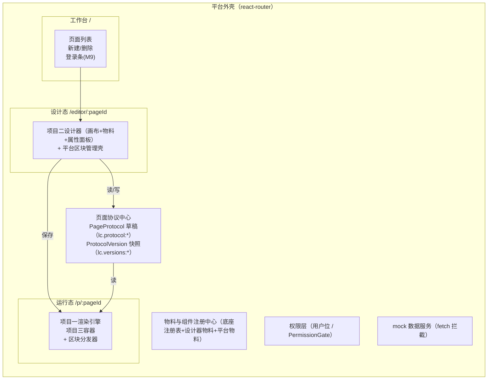

# 项目五：低代码平台整合复刻手册

> **一句话目标**：把项目 0–4 的产物（底座渲染器、动态表单引擎、拖拽设计器、仪表盘容器、JSON 编辑器）整合成一个"设计态 → 页面协议 → 运行态"三层分离的低代码平台原型：工作台管页面、设计器搭页面、协议存页面、运行态跑页面，外加发布流、版本回滚与权限位。
> **预计工期**：2–3 周（10 个里程碑，每个 0.5–3 天，见里程碑标题后的进度标注）。
> **前置要求**：已完成项目 0–4（`00-公共底座`、`01-项目一-Schema动态表单`、`02-项目二-拖拽式表单设计器`、`03-项目三-Grafana式仪表盘`、`04-项目四-JSON编辑器` 五份手册）；尚未全部完成的，按第 6 节衔接清单逐项抽取对应模块。
> **技术栈**：React 18 + TypeScript + Vite；新增依赖仅 `react-router-dom`（zustand / immer / echarts / @monaco-editor/react 均已随项目 0–4 装好；布局引擎沿用项目三的自研实现，不依赖 react-grid-layout）。

## 0. 最终效果与验收清单

全部打勾即复刻完成，每条给出可运行的验证：

- [ ] **工作台**：`npm run dev` 打开 `/`，新建/删除页面，刷新后列表仍在；Local Storage 出现 `lc.page-index`。
- [ ] **设计态搭建**：`/editor/:pageId` 内嵌项目二设计器，拖物料、配属性、Cmd+Z 撤销，保存后刷新不丢。
- [ ] **协议落库**：保存后 Local Storage 出现 `lc.protocol:<pageId>`，结构符合第 2 节。
- [ ] **表单区块运行**：`/p/:pageId` 用项目一引擎渲染：必填校验拦截；城市选"北京"时区县字段出现（`$form.city == 'bj'` 联动）。
- [ ] **图表区块运行**：项目三容器渲染 DashboardDoc：折线图出图、按 `refreshMs` 自动刷新、时间范围可由 URL 参数控制。
- [ ] **数据源绑定**：低代码区块按钮点击 → Network 面板出现 `GET /api/mock/users` → cardList 随 `$ds.dsUsers.data` 更新，Console 无报错。
- [ ] **JSON 兜底改协议**：编辑器"源码模式"改按钮 `text` 保存草稿，运行态文字跟着变。
- [ ] **发布与回滚**：发布生成 `lc.versions:<pageId>` 快照；改坏协议发布后回滚旧版，运行态恢复。
- [ ] **权限位**：restricted 页面用"张三"可见、"李四"见无权提示；区块级 `requiredBits` 整块隐藏。
- [ ] **降级兜底**：节点 `type` 改成 `"ghost"` 渲染红色占位不白屏；`visibleWhen` 写成非法表达式区块仍可见且有警告。

## 1. 平台架构总览



**设计态与运行态的隔离边界**（整合最容易破的规矩）：

1. **唯一契约是页面协议**：设计态只产出 `PageProtocol`，运行态只消费它；预览 = 打开 `/p/:pageId` 跑同一份协议。
2. **单一数据源**：设计器树存在项目二 `useEditorStore`（带 undo/redo），保存时经适配层转成协议；协议是落盘唯一权威，不存第二份（坑 2 的根源就是双写）。
3. **两套渲染入口**：设计态物料是 `pointer-events: none` 的 inert 预览，运行态物料可交互并挂 bindings/事件——同一批组件、两个入口，不共享选中/事件拦截逻辑。
4. **运行态防御性消费**：未知物料占位、区块级 ErrorBoundary、表达式求值失败按可见处理——协议是别人写的。

**技术选型表**：

| 决策点 | 选型 | 理由 |
|---|---|---|
| 路由 | react-router-dom v7，`/`、`/editor/:pageId`、`/p/:pageId` 三条路由 | 页面少、无嵌套布局诉求 |
| 状态 | zustand 多 store：工作台 `pageStore`、编辑态复用项目二 `useEditorStore`、运行态 `useRuntimeStore`、权限 `useUserStore` | 各层单一数据源，互不渗透 |
| 协议存储 | localStorage（`lc.protocol:*` 草稿 + `lc.versions:*` 快照），升级路径见 4.1 | 原型零后端 |
| 数据服务 | 前端 fetch 拦截式 mock（M6） | 演示 loading/并发/轮询全链路 |
| micro-frontend | **不需要**：同一 React 实例、同一构建体系，并入同一 src；物料独立部署才需要，见 4.2 动态 import 路线 | — |

**工程组织**：把前四个项目的产物按目录并入一个 Vite 工程（各手册的文件路径保持不变），新增代码全部放 `src/platform/`：

```
src/
  schema/ materials/ renderer/ expr/ undo/   # 项目0：底座（00-手册）
  chapter2/                                  # 项目1：动态表单（01-手册）
  designer/                                  # 项目2：表单设计器（02-手册）
  dashboard/ datasource/                     # 项目3：仪表盘（03-手册）
  json-editor/ monaco-setup.ts               # 项目4：JSON 编辑器（04-手册）
  platform/                                  # 项目5：本手册新增的全部代码
```

## 2. 数据模型与协议

页面协议是平台唯一持久化对象：设计态往里写，运行态从里读，版本快照存它的深拷贝。

### 2.1 类型定义（权限 / 变量 / 数据源 / 低代码节点）

```ts
// src/platform/page-protocol.ts（第 1 部分）
// SchemaNode 是底座手册 schema/page.ts 中 PageNode 的平台演进版（增加 style/events/bindings），
// 升级思路来自 14-6 低代码平台整合 路线 1。
export const LATEST_PROTOCOL_VERSION = 1

/** public 任何人可见；login 登录即可见；restricted 还需命中权限位 */
export type PermissionMode = 'public' | 'login' | 'restricted'

export interface PagePermissions {
  mode: PermissionMode
  /** restricted 模式要求的权限位；用户位集合与其有交集即可见 */
  requiredBits: string[]
}

export interface PageVariable {
  name: string
  type: 'string' | 'number' | 'boolean' | 'object' | 'array'
  /** 初始值；求值上下文里字段永远存在（哪怕 null），规避 undefined 三态坑 */
  initial: unknown
}

export interface DataSourceConfig {
  id: string
  kind: 'fetch'
  api: string
  method: 'GET' | 'POST'
  /** 查询参数：键 → 表达式（如 '$page.keyword'），每次请求前重新求值 */
  params?: Record<string, string>
  /** 响应取值路径：'data.list'；缺省取整个响应体 */
  dataPath?: string
  pollIntervalMs?: number
}

/** 白名单式受控样式子集，不是自由 CSS：数值字段渲染时统一拼 px */
export interface NodeStyle {
  width?: string
  height?: string
  marginTop?: number
  marginBottom?: number
  padding?: number
  fontSize?: number
  color?: string
  background?: string
  display?: 'block' | 'flex' | 'inline-flex' | 'none'
  flexDirection?: 'row' | 'column'
  gap?: number
}

/** 动作配置是 discriminated union：type 收窄 config 形状 */
export type ActionConfig =
  | { type: 'updateVariable'; config: { scope: 'page' | 'global'; name: string; valueExpr: string } }
  | { type: 'callDataSource'; config: { dataSourceId: string } }
  | { type: 'link'; config: { url: string; target?: '_self' | '_blank' } }
  | { type: 'toast'; config: { messageExpr: string } }

/** 事件名 → 串行动作链 */
export interface EventBinding {
  event: string
  actions: ActionConfig[]
}

export interface SchemaNode {
  id: string                        // 稳定 id：渲染 key / 事件定位 / 校验去重全靠它
  type: string                      // 物料名，注册表查找用
  props?: Record<string, unknown>   // 静态属性
  children?: SchemaNode[]           // 容器节点递归 children，原子组件没有
  style?: NodeStyle                 // 受控样式
  events?: EventBinding[]           // 事件-动作绑定
  bindings?: Record<string, string> // prop 名 → 表达式，求值后覆盖同名静态 props
  dataSourceId?: string             // 预留：节点级数据源
  [extra: `x-${string}`]: unknown   // x- 扩展：协议内核不解释、原样保留（底座手册 1.1 原则 4）
}
```

### 2.2 类型定义（区块联合与页面根对象）

平台页面 = 有序的**区块（Block）**列表，四个项目的产物各自成为一类区块的载荷：

```ts
// src/platform/page-protocol.ts（第 2 部分）
import type { DashboardDoc } from '../dashboard/types'  // 项目三手册 §2 的仪表盘协议

export type BlockKind = 'lowcode' | 'form' | 'dashboard' | 'json'

export interface BlockBase {
  id: string
  kind: BlockKind
  title?: string
  /** 区块级显隐表达式，求值上下文同 bindings（$page/$global/$ds） */
  visibleWhen?: string
  /** 区块级权限位：restricted 页面内的进一步收敛 */
  requiredBits?: string[]
}

/** 低代码区块：底座递归渲染器渲染的节点数组 */
export interface LowcodeBlock extends BlockBase {
  kind: 'lowcode'
  nodes: SchemaNode[]
}

/** 设计器树的平台中立形态（字段与项目二 EditorNode 一致，协议不直接依赖设计器类型） */
export interface BlockNode {
  id: string
  componentName: string
  props: Record<string, unknown>
  children?: BlockNode[]
}

/** 表单区块：只存设计器树这一个数据源，FormSchema 运行时派生（坑 2） */
export interface FormBlock extends BlockBase {
  kind: 'form'
  tree: BlockNode[]
}

/** 图表区块：整份 DashboardDoc 原样内嵌 */
export interface DashboardBlock extends BlockBase {
  kind: 'dashboard'
  dashboard: DashboardDoc
}

/** JSON 区块：任意 JSON 内容，运行态只读展示 */
export interface JsonBlock extends BlockBase {
  kind: 'json'
  json: unknown
}

export type PageBlock = LowcodeBlock | FormBlock | DashboardBlock | JsonBlock

export interface PageProtocol {
  protocolVersion: number   // 迁移链锚点，第一天就有（4.1）
  pageId: string            // 所有存储键的关联键，创建后永不改
  title: string
  permissions: PagePermissions
  state: { pageVariables: PageVariable[]; globalVariables: string[] }
  dataSources: DataSourceConfig[]
  blocks: PageBlock[]
  updatedAt: number
}
```

配套工厂（同文件追加）：

```ts
export function createEmptyProtocol(pageId: string, title: string): PageProtocol {
  return {
    protocolVersion: LATEST_PROTOCOL_VERSION,
    pageId, title,
    permissions: { mode: 'public', requiredBits: [] },
    state: { pageVariables: [], globalVariables: [] },
    dataSources: [],
    blocks: [],
    updatedAt: Date.now(),
  }
}

export function newBlockId(): string {
  return `block_${crypto.randomUUID().slice(0, 8)}`
}

export function createEmptyBlock(kind: BlockKind): PageBlock {
  const id = newBlockId()
  switch (kind) {
    case 'lowcode': return { id, kind, title: '低代码区块', nodes: [] }
    case 'form': return { id, kind, title: '表单区块', tree: [] }
    case 'dashboard': return { id, kind, title: '图表区块', dashboard: createSampleDashboardDoc() }
    case 'json': return { id, kind, title: 'JSON 区块', json: { tip: '在这里放任意 JSON 内容' } }
  }
}

/** 新图表区块的默认内容：一份最小可跑的 DashboardDoc（数据源与项目三 mock 对齐） */
function createSampleDashboardDoc(): DashboardDoc {
  const now = Date.now()
  return {
    version: 1,
    meta: { title: '图表区块', updatedAt: now },
    time: { from: now - 3600_000, to: now, refreshMs: 0 },
    datasources: [{ uid: 'ds-walk', type: 'mock-random-walk', options: {} }],
    panels: [{
      id: 'p_line', type: 'line', title: '折线示例', datasourceUid: 'ds-walk',
      query: { refId: 'A', payload: { seriesName: 'demo', seriesCount: 1, volatility: 8, baseline: 50 } },
      options: { unit: '', area: true },
    }],
    layout: [{ i: 'p_line', x: 0, y: 0, w: 24, h: 9 }],
  }
}
```

### 2.3 版本快照 ProtocolVersion

```ts
// 定义于 src/platform/publish/versionRepo.ts（M7 完整实现），先给出数据形状：
export interface ProtocolVersion {
  versionId: string                       // 'ver_xxxxxxxx'
  pageId: string
  semver: string                          // '1.0.0'，每次发布 patch +1
  status: 'published' | 'archived'        // 同页同时只有一个 published
  changelog: string                       // 本次发布改了什么
  snapshot: PageProtocol                  // 全量快照：发布那一刻的协议深拷贝
  publishedAt: number
  publishedBy: string
  parentVersionId?: string                // 回滚产生的版本记录回滚来源
}
```

### 2.4 平台物料描述（统一注册中心）

**协议里只存 `type` 字符串，组件引用永远住在注册表里**（底座手册 1.2 原则）。四个注册中心在平台层收口：

| 注册中心 | 来源 | 键 | 平台用途 |
|---|---|---|---|
| `src/materials/registry.ts`（`registerMaterial`/`getMaterial`） | 项目 0 | `SchemaNode.type`（grid/card/text/input/button/cardList） | 运行态低代码渲染 + 发布校验物料是否已注册 |
| `src/designer/materials/registry.ts`（`materialRegistry`） | 项目 2 | `BlockNode.componentName`（input/select/section…） | 表单区块画布 + `toFormSchema` 派生 |
| `src/dashboard/panelRegistry.tsx`（`panelRegistry`） | 项目 3 | `Panel.type`（line/bar/stat/table） | 图表区块内渲染面板 |
| `src/platform/materials/platformMaterials.tsx` | 项目 5 | 补充底座缺的 `button`/`cardList` | 低代码区块的交互与数据物料 |

新增一种物料 = 注册一个对象，设计态画布、发布校验、运行态渲染三层自动感知。

### 2.5 完整示例页面协议 JSON

可直接贴进源码模式的协议（低代码区块 + 表单区块 + 图表区块）：

```json
{
  "protocolVersion": 1,
  "pageId": "page_a1b2c3d4",
  "title": "运营活动页（示例）",
  "permissions": { "mode": "restricted", "requiredBits": ["bit:activity"] },
  "state": {
    "pageVariables": [{ "name": "keyword", "type": "string", "initial": "" }],
    "globalVariables": []
  },
  "dataSources": [
    { "id": "dsUsers", "kind": "fetch", "api": "/api/mock/users", "method": "GET",
      "params": { "keyword": "$page.keyword" }, "dataPath": "data.list" }
  ],
  "blocks": [
    {
      "id": "block_head", "kind": "lowcode", "title": "头部与刷新",
      "nodes": [
        { "id": "n_title", "type": "text", "props": { "content": "活动用户速览", "level": 2 } },
        { "id": "n_refresh", "type": "button", "props": { "text": "刷新用户列表" },
          "style": { "marginTop": 8 },
          "events": [{ "event": "onClick", "actions": [
            { "type": "callDataSource", "config": { "dataSourceId": "dsUsers" } },
            { "type": "toast", "config": { "messageExpr": "'已刷新'" } }
          ] }] }
      ]
    },
    {
      "id": "block_form", "kind": "form", "title": "报名表单",
      "tree": [
        { "id": "f_name", "componentName": "input",
          "props": { "label": "姓名", "required": true, "placeholder": "请输入姓名" } },
        { "id": "f_city", "componentName": "select",
          "props": { "label": "城市", "options": [
            { "label": "北京", "value": "bj" }, { "label": "上海", "value": "sh" } ] } },
        { "id": "f_district", "componentName": "input",
          "props": { "label": "区县", "visibleWhen": "$form.city == 'bj'" } }
      ]
    },
    {
      "id": "block_chart", "kind": "dashboard", "title": "活动数据",
      "dashboard": {
        "version": 1,
        "meta": { "title": "活动数据", "updatedAt": 1760000000000 },
        "time": { "from": 1759996400000, "to": 1760000000000, "refreshMs": 30000 },
        "datasources": [{ "uid": "ds-walk", "type": "mock-random-walk", "options": {} }],
        "panels": [
          { "id": "p_pv", "type": "line", "title": "报名量", "datasourceUid": "ds-walk",
            "query": { "refId": "A", "payload": { "seriesName": "signup", "seriesCount": 1, "volatility": 6, "baseline": 120 } },
            "options": { "unit": "人", "area": true } }
        ],
        "layout": [{ "i": "p_pv", "x": 0, "y": 0, "w": 24, "h": 9 }]
      }
    }
  ],
  "updatedAt": 1760000000000
}
```

读这份 JSON 注意三点：数据源 id `dsUsers` 是**合法标识符**（表达式用 `$ds.dsUsers` 点访问，不支持方括号）；表单区块存设计器树而不是派生的 FormSchema；图表区块的 `dashboard` 是项目三协议原样内嵌，平台不改写它。

## 3. 复刻主线路径：里程碑 M1..M10

### M1 平台工程与工作台路由（第 1 周前半）

**目标**：整合工程跑起来，`/` 出现工作台：新建/删除页面写入 localStorage 索引，刷新不丢；"编辑/运行"按钮先放上（对应路由 M3/M4 接通，点击暂空白属预期）。机制要点：页面索引（`PageSummary[]`）与协议正文（M2）分开存，删除时两把钥匙一起清。

**完整代码**：

```ts
// src/platform/pageStore.ts —— 页面索引 store（localStorage 持久化）
import { create } from 'zustand'

export type PageStatus = 'draft' | 'publishing' | 'published' | 'offline'

export interface PageSummary {
  pageId: string
  title: string
  status: PageStatus
  updatedAt: number
}

const INDEX_KEY = 'lc.page-index'

function readIndex(): PageSummary[] {
  try {
    const raw = localStorage.getItem(INDEX_KEY)
    return raw ? (JSON.parse(raw) as PageSummary[]) : []
  } catch {
    return []   // 索引损坏从空开始，不阻塞平台启动
  }
}

function writeIndex(pages: PageSummary[]): void {
  localStorage.setItem(INDEX_KEY, JSON.stringify(pages))
}

interface PageStoreState {
  pages: PageSummary[]
  createPage: (title: string) => string
  removePage: (pageId: string) => void
  upsertPage: (pageId: string, patch: Partial<Omit<PageSummary, 'pageId'>>) => void
}

export const usePageStore = create<PageStoreState>()((set, get) => ({
  pages: readIndex(),
  createPage: (title) => {
    const pageId = `page_${crypto.randomUUID().slice(0, 8)}`
    const next: PageSummary[] = [
      { pageId, title, status: 'draft', updatedAt: Date.now() },
      ...get().pages,
    ]
    writeIndex(next)
    set({ pages: next })
    return pageId
  },
  removePage: (pageId) => {
    const next = get().pages.filter((p) => p.pageId !== pageId)
    writeIndex(next)
    localStorage.removeItem('lc.protocol:' + pageId)   // 协议正文（M2 写入）
    localStorage.removeItem('lc.versions:' + pageId)   // 版本快照（M7 写入）
    set({ pages: next })
  },
  upsertPage: (pageId, patch) => {
    const next = get().pages.map((p) => (p.pageId === pageId ? { ...p, ...patch } : p))
    writeIndex(next)
    set({ pages: next })
  },
}))
```

```tsx
// src/platform/workbench/WorkbenchPage.tsx —— 工作台：列表 + 新建 + 删除
import { useState } from 'react'
import { Link } from 'react-router-dom'
import { usePageStore } from '../pageStore'

export function WorkbenchPage() {
  const pages = usePageStore((s) => s.pages)
  const createPage = usePageStore((s) => s.createPage)
  const removePage = usePageStore((s) => s.removePage)
  const [title, setTitle] = useState('')

  return (
    <div style={{ maxWidth: 880, margin: '0 auto', padding: 24 }}>
      <h1>低代码平台工作台</h1>
      <form onSubmit={(e) => {
        e.preventDefault()
        if (!title.trim()) return
        createPage(title.trim())
        setTitle('')
      }}>
        <input value={title} onChange={(e) => setTitle(e.target.value)} placeholder="新页面标题，如：运营活动页" />
        <button type="submit">新建页面</button>
      </form>
      <ul>
        {pages.map((p) => (
          <li key={p.pageId}>
            <b>{p.title}</b>（{p.status}，更新于 {new Date(p.updatedAt).toLocaleString()}）
            <Link to={`/editor/${p.pageId}`}><button type="button">编辑</button></Link>
            <Link to={`/p/${p.pageId}`}><button type="button">运行</button></Link>
            <button type="button" onClick={() => removePage(p.pageId)}>删除</button>
          </li>
        ))}
        {pages.length === 0 && <li>还没有页面，先新建一个</li>}
      </ul>
    </div>
  )
}
```

```tsx
// src/platform/App.tsx —— 平台路由（M1 只有工作台）
import { BrowserRouter, Routes, Route } from 'react-router-dom'
import { WorkbenchPage } from './workbench/WorkbenchPage'

export function App() {
  return (
    <BrowserRouter>
      <Routes>
        <Route path="/" element={<WorkbenchPage />} />
      </Routes>
    </BrowserRouter>
  )
}
```

```tsx
// src/main.tsx —— 平台装配入口：五个项目的初始化全部收口在这里
import { StrictMode } from 'react'
import { createRoot } from 'react-dom/client'
import './materials/bootstrap'    // 项目0：底座物料注册（00-手册 1.2，入口 import 一次）
import './datasource/register'    // 项目3：mock 数据源注册（03-手册 路线 5）
import { App } from './platform/App'

createRoot(document.getElementById('root')!).render(
  <StrictMode>
    <App />
  </StrictMode>,
)
```

**验证**：`npm i react-router-dom` 后 `npm run dev`。打开 `http://localhost:5173/`：新建"测试页"→ 列表出现一行，`lc.page-index` 内容含 pageId；刷新列表仍在；删除后键内容同步消失；Console 无报错。

**常见报错与修复**：

1. `Module '"react-router-dom"' has no exported member 'Routes'` —— 装到了 v5（API 是 `<Switch>`，没有 `Routes`）。修复：`npm i react-router-dom@^7`，删掉旧的 v5。
2. `TypeError: crypto.randomUUID is not a function` —— 用局域网 IP 访问 dev server，页面不在安全上下文。修复：改用 `localhost`（部署环境必须 HTTPS）；本地原型可临时降级 `Math.random().toString(36).slice(2)`。
3. `Failed to resolve import "./platform/App" from "src/main.tsx". Does the file exist?` —— 路径或大小写错。macOS 大小写不敏感能跑，CI/Linux 直接挂。修复：核对目录名与 import 大小写完全一致。

### M2 页面协议定义与存储层（第 1 周前半）

**目标**：第 2.1/2.2/2.3 节的类型写入 `src/platform/page-protocol.ts` 与 `versionRepo.ts`（M7 再补动作），并实现协议草稿存储层。机制要点：存储层只做"解析 + 结构校验 + 版本方向检查"，不理解语义；写入前先 `structuredClone`——协议混入组件引用/函数会在这里先报错，而不是写坏一半的 localStorage；发布锁（M7）也从这层拦。

**完整代码**：

```ts
// src/platform/protocolRepo.ts —— 协议存储层：草稿区读写（localStorage）
import { LATEST_PROTOCOL_VERSION, createEmptyProtocol, type PageProtocol } from './page-protocol'
import { usePageStore } from './pageStore'

const KEY_PREFIX = 'lc.protocol:'

/** 解析 + 结构校验 + 版本方向检查。旧版本数据的升级走 4.1 迁移链 */
export function parseProtocol(raw: string): PageProtocol {
  let parsed: unknown
  try {
    parsed = JSON.parse(raw)
  } catch (e) {
    throw new Error(`协议不是合法 JSON：${(e as Error).message}`)
  }
  const p = parsed as PageProtocol
  if (typeof p?.protocolVersion !== 'number' || !Array.isArray(p?.blocks) || typeof p?.pageId !== 'string') {
    throw new Error('协议结构不合法：缺少 protocolVersion / pageId / blocks')
  }
  if (p.protocolVersion > LATEST_PROTOCOL_VERSION) {
    throw new Error(`协议版本 ${p.protocolVersion} 高于平台支持的 ${LATEST_PROTOCOL_VERSION}，请先升级平台`)
  }
  return p
}

export function loadDraft(pageId: string): PageProtocol | null {
  const raw = localStorage.getItem(KEY_PREFIX + pageId)
  return raw ? parseProtocol(raw) : null
}

export function ensureDraft(pageId: string, fallbackTitle: string): PageProtocol {
  return loadDraft(pageId) ?? createEmptyProtocol(pageId, fallbackTitle)
}

export function saveDraft(pageId: string, protocol: PageProtocol): void {
  const page = usePageStore.getState().pages.find((p) => p.pageId === pageId)
  if (page?.status === 'publishing') {
    throw new Error('页面正在发布中，暂不能保存草稿（防止快照撕裂，见 M7）')
  }
  // structuredClone 先行：协议混入组件引用/函数（循环引用）在这里先炸，不写坏一半数据
  const next: PageProtocol = { ...structuredClone(protocol), pageId, updatedAt: Date.now() }
  localStorage.setItem(KEY_PREFIX + pageId, JSON.stringify(next))
}

export function deleteDraft(pageId: string): void {
  localStorage.removeItem(KEY_PREFIX + pageId)
}
```

**验证**：浏览器 Console 执行 `localStorage.setItem('lc.page-index', JSON.stringify([{ pageId: 'page_test01', title: '手工测试页', status: 'draft', updatedAt: Date.now() }]))`，刷新工作台看到该页；`localStorage.getItem('lc.protocol:page_test01')` 为 `null`（正文由 M3 首次保存经 `ensureDraft` 创建）。故意把 `page-protocol.ts` 的 `blocks` 字段改名，确认编译期红线——协议类型错误最先在存储层与编辑器爆出。

**常见报错与修复**：

1. `TypeError: Converting circular structure to JSON` —— 协议里塞了组件引用/React 元素（如把物料 `icon` ReactNode 存进 props）。修复：组件、图标、函数全部住注册表，协议只存字符串键；`structuredClone` 哨兵会先报 `DataCloneError`，按报错字段定位改掉。
2. `DataCloneError: #<Object> could not be cloned` —— 同根因的另一张脸：函数/类实例不可克隆。修复同第 1 条；口诀是"协议里只能有 JSON 五种值 + x- 扩展"。
3. `Error: 协议结构不合法：缺少 protocolVersion / pageId / blocks` —— 手改 localStorage 弄坏了结构。修复：不手改存储键，改协议一律走 M5 源码模式；这个错误正是 `parseProtocol` 防线上线的证明。

### M3 设计态接入：项目二改造为平台编辑器（第 1 周后半）

**目标**：`/editor/:pageId` 出现平台编辑器：左侧区块管理（增删四种区块、选中切换），右侧表单区块内嵌完整项目二设计器（拖拽、属性面板、撤销全可用），"保存设计器内容到协议"写回协议；其余三类区块先用 JSON 源码编辑（M5 升级 Monaco）。机制要点：设计器树（EditorNode）与协议树（BlockNode）字段一致但类型解耦，互转走独立适配层；设计器 store 是单例，切换区块"灌入一次"必须有守卫，否则 StrictMode 双挂载会写两遍。

**完整代码**：

```ts
// src/platform/adapter/blockTree.ts —— 协议树 ↔ 设计器树互转（平台适配层）
import type { EditorNode } from '../../designer/materials/createNode'  // 项目二手册：物料节点工厂
import type { BlockNode } from '../page-protocol'

/** 协议区块树 → 设计器 EditorNode 树：包 FormRoot 根；补缺失/重复 id，历史数据也能救活 */
export function blockToEditorTree(nodes: BlockNode[]): EditorNode {
  const used = new Set<string>()
  const convert = (n: BlockNode): EditorNode => {
    const id = typeof n.id === 'string' && n.id !== '' && !used.has(n.id) ? n.id : crypto.randomUUID()
    used.add(id)
    const node: EditorNode = { id, componentName: n.componentName, props: structuredClone(n.props ?? {}) }
    if (Array.isArray(n.children) && n.children.length > 0) node.children = n.children.map(convert)
    return node
  }
  return { id: 'root', componentName: 'FormRoot', props: {}, children: nodes.map(convert) }
}

/** 设计器树 → 协议区块树：剥掉 FormRoot 根，只留顶层字段数组 */
export function editorTreeToBlocks(root: EditorNode): BlockNode[] {
  const convert = (n: EditorNode): BlockNode => {
    const node: BlockNode = { id: n.id, componentName: n.componentName, props: structuredClone(n.props ?? {}) }
    if (n.children && n.children.length > 0) node.children = n.children.map(convert)
    return node
  }
  return (root.children ?? []).map(convert)
}
```

```tsx
// src/platform/editor/EditorPage.tsx（第 1 部分）—— 状态与协议读写
import { useCallback, useEffect, useState } from 'react'
import { Link, useParams } from 'react-router-dom'
import { usePageStore } from '../pageStore'
import { ensureDraft, saveDraft } from '../protocolRepo'
import { createEmptyBlock, type PageBlock, type PageProtocol } from '../page-protocol'
import { FormBlockDesigner } from './FormBlockDesigner'
import { BlockJsonEditor } from './BlockJsonEditor'

export function EditorPage() {
  const { pageId } = useParams<{ pageId: string }>()
  const [protocol, setProtocol] = useState<PageProtocol | null>(null)
  const [activeId, setActiveId] = useState<string | null>(null)
  const [error, setError] = useState<string | null>(null)
  const upsertPage = usePageStore((s) => s.upsertPage)

  useEffect(() => {
    if (!pageId) return
    const p = ensureDraft(pageId, '未命名页面')
    setProtocol(p)
    setActiveId(p.blocks[0]?.id ?? null)
  }, [pageId])

  const update = useCallback((next: PageProtocol) => {
    if (!pageId) return
    try {
      saveDraft(pageId, next)
      setProtocol(next)
      upsertPage(pageId, { title: next.title })
    } catch (e) {
      setError((e as Error).message)
    }
  }, [pageId, upsertPage])

  if (error) return <p style={{ color: 'red', padding: 24 }}>{error}</p>
  if (!protocol || !pageId) return <p style={{ padding: 24 }}>加载中…</p>

  const addBlock = (kind: PageBlock['kind']) => {
    const block = createEmptyBlock(kind)
    update({ ...protocol, blocks: [...protocol.blocks, block] })
    setActiveId(block.id)
  }
  const removeBlock = (blockId: string) => {
    update({ ...protocol, blocks: protocol.blocks.filter((b) => b.id !== blockId) })
    if (activeId === blockId) setActiveId(null)
  }
  const updateBlock = (next: PageBlock) => {
    update({ ...protocol, blocks: protocol.blocks.map((b) => (b.id === next.id ? next : b)) })
  }

  return <EditorLayout protocol={protocol} activeId={activeId} setActiveId={setActiveId}
    addBlock={addBlock} removeBlock={removeBlock} updateBlock={updateBlock} />
}
```

```tsx
// src/platform/editor/EditorPage.tsx（第 2 部分，同文件拼接）—— 布局 JSX
function EditorLayout(props: {
  protocol: PageProtocol
  activeId: string | null
  setActiveId: (id: string | null) => void
  addBlock: (kind: PageBlock['kind']) => void
  removeBlock: (blockId: string) => void
  updateBlock: (next: PageBlock) => void
}) {
  const { protocol, activeId, setActiveId, addBlock, removeBlock, updateBlock } = props
  const active = protocol.blocks.find((b) => b.id === activeId) ?? null

  return (
    <div style={{ display: 'flex', minHeight: '100vh' }}>
      <aside style={{ width: 260, borderRight: '1px solid #eee', padding: 12 }}>
        <Link to="/">← 返回工作台</Link>
        <h2>{protocol.title}</h2>
        <div>
          {(['lowcode', 'form', 'dashboard', 'json'] as const).map((kind) => (
            <button key={kind} onClick={() => addBlock(kind)}>+ {kind} 区块</button>
          ))}
        </div>
        <ul>
          {protocol.blocks.map((b, i) => (
            <li key={b.id} style={{ fontWeight: b.id === activeId ? 700 : 400 }}>
              <span style={{ cursor: 'pointer' }} onClick={() => setActiveId(b.id)}>
                {i + 1}. {b.title ?? b.kind}
              </span>
              <button onClick={() => removeBlock(b.id)}>删</button>
            </li>
          ))}
          {protocol.blocks.length === 0 && <li>还没有区块，从上面添加</li>}
        </ul>
      </aside>
      <main style={{ flex: 1, padding: 16 }}>
        {active?.kind === 'form' && <FormBlockDesigner block={active} onChange={updateBlock} />}
        {active && active.kind !== 'form' && <BlockJsonEditor block={active} onChange={updateBlock} />}
        {!active && <p>选中左侧一个区块开始编辑</p>}
      </main>
    </div>
  )
}
```

```tsx
// src/platform/editor/FormBlockDesigner.tsx —— 把项目二设计器装进平台编辑器
import { useEffect, useRef } from 'react'
import { DesignerRoot } from '../../designer/DesignerRoot'    // 项目二手册：设计器三栏主界面
import { useEditorStore } from '../../designer/store'         // 项目二手册：编辑器 store（含 undo/redo）
import { blockToEditorTree, editorTreeToBlocks } from '../adapter/blockTree'
import type { FormBlock } from '../page-protocol'

export function FormBlockDesigner({ block, onChange }: {
  block: FormBlock
  onChange: (next: FormBlock) => void
}) {
  const hydratedFor = useRef<string | null>(null)

  // 只在切换到该区块时灌入一次；StrictMode 双挂载与重渲染都不会重复 replaceAll
  useEffect(() => {
    if (hydratedFor.current === block.id) return
    hydratedFor.current = block.id
    useEditorStore.getState().replaceAll(blockToEditorTree(block.tree))
  }, [block.id])

  const save = () => {
    onChange({ ...block, tree: editorTreeToBlocks(useEditorStore.getState().schema) })
  }

  return (
    <div>
      <div style={{ marginBottom: 8 }}>
        <button onClick={save}>保存设计器内容到协议</button>
        <span style={{ marginLeft: 8, color: '#999' }}>设计器可撤销（Cmd+Z），保存的是当前整棵树</span>
      </div>
      <DesignerRoot />
    </div>
  )
}
```

```tsx
// src/platform/editor/BlockJsonEditor.tsx —— 非表单区块的源码编辑（M5 升级为 Monaco）
import { useEffect, useState } from 'react'
import type { PageBlock } from '../page-protocol'

export function BlockJsonEditor({ block, onChange }: {
  block: PageBlock
  onChange: (next: PageBlock) => void
}) {
  const [text, setText] = useState(() => JSON.stringify(block, null, 2))
  const [error, setError] = useState<string | null>(null)

  // 切换区块时重置文本（依赖 block.id 而不是 block，避免每次保存回灌打断输入）
  useEffect(() => {
    setText(JSON.stringify(block, null, 2))
    setError(null)
  }, [block.id])

  const apply = () => {
    try {
      const parsed = JSON.parse(text) as PageBlock
      if (parsed.id !== block.id) throw new Error('不允许修改区块 id（选中与校验靠它定位）')
      if (parsed.kind !== block.kind) throw new Error('不允许修改区块 kind')
      setError(null)
      onChange(parsed)
    } catch (e) {
      setError((e as Error).message)
    }
  }

  return (
    <div>
      <h3>源码编辑：{block.title ?? block.kind}</h3>
      <textarea value={text} onChange={(e) => setText(e.target.value)} rows={18}
        style={{ width: '100%', fontFamily: 'monospace' }} />
      {error && <p style={{ color: 'red' }}>{error}</p>}
      <button onClick={apply}>应用修改</button>
    </div>
  )
}
```

`src/platform/App.tsx` 增加编辑态路由（完整文件）：

```tsx
import { BrowserRouter, Routes, Route } from 'react-router-dom'
import { WorkbenchPage } from './workbench/WorkbenchPage'
import { EditorPage } from './editor/EditorPage'

export function App() {
  return (
    <BrowserRouter>
      <Routes>
        <Route path="/" element={<WorkbenchPage />} />
        <Route path="/editor/:pageId" element={<EditorPage />} />
      </Routes>
    </BrowserRouter>
  )
}
```

**验证**：工作台点"编辑"进入编辑器；添加表单区块 → 拖入"单行输入/分组"→ 改标题 → `Cmd+Z` 撤销 → 点"保存设计器内容到协议"→ `lc.protocol:<pageId>` 的 `blocks[0].tree` 出现节点；刷新重进物料还在（hydrate 生效）。添加 JSON 区块改 `title` 应用后左侧列表标题变化。

**常见报错与修复**：

1. `TypeError: Cannot read properties of undefined (reading 'children')`（designer 渲染时）—— 把 `BlockNode[]` 直接灌给设计器 store，而设计器要求带 `FormRoot` 根的整树。修复：一律经 `blockToEditorTree` 包根再 `replaceAll`（上面代码已含）。
2. `TypeError: useEditorStore.getState().replaceAll is not a function` —— 项目二手册 io 一节的 `replaceAll` action 没落到你的 store。修复：按 02-手册"导入导出"一节在 `designer/store.ts` 补 `replaceAll: (schema) => mutate(...)`。
3. StrictMode 下设计器撤销历史出现多余空记录 —— hydrate effect 没做守卫，双挂载执行了两次 `replaceAll`。修复：`hydratedFor` ref 比较 `block.id`（上面代码已含）。

### M4 运行态渲染管线：协议 → 渲染器（第 2 周前半）

**目标**：`/p/:pageId` 能跑：加载协议 → 逐区块渲染，低代码区块由平台版递归渲染器执行（查底座注册表、白名单样式、未知物料占位、区块级 ErrorBoundary）；表单/图表/JSON 区块本步走占位降级（M5 接通）。机制要点：`getMaterial` 判空是第一道降级；`data-node-id` 写进 DOM 为后续选中/上报留锚；数字样式字段统一拼 px（抽出独立模块供 M6 复用）。

**完整代码**：

```tsx
// src/platform/materials/platformMaterials.tsx —— 平台补充物料：button（底座 bootstrap 之外）
import { registerMaterial, getMaterial } from '../../materials/registry'  // 项目0手册 1.2

function PlatformButton({ text }: { text?: string; nodeId: string }) {
  return <button type="button">{text ?? '按钮'}</button>
}

// 底座 materials/types.ts 的 WidgetPropsMap 需补一行（discriminated union 合法扩展，不改既有物料）：
//   button: { text?: string }
if (!getMaterial('button')) {
  registerMaterial({
    type: 'button', label: '按钮', icon: '⬛', group: '基础', isContainer: false,
    defaultProps: { text: '按钮' },
    setters: [{ name: 'text', label: '按钮文字', setter: 'TextInputSetter' }],
    // 若你的底座 registerMaterial 泛型收口较严，集中在这一个 cast 上处理（运行时无影响）：
    component: PlatformButton as unknown as Parameters<typeof registerMaterial>[0]['component'],
  })
}
```

```ts
// src/platform/runtime/nodeStyle.ts —— 白名单样式 → CSSProperties（M4/M6 共用）
import type { CSSProperties } from 'react'
import type { NodeStyle } from '../page-protocol'

export function toCss(style?: NodeStyle): CSSProperties {
  const css: CSSProperties = {}
  if (!style) return css
  if (style.width) css.width = style.width
  if (style.height) css.height = style.height
  if (style.marginTop !== undefined) css.marginTop = style.marginTop + 'px'
  if (style.marginBottom !== undefined) css.marginBottom = style.marginBottom + 'px'
  if (style.padding !== undefined) css.padding = style.padding + 'px'
  if (style.fontSize !== undefined) css.fontSize = style.fontSize + 'px'
  if (style.color) css.color = style.color
  if (style.background) css.background = style.background
  if (style.display) css.display = style.display
  if (style.flexDirection) css.flexDirection = style.flexDirection
  if (style.gap !== undefined) css.gap = style.gap + 'px'
  return css
}
```

```tsx
// src/platform/runtime/LowcodeNodeView.tsx —— 低代码节点递归渲染器（底座 NodeView 的平台版）
import { memo } from 'react'
import { getMaterial } from '../../materials/registry'   // 项目0手册 1.2：type → 物料
import { toCss } from './nodeStyle'
import type { SchemaNode } from '../page-protocol'

function LowcodeNodeViewImpl({ node }: { node: SchemaNode }) {
  const material = getMaterial(node.type)

  // 降级 1：未注册物料渲染占位——单节点损坏不能放倒整页
  if (!material) {
    return (
      <div style={{ color: '#ff4d4f', border: '1px dashed #ff4d4f', borderRadius: 4, padding: 8 }}>
        未注册的组件类型：{node.type}
      </div>
    )
  }

  const Widget = material.component
  const children = Array.isArray(node.children) && node.children.length > 0
    ? node.children.map((child) => <LowcodeNodeView key={child.id} node={child} />)
    : undefined

  return (
    <div style={toCss(node.style)} data-node-id={node.id}>
      {/* 容器物料通过 JSX children 接收子节点，递归结果必须传进 Widget */}
      <Widget nodeId={node.id} {...node.props}>{children}</Widget>
    </div>
  )
}

export const LowcodeNodeView = memo(LowcodeNodeViewImpl)
```

```tsx
// src/platform/runtime/BlockErrorBoundary.tsx —— 区块级错误边界：单区块异常不放倒整页
import { Component, type ErrorInfo, type ReactNode } from 'react'

interface Props { blockId: string; children: ReactNode }
interface State { error: Error | null }

export class BlockErrorBoundary extends Component<Props, State> {
  state: State = { error: null }

  static getDerivedStateFromError(error: Error): State {
    return { error }
  }

  componentDidCatch(error: Error, info: ErrorInfo): void {
    console.error(`[区块 ${this.props.blockId}] 渲染异常：`, error, info.componentStack)
  }

  render() {
    if (this.state.error) {
      return (
        <div style={{ border: '1px solid #ffa39e', background: '#fff1f0', padding: 12, borderRadius: 6 }}>
          该区块渲染出错：{this.state.error.message}
        </div>
      )
    }
    return this.props.children
  }
}
```

```tsx
// src/platform/runtime/BlockView.tsx —— 区块分发器 v1：先通低代码区块，其余占位降级
import type { PageBlock } from '../page-protocol'
import { LowcodeNodeView } from './LowcodeNodeView'

export function BlockView({ block }: { block: PageBlock }) {
  switch (block.kind) {
    case 'lowcode':
      return (
        <section>
          {block.nodes.map((node) => <LowcodeNodeView key={node.id} node={node} />)}
        </section>
      )
    default:
      // 降级 2：尚未接通/未知区块类型渲染占位，不让整页挂掉（M5 接通其余三类）
      return (
        <div style={{ border: '1px dashed #d9d9d9', borderRadius: 6, padding: 12, color: '#999' }}>
          暂不支持渲染的区块类型：{(block as PageBlock).kind}
        </div>
      )
  }
}
```

```tsx
// src/platform/runtime/RuntimePage.tsx —— 运行态路由页 v1：加载协议 → 逐区块渲染
import { useEffect, useState } from 'react'
import { Link, useParams } from 'react-router-dom'
import { loadDraft, parseProtocol } from '../protocolRepo'
import type { PageProtocol } from '../page-protocol'
import { BlockView } from './BlockView'
import { BlockErrorBoundary } from './BlockErrorBoundary'

export function RuntimePage() {
  const { pageId } = useParams<{ pageId: string }>()
  const [protocol, setProtocol] = useState<PageProtocol | null>(null)
  const [error, setError] = useState<string | null>(null)

  useEffect(() => {
    if (!pageId) return
    let alive = true
    try {
      const raw = localStorage.getItem('lc.protocol:' + pageId)
      const p = raw ? parseProtocol(raw) : null
      if (!alive) return
      if (!p) setError(`页面 ${pageId} 不存在或还没有保存过协议`)
      else setProtocol(p)
    } catch (e) {
      if (alive) setError((e as Error).message)
    }
    return () => { alive = false }
  }, [pageId])

  if (error) return <div style={{ padding: 24 }}><p>{error}</p><Link to="/">返回工作台</Link></div>
  if (!protocol) return <p style={{ padding: 24 }}>加载中…</p>

  return (
    <div style={{ padding: 24 }}>
      <h1>{protocol.title}</h1>
      {protocol.blocks.map((block) => (
        <BlockErrorBoundary key={block.id} blockId={block.id}>
          <BlockView block={block} />
        </BlockErrorBoundary>
      ))}
    </div>
  )
}
```

接线两处：`App.tsx` 的 `<Routes>` 内追加 `<Route path="/p/:pageId" element={<RuntimePage />} />`（import 加上 `RuntimePage`）；`main.tsx` 追加 `import './platform/materials/platformMaterials'`。

**验证**：编辑器给页面加低代码区块，源码编辑里粘贴 2.5 节的 `nodes` 数组（标题 + 按钮），应用后打开 `/p/:pageId`：标题与按钮渲染出来；把某节点 `type` 改成 `"ghost"` → 红色占位而非白屏；Console 无 React key 警告。

**常见报错与修复**：

1. `Error: Element type is invalid: expected a string (for built-in components) or a class/function (for composite components) but got: undefined.` —— 直接 `const Widget = registry[type]` 后渲染，type 查不到时 Widget 是 undefined。修复：永远走 `getMaterial()` 判空 + 占位分支（LowcodeNodeView 已含）。
2. `Warning: Each child in a list should have a unique "key" prop.` —— `children.map` 忘传 key 或 key 用数组下标。修复：`key={child.id}`，节点 id 永不复用（底座手册 1.1 原则 5）。
3. 页面所有节点都显示"未注册的组件类型" —— `main.tsx` 忘了 `import './materials/bootstrap'`，注册表是空的。修复：补上底座物料注册入口 import；这是整合项目最常见的"注册表没人装配"事故。

### M5 表单/图表/JSON 三种区块类型打通（第 2 周前半）

**目标**：四类区块全可跑：表单区块用项目一引擎渲染（校验、`visibleWhen` 联动、提交结果展示）；图表区块把 DashboardDoc 装载进项目三容器；JSON 区块只读展示；编辑器新增"源码模式"用项目四 Monaco 兜底改整份协议。机制要点：FormSchema 运行时从设计器树派生（`toFormSchema`），协议里永远只有一份树；项目三 store 是单例，图表区块"进入即 `replaceDoc` 覆盖"。

**完整代码**：

```tsx
// src/platform/runtime/blocks/FormBlockView.tsx —— 表单区块：项目一引擎渲染设计器树
import { useMemo, useState } from 'react'
import { blockToEditorTree } from '../../adapter/blockTree'
import { toFormSchema } from '../../../designer/preview/toFormSchema'       // 项目二手册：树 → FormSchema
import { FormProvider, useFormStore } from '../../../chapter2/FormProvider' // 项目一手册
import { SchemaNode } from '../../../chapter2/SchemaNode'                   // 项目一手册
import type { FormData } from '../../../chapter2/types'
import type { FormBlock } from '../../page-protocol'

export function FormBlockView({ block }: { block: FormBlock }) {
  // 设计器树是唯一数据源，FormSchema 每次派生：协议里不存两份，杜绝双写漂移
  const formSchema = useMemo(() => toFormSchema(blockToEditorTree(block.tree)), [block.tree])
  const [submitted, setSubmitted] = useState<FormData | null>(null)

  if (formSchema.fields.length === 0) {
    return <div style={{ border: '1px dashed #d9d9d9', padding: 12, borderRadius: 6 }}>
      空表单区块：回编辑器拖入字段
    </div>
  }

  return (
    <section>
      <h2>{block.title ?? '表单区块'}</h2>
      <FormProvider schema={formSchema}>
        <InnerForm onSubmitted={setSubmitted} />
      </FormProvider>
      {submitted && (
        <pre style={{ background: '#f6f8fa', padding: 12, borderRadius: 6 }}>
          提交结果：{JSON.stringify(submitted, null, 2)}
        </pre>
      )}
    </section>
  )
}

function InnerForm({ onSubmitted }: { onSubmitted: (data: FormData) => void }) {
  const submit = useFormStore((s) => s.submit)
  const fields = useFormStore((s) => s.schema.fields)
  return (
    <form onSubmit={(e) => {
      e.preventDefault()
      const data = submit()   // 项目一提交链路：全量校验 → 过滤隐藏字段 → 剥内部标记
      if (data) onSubmitted(data)
    }}>
      {fields.map((f) => <SchemaNode key={f.name} schema={f} path={f.name} />)}
      <button type="submit">提交</button>
    </form>
  )
}
```

```tsx
// src/platform/runtime/blocks/DashboardBlockView.tsx —— 图表区块：项目三容器承载 DashboardDoc
import { useEffect } from 'react'
import { DashboardPage } from '../../../dashboard/DashboardPage'   // 项目三手册 路线 8
import { useDashboardStore } from '../../../dashboard/dashboardStore'
import type { DashboardBlock } from '../../page-protocol'

export function DashboardBlockView({ block }: { block: DashboardBlock }) {
  useEffect(() => {
    // 进入即装载：单例 store 在多页面间会被覆盖，语义是"谁在跑谁说了算"
    useDashboardStore.getState().replaceDoc(structuredClone(block.dashboard))
    useDashboardStore.getState().setMode('view')
  }, [block])

  return (
    <section>
      <h2>{block.title ?? '图表区块'}</h2>
      {/* 适配点：项目三 DashboardPage 最外层是 height:100vh，嵌进平台页面改为撑满固定高度容器 */}
      <div style={{ height: 520, border: '1px solid #eee', borderRadius: 6, overflow: 'hidden' }}>
        <DashboardPage />
      </div>
    </section>
  )
}
```

```tsx
// src/platform/runtime/blocks/JsonBlockView.tsx —— JSON 区块：项目四只读查看
import { useMemo } from 'react'
import { JsonSourceEditor } from '../../../json-editor/JsonSourceEditor'  // 项目四手册 路线 1
import type { JsonBlock } from '../../page-protocol'

export function JsonBlockView({ block }: { block: JsonBlock }) {
  const text = useMemo(() => JSON.stringify(block.json, null, 2), [block.json])
  return (
    <section>
      <h2>{block.title ?? 'JSON 区块'}</h2>
      <div style={{ height: 240, border: '1px solid #eee', borderRadius: 6, overflow: 'hidden' }}>
        <JsonSourceEditor path={`json-block-${block.id}`} defaultValue={text} readOnly />
      </div>
    </section>
  )
}
```

`src/platform/runtime/BlockView.tsx` 整文件替换为四类区块全分发（v2）：

```tsx
import type { PageBlock } from '../page-protocol'
import { LowcodeNodeView } from './LowcodeNodeView'
import { FormBlockView } from './blocks/FormBlockView'
import { DashboardBlockView } from './blocks/DashboardBlockView'
import { JsonBlockView } from './blocks/JsonBlockView'

export function BlockView({ block }: { block: PageBlock }) {
  switch (block.kind) {
    case 'lowcode':
      return <section>{block.nodes.map((node) => <LowcodeNodeView key={node.id} node={node} />)}</section>
    case 'form':
      return <FormBlockView block={block} />
    case 'dashboard':
      return <DashboardBlockView block={block} />
    case 'json':
      return <JsonBlockView block={block} />
    default:
      return (
        <div style={{ border: '1px dashed #d9d9d9', borderRadius: 6, padding: 12, color: '#999' }}>
          暂不支持渲染的区块类型：{(block as PageBlock).kind}
        </div>
      )
  }
}
```

```tsx
// src/platform/editor/ProtocolSourceDialog.tsx —— 源码模式：整份协议的兜底编辑（项目四 Monaco）
import { useEffect, useRef, useState } from 'react'
import { JsonSourceEditor, type JsonSourceEditorHandle } from '../../json-editor/JsonSourceEditor'
import { parseProtocol, saveDraft } from '../protocolRepo'
import { usePageStore } from '../pageStore'
import type { PageProtocol } from '../page-protocol'

export function ProtocolSourceDialog({ pageId, protocol, onClose, onSaved }: {
  pageId: string
  protocol: PageProtocol
  onClose: () => void
  onSaved: (next: PageProtocol) => void
}) {
  const editorRef = useRef<JsonSourceEditorHandle>(null)
  const [error, setError] = useState<string | null>(null)

  // 外部（可视化侧）保存后安全回写：走 setValueSafely 保撤销栈与光标（项目四手册 坑 3）
  useEffect(() => {
    editorRef.current?.setValueSafely(JSON.stringify(protocol, null, 2))
  }, [protocol.updatedAt])

  const save = () => {
    try {
      const next = parseProtocol(editorRef.current!.getValue())
      if (next.pageId !== pageId) throw new Error('不允许修改 pageId：它是所有存储键的关联键')
      saveDraft(pageId, next)
      usePageStore.getState().upsertPage(pageId, { title: next.title })
      setError(null)
      onSaved(next)
    } catch (e) {
      setError((e as Error).message)
    }
  }

  return (
    <div style={{ position: 'fixed', inset: 0, background: 'rgba(0,0,0,0.4)', display: 'flex', alignItems: 'center', justifyContent: 'center' }}>
      <div style={{ width: 860, height: 600, background: '#fff', borderRadius: 8, display: 'flex', flexDirection: 'column', padding: 16 }}>
        <div style={{ display: 'flex', justifyContent: 'space-between' }}>
          <h2>源码模式：页面协议 JSON</h2>
          <button onClick={onClose}>关闭</button>
        </div>
        <div style={{ flex: 1, minHeight: 0 }}>
          <JsonSourceEditor
            path={`protocol-${pageId}`}
            defaultValue={JSON.stringify(protocol, null, 2)}
            onChange={() => setError(null)}
            ref={editorRef}
          />
        </div>
        {error && <p style={{ color: 'red' }}>{error}</p>}
        <div style={{ textAlign: 'right' }}>
          <button onClick={save}>保存草稿</button>
        </div>
      </div>
    </div>
  )
}
```

EditorPage 接入（新增 import 与状态，JSX 放标题旁）：

```tsx
import { ProtocolSourceDialog } from './ProtocolSourceDialog'
// —— EditorPage 函数体内：
const [showSource, setShowSource] = useState(false)
// —— JSX（<h2>{protocol.title}</h2> 旁）：
<button onClick={() => setShowSource(true)}>源码模式</button>
{showSource && (
  <ProtocolSourceDialog pageId={pageId} protocol={protocol}
    onClose={() => setShowSource(false)}
    onSaved={(next) => { setProtocol(next); setShowSource(false) }} />
)}
```

**验证**：表单区块（姓名 input + 城市 select + 区县 input 配 `$form.city == 'bj'`）保存后运行：区县随城市联动、空姓名提交被校验拦下、合法提交打印结果 JSON。图表区块出现折线图（mock 随机游走）。JSON 区块只读显示 Monaco。源码模式把按钮 `text` 改掉保存，运行态文字变化。

**常见报错与修复**：

1. `Could not create web worker(s). Falling back to loading web worker code in main thread, which might cause UI freezes.` —— Monaco 语言服务 worker 没配置。修复：按 04-手册的 `monaco-setup.ts` 接线（应用入口 import 一次），配置 `self.MonacoEnvironment` 或对应 Vite 插件。
2. `Error: Cannot create model with URI 'inmemory://model/protocol-page_x.json' because it already exists.` —— 两处编辑器实例复用了同一个 `path`（Monaco 按 path 建/复用 model）。修复：每处 path 全局唯一（`protocol-${pageId}` 与 `json-block-${block.id}`），对话框关闭时条件渲染卸载实例（`showSource &&` 已保证）。
3. `TypeError: Cannot read properties of null (reading 'getAttribute')`（echarts）—— 图表 init 时容器高度为 0。修复：保留 DashboardBlockView 外层固定高度容器；确认项目三 `DashboardPage` 最外层 `height: '100vh'` 已按适配点改掉。

### M6 数据源绑定与 mock 服务（第 2 周后半）

**目标**：`$page` / `$global` / `$ds` 三段式求值上下文上线；`dataSources` 进页面自动拉一拍、支持轮询、后台标签页暂停；低代码节点支持 `bindings`（求值覆盖 props）与 `events`（串行动作链：更新变量/调数据源/跳转/toast，深度熔断防循环）；cardList 物料消费数据源。机制要点：变量池初始化时字段先占位（哪怕 null），表达式求值永不因 undefined 断链；写变量只发生在事件回调与轮询回调，渲染期间只读。

**完整代码**：

```ts
// src/platform/runtime/variableStore.ts —— 页面级/全局级变量池 + 数据源状态
import { create } from 'zustand'

export interface DsState {
  loading: boolean
  data?: unknown
  error?: string
}

interface RuntimeState {
  page: Record<string, unknown>
  global: Record<string, unknown>
  ds: Record<string, DsState>
  initPage: (vars: { name: string; initial: unknown }[]) => void
  write: (scope: 'page' | 'global', name: string, value: unknown) => void
  setDs: (id: string, patch: Partial<DsState>) => void
  reset: () => void
}

export const useRuntimeStore = create<RuntimeState>()((set) => ({
  page: {},
  global: {},
  ds: {},
  initPage: (vars) => {
    const page: Record<string, unknown> = {}
    for (const v of vars) page[v.name] = v.initial
    set({ page, ds: {} })   // 换页面：数据源状态一并清空，避免上一页数据串到下一页
  },
  write: (scope, name, value) =>
    set((s) => ({ [scope]: { ...s[scope], [name]: value } }) as Partial<RuntimeState>),
  setDs: (id, patch) =>
    set((s) => ({ ds: { ...s.ds, [id]: { loading: false, ...s.ds[id], ...patch } } })),
  reset: () => set({ page: {}, global: {}, ds: {} }),
}))
```

```ts
// src/platform/runtime/expr.ts —— 表达式引擎适配层（只依赖底座的 parse / evaluate 两个入口）
// 来源：00-公共底座手册 1.4 的 mini 求值器（parse 只做词法+语法，evaluate 求值）。
// 导出名若与你复刻的版本不同，只改本文件。
import { parse, evaluate } from '../../expr/engine'

/** 求值。任何异常都转成带表达式的 Error，由调用方决定降级方式 */
export function evaluateExpr(src: string, ctx: Record<string, unknown>): unknown {
  try {
    return evaluate(parse(src), ctx)
  } catch (e) {
    throw new Error(`表达式求值失败：${src} —— ${(e as Error).message}`)
  }
}

/** 只解析不求值：发布校验用，绝不执行副作用 */
export function checkExpr(src: string): string | null {
  try {
    parse(src)
    return null
  } catch (e) {
    return (e as Error).message
  }
}
```

```tsx
// src/platform/runtime/RuntimeScope.tsx（上半）—— 上下文与求值工具
import { createContext, useContext, useEffect, useRef, type ReactNode } from 'react'
import { useRuntimeStore } from './variableStore'
import { evaluateExpr } from './expr'
import type { PageProtocol } from '../page-protocol'

interface RuntimeContextValue {
  protocol: PageProtocol
  evaluate: (src: string) => unknown
  callDataSource: (dataSourceId: string) => Promise<void>
}

const RuntimeContext = createContext<RuntimeContextValue | null>(null)

export function useRuntime(): RuntimeContextValue {
  const value = useContext(RuntimeContext)
  if (!value) throw new Error('useRuntime 必须在 <RuntimeScope> 内使用')
  return value
}

/** 求值上下文：$page / $global / $ds（ds 状态对象含 loading/data/error） */
export function getExprContext(): Record<string, unknown> {
  const s = useRuntimeStore.getState()
  const ds: Record<string, unknown> = {}
  for (const [id, st] of Object.entries(s.ds)) ds[id] = st
  return { $page: s.page, $global: s.global, $ds: ds }
}

function pickPath(body: unknown, path?: string): unknown {
  if (!path) return body
  let cur: unknown = body
  for (const seg of path.split('.')) {
    if (cur === null || typeof cur !== 'object') return undefined
    cur = (cur as Record<string, unknown>)[seg]
  }
  return cur
}
```

```tsx
// src/platform/runtime/RuntimeScope.tsx（下半，与上半同文件拼接）—— Provider 本体
export function RuntimeScope({ protocol, children }: { protocol: PageProtocol; children: ReactNode }) {
  const inflight = useRef(new Set<string>())

  // 变量池初始化：字段先占位（哪怕 null），表达式求值永不因 undefined 断链
  useEffect(() => {
    useRuntimeStore.getState().initPage(protocol.state.pageVariables)
    return () => { useRuntimeStore.getState().reset() }
  }, [protocol.pageId, protocol.updatedAt])

  const callDataSource = async (dataSourceId: string): Promise<void> => {
    const cfg = protocol.dataSources.find((d) => d.id === dataSourceId)
    if (!cfg) throw new Error(`数据源不存在：${dataSourceId}`)
    if (inflight.current.has(dataSourceId)) return   // 同源并发去重
    inflight.current.add(dataSourceId)
    useRuntimeStore.getState().setDs(dataSourceId, { loading: true, error: undefined })
    try {
      const params: Record<string, string> = {}
      for (const [k, expr] of Object.entries(cfg.params ?? {})) {
        params[k] = String(evaluateExpr(expr, getExprContext()))
      }
      const url = new URL(cfg.api, window.location.origin)
      for (const [k, v] of Object.entries(params)) url.searchParams.set(k, v)
      const res = await fetch(url.toString(), {
        method: cfg.method,
        headers: cfg.method === 'POST' ? { 'content-type': 'application/json' } : undefined,
        body: cfg.method === 'POST' ? JSON.stringify(params) : undefined,
      })
      if (!res.ok) throw new Error(`接口 ${cfg.api} 返回 ${res.status}`)
      const body = (await res.json()) as Record<string, unknown>
      useRuntimeStore.getState().setDs(dataSourceId, { loading: false, data: pickPath(body, cfg.dataPath) })
    } catch (e) {
      useRuntimeStore.getState().setDs(dataSourceId, { loading: false, error: (e as Error).message })
    } finally {
      inflight.current.delete(dataSourceId)
    }
  }

  // 数据源：进页面先各拉一拍；声明了轮询的按间隔拉，页面隐藏时跳过
  useEffect(() => {
    const timers: number[] = []
    for (const cfg of protocol.dataSources) {
      void callDataSource(cfg.id)
      if (cfg.pollIntervalMs && cfg.pollIntervalMs > 0) {
        timers.push(window.setInterval(() => {
          if (!document.hidden) void callDataSource(cfg.id)
        }, cfg.pollIntervalMs))
      }
    }
    return () => timers.forEach((t) => window.clearInterval(t))
  }, [protocol.pageId, protocol.updatedAt])

  const value: RuntimeContextValue = {
    protocol,
    evaluate: (src) => evaluateExpr(src, getExprContext()),
    callDataSource,
  }
  return <RuntimeContext.Provider value={value}>{children}</RuntimeContext.Provider>
}
```

```ts
// src/platform/runtime/actionEngine.ts —— 串行动作链执行器（14-6 路线 6 的紧凑版）
import { useRuntimeStore } from './variableStore'
import type { ActionConfig } from '../page-protocol'

/** 熔断阈值：正常业务链 3~5 层封顶，超过 16 只可能是互触成环 */
export const MAX_ACTION_DEPTH = 16

export class CycleGuardError extends Error {}

export interface ActionContext {
  depth: number
  payload: unknown
  evaluate: (src: string) => unknown
  callDataSource: (dataSourceId: string) => Promise<void>
}

export async function runActions(actions: ActionConfig[], ctx: ActionContext): Promise<void> {
  for (const action of actions) {
    await runAction(action, ctx)   // 串行：上一个 await 完成（或抛错中断）才执行下一个
  }
}

async function runAction(action: ActionConfig, ctx: ActionContext): Promise<void> {
  if (ctx.depth > MAX_ACTION_DEPTH) {
    throw new CycleGuardError(`动作链超过最大深度 ${MAX_ACTION_DEPTH}，疑似循环触发`)
  }
  switch (action.type) {
    case 'updateVariable': {
      const value = ctx.evaluate(action.config.valueExpr)   // 执行时才求值，绝不缓存
      useRuntimeStore.getState().write(action.config.scope, action.config.name, value)
      return
    }
    case 'callDataSource':
      await ctx.callDataSource(action.config.dataSourceId)
      return
    case 'link':
      if (action.config.target === '_blank') window.open(action.config.url, '_blank', 'noopener')
      else window.location.assign(action.config.url)
      return
    case 'toast':
      window.alert(String(ctx.evaluate(action.config.messageExpr) ?? ''))
      return
    default:
      // 协议演进期常见：旧页面引用了已下线的动作类型，跳过而不是炸链
      console.warn('[动作引擎] 未知动作类型，已跳过：', (action as { type?: string }).type)
  }
}
```

```tsx
// src/platform/runtime/LowcodeNodeView.tsx —— M6 完整版：bindings 求值 + 事件动作链（整文件替换 M4 版）
import { memo, useMemo, type MouseEvent } from 'react'
import { getMaterial } from '../../materials/registry'
import { useRuntime } from './RuntimeScope'
import { useRuntimeStore } from './variableStore'
import { runActions } from './actionEngine'
import { toCss } from './nodeStyle'
import type { SchemaNode } from '../page-protocol'

function LowcodeNodeViewImpl({ node }: { node: SchemaNode }) {
  const material = getMaterial(node.type)
  const { evaluate, callDataSource } = useRuntime()
  // 拉模型：订阅整个变量池，任何变量变化都重求值（原型够用；推模型见 14-6 路线 5）
  const page = useRuntimeStore((s) => s.page)
  const global = useRuntimeStore((s) => s.global)
  const ds = useRuntimeStore((s) => s.ds)

  const bound = useMemo(() => {
    const out: Record<string, unknown> = {}
    for (const [prop, src] of Object.entries(node.bindings ?? {})) {
      try {
        out[prop] = evaluate(src)
      } catch (e) {
        console.warn(`[bindings] ${node.id}.${prop} 求值失败：`, e)
      }
    }
    return out
  }, [node.bindings, evaluate, page, global, ds])

  const onDomEvent = (eventName: string) => (e: MouseEvent) => {
    const binding = node.events?.find((b) => b.event === eventName)
    if (!binding) return
    e.stopPropagation()
    runActions(binding.actions, { depth: 0, payload: undefined, evaluate, callDataSource })
      .catch((err) => {
        console.error('[动作链]', err)
        window.alert(`动作执行失败：${(err as Error).message}`)
      })
  }

  if (!material) {
    return (
      <div style={{ color: '#ff4d4f', border: '1px dashed #ff4d4f', borderRadius: 4, padding: 8 }}>
        未注册的组件类型：{node.type}
      </div>
    )
  }

  const Widget = material.component
  const children = Array.isArray(node.children) && node.children.length > 0
    ? node.children.map((child) => <LowcodeNodeView key={child.id} node={child} />)
    : undefined

  return (
    <div style={toCss(node.style)} data-node-id={node.id} onClick={onDomEvent('onClick')}>
      <Widget nodeId={node.id} {...node.props} {...bound}>{children}</Widget>
    </div>
  )
}

export const LowcodeNodeView = memo(LowcodeNodeViewImpl)
```

```ts
// src/platform/mock/mockServer.ts —— 前端 mock 服务：拦截 /api/mock/* 返回假数据
const sleep = (ms: number) => new Promise((r) => setTimeout(r, ms))

const routes: Record<string, (url: URL) => unknown> = {
  '/api/mock/users': (url) => {
    const keyword = url.searchParams.get('keyword') ?? ''
    const all = [
      { id: 1, name: '张三', city: '北京', vip: true },
      { id: 2, name: '李四', city: '上海', vip: false },
      { id: 3, name: '王五', city: '北京', vip: true },
      { id: 4, name: '赵六', city: '深圳', vip: false },
    ]
    return { code: 0, data: { list: all.filter((u) => u.name.includes(keyword) || keyword === '') } }
  },
}

let installed = false
let rawFetch: typeof window.fetch | null = null

export function installMockServer(): void {
  if (installed) return   // 双重安装会把 fetch 包两层：延迟翻倍、日志双份
  installed = true
  rawFetch = window.fetch.bind(window)
  window.fetch = async (input, init) => {
    const url = typeof input === 'string' ? input : input instanceof URL ? input.href : input.url
    const resolved = new URL(url, window.location.origin)
    const handler = routes[resolved.pathname]
    if (!handler) return rawFetch!(input as RequestInfo, init)
    await sleep(150 + Math.random() * 250)   // 模拟网络延迟：验证 loading 态与并发去重
    return new Response(JSON.stringify(handler(resolved)), {
      headers: { 'content-type': 'application/json' },
    })
  }
}
```

`platformMaterials.tsx` 追加 cardList 物料（`WidgetPropsMap` 再补一行 `cardList: { items?: unknown[]; loading?: boolean }`）：

```tsx
function PlatformCardList({ items, loading }: { items?: unknown[]; loading?: boolean; nodeId: string }) {
  if (loading) return <p>加载中…</p>
  if (!Array.isArray(items) || items.length === 0) return <p style={{ color: '#999' }}>暂无数据</p>
  return (
    <div style={{ display: 'flex', flexDirection: 'column', gap: 8 }}>
      {items.map((it, i) => (
        <div key={i} style={{ border: '1px solid #eee', borderRadius: 6, padding: 8 }}>
          {typeof it === 'object' && it !== null
            ? Object.entries(it as Record<string, unknown>).map(([k, v]) => (
                <span key={k} style={{ marginRight: 12 }}>{k}: {String(v)}</span>
              ))
            : String(it)}
        </div>
      ))}
    </div>
  )
}
if (!getMaterial('cardList')) {
  registerMaterial({
    type: 'cardList', label: '卡片列表', icon: '▦', group: '数据',
    isContainer: false, defaultProps: {}, setters: [],
    component: PlatformCardList as unknown as Parameters<typeof registerMaterial>[0]['component'],
  })
}
```

接线三处：`main.tsx` 追加 `import { installMockServer } from './platform/mock/mockServer'` 并在渲染前调用 `installMockServer()`；`RuntimePage` 的 return 整体包进 `<RuntimeScope protocol={protocol}>…</RuntimeScope>`（import `RuntimeScope`）；给低代码区块的按钮节点配 2.5 节的 `events` 动作链。

**验证**：运行页打开后 Network 出现 `GET /api/mock/users?keyword=`（150–400ms 后 200）；给协议加 cardList 节点（`bindings: { "items": "$ds.dsUsers.data", "loading": "$ds.dsUsers.loading" }`）后列表渲染四人；按钮 `events` 里 `callDataSource` + `toast` 串行生效（请求完成才弹窗）；`pollIntervalMs` 设 2000 观察轮询、切后台标签页请求停止；Console 无 `Maximum update depth exceeded`。

**常见报错与修复**：

1. `GET http://localhost:5173/api/mock/users 404 (Not Found)` —— mock 服务没装或装晚了。修复：`installMockServer()` 必须在 `main.tsx` 里、任何组件渲染之前执行；装在组件 effect 里首拍请求就会漏掉。
2. `SyntaxError: 非法字符：[`（求值 `"$ds['dsUsers'].data"`）—— 底座 mini 引擎是白名单语法，不支持方括号成员访问。修复：数据源 id 用合法标识符（`dsUsers`），表达式写点访问 `$ds.dsUsers.data`；M7 发布校验会把非法 id 拦在发布前。
3. `Warning: Maximum update depth exceeded` —— 把 `write` 放进了组件体或 `useMemo`（渲染期间写状态）。修复：变量池写入只发生在事件回调、轮询回调与动作引擎；渲染路径严格只读。

### M7 发布流：协议校验 → 版本号 → 快照存储（第 3 周前半）

**目标**：编辑器出现"发布"按钮：先跑静态校验（id 重复 / 未知物料 / 表达式语法 / 数据源引用 / 变量名合法），error 阻断发布；通过后进入发布中状态（此窗口保存草稿被拒绝，防快照撕裂），写入版本快照（semver 自增、旧 published 归档）；运行态改为"优先已发布快照，无发布走草稿兜底"。机制要点：发布锁 = `pageStore` 的 `status: 'publishing'` + 存储层拒绝写入，`finally` 保证失败也解锁。

**完整代码**：

```ts
// src/platform/publish/validate.ts —— 发布前静态校验：error 阻断发布，warn 只提示
import { getMaterial } from '../../materials/registry'   // 项目0手册 1.2
import { checkExpr } from '../runtime/expr'
import type { ActionConfig, PageProtocol, SchemaNode } from '../page-protocol'

export interface ValidationIssue {
  level: 'error' | 'warn'
  path: string
  message: string
}

function actionExprs(a: ActionConfig): string[] {
  switch (a.type) {
    case 'updateVariable': return [a.config.valueExpr]
    case 'toast': return [a.config.messageExpr]
    default: return []
  }
}

export function validateProtocol(p: PageProtocol): ValidationIssue[] {
  const issues: ValidationIssue[] = []
  const push = (level: ValidationIssue['level'], path: string, message: string) =>
    issues.push({ level, path, message })

  // 1. 区块 id 唯一
  const blockIds = new Set<string>()
  for (const b of p.blocks) {
    if (blockIds.has(b.id)) push('error', `blocks[${b.id}]`, '区块 id 重复')
    blockIds.add(b.id)
  }

  // 2. 低代码节点：id 全页唯一、物料已注册、表达式可解析
  const nodeIds = new Set<string>()
  const walk = (nodes: SchemaNode[], path: string): void => {
    for (const [i, n] of nodes.entries()) {
      const at = `${path}.nodes[${i}](${n.type})`
      if (nodeIds.has(n.id)) push('error', at, `节点 id 重复：${n.id}`)
      nodeIds.add(n.id)
      if (!getMaterial(n.type)) push('error', at, `未注册的物料类型：${n.type}（发布后只能降级占位）`)
      for (const [prop, expr] of Object.entries(n.bindings ?? {})) {
        const err = checkExpr(expr)
        if (err) push('error', `${at}.bindings.${prop}`, `表达式语法错误：${err}`)
      }
      for (const ev of n.events ?? []) {
        for (const a of ev.actions) {
          for (const expr of actionExprs(a)) {
            const err = checkExpr(expr)
            if (err) push('error', `${at}.events.${ev.event}`, `动作表达式语法错误：${err}`)
          }
        }
      }
      if (n.children) walk(n.children, at)
    }
  }
  for (const b of p.blocks) if (b.kind === 'lowcode') walk(b.nodes, `blocks[${b.id}]`)

  // 3. 数据源：id 必须是合法标识符（表达式用 $ds.<id> 点访问，不支持方括号）
  for (const ds of p.dataSources) {
    if (!/^[A-Za-z_$][A-Za-z0-9_$]*$/.test(ds.id)) {
      push('error', `dataSources[${ds.id}]`, '数据源 id 必须是合法标识符（$ds.<id> 点访问）')
    }
    for (const expr of Object.values(ds.params ?? {})) {
      const err = checkExpr(expr)
      if (err) push('error', `dataSources[${ds.id}].params`, `参数表达式语法错误：${err}`)
    }
    if (ds.pollIntervalMs !== undefined && ds.pollIntervalMs < 1000) {
      push('warn', `dataSources[${ds.id}]`, '轮询间隔低于 1s，容易打爆接口')
    }
  }

  // 4. 图表区块：面板引用的数据源 uid 必须存在于本区块 datasources
  for (const b of p.blocks) {
    if (b.kind !== 'dashboard') continue
    const uids = new Set(b.dashboard.datasources.map((d) => d.uid))
    for (const panel of b.dashboard.panels) {
      if (!uids.has(panel.datasourceUid)) {
        push('error', `blocks[${b.id}].panels[${panel.id}]`, `面板引用了不存在的数据源 uid：${panel.datasourceUid}`)
      }
    }
  }

  // 5. 变量名合法（表达式 $page.<name> 同样走点访问）
  for (const v of p.state.pageVariables) {
    if (!/^[A-Za-z_$][A-Za-z0-9_$]*$/.test(v.name)) {
      push('error', `state.pageVariables[${v.name}]`, '变量名必须是合法标识符')
    }
  }
  return issues
}
```

```ts
// src/platform/publish/versionRepo.ts（第 1 部分）—— 版本快照存储：类型 + localStorage 读写
import type { PageProtocol } from '../page-protocol'
import { usePageStore } from '../pageStore'
import { loadDraft } from '../protocolRepo'
import { validateProtocol } from './validate'

export interface ProtocolVersion {
  versionId: string
  pageId: string
  semver: string
  status: 'published' | 'archived'
  changelog: string
  snapshot: PageProtocol
  publishedAt: number
  publishedBy: string
  parentVersionId?: string
}

const MAX_VERSIONS = 20   // 全量快照很占地：localStorage 5MB 上限，超出截断旧版（坑 11）

function key(pageId: string): string {
  return 'lc.versions:' + pageId
}

export function listVersions(pageId: string): ProtocolVersion[] {
  try {
    return JSON.parse(localStorage.getItem(key(pageId)) ?? '[]') as ProtocolVersion[]
  } catch {
    return []
  }
}

function saveVersions(pageId: string, versions: ProtocolVersion[]): void {
  localStorage.setItem(key(pageId), JSON.stringify(versions.slice(-MAX_VERSIONS)))
}

function nextSemver(versions: ProtocolVersion[]): string {
  const last = versions[versions.length - 1]
  if (!last) return '1.0.0'
  const [, minor, patch] = last.semver.split('.').map(Number)
  return `1.${minor}.${patch + 1}`
}

function archivePrevious(versions: ProtocolVersion[]): ProtocolVersion[] {
  return versions.map((v) => (v.status === 'published' ? { ...v, status: 'archived' as const } : v))
}

const sleep = (ms: number) => new Promise((r) => setTimeout(r, ms))
```

```ts
// src/platform/publish/versionRepo.ts（第 2 部分，同文件拼接）—— 发布与回滚动作（回滚 M8 用）
export async function publishDraft(pageId: string, changelog: string, operator: string): Promise<ProtocolVersion> {
  const draft = loadDraft(pageId)
  if (!draft) throw new Error('草稿不存在，无法发布')
  const issues = validateProtocol(draft)
  const errors = issues.filter((i) => i.level === 'error')
  if (errors.length > 0) {
    throw new Error(
      `协议校验未通过（${errors.length} 个错误）：\n` +
      errors.map((i) => `- [${i.path}] ${i.message}`).join('\n'),
    )
  }

  const { upsertPage } = usePageStore.getState()
  upsertPage(pageId, { status: 'publishing' })   // 上锁：发布期间 protocolRepo.saveDraft 会拒绝写入
  try {
    await sleep(600)   // 原型里模拟真实发布的服务端往返；真实项目换成 HTTP 调用
    const versions = listVersions(pageId)
    const version: ProtocolVersion = {
      versionId: `ver_${crypto.randomUUID().slice(0, 8)}`,
      pageId,
      semver: nextSemver(versions),
      status: 'published',
      changelog,
      snapshot: structuredClone(draft),
      publishedAt: Date.now(),
      publishedBy: operator,
    }
    saveVersions(pageId, [...archivePrevious(versions), version])
    upsertPage(pageId, { status: 'published' })
    return version
  } finally {
    const cur = usePageStore.getState().pages.find((p) => p.pageId === pageId)
    if (cur?.status === 'publishing') upsertPage(pageId, { status: 'draft' })   // 失败也要解锁
  }
}

export function getPublished(pageId: string): ProtocolVersion | undefined {
  return [...listVersions(pageId)].reverse().find((v) => v.status === 'published')
}

export function rollback(pageId: string, versionId: string): ProtocolVersion {
  const versions = listVersions(pageId)
  const target = versions.find((v) => v.versionId === versionId)
  if (!target) throw new Error(`要回滚的版本不存在：${versionId}`)
  const version: ProtocolVersion = {
    versionId: `ver_${crypto.randomUUID().slice(0, 8)}`,
    pageId,
    semver: nextSemver(versions),
    status: 'published',
    changelog: `回滚自 v${target.semver}：${target.changelog}`,
    snapshot: structuredClone(target.snapshot),
    publishedAt: Date.now(),
    publishedBy: 'rollback',
    parentVersionId: target.versionId,
  }
  saveVersions(pageId, [...archivePrevious(versions), version])
  usePageStore.getState().upsertPage(pageId, { status: 'published' })
  return version
}
```

```tsx
// src/platform/publish/PublishDialog.tsx —— 发布对话框：校验 → 填 changelog → 发布
import { useState } from 'react'
import { validateProtocol, type ValidationIssue } from './validate'
import { publishDraft, type ProtocolVersion } from './versionRepo'
import type { PageProtocol } from '../page-protocol'

export function PublishDialog({ pageId, protocol, onClose, onPublished }: {
  pageId: string
  protocol: PageProtocol
  onClose: () => void
  onPublished: (version: ProtocolVersion) => void
}) {
  const [issues, setIssues] = useState<ValidationIssue[] | null>(null)
  const [changelog, setChangelog] = useState('')
  const [busy, setBusy] = useState(false)
  const [error, setError] = useState<string | null>(null)

  const runCheck = () => setIssues(validateProtocol(protocol))

  const publish = async () => {
    setBusy(true)
    setError(null)
    try {
      const version = await publishDraft(pageId, changelog.trim() || '发布', 'me')
      onPublished(version)
      onClose()
    } catch (e) {
      setError((e as Error).message)
    } finally {
      setBusy(false)
    }
  }

  const hasErrors = (issues ?? []).some((i) => i.level === 'error')

  return (
    <div style={{ position: 'fixed', inset: 0, background: 'rgba(0,0,0,0.4)', display: 'flex', alignItems: 'center', justifyContent: 'center' }}>
      <div style={{ width: 560, maxHeight: 560, overflow: 'auto', background: '#fff', borderRadius: 8, padding: 16 }}>
        <h2>发布页面</h2>
        <textarea value={changelog} onChange={(e) => setChangelog(e.target.value)}
          placeholder="本次发布改了什么（进版本 changelog）" style={{ width: '100%' }} />
        <button onClick={runCheck}>先跑一遍校验</button>
        {issues && (
          issues.length === 0
            ? <p style={{ color: 'green' }}>校验通过</p>
            : <ul>
                {issues.map((i, idx) => (
                  <li key={idx} style={{ color: i.level === 'error' ? 'red' : '#ad6800' }}>
                    [{i.level}] {i.path}：{i.message}
                  </li>
                ))}
              </ul>
        )}
        {error && <p style={{ color: 'red', whiteSpace: 'pre-wrap' }}>{error}</p>}
        <div>
          <button disabled={busy || (issues !== null && hasErrors)} onClick={publish}>
            {busy ? '发布中…（此窗口内保存草稿会被拒绝）' : '确认发布'}
          </button>
          <button onClick={onClose}>关闭</button>
        </div>
      </div>
    </div>
  )
}
```

接线三处。其一，`protocolRepo.ts` 追加运行态加载（优先已发布快照）：

```ts
import { getPublished } from './publish/versionRepo'

export function loadForRuntime(pageId: string): PageProtocol | null {
  const published = getPublished(pageId)
  if (published) return parseProtocol(JSON.stringify(published.snapshot))
  return loadDraft(pageId)
}
```

其二，`RuntimePage.tsx` 的加载段替换为 `const p = loadForRuntime(pageId)`（import 同步改为 `loadForRuntime`）。其三，`EditorPage.tsx` 增加发布入口：

```tsx
import { PublishDialog } from '../publish/PublishDialog'
import type { ProtocolVersion } from '../publish/versionRepo'
// —— EditorPage 函数体内：
const [showPublish, setShowPublish] = useState(false)
const publishing = usePageStore((s) => s.pages.find((p) => p.pageId === pageId)?.status === 'publishing')
// —— JSX（源码模式按钮旁）：
<button onClick={() => setShowPublish(true)} disabled={publishing}>
  {publishing ? '发布中…' : '发布'}
</button>
{showPublish && (
  <PublishDialog pageId={pageId} protocol={protocol}
    onClose={() => setShowPublish(false)}
    onPublished={(_v: ProtocolVersion) => setShowPublish(false)} />
)}
```

**验证**：塞一个 `type: "ghost"` 节点跑校验出现红色 error；改正后"确认发布"，按钮变"发布中…"，期间源码模式保存被"页面正在发布中"拒绝；完成后工作台状态变 published，`lc.versions:<pageId>` 出现 `semver: 1.0.0 / snapshot`；再发一次旧版变 archived、新版 1.0.1；删除协议里 dataSources 再发布，运行态图表报错但页面不白屏（ErrorBoundary 兜住）。

**常见报错与修复**：

1. `Error: 页面正在发布中，暂不能保存草稿` —— 竞态护栏触发，不是 bug：发布读快照与用户写草稿并发会撕裂快照。修复：等发布完成再保存；真实项目升级为带版本号的乐观锁或编辑队列。
2. `Error: 协议校验未通过（2 个错误）：…` —— validate 的 error 级问题阻断发布，这是设计行为。修复：按报错 path 逐条修协议（未知物料、非法表达式、重复 id 都是发布后才炸的雷，提前拦）。
3. `QuotaExceededError: The quota has been exceeded.` —— 全量快照累积超 localStorage 5MB。修复：`MAX_VERSIONS = 20` 截断（versionRepo 已含）；更大协议把存储层换 IndexedDB（接口不变只换读写实现）。

### M8 版本回滚与 diff（第 3 周中）

**目标**：编辑器出现"版本历史"面板：列出全部版本（semver / 状态 / 时间 / changelog），任一版本可与当前草稿做 Monaco 双栏 diff，"回滚到此版"生成一条新的 published 版本（changelog 注明来源），运行态立即恢复旧版；草稿不受影响。机制要点：回滚 = 旧快照深拷贝 + 新 semver，快照不可变让每条版本都可重复回滚。

**完整代码**：

```tsx
// src/platform/publish/VersionPanel.tsx —— 版本历史：列表 + Monaco DiffEditor + 回滚
import { useState } from 'react'
import { DiffEditor } from '@monaco-editor/react'
import { listVersions, rollback, type ProtocolVersion } from './versionRepo'
import type { PageProtocol } from '../page-protocol'

export function VersionPanel({ pageId, draft, onClose, onRolledBack }: {
  pageId: string
  draft: PageProtocol
  onClose: () => void
  onRolledBack: (version: ProtocolVersion) => void
}) {
  const [versions, setVersions] = useState(() => listVersions(pageId))
  const [diffWith, setDiffWith] = useState<ProtocolVersion | null>(null)

  const doRollback = (v: ProtocolVersion) => {
    if (!window.confirm(`回滚到 v${v.semver}？将生成一条新的已发布版本，草稿不受影响。`)) return
    const next = rollback(pageId, v.versionId)
    setVersions(listVersions(pageId))
    onRolledBack(next)
  }

  return (
    <div style={{ position: 'fixed', inset: 0, background: 'rgba(0,0,0,0.4)', display: 'flex', alignItems: 'center', justifyContent: 'center' }}>
      <div style={{ width: 640, maxHeight: 560, overflow: 'auto', background: '#fff', borderRadius: 8, padding: 16 }}>
        <div style={{ display: 'flex', justifyContent: 'space-between' }}>
          <h2>版本历史</h2>
          <button onClick={onClose}>关闭</button>
        </div>
        <ul>
          {versions.map((v) => (
            <li key={v.versionId}>
              v{v.semver}（{v.status}，{new Date(v.publishedAt).toLocaleString()}）{v.changelog}
              <button onClick={() => setDiffWith(v)}>与草稿对比</button>
              <button onClick={() => doRollback(v)}>回滚到此版</button>
            </li>
          ))}
          {versions.length === 0 && <li>还没有发布过版本</li>}
        </ul>
        {diffWith && (
          <div style={{ width: 900, height: 560, background: '#fff', borderRadius: 8, padding: 16, display: 'flex', flexDirection: 'column' }}>
            <h2>左：当前草稿　右：v{diffWith.semver} 快照</h2>
            <DiffEditor
              // 对比视图不需要编辑：key 重挂载最稳，避开增量 diff 的内部缓存（项目四手册要点）
              key={`${draft.updatedAt}-${diffWith.semver}`}
              original={JSON.stringify(draft, null, 2)}
              modified={JSON.stringify(diffWith.snapshot, null, 2)}
              language="json"
              options={{ readOnly: true, renderSideBySide: true, renderOverviewRuler: false }}
            />
            <button onClick={() => setDiffWith(null)}>关闭对比</button>
          </div>
        )}
      </div>
    </div>
  )
}
```

EditorPage 接入（新增 import 与状态，JSX 放发布按钮旁）：

```tsx
import { VersionPanel } from '../publish/VersionPanel'
import type { ProtocolVersion } from '../publish/versionRepo'
// —— 状态与 JSX：
const [showVersions, setShowVersions] = useState(false)
<button onClick={() => setShowVersions(true)}>版本历史</button>
{showVersions && (
  <VersionPanel pageId={pageId} draft={protocol}
    onClose={() => setShowVersions(false)}
    onRolledBack={(_v: ProtocolVersion) => setShowVersions(false)} />
)}
```

**验证**：发两版（第二版改按钮文字）；"版本历史"里 v1.0.0/v1.0.1 都在，"与草稿对比"双栏差异高亮；回滚到 v1.0.0 → 列表出现 v1.0.2（changelog 含"回滚自 v1.0.0"）；`/p/:pageId` 按钮文字回到旧版；编辑器草稿仍是新值（回滚不覆盖草稿）。

**常见报错与修复**：

1. Diff 面板内容不随版本切换刷新 —— DiffEditor 对 `original/modified` 增量更新有内部缓存。修复：`key={`${draft.updatedAt}-${diffWith.semver}`}` 强制重挂载（VersionPanel 已含）。
2. 回滚后运行态"没变化" —— 回滚只生成新 published 版本、草稿不动，这是正确语义（运行态读已发布快照）。修复认知 + 操作：想让草稿跟线上一致，用源码模式把目标版本快照 JSON 覆盖草稿，或给 VersionPanel 加"以线上覆盖草稿"按钮（实现即 `saveDraft(pageId, structuredClone(v.snapshot))`）。

### M9 权限位与可见性（第 3 周中）

**目标**：工作台出现登录条（三个 mock 身份切换）；页面级权限（`mode` + `requiredBits`）拦运行态整页；区块级 `requiredBits` 与 `visibleWhen` 经 PermissionGate 控制可见性；工作台列表按权限过滤。机制要点：位判定是"用户位集合与 requiredBits 有交集"，不能用 `includes` 塞数组；显隐表达式求值失败按可见处理——打错表达式不能吞掉内容。

**完整代码**：

```ts
// src/platform/auth/userStore.ts —— mock 登录与权限位
import { create } from 'zustand'
import type { PermissionMode } from '../page-protocol'

export interface PlatformUser {
  userId: string
  name: string
  bits: string[]
}

const MOCK_USERS: PlatformUser[] = [
  { userId: 'u1', name: '张三（运营）', bits: ['bit:activity', 'bit:finance'] },
  { userId: 'u2', name: '李四（普通成员）', bits: [] },
  { userId: 'u3', name: '王五（管理员）', bits: ['bit:activity', 'bit:finance', 'bit:admin'] },
]

const SESSION_KEY = 'lc.session'

function readSession(): PlatformUser | null {
  try {
    return JSON.parse(localStorage.getItem(SESSION_KEY) ?? 'null') as PlatformUser | null
  } catch {
    return null
  }
}

interface UserState {
  user: PlatformUser | null
  login: (userId: string) => void
  logout: () => void
}

export const useUserStore = create<UserState>()((set) => ({
  user: readSession(),
  login: (userId) => {
    const user = MOCK_USERS.find((u) => u.userId === userId) ?? null
    if (user) localStorage.setItem(SESSION_KEY, JSON.stringify(user))
    set({ user })
  },
  logout: () => {
    localStorage.removeItem(SESSION_KEY)
    set({ user: null })
  },
}))

/** 权限位判定：两个位集合有交集即命中（不要写成 includes 塞数组） */
export function hasAnyBit(userBits: string[], required: string[]): boolean {
  return required.some((r) => userBits.includes(r))
}

/** 页面级可见性判定 */
export function canViewPage(mode: PermissionMode, requiredBits: string[], user: PlatformUser | null): boolean {
  if (mode === 'public') return true
  if (!user) return false
  if (mode === 'login') return true
  return hasAnyBit(user.bits, requiredBits)
}
```

```tsx
// src/platform/auth/PermissionGate.tsx —— 权限门：区块级 requiredBits + 显隐表达式
import type { ReactNode } from 'react'
import { hasAnyBit, useUserStore } from './userStore'
import { useRuntime } from '../runtime/RuntimeScope'

export function PermissionGate({ requiredBits, visibleWhen, children }: {
  requiredBits?: string[]
  visibleWhen?: string
  children: ReactNode
}) {
  // hooks 全部无条件先调用，再走早退分支（hook 规则）
  const user = useUserStore((s) => s.user)
  const { evaluate } = useRuntime()

  if (requiredBits && requiredBits.length > 0) {
    // 未登录或位集合无交集：整块隐藏（数据层的对应防线见坑 12）
    if (!user || !hasAnyBit(user.bits, requiredBits)) return null
  }
  if (visibleWhen) {
    try {
      if (!evaluate(visibleWhen)) return null
    } catch (e) {
      // 求值失败按可见处理：打错表达式不能吞掉整块内容
      console.warn('[PermissionGate] 显隐表达式求值失败，按可见处理：', e)
    }
  }
  return <>{children}</>
}
```

```tsx
// src/platform/auth/LoginBar.tsx —— mock 登录条：切换身份演示权限位
import { useUserStore } from './userStore'

const CHOICES = [
  { userId: 'u1', label: '张三（运营，有 bit:activity）' },
  { userId: 'u2', label: '李四（普通成员，无权限位）' },
  { userId: 'u3', label: '王五（管理员）' },
]

export function LoginBar() {
  const user = useUserStore((s) => s.user)
  const login = useUserStore((s) => s.login)
  const logout = useUserStore((s) => s.logout)
  return (
    <div style={{ marginBottom: 16 }}>
      {user
        ? <>当前身份：{user.name}（权限位：{user.bits.length ? user.bits.join('、') : '无'}）
            <button onClick={logout}>退出</button></>
        : <>选择身份：
            {CHOICES.map((u) => <button key={u.userId} onClick={() => login(u.userId)}>{u.label}</button>)}
          </>}
    </div>
  )
}
```

`src/platform/runtime/RuntimePage.tsx` 最终版（整文件替换，含页面权限门与区块门）：

```tsx
import { useEffect, useState } from 'react'
import { Link, useParams } from 'react-router-dom'
import { canViewPage, useUserStore } from '../auth/userStore'
import { loadForRuntime } from '../protocolRepo'
import type { PageProtocol } from '../page-protocol'
import { RuntimeScope } from './RuntimeScope'
import { BlockView } from './BlockView'
import { BlockErrorBoundary } from './BlockErrorBoundary'
import { PermissionGate } from '../auth/PermissionGate'

export function RuntimePage() {
  const { pageId } = useParams<{ pageId: string }>()
  const user = useUserStore((s) => s.user)
  const [protocol, setProtocol] = useState<PageProtocol | null>(null)
  const [error, setError] = useState<string | null>(null)

  useEffect(() => {
    if (!pageId) return
    let alive = true
    try {
      const p = loadForRuntime(pageId)
      if (!alive) return
      if (!p) setError(`页面 ${pageId} 不存在`)
      else setProtocol(p)
    } catch (e) {
      if (alive) setError((e as Error).message)
    }
    return () => { alive = false }
  }, [pageId])

  if (error) return <div style={{ padding: 24 }}><p>{error}</p><Link to="/">返回工作台</Link></div>
  if (!protocol) return <p style={{ padding: 24 }}>加载中…</p>

  if (!canViewPage(protocol.permissions.mode, protocol.permissions.requiredBits, user)) {
    return (
      <div style={{ padding: 24 }}>
        <p>
          你没有查看「{protocol.title}」的权限
          {protocol.permissions.requiredBits.length > 0 &&
            `（需要权限位：${protocol.permissions.requiredBits.join('、')}）`}
        </p>
        <Link to="/">返回工作台</Link>
      </div>
    )
  }

  return (
    <RuntimeScope protocol={protocol}>
      <div style={{ padding: 24 }}>
        <h1>{protocol.title}</h1>
        {protocol.blocks.map((block) => (
          <BlockErrorBoundary key={block.id} blockId={block.id}>
            <PermissionGate requiredBits={block.requiredBits} visibleWhen={block.visibleWhen}>
              <BlockView block={block} />
            </PermissionGate>
          </BlockErrorBoundary>
        ))}
      </div>
    </RuntimeScope>
  )
}
```

WorkbenchPage 两处小改：`<h1>` 下方挂 `<LoginBar />`（import `LoginBar`）；列表渲染改用过滤结果：

```tsx
import { canViewPage, useUserStore } from '../auth/userStore'
import { loadDraft } from '../protocolRepo'
// —— return 前计算：
const user = useUserStore((s) => s.user)
const visiblePages = pages.filter((p) => {
  const proto = loadDraft(p.pageId)
  if (!proto) return true   // 还没保存过协议的空页面不拦
  return canViewPage(proto.permissions.mode, proto.permissions.requiredBits, user)
})
// pages.map(...) 改为 visiblePages.map(...)
// 注意：真实平台应显示"无权访问"占位而不是直接隐藏，避免权限探测（坑 12）
```

**验证**：登录张三 → 示例页（restricted + bit:activity）在列表出现；退出登录李四 → 列表消失；直接访问 `/p/:pageId` 出现无权提示。给低代码区块配 `requiredBits: ["bit:admin"]`：张三看不到该区块、王五能；把某区块 `visibleWhen` 写成 `$page.` → 区块仍显示且 Console 有求值失败警告。刷新页面登录态保留。

**常见报错与修复**：

1. 配了权限位还是能看到区块 —— 判定写成 `user.bits.includes(block.requiredBits)`：数组对数组 `includes` 恒为 false。修复：交集判定 `required.some((r) => userBits.includes(r))`（`hasAnyBit` 已含）。
2. 刷新后登录态丢失 —— userStore 只在内存。修复：`SESSION_KEY` 读写（userStore 已含）；真实项目换 cookie/token + 服务端会话。
3. `Error: useRuntime 必须在 <RuntimeScope> 内使用` —— PermissionGate 被放到 RuntimeScope 外（如在编辑器里试用）。修复：PermissionGate 只在运行态区块树内使用；编辑器需要同类效果时另写设计态版判定（两态隔离边界）。

### M10 联调与体验走查（第 3 周后半）

**目标**：一键载入完整示例页（四类区块 + 权限位 + 数据源绑定），按第 0 节清单走查全链路，修掉整合层最后的"缝"问题（mock 双装、作用域外用 hook 等）。机制要点：示例数据即协议文档——读懂 seed 就是读懂协议；联调不加功能，只确认三层边界没破。

**完整代码**：

```ts
// src/platform/mock/seed.ts（上半）—— 协议骨架 + 低代码/表单区块
import { createEmptyBlock, createEmptyProtocol } from '../page-protocol'
import { saveDraft } from '../protocolRepo'
import { usePageStore } from '../pageStore'
import type { PageProtocol } from '../page-protocol'

export function seedDemoPage(): string {
  const pageId = usePageStore.getState().createPage('运营活动页（示例）')
  const protocol: PageProtocol = createEmptyProtocol(pageId, '运营活动页（示例）')
  protocol.permissions = { mode: 'restricted', requiredBits: ['bit:activity'] }
  protocol.state.pageVariables = [{ name: 'keyword', type: 'string', initial: '' }]
  protocol.dataSources = [
    { id: 'dsUsers', kind: 'fetch', api: '/api/mock/users', method: 'GET',
      params: { keyword: '$page.keyword' }, dataPath: 'data.list' },
  ]
  protocol.blocks = [
    {
      id: createEmptyBlock('lowcode').id, kind: 'lowcode', title: '头部与刷新',
      nodes: [
        { id: 'n_title', type: 'text', props: { content: '活动用户速览', level: 2 } },
        { id: 'n_refresh', type: 'button', props: { text: '刷新用户列表' }, style: { marginTop: 8 },
          events: [{ event: 'onClick', actions: [
            { type: 'callDataSource', config: { dataSourceId: 'dsUsers' } },
            { type: 'toast', config: { messageExpr: "'已刷新'" } },
          ] }] },
        { id: 'n_list', type: 'cardList', style: { marginTop: 12 },
          bindings: { items: '$ds.dsUsers.data', loading: '$ds.dsUsers.loading' } },
      ],
    },
    {
      id: createEmptyBlock('form').id, kind: 'form', title: '报名表单',
      tree: [
        { id: 'f_name', componentName: 'input',
          props: { label: '姓名', required: true, placeholder: '请输入姓名' } },
        { id: 'f_city', componentName: 'select',
          props: { label: '城市', options: [
            { label: '北京', value: 'bj' }, { label: '上海', value: 'sh' } ] } },
        { id: 'f_district', componentName: 'input',
          props: { label: '区县', visibleWhen: "$form.city == 'bj'" } },
      ],
    },
  ]
  seedDashboardAndJson(protocol)
  saveDraft(pageId, protocol)
  return pageId
}
```

```ts
// src/platform/mock/seed.ts（下半，与上半同文件拼接）—— 图表/JSON 区块
import type { DashboardDoc } from '../../dashboard/types'   // 项目三手册 §2

function seedDashboardAndJson(protocol: PageProtocol): void {
  const now = Date.now()
  const dashboard: DashboardDoc = {
    version: 1,
    meta: { title: '活动数据', updatedAt: now },
    time: { from: now - 3600_000, to: now, refreshMs: 5000 },
    datasources: [{ uid: 'ds-walk', type: 'mock-random-walk', options: {} }],
    panels: [
      { id: 'p_pv', type: 'line', title: '报名量', datasourceUid: 'ds-walk',
        query: { refId: 'A', payload: { seriesName: 'signup', seriesCount: 1, volatility: 6, baseline: 120 } },
        options: { unit: '人', area: true } },
      { id: 'p_rate', type: 'stat', title: '转化率', datasourceUid: 'ds-walk',
        query: { refId: 'A', payload: { seriesName: 'rate', seriesCount: 1, volatility: 1, baseline: 8 } },
        options: { unit: '%', decimals: 1, dangerAbove: 10 } },
    ],
    layout: [
      { i: 'p_pv', x: 0, y: 0, w: 16, h: 9 },
      { i: 'p_rate', x: 16, y: 0, w: 8, h: 9 },
    ],
  }
  protocol.blocks.push(
    { id: createEmptyBlock('dashboard').id, kind: 'dashboard', title: '活动数据', dashboard },
    {
      id: createEmptyBlock('json').id, kind: 'json', title: 'FAQ 配置',
      json: [{ q: '报名需要付费吗？', a: '本期免费' }, { q: '可以退报名吗？', a: '活动前 24h 可退' }],
    },
  )
}
```

```tsx
// src/platform/workbench/SeedButton.tsx —— 工作台的"载入示例"按钮
import { useNavigate } from 'react-router-dom'
import { seedDemoPage } from '../mock/seed'

export function SeedButton() {
  const navigate = useNavigate()
  return (
    <button onClick={() => {
      const pageId = seedDemoPage()
      navigate(`/editor/${pageId}`)
    }}>载入示例页面</button>
  )
}
// WorkbenchPage：import { SeedButton } from './SeedButton' 后，把 <SeedButton /> 放在新建表单旁
```

**验证**（对照第 0 节清单逐条走查）：登录张三 → 点"载入示例页面"自动进编辑器；运行 `/p/:pageId`：cardList 出四人列表、点"刷新用户列表"先请求后弹"已刷新"（串行动作）、表单联动与提交正常、折线图 + 转化率每 5 秒自走、FAQ 只读展示；切李四刷新 → 无权访问页；源码模式改按钮文字验证兜底链路；最后全量看 Console：无 key 警告、无 Maximum update depth、无 404。

**常见报错与修复**：

1. 接口延迟"翻倍"、Network 出现两条同名请求 —— `installMockServer()` 被调了两次，fetch 被包两层。修复：mockServer 内 `installed` 哨兵（已含）；纪律是 mock 安装只在应用入口发生一次。
2. `Error: useRuntime 必须在 <RuntimeScope> 内使用` —— 新区块组件用了 `useRuntime` 但被渲染在 RuntimeScope 外（常见于把 PermissionGate/BlockView 复用到编辑器画布）。修复：作用域内组件不得外借；编辑器需要同类能力时另写设计态版本。
3. 图表区块把页面撑出双滚动条 —— 项目三 `DashboardPage` 最外层 `height: '100vh'` 未按 M5 适配点改掉。修复：改 `height: '100%'` 并保留 DashboardBlockView 的固定高度容器。

## 4. 进阶扩展（可选）

### 4.1 协议 schema 版本迁移链

**思路**：迁移函数是"旧 JSON 进、新 JSON 出"的纯函数，按 `protocolVersion` 串成链；`parseProtocol` 对旧版本数据先迁移再返回。纪律：绝不原地改入参、未知字段原样透传、每个迁移配快照测试（14-6 路线 9 的工程纪律全部适用）。

```ts
// src/platform/page-protocol/migrate.ts —— 迁移链示例（v1 → v2）
// v2 变更示例：低代码节点 style 的间距字段从 kebab-case 字符串升级为驼峰数字
import { LATEST_PROTOCOL_VERSION, type PageProtocol } from './page-protocol'

type Migration = (s: any) => any

const migrations: Record<number, Migration> = {
  1: (s) => ({
    ...s,
    protocolVersion: 2,
    blocks: s.blocks.map((b: any) =>
      b.kind !== 'lowcode' ? b : { ...b, nodes: b.nodes.map(upgradeStyle) }),
  }),
}

function upgradeStyle(node: any): any {
  let style = node.style
  if (style && typeof style['margin-top'] === 'string') {
    style = { ...style, marginTop: Number(String(style['margin-top']).replace(/px$/, '')) }
    delete style['margin-top']
  }
  const next = { ...node, ...(style ? { style } : {}) }
  if (node.children) next.children = node.children.map(upgradeStyle)
  return next
}

export function migrateProtocol(input: unknown): PageProtocol {
  let s = structuredClone(input)   // 铁律：绝不原地修改入参
  let v = typeof (s as { protocolVersion?: number }).protocolVersion === 'number'
    ? (s as { protocolVersion: number }).protocolVersion
    : 1
  while (v < LATEST_PROTOCOL_VERSION) {
    const step = migrations[v]
    if (!step) throw new Error(`协议版本 ${v} 缺少迁移函数，无法升级到 ${LATEST_PROTOCOL_VERSION}`)
    s = step(s)
    v = s.protocolVersion
  }
  return s as PageProtocol
}
```

接入点一行：`parseProtocol` 的版本方向检查后，`p.protocolVersion < LATEST_PROTOCOL_VERSION` 时 `return migrateProtocol(p)`。

### 4.2 自定义物料接入（第三方组件注册）

**思路**：物料包独立构建（react/react-dom 声明为 external 防双实例），运行时动态 import 并按 `setup(api)` 约定入口注册；加载失败走既有的未知类型占位降级。铁律：React 必须单例（双实例症状是 `Invalid hook call`），物料失败必须可降级。

```ts
// src/platform/materials/remoteMaterial.ts —— 第三方物料包接入
import { registerMaterial } from '../../materials/registry'
import type { MaterialMeta } from '../../materials/types'

export interface MaterialPackApi {
  registerMaterial: (meta: MaterialMeta) => void
}

export async function loadRemoteMaterial(cdnBase: string, pkg: string, version: string): Promise<void> {
  const url = `${cdnBase}/${pkg}@${version}/index.js`
  const mod = (await import(/* @vite-ignore */ url)) as { setup?: (api: MaterialPackApi) => void }
  if (typeof mod.setup !== 'function') {
    throw new Error(`物料包 ${pkg} 缺少 setup(api) 入口，无法注册`)
  }
  mod.setup({ registerMaterial })   // 物料包按约定调 api.registerMaterial({...})
}
```

接入前双 React 自检：物料包构建配置确认 `external: ['react', 'react-dom']`；出现 `Invalid hook call` 即双实例，先修构建再谈注册。

### 4.3 导出源码模式（出码）

**思路**：出码 = "schema → JSX 字符串"的递归打印器 + 模板工程。它消灭"协议 → 组件树"的运行时解释，但表达式仍需运行时求值（打印成 `readExpr("...")`）。取舍见 14-6 路线 8：页面少、要交付源码的场景才值；本平台原型以运行时解释为主线。

```ts
// src/platform/codegen/nodeToJsx.ts —— 低代码区块 → JSX 打印器（骨架）
import type { SchemaNode } from '../page-protocol'

function attr(v: unknown): string {
  return typeof v === 'string' ? `="${v}"` : `={${JSON.stringify(v)}}`
}

export function nodeToJsx(node: SchemaNode, indent = '  '): string {
  const props = Object.entries(node.props ?? {}).map(([k, v]) => ` ${k}${attr(v)}`).join('')
  // bindings 出码成"运行时读变量池"的函数调用：变量池实现换成 zustand selector 皆可
  const binds = Object.entries(node.bindings ?? {})
    .map(([k, expr]) => ` ${k}={readExpr(${JSON.stringify(expr)})}`).join('')
  if (!node.children?.length) return `${indent}<${node.type}${props}${binds} />`
  const inner = node.children.map((c) => nodeToJsx(c, indent + '  ')).join('\n')
  return `${indent}<${node.type}${props}${binds}>\n${inner}\n${indent}</${node.type}>`
}
```

工程化护栏：把"出码产物可编译"做成 CI 门槛——协议/物料每次变更自动跑全量出码 + `tsc --noEmit`，否则出码器与协议漂移三天就编译不过。

### 4.4 审计日志

**思路**：低代码平台要留痕"谁改了什么"。审计日志是独立 append-only store，写入口收口在四个动作：保存草稿、源码保存、发布、回滚。

```ts
// src/platform/audit/auditStore.ts
import { create } from 'zustand'

export interface AuditEntry {
  id: string
  at: number
  pageId: string
  action: 'edit-save' | 'source-edit' | 'publish' | 'rollback'
  detail: string
  operator: string
}

interface AuditState {
  entries: AuditEntry[]
  append: (e: Omit<AuditEntry, 'id' | 'at'>) => void
}

const KEY = 'lc.audit'

export const useAuditStore = create<AuditState>()((set, get) => ({
  entries: (() => {
    try {
      return JSON.parse(localStorage.getItem(KEY) ?? '[]') as AuditEntry[]
    } catch {
      return []
    }
  })(),
  append: (e) => {
    const entry: AuditEntry = { ...e, id: crypto.randomUUID(), at: Date.now() }
    const next = [entry, ...get().entries].slice(0, 200)
    localStorage.setItem(KEY, JSON.stringify(next))
    set({ entries: next })
  },
}))
```

接入三处各一行：`EditorPage.update` 记 `edit-save`（detail 带区块数）；`publishDraft` 成功后记 `publish`（detail 带 semver）；`rollback` 后记 `rollback`（detail 带来源版本）。查看端做一个只读列表路由即可。

## 5. 复刻坑清单

1. **设计态组件与运行态行为不一致**：画布按钮点不动、输入框打不了字（或反过来画布能跳页）。原因：项目二画布对物料做 `pointer-events: none` 的 inert 预览（点击=选中不是使用），这是设计态正确行为。解法：设计态用 WidgetPreview/inert 机制，运行态用 LowcodeNodeView（可交互 + bindings + 事件）；同一注册表、两个渲染入口，不共享选中/事件拦截逻辑。
2. **协议字段冗余导致双写漂移**：表单区块同时存设计器树和 FormSchema，改树忘更 FormSchema，运行态与编辑器不一致。原因：同一语义存两份数据必然漂移。解法：单一数据源——协议只存设计器树，FormSchema 运行时 `toFormSchema` 派生（M5）；凡"派生得出"的字段一律不落协议。
3. **版本快照缺组件依赖**：回滚到三个月前的版本，页面全是"未注册的组件类型"占位。原因：快照只存协议（数据），物料注册表是代码，旧版本引用的物料可能已下线。解法：快照追加 `x-materials` 清单（物料名+版本），载入时与当前注册表求差并提示；未知类型降级占位保住页面可打开。
4. **渲染器对未知组件类型的降级**：一个 `type` 打错整页白屏，Console 报 `Element type is invalid ... but got: undefined`。原因：`registry[type]` 查不到返回 undefined，`<Widget/>` 直接炸。解法：`getMaterial` 判空占位（M4）+ 区块级 ErrorBoundary（M4）+ 发布校验拦未注册物料（M7），三层缺一不可。
5. **协议循环引用**：保存时 `TypeError: Converting circular structure to JSON` / `DataCloneError`，localStorage 留半份坏数据。原因：协议混入组件引用/函数/类实例。解法：协议只存 JSON 五种值；保存层先 `structuredClone` 再 stringify（哨兵先炸、数据不脏）；组件住注册表、协议存键。
6. **发布流竞态（发布中又编辑）**：发布到一半用户又改草稿，快照一半新一半旧。原因：发布读快照与用户写草稿并发。解法：发布前置 `status: 'publishing'` 锁 + `protocolRepo.saveDraft` 检锁拒绝 + `finally` 解锁（M7）；真实项目升级乐观锁版本号。
7. **双 React 实例**：接入第三方物料包后 `Uncaught Error: Invalid hook call. Hooks can only be called inside of the body of a function component.`。原因：物料包把 react 打进产物，页面出现两个 React 实例。解法：物料包构建 `external: ['react', 'react-dom']`，运行时共享宿主 React（4.2 接入流程统一收口）。
8. **表达式引擎不支持方括号访问**：绑定写 `"$ds['dsUsers'].data"` 报 `SyntaxError: 非法字符：[`。原因：底座 mini 求值器是白名单语法，只有点号成员访问。解法：数据源 id 与变量名用合法标识符，表达式写点访问；发布校验用正则拦非法 id（M7）。
9. **渲染期间写变量**：`Warning: Maximum update depth exceeded`，页面循环更新卡死。原因：把 `write` 放进组件体或 `useMemo`，渲染触发写、写又触发渲染。解法：变量池写入只发生在事件回调、轮询回调与动作引擎；渲染路径严格只读。
10. **dashboard / 时间范围单例串页**：从 A 页图表退回工作台再进 B 页，B 显示 A 的数据或时间范围。原因：项目三 `useDashboardStore` 与 `timeRangeStore` 是单例，`replaceDoc` 只管进入不管离开。解法：进入即装载（M5）；RuntimeScope 卸载时 `reset`（M6）；时间范围靠 URL 参数每次进入重置（03-手册路线 6）。
11. **localStorage QuotaExceededError**：发布十几次后报 `QuotaExceededError: The quota has been exceeded.`。原因：每版全量快照，5MB 上限很快打满。解法：`MAX_VERSIONS` 截断（M7）；大协议换 IndexedDB（接口不变）；快照只存 diff 是进阶优化（配合 4.1 迁移链回放）。
12. **权限位只拦 UI 不拦数据**：区块隐藏了，但 Network 里请求照样返回全量内容。原因：PermissionGate 只控制渲染层。解法：数据层同口径过滤——mock 服务按身份位返回子集（真实项目在服务端做）；工作台用"无权占位"替代直接隐藏，避免权限探测。
13. **Monaco 受控 value 回灌**：源码模式打字光标乱跳、Cmd+Z 撤销失效。原因：把 Monaco 当受控输入框，每次渲染整段 `setValue` 清空撤销栈（04-手册路线 1 的最大坑）。解法：非受控 model 模式（defaultValue + onChange），外部回写走 `setValueSafely`（M5 源码模式对话框的实现）。

## 6. 与前四个项目的衔接

工程组织的两种形态：原型阶段把四个项目的 `src` 子目录并入同一 Vite 工程（本手册假设，路径保持各手册原样）；正式化后抽成 monorepo 包（`@lc/protocol` / `@lc/base` / `@lc/form-engine` / `@lc/dashboard` / `@lc/json-editor`），平台按包 import。两种形态下"直接 import / 抽包 / 适配层"的划分一致：

| 项目 | 直接 import 的模块 | 需要抽包的 | 平台适配层（本手册已实现） |
|---|---|---|---|
| 0 公共底座 | `materials/registry`、`materials/bootstrap`、`expr/engine` | 底座稳定后整体抽 `@lc/base` | `runtime/expr.ts` 收口 parse/evaluate；`materials/platformMaterials.tsx` 补平台物料 |
| 1 Schema 动态表单 | `chapter2/FormProvider`、`chapter2/SchemaNode`、`chapter2/types` | `types.ts` 协议独立成包 | `blocks/FormBlockView.tsx` 包提交链路：onSubmit 里加一行 `useRuntimeStore.getState().write('page', 'formData_' + block.id, data)`，其他区块即可用 `$page.formData_xxx` 引用表单数据 |
| 2 Form Builder | `designer/DesignerRoot`、`designer/store`、`designer/materials/*`、`designer/preview/toFormSchema` | 物料协议（MaterialMeta）与树协议（EditorNode） | `adapter/blockTree.ts` 双向转换；hydrate/save 生命周期（FormBlockDesigner）；store 先补 `replaceAll` action |
| 3 Grafana 仪表盘 | `dashboard/DashboardPage`、`dashboardStore`、`PanelShell`/`PanelHost`/`usePanelData`、`datasource/*` | `dashboard/types.ts`（DashboardDoc） | `blocks/DashboardBlockView.tsx` 进入即 `replaceDoc` + 外层固定高度样式适配 |
| 4 JSON 编辑器 | `json-editor/JsonSourceEditor`、`monaco-setup.ts`、`DiffEditor` | `monaco-setup.ts` 独立（入口 import 一次） | `editor/ProtocolSourceDialog.tsx`（协议兜底编辑）、`publish/VersionPanel.tsx`（版本对比） |

逐项目改造清单（复刻时逐条打勾）：

- **项目 0**：`main.tsx` 保留 `import './materials/bootstrap'`（忘 import 的症状是全部节点显示未注册）；`WidgetPropsMap` 追加 `button` / `cardList` 两行；表达式引擎只需导出 `parse`/`evaluate`，命名不同只改 `runtime/expr.ts` 一处。
- **项目 1**：引擎（FormProvider / SchemaNode / `useFormStore().submit`）零改动；表单协议不进页面协议（只存设计器树）；提交结果接变量池见上表。
- **项目 2**：store 补 `replaceAll`；画布/物料面板/属性面板/撤销原样保留；hydrate 用 ref 守卫防 StrictMode 双执行；设计器的 PreviewPanel 在平台里不再单独用——平台预览 = 运行态路由（协议口径一致）。
- **项目 3**：运行态全家桶零改动；`datasource/register` 的入口 import 由平台 main.tsx 统一执行；适配两处：`DashboardPage` 最外层 `height:'100vh'` 改 `'100%'`、进入即 `replaceDoc` + 卸载清状态（防单例串页）；dashboard JSON 作为图表区块载荷原样内嵌，校验只查引用完整性。
- **项目 4**：`JsonSourceEditor`（非受控 model + `setValueSafely`）与 `DiffEditor` 零改动；`monaco-setup.ts` 由平台入口 import 一次；两处挂载的 `path` 全局唯一避免 model URI 冲突；后续可把协议 JSON Schema 挂到 `setDiagnosticsOptions`（04-手册路线 2）让源码模式获得自动补全。

**一句话收束**：注册表模式（项目 0）是平台的地基，"协议是唯一契约"（项目 0 原则 1 + 14-6 架构图）是整合的铁律；其余一切都只是"把旧产物装进新协议的哪一类区块、经哪一层适配"的选择题。

---

## 附：ASCII 图替换清单

本文档图形化改版，原 ASCII 字符图与 Mermaid 图表对应关系如下：

| 原图位置 / 标题 | 处理结果 |
| --- | --- |
| §1 平台架构总览：平台外壳内工作台/设计态/运行态与页面协议中心的数据流（附注册中心、权限层、mock 数据服务） | 替换为 flowchart LR（三态各用一个 subgraph） |
