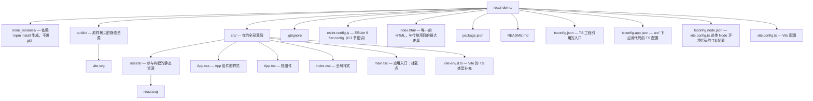
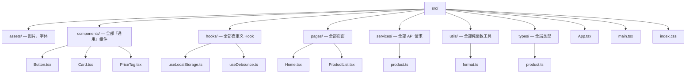
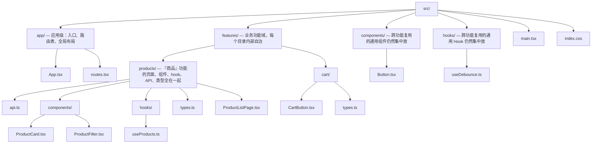

## 阶段 0：环境与工具（0.5 周）

| 场景 | 要做的事 |
|---|---|
| 项目初始化 | 用 Vite 创建 React + TS 项目，理解目录组织（按功能分 vs 按类型分） |
| 代码规范 | 配置 ESLint（含 `eslint-plugin-react-hooks`）+ Prettier |
| 调试工具 | 安装 React DevTools，学会看组件树、Props、高亮重渲染 |

表格三行分别对应"项目从哪来、代码怎么保持干净、出问题怎么查"。下面逐行展开：第 1 行对应 0.1（创建项目）与 0.2（目录组织）；第 2 行对应 0.3；第 3 行对应 0.4。

### 0.1 项目初始化：用 Vite 创建 React + TS 项目

**是什么**：用 Vite 的脚手架（create-vite）生成一个最小可运行的 React + TypeScript 项目，作为后续所有 demo 的宿主。

**为什么用 Vite 而不是其他**：Vite 是当前 React 官方生态事实上的默认脚手架（`react.dev` 的新建项目指引即指向它）。它在开发环境用原生 ES Module 按需编译——改一行代码，浏览器毫秒级热更新（HMR），不像旧工具链每次都要整体打包；生产构建则用 Rollup（Vite 6+）产出优化后的静态文件。对学习者还有一层价值：它生成的项目结构极简，没有隐藏的 webpack 配置，出问题时的因果链是可追的。

**怎么做**：

```bash
# 方式一：交互式创建，回车后按提示选择 React -> TypeScript
npm create vite@latest

# 方式二（推荐）：一步到位，直接指定项目名与 react-ts 模板
# 注意 npm 需要 "--" 把参数透传给脚手架；pnpm/yarn/bun 不需要
npm create vite@latest react-demo -- --template react-ts

cd react-demo
npm install      # 安装依赖
npm run dev      # 启动开发服务器，默认 http://localhost:5173
```

看到终端输出 `Local: http://localhost:5173/`，浏览器打开能看到一个转动的 React logo 页面，项目就建好了。加 `--host` 参数（`npm run dev -- --host`）可让同一局域网的手机访问，方便真机调试。

**产物结构逐项解说**。执行完后目录长这样：



逐项说明：

- **`index.html` 在项目根目录而不是 `public/` 里**——这是 Vite 与传统打包器（webpack）最直观的差异：Vite 把 HTML 当作"入口模块"，开发时它就是真实被浏览器加载的页面，JS 与 CSS 以 `<script type="module">` 的形式从 HTML 引出去。打开它可以看到关键的一行：

```html
<!doctype html>
<html lang="en">
  <head>
    <meta charset="UTF-8" />
    <link rel="icon" type="image/svg+xml" href="/vite.svg" />
    <meta name="viewport" content="width=device-width, initial-scale=1.0" />
    <title>Vite + React + TS</title>
  </head>
  <body>
    <!-- React 应用的挂载点：main.tsx 会往这个 div 里渲染整棵组件树 -->
    <div id="root"></div>
    <!-- 以 ES Module 方式引入入口脚本，Vite 从这里开始按需编译 -->
    <script type="module" src="/src/main.tsx"></script>
  </body>
</html>
```

- **`src/main.tsx`** 是 JS 与 DOM 的交界处，只有几行，但每一行都值得认识：

```tsx
import { StrictMode } from 'react'
import { createRoot } from 'react-dom/client'
import './index.css'
import App from './App.tsx'

// createRoot：React 18/19 的挂载 API，拿到根容器后整个应用由它驱动
// getElementById('root') 对应 index.html 里的 <div id="root">
// 末尾的 "!" 是 TS 语法：向编译器断言这个元素一定存在
createRoot(document.getElementById('root')!).render(
  // StrictMode：开发模式下会故意双调用渲染函数、双执行部分副作用，
  // 用来提前暴露不纯的写法；生产构建中它什么都不做
  <StrictMode>
    <App />
  </StrictMode>,
)
```

- **`src/App.tsx`**：根组件，起步阶段你写 demo 就直接改它，或从它引入你的 demo 文件。
- **`public/` vs `src/assets/`**：两者都能放图片，机制完全不同。`public/` 里的文件构建时**原样拷贝**，用绝对路径引用（`/vite.svg`），不做任何压缩改名，适合 favicon、robots.txt 这类"就要这个路径"的文件；`src/assets/` 里的文件**参与构建管线**，通过 `import logo from './assets/x.png'` 引入，会被 hash 改名、可压缩，推荐业务资源都走这条路径。
- **`src/vite-env.d.ts`**：只有一行 `/// <reference types="vite/client" />`，它让 TS 认识 `import.meta.env` 环境变量和 `.svg/.png` 等资源的导入类型。没有它，IDE 会到处报红。
- **三个 tsconfig**：`tsconfig.json` 本身不配置任何东西，只通过 `references` 把工程拆成两半——`tsconfig.app.json` 管浏览器里跑的 `src/` 代码（`strict: true`、`jsx: "react-jsx"` 等），`tsconfig.node.json` 管构建期 Node 环境跑的 `vite.config.ts`。拆开的原因是两处的运行环境与模块机制不同，混在一套配置里必然顾此失彼。
- **`vite.config.ts`**：起步时只有 React 插件一项：

```ts
import { defineConfig } from 'vite'
import react from '@vitejs/plugin-react'

export default defineConfig({
  // react 插件负责两件事：JSX 转译 + 开发时的快速刷新（Fast Refresh，改代码不丢组件状态）
  plugins: [react()],
})
```

`package.json` 里预置的三个脚本：`npm run dev`（开发服务器）、`npm run build`（先 `tsc -b` 类型检查再 `vite build` 产出 `dist/`）、`npm run preview`（本地预览 `dist/` 构建产物）。

**常见坑**：

- 症状：本地一切正常，部署到 Linux 服务器/CI 后白屏，控制台报 `Failed to resolve module import`。根因：import 路径大小写与真实文件名不一致（macOS 文件系统默认大小写不敏感，`./Button` 能匹配 `button.tsx`；Linux 敏感，直接失败）。修法：统一文件名命名风格（组件 PascalCase、工具 kebab-case），并且 import 路径与文件名逐字符一致；平时留意 IDE 的路径自动补全，别手敲。
- 症状：改了 `vite.config.ts` 或 `.env` 文件后不生效。根因：这两个文件只在启动时读取一次。修法：重启 dev server（Ctrl/Cmd+C 后重新 `npm run dev`）。
- 症状：编辑器里类型报错但页面照常跑。根因：Vite 的开发转译用 esbuild，**不做任何类型检查**；`tsc` 只在 `npm run build` 时才跑。修法：把 IDE 的 TS 报错当真，别依赖页面能不能跑来判断对错；提交前跑 `npm run build` 让类型检查兜底。

### 0.2 目录组织：按功能分 vs 按类型分

**是什么**：随着文件增多，"新文件放哪"需要一个约定。社区主流两种：按文件**类型**分（所有组件一个目录、所有 hook 一个目录），或按**业务功能**分（一个功能的页面/组件/hook/API 全在一个目录）。

**为什么需要**：目录结构的本质不是"好看"，而是回答两个问题——"改一个功能时我要开几个目录？"和"这段代码被谁使用？"。结构错了，后期每个需求都要跨五六个目录跳转；结构对了，一个功能的高内聚变更落在一个文件夹里。

**怎么做（两种示例）**。按类型分（type-based）：



按功能分（feature-based / feature-first）：



注意按功能分的目录里**保留了**顶层 `components/` 与 `hooks/`——按功能分不是说"取消通用目录"，而是"只有真正被多个功能共享的东西才进通用目录"。

**优缺点对比与逐行解读**：

| 维度 | 按类型分 | 按功能分 |
|---|---|---|
| 上手成本 | 低，规则一句话说完 | 略高，需要先想清楚功能边界 |
| 改一个功能要开的目录 | 多（components/pages/services/types 各开一个） | 少（基本只开一个功能目录） |
| 删除一个功能 | 残留文件要到处找 | 删掉一个目录即净 |
| 命名冲突 | 少（同类型集中，重名显眼） | 多（各功能都有自己的 `types.ts`、`api.ts`，靠 import 路径区分） |
| 复用边界是否清晰 | 否：所有组件都在一个池子里，"能不能复用"全凭感觉 | 是：想跨功能使用时必须显式"提升"到通用目录，决策被强制做出来 |
| 适合阶段 | 起步期、页面 < 5 个、单人 | 多人协作、功能域明确、中大型项目 |

**演进建议**：不要在第一周就上按功能分——功能边界在没写过几屏代码之前是猜不准的，过早划分只会制造一堆只有一个文件的空目录。推荐路径：**起步用按类型分**（心智负担最小）；当出现"改一个商品需求要同时开 `components/`、`pages/`、`services/`、`types/` 四个目录"的实感时，再迁移到按功能分。迁移策略是增量式的：新功能一律按 feature 落地，旧功能在被大规模修改时顺手搬家，中间态（两种并存）是常态，不必一次性"大革命"。只有一条硬规则要遵守：**同类东西只有一个家**——不要 `components/Button.tsx` 和 `features/products/components/Button.tsx` 同时存在两份，双份必然走向分叉。

**常见坑**：

- 症状：`features/products/types.ts` 与顶层 `types/product.ts` 内容重复、改一处漏一处。根因：迁移期没有"唯一家"规则，新旧两处都在写。修法：明确"旧目录只出不进"，用 IDE 的查找引用把旧文件逐步清空后删除。
- 症状：组件循环依赖报警（A 引 B、B 又引 A）。根因：把"通用组件"反向依赖了某个 feature 的代码，层级倒挂。修法：依赖方向必须是 `features → components/hooks/utils`，通用目录永远不 import 功能目录；发现倒挂就把被依赖的部分下沉到通用层。

### 0.3 代码规范：ESLint（含 eslint-plugin-react-hooks）+ Prettier

**是什么**：ESLint 负责"对错"——找出危险或错误的写法（例如在条件分支里调用 Hook）；Prettier 负责"格式"——缩进、引号、换行，全部机器自动统一。

**为什么需要**：对学习者而言，ESLint 在这个阶段最值钱的能力不是风格检查，而是 **`eslint-plugin-react-hooks` 的两条规则会像贴身教练一样拦住你**：

- `react-hooks/rules-of-hooks`：Hook 只能在组件函数顶层调用。你一旦把 `useState` 写进 `if`/`for`/嵌套函数里，保存瞬间就报错——Hooks 的全部心智模型都建立在这条规则上，提前装好它，阶段 2 能少熬好几个夜。
- `react-hooks/exhaustive-deps`：`useEffect` 依赖数组缺项、多项都会警告。这是阶段 2 出镜率最高的警告，从第一天就让它陪着你。

Prettier 的价值则是消灭"格式讨论"：团队里（以及未来的你和自己）不再争论单引号还是双引号，保存即格式化，代码评审只看逻辑。

**怎么做**。create-vite 的 react-ts 模板已经内置了 ESLint（9 的 flat config），先补装 Prettier 及桥接包：

```bash
npm install -D prettier eslint-config-prettier
```

完整的 `eslint.config.js`（ESLint 9 flat config 写法，与 Vite/TS 模板同构，可直接抄）：

```js
// eslint.config.js —— ESLint 9 扁平配置（flat config）
// 旧版 .eslintrc.* 已废弃：这里导出一个配置数组，从上到下依次匹配合并
import js from '@eslint/js'
import globals from 'globals'
import reactHooks from 'eslint-plugin-react-hooks'
import reactRefresh from 'eslint-plugin-react-refresh'
import tseslint from 'typescript-eslint'
import prettier from 'eslint-config-prettier'
import { defineConfig, globalIgnores } from 'eslint/config'

export default defineConfig([
  // 1. 全局忽略：构建产物与测试覆盖率不参与检查
  globalIgnores(['dist', 'coverage']),

  // 2. 对所有 TS/TSX 文件生效的规则集
  {
    files: ['**/*.{ts,tsx}'],
    extends: [
      js.configs.recommended,                   // JS 语言层的基础规则（如 no-undef）
      tseslint.configs.recommended,             // TS 扩展规则（如 no-unused-vars 的 TS 版）
      reactHooks.configs['recommended-latest'], // 本节主角：rules-of-hooks + exhaustive-deps
      reactRefresh.configs.vite,                // 只允许组件文件导出组件，配合 Vite 热刷新不丢状态
    ],
    languageOptions: {
      ecmaVersion: 2022,
      globals: globals.browser,                 // 告诉 ESLint 代码跑在浏览器：window/document 是内置全局
    },
  },

  // 3. Prettier 兼容层：关闭所有"与格式相关"的 ESLint 规则，必须放在最后
  prettier,
])
```

逐段说明：

- `defineConfig` / `globalIgnores` 是 ESLint 9.x 自带 `eslint/config` 导出的辅助函数（较新的 9.x 提供；若你的 ESLint 小版本较旧没有它们，退化为纯数组写法——把 `globalIgnores(['dist'])` 换成 `{ ignores: ['dist'] }`，去掉 `defineConfig` 包装，效果完全一致）。
- `extends` 数组顺序有意义：后面预设可以覆盖/补充前面的；`prettier` 放最外层最后，保证它"赢"过一切与格式相关的规则。
- 有意不装 `eslint-plugin-prettier`（把 Prettier 当 ESLint 规则跑）。推荐的做法是**两个工具彻底分工**：ESlint 只管逻辑与危险写法，Prettier 单独跑格式。混跑会让 lint 变慢，也让报错来源混乱。

Prettier 配置（项目根目录 `.prettierrc.json`，与 create-vite 模板代码风格一致）：

```json
{
  "printWidth": 100,
  "singleQuote": true,
  "semi": false,
  "trailingComma": "all"
}
```

忽略文件 `.prettierignore`：

```text
dist
coverage
package-lock.json
pnpm-lock.yaml
```

在 `package.json` 补两个脚本：

```json
{
  "scripts": {
    "dev": "vite",
    "build": "tsc -b && vite build",
    "lint": "eslint .",
    "format": "prettier --write .",
    "format:check": "prettier --check .",
    "preview": "vite preview"
  }
}
```

编辑器集成（VS Code，项目根 `.vscode/settings.json`）：保存时 Prettier 格式化 + ESLint 自动修复可修的问题，装好扩展 `esbenp.prettier-vscode` 与 `dbaeumer.vscode-eslint`（v3+ 默认就走 flat config，无需额外开关）：

```json
{
  "editor.defaultFormatter": "esbenp.prettier-vscode",
  "editor.formatOnSave": true,
  "editor.codeActionsOnSave": {
    "source.fixAll.eslint": "explicit"
  }
}
```

装完自检：随便在一个组件里写 `if (cond) { const [x, setX] = useState(0) }`，保存后应立刻出现 `React Hook "useState" is called conditionally` 报错——看到它，说明 `rules-of-hooks` 已经在保护你了。

**常见坑**：

- 症状：`npm run lint` 报 `eslint.config.js` 找不到某些模块。根因：依赖没装全（模板只带了前五个，`eslint-config-prettier` 是我们后补的）或装完没重启编辑器的 ESLint 服务。修法：对照 import 逐个 `npm install -D`；VS Code 里 Cmd+Shift+P 执行 `ESLint: Restart ESLint Server`。
- 症状：ESLint 与 Prettier 互相打架（如 Prettier 删分号、ESLint 又要求加分号）。根因：没有 `eslint-config-prettier`，或它没放在配置最后。修法：确认 `prettier` 出现在配置数组末尾。
- 症状：跑 `eslint .` 时把 `dist/` 里的生成代码也检查了一遍，报一堆莫名错误。根因：忽略配置没生效（flat config 中 ignores 写在了带 files 的配置块里而不是全局块）。修法：用上面独立的 `globalIgnores(...)`（或 `{ ignores: [...] }`）作为数组第一项。

### 0.4 调试工具：React DevTools

**是什么**：浏览器扩展形态的官方调试器，让你"看见"组件树、每个组件当前的 props/state/hooks 值、以及谁在重渲染。它与 Elements 面板互补：Elements 看 DOM，DevTools 看**组件**。

**为什么需要**：React 的核心心智是"数据驱动视图"，出问题时 90% 的疑问其实是三个之一——"这个组件现在拿到什么 props？""它的 state 是什么值？""它为什么又渲染了？"DevTools 把这三个问题变成肉眼可见。

**安装**：Chrome/Edge/Firefox 应用商店搜索 "React Developer Tools" 安装。装好后打开你的 `npm run dev` 页面，按 F12，会多出 **Components** 与 **Profiler** 两个面板（页面上检测不到 React 时图标是灰色的）。Safari 无官方扩展，可用独立的 React DevTools 桌面应用通过 npm 启动后连接，初学期可先跳过。

**能力一：组件树检视（Components 面板）**。

1. 打开 Components 面板，左侧是从 `App` 开始的整棵组件树，点击任意组件节点。
2. 右侧面板分栏显示该组件的 **props / hooks / rendered（渲染出的 DOM）**：props 里每个值可展开（对象、数组、嵌套结构一目了然）；`useState` 在 hooks 栏显示当前值，还会标注它是第几个 hook。
3. 值可以直接**编辑**：点击一个 boolean 类型的 prop 值切换 true/false、点击字符串直接改文本，回车后组件立刻按新值重新渲染——这是"改一个 prop 看看效果"的最快实验手段，不用回编辑器改代码。
4. 右键组件节点选 "Store as global variable"，控制台里就有了一个 `$r` 变量指向该组件实例，可以打印它的 props 做进一步检查。

**能力二：高亮重渲染（怎么开、怎么读）**。

1. Components 面板右上角齿轮进入 Settings → General，勾选 **"Highlight updates when components render"（组件渲染时高亮更新）**。
2. 回到页面交互（点按钮、输入文字），每次有组件重新渲染，页面上对应区域会出现描边框。
3. 读法：颜色按更新频率从低到高在冷色到暖色之间变化（蓝/绿偏冷＝不频繁，黄/红偏暖＝高频，不同版本 UI 细节略有差异，记住"越暖越频繁"即可）。判断口径：
   - 静止不动的页面仍有持续暖色描边 → 有东西在周期性 setState（轮询、定时器、失控动画）；
   - 在输入框打一个字符、整页大面积变暖 → 状态放得太高，一个小 state 连坐了整棵树（阶段 2 讲"状态下放"、阶段 6 讲 memo 时回来对照）；
   - 只有目标组件及其必要子级描边 → 渲染范围健康。

**能力三：Profiler 的 "why did this render"（渲染原因分析）**。

1. 先开录制原因开关：Settings → **Profiler** 标签页 → 勾选 **"Record why each component rendered while profiling"（分析时记录每个组件的渲染原因）**。不开这个开关，Profiler 只能告诉你"谁渲染了"，开了才能告诉你"为什么"。
2. 切到 Profiler 面板，点左上角圆形录制按钮（变红表示录制中）。
3. 在页面上执行你要分析的操作（比如点一次"加入购物车"），点停止。
4. 顶部出现**提交（commit）列表**——React 每完成一次渲染就是一次提交，每条按耗时染色（越暖越慢）。逐条点选。
5. 选中某次提交后，下方火焰图/排行图展示这次提交中实际渲染的组件；点选单个组件，右侧即列出它本次渲染的原因，常见五种：
   - **Hooks changed** —— 某个 hook 的返回值变了（如 useState 的新值）；
   - **Props changed** —— 父组件传来的某个 prop 引用变了；
   - **State changed** —— 本组件 state 变了；
   - **The parent component rendered** —— 父组件渲染了，作为默认行为带着你一起渲染（这是最常见的"被连坐"）；
   - **Context changed** —— 消费的 context 值变了。
6. 读法示例：一个展示型组件频繁出现 "The parent component rendered"，说明它被父组件的无谓渲染连坐——阶段 6 的 `memo` 就是为此准备的；出现 "Props changed" 但你觉得值没变，多半是引用相等性问题（对象/函数每次都是新引用），那是阶段 2 `useMemo/useCallback` 的主场。现在只需要会"录制→点开→读原因"，解读手段后面阶段逐个补上。

**常见坑**：

- 症状：F12 里没有 Components/Profiler 面板。根因：扩展未安装、或页面用的是生产构建（生产构建不含调试信息，组件树功能受限）。修法：确认扩展已装且对 localhost 启用；调试一律在 `npm run dev` 的开发模式下进行。
- 症状：Profiler 里每个组件似乎都渲染了两次，怀疑性能灾难。根因：`main.tsx` 里的 `StrictMode` 在开发模式下故意双调用渲染函数，用来暴露不纯的副作用，生产构建不会发生。修法：无需修，读懂即可；做性能测量时对比提交列表要考虑这一因素。
- 症状：在 Components 面板里看不到自己组件的名字，只有 `Anonymous`/`_c` 之类。根因：组件用了匿名函数写法或被构建压缩改名。修法：组件永远用具名函数（`function ProductCard() {}` 而不是 `export default function () {}`），调试体验完全不同。

✅ 产出：一个干净可运行的项目骨架，后续所有 demo 都在这里写。

产出验收清单：

- [ ] `npm run dev` 可启动，页面正常渲染模板默认内容
- [ ] 能说出 `index.html`、`main.tsx`、`App.tsx`、`vite.config.ts` 各自的职责
- [ ] `npm run lint` 全绿；故意在条件分支里写 `useState` 能被 ESLint 拦下
- [ ] 保存任意文件时 Prettier 自动格式化生效
- [ ] DevTools 能看到组件树、能编辑一个 prop 并观察页面变化
- [ ] 已开启"高亮重渲染"与"记录渲染原因"两个开关，并各做过一次观察
- [ ] 已决定目录方案（建议先按类型分），并建好 `demos/` 目录准备放阶段 1 的 demo

### 0.5 多环境配置：.env 文件与 import.meta.env

**是什么**：Vite 内置的多环境变量机制——用 `.env` 系列文件声明键值对，代码里通过 `import.meta.env.*` 读取；不同模式（development/production）自动加载不同文件，一份代码连多个环境。

**为什么需要**：接口基地址、调试开关这类值在开发、测试、生产各不相同，硬编码进组件意味着每次发版改代码。另一个动机是纠正一个肌肉记忆：webpack 时代的 `process.env.XXX` 在 Vite 浏览器代码里是 undefined——Vite 的变量必须带 `VITE_` 前缀、从 `import.meta.env` 读取，这是两套工具链最容易踩的差异点。

**怎么做（机制分步）**：

1. Vite 启动/构建时按当前 mode 加载 env 文件，加载顺序为 `.env` → `.env.local` → `.env.[mode]` → `.env.[mode].local`，**后加载的覆盖先加载的**（越具体的越优先）：

| 文件 | 何时加载 | 用途 | 进 git？ |
|---|---|---|---|
| `.env` | 所有模式 | 各环境共用的默认值 | 是 |
| `.env.local` | 所有模式 | 个人本机覆盖（如连本机后端） | 否 |
| `.env.development` | `vite dev` | 开发专属 | 是 |
| `.env.production` | `vite build` | 生产专属 | 是 |
| `.env.[mode].local` | 对应模式 | 个人 + 模式双重覆盖 | 否 |

2. 只有 `VITE_` 前缀的键会暴露给浏览器代码——这是安全默认：防止 `.env` 里数据库密码之类的服务器密钥混进前端产物。
3. 读取发生在**构建期静态替换**：`import.meta.env.VITE_API_BASE` 在产物里是一段字面量，不是运行时查表。
4. 三个内置值：`import.meta.env.MODE`（模式名）、`.DEV`、`.PROD`（布尔）。

**完整示例**。env 文件 + 类型增强 + 单点收口：

```bash
# .env —— 共用默认值
VITE_API_BASE=/api

# .env.development —— 开发期指向本地
VITE_API_BASE=http://localhost:5173/api
VITE_ENABLE_MOCK=true

# .env.production —— 生产指向线上
VITE_API_BASE=https://api.example.com
```

类型增强（`src/vite-env.d.ts` 追加；不写的话这些键在 TS 里拿不到精确类型）：

```ts
/// <reference types="vite/client" />

interface ImportMetaEnv {
  readonly VITE_API_BASE: string
  readonly VITE_ENABLE_MOCK?: string // 注意：env 值一律是字符串
}

interface ImportMeta {
  readonly env: ImportMetaEnv
}
```

使用处全项目只留一个入口，别在组件里到处读 env：

```ts
// src/api/config.ts
export const API_BASE = import.meta.env.VITE_API_BASE
export const MOCK_ENABLED = import.meta.env.VITE_ENABLE_MOCK === 'true' // 值是字符串，比较也按字符串
```

**常见坑**：

- 症状：`import.meta.env.MY_VAR` 是 undefined。根因：键没带 `VITE_` 前缀（或拼错大小写），Vite 出于安全不暴露无前缀变量。修法：改名加前缀并重启 dev server。
- 症状：改了 `.env` 后页面行为没变。根因：env 文件与 `vite.config.ts` 一样只在启动时读取一次。修法：重启 dev server。
- 症状：代码评审被指出"你怎么把测试环境的密钥提交了"。根因：`VITE_` 变量会被静态替换进 JS 产物，任何用户都能在浏览器 Sources 里看到。修法：前端 env 只放"可公开的配置"（地址、功能开关）；真密钥属于后端。开发期跨域/鉴权交给 Vite 代理，env 里连地址都不用暴露：

```ts
// vite.config.ts —— 开发期把 /api 转发到本机后端
export default defineConfig({
  plugins: [react()],
  server: {
    proxy: {
      '/api': {
        target: 'http://localhost:8080',
        changeOrigin: true,
      },
    },
  },
})
```

### 0.6 路径别名：从 `../../` 到 `@/`

**是什么**：把 `import { Button } from '../../components/Button'` 写成 `import { Button } from '@/components/Button'`，`@` 指向 `src/`。create-vite 不内置，需要配两处。

**为什么需要**：相对路径的深度随目录结构调整而变——文件挪一层，它被 import 的每一处都要改；`../../..` 数到第三层就开始靠猜。别名让 import 与"文件在哪"解耦，只与"它是什么"挂钩。

**怎么做**。别名必须让两个系统都认识：Vite（开发/构建时解析模块）与 TypeScript（编辑器类型解析与跳转）。只配一半就有一半的症状：

```ts
// vite.config.ts —— 给 Vite 认
import { fileURLToPath, URL } from 'node:url'
import { defineConfig } from 'vite'
import react from '@vitejs/plugin-react'

export default defineConfig({
  plugins: [react()],
  resolve: {
    alias: {
      // 用 node:url 计算 src 的绝对路径，跨平台安全；不要手拼 './src/' 字符串
      '@': fileURLToPath(new URL('./src', import.meta.url)),
    },
  },
})
```

```jsonc
// tsconfig.app.json 的 compilerOptions 内追加（注意是 app 这份，不是顶层的引用壳）
{
  "compilerOptions": {
    "baseUrl": ".",
    "paths": {
      "@/*": ["./src/*"]
    }
  }
}
```

自检：新开一个文件写 `import App from '@/App'`，两关都过才算配好——(1) `npm run dev` 页面能跑（Vite 认了）；(2) 编辑器无红线、可跳转定义（TS 认了）。

**常见坑**：

- 症状：编辑器满屏 `Cannot find module '@/...'`，但页面照常跑。根因：只配了 vite.config.ts。修法：补 tsconfig.app.json 的 paths。
- 症状：编辑器一切正常，`npm run build` 报 `Could not resolve "@/..."`。根因：只配了 tsconfig。修法：补 vite.config.ts 的 alias。
- 症状：同一个模块一半文件用 `@/` 一半用 `./`，全局搜索改名时两套写法都要查。根因：没有约定别名的作用范围。修法：别名只用于**跨目录**引用（features 之间、引通用层）；同目录内保持 `./X` 相对路径——"就近"这个信息比别名更有价值。另注：vitest（阶段 8）不读 vite.config.ts 的 alias，届时要在测试配置里再声明一次，先有印象即可。

### 0.7 工具链高频坑位补遗

0.1–0.6 的"常见坑"集中在编辑器里能碰到的问题；下面四个坑都发生在"换机器、上 CI、新人入职"的场景，每个都是真实团队反复上演的。

**坑一：端口被占，地址悄悄变了**。

- 复现：昨天某个 Node 进程没退干净，今天 `npm run dev` 输出的是 `http://localhost:5174/`，而你在别处配置的 OAuth 回调、后端 CORS 白名单全都指向 5173，突然全部失灵。
- 根因：Vite 默认 `port: 5173` 且**不独占**——被占时自动 +1，只在终端提示一行，极易漏看。
- 修复/预防：

```ts
// vite.config.ts
export default defineConfig({
  server: {
    port: 5173,
    strictPort: true, // 端口被占直接报错退出，把问题暴露在启动时而不是调试中
  },
})
```

排查占用：`lsof -i :5173`（macOS/Linux），确认是废弃进程再 kill。

**坑二：换机器/CI 上装不上或跑不起来——Node 版本漂移**。

- 复现：本机 Node 22 一切正常；CI 镜像默认 Node 18，依赖安装或启动直接报语法错、平台不支持。
- 根因：Vite 与部分依赖对 Node 有最低版本要求（如 Vite 6 要求 18/20/22+），本地与远端版本不一致，且项目从未声明要求。
- 修复/预防：声明 + 统一工具双管齐下。

```jsonc
// package.json
{
  "engines": { "node": ">=20" },
  "packageManager": "npm@10.9.0" // 配合 corepack 锁定包管理器，见坑三
}
```

团队统一用 nvm（仓库放一个 `.nvmrc`，内容一行 `20`）或 volta 固定版本；CI 里让 setup-node 读 `.nvmrc`（见 0.8 的 workflow）。

**坑三：混用包管理器，node_modules 变成"薛定谔的依赖"**。

- 复现：你用 npm 装了新包但没提交 lockfile 更新；同事 pnpm install 后本地能跑、CI 构建失败；或同一台机器先后 npm install / pnpm install，出现"本地有这个包、干净环境没有"的幽灵依赖。
- 根因：npm 与 pnpm 的依赖解析与目录结构不同（pnpm 符号链接严格隔离，npm 扁平化会漏出未声明依赖），lockfile 也互不通用——仓库里同时存在 `package-lock.json` 与 `pnpm-lock.yaml` 必然走向分叉。
- 修复/预防：仓库只允许一种包管理器，用 corepack 强制：

```bash
# corepack 是 Node 自带的包管理器版本管理器
corepack enable
# 此后有人误用别的包管理器会被直接拦下：
# This project is configured to use npm (because of packageManager field)
```

同时：只保留一种 lockfile 并提交进 git，其余的删掉；`node_modules` 永远不进 git（模板 .gitignore 已含）。

**坑四：公司网络下依赖装不上（慢 / 404 / 私有包）**。

- 复现：`npm install` 卡在 `idealTree` 数分钟；或安装 `@company/xxx` 私有包时 404。
- 根因：默认 registry 在公司网络下不稳定；私有包需要带凭证的私服；系统代理只对浏览器生效，终端不走。
- 修复/预防：项目级 `.npmrc`（提交进仓库）统一镜像/私服地址；个人凭证放用户级 `~/.npmrc`（绝不提交）：

```ini
# .npmrc（项目级，提交）
registry=https://registry.npmmirror.com
# 公司有私服时写私服地址，并在用户级 ~/.npmrc 里配凭证：
# //npm.company.com/:_authToken=你的令牌
```

终端确需走代理时：`export HTTPS_PROXY=http://127.0.0.1:7890`（按实际代理端口）。

### 0.8 工程落地：提交前自动检查与 CI 最小流水线

0.3 配好了 lint 与格式化，但"靠自觉运行"等于没有。把它们挂到两个强制关卡上：本地提交时（pre-commit 钩子）与远端 CI（push/PR 时）。

**关卡一：husky + lint-staged——提交时只查本次改动的文件**。

```bash
npm install -D husky lint-staged
npx husky init    # 生成 .husky/ 目录，并在 package.json 里加入 prepare 脚本
```

```bash
# .husky/pre-commit —— init 生成的文件，把内容替换成这一行
npx lint-staged
```

```jsonc
// package.json 追加
{
  "scripts": {
    "prepare": "husky" // 每次 npm install 后自动激活 git 钩子
  },
  "lint-staged": {
    "*.{ts,tsx}": ["eslint --fix", "prettier --write"],
    "*.{css,md,json}": ["prettier --write"]
  }
}
```

机制：`git commit` 触发 pre-commit → lint-staged 从暂存区取**本次改动的文件**逐个修复与检查 → 可自动修复的改动会重新暂存；eslint 报出不可自动修复的错误时提交被整体拦下。因为只查暂存文件，大仓库也不会慢。确有必要时可 `git commit --no-verify` 绕过，但要把它当报警按钮而不是常规操作。

**关卡二：GitHub Actions 最小流水线**——`.github/workflows/ci.yml`：

```yaml
name: ci
on:
  push:
    branches: [main]
  pull_request:

jobs:
  check:
    runs-on: ubuntu-latest
    steps:
      - uses: actions/checkout@v4
      - uses: actions/setup-node@v4
        with:
          node-version-file: '.nvmrc' # 与本机版本同源（0.7 坑二）
          cache: npm # 按 lockfile 缓存依赖，二次运行明显加速
      - run: npm ci # 严格按 lockfile 安装：lockfile 与 package.json 不一致直接失败
      - run: npm run lint
      - run: npx tsc -b # 类型检查单独列一步，报错归属更清楚
      - run: npm run build # 能构建 = 产物可发布
```

`npm ci` 与 `npm install` 的区别是 CI 成败的关键：前者严格按 lockfile 安装、不一致即失败——CI 的意义就是"本机能跑不算数，换台干净机器也能跑"。

**PR 提交前的检查清单**（自查与 code review 双方对照）：

- [ ] 本地跑过与 CI 相同的四件事：`npm ci`、`npm run lint`、`npx tsc -b`、`npm run build` 全绿
- [ ] lockfile 随依赖变更一起提交，且仓库只有一种 lockfile
- [ ] 没有提交 `.env*.local` 与任何含密钥的文件（`git status` 里出现就先处理）
- [ ] 新增 env 变量同时补了 `.env` 默认值与 `vite-env.d.ts` 类型，且不含私密信息
- [ ] 故意制造一次 lint 错误，确认 pre-commit 能拦下（装完钩子的验收动作）
- [ ] 组件用具名函数导出（保住 0.4 的 DevTools 调试体验）

✅ 产出（0.5–0.8 追加）：env 多环境配置与类型收口、路径别名、版本与包管理器统一、提交钩子与 CI 流水线。

---

## 附:ASCII 图替换清单

本文档图形化改版,原 ASCII 字符图与 Mermaid 图表对应关系如下:

| 原图位置 / 标题 | 处理结果 |
| --- | --- |
| 0.1 项目初始化 · react-demo/ 产物目录结构 | 替换为 flowchart TD(目录树) |
| 0.2 目录组织 · 按类型分(type-based)目录结构 | 替换为 flowchart TD(目录树) |
| 0.2 目录组织 · 按功能分(feature-based)目录结构 | 替换为 flowchart TD(目录树) |
