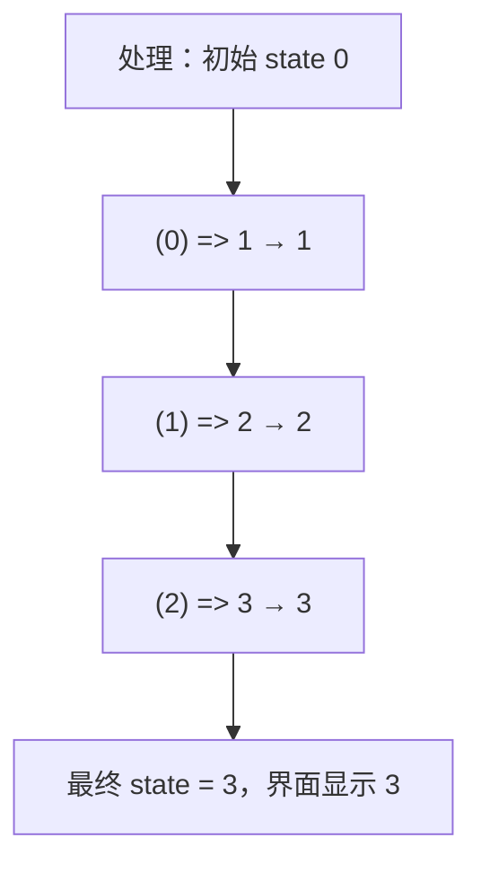
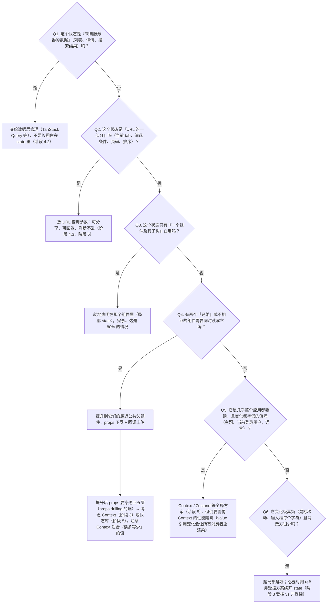

## 阶段 2：状态与副作用 ⭐核心（2 周）

这一章是全书最核心的一章。前面阶段 1 学的渲染（JSX、props、事件）解决的是"界面长什么样"的问题，而本章解决的是 React 的另一半灵魂："数据从哪来、怎么变、变化之后界面如何正确地跟上"。后续所有章节——表单、数据请求、状态管理、性能优化——出问题时往下追究，最终几乎都会落到本章的两个知识点上：**state 的更新机制**与**effect 的执行时机**。面试中 React 的高频题（为什么连续三次 setState 只加一、为什么 effect 会无限循环、为什么定时器里读到旧值）全部出自这里。

本章按三条主线展开：

1. **useState 场景**：状态怎么存（不可变）、怎么改（函数式更新）、怎么初始化（惰性）、多次修改怎么合并（批处理）、放在哪个组件（状态位置）。
2. **useEffect 场景**：副作用怎么声明（依赖数组）、怎么撤销（清理函数）、怎么请求（数据链路与竞态）、依赖出错怎么办（exhaustive-deps 两类问题）、以及最重要的——什么时候根本不该用它。
3. **闭包陷阱专题**：上面两条线里所有"读到旧值"类 bug 的统一根源。学完这一节，你对"state 是一次渲染的快照"这个模型的理解会从"听过"变成"能推理"。

学习建议：本章每个 demo 都亲手敲一遍，并且刻意去制造 bug（把正确的写法改错，观察症状），比只看正确代码的收获大一个数量级。

---

### useState 场景

在展开五条之前，先建立总的心智模型。`useState` 做的事情只有一件：**让 React"记住"一个跨渲染存在的值，并在它变化时重新调用你的组件函数**。组件函数本身每次渲染都从头执行一遍，局部变量全部重建，唯独 `useState` 返回的第一个值能在多次渲染之间延续——这是它和"直接在函数体里写 `let count = 0`"的本质区别。五条场景分别回答五个工程问题：

| 场景 | 回答的问题 |
|---|---|
| 1. 函数式更新 | 新值依赖旧值时怎么改才不出错 |
| 2. 不可变更新 | 对象/数组这种"引用类型"怎么改才能被 React 感知 |
| 3. 惰性初始化 | 初始值计算很贵时怎么避免重复计算 |
| 4. 批处理 | 一次交互里改多个 state，渲染几次 |
| 5. 状态放哪 | state 应该住在哪个组件里 |

#### 1. 基础用法 + **函数式更新**（`setCount(c => c + 1)`）

**是什么。** `useState(initial)` 返回一个二元组：当前值与更新函数。更新函数有两种传参方式：

- **传值**：`setCount(1)`、`setCount(count + 1)` —— "把状态替换成这个值"。
- **传函数**（函数式更新 / functional update）：`setCount(c => c + 1)` —— "基于上一个状态计算新状态"。React 会在真正处理这次更新时调用你的函数，并把**队列中上一步的结果**作为参数传进来。

**为什么需要函数式更新。** 因为 `setState` 不是"立即修改变量"，而是"提交一次更新请求"。在同一个事件处理器里，`count` 这个变量从头到尾都是本次渲染快照里的那个值，不会因为中间调用了 `setCount` 而改变。所以当你在一次交互里连续多次更新、且新值依赖旧值时，"传值"写法每一步都基于同一个过时的快照计算，后一步无法站在前一步的肩膀上。"传函数"写法把"怎么算"的描述交给 React，React 在处理队列时按顺序把上一步的输出喂给下一步，形成真正的链式累加。

**怎么做（机制分步）。** 以点击一次按钮连调三次 `setCount` 为例：

1. 用户点击，React 调用你的事件处理器（React 会托管这个调用过程）。
2. 处理器里每次 `setCount(x)` 都只是把"一个动作"排入更新队列：要么是"替换为 x"，要么是"用函数 f 变换"。**当前函数里的 `count` 变量纹丝不动**。
3. 事件处理器执行完毕，React 从队列头部开始逐个处理：从当前 state 出发，"替换为 x"就取 x，"函数 f"就取 `f(上一步结果)`，得到最终 state。
4. React 拿最终 state 重新调用组件函数，界面更新一次。

**代码示例：完整复现"三次 `setCount(count + 1)` 只加一"。** 先看 bug 版，可直接运行：

```tsx
import { useState } from 'react';

export default function BuggyCounter() {
  const [count, setCount] = useState(0);

  const handleClick = () => {
    setCount(count + 1); // 排队：替换为 0 + 1 = 1
    setCount(count + 1); // 排队：替换为 0 + 1 = 1（注意：count 还是 0！）
    setCount(count + 1); // 排队：替换为 0 + 1 = 1（count 依然是 0！）
    console.log('同步打印 count：', count); // 永远打印 0，见"常见坑"
  };

  return (
    <div>
      <p>count = {count}</p>
      <button onClick={handleClick}>点我 +3（期望）</button>
    </div>
  );
}
```

运行结果：点一次按钮，`count` 从 0 变成 **1**，不是 3。逐步解说如下表——关键在于"传值"模式下后一步**不会**引用前一步的结果，三次计算互相独立：

```text
事件处理器执行过程（count 是本次渲染快照里的 0）：

步骤  代码               队列内容（动作）          count 变量
 1    setCount(count+1)  [替换为 1]               0（未变）
 2    setCount(count+1)  [替换为 1, 替换为 1]     0（未变）
 3    setCount(count+1)  [替换为 1, 替换为 1,     0（未变）
                         替换为 1]
—— 处理器结束，React 处理队列 ——
处理：初始 state 0 → 替换为 1 → 替换为 1 → 替换为 1 → 最终 state = 1
—— 用 state = 1 重新渲染一次 → 界面显示 1
```

修正版——把每一步从"替换为某值"改成"在上一步基础上变换"：

```tsx
import { useState } from 'react';

export default function FixedCounter() {
  const [count, setCount] = useState(0);

  const handleClick = () => {
    setCount(c => c + 1); // 排队：函数 c => c + 1
    setCount(c => c + 1); // 排队：函数 c => c + 1
    setCount(c => c + 1); // 排队：函数 c => c + 1
  };

  return (
    <div>
      <p>count = {count}</p>
      <button onClick={handleClick}>点我 +3</button>
    </div>
  );
}
```



**什么时候必须用函数式更新**（满足任一条就该用）：

1. **同一交互里连续多次更新同一个 state**：如上面的一次 +3、一次提交里累加多条明细。
2. **新值依赖旧值**：开关 `setOn(on => !on)`、步进器、往数组追加 `setList(list => [...list, item])`。
3. **更新发生在"延后执行"的回调里**：`setTimeout`、`setInterval`、事件订阅、Promise `.then` 中——这些回调捕获的是定义那一刻的旧快照（机制详见本章末尾闭包陷阱专题），函数式更新是标准解法之一。
4. **希望更新逻辑纯粹、与渲染时机解耦**：函数式更新的函数应当是纯函数（不读外部可变量、不产生副作用），这样无论 React 何时、以何种顺序处理它都得到一致结果——这也是 React 严格模式（StrictMode）下能安全地双调用它的前提。

反过来，新值与旧值完全无关时（`setFormOpen(true)`、`setName(inputValue)`），传值更直白，不必强行包一层函数。

最后强调函数式更新的**纯度要求**：你传给 `setCount` 的更新函数必须是纯函数——只依赖传入的参数、不读组件里其他可变量、不产生副作用（不发请求、不打日志计数、不 mutate 参数）。原因有二：其一，React 可能以任意时机、任意次数调用它——严格模式（StrictMode）开发环境会刻意**双调用**每个更新函数以暴露不纯（生产环境只调一次），若函数里有 `console.log` 会计两次数、有副作用会执行两次；其二，并发渲染（阶段 10）下更新处理可能被中断重放，不纯的更新函数在重放时会污染外部世界。写 `setCount(c => { console.log('算了'); return c + 1; })` 这类代码时，把日志挪到事件处理器里去。

**常见坑。**

- 症状一：点一次按钮期望 +3 实际只 +1。
  根因：三次 `setCount(count + 1)` 基于同一快照计算，互相覆盖。
  修法：改函数式更新 `setCount(c => c + 1)`。
- 症状二：`setCount(count + 1)` 之后立刻 `console.log(count)`，打印的还是旧值，于是再补一次 `setCount` "纠正"，导致状态错乱。
  根因：不是 bug，是机制——批处理下当前函数剩余部分看到的永远是快照值。
  修法：需要"下一步的结果"就在 setState 时就算好（`const next = count + 1; setCount(next); ` 本地变量 `next` 立即可用），或改函数式更新；绝对不要靠"再 set 一次"来弥补。
- 症状三：把对象 state 用传值方式整体覆盖 `setUser({ name: '李四' })`，发现 `age`、`email` 全丢了。
  根因：传值是**整体替换**，不像类组件的 `this.setState` 那样做浅合并。
  修法：`setUser(u => ({ ...u, name: '李四' }))`，详见下一条不可变更新。

#### 2. 对象/数组状态的**不可变更新**（展开、`map`、`filter` 更新某一项）

**是什么。** 不可变更新（immutable update）指：修改对象或数组类型的 state 时，**不改动原对象，而是创建一个包含变更内容的新对象/新数组**，再把它传给 setState。原对象保持原样，像一张没动过的历史照片。

**为什么需要不可变更新。** 这不是风格洁癖，而是 React 的更新检测机制决定的：

1. React 判断"要不要重新渲染"的依据之一，是用 `Object.is(oldState, newState)` 比较新旧 state。`Object.is` 对对象/数组比较的是**引用**（内存地址），不是内容。
2. `arr.push(item)`、`obj.name = 'x'` 这类直接修改（mutate）不改变引用——修改前后是同一个对象，`Object.is` 返回 `true`，React 认为"状态没变"，于是**跳过这次渲染**。
3. `useState` 存的是"下一次渲染用的值"。React 需要能在任意时刻拿旧快照与新快照做比较，也依赖每个快照不被事后篡改。一旦 mutate，所有基于引用相等性的机制（跳过渲染、`React.memo`、`useEffect` 的依赖比较、`useMemo` 缓存、撤销/重做的历史快照）都会在某个时刻给出错误答案。

**怎么做（机制分步）。** 以 `arr.push(item); setTodos(arr)` 为例：

1. `push` 修改了堆上的原数组（数据层面确实加进去了）。
2. `setTodos(arr)` 传入的还是**同一个引用**。
3. React 处理这次更新时，用 `Object.is(prevTodos, nextTodos)` 比较——相等。
4. React 跳过重新渲染（bail out）：不重渲染子组件、不触发 effect。界面不更新。

于是出现一个典型的诡异现象：**第一次点"添加"没反应，之后随便触发一次别的 state 更新（比如点了一下别处），新任务突然出现了**——因为那次更新引发的重渲染读到的正是被你 push 过的数组（数据早就在里面了，只是没人来渲染）。这说明 mutate 不是"永远不生效"，而是"生效与否取决于运气"，这比稳定不生效更危险。

**代码示例。** 一个覆盖增/删/改的完整 Todo 组件，含错误演示按钮：

```tsx
import { useState } from 'react';

interface Todo {
  id: number;
  text: string;
  done: boolean;
}

let nextId = 3; // 演示用自增 id

export default function TodoList() {
  const [todos, setTodos] = useState<Todo[]>([
    { id: 1, text: '学 useState', done: false },
    { id: 2, text: '学 useEffect', done: false },
  ]);
  const [text, setText] = useState('');

  // ❌ 错误演示：push 改的是原数组，setTodos 拿到同一引用，React 检测不到变化
  const addWrong = () => {
    todos.push({ id: nextId++, text: text || '错误演示', done: false });
    setTodos(todos); // Object.is(旧, 新) === true → 跳过渲染
  };

  // ✅ 正确：展开旧数组，创建新数组
  const add = () => {
    if (!text.trim()) return;
    setTodos(t => [...t, { id: nextId++, text: text.trim(), done: false }]);
    setText('');
  };

  // ✅ 更新某一项：map + 条件展开，只替换命中的那项，其余原样引用
  const toggle = (id: number) => {
    setTodos(ts =>
      ts.map(t => (t.id === id ? { ...t, done: !t.done } : t))
    );
  };

  // ✅ 删除某一项：filter 生成新数组
  const remove = (id: number) => {
    setTodos(ts => ts.filter(t => t.id !== id));
  };

  return (
    <div>
      <input value={text} onChange={e => setText(e.target.value)} />
      <button onClick={add}>添加</button>
      <button onClick={addWrong}>添加（错误演示，点了没反应）</button>
      <ul>
        {todos.map(t => (
          <li key={t.id}>
            <label>
              <input type="checkbox" checked={t.done} onChange={() => toggle(t.id)} />
              <span style={{ textDecoration: t.done ? 'line-through' : 'none' }}>
                {t.text}
              </span>
              <button onClick={() => remove(t.id)}>删除</button>
            </label>
          </li>
        ))}
      </ul>
    </div>
  );
}
```

**数组操作速查表**（左边是直觉写法，右边是 React 里必须用的不可变写法；`setArr` 一律可再包函数式更新 `setArr(a => ...)`）：

| 目的 | ❌ mutate（UI 不更新） | ✅ 不可变更新 |
|---|---|---|
| 尾部追加 | `arr.push(x)` | `setArr([...arr, x])` |
| 头部插入 | `arr.unshift(x)` | `setArr([x, ...arr])` |
| 尾部删除 | `arr.pop()` | `setArr(arr.slice(0, -1))` |
| 头部删除 | `arr.shift()` | `setArr(arr.slice(1))` |
| 按 id 删除某项 | `arr.splice(i, 1)` | `setArr(arr.filter(x => x.id !== id))` |
| 更新某一项字段 | `arr[i].done = true` | `setArr(arr.map(x => x.id === id ? { ...x, done: true } : x))` |
| 整项替换 | `arr[i] = newItem` | `setArr(arr.map(x => x.id === id ? newItem : x))` |
| 任意位置插入 | `arr.splice(i, 0, x)` | `setArr([...arr.slice(0, i), x, ...arr.slice(i)])` |
| 原地排序 | `arr.sort(compare)` | `setArr([...arr].sort(compare))`（sort 会改原数组，必须先复制） |
| 原地反转 | `arr.reverse()` | `setArr([...arr].reverse())` |
| 清空 | `arr.length = 0` | `setArr([])` |
| 追加一批 | `arr.push(...xs)` | `setArr([...arr, ...xs])` |

注意 `sort`、`reverse`、`splice` 这三个"内奸"：它们是数组上少数会修改原数组的方法，即使写在新数组表达式里也可能踩坑（例如 `[...arr].sort()` 是对的，`arr.sort()` 是错的）。

**对象操作速查表**：

```tsx
import { useState } from 'react';

interface Address { city: string; street: string; }
interface Profile { name: string; age: number; address: Address; }

export default function ProfileForm() {
  const [profile, setProfile] = useState<Profile>({
    name: '张三',
    age: 25,
    address: { city: '北京', street: '中关村大街 1 号' },
  });

  // ✅ 浅更新一个字段：展开旧对象再覆盖目标字段
  // 注意：useState 对对象不做自动浅合并，漏掉展开会丢掉其余字段
  const rename = (name: string) => {
    setProfile(p => ({ ...p, name }));
  };

  // ❌ 对照：setProfile({ name }) 会把 age、address 全部丢掉，state 只剩 { name }

  // ✅ 嵌套对象更新：每一层都要重新展开（展开是"浅拷贝"）
  const moveCity = (city: string) => {
    setProfile(p => ({
      ...p,                                    // 第一层展开：保住 name、age
      address: { ...p.address, city },          // 第二层展开：保住 street
    }));
  };

  // ✅ 动态键名更新（表单里字段名来自变量时）
  const setField = (field: keyof Profile, value: string | number) => {
    setProfile(p => ({ ...p, [field]: value }) as Profile);
  };

  return (
    <div>
      <input value={profile.name} onChange={e => rename(e.target.value)} />
      <input value={profile.address.city} onChange={e => moveCity(e.target.value)} />
      <input
        type="number"
        value={profile.age}
        onChange={e => setField('age', Number(e.target.value))}
      />
      <pre>{JSON.stringify(profile, null, 2)}</pre>
    </div>
  );
}
```

两个必须记住的细节：

- 展开运算符是**浅拷贝**：`{ ...p }` 只复制第一层，嵌套对象（上面的 `address`）仍与旧 state 共享同一个引用。所以更新嵌套值时必须逐层展开；同理，`{ ...p, address: { ...p.address, city } }` 里若忘了展开 `p.address`，`street` 就没了。
- 只替换真正变化的部分是惯例：`map` 时未命中的项返回**原对象**（不是复制一份），这样 `React.memo`、依赖比较仍能识别"这些项没变"，是列表性能的基础（阶段 3 组件库与阶段 6 性能优化会反复用到）。

深层嵌套结构（三四层以上）逐层展开非常痛苦且易错，生产中常用 [Immer](https://github.com/immerjs/use-immer) 的 `produce` 以"看似 mutate、实际生成新对象"的方式书写；Zustand 也提供 immer 中间件（阶段 5 展开）。原理同样是产出新引用，只是写法更接近直觉。

顺带把 `Object.is` 的比较规则讲全。React 没有选 `===` 而选了 `Object.is`，两者几乎一致，只差两个特例：

| 比较 | `===` | `Object.is`（React 采用） |
|---|---|---|
| `NaN` 与 `NaN` | `false` | `true`（NaN 视为相等——合理：state 是 NaN 就别再渲染了） |
| `+0` 与 `-0` | `true` | `false`（罕见，理论区分，实践中可忽略） |

所以 `setCount(NaN)` 两次，第二次会被判为"没变"而跳过渲染；这也解释了为什么 `setX(x)` 传回同一个对象/数组引用必然 bail out——`Object.is` 比的是身份，不是内容。

还要建立一个全局认知：**"引用相等"是整个 React 优化体系的通货**。不只是 `useState` 的 bail out 靠它——`useEffect` 的依赖比较（本章下一节）、`React.memo` 的 props 浅比较、`useMemo`/`useCallback` 的缓存命中（本章后文），全部是同一套 `Object.is` 逐位比较。因此"不可变更新"不只是让某一次 setState 生效，它同时保住了依赖数组、memo 缓存、组件浅比较的判断正确性——一处 mutate，四处失明。

**常见坑。**

- 症状一：点了按钮 UI 没反应；过一会儿操作别的功能，之前"丢失"的修改突然全部冒出来。
  根因：mutate 后引用不变，`Object.is` 判等，React 跳过渲染；后续别的更新触发重渲染时读到了被改过的原数组。
  修法：全部改为不可变更新（速查表右列）。
- 症状二：更新对象后其他字段丢失（`setUser({ name })` 丢 `age`）。
  根因：传值是整体替换，`useState` 不做浅合并。
  修法：`setUser(u => ({ ...u, name }))`。
- 症状三：明明改了嵌套字段，`useEffect([profile]` 却没触发，或子组件没刷新。
  根因：嵌套 mutate（`profile.address.city = '上海'`）不改顶层引用，依赖比较认为没变。
  修法：逐层展开生成新引用；或上 Immer。
- 症状四（反向坑）：为了"不可变"在每次渲染中无脑 `{...obj}` 创建新对象放进 props/依赖，导致子组件与 effect 全部失效式重跑。
  根因：不可变更新是**更新时**的要求，不是渲染时的要求；渲染期间创建的新引用让"引用相等性优化"失去意义。
  修法：更新只发生在事件/`setState` 中；渲染期间需要稳定引用时用 `useMemo`（见本章后文 useMemo 场景）。

#### 3. 惰性初始化（`useState(() => expensive())`）

**是什么。** `useState` 的第一个参数除了传初始值，还可以传一个**函数**（惰性初始化函数 / lazy initializer）。React 只在组件**首次渲染**（mount）时调用这个函数，把返回值作为初始 state；之后的每次渲染直接忽略它。

**为什么需要。** 这里有一个 JavaScript 语言层面的陷阱：`useState(expensive())` 里的 `expensive()` 是**函数调用表达式**，它在 `useState` 被调用**之前**就必须求值完毕——而组件函数每次渲染都会完整执行一遍。也就是说：

- `useState(expensive())`：每次渲染都执行一次 `expensive()`，算出结果传给 `useState`，然后 React 只在第一次用这个结果，**之后每次的返回值都被白白扔掉**。
- `useState(() => expensive())` / `useState(expensive)`：传的是函数本身（注意第二种写法**不带括号**），只有第一次渲染时 React 才调用它。

当 `expensive()` 代价可忽略（如 `useState(0)`）时无所谓；当它是"解析一大段 localStorage JSON""对一个上千项的数组做复杂计算"时，浪费会被放大成用户可感知的卡顿——尤其配合受控输入：每敲一个字符 → setState → 组件重渲染 → `expensive()` 再跑一遍。

**怎么做（机制分步）。**

1. React 渲染组件 → 执行到 `useState` 这一行。
2. 若传入的是函数：首次渲染（没有 state）时调用它取初始值；非首次渲染时直接跳过，沿用已存 state。这就是"惰性"的含义——初始化被推迟到"确认真的需要"的那一刻，且只发生一次。
3. 初始化函数必须是**纯函数**：不接收参数、不修改外部状态、同样的输入返回同样的结果。React 严格模式（StrictMode）在开发环境会把它调用两次以暴露不纯（生产环境只调一次），如果你的初始化函数有副作用（如写 localStorage、打日志计数），会在开发期立刻现形。

**代码示例：用日志观察调用次数。**

```tsx
import { useState } from 'react';

interface Todo { id: number; text: string; done: boolean; }

// 一个昂贵的初始化函数：读 localStorage + 解析 JSON + 排序
function createInitialTodos(): Todo[] {
  console.log('createInitialTodos 执行了'); // 观察这一行打印几次
  const raw = localStorage.getItem('todos');
  const saved = raw ? (JSON.parse(raw) as Todo[]) : [];
  return saved.sort((a, b) => a.id - b.id);
}

export default function TodoApp() {
  // ❌ 写法 A：每次渲染都执行 createInitialTodos()
  //    控制台：挂载时 1 次，之后每敲一个字（keyword 变化触发重渲染）再来 1 次
  // const [todos, setTodos] = useState<Todo[]>(createInitialTodos());

  // ✅ 写法 B：惰性初始化，只在首次渲染执行 1 次，之后怎么重渲染都不再执行
  const [todos, setTodos] = useState<Todo[]>(createInitialTodos);

  // 注意：这里也可以写 useState(() => createInitialTodos())，两者等价；
  // 当初始化逻辑不是现成函数时用箭头函数包裹，如 useState(() => JSON.parse(bigJson))
  const [keyword, setKeyword] = useState('');

  return (
    <div>
      <input
        value={keyword}
        onChange={e => setKeyword(e.target.value)} // 每敲一个字符都重渲染一次
        placeholder="输入关键字，观察控制台日志"
      />
      <ul>
        {todos.filter(t => t.text.includes(keyword)).map(t => (
          <li key={t.id}>{t.text}</li>
        ))}
      </ul>
    </div>
  );
}
```

把写法 A 和 B 分别打开，在输入框里连续打字：A 的控制台每敲一个字符打印一次 `createInitialTodos 执行了`，B 只在进入页面时打印一次。差异一目了然。

**什么场景值得用。**

| 场景 | 值得吗 | 说明 |
|---|---|---|
| 初始值来自 `localStorage.getItem` + `JSON.parse`（购物车、草稿、主题） | ✅ 值得 | I/O 与解析成本随数据量增长 |
| 初始值需要大量计算（对大数组排序/建索引、生成大查找表） | ✅ 值得 | 典型的昂贵 CPU 计算 |
| 初始值来自 URL 查询参数解析 | ✅ 值得 | 每次渲染重复解析毫无意义 |
| `useState(0)`、`useState(false)`、`useState(null)`、字面量对象 | ❌ 不值得 | 字面量本身没有计算成本，包一层函数只是噪音 |
| 初始值依赖传入的 props | ⚠️ 慎用 | `useState(() => props.defaultValue)` 只在首次生效，之后 props 再变 state 不会跟着变——这通常说明你想要的是"派生状态"而非 state（见本章 useEffect 场景第 5 条） |

**常见坑。**

- 症状一：受控输入每敲一个字都掉帧，Profiler 显示时间耗在某个"初始化"函数上，且它被调用了 N 次。
  根因：`useState(expensive())` 表达式每次渲染求值，结果仅首次被采用。
  修法：改为惰性初始化。
- 症状二：`useState(expensive)` 写成了 `useState(expensive())` 或反过来，代码都能跑、看不出来。
  根因：两者只差一对括号，TypeScript 对"返回值恰好是函数"的类型没有防呆。
  修法：靠肉眼约定——**惰性初始化传"函数本身"，绝不加括号**；有条件时让初始化函数返回类型与 state 类型一致（返回函数类型的 state 是极少数场景，如 `useState<() => void>(() => handler)`，此时需显式标注泛型）。
- 症状三：把惰性初始化当 `componentDidMount` 用，在里面发请求、打日志、改外部变量。
  根因：误解了它的定位——它是"算初始值"的，不是生命周期钩子；副作用属于 `useEffect`。
  修法：初始化函数保持纯函数；副作用移到 effect。
- 症状四：期望 props 变化后 state 跟着重置，但 state 还是旧的。
  根因：惰性初始化只跑一次，props 变化不会重新初始化。
  修法：用 `key` 让组件重新挂载（见本章 useEffect 场景第 5 条的"用 key 重置状态"），或改为渲染期间调整 state 的模式。

#### 4. 批处理：一次点击里连续多次 setState 的表现

**是什么。** 批处理（batching）指 React 把一次交互中触发的多次 state 更新**合并到一次重新渲染**里处理。点了按钮调三次 setState，组件只渲染一次而不是三次。

**为什么需要。** 渲染是有成本的工作：执行组件函数、diff 新旧虚拟 DOM、提交到真实 DOM。如果每个 `setState` 都立刻同步渲染一次，一次表单提交改 5 个 state 就要渲染 5 次，其中前 4 次的结果全是中间态，用户根本看不到。批处理保证：**一次交互 → 一次渲染 → 一个一致的最终界面**，既省性能，也避免了界面闪现中间状态。

**怎么做（机制分步）。**

1. 用户事件触发，React 先接管调度（合成事件系统，统一委托挂载在根容器上——细节见阶段 1 事件处理与阶段 10 合成事件）。
2. 事件处理器执行期间，所有 `setState` 只把更新动作入队，标记"此组件待更新"。
3. 处理器返回后，React 一次性处理整个更新队列，算出所有受影响组件的最终 state。
4. 重新渲染受影响的组件树一次，DOM 一次提交。

**React 18 自动批处理前后差异。** 这是 React 18 最重要（也最容易被忽略）的行为变更，面试常考：

| 更新发生的位置 | React 17 及以前（`ReactDOM.render`） | React 18（`createRoot`，自动批处理） |
|---|---|---|
| React 事件处理器内（onClick 等） | ✅ 批处理，渲染一次 | ✅ 批处理，渲染一次 |
| `setTimeout` / `setInterval` 回调 | ❌ 不批处理，每次 setState 同步渲染一次 | ✅ 批处理，渲染一次 |
| `Promise.then` / `await` 之后 | ❌ 不批处理 | ✅ 批处理 |
| 原生事件监听（`addEventListener` 直接挂 DOM） | ❌ 不批处理 | ✅ 批处理 |
| 任意普通函数调用深处 | ❌ 不批处理 | ✅ 批处理 |

React 17 时代批处理依赖"React 事件系统的开区间"：React 在调用你的合成事件处理器前后开/关一个批处理开关，脱离这个区间（进了定时器、Promise 微任务）开关就失效。React 18 的自动批处理把"开区间"改为覆盖**所有**更新来源，代价是少数依赖"setState 后立刻同步看到 DOM"的老代码会失灵（见下方 `flushSync`）。

用下面的 demo 观察差异（在 React 18 里跑，所有按钮都只渲染一次；同样的代码在 React 17 沙箱里，后两个按钮会渲染两次）：

```tsx
import { useState } from 'react';

export default function BatchingDemo() {
  const [count, setCount] = useState(0);
  const [flag, setFlag] = useState(false);

  // 渲染计数：每次组件函数执行都会打印，用来数"渲染了几次"
  console.log('渲染：count =', count, ', flag =', flag);

  const handleSync = () => {
    // React 事件处理器：17 / 18 都只渲染一次（经典批处理）
    setCount(c => c + 1);
    setFlag(f => !f);
  };

  const handleTimeout = () => {
    setTimeout(() => {
      // React 17：两次渲染；React 18：一次渲染（自动批处理）
      setCount(c => c + 1);
      setFlag(f => !f);
    }, 0);
  };

  const handlePromise = async () => {
    await Promise.resolve(); // 跨过一个微任务边界
    // React 17：两次渲染；React 18：一次渲染
    setCount(c => c + 1);
    setFlag(f => !f);
  };

  return (
    <div>
      <button onClick={handleSync}>同步处理器里两次 setState</button>
      <button onClick={handleTimeout}>setTimeout 里两次 setState</button>
      <button onClick={handlePromise}>await 之后两次 setState</button>
      <p>count={count} flag={String(flag)}</p>
    </div>
  );
}
```

**强制同步渲染的边界情况：`flushSync`。** 自动批处理下，`setState` 之后 DOM 要等当前任务收尾才更新。极少数场景需要"setState 后**立刻**同步读 DOM"——最典型的是更新后马上测量新布局或滚动到新元素。`react-dom` 提供了显式退出批处理的逃生舱：

```tsx
import { useRef, useState } from 'react';
import { flushSync } from 'react-dom';

export default function Chat() {
  const [messages, setMessages] = useState<string[]>([]);
  const bottomRef = useRef<HTMLDivElement>(null); // ref 的系统讲解见下一节 useRef 场景

  const send = () => {
    const text = `消息 ${messages.length + 1}`;
    flushSync(() => {
      // flushSync 返回之前，React 已同步完成这次渲染并提交 DOM
      setMessages(msgs => [...msgs, text]);
    });
    // 没有 flushSync 的话，这里的 DOM 还是旧的，滚动的目标是"上一条消息"的位置
    bottomRef.current?.scrollIntoView({ behavior: 'smooth', block: 'end' });
  };

  return (
    <div style={{ height: 160, overflowY: 'auto', border: '1px solid #ccc' }}>
      {messages.map((m, i) => (
        <p key={i}>{m}</p>
      ))}
      <div ref={bottomRef} />
      <button onClick={send}>发送并滚到底部</button>
    </div>
  );
}
```

关于 `flushSync` 只强调两点：它是**性能逃生舱不是常规工具**（强制同步刷新放弃了批处理的全部好处），官方明确建议优先考虑 `useEffect` / `useLayoutEffect` 里做"渲染后处理"的方案，只有"必须在本次事件里读到最新 DOM"时才用。

**另一个"看起来渲染了两次"的边界情况：严格模式双调用。** 开发环境用 `<StrictMode>` 包裹应用时，React 会故意把每个组件渲染两次、把每个 effect 执行"挂载→清理→再挂载"一轮。这是刻意为之：用于暴露不纯的渲染逻辑与缺失的清理函数，**生产环境不会发生**。如果你在开发期看到"多了一次渲染/日志打了两遍"，先检查是不是 StrictMode，再去找性能问题（阶段 10 复刻 mini React 时你会亲手实现它）。

**用 React DevTools Profiler 验证批处理。** 光靠数日志不如工具直观，标准做法：

1. 安装 React DevTools 浏览器扩展（阶段 0 已装），打开 Profiler 面板，勾选 "Highlight updates when components render"（可选，会在页面上给重渲染区域着色）。
2. 点击左上角圆点（或 `Ctrl/Cmd + R` 区域的录制按钮）开始录制。
3. 回到页面点一次 `handleTimeout`（两次 setState 那个按钮）。
4. 停止录制。时间轴上应只出现**一个**commit 条（对应一次渲染提交）；点开该条，火焰图里 `BatchingDemo` 被标亮、其子树随之渲染一次。若你在 React 17 沙箱做同样实验，时间轴会出现两个 commit 条。

补充一个把"批处理"和日常体验连起来的观察：受控输入每敲一个字符就是一次 setState、一次渲染，听起来很贵，但打字依然顺滑——正是因为每次击键的更新被批成恰好一次渲染，且渲染的是轻量子树。反过来，若某天你发现"打字变卡了"，用 Profiler 录一下击键，看到一次击键出现**两个以上** commit，排查方向就是"渲染链路上谁在额外 setState"（典型元凶：effect 里 setState，见下一节第 4 条）。

**常见坑。**

- 症状一：`setCount(count + 1); console.log(count)` 打印旧值，误以为 setState "没生效"。
  根因：批处理机制下，state 在当前函数剩余生命周期内不变；setState 调度的是"下一次渲染"，不是"立即改值"。
  修法：本地变量接住新值（`const next = count + 1; setCount(next); `），或函数式更新；需要读 DOM 用 `flushSync`。
- 症状二：从 React 17 升到 18 后，某个"setState 后同步读 DOM/老第三方库初始化"的代码悄悄坏了。
  根因：17 下 Promise/定时器里的 setState 是同步渲染，DOM 立即可读；18 自动批处理把渲染推迟到任务收尾。
  修法：该处改用 `flushSync` 包裹；或重构为 effect 中处理。
- 症状三：开发环境日志/请求重复执行两次，以为逻辑写错。
  根因：StrictMode 开发期双调用。
  修法：让渲染与初始化保持纯净、给 effect 补全清理函数；不要关掉 StrictMode 来"修复"（阶段 2 产出 TodoMVC 前建议全程开启）。
- 症状四：传入与当前值相同的 state（`Object.is` 判等）后组件"又渲染了一次"。
  根因：React 对相同值的更新会跳过重渲染（bail out），但它仍可能需要先渲染该组件一次才能确认；确认后不会再提交、不会再触发子组件渲染与 effect。这是正常优化行为，不是 bug。
  修法：无需处理；但不要依赖"setState 同值必然不渲染"写出奇怪代码。

#### 5. **状态放哪**：状态提升、就地下放、为什么"能放局部就不放全局"

**是什么。** React 不像 Vue 有"中央 data"，state 住在你声明它的那个组件里。"放哪"因此是一个真实的架构决策，有三种基本操作：

- **局部状态**：只有本组件（含其子树）用，声明在本组件——默认选项。
- **状态提升（lifting state up）**：两个组件需要**同一个**状态的读写（典型是兄弟组件联动），把它搬到它们**最近的公共父组件**，通过 props 分发下去，修改通过回调 props 传上来。
- **状态下放（state colocation / pushing state down）**：父组件里某个 state 实际只服务于某一个子树，把它移进那个子树，让父组件不再因它重渲染。

更远的选项（Context、Zustand 等全局方案）属于阶段 5，本节先建立"为什么能不用就不用"的直觉。

**为什么这个决策重要：state 的位置决定重渲染的波及范围。** React 的默认渲染规则是：**父组件重渲染时，所有子组件都会跟着重渲染**（不管子组件的 props 有没有变，除非用 `React.memo` 显式拦截——见本章 useMemo 场景）。因此：

- state 放得离使用它的组件越近，变化时被拖累重渲染的组件越少；
- state 放得越"高"（越靠近根、越全局），一次变化引发的连锁重渲染范围越大。

**决策流程图（文字版）。** 遇到"这个 state 放哪"时按顺序问：



一句话原则：**state 应该住在"使用它的所有组件构成的子树"中尽可能低（深）的位置**。这就是"能放局部就不放全局"。

**代码示例一：状态提升。** 两个输入框，摄氏/华氏要互相换算——两个组件需要同一份数据，state 必须提到公共父组件：

```tsx
import { useState } from 'react';

// 子组件：纯展示 + 上报修改，自己不存温度
function ScaleInput({
  scale,
  value,
  onChange,
}: {
  scale: 'c' | 'f';
  value: string;
  onChange: (v: string) => void;
}) {
  const label = scale === 'c' ? '摄氏温度' : '华氏温度';
  return (
    <fieldset>
      <legend>{label}（{scale === 'c' ? '°C' : '°F'}）</legend>
      <input value={value} onChange={e => onChange(e.target.value)} />
    </fieldset>
  );
}

export default function Calculator() {
  // state 提升到这里：两个 ScaleInput 的唯一数据源（single source of truth）
  const [scale, setScale] = useState<'c' | 'f'>('c');
  const [temp, setTemp] = useState('');

  const celsius = scale === 'c' ? temp : String((Number(temp) - 32) / 1.8);
  const fahrenheit = scale === 'f' ? temp : String((Number(temp) * 1.8) + 32);

  return (
    <div>
      {/* 每个输入框读写的是同一个 state 的不同视图 */}
      <ScaleInput scale="c" value={celsius} onChange={v => { setScale('c'); setTemp(v); }} />
      <ScaleInput scale="f" value={fahrenheit} onChange={v => { setScale('f'); setTemp(v); }} />
      {temp !== '' && Number.isFinite(Number(temp)) && (
        <p>沸腾状态：{Number(celsius) >= 100 ? '水开了' : '还没开'}</p>
      )}
    </div>
  );
}
```

提升后两个输入框永远一致——因为它们读的**从来不是自己的副本**，而是同一份父组件 state 的两种换算视图。如果各存各的，同步两个副本迟早出 bug（这正是"单一数据源"原则的意义）。

**代码示例二：状态下放。** hover 高亮只影响列表的某一行，却放在了父组件里：

```tsx
import { useState } from 'react';

const items = Array.from({ length: 1000 }, (_, i) => `列表项 ${i + 1}`);

// ❌ 反例：hovered 放在父组件。
// 鼠标每划过一行 → setHovered → BadList 整个重渲染 → 1000 个 li 全部重新执行
function BadList() {
  const [hovered, setHovered] = useState<number | null>(null);
  console.log('BadList 重渲染（鼠标划过每行都会触发）');
  return (
    <ul>
      {items.map((item, i) => (
        <li
          key={i}
          onMouseEnter={() => setHovered(i)}
          onMouseLeave={() => setHovered(null)}
          style={{ background: hovered === i ? '#ffd' : 'transparent' }}
        >
          {item}
        </li>
      ))}
    </ul>
  );
}

// ✅ 正例：hover 状态下放到每个 Row，谁 hover 谁自己重渲染。
// 父组件 GoodList 从不因 hover 重渲染，999 行安然不动。
function Row({ item }: { item: string }) {
  const [hovered, setHovered] = useState(false); // 状态与使用者住在一起
  return (
    <li
      onMouseEnter={() => setHovered(true)}
      onMouseLeave={() => setHovered(false)}
      style={{ background: hovered ? '#ffd' : 'transparent' }}
    >
      {item}
    </li>
  );
}

function GoodList() {
  console.log('GoodList 渲染（只在挂载时）');
  return (
    <ul>
      {items.map((item, i) => (
        <Row key={i} item={item} />
      ))}
    </ul>
  );
}

export default function App() {
  return (
    <>
      <BadList />
      <GoodList />
    </>
  );
}
```

打开控制台对比日志频率：鼠标在两个列表里滑动时，`BadList 重渲染`疯狂打印，`GoodList 渲染`纹丝不动。**同一个功能，state 放的位置不同，重渲染量差三个数量级。**

**为什么"能放局部就不放全局"。** 三条理由，从性能到架构：

1. **重渲染范围最小化**（性能）：局部 state 变化只重渲染本组件与子树；全局 store / 高层 Context 的值变化会牵动**所有**订阅/消费它的组件。高频变化的状态（输入、动画、hover）放到全局，等于让全应用为它陪跑。
2. **降低耦合**（可维护性）：state 放在哪个组件，就等于声明了"谁有权改它"。局部 state 的修改面只有本组件，代码怎么改都不容易伤及别处；全局状态任何人都能改，排查"谁把它改坏了"的成本随项目规模线性上升。
3. **可测试性**：一个组件的状态都靠自己 `useState` 声明时，单测只需渲染它自己；依赖一堆全局 store 的组件，测试前要先搭起整个环境。

**常见坑。**

- 症状一：输入框每敲一个字符，页面里无关的复杂区块（图表、大表格）跟着闪烁/掉帧。
  根因：把输入框的值放进了父组件甚至全局，每个字符驱动整棵树重渲染。
  修法：把输入状态下放到表单子组件；确有大区块受影响时，配合 `React.memo` 或 `useDeferredValue`（阶段 6）。
- 症状二：两个兄弟组件的数据"各改各的"，同步逻辑越补越乱。
  根因：同一份数据存了两份 state。
  修法：删掉副本，提升到公共父组件，单一数据源 + 派生显示。
- 症状三：为了"省事"把一堆无关状态塞进一个全局 store，最后任何一个小改动都让全站重渲染。
  根因：把全局当成了默认选项。
  修法：按上面的决策流程图逐项下放/拆分；全局只留真正全局的（主题、登录态、语言）。
- 症状四：无脑提升到 App 根组件，导致 props 穿透五六层。
  根因：把"提升"当成了唯一方向，忽略了"下放"。
  修法：先检查每个 state 的真实消费者，只提升到**最近**公共父组件；穿透严重的考虑 Context（阶段 3 Props drilling 一节会先体验这种痛再解决它）。

### 6. 实战变体：购物车状态建模——多个 useState 的分与合

前五条回答的是"单个 state 怎么用对"，真实页面一次要回答的是"一组相关 state 怎么设计"。购物车是最好的练手对象：增删改、集合选择、派生金额全都有，还逼你面对"拆几个 state、每个什么形状"的决策。

**需求**。

1. 行数据：商品 id、名称、单价、数量；数量可加减（下限 1），可删行。
2. 选择：每行可勾选；表头"全选"反映并控制所有行；空车时全选必须为未勾选。
3. 金额：合计 = 选中行的单价 × 数量之和，随任何操作实时正确。
4. 判重：同一商品重复加购时不新增行，而是数量累加。

**先做三个设计决策（比代码更值钱的部分）**。

| 决策点 | 备选 | 选择与理由 |
|---|---|---|
| 行集合的形状 | 数组 `CartLine[]` / 按 id 索引 `Record<string, CartLine>` + 顺序数组 | 选后者：增删改都按 id 定位，Record 让"改一行"不用整表 map，判重退化为一次属性访问；顺序数组只负责渲染次序 |
| 勾选状态放哪 | 每行字段 `line.selected` / 独立 `selectedIds: Set` | 选独立 Set：勾选是高频独立变化，拆开后改勾选不复制行对象（为阶段 3 的 `React.memo` 与依赖比较留路）；代价是删行时要在两处成对清理（代码里处理了这个坑） |
| 合计金额 | 存 state，操作时同步 / 渲染时派生 | 派生。存成 state 就是"冗余状态"：任何一条新写路径忘了同步它，金额与明细立即不一致——能从现有 state 算出来的值不要存 |

**完整代码**。

```tsx
import { useState } from 'react';

interface CartLine {
  id: string;       // 商品 skuId
  name: string;
  price: number;
  qty: number;      // 恒 >= 1
}

// 两份 state 由 add/remove 成对维护的不变式：order 里的 id 必在 lines 里
interface CartState {
  lines: Record<string, CartLine>;
  order: string[];  // 只存 id，渲染顺序的唯一真相源
}

const initial: CartState = {
  lines: {
    k1: { id: 'k1', name: '机械键盘', price: 399, qty: 1 },
    k2: { id: 'k2', name: '键帽', price: 59, qty: 2 },
  },
  order: ['k1', 'k2'],
};

export default function Cart() {
  const [cart, setCart] = useState<CartState>(initial);
  const [selectedIds, setSelectedIds] = useState<ReadonlySet<string>>(new Set(['k1']));

  // 加购：Record 结构让判重变成一次属性访问；新行才追加 order
  const add = (line: Omit<CartLine, 'qty'>, qty = 1) => {
    setCart(c => {
      const exist = c.lines[line.id];
      return {
        lines: exist
          ? { ...c.lines, [line.id]: { ...exist, qty: exist.qty + qty } }
          : { ...c.lines, [line.id]: { ...line, qty } },
        order: exist ? c.order : [...c.order, line.id],
      };
    });
  };

  // 改数量：边界收敛（下限 1）放进函数式更新里，与"读最新值"在同一步完成
  const setQty = (id: string, qty: number) => {
    setCart(c => ({
      ...c,
      lines: { ...c.lines, [id]: { ...c.lines[id], qty: Math.max(1, qty) } },
    }));
  };

  // 删行：两份 state 成对更新；勾选集合同步清理——独立 Set 决策的代价在这里偿还
  const remove = (id: string) => {
    setCart(c => {
      const lines = { ...c.lines };
      delete lines[id]; // 在浅复制出的副本上删，原 state 纹丝不动
      return { lines, order: c.order.filter(x => x !== id) };
    });
    setSelectedIds(s => {
      if (!s.has(id)) return s; // 没勾过：原引用返回，Object.is 判等直接 bail out
      const next = new Set(s);
      next.delete(id);
      return next;
    });
  };

  const toggle = (id: string) => {
    setSelectedIds(s => {
      const next = new Set(s);
      if (next.has(id)) next.delete(id);
      else next.add(id);
      return next;
    });
  };

  // 空车必须排除：every 对空数组返回 true，不排除会出现"空车全选中"
  const allSelected = cart.order.length > 0 && cart.order.every(id => selectedIds.has(id));

  const toggleAll = () => {
    setSelectedIds(allSelected ? new Set() : new Set(cart.order));
  };

  // 合计：派生值，渲染时现算；不存在"忘了同步"的可能
  const total = cart.order
    .filter(id => selectedIds.has(id))
    .reduce((sum, id) => sum + cart.lines[id].price * cart.lines[id].qty, 0);

  return (
    <div>
      <table>
        <thead>
          <tr>
            <th><input type="checkbox" checked={allSelected} onChange={toggleAll} /></th>
            <th>商品</th><th>单价</th><th>数量</th><th>小计</th><th></th>
          </tr>
        </thead>
        <tbody>
          {cart.order.map(id => {
            const line = cart.lines[id];
            return (
              <tr key={id}>
                <td><input type="checkbox" checked={selectedIds.has(id)} onChange={() => toggle(id)} /></td>
                <td>{line.name}</td>
                <td>¥{line.price.toFixed(2)}</td>
                <td>
                  <button type="button" onClick={() => setQty(id, line.qty - 1)}>-</button>
                  {line.qty}
                  <button type="button" onClick={() => setQty(id, line.qty + 1)}>+</button>
                </td>
                <td>¥{(line.price * line.qty).toFixed(2)}</td>
                <td><button type="button" onClick={() => remove(id)}>删除</button></td>
              </tr>
            );
          })}
        </tbody>
      </table>
      <p>已选 {selectedIds.size} 项，合计：¥{total.toFixed(2)}</p>
      <button type="button" onClick={() => add({ id: 'm1', name: '鼠标垫', price: 25 })}>加购鼠标垫</button>
    </div>
  );
}
```

**关键取舍回顾**。

- `lines + order` 的耦合被限制在 add/remove 两个函数里，且都靠函数式更新保证两份一致。当状态动作继续增多（优惠、凑单、跨店拆单），这里就是升级 useReducer 的临界点——reducer 把"一次动作 = 一组状态变更"显式收口（阶段 5 展开，先把痛点攒够再去学）。
- `selectedIds` 用 `ReadonlySet` 而非数组：`has` 判断 O(1)，Set 语义上就是"集合"，天然不会重复勾选。
- 渲染处直接 `cart.lines[id]` 不做 undefined 兜底，靠的是不变式"order 里的 id 必在 lines 里"——不变式守在少数写入点，读取处才能放心直取。

**常见坑**。

- 症状：删除一行后合计仍包含它，或下一次勾选报 undefined。
  根因：删行只清理了 lines/order，没清理 selectedIds，合计的 filter 拿着幽灵 id 去查 lines。
  修法：成对更新（如上）；动作更多时把 selectedIds 并进 CartState 由统一入口维护。
- 症状：同一商品加购两次出现两行。
  根因：数组结构 + 直接 push，没有判重环节。
  修法：按 id 索引的结构让判重变成一次属性访问（对照上面 add 的两个分支）。
- 症状：清空购物车后"全选"复选框还是勾着的。
  根因：`[].every(...)` 返回 true，空车被判定为全选。
  修法：`order.length > 0 &&` 显式排除空集（代码里已处理）。

### 7. 边界与防御：并发交互下的 state 更新

前六条都假设"一次交互 = 一次状态推进"。真实应用里交互会重叠：双击、两个异步操作先后落地、用户等不及重复触发。这一节给三个防御模式，全部只用本章已学的机制。

#### 7.1 丢失更新（lost update）：两个异步写者基于同一快照

**是什么。**"读 → 算 → 写"三步跨了一个异步边界，算这一步读到的 state 在等待期间已被别人改过，写回时把别人的修改覆盖掉。

**最小复现。**秒杀扣库存：点击后延迟 200–500ms 才写入，在第一个定时器落地之前快速点两次：

```tsx
import { useState } from 'react';

export default function StockBug() {
  const [stock, setStock] = useState(10);

  const buy = () => {
    const next = stock - 1;          // ❌ 读：此刻的快照（两次点击都是 10）
    setTimeout(() => {
      console.log('写入', next);
      setStock(next);                // ❌ 写：两次写的都是同一个 9，第二次覆盖第一次
    }, 200 + Math.random() * 300);
  };

  return (
    <div>
      <p>库存：{stock}</p>
      <button type="button" onClick={buy}>买一件</button>
    </div>
  );
}
```

控制台打印两个 `写入 9`，库存最终 9 而不是 8——这是第 1 条"传值写法"的异步放大版：两次点击的事件处理器闭的是同一个渲染快照，`next` 在两边都是 9。

**修复。**把"读-算-写"压进函数式更新，算术发生在 React 处理队列的那一刻：

```tsx
const buy = () => {
  setTimeout(() => {
    setStock(s => s - 1); // ✅ 每次更新都从队列上一步的结果出发，两次点击必然累计 -2
  }, 200 + Math.random() * 300);
};
```

判断口诀：**更新逻辑里出现 `stock`、`cart` 这类"当前渲染的 state 变量"参与计算，且写回发生在任何异步边界之后，就是丢失更新的温床**——把变量名从更新代码里赶出去，换成更新函数的参数。

#### 7.2 重复提交：state 当锁，锁不住异步间隙里的第二次点击

**最小复现。**领券：守卫检查之后隔着一段异步，上锁发生在异步之后：

```tsx
import { useState } from 'react';

export default function ClaimBug() {
  const [submitting, setSubmitting] = useState(false);
  const [claimed, setClaimed] = useState(false);

  const claim = async () => {
    if (submitting) return;            // ❌ 守卫读的是本次渲染快照里的 false
    const user = await getUser();      // 异步间隙 500ms：双击的第二击也通过了守卫
    setSubmitting(true);               // 上锁太晚：第二个执行流早已溜过守卫
    await requestClaim(user);          // 重复领券发生在这里
    setClaimed(true);
    setSubmitting(false);
  };

  return (
    <button type="button" onClick={claim} disabled={submitting}>
      {claimed ? '已领取' : '领取优惠券'}
    </button>
  );
}

// 模拟两个有耗时的接口
function getUser() {
  return new Promise<string>(resolve => setTimeout(() => resolve('u1'), 500));
}
function requestClaim(user: string) {
  return new Promise<void>(resolve => setTimeout(resolve, 800));
}
```

机制：`submitting` 是"某一次渲染的快照"，不是同步锁；守卫与上锁之间隔着 `await`，快照在这段时间里一直是 false，`disabled` 也因此没生效。另一种必败场景：同一事件处理器里连续调用两次 `claim()`——两次都活在同一快照里，守卫形同虚设。

**修复分三层，各管一段**。

```tsx
import { useState } from 'react';

export default function Claim() {
  const [claimedIds, setClaimedIds] = useState<ReadonlySet<string>>(new Set());
  const [claiming, setClaiming] = useState(false);

  const claim = (couponId: string) => {
    setClaiming(true);              // 第一层（时序）：进入函数第一行同步上锁，消灭"守卫与上锁之间的异步间隙"
                                    // React 18 离散事件同步提交，重渲染在第二次物理点击前完成，
                                    // disabled={claiming} 能拦住绝大多数双击
    setClaimedIds(prev => {         // 第二层（写入幂等）：就算两个执行流都跑到底，同一张券只有第一次写入生效
      if (prev.has(couponId)) return prev; // 已领过：原引用返回，bail out，什么都不发生
      const next = new Set(prev);
      next.add(couponId);
      return next;
    });
    void requestClaim(couponId)     // 第三层（强约束）："请求恰好只发一次"state 做不到——
      .finally(() => setClaiming(false)); // 同一快照内的重复调用仍会发出两次请求。
                                          // 要强保证用 ref 同步锁（07 useRef 场景），最终靠后端幂等键兜底
  };

  return (
    <button
      type="button"
      onClick={() => claim('c1')}
      disabled={claiming || claimedIds.has('c1')}
    >
      {claimedIds.has('c1') ? '已领取' : '领取优惠券'}
    </button>
  );
}

function requestClaim(couponId: string) {
  return new Promise<void>(resolve => setTimeout(resolve, 800));
}
```

一句话总结分层：渲染层锁（disabled）拦"慢速重复"，写入层判重保证"结果只生效一次"，"请求只发一次"的强约束必须交给 ref 与后端幂等——前端的锁永远是体验优化，不是安全边界。

#### 7.3 异步结果回写：过期结果必须作废

多个异步回调写同一个 state 时，完成顺序不可控——先发出的请求可能后返回，把新数据覆盖掉（快速切换 Tab 时列表闪回旧内容）。完整解法（请求序号守卫 / AbortController / 卸载后 ignore 标记）在《05-useEffect-场景》第 2、3 条与《13-4-2-数据请求与服务器状态》展开，这里只记两条结论：**"谁最后发出，谁说了算"必须在回写处校验，不能指望响应有序**；组件卸载后的 setState 在 React 18 虽不再报警，但仍是无用功，清理函数里要把回调作废。

**自检清单（任何异步写 state 的代码，合并前过一遍）**：

- [ ] 更新逻辑里有没有直接读"当前渲染的 state 变量"？换成函数式更新的参数
- [ ] 同一操作可能重叠发生吗？写入层有没有判重/收敛（Set 判重、`Math.max` 收敛边界）
- [ ] 多个异步结果写同一个 state 时，有没有"只认最后一次"的守卫
- [ ] 组件卸载后，飞行中的回调还会不会 setState（cleanup 里作废）

### 8. 自测题与面试题（state 更新机制）

规则同前：先口头作答再对照要点；面试官的追问几乎都落在机制层，答案里没有"快照、队列、引用比较"这类机制词，说明还差半层。

**第 1 题**：一次点击里连续 `setCount(count + 1)` 三次，结果是多少？怎么修？
要点：1。三次都基于同一渲染快照计算"替换为 1"，队列处理完仍是 1。修法：函数式更新 `setCount(c => c + 1)`；或本地变量算好终值一次写入。追问：为什么处理器里 `console.log(count)` 还是旧值——setState 提交的是"下一次渲染"，当前函数剩余部分活在快照里。

**第 2 题**：`arr.push(x); setArr(arr)` 为什么页面不更新？为什么之后点了别处又"突然"更新？
要点：push 不改引用，`Object.is` 判等触发 bail out 跳过渲染；后续任意更新引发重渲染时，读到的正是被改过的原数组，数据"突然冒出来"。修法：不可变更新。追问点：同一套引用比较还支撑着 `React.memo`、`useEffect` 依赖与 `useMemo` 缓存——一处 mutate，四处失明。

**第 3 题**：`setCount(5)` 之后再 `setCount(5)`，渲染几次？
要点：React 可能仍先渲染一次以确认新值，确认相同后跳过提交与 effect（bail out）；不要依赖这个行为写代码。延伸：`Object.is` 与 `===` 只在 NaN 与 ±0 上不同，`setX(NaN)` 第二次会被判"没变"。

**第 4 题**：`useState(createInitialTodos())` 与 `useState(createInitialTodos)` 差在哪？StrictMode 下各执行几次？
要点：前者先求值再传值，组件每次渲染都执行一次该函数，结果仅首次被采用；后者传函数本身，惰性初始化只在首次渲染执行。StrictMode 开发期会双调用初始化函数以暴露不纯，生产只调一次——所以它必须是纯函数。

**第 5 题**：React 18 的自动批处理改了什么？什么场景才需要 `flushSync`？
要点：17 只在 React 事件处理器内批处理；18 扩展到 Promise、定时器、原生事件等一切来源，一次交互的多次 setState 合并为一次渲染。`flushSync` 用于"setState 后必须同步读 DOM"的例外（如测量新布局后立即滚动），是性能逃生舱，不是常规工具。

**第 6 题**：函数式更新的更新函数有什么纯度要求？为什么？
要点：只依赖传入参数、无副作用。因为 StrictMode 双调用与并发渲染的中断重放可能多次、任意时机调用它，副作用会重复执行、污染外部世界。日志与请求放事件处理器，不放更新函数。

**第 7 题**：三个状态分别放哪——搜索关键词（页面级过滤大列表）、行 hover 高亮、当前登录用户（全站任意角落显示）？
要点：关键词提升到页面级（列表与筛选框两个组件消费，最近公共父是页面）；hover 下放到行组件（只影响本行，父组件不该陪跑，对照本章 GoodList/BadList 的数量级差异）；登录用户是全局低频值，Context/状态库（阶段 5），并警惕 Context value 引用变化导致全体消费者重渲染。

**第 8 题**：`setUser({ ...user, name: '李四' })` 与 `setUser(u => ({ ...u, name: '李四' }))` 什么时候表现不同？
要点：该调用发生在异步边界之后（定时器、请求回调）时，前者基于旧快照展开，可能覆盖掉等待期间其他字段的变化（丢失更新的对象版）；后者从队列最新值展开。同步事件里两者等价，但团队统一用函数式写法可以免疫未来把这段代码挪进异步的重构。


---

## 附:ASCII 图替换清单

本文档图形化改版,原 ASCII 字符图与 Mermaid 图表对应关系如下:

| 原图位置 / 标题 | 处理结果 |
| --- | --- |
| 2.1 函数式更新 · 三次 +1 的处理过程 | 替换为 flowchart TD(管道) |
| 2.5 状态放哪 · 决策流程图 Q1-Q6 | 替换为 flowchart TD(决策树) |
