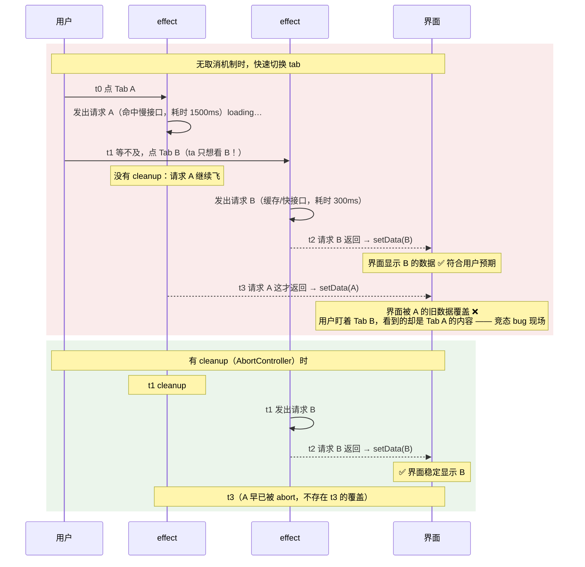

> 本文是《阶段 2：状态与副作用 ⭐核心（2 周）》按小节拆分后的续篇，上一部分见 [04-阶段-2-状态与副作用-核心-2-周.md](04-阶段-2-状态与副作用-核心-2-周.md)。

### useEffect 场景

展开五条之前，先回答"为什么会有 useEffect 这个东西"。React 对组件函数有一条铁律：**渲染必须是纯粹的**——同样的 props 和 state，渲染结果必须一样，且渲染过程不能产生任何可观察的副作用（改全局变量、操作 DOM、发请求、开定时器都不行）。这条铁律不是洁癖：React 18 之后渲染可能是并发的、可中断的，一次渲染的结果可能被丢弃后重放（StrictMode 开发期双调用就是在模拟这件事），如果渲染过程里夹了副作用，重放一次请求就发两次。

但真实应用必须与 React 之外的世界打交道：要订阅浏览器事件、要连 WebSocket、要请求数据、要让 `document.title` 跟上状态。`useEffect` 就是官方提供的"离开 React 世界"的出口：**渲染完成后，把指定的外部交互执行一遍，并且允许你登记"如何撤销它"**。正确的使用心智模型不是"生命周期钩子"（不是 `didMount`/`didUpdate`），而是——

> **useEffect 是让组件与某个外部系统保持同步的机制。依赖数组描述"同步的条件"，effect 体描述"怎么接上"，清理函数描述"怎么断开"。**

带着这个模型看五条场景：第 1 条讲同步条件的表达；第 2 条讲断开；第 3 条是完整实战（请求 + 断开防竞态）；第 4 条讲条件写错的两类后果；第 5 条讲"这根本不需要同步"的情况——那就一条都不该写。

#### 1. 依赖数组三种形态的含义（无 / `[]` / 指定）

**是什么。** `useEffect(setup, dependencies)` 的第二个参数有三种给法，分别声明三种同步策略：

| 形态 | 写法 | 执行时机 | 执行次数 | 语义 |
|---|---|---|---|---|
| 无依赖数组 | `useEffect(fn)` | **每次渲染提交后**都执行 | 每次渲染 1 次 | "渲染结果和外部系统有任何出入就重新同步"——最保守，代价最大 |
| 空数组 | `useEffect(fn, [])` | 仅**首次渲染提交后**执行（严格模式开发期为暴露问题会执行"effect→清理→再 effect"） | 1 次 | "外部系统只在挂载时接一次，之后永不重新同步"——用于订阅与组件生命周期一致的东西 |
| 指定依赖 | `useEffect(fn, [a, b])` | 首次 + 依赖变化后的渲染提交后 | 首次 1 次 + 每次依赖变化 1 次 | "当 a、b 变了，外部系统就过时了，需要断开重连"——最常用 |

**为什么需要依赖数组。** 因为"同步"是有条件的：`document.title = fullName` 只在 `fullName` 变化后才需要重做，每次渲染都重做是浪费；`roomId` 变了，聊天室连接必须重连，不重连就连错房间。依赖数组就是你告诉 React 的**同步条件声明**："这几个值是本 effect 与外部世界的一致性所系的，它们变了就重新执行"。

**怎么做（机制分步）。** 每次渲染提交后，React 执行这段逻辑：

1. 拿出**上一次渲染时记录的依赖值数组**与**本次的依赖值数组**。
2. 逐位用 `Object.is(prev, next)` 比较（所以对象/数组/函数类型的依赖，引用变了就算"变化"，哪怕内容相同——这是无数 bug 的来源，见第 4 条与本章 useMemo 场景）。
3. 只要**任意一位**不等：先执行上一次 effect 返回的**清理函数**，再执行本次的 effect 体，并记录本次依赖。
4. 全部相等：什么都不做（既不清理也不执行）。
5. 没有依赖数组：跳过比较，每次渲染后都执行 3 中的"清理→执行"。

**代码示例：三种形态对比。**

```tsx
import { useEffect, useState } from 'react';

export default function DepsDemo({ roomId }: { roomId: string }) {
  const [count, setCount] = useState(0);

  // 形态一：无依赖数组——每次渲染后都执行（含 count 变化引发的渲染）
  useEffect(() => {
    console.log('[无依赖] 每次渲染后都会跑');
  });

  // 形态二：空数组——只在挂载后执行一次
  useEffect(() => {
    console.log('[空数组] 只在挂载后执行一次');
    return () => console.log('[空数组] 卸载时执行清理');
  }, []);

  // 形态三：指定依赖——挂载后一次 + roomId 每次变化后
  useEffect(() => {
    console.log(`[指定依赖] 同步连接到房间 ${roomId}`);
    return () => console.log(`[指定依赖] 断开与房间 ${roomId} 的连接`);
  }, [roomId]);

  return (
    <div>
      <p>房间：{roomId}，count：{count}</p>
      <button onClick={() => setCount(c => c + 1)}>+1（触发一次渲染）</button>
    </div>
  );
}
```

把父组件里 `roomId` 从 `'general'` 改到 `'random'`，再点三次 +1，控制台输出序列是：

```text
挂载：
  [无依赖] 每次渲染后都会跑
  [空数组] 只在挂载后执行一次
  [指定依赖] 同步连接到房间 general
点击 +1 三次（roomId 没变，只有渲染在变）：
  [无依赖] 每次渲染后都会跑        ← 3 次
roomId 变为 random：
  [指定依赖] 断开与房间 general 的连接   ← 先清理旧的
  [指定依赖] 同步连接到房间 random       ← 再同步新的
  [无依赖] 每次渲染后都会跑
卸载：
  [空数组] 卸载时执行清理
  [指定依赖] 断开与房间 random 的连接
```

**"每次渲染都跑"的合法场景。** 无依赖数组不是禁用写法，只是用得少。合法场景比如：effect 的同步条件确实"包含所有渲染产物"时——调试日志、依据整棵渲染结果同步某外部缓存。但大多数"看似每次都要跑"的场景，写明依赖后性能更好且语义更准：`document.title = fullName` 写 `[fullName]` 就只在名字变化时执行一次，效果一样。

**常见坑。**

- 症状一：effect 只在挂载时跑了一次，之后 props 变了再也不跑（连接一直连着旧房间、日志一直打印旧 userId）。
  根因：写成 `[]` 但 effect 内部读了会变化的 props/state；`[]` 的语义是"永不需要重新同步"，React 说到做到。
  修法：把读到的值全部加入依赖（配合 eslint，见第 4 条）；"确实只想跑一次但想读最新值"的少数场景用 ref 存最新值（见闭包陷阱专题第 3 条）。
- 症状二：写了 `useEffect(fn, [user])`，`user` 是个对象，父组件每次渲染都传**新建的对象**（内容没变），导致 effect 每次渲染都在清理+重跑（WebSocket 反复断连重连）。
  根因：依赖比较用 `Object.is`，比的是引用；组件体内 `const user = { name } ` 每次渲染都是新引用。
  修法：依赖最小化——只依赖真正用到的字段 `user.id`；或渲染侧用 `useMemo` 稳定引用（本章 useMemo 场景）。
- 症状三：把依赖数组写成依赖"值"之外的变量个数不对（漏写、多写、写错顺序）导致 effect 行为漂移。
  根因：依赖数组是手写的，容易与 effect 体脱节。
  修法：启用 `eslint-plugin-react-hooks` 的 `exhaustive-deps` 规则（阶段 0 已配置），让工具守住这层一致性。

#### 2. **清理函数**：定时器、`addEventListener`、WebSocket、`AbortController`

**是什么。** effect 的 setup 函数可以返回一个清理函数（cleanup）。React 会在两个时机调用它：

```text
effect 生命周期时序（以依赖 [roomId] 为例）：

挂载        :  effect(roomId=A)
roomId 变化 :  cleanup(A)          ← 先调用上一次的清理函数
              effect(roomId=B)     ← 再执行新一次 effect
roomId 再变 :  cleanup(B) → effect(roomId=C)
卸载        :  cleanup(最后一次)    ← 卸载时也会调用
```

一句话概括：**清理函数总在下一次 effect 执行之前、以及组件卸载时调用**。它的职责是把上一次 effect 对外部世界造成的改变恢复原状——解除订阅、关掉定时器、断开连接、取消请求——保证"每次 effect 都是从干净状态开始的同步"。

**为什么需要清理。** 因为 effect 是"重复发生"的（依赖变化就重跑）而外部资源是"累积存在"的：

- 定时器不 clear：每重跑一次 effect 就多一个定时器，旧的还在跑；
- 监听器不 remove：每重跑一次就多挂一个回调，一次事件触发 N 次 handler；
- WebSocket 不 close：连接对象越积越多，服务器连接数上涨；
- 请求不 abort：旧请求还在飞，回来时把新数据覆盖掉（第 3 条竞态专题）。

没有清理函数的 effect，等价于"只借不还"，早晚资源泄漏或行为错乱。React 官方把"setup 与 cleanup 成对"作为 effect 设计的第一原则，StrictMode 在开发环境强制"挂载→清理→再挂载"一轮，就是为了把缺失清理的代码在开发期暴露出来。

**场景一代码：定时器。**

```tsx
import { useEffect, useState } from 'react';

export default function Clock() {
  const [now, setNow] = useState(() => Date.now());

  useEffect(() => {
    // setup：开始一段外部交互——每秒读一次系统时钟
    // 新值不依赖旧值（时钟自己走），传值即可；若要"在上次基础上累加"才需要函数式更新
    const id = setInterval(() => setNow(Date.now()), 1000);
    return () => {
      // cleanup：撤销这段交互——销毁定时器
      clearInterval(id);
    };
  }, []); // 时钟的同步条件是"组件存在"，所以 []（只挂一次，卸载时清理）

  return <p>当前时间戳：{now}</p>;
}
```

漏清理的症状与观察法：把 `return () => clearInterval(id)` 删掉，表面看不出异常（因为 `[]` 只跑一次）；但当依赖不是 `[]` 而是会变化的值（比如 props 里的刷新间隔）时，每变化一次就多一个 interval，时间跳越来越快、CPU 占用上升。观察法：在 setup 里 `console.log('interval 创建', id)`、清理里 `console.log('interval 清除', id)`，任何时刻"创建数 - 清除数"应恒等于 1。

**场景二代码：`addEventListener`。**

```tsx
import { useEffect, useState } from 'react';

export default function WindowWidth({ onResize }: { onResize?: () => void }) {
  const [width, setWidth] = useState(() => window.innerWidth);

  useEffect(() => {
    // setup：向 window 挂一个 resize 监听（window 在组件卸载后依然存在！）
    const handleResize = () => {
      setWidth(window.innerWidth);
      onResize?.();
    };
    window.addEventListener('resize', handleResize);
    return () => {
      // cleanup：移除监听。注意必须传同一个函数引用，
      // 若 cleanup 里现写一个新箭头函数，remove 无效（removeEventListener 按引用匹配）
      window.removeEventListener('resize', handleResize);
    };
  }, [onResize]); // onResize 是 prop：它变了就需要"换个回调重新同步"，所以进依赖

  return <p>窗口宽度：{width}px</p>;
}
```

两个工程要点：其一，cleanup 里移除的必须是 setup 里挂载的**同一个函数引用**（所以 `handleResize` 要先存成变量）；其二，`window` 这类"活得比组件久"的对象是泄漏重灾区——组件销了监听器还在，回调里再引用着 state/闭包，整条引用链都释放不掉。观察法：DevTools Console 执行 `getEventListeners(window)`（Chrome 专有 API，仅在 DevTools 控制台可用）查看 window 上挂的监听器数量，反复挂载/卸载组件，数量应回到初始值。

**场景三代码：WebSocket。**

```tsx
import { useEffect, useState } from 'react';

interface ChatMessage { user: string; text: string; }

export default function ChatRoom({ roomUrl }: { roomUrl: string }) {
  const [messages, setMessages] = useState<ChatMessage[]>([]);
  const [status, setStatus] = useState<'connecting' | 'open' | 'closed'>('connecting');

  useEffect(() => {
    setStatus('connecting');
    // setup：连接指定房间。roomUrl 在依赖里——换房间必须重连
    const ws = new WebSocket(roomUrl);

    ws.onopen = () => setStatus('open');
    ws.onmessage = (event: MessageEvent<string>) => {
      // 用函数式更新追加消息：不依赖闭包里的旧 messages（闭包陷阱专题详解）
      const msg = JSON.parse(event.data) as ChatMessage;
      setMessages(prev => [...prev, msg]);
    };
    ws.onclose = () => setStatus('closed');

    return () => {
      // cleanup：断开连接。不关的话——换房间后旧房间的消息仍会涌入 setMessages
      ws.close();
    };
  }, [roomUrl]);

  return (
    <div>
      <p>连接状态：{status}</p>
      <ul>
        {messages.map((m, i) => (
          <li key={i}>{m.user}：{m.text}</li>
        ))}
      </ul>
    </div>
  );
}
```

漏清理的症状与观察法：删掉 `ws.close()`，快速在两个 `roomUrl` 之间切换几次，Chrome DevTools 的 Network 面板 → WS 过滤器里会看到 WebSocket 连接条目只增不减，旧连接的 Frame 仍在滚动收消息（消息还会继续 `setMessages`，两个房间的消息混在一起）；组件卸载后回调仍在更新 state，React 18 已不再为此报错（旧版本会警告 memory leak），但你的 UI 已经无人显示，纯属做无用功。观察法：Network → WS 看连接数；Console 里看卸载后是否仍打印消息日志。

**场景四代码：`AbortController`（取消 fetch 请求）。**

```tsx
import { useEffect, useState } from 'react';

interface User { id: number; name: string; }

export default function UserCard({ userId }: { userId: number }) {
  const [user, setUser] = useState<User | null>(null);
  const [error, setError] = useState<Error | null>(null);

  useEffect(() => {
    // setup：为这一次请求配一个"中止器"，把 signal 关联到 fetch
    const controller = new AbortController();

    fetch(`https://jsonplaceholder.typicode.com/users/${userId}`, {
      signal: controller.signal,
    })
      .then(res => {
        if (!res.ok) throw new Error(`HTTP ${res.status}`);
        return res.json() as Promise<User>;
      })
      .then(setUser)
      .catch((err: unknown) => {
        // 被 abort 的请求会以 AbortError 拒绝：这不是业务错误，静默忽略
        if (err instanceof DOMException && err.name === 'AbortError') return;
        setError(err as Error);
      });

    return () => {
      // cleanup：userId 变化或卸载时，中止仍在飞的请求
      controller.abort();
    };
  }, [userId]);

  if (error) return <p>加载失败：{error.message}</p>;
  return <p>{user ? user.name : '加载中…'}</p>;
}
```

四个场景一张表总结：

| 资源 | setup | cleanup | 不清理的后果 |
|---|---|---|---|
| 定时器 | `setInterval(fn, ms)` | `clearInterval(id)` | 定时器堆积，回调重复执行 |
| DOM/window 事件 | `addEventListener(type, fn)` | `removeEventListener(type, fn)`（同一引用） | 回调重复触发、闭包引用泄漏 |
| WebSocket | `new WebSocket(url)` | `ws.close()` | 连接数上涨、旧连接消息继续灌入 |
| fetch | `fetch(url, { signal })` | `controller.abort()` | 竞态：旧响应覆盖新数据 |

**漏清理的内存泄漏，DevTools 观察法汇总。**

1. **Console 计数法（最快）**：setup/cleanup 各打一条带自增编号的日志，任何时刻两者差值应等于"当前应有的资源数"。
2. **React DevTools Profiler**：录制期间反复挂载/卸载组件，若卸载后仍有该组件名下的提交（commit）出现，说明有回调仍在 setState。
3. **Chrome Performance → Memory**：拍 Heap snapshot（堆快照）两次（卸载组件前后各一次），用 Comparison 视图看 Detached（已脱离 DOM 树但仍被引用的）节点是否持续增长；Summary 里按 Retainers 追到持有者——通常就是没解绑的监听器或没关的连接。
4. **Network 面板**：WS 连接只增不减、卸载后请求仍在发出，都是清理缺失的直接证据。

**常见坑。**

- 症状一：组件卸载后控制台还在刷日志 / 请求还在发。
  根因：effect 建立的异步任务没有随卸载终止。
  修法：补 cleanup；无法 abort 的场景（如某些旧接口）用"忽略标志"（第 3 条）兜底。
- 症状二：`removeEventListener` 写了但监听器还在，事件触发两次。
  根因：cleanup 里传的箭头函数是**新建的引用**，与 setup 时挂的不是同一个函数，移除无效。
  修法：handler 提为 setup 内的具名变量，add/remove 用同一个变量。
- 症状三：依赖数组留空 `[]` 但 effect 里用了会变的 props，导致"清理"清理的永远是第一次的旧值资源。
  根因：`[]` 让 effect 与清理都只跑一次，后续变化既不重新同步也不重新清理。
  修法：补全依赖，让"清理旧的 + 建立新的"配对发生。
- 症状四：在 cleanup 里做了多余的事（重置 UI state、发埋点）导致切页时界面闪烁。
  根因：清理函数的职责被扩大。它只该"撤销 setup 建立的交互"。
  修法：埋点等"只在真正离开时做一次"的逻辑，放到卸载才执行的 effect（`[]`）里，或用 ref 标记依赖变化与卸载的区分。

#### 3. 数据请求完整链路：loading / error / success / 竞态取消（快速切换 tab 时旧请求覆盖新结果）

**是什么。** 把"请求"这件外部交互完整地纳入 React：用状态机描述请求的三种形态（进行中/失败/成功），用 cleanup（AbortController 或忽略标志）处理"请求未完成但组件已进入下一轮"的竞态。

**为什么需要。** 两个原因：

1. 请求是**异步**的：从发出到响应之间组件可能渲染任意次，必须有一个 state 表达"正在进行中"，否则 UI 无从显示骨架屏/禁用态；响应可能失败，失败必须可表达、可恢复（重试）。
2. 请求是**乱序返回**的：发出 A（慢）又发出 B（快）时，B 先回、A 后回，若不处理，最后留在界面上的会是 A 的旧数据——但用户当前选择的是 B。这就是竞态条件（race condition），数据请求里最经典的 bug。

**怎么做（机制分步）。** 以"请求参数 `url` 作为依赖"的 effect 为例：

1. `url` 变化 → React 调用 cleanup：abort 上一次请求（它已不代表用户当前意图）。
2. 执行新 effect：进入 loading 态，创建新 AbortController，发出带 signal 的新请求。
3. 响应到达 → 校验状态 → 进入 success 态写入 data；异常到达 → abort 引起的 AbortError 静默忽略，其他进入 error 态。
4. 组件卸载 → cleanup 同样 abort，防止"卸载后 setState"式的无用工。

**状态机建模。** 不要用三个平行布尔值（`loading && error` 同时为 true 的非法组合早晚出现），用一个可辨识联合（discriminated union）让非法状态不可表示：

```ts
// RequestState.ts —— 三态状态机：任一时刻恰好处于其中一种形态
export type RequestState<T> =
  | { status: 'loading' }
  | { status: 'error'; error: Error }
  | { status: 'success'; data: T };
```

**竞态时序图解。** 无取消机制时，快速切换 tab：



复现方法：真实网络里很难稳定复现竞态，用 Chrome DevTools Network 面板的 throttling 选 Slow 3G，或给接口 URL 加不同延迟参数（如 jsonplaceholder 响应本就偏慢），快速连点两个 tab 即可看到"显示的是先点那个 tab 的数据"。

**AbortController 版 useFetch 完整实现。**

```tsx
// useFetch.ts —— 通用数据请求 Hook：三态状态机 + AbortController 竞态取消
import { useEffect, useState } from 'react';

export type RequestState<T> =
  | { status: 'loading' }
  | { status: 'error'; error: Error }
  | { status: 'success'; data: T };

export function useFetch<T>(url: string): RequestState<T> {
  // 初始即 loading：组件一挂起就有请求要发
  const [state, setState] = useState<RequestState<T>>({ status: 'loading' });

  useEffect(() => {
    // 每轮 effect 配一个独立控制器：它的生命周期 = 本轮同步的生命周期
    const controller = new AbortController();
    setState({ status: 'loading' }); // url 变化后先回到 loading（清掉上一轮的 data/error）

    fetch(url, { signal: controller.signal })
      .then(res => {
        if (!res.ok) {
          // fetch 对 404/500 不会 reject！必须手动检查并抛出，否则会进 success
          throw new Error(`HTTP ${res.status} ${res.statusText}`);
        }
        return res.json() as Promise<T>;
      })
      .then(data => {
        // 走到这里说明既成功又未被 abort，安全写入
        setState({ status: 'success', data });
      })
      .catch((err: unknown) => {
        // 被 abort 的请求抛 AbortError：它是"被我们主动取消"的，不算失败，静默返回
        if (err instanceof DOMException && err.name === 'AbortError') return;
        setState({ status: 'error', error: err as Error });
      });

    return () => {
      // cleanup：url 变化 / 组件卸载 → 中止本轮请求（竞态防线就在这一行）
      controller.abort();
    };
  }, [url]); // url 是唯一的同步条件：url 变 = 数据过时 = 必须重新请求

  return state;
}
```

配套使用它的 tab 组件：

```tsx
// UserTabs.tsx —— 快速切换也不怕：useFetch 内部已处理竞态
import { useState } from 'react';
import { useFetch } from './useFetch';

interface User { id: number; name: string; email: string; }

const TABS: Record<string, number> = { Alice: 1, Bob: 2, Carol: 3 };

export default function UserTabs() {
  const [tab, setTab] = useState<keyof typeof TABS>('Alice');
  // 请求 URL 由 tab 派生：tab 变 → url 变 → useFetch 内部 abort 旧的、发新的
  const state = useFetch<User>(
    `https://jsonplaceholder.typicode.com/users/${TABS[tab]}`
  );

  return (
    <div>
      {Object.keys(TABS).map(name => (
        <button key={name} onClick={() => setTab(name as keyof typeof TABS)}>
          {name}
        </button>
      ))}
      {state.status === 'loading' && <p>加载中…</p>}
      {state.status === 'error' && <p>出错了：{state.error.message}</p>}
      {state.status === 'success' && (
        <dl>
          <dt>姓名</dt><dd>{state.data.name}</dd>
          <dt>邮箱</dt><dd>{state.data.email}</dd>
        </dl>
      )}
    </div>
  );
}
```

**备选方案：忽略标志（ignore flag）。** 当接口/库不支持 abort（如 JSONP、部分旧封装）时，用布尔标志实现"请求照飞、结果丢弃"：

```tsx
// useFetchIgnore.ts —— 不中断请求，但让迟到的旧响应被丢弃
import { useEffect, useState } from 'react';

export function useFetchIgnore<T>(url: string) {
  const [data, setData] = useState<T | null>(null);
  const [error, setError] = useState<Error | null>(null);

  useEffect(() => {
    let ignore = false; // 本轮同步的"生死牌"：cleanup 一执行即翻转为 true

    fetch(url)
      .then(res => {
        if (!res.ok) throw new Error(`HTTP ${res.status}`);
        return res.json() as Promise<T>;
      })
      .then(json => {
        if (!ignore) setData(json); // 只有这轮 effect 还"活着"才允许写入
      })
      .catch((err: unknown) => {
        if (!ignore) setError(err as Error);
      });

    return () => {
      ignore = true; // url 变化/卸载：宣布上一轮结果作废
    };
  }, [url]);

  return { data, error, loading: data === null && error === null };
}
```

两种方案对比：ignore 标志**只丢弃结果**，请求本身仍会下载完（浪费带宽与服务器资源，但实现零依赖、处处可用）；AbortController **真正中止请求**（浏览器停止下载、服务器有机会中断处理），是首选。两者不冲突，`useFetch` 里 abort + catch AbortError 的组合已经同时起到了 ignore 的作用。

**常见坑。**

- 症状一：快速切换 tab 后显示的是"先点的那个 tab"的数据。
  根因：无取消机制，慢请求后到，把正确数据覆盖。
  修法：AbortController（首选）或 ignore 标志；生产项目直接上 TanStack Query，其内部已处理（阶段 4.2 展开）。
- 症状二：接口返回 404/500，界面却显示"成功"且数据为空。
  根因：`fetch` 只在网络层面失败时 reject，HTTP 错误状态码不会自动抛错。
  修法：`if (!res.ok) throw new Error(...)`（见 useFetch 实现）。
- 症状三：url 变化后界面上上一轮的 data 和这一轮的 loading 闪烁重叠。
  根因：effect 里忘了先 `setState({ status: 'loading' })`，旧数据残留到了新请求返回。
  修法：每轮 effect 开头重置为 loading（见实现）。
- 症状四：catch 里把 AbortError 当作错误显示给用户（切换越快越容易看到"请求被中止"的报错）。
  根因：abort 触发的 DOMException(AbortError) 走进了同一个 catch。
  修法：catch 首行过滤 `err.name === 'AbortError'` 直接 return。

#### 4. `exhaustive-deps` 警告：依赖"太多导致循环"与"太少导致旧值"两类问题的解法

**是什么。** `exhaustive-deps` 是 `eslint-plugin-react-hooks` 内置规则（阶段 0 已配置），它静态分析 effect 内部**实际读取**的响应式值（props、state 及由它们派生的局部变量），与依赖数组比对：漏了就警告"缺少依赖"，写了对内部没用的会提示"多余依赖"。它的立场很明确：**依赖数组不是"你希望 effect 什么时候跑"的开关，而是"effect 正确性所需条件"的如实申报**。警告出现时，正确动作不是删规则、加 `eslint-disable`，而是处理它。

为什么规则如此强硬？因为两类瞒报/误报会分别导致两种可复现的 bug：

**问题 A：依赖太少 → 读到旧值。**

复现：

```tsx
import { useEffect, useState } from 'react';

export default function MissingDep({ userId }: { userId: string }) {
  const [message, setMessage] = useState('');

  useEffect(() => {
    // effect 体读取了 userId，但依赖数组没申报
    setMessage(`欢迎你，${userId}`);
    console.log('欢迎消息已设置：', userId);
  }, []); // ⚠️ exhaustive-deps：React Hook useEffect has a missing dependency: 'userId'

  return <p>{message}</p>;
}
```

运行流程：挂载时 userId 是 `'alice'`，effect 跑一次，显示"欢迎你，alice"。父组件把 userId 换成 `'bob'` 组件重渲染——但依赖是 `[]`，React 比较 `[]` 与 `[]` 全等，**effect 不再执行**，界面仍显示 alice 的欢迎语。旧值从此凝固。修法：如实申报 `[userId]`，userId 变化时 effect 重新同步，欢迎语跟上。

```tsx
  useEffect(() => {
    setMessage(`欢迎你，${userId}`); // 依赖申报与读取一致，警告消失，行为正确
  }, [userId]);
```

**问题 B：依赖太多 → 无限循环。**

复现一（effect 里 setState 又依赖它）：

```tsx
import { useEffect, useState } from 'react';

export default function InfiniteLoop() {
  const [count, setCount] = useState(0);
  const [renderCount, setRenderCount] = useState(0);

  useEffect(() => {
    setRenderCount(r => r + 1); // effect 里更新了 renderCount……
  }, [renderCount]);            // ……而又依赖了 renderCount

  // 死循环链：渲染 → effect 跑 → setRenderCount → 渲染 → 依赖变了 → effect 再跑 → ……
  // 表现：界面卡死/警告 "Maximum update depth exceeded"
  return <p>渲染了 {renderCount} 次（并持续增长）</p>;
}
```

复现二（对象引用依赖）：

```tsx
import { useEffect, useState } from 'react';

export default function ObjectDepLoop({ query }: { query: string }) {
  const [results, setResults] = useState<string[]>([]);

  // 每次渲染都在组件体内新建 options 对象（引用全新）
  const options = { q: query, pageSize: 10 };

  useEffect(() => {
    setResults(search(options)); // setState → 渲染 → 新 options → 依赖变 → 再跑……
  }, [options]); // ⚠️ 引用比较永不相等

  return <ul>{results.map((r, i) => <li key={i}>{r}</li>)}</ul>;
}

function search(o: { q: string; pageSize: number }): string[] {
  return [`${o.q}-结果1`, `${o.q}-结果2`];
}
```

**修法一：函数式更新，把 state 移出依赖。** 若 effect 更新 state 的逻辑不依赖读取该 state，用函数式更新即可删掉这个依赖（问题 B 复现一里 `setRenderCount(r => r + 1)` 本就不需要读 `renderCount`，依赖删成 `[]` 就修好了）：

```tsx
  useEffect(() => {
    setRenderCount(r => r + 1); // 函数式更新自带"上一步"，无需读取闭包里的值
  }, []); // 依赖里不再有 renderCount，循环断开
```

**修法二：依赖最小化——只依赖真正参与同步条件的值。** 问题 B 复现二里，effect 实际需要的只是 `query`（字符串，值相等即引用相等），把 `options` 移进 effect 内部构造：

```tsx
  useEffect(() => {
    const options = { q: query, pageSize: 10 }; // 移进 effect：不再是"每次渲染的新引用"
    setResults(search(options));
  }, [query]); // 只依赖原始值，语义更准、永不循环
```

**修法三：拆分 effect。** 一个 effect 干了多件事、互相牵连出依赖纠纷时，按"同步条件不同"拆开，各自依赖各自：

```tsx
  // ❌ 揉在一起：a 变化也会导致 b 的订阅重连
  useEffect(() => {
    subscribeTo(a);
    log(b);
  }, [a, b]);

  // ✅ 拆分：a 的重连不再被 b 的变化骚扰
  useEffect(() => {
    const unsub = subscribeTo(a);
    return unsub;
  }, [a]);
  useEffect(() => {
    log(b);
  }, [b]);
```

**修法四：确需"每次引用都稳定"时用 `useMemo` 包住对象/函数**（本章 useMemo 场景展开；函数可用 `useCallback`）。这是最后手段——先问自己能不能依赖更原始的值。

**两类问题对照速查：**

| | 依赖太少 | 依赖太多 |
|---|---|---|
| 典型症状 | 值凝固在旧数据、effect "不再跑" | 无限循环 / effect 频繁重跑 / 卡死 |
| 根因 | 依赖申报少于实际读取 → React 认为"无需重新同步" | 依赖了 effect 更新的 state，或依赖了每次渲染新建的对象引用 |
| 第一反应 | 补上缺的依赖 | 删掉不该有的依赖（移进 effect / 函数式更新 / 依赖原始值） |
| 拆东墙补西墙的伪修法 | 删依赖压警告（旧值 bug 被埋进去） | 把依赖写全却保留 setState（循环换了个形状） |

**常见坑。**

- 症状一：控制台 `Maximum update depth exceeded`。
  根因：effect 与自身依赖形成闭环（问题 B 复现一/二）。
  修法：按"修法一/二"断环；重新审视这段逻辑是否根本不该在 effect 里（见第 5 条）。
- 症状二：加了个 `setTimeout` 依赖"只跑一次"的 effect，后来发现读到旧 props。
  根因：`[]` 是"永不重同步"的强声明，不是"只跑一次的工具"。
  修法：补依赖；只在"同步条件确实是组件生命周期"时用 `[]`。
- 症状三：`eslint-disable-next-line react-hooks/exhaustive-deps` 满天飞。
  根因：把警告当噪音。绝大多数警告指向真实 bug 或设计问题。
  修法：先按规则修；确属例外（如第三方库文档要求）再 disable 并写明原因与风险。
- 症状四：依赖数组写了但顺序/内容不稳定（如依赖里混入条件表达式结果），effect 行为漂移难排查。
  修法：依赖数组只放"effect 里读取的响应式值"本体，不放表达式；靠 exhaustive-deps 兜底。

#### 5. **什么时候不该用 useEffect**：派生状态用普通变量/Memo、事件逻辑放事件处理器（react.dev《You Might Not Need an Effect》必读）

**是什么。** react.dev 官方文档专设一节《You Might Not Need an Effect》，核心论断：**effect 的唯一正当职责是"与 React 之外的系统同步"**（网络请求、DOM 浏览器 API、第三方 widget、计时器、订阅、日志）。以下三类需求都不该用 effect 实现：

1. 由 props/state **计算出来**的数据 → 普通变量（贵的加 `useMemo`）。
2. 响应**用户操作**的逻辑 → 事件处理器。
3. 因某个值变化而**调整/重置另一个 state** → 多数有更好的模式（`key` 重置、渲染期间调整、函数式更新）。

**为什么不该滥用。** 三条实打实的代价：

- **多余的渲染链**：先渲染一次（旧派生值）→ effect 跑 → setState → 再渲染一次（新派生值），本可一次完成的更新变成两跳，输入类高频场景直接掉帧。
- **旧值与时序 bug 的温床**：effect 与渲染之间存在一次提交的时间差，期间任何读取都可能拿到中间态；依赖写漏就是本章第 4 条的问题。
- **逻辑被藏进"数据流之外"**：事件处理器里的逻辑顺着"用户操作"能直接找到；藏进 effect 后，"谁触发的"要靠脑内模拟渲染序列，新人接手如读天书。

**反例一：用 effect 派生状态。** 错误写法（React 官方文档的头号反面教材）：

```tsx
import { useEffect, useState } from 'react';

export default function BadFullNameForm() {
  const [firstName, setFirstName] = useState('张');
  const [lastName, setLastName] = useState('三');

  // ❌ 用一整套 state+effect 去"手动同步"一个可以当场算出来的值
  const [fullName, setFullName] = useState('');
  useEffect(() => {
    setFullName(firstName + ' ' + lastName); // 每次名字变化：渲染(旧值)→effect→再渲染(新值)
  }, [firstName, lastName]);

  return (
    <form>
      <input value={firstName} onChange={e => setFirstName(e.target.value)} />
      <input value={lastName} onChange={e => setLastName(e.target.value)} />
      <p>全名：{fullName}</p>
    </form>
  );
}
```

重构后——派生值直接在渲染中计算，没有第二次渲染、没有依赖数组、没有旧值窗口：

```tsx
import { useState } from 'react';

export default function GoodFullNameForm() {
  const [firstName, setFirstName] = useState('张');
  const [lastName, setLastName] = useState('三');

  // ✅ 派生状态 = 普通变量：每次渲染现场计算，天然与源同步
  const fullName = firstName + ' ' + lastName;

  return (
    <form>
      <input value={firstName} onChange={e => setFirstName(e.target.value)} />
      <input value={lastName} onChange={e => setLastName(e.target.value)} />
      <p>全名：{fullName}</p>
    </form>
  );
}
```

判断口径："这个值能否用已有 props/state **直接算出来**？"能，就是派生状态，永远不要存进 state 再同步。计算昂贵（如对一万条数据过滤排序）时，用 `useMemo` 缓存计算结果——注意 memo 缓的是**计算成本**，语义仍是"派生"：

```tsx
import { useMemo, useState } from 'react';

const ALL_ITEMS = Array.from({ length: 10000 }, (_, i) => `商品 ${String(i + 1).padStart(5, '0')}`);

export default function ExpensiveList() {
  const [keyword, setKeyword] = useState('');

  // ✅ 派生 + 缓存：仅当 keyword 变化才重算，其余渲染直接复用上次结果
  const filtered = useMemo(
    () => ALL_ITEMS.filter(item => item.includes(keyword)),
    [keyword]
  );

  return (
    <div>
      <input value={keyword} onChange={e => setKeyword(e.target.value)} />
      <p>共 {filtered.length} 件（来自 {ALL_ITEMS.length} 件）</p>
      <ul>{filtered.slice(0, 20).map(item => <li key={item}>{item}</li>)}</ul>
    </div>
  );
}
```

**反例二：把事件逻辑放进 effect。** 错误写法——提交表单不写在提交事件里，而是"绕道 state 变化"触发：

```tsx
import { useEffect, useState } from 'react';

export default function BadSubmitForm() {
  const [form, setForm] = useState({ name: '', email: '' });
  const [submitted, setSubmitted] = useState(false);

  // ❌ "监听 submitted 变 true 就提交"：把用户动作翻译成 state 再翻译回来
  useEffect(() => {
    if (submitted) {
      submitForm(form); // 后果一：StrictMode 下开发期双执行，请求发两次
      setSubmitted(false); // 后果二：手动复位，多一次渲染，忘了就每次渲染都提交
    }
  }, [submitted, form]); // 后果三：form 也得进依赖，依赖越滚越多

  return (
    <form onSubmit={e => { e.preventDefault(); setSubmitted(true); }}>
      <input value={form.name} onChange={e => setForm(f => ({ ...f, name: e.target.value }))} />
      <input value={form.email} onChange={e => setForm(f => ({ ...f, email: e.target.value }))} />
      <button type="submit">提交</button>
    </form>
  );
}

function submitForm(form: { name: string; email: string }) {
  console.log('提交到服务器：', form);
}
```

重构后——用户动作直接对接动作处理代码，可预测、不重复：

```tsx
import { useState } from 'react';

export default function GoodSubmitForm() {
  const [form, setForm] = useState({ name: '', email: '' });

  // ✅ 事件逻辑放事件处理器：谁触发、何时执行一目了然，StrictMode 双渲染也不会多发请求
  const handleSubmit = (e: React.FormEvent<HTMLFormElement>) => {
    e.preventDefault();
    submitForm(form);
  };

  return (
    <form onSubmit={handleSubmit}>
      <input value={form.name} onChange={e => setForm(f => ({ ...f, name: e.target.value }))} />
      <input value={form.email} onChange={e => setForm(f => ({ ...f, email: e.target.value }))} />
      <button type="submit">提交</button>
    </form>
  );
}

function submitForm(form: { name: string; email: string }) {
  console.log('提交到服务器：', form);
}
```

判断口径："这段逻辑是在**响应用户的操作**，还是在**和外部系统同步**？"响应用户（提交、购买、点赞、导航）→ 事件处理器。同一个需求里两类逻辑都可能存在：点击购买是事件逻辑，购买后同步购物车徽标到服务器才是 effect 关心的事。

**反例三：props 变化时重置 state。** 错误写法——用 effect"监听"userId，变了就清空评论草稿：

```tsx
import { useEffect, useState } from 'react';

export default function BadProfile({ userId }: { userId: string }) {
  const [comment, setComment] = useState('');

  // ❌ 先渲染一次带着旧用户的草稿，effect 再清空 → 又一次渲染，界面闪一下旧值
  useEffect(() => {
    setComment('');
  }, [userId]);

  return <textarea value={comment} onChange={e => setComment(e.target.value)} />;
}
```

重构方案 A（首选）——**用 `key` 重置整个组件**。父组件把 `userId` 同时作为 `key` 传入，key 变化时 React 会**卸载旧组件、挂载新组件**，所有 state 天然回到初始值，一行 effect 都不用写：

```tsx
// 父组件里：<Profile key={userId} userId={userId} />
import { useState } from 'react';

export default function Profile({ userId }: { userId: string }) {
  // userId 一变（经父组件 key），本组件整个重建，comment 自动是 ''
  const [comment, setComment] = useState('');
  return (
    <div>
      <p>用户：{userId}</p>
      <textarea value={comment} onChange={e => setComment(e.target.value)} />
    </div>
  );
}
```

重构方案 B——**渲染期间调整 state**（react.dev 认可的官方模式）：在渲染过程中比较"上一次的 props"与"本次的 props"，不一致就趁渲染内重置，无需第二次提交：

```tsx
import { useState } from 'react';

export default function List({ items }: { items: string[] }) {
  const [selection, setSelection] = useState<string | null>(null);
  const [prevItems, setPrevItems] = useState(items); // 记住"这次 state 对应的 props"

  if (items !== prevItems) {
    // 渲染期间检测到 items 变化：直接调整本组件 state（React 会立刻丢弃本次输出重新渲染，
    // 不会提交中间态；只允许"改自己"且需能收敛，严禁改父级/全局）
    setPrevItems(items);
    setSelection(null);
  }

  return (
    <ul>
      {items.map(item => (
        <li
          key={item}
          onClick={() => setSelection(item)}
          style={{ fontWeight: selection === item ? 'bold' : 'normal' }}
        >
          {item}
        </li>
      ))}
    </ul>
  );
}
```

**判别口诀（贴在工位上）：**

```text
想写 useEffect 前，按序三问：

1. 能用 props/state 直接算出来吗？      → 普通变量（贵的用 useMemo），删掉 effect
2. 是在响应用户的某个操作吗？           → 事件处理器，删掉 effect
3. 是要"重置/调整"某个 state 吗？        → key 重置 或 渲染期间调整，多数情况删掉 effect

三问都否，且确实要接触 React 之外的系统（请求/订阅/计时器/DOM API/第三方库/日志）
→ 这才是 useEffect 的本职，写吧——记得带清理函数，依赖如实申报。
```

**常见坑。**

- 症状一：输入框打字卡顿，Profiler 显示每次击键引发两次渲染。
  根因：派生值走 effect+setState 同步，多了一跳。
  修法：改普通变量/useMemo。
- 症状二：表单提交在开发环境发两次请求。
  根因：提交逻辑在 effect 里，StrictMode 双执行 effect 直接放大。
  修法：移入 `onSubmit`。
- 症状三：切换用户后表单里还残留上一个用户的草稿（或闪烁一下旧值才清空）。
  根因：用 effect "补丁式"重置 state，重置发生在提交之后。
  修法：`key` 重置组件（方案 A），一劳永逸。

#### 6. 实战变体：防抖搜索 + 可暂停轮询（两个高频需求的完整实现与取舍）

**需求一：搜索防抖。** 用户在搜索框连续输入时，UI 必须立即回显每一个字符（体验要求），但请求不能每个字符发一次（输入 "react hooks" 10 个字符就是 10 次请求，其中 9 次是浪费）。目标：输入停止 300ms 后才发出一次请求，且快速输入期间旧请求被取消。

**机制分步。** 防抖的正确落点不是"事件"而是"派生值"：输入值 `keyword` 照常进 state（驱动输入框即时回显），再派生一个"防抖值" `debouncedKeyword`——它落后 300ms。effect 负责"推迟更新"，cleanup 负责"输入又变了就作废上一次推迟"：

```tsx
// useDebouncedValue.ts —— 通用防抖 Hook：value 停止变化 delay 毫秒后才更新
import { useEffect, useState } from 'react';

export function useDebouncedValue<T>(value: T, delay: number): T {
  const [debounced, setDebounced] = useState(value);

  useEffect(() => {
    // value 每变一次：cleanup 先清掉上一次的"到点更新"，再重新计时
    const timer = setTimeout(() => setDebounced(value), delay);
    return () => clearTimeout(timer);
  }, [value, delay]); // delay 也是同步条件：间隔配置变了要重新计时

  return debounced;
}
```

时序图解（输入 r → re → rea → reac，每步间隔 200ms，delay 300ms）：

```text
t=0    keyword='r'    定时器#1（300ms）启动
t=200  keyword='re'   cleanup 清掉 #1，定时器#2 启动
t=400  keyword='rea'  清掉 #2，#3 启动
t=600  keyword='reac' 清掉 #3，#4 启动
t=900  #4 到点 → setDebounced('reac') → 仅此一次触发 useFetch 请求
中间任何时刻组件卸载：cleanup 清掉当前定时器，绝不会在卸载后再 setState
```

与第 3 条的 `useFetch` 组装成完整页面：

```tsx
// SearchPage.tsx —— 输入即时回显 + 请求防抖 + 竞态取消，三层各司其职
import { useState } from 'react';
import { useDebouncedValue } from './useDebouncedValue';
import { useFetch } from './useFetch';

interface Post { id: number; title: string; }

export default function SearchPage() {
  // 第一层：keyword 即时更新，输入框绝不卡顿
  const [keyword, setKeyword] = useState('');
  // 第二层：防抖值落后 300ms，吸收连续击键
  const debounced = useDebouncedValue(keyword, 300);
  // 第三层：url 由防抖值派生，内部自带 AbortController 竞态取消
  const state = useFetch<Post[]>(
    debounced
      ? `https://jsonplaceholder.typicode.com/posts?title=${encodeURIComponent(debounced)}`
      : 'https://jsonplaceholder.typicode.com/posts'
  );

  return (
    <div>
      <input
        value={keyword}
        onChange={(e) => setKeyword(e.target.value)}
        placeholder="搜索（连续输入，观察 Network 只在停顿后发请求）"
      />
      {state.status === 'loading' && <p>加载中…</p>}
      {state.status === 'error' && <p>出错了：{state.error.message}</p>}
      {state.status === 'success' && (
        <ul>{state.data.slice(0, 10).map((p) => <li key={p.id}>{p.title}</li>)}</ul>
      )}
    </div>
  );
}
```

关键取舍：把防抖做成**派生值的 Hook**（可复用、可单测、输入框不受影响），而不是在 `onChange` 里手写 `setTimeout`（要自己管 timer id 与清理，还容易顺手把输入框也改成延迟回显，体验倒退）；请求取消完全交给 `useFetch` 的 cleanup，防抖层不碰网络——两层职责分离，将来换 TanStack Query 只动第三层。

**需求二：可暂停轮询。** 监控面板每 5 秒拉一次指标：页面切到后台要暂停（省电省请求），切回来立刻补一次；上一次请求没回来不许排下一轮（慢接口 + `setInterval` 会把请求堆成队列）；组件卸载必须彻底停止。

**机制分步。** 用 `setTimeout` 链代替 `setInterval`：每轮"请求完成 → 再等 interval → 下一轮"，天然不堆积；用 `visibilitychange` 感知页面可见性；用 AbortController + 取消标志处理卸载与换参：

```tsx
// usePolling.ts —— 完成后再排下一轮的轮询 Hook（不堆积、可暂停、可自愈）
import { useEffect, useRef, useState } from 'react';

interface PollOptions {
  interval: number;   // 两次轮询的间隔（从上一轮完成算起）
  enabled?: boolean;  // 总开关：false 时完全停止
}

export function usePolling<T>(
  fetcher: (signal: AbortSignal) => Promise<T>,
  { interval, enabled = true }: PollOptions
) {
  const [data, setData] = useState<T | null>(null);
  const [error, setError] = useState<Error | null>(null);

  // fetcher 多半是每次渲染新建的内联函数，直接进依赖会把轮询节奏重置。
  // 镜像进 ref：effect 只认 interval/enabled，调用时取最新实现（闭包陷阱专题的 ref 镜像）
  const fetcherRef = useRef(fetcher);
  useEffect(() => {
    fetcherRef.current = fetcher;
  });

  useEffect(() => {
    if (!enabled) return;

    let cancelled = false;
    let timerId: number | undefined;
    let inFlight = false;
    const controller = new AbortController();

    // 排期幂等：任何时刻至多一个待执行的 tick，防止"回前台补发"与"上一轮排期"撞出两条链
    const schedule = (delay: number) => {
      if (cancelled || timerId !== undefined) return;
      timerId = window.setTimeout(() => {
        timerId = undefined;
        void tick();
      }, delay);
    };

    const tick = async () => {
      if (inFlight) return; // 双保险：执行中也去重
      inFlight = true;
      try {
        const result = await fetcherRef.current(controller.signal);
        if (!cancelled) {
          setData(result);
          setError(null);
        }
      } catch (err) {
        if (cancelled) return;
        if (err instanceof DOMException && err.name === 'AbortError') return;
        setError(err as Error); // 记录失败但继续下一轮：轮询要"自愈"，一次网络抖动不该让监控停摆
      } finally {
        inFlight = false;
      }
      if (!cancelled && !document.hidden) {
        schedule(interval); // 上一轮结束后再排下一轮：任意时刻至多一轮在飞
      }
    };

    schedule(0);

    const onVisibility = () => {
      if (document.hidden) {
        if (timerId !== undefined) {
          window.clearTimeout(timerId);
          timerId = undefined; // 切走：撤销待执行的排期（在飞那轮结束时自知不再排）
        }
      } else {
        schedule(0); // 回来：立刻补一次
      }
    };
    document.addEventListener('visibilitychange', onVisibility);

    return () => {
      cancelled = true;                              // 迟到的响应一律丢弃
      if (timerId !== undefined) window.clearTimeout(timerId); // 撤销排期
      controller.abort();                            // 中止在飞请求
      document.removeEventListener('visibilitychange', onVisibility);
    };
  }, [interval, enabled]);

  return { data, error };
}
```

使用方：

```tsx
// MetricsPanel.tsx —— 打开面板才轮询，关闭即停
import { useState } from 'react';
import { usePolling } from './usePolling';

interface Metrics { cpu: number; memory: number; }

export default function MetricsPanel() {
  const [open, setOpen] = useState(false);

  const { data, error } = usePolling<Metrics>(
    (signal) =>
      fetch('/api/metrics', { signal }).then((res) =>
        res.ok ? (res.json() as Promise<Metrics>) : Promise.reject(new Error(`HTTP ${res.status}`))
      ),
    { interval: 5000, enabled: open } // open=false：effect 不排任何任务
  );

  if (!open) return <button onClick={() => setOpen(true)}>打开监控</button>;
  return (
    <section>
      <button onClick={() => setOpen(false)}>关闭</button>
      {error && <p>本次拉取失败：{error.message}（将继续重试）</p>}
      {data && <p>CPU {data.cpu}% / 内存 {data.memory}MB</p>}
    </section>
  );
}
```

关键取舍：其一，`setTimeout` 链 vs `setInterval`——后者在响应时间大于间隔时回调越积越多（网络 8 秒、间隔 5 秒 → 同时挂着两个请求），前者结构性地保证"至多一轮在飞"；其二，失败不停摆——监控类轮询宁可把错误展示出来继续跑，而一次性请求失败应当停（第 3 条）；其三，生产项目这类需求直接用 TanStack Query 的 `refetchInterval`（内部同样处理了暂停与堆积），本条的价值在于理解它替你做了什么。

#### 7. 高频坑位补遗（五个前文未展开的坑）

**坑 1：把 `async` 函数直接交给 `useEffect`。**

```tsx
// 错误写法：最小复现
useEffect(async () => {
  const res = await fetch('/api/user');
  setUser(await res.json());
}, []);
```

症状：开发环境控制台立刻报错。根因：effect 的 setup 只允许返回"清理函数或 undefined"，而 `async` 函数必然返回 Promise，React 会把它当作清理函数处理并直接拒绝。修法：setup 保持同步，内部再定义并调用 async 函数：

```tsx
// 正确写法
useEffect(() => {
  const controller = new AbortController();
  const run = async () => {
    try {
      const res = await fetch('/api/user', { signal: controller.signal });
      if (!res.ok) throw new Error(`HTTP ${res.status}`);
      setUser(await res.json());
    } catch (err) {
      if (err instanceof DOMException && err.name === 'AbortError') return;
      setError(err as Error);
    }
  };
  void run();
  return () => controller.abort();
}, []);
```

**坑 2：把 `ref.current` 写进依赖数组。**

```tsx
// 错误写法：期望"宽度记进 ref 后同步标题"，实际上永远不跑第二次
const widthRef = useRef(0);
useEffect(() => {
  document.title = `宽度：${widthRef.current}`;
}, [widthRef.current]); // ref 不是响应式数据源：写入既不触发渲染也不触发 effect
```

症状：ref 变了 effect 不跑。根因：依赖数组比较的是"本次渲染时求值出的值"，ref 的写入不引发渲染，渲染时读到的又是"上一拍"的值，React 与 eslint 都无法感知其变化（`exhaustive-deps` 会直接警告 ref.current 不应作为依赖）。修法：这个值若需要驱动 effect，它就值得驱动渲染——改成 state；确属"不驱动 UI 的可变容器"就别让它出现在依赖里，改在写入处直接完成后续操作。

**坑 3：依赖数组长度在渲染之间变化。**

```tsx
// 错误写法：根据条件增减依赖项
useEffect(() => {
  if (detailMode) loadDetail(id);
  else loadSummary(id);
}, detailMode ? [id] : [id, detailMode]); // 两个分支长度不同
```

症状：切换 detailMode 时直接抛错："The final argument passed to useEffect changed size between renders"。根因：React 按槽位记录每条 Hook 的依赖，长度变化破坏 Hook 序列的稳定性。修法：依赖数组长度恒定，条件移进 effect 体：

```tsx
// 正确写法：依赖写全，分支逻辑进 effect
useEffect(() => {
  (detailMode ? loadDetail : loadSummary)(id);
}, [id, detailMode]);
```

**坑 4：在 cleanup 里 setState。**

```tsx
// 错误写法：卸载时"顺手"清一个全局筛选
useEffect(() => {
  return () => {
    setGlobalFilter(null); // cleanup 在卸载后执行：一次注定无人观看的渲染
  };
}, []);
```

症状：路由切换后新页面闪一下空白（旧组件卸载触发的 store 更新引发了一次无关渲染）；React 18 起不再告警，但纯属浪费甚至干扰时序。根因：cleanup 的职责被扩大成"离开时做业务"。修法：cleanup 只撤销 setup 建立的外部交互；"离开页面时要做的业务"（埋点、保存草稿）放进只在卸载时执行的独立 effect，并用 ref 区分"依赖变化触发的 cleanup"与"真正卸载"（记录上一次依赖值，cleanup 里比较判断）。

**坑 5：首帧闪旧内容——effect 时机与绘制的关系。**

```tsx
// 错误写法：暗色主题首帧白闪
function ThemedApp() {
  const [theme, setTheme] = useState<'light' | 'dark'>('light'); // 初始只能猜
  useEffect(() => {
    const saved = localStorage.getItem('theme') as 'light' | 'dark' | null;
    if (saved) setTheme(saved); // effect 在浏览器绘制之后才跑：先画了 light 再改成 dark
  }, []);
  return <div className={theme}>{/* …… */}</div>;
}
```

症状：暗色用户每次刷新都先白屏一闪。根因：`useEffect` 在绘制之后异步执行，"读外部系统再修正渲染"必然产生一帧旧内容。修法（按优先级）：外部数据能同步读到且便宜 → `useState(() => initializer())` 惰性初始化，首渲染就用对值；必须操作 DOM 且视觉敏感 → `useLayoutEffect`（绘制前同步执行，代价是阻塞绘制，仅小范围使用）；服务端渲染环境 `useLayoutEffect` 会告警，需按环境降级回 `useEffect`。

#### 8. 自测题与面试题

**Q1：依赖数组用什么规则比较？为什么内容相同的两个对象也会触发 effect 重跑？**
要点：逐位 `Object.is`（SameValue 语义）；对象/数组/函数比较引用，字面量每次求值都是新引用；所以"内容没变引用变了"会重跑、"内容变了引用没变"（原地修改）不会重跑——两类 bug 同源。

**Q2：依赖从 A 变到 B 再变到 C（中间无其他渲染），cleanup 与 setup 的完整执行序列是什么？**
要点：effect(A) → cleanup(A) → effect(B) → cleanup(B) → effect(C)；cleanup 总在"下一次 setup 前"与"卸载时"执行，且闭住它那次 setup 的值——cleanup 断开的必须是 setup 建立的那个连接。

**Q3：竞态的两类防线各自阻止了什么、没阻止什么？**
要点：AbortController 真正中止请求与响应体下载，省带宽并防旧响应覆盖；ignore 标志请求照飞、只丢弃迟到结果，零依赖处处可用；两者都防"旧结果写入"，前者还省资源，后者适用于不支持 abort 的接口。

**Q4：`useEffect(fn, [])` 等价于 `componentDidMount` 吗？**
要点：不等价。`[]` 的语义是"同步条件与任何响应式值无关，永不重跑"；严格模式开发期会执行 setup→cleanup→setup 一轮；effect 内读到的 props/state 固定为首轮快照。componentDidMount 心智模型会诱导漏依赖 bug，正确问法是"这个外部系统的参数会不会变"。

**Q5：StrictMode 下 effect 为什么双执行？它帮你暴露什么？**
要点：模拟"挂载→卸载→再挂载"，检验 setup/cleanup 是否严格可逆；暴露缺失清理（定时器/订阅/请求泄漏）与 setup 不纯（双请求、双计数）；生产构建不发生，不要靠去掉 StrictMode 消音。

**Q6：三个判断题。（a）setState 是异步的；（b）effect 里的代码"在渲染后"执行，所以 DOM 一定可操作；（c）把两个不相关的逻辑写进同一个 effect 只是风格问题。**
要点：(a) 术语不准确——setState 是"调度一次更新"，事件内连续调用会被批处理，但函数本身同步返回；(b) 对 `useEffect` 成立（提交后、通常绘制后执行），但同步 DOM 需求要用 `useLayoutEffect`；(c) 错——合并 effect 会把两组依赖"与"在一起互相牵连出多余重跑（第 4 条修法三），按同步条件拆分是正确性问题不是风格问题。

---

## 附:ASCII 图替换清单

本文档图形化改版,原 ASCII 字符图与 Mermaid 图表对应关系如下:

| 原图位置 / 标题 | 处理结果 |
| --- | --- |
| 3. 数据请求完整链路 · 竞态时序图解(t0-t3) | 替换为 sequenceDiagram(rect 分区:无取消/有 cleanup) |
