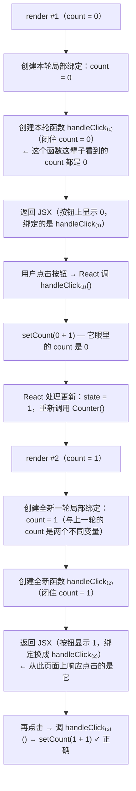

> 本文是《阶段 2：状态与副作用 ⭐核心（2 周）》按小节拆分后的续篇，上一部分见 [05-useEffect-场景.md](05-useEffect-场景.md)。

### 闭包陷阱专题（必练）

前面 useState 与 useEffect 两节反复出现同一类怪现象："明明 state 已经变了，某段代码读到的还是旧值"。这类 bug 的统一根源是 **JavaScript 闭包 × React 渲染快照模型** 的相互作用。把它单独拎出来专题攻克，是因为它披着各种外衣出现——事件回调、定时器、effect、订阅——而本质只有一个。先讲透原理，再逐条拆解三个高频现场。

#### 原理：闭包为什么会捕获旧值——渲染快照模型

**先复习纯 JavaScript 层面的闭包。** 函数定义时会记住自己被创建时所在的词法环境（作用域链），此后无论这个函数被拿到哪里、何时执行，它访问的都是**定义那一刻**作用域里的那些变量绑定：

```ts
function createCounter() {
  let n = 0;                 // 这个变量属于 createCounter 的词法环境
  return () => ++n;          // 返回的函数"闭"住了这个环境
}
const counter = createCounter();
counter(); // 1 —— 即使 createCounter 早已返回，n 依然活着
```

闭包捕获的是**变量绑定（那间屋子的钥匙）**而不是某一刻的值的拷贝——但关键在于：**你拿到的是"哪一间屋子"的钥匙，取决于函数是"第几次调用"时创建的**。

**再看 React 层面：组件函数是"一次渲染调用一次"的普通函数。** 你写的组件：

```tsx
function Counter() {
  const [count, setCount] = useState(0);
  const handleClick = () => setCount(count + 1);
  return <button onClick={handleClick}>{count}</button>;
}
```

在 React 眼里，它每渲染一次就**完整调用一遍** `Counter`。每次调用都有自己的一间屋子：自己的 `count` 局部绑定（值来自 `useState` 本轮返回的快照）、自己的 `handleClick` 函数实例。**第 1 次渲染创建的 `handleClick` 闭住的是第 1 次的 `count`，第 2 次渲染创建的 `handleClick` 闭住的是第 2 次的 `count`——它们是不同屋子里同名的变量，毫无关系。**

用一张时间线图把"渲染快照模型"画出来：



界面之所以"看起来正常"，是因为每次渲染后 React 都把页面上绑定的事件处理器**换成最新一轮创建的函数**——你永远点到"最新一间的屋子"。陷阱的全部秘密在于：**任何"越过本次渲染存活"的函数——`setTimeout` 回调、`setInterval` 回调、`useEffect` 里创建的订阅、存进第三方的回调——不会随重渲染被替换**，它们闭住的那间屋子就此定格。state 更新不会"追进"旧闭包去修改变量（那间屋子的 `count` 是 `const` 性质的历史照片），React 只是开一间新屋子重新渲染一遍。

**为什么 React 偏要这样设计？** 因为"一次渲染 = 输入确定 → 输出确定"的纯函数模型是 React 一切高级能力的地基：StrictMode 双调用校验纯度、并发渲染丢弃过期渲染重放、未来阶段的 Fiber 可中断调度（阶段 10 展开），都要求渲染过程不依赖、不修改任何可变的外部状态。state 作为"每次渲染的一张快照"，正是用"不可变的历史照片"换来了整套可预测性。你遇到的旧值问题是这个模型的副产品，而解法也全部来自模型内部：**要么让 React 在处理更新时把最新值喂给你（函数式更新），要么把最新值放进一个"跨渲染同一间屋子"的容器（ref，见下一节 useRef 场景）**。

判断"会不会踩闭包坑"只需一问：**"这段代码执行时，它闭住的是哪一次渲染？"**如果答案是"某一次过去的渲染"，而它又读取了那之后的 state/props——旧值陷阱成立。下面三条逐一现场验证。

#### 事件处理器里读到旧 state

**是什么。** 在事件处理器中启动的**延迟执行**逻辑（`setTimeout`、`Promise.then`、动画回调）里读取 state，读到的是"点击那一刻的渲染快照"，而非执行时刻的最新值。

**复现代码。** react.dev 的经典演示——点击按钮 3 秒后弹窗显示 count：

```tsx
import { useState } from 'react';

export default function DelayedAlert() {
  const [count, setCount] = useState(0);

  const handleClick = () => {
    // setTimeout 的回调是"本次渲染"创建的函数，闭住本次的 count
    setTimeout(() => {
      alert('你点击按钮时，count 是：' + count); // 3 秒后执行，count 仍是点击那一刻的值
    }, 3000);
  };

  return (
    <div>
      <p>当前 count：{count}</p>
      <button onClick={() => setCount(c => c + 1)}>+1</button>
      <button onClick={handleClick}>3 秒后显示 count</button>
    </div>
  );
}
```

复现步骤：点三次"+1"（count = 3）→ 点"3 秒后显示 count"→ **立刻**再点两次"+1"（count = 5）→ 3 秒后弹窗显示 **3**，不是 5。

**机制解释。** 点击"3 秒后显示"发生在 count = 3 的那次渲染里，`handleClick` 是那一轮创建的，它交给 `setTimeout` 的回调闭住的也是那一轮屋子的 `count = 3`。之后的两次"+1"开了两间新屋子（count = 4、5），但定时器里握着的还是旧屋子的钥匙。**这不是 React 的 bug，而是"闭包捕获定义时环境"这一 JS 语义的自然结果**——就像上面原理图里的 `handleClick₍₁₎` 永远看到 0 一样。

**修法。** 分两种诉求：

- 诉求是"**基于最新值更新**"：函数式更新，让 React 在处理更新时喂最新值——

```tsx
import { useState } from 'react';

export default function FixedUpdate() {
  const [count, setCount] = useState(0);

  const handleClick = () => {
    setTimeout(() => {
      // 不再读取闭包里的 count，而是描述"基于最新值 +1"
      setCount(c => c + 1); // 3 秒后照样精确 +1，与点击时刻的快照无关
    }, 3000);
  };

  return <button onClick={handleClick}>3 秒后基于最新值 +1</button>;
}
```

- 诉求是"**读取执行时刻的最新值**"（弹窗场景）：普通函数式更新帮不上忙，需要 `useRef` 存最新值（ref 是跨渲染的同一间屋子，详见下一节 useRef 场景）——

```tsx
import { useEffect, useRef, useState } from 'react';

export default function FixedAlert() {
  const [count, setCount] = useState(0);
  // ref.current 是一个跨渲染共享的可变容器：所有渲染轮次里是同一个对象
  const countRef = useRef(count);

  useEffect(() => {
    countRef.current = count; // 每次渲染后把最新值同步进 ref
  });

  const handleClick = () => {
    setTimeout(() => {
      // 执行时刻读 ref：永远拿到最新值
      alert('此刻最新的 count 是：' + countRef.current);
    }, 3000);
  };

  return (
    <div>
      <p>当前 count：{count}</p>
      <button onClick={() => setCount(c => c + 1)}>+1</button>
      <button onClick={handleClick}>3 秒后显示最新 count</button>
    </div>
  );
}
```

**常见坑。** 症状：延迟逻辑里读到"点击那一刻"的旧值，且值越小（越早点击）越明显。根因：延迟回调闭住历史渲染的快照。修法：更新用函数式更新；读取用 ref 镜像最新值。额外提示：如果发现自己在到处写 ref 镜像，先回头想想是不是状态设计有问题（该提升的没提升、该下放的没下放）。

#### `setInterval` 里读旧值（两种解法：函数式更新 / ref）

**是什么。** `setInterval` 的回调**只会在 effect（或某次渲染）里创建一次**，之后无论组件重渲染多少次，执行的始终是那一个旧闭包里的回调——它读到的 state 永远定格在创建那一刻。这是三条陷阱中最"稳定复现"的一条，因为 interval 从不换屋子。

**复现代码。** 想做每秒 +1 的计时器：

```tsx
import { useEffect, useState } from 'react';

export default function StuckTimer() {
  const [count, setCount] = useState(0);

  useEffect(() => {
    // 回调只在挂载时创建一次，闭住的是"count = 0"那间屋子
    const id = setInterval(() => {
      setCount(count + 1); // 每一秒执行的都是：setCount(0 + 1) → count 永远是 1
    }, 1000);
    return () => clearInterval(id);
  }, []); // [] 意味着 interval 与它的回调只创建一次

  return <p>已运行 {count} 秒</p>;
}
```

运行结果：界面显示 0 → 1 → 1 → 1……永远卡在 1。逐帧拆解：

```text
挂载 render#1：count = 0；effect 创建 interval，回调闭住 count(=0)
第 1 秒：回调执行 setCount(0 + 1) → state 变 1 → render#2（显示 1）
         ⚠️ 但 effect 依赖是 []，不会因 count 变化而重跑——interval 还是旧的那个
第 2 秒：执行的仍是"旧回调"，它眼里的 count 还是 0 → setCount(0 + 1) → 还是 1
第 3 秒起：与第 2 秒完全相同，永远 1
```

**修法一：函数式更新（首选）。** 更新逻辑只需"最新值"时，把读取从闭包中拿掉：

```tsx
import { useEffect, useState } from 'react';

export default function FunctionUpdateTimer() {
  const [count, setCount] = useState(0);

  useEffect(() => {
    const id = setInterval(() => {
      setCount(c => c + 1); // c 由 React 在每次处理更新时注入，永远是最新值
    }, 1000);
    return () => clearInterval(id);
  }, []);

  return <p>已运行 {count} 秒</p>;
}
```

改动只有一处，但含义深刻：回调不再**读取**任何渲染快照，它只**描述**一个变换。无论这个回调多老，变换作用在最新 state 上都是正确的。这就是"函数式更新是闭包陷阱标准解"的原因——它绕开了"读旧照片"，改成"委托 React 现算"。

**修法二：useRef 镜像最新值。** 当回调里要的不只是"更新"（比如要**读取**最新值参与判断、或调用接收最新值的函数）时：

```tsx
import { useEffect, useRef, useState } from 'react';

export default function RefTimer() {
  const [count, setCount] = useState(0);
  const countRef = useRef(count); // 跨渲染同一间屋子

  // 每次渲染后，把最新 count 同步进 ref（这个 effect 没有依赖数组，每轮渲染都跑）
  useEffect(() => {
    countRef.current = count;
  });

  useEffect(() => {
    const id = setInterval(() => {
      // 读：从 ref 拿最新值（而不是闭包快照）
      const latest = countRef.current;
      // 写：同样用函数式更新（读到的 latest 仅用于展示/判断，不用于计算新值也可）
      setCount(latest + 1);
      console.log('这一秒开始时 count 是', latest); // 依赖最新值的日志，函数式更新做不到
    }, 1000);
    return () => clearInterval(id);
  }, []);

  return <p>已运行 {count} 秒</p>;
}
```

两种解法怎么选：

| | 函数式更新 | useRef 镜像 |
|---|---|---|
| 适用 | 更新逻辑只依赖最新 state 本身 | 回调需要**读取**最新值用于展示/判断，或要调用"必须拿最新值"的函数 |
| 改动量 | 一行 | 需要一个"每轮渲染同步"的 effect + ref |
| 心智负担 | 低（推荐默认） | 中（ref 更新不触发渲染，别把 ref 当 state 用，详见下一节 useRef 场景） |

顺带指出一个"看起来修好了"的第三种写法——把 `count` 加进依赖：

```tsx
  // ⚠️ 不推荐：值正确了，但每一秒都会"clear 旧 interval + 建新 interval"，
  // 计时被不断重置，间隔不再是稳定的 1 秒（且依赖任何其他 state 变化都会重建定时器）
  useEffect(() => {
    const id = setInterval(() => setCount(count + 1), 1000);
    return () => clearInterval(id);
  }, [count]);
```

它确实能让数字走对（每轮渲染重建 interval，闭包换新），但代价是定时器寿命不再可控：interval 的语义从"每秒一次"退化成"从 count 最后一次变化起每秒一次"，并在任何导致渲染的 state 变化时被重置。定时器类"长寿资源"应配合函数式更新/ref 保持 `[]` 依赖，让资源生命周期与组件生命周期对齐。

**常见坑。** 症状一：计数器卡在 1 不动（上面的完整复现）。根因：interval 回调闭住首轮快照。修法：函数式更新。症状二：改用依赖 `[count]` 后数字正常，但计时间隔漂移、页面其他操作会重置计时节奏。根因：定时器随依赖频繁重建。修法：回到 `[]` + 函数式更新/ref。症状三：在 interval 回调里读取 props 或调用旧的处理函数（如"轮询接口直到满足某 props 阈值"）永远判断失败。根因：同源，闭住旧 props。修法：ref 镜像该值。

#### useEffect 捕获旧 props

**是什么。** effect 的 setup/cleanup 闭住的是"**本次执行它的那轮渲染**"的 props。当依赖数组没有如实申报某个被读取的 prop 时，effect 不再重跑，之后所有读取都停在旧 props 上——它与"事件处理器旧 state"同根同源，只是常量从 state 换成了 props，且受害者常常是**第三方库的连接/订阅**，更隐蔽。

**复现代码。** 聊天室连接：房间号换了，日志却一直打旧房间：

```tsx
import { useEffect, useState } from 'react';

// 模拟的第三方连接器：订阅外部系统（真实项目里是 socket.io-client 等）
function createConnection(roomId: string) {
  return {
    connect: () => console.log(`✅ 已连接到房间「${roomId}」`),
    disconnect: () => console.log(`❌ 已断开房间「${roomId}」`),
  };
}

export default function ChatRoom({ initialRoom }: { initialRoom: string }) {
  const [roomId, setRoomId] = useState(initialRoom);

  useEffect(() => {
    // setup 闭住"本轮渲染"的 roomId；依赖是 [] → 本 effect 及其闭包永不更新
    const conn = createConnection(roomId);
    conn.connect();
    return () => conn.disconnect();
  }, []); // ⚠️ 读取了 roomId 却未申报 → eslint 立刻警告 missing dependency

  return (
    <div>
      <p>当前选择房间：{roomId}</p>
      <select value={roomId} onChange={e => setRoomId(e.target.value)}>
        <option value="general">大厅</option>
        <option value="random">闲聊</option>
        <option value="music">音乐</option>
      </select>
    </div>
  );
}
```

运行：挂载连接"大厅"→ 下拉切到"音乐"→ 页面文字显示"音乐"，但控制台**没有任何新的连接日志**，消息仍从"大厅"涌来。更糟的是卸载时 `disconnect` 的也是"大厅"——如果内部真的持有连接，"音乐"从未连过，而用户以为自己在音乐房间。

**机制解释。** 依赖 `[]` 声明"此 effect 的同步条件与任何响应式值无关，永不重跑"。React 尊重声明：切换房间引发的重渲染只是又开了间新屋子（新 `roomId`），但 effect 判断 `[]` 与 `[]` 相等，不清理、不重跑——**仍在外部世界里活着的是首轮那间屋子里的连接**。与事件处理器旧 state 完全同构：长寿回调 + 未申报依赖 = 定格的快照。

**修法：如实申报依赖，让"断开旧 + 连接新"成对发生。**

```tsx
  useEffect(() => {
    const conn = createConnection(roomId);
    conn.connect();
    return () => conn.disconnect();
  }, [roomId]); // roomId 变化：先 cleanup（断开旧房间）→ 再 setup（连接新房间）
```

切换到"音乐"后控制台输出：

```text
✅ 已连接到房间「大厅」        ← 挂载
❌ 已断开房间「大厅」          ← roomId 变化，先清理
✅ 已连接到房间「音乐」        ← 再同步
```

这正是"effect = 与外部系统保持同步"心智模型的兑现：props 变化意味着外部系统参数过时，正确的反应不是硬撑，而是断开重连。绝大多数"effect 旧 props"问题的正解就是**补依赖**；`exhaustive-deps` 警告（第 4 条）在复现代码里已经把问题指出来了——从"点灯"到"修灯"只差一行。

少数场景确实要"订阅一次、但读取最新值"（例如一个全局级单例订阅，不希望随 props 重订），才使用 ref 镜像方案：

```tsx
import { useEffect, useRef } from 'react';

// 订阅只建立一次，但回调里读取的是最新 roomId
export function useGlobalBusOnce(roomId: string, onEvent: (msg: string) => void) {
  const latest = useRef({ roomId, onEvent });

  useEffect(() => {
    // 每轮渲染把最新的 props 刷进 ref（无依赖数组的 effect：每次渲染后都执行）
    latest.current = { roomId, onEvent };
  });

  useEffect(() => {
    const handler = (msg: string) => {
      // 执行时从 ref 取"此刻最新"的值，而不是订阅建立那一刻的快照
      const { roomId: room, onEvent: emit } = latest.current;
      console.log(`房间 ${room} 收到：${msg}`);
      emit(msg);
    };
    window.addEventListener('bus-message', handler as EventListener);
    return () => window.removeEventListener('bus-message', handler as EventListener);
  }, []); // 订阅本身与组件生命周期一致，只建立一次
}
```

判断口径：**外部系统应该跟着值换（连接、请求、查询参数）→ 补依赖重跑；外部系统不该换、只有回调用值 → ref 镜像**。

**常见坑。** 症状一：切换筛选/房间/用户后，数据、日志、连接"没跟上"。根因：effect 依赖缺失，闭住旧 props。修法：补依赖（首选），例外场景用 ref 镜像。症状二：以为 `[]` 是"componentDidMount 的现代写法"，随手把所有一次性逻辑塞进去。根因：把 effect 当生命周期钩子，而 `[]` 的真实语义是"永不重新同步"。修法：按"这个 effect 同步的外部系统，参数会不会变"来决定依赖；参数会变就必须申报。症状三：cleanup 里引用旧 props 做清理（如 `disconnect(roomId)`），以为清理"拿错了房间"。根因：cleanup 与 setup 闭的是同一间屋子——**setup 连的哪个房间，cleanup 断的就是哪个房间，这是配对正确的表现**，不是 bug。修法：保持 setup/cleanup 同源；不要在 cleanup 里另外读 ref"最新值"去断连（会断错对象）。

---

至此，useState 的更新机制、useEffect 的同步与清理、闭包陷阱的快照模型三条主线合拢成一个闭环：**state 是渲染的快照，setState 是请求一次新渲染，effect 是渲染后与外部世界的受控握手，而一切"旧值"都是"长寿回调握着旧屋子的钥匙"**。带着这套模型进入下一节 useRef 场景——你会看到 ref 正是 React 为"跨渲染同一间屋子"提供的官方容器——以及随后的 useMemo/useCallback（用缓存换引用稳定）与自定义 Hook。本阶段收尾的 TodoMVC 作业会把这些知识全部压进一个真实应用里；日后排查"无限重渲染、闭包旧值、竞态"这类高频 bug 时（见阶段 6 调试方法论），本章就是你的索引。

#### 补充：useEffectEvent 模式——"只同步一次，但读最新值"的第三条路

**场景与冲突。** 商品页曝光埋点：业务要求"每次进入页面只上报一次"，但上报内容包含会变化的值——当前 `theme`、当前 `productId` props。三种直觉写法各撞一堵墙：

```tsx
// 写法一：[] + 直接读值 → 上报内容凝固在首轮（本章第 3 条的旧 props 陷阱）
useEffect(() => {
  report(`expose product=${productId} theme=${theme}`);
}, []);

// 写法二：补依赖 → 值是新的，但 theme 一切换又上报一次（业务错误：曝光被重复计数）
useEffect(() => {
  report(`expose product=${productId} theme=${theme}`);
}, [productId, theme]);
```

ref 镜像能解，但每个要读的值都得建 ref、都得写"每轮渲染同步"，样板随值数量线性增长。useEffectEvent 是第三条路：**把"effect 要执行的动作"与"effect 的同步条件"解耦——动作永远是调用时的最新版本，同步条件只由数据依赖决定。**

**手写实现（官方 experimental_useEffectEvent 的等价模式）：**

```ts
// useEffectEvent.ts
import { useCallback, useEffect, useRef } from 'react';

/**
 * 返回一个"引用永久稳定、调用时转发给最新实现"的函数。
 * 两条纪律（与官方 API 一致）：
 *   1. 不得在渲染期间调用它；
 *   2. 它是"非响应式函数"，不要用来替代真正的事件处理器。
 */
export function useEffectEvent<A extends unknown[], R>(
  fn: (...args: A) => R
): (...args: A) => R {
  const latestRef = useRef(fn);

  // 每次提交后刷新实现：ref 里永远是最近一次渲染的 fn
  useEffect(() => {
    latestRef.current = fn;
  });

  // 依赖为空的 useCallback 只是"取稳定引用"的手段；
  // 包装体不读任何渲染值、只读 ref，所以它自己永不陈旧
  return useCallback((...args: A) => latestRef.current(...args), []);
}
```

**使用（曝光埋点的最终形态）：**

```tsx
import { useEffect, useState } from 'react';
import { useEffectEvent } from './useEffectEvent';

function ProductPage({ productId }: { productId: string }) {
  const [theme, setTheme] = useState<'light' | 'dark'>('light');

  // "非响应式函数"：不参与响应式数据流，被调用时才取最新实现
  const onVisit = useEffectEvent(() => {
    report(`expose product=${productId} theme=${theme} ts=${Date.now()}`);
  });

  useEffect(() => {
    onVisit(); // 语义：进入页面，上报一次——就一次；上报内容取的是调用时刻的最新值
  }, [onVisit]); // 手写版会被 exhaustive-deps 要求申报 onVisit；它引用稳定，
                 // 写进依赖不会导致 effect 重跑（官方实验 API 配套的 lint 会直接豁免它）

  return (
    <div>
      <button onClick={() => setTheme((t) => (t === 'light' ? 'dark' : 'light'))}>
        切换主题（不会触发重复曝光）
      </button>
    </div>
  );
}

declare function report(payload: string): void;
```

**机制解释。** 为什么它"稳定又不陈旧"：`useCallback(..., [])` 保证返回的包装函数从挂载到卸载是同一个对象（effect 依赖它不会重跑）；包装体执行时才解引用 `latestRef.current`，而 latestRef 在每次提交后被刷新——所以调用拿到的永远是最新实现。它本质上是 ref 镜像模式的"函数化封装"：把"镜像一个值"泛化成"镜像整个函数实现"。

**三种方案对比：**

| 方案 | effect 随值变化重跑？ | 调用时读到最新值？ | 适用 |
|---|---|---|---|
| 补依赖 | 是 | 是 | 外部系统参数真的变了需要重连（本章第 3 条的正解） |
| ref 镜像 | 否 | 是 | 只有一两个值要读，手写可控 |
| useEffectEvent | 否 | 是 | "effect 按数据依赖跑，但体内逻辑要用最新值"的通用解，样板最少 |

**使用边界。** 其一，官方 API 写作本文时仍在实验频道（`experimental_useEffectEvent`），手写模式在 React 18/19 均可用；其二，effect event 只该在 effect 内部调用（渲染期间调用会读到未刷新的实现），官方版本还禁止在 effect 之外调用；其三，不要拿它当"永不重建的 useCallback"到处用——它绕过了依赖追踪，滥用等于把数据流改回命令式，仅保留给"effect 需要读最新值/调最新函数"这一种场景。

#### 补充：高频坑位补遗——同根变体的五个现场

**现场一：全局键盘快捷键读旧 props。**

```tsx
// 复现：orderId 换了，Enter 永远提交旧订单
useEffect(() => {
  const onKey = (e: KeyboardEvent) => {
    if (e.key === 'Enter') submit(orderId); // 闭住首轮 orderId
  };
  window.addEventListener('keydown', onKey);
  return () => window.removeEventListener('keydown', onKey);
}, []); // 监听器只在挂载时挂一次，之后执行的都是那个旧闭包
```

修法：读值参与判断 → 补依赖 `[orderId]`（重挂监听通常无害）；读值参与"调用最新函数" → useEffectEvent 或 ref 镜像。判别口径与本章第 3 条一致：外部系统（这里是 document 的监听）该不该跟着值换。

**现场二：`await` 之后的"时间旅行"。**

```tsx
const [itemCount, setItemCount] = useState(1);

const handlePay = async () => {
  await api.pay();                        // 网络往返 800ms，期间用户又加了 2 件商品
  if (itemCount >= 3) showFreeShipping(); // itemCount 还是点击那一刻的 1 —— 优惠没触发
};
```

机制：`handlePay` 是点击那轮渲染创建的函数，`await` 之后代码继续在这个旧闭包里跑；期间的重渲染创建的是"新处理器"，正在执行的这个不会换代。**`await` 就是长寿回调的分隔线：await 之后的每一行，都相当于写在了一个 setTimeout 里。** 修法：判断依据从服务端响应取（真正的最新事实）；确需读本地最新值用 ref 镜像。

**现场三：requestAnimationFrame 动画到不了新目标。**

```tsx
const [target, setTarget] = useState(50);

useEffect(() => {
  let raf = 0;
  const step = () => {
    setProgress((p) => Math.min(p + 1, target)); // 函数式更新救不了 target
    raf = requestAnimationFrame(step);
  };
  raf = requestAnimationFrame(step);
  return () => cancelAnimationFrame(raf);
}, []); // target 从 50 改成 100：动画停在 50 再也不动
```

机制：函数式更新只对"它直接包裹的那个值"生效（此处是 `p`），`target` 仍是首轮快照。修法：把 `target` 镜像进 ref（rAF 循环本身不应随 target 重建，否则动画重启抖动），`Math.min(p + 1, targetRef.current)`。

**现场四：useCallback 依赖漏写，把旧值"封装"进稳定函数。**

```tsx
const announce = useCallback(() => {
  toast(`当前余额 ${balance} 元`); // balance 漏申报
}, []); // 引用稳定被传给 memo 子组件/定时器，但永远播报初始余额
```

这个现场更隐蔽：函数引用稳定使它顺利穿过 memo 链、effect 依赖，测试时初始值碰巧正确就放过了。修法：如实补依赖（引用会变，下游 memo 链要能接受）或改用 useEffectEvent（引用稳定且值最新——按下游需要的是"引用稳定"还是"值也变"来选）。

**现场五：原地修改让"依赖没变、值变了"。**

```tsx
// 父组件缓存了一个对象，为了"省一次渲染"直接改它（错误写法）
function rename(user: { id: number; name: string }, name: string) {
  user.name = name; // 原地修改：引用没变
  setUsers([...users]); // 数组换了，user 对象还是原来那个
}

// 子组件
useEffect(() => {
  syncToServer(user); // 依赖 [user]：Object.is(旧, 新) 相等 → 不重跑 → 服务器还是旧名字
}, [user]);
```

症状最迷惑的一类：渲染读 `user.name` 直接显示新值（渲染直接读对象字段），而依赖 `[user]` 的 effect 不重跑——UI 与副作用不一致。根因：引用相等被当成了内容相等。修法：不可变更新 `setUsers(users.map(u => u.id === id ? { ...u, name } : u))`，让引用语义与内容语义对齐；这也是"为什么 React 生态坚持不可变数据"的答案之一。

#### 补充：自测题与面试题

**Q1：用"渲染快照"模型解释：为什么 setTimeout 3 秒后 alert 的 count 是点击那一刻的值？**
要点：组件函数每次渲染完整调用一次，各轮词法环境独立；定时器回调闭住"创建那轮"的环境；后续 setState 开新环境，不会改写旧环境里的绑定——旧值不是"没更新"，是"属于另一间屋子"。

**Q2：函数式更新为什么免疫闭包陷阱？它的能力边界在哪？**
要点：函数体不读闭包，把"求值"推迟到 React 处理更新时、以队列中的最新值为入参；边界：需要"读最新值做判断/展示/传给别的函数"（而非仅计算新 state）时无效，需 ref 镜像或 useEffectEvent。

**Q3：ref 镜像的同步为什么写在无依赖数组的 effect 里？组件首次提交前 ref.current 是什么？**
要点：无依赖 effect 每次提交后执行，保证 ref 恒等于最近一次提交的值；首次提交前 ref.current 是初始值（构造参数）；事件都发生在提交之后所以安全，但若在另一条 effect 的同步阶段之前调用，可能读到上一拍。

**Q4：把 `count` 加进依赖重建 interval，为什么"数值正确但工程上错误"？**
要点：定时器寿命与数据值耦合——任何引起渲染的 state 变化都会 clear+重建，间隔漂移、节奏被重置；正确做法是 `[]` + 函数式更新/ref，让资源生命周期对齐组件生命周期。

**Q5：cleanup 里断开的是旧房间（闭住旧 props），为什么反而是正确行为？**
要点：setup 与 cleanup 同源配对——连的是哪个房间就断哪个房间；若 cleanup 改读"最新值"去断连，会断错对象、把真正的连接泄漏在外部系统里。

**Q6：手写一个 useEffectEvent，并说出它的两条纪律。**
要点：latest ref + 空依赖 useCallback 的稳定包装（或稳定 ref 存包装）；纪律：不在渲染期间调用、不当通用事件处理器用；原理：调用时才解引用最新实现。

**Q7：纠错题——同事说"React 的 state 是异步变量，所以定时器里读到旧值"。哪里不对？**
要点：state 不是异步变量，是每次渲染的快照（不可变绑定）；旧值的来源是闭包捕获历史环境，与异步无关；即使全部代码同步执行，旧闭包依旧读到旧值；"异步"混淆的是 setState 的批处理调度机制。


---

## 附:ASCII 图替换清单

本文档图形化改版,原 ASCII 字符图与 Mermaid 图表对应关系如下:

| 原图位置 / 标题 | 处理结果 |
| --- | --- |
| 原理 · 渲染快照模型时间线(render #1 → render #2) | 替换为 flowchart TD(时间线管道) |
