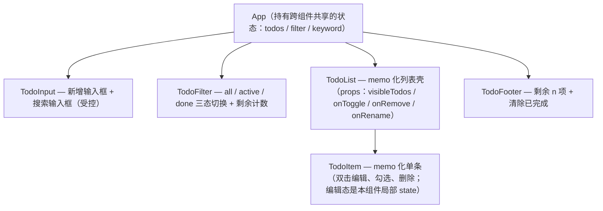

> 本文是《阶段 2：状态与副作用 ⭐核心（2 周）》按小节拆分后的续篇，上一部分见 [09-自定义-Hook-从模仿到手写.md](09-自定义-Hook-从模仿到手写.md)。

### ✅ 产出：**TodoMVC**（增删改查 + 状态过滤 + localStorage 持久化 + useDebounce 搜索）

现在把本节所有零件装到一辆整车上。TodoMVC 是验证"状态与副作用"掌握度的最小完整应用。

**功能拆解清单**（每项功能分别落在哪个知识点上）：

| 功能 | 用什么 | 要点 |
|---|---|---|
| 新增待办 | `useState` 受控 input + 回车提交 | 空白不新增；提交后清空输入框 |
| 删除 | `useState` 不可变更新（`filter`） | 每项一个删除按钮 |
| 编辑（双击进入） | `useToggle` 管编辑态 + 受控草稿 | 回车保存 / Esc 取消 / 失焦保存；保存为空 = 删除（TodoMVC 规范） |
| 勾选完成 | 不可变更新（`map` 替换某项） | 划线样式 |
| 状态过滤（全部/未完成/已完成） | `useState` 存 filter + `useMemo` 派生可见列表 | 派生数据用普通计算，不用 effect |
| localStorage 持久化 | `useLocalStorage` | 刷新不丢；跨标签页同步 |
| 防抖搜索 | `useDebounce(keyword, 300)` | 连续输入只过滤一次 |
| 列表性能 | `memo` + 父侧 `useCallback` | 搜索打字期间（防抖值未变时）列表不重渲染 |

**组件结构与状态设计建议**：



状态归属判断（呼应 useState 场景第 5 条"状态放哪"）：`todos` 被 App 的多个子组件读写 → 提升到 App；`editing` 只影响单个 TodoItem 自身 → 下放为局部 state；`visibleTodos` 是派生值 → 永远现算，不落地成 state（"什么时候不该用 useEffect"的直接应用）。

**核心实现**（复用本章手写的 `useLocalStorage` / `useDebounce`）：

```tsx
// App.tsx
import { useCallback, useMemo, useState } from 'react';
import { useLocalStorage } from './useLocalStorage';
import { useDebounce } from './useDebounce';
import { TodoItem } from './TodoItem';

type Filter = 'all' | 'active' | 'done';

interface Todo {
  id: number;
  text: string;
  done: boolean;
}

const FILTERS: Array<{ key: Filter; label: string }> = [
  { key: 'all', label: '全部' },
  { key: 'active', label: '未完成' },
  { key: 'done', label: '已完成' },
];

export default function App() {
  // 数据本体：useLocalStorage 负责持久化 + 跨标签页同步
  const { value: todos, setValue: setTodos } = useLocalStorage<Todo[]>('todomvc-todos', []);

  const [filter, setFilter] = useState<Filter>('all');
  const [keyword, setKeyword] = useState('');
  const debouncedKeyword = useDebounce(keyword, 300); // 停止输入 300ms 才参与过滤

  // 四个操作回调全部 useCallback：useLocalStorage 的 setValue 本身引用稳定，
  // 所以这些回调的引用也稳定 → 传给 memo 化的 TodoList/TodoItem 不会击穿浅比较
  const addTodo = useCallback(
    (text: string) => {
      const trimmed = text.trim();
      if (!trimmed) return; // 空白不新增
      setTodos((prev) => [...prev, { id: Date.now(), text: trimmed, done: false }]); // 展开追加
    },
    [setTodos],
  );

  const removeTodo = useCallback(
    (id: number) => setTodos((prev) => prev.filter((t) => t.id !== id)), // filter 删除
    [setTodos],
  );

  const toggleTodo = useCallback(
    (id: number) =>
      setTodos((prev) => prev.map((t) => (t.id === id ? { ...t, done: !t.done } : t))), // map 替换某项
    [setTodos],
  );

  const renameTodo = useCallback(
    (id: number, text: string) =>
      setTodos((prev) => prev.map((t) => (t.id === id ? { ...t, text } : t))),
    [setTodos],
  );

  const clearDone = useCallback(
    () => setTodos((prev) => prev.filter((t) => !t.done)),
    [setTodos],
  );

  // 派生数据：普通计算 + useMemo，绝不放进 effect
  const visibleTodos = useMemo(() => {
    const kw = debouncedKeyword.trim().toLowerCase();
    return todos.filter((t) => {
      const byFilter = filter === 'all' ? true : filter === 'done' ? t.done : !t.done;
      const bySearch = kw === '' || t.text.toLowerCase().includes(kw);
      return byFilter && bySearch;
    });
  }, [todos, filter, debouncedKeyword]);

  const leftCount = useMemo(() => todos.filter((t) => !t.done).length, [todos]);

  return (
    <div style={{ maxWidth: 480, margin: '0 auto' }}>
      <input
        placeholder="新增待办，回车提交"
        onKeyDown={(e) => {
          if (e.key === 'Enter') {
            addTodo(e.currentTarget.value);
            e.currentTarget.value = ''; // 提交后清空（非受控的简单做法）
          }
        }}
      />
      <input
        placeholder="搜索（防抖 300ms）"
        value={keyword}
        onChange={(e) => setKeyword(e.target.value)}
      />

      <div>
        {FILTERS.map(({ key, label }) => (
          <button
            key={key}
            onClick={() => setFilter(key)}
            style={{ fontWeight: filter === key ? 'bold' : 'normal' }}
          >
            {label}
          </button>
        ))}
      </div>

      <ul>
        {visibleTodos.map((todo) => (
          <TodoItem
            key={todo.id}
            todo={todo}
            onToggle={toggleTodo}
            onRemove={removeTodo}
            onRename={renameTodo}
          />
        ))}
      </ul>

      <footer>
        <span>剩余 {leftCount} 项</span>
        <button onClick={clearDone}>清除已完成</button>
      </footer>
    </div>
  );
}
```

```tsx
// TodoItem.tsx
import { memo, useEffect, useRef, useState } from 'react';

interface Todo {
  id: number;
  text: string;
  done: boolean;
}

interface TodoItemProps {
  todo: Todo;
  onToggle: (id: number) => void;
  onRemove: (id: number) => void;
  onRename: (id: number, text: string) => void;
}

// memo + 父侧稳定回调：todos 里其他项变化时，未变的项不重渲染
export const TodoItem = memo(function TodoItem({
  todo,
  onToggle,
  onRemove,
  onRename,
}: TodoItemProps) {
  const [editing, setEditing] = useState(false); // 编辑态只影响本组件 → 局部 state
  const [draft, setDraft] = useState(todo.text);
  const editInputRef = useRef<HTMLInputElement>(null); // 进入编辑态自动聚焦（useRef 场景 1）

  useEffect(() => {
    if (editing) editInputRef.current?.focus();
  }, [editing]);

  const startEdit = () => {
    setDraft(todo.text); // 进入编辑时同步最新文本
    setEditing(true);
  };

  const commit = () => {
    const text = draft.trim();
    if (text === '') {
      onRemove(todo.id); // TodoMVC 规范：清空后保存 = 删除该项
    } else if (text !== todo.text) {
      onRename(todo.id, text);
    }
    setEditing(false);
  };

  if (editing) {
    return (
      <li>
        <input
          ref={editInputRef}
          value={draft}
          onChange={(e) => setDraft(e.target.value)}
          onBlur={commit}
          onKeyDown={(e) => {
            if (e.key === 'Enter') commit();
            if (e.key === 'Escape') setEditing(false); // Esc 放弃修改
          }}
        />
      </li>
    );
  }

  return (
    <li onDoubleClick={startEdit}>
      <label>
        <input type="checkbox" checked={todo.done} onChange={() => onToggle(todo.id)} />
        <span style={{ textDecoration: todo.done ? 'line-through' : 'none' }}>{todo.text}</span>
      </label>
      <button onClick={() => onRemove(todo.id)}>删除</button>
    </li>
  );
});
```

**逐条验收标准**（全部通过才算完成）：

1. 新增：输入文本回车，列表出现新项、输入框清空；只输空格/空文本时不新增。
2. 删除：点某项"删除"，该项立即消失，其余项不受影响（key 用 id，无错乱）。
3. 编辑：双击文本进入编辑态且自动聚焦，原文本填入输入框；回车保存、Esc 放弃、失焦保存；清空文本后保存等于删除。
4. 勾选：checkbox 切换后文本出现/去除划线；"剩余 n 项"计数同步变化。
5. 过滤：三个 Tab 切换正确——"未完成"不含已勾选项，"已完成"只含已勾选项；勾选状态在过滤视图下依然可切换。
6. 持久化：新增几项后刷新页面数据还在；DevTools → Application → Local Storage 能看到 `todomvc-todos` 的 JSON；手动删掉该 key 再刷新，回到空列表。
7. 跨标签页：同一页面开两个标签页，在 A 标签新增，B 标签无需刷新即同步（storage 事件生效）。
8. 防抖：在搜索框快速连续输入（比如 1 秒内打完一个词），列表过滤只发生一次——可用一行日志或 Profiler 的提交次数验证；清空搜索框显示全部。
9. 性能（对照 memo 一节）：列表放 50 条以上数据，在搜索框连续打字（防抖值未变化期间），用 DevTools Profiler 录制，TodoItem 不应出现在提交记录里；点击勾选某项时，只有该项重渲染。
10. 零警告：控制台没有 key 警告、没有 `react-hooks/exhaustive-deps` 警告。

做到第 9 条，本节的 useRef、memo 三件套、八个自定义 Hook 就全部在一个真实应用里落过地了。

#### 补充：变体实战——撤销 / 重做（undo / redo）

**需求**：在原版 TodoMVC 上加历史能力：Ctrl/Cmd+Z 撤销上一步、Ctrl/Cmd+Shift+Z 重做；新增/删除/勾选/改名/清除已完成全部可撤销；历史上限 50 步；产生新操作后清空重做栈（经典编辑器语义）；工具栏显示"撤销/重做"按钮并按可用性禁用。

**关键取舍：记"逆操作"还是记"快照"？** 逆操作要为每种命令写还原逻辑（删除要记被删项与位置、改名要记旧文案……），命令一多必然漏；快照栈每步存一份"操作前的完整数组"，实现十行、绝对正确，代价是内存——TodoMVC 的量级（几十条 × 50 步）完全可以忽略。数据量大到快照吃不消时，再升级为命令模式或结构共享的不可变数据，此处不展开。

**实现：useUndoable**（把 {past, present, future} 合进**一个** state——如果拆成三个独立 useState，在更新函数里连环调用三个 setState 会把 updater 写"脏"，StrictMode 双调用时就可能记两份历史；合并后所有转移都是纯函数，天然免疫）：

```ts
import { useCallback, useState } from 'react';

const HISTORY_LIMIT = 50;

interface History<T> {
  past: T[];
  present: T;
  future: T[];
}

export interface UseUndoableResult<T> {
  state: T;
  /** 提交一次"可撤销的修改"（传纯函数，接收最新值） */
  commit: (update: (prev: T) => T) => void;
  undo: () => void;
  redo: () => void;
  canUndo: boolean;
  canRedo: boolean;
}

export function useUndoable<T>(initial: T | (() => T)): UseUndoableResult<T> {
  const [history, setHistory] = useState<History<T>>(() => ({
    past: [],
    present: typeof initial === 'function' ? (initial as () => T)() : initial,
    future: [],
  }));

  const commit = useCallback((update: (prev: T) => T) => {
    setHistory((h) => {
      const next = update(h.present);
      if (Object.is(next, h.present)) return h; // 无实际变化不入栈（原值空转防占坑）
      return {
        past: [...h.past, h.present].slice(-HISTORY_LIMIT), // 超上限丢最旧的
        present: next,
        future: [], // 新操作使重做栈作废
      };
    });
  }, []);

  const undo = useCallback(() => {
    setHistory((h) => {
      if (h.past.length === 0) return h;
      return {
        past: h.past.slice(0, -1),
        present: h.past[h.past.length - 1],
        future: [h.present, ...h.future],
      };
    });
  }, []);

  const redo = useCallback(() => {
    setHistory((h) => {
      if (h.future.length === 0) return h;
      const [next, ...rest] = h.future;
      return { past: [...h.past, h.present].slice(-HISTORY_LIMIT), present: next, future: rest };
    });
  }, []);

  return {
    state: history.present,
    commit,
    undo,
    redo,
    canUndo: history.past.length > 0,
    canRedo: history.future.length > 0,
  };
}
```

**接入原版 App**（只列 diff 要点）：

```tsx
// 1) todos 的来源从 useLocalStorage 换成 useUndoable（持久化改为跟随 present 写盘）
const { state: todos, commit, undo, redo, canUndo, canRedo } = useUndoable<Todo[]>(
  () => readFromStorage('todomvc-todos', []), // 惰性初始化只读一次磁盘（readFromStorage 见 09 篇）
);

// 写盘跟随：present 的每次变化（含 undo/redo）都落盘，刷新后拿到时间线上最新状态
useEffect(() => {
  try {
    window.localStorage.setItem('todomvc-todos', JSON.stringify(todos));
  } catch {
    /* 写失败降级为内存态，容错讨论见 09 篇 useLocalStorage */
  }
}, [todos]);

// 2) 五个操作的 setTodos 全部换成 commit，函数体一字不改：
const addTodo = useCallback(
  (text: string) => {
    const trimmed = text.trim();
    if (!trimmed) return;
    commit((prev) => [...prev, { id: Date.now(), text: trimmed, done: false }]);
  },
  [commit],
);
// removeTodo / toggleTodo / renameTodo / clearDone 同理：setTodos((prev) => …) → commit((prev) => …)

// 3) 快捷键：全局接管 Ctrl/Cmd+Z（卸载必清理）
useEffect(() => {
  const onKey = (e: KeyboardEvent) => {
    if (!(e.metaKey || e.ctrlKey) || e.key.toLowerCase() !== 'z') return;
    e.preventDefault(); // 接管浏览器原生撤销：Ctrl+Z 作用于"整份待办列表"
    if (e.shiftKey) redo();
    else undo();
  };
  window.addEventListener('keydown', onKey);
  return () => window.removeEventListener('keydown', onKey);
}, [undo, redo]);

// 4) 工具栏：
// <button onClick={undo} disabled={!canUndo}>撤销</button>
// <button onClick={redo} disabled={!canRedo}>重做</button>
```

**取舍与边界**：

- 全局 preventDefault 会夺走输入框里浏览器原生的逐字撤销（编辑草稿的 Ctrl+Z）。教学版接受它——草稿很短，Ctrl+Z 直接撤销"上一次列表级操作"；精细做法是 `e.target` 位于 INPUT/TEXTAREA 内时不拦截，把原生撤销留给草稿，列表级撤销改走工具栏按钮。
- 只把数据本体（todos）记进历史。filter、keyword、debouncedKeyword 是派生/会话态，入栈只会制造"按三次撤销才回一次有效状态"的挫败感。
- 跨标签页与 undo 天然冲突：A 标签 undo 会把 B 标签刚新增的项写盘覆盖（last-write-wins）。教学版接受；生产可给每份快照带版本号，写盘前校验版本再落。

#### 补充：持久化的防御式升级——版本迁移与结构校验

**需求场景**：v1 上线用的 `{ id, text, done }`；迭代要求加 `createdAt`、`id` 换 `string`（为多端同步铺路）、`text` 更名 `title`。旧用户 localStorage 里躺着 v1 数据，新代码直接 `todo.createdAt.toLocaleString()` 就白屏；更糟的是用户手改过、或上个版本的 bug 写进过半截 JSON。读本地存储的纪律与读网络响应同一条：**先验证结构，再敢使用**（useLocalStorage 的 try/catch 只兜"解析崩溃"，兜不住"解析成功但结构不对"）。

**方案：版本信封 + 迁移链 + 读取时校验**。存储格式固定为 `{ version, data }`；每个版本迁移写成一个纯函数，串成链；读取时先跑迁移、再逐项校验、再把清洗后的新格式回写（下次读取不再迁移）。

```ts
// todoStorage.ts
// ---------- 类型：每个历史版本都留档，迁移函数才有的放矢 ----------
interface TodoV1 {
  id: number;
  text: string;
  done: boolean;
}
export interface Todo {
  id: string;
  title: string;
  done: boolean;
  createdAt: number;
}

const STORAGE_KEY = 'todomvc-todos';
const CURRENT_VERSION = 2;

// ---------- 迁移链：migrations[i] 把"版本 i 的数据"升级为"版本 i+1 的数据" ----------
const migrations: Array<(raw: unknown) => unknown> = [
  // 0 → 1：最早的裸数组（还没穿信封的时代）
  (raw) => (Array.isArray(raw) ? raw : []),
  // 1 → 2：id 转 string、text 更名 title、补 createdAt 默认值
  (raw) =>
    (raw as TodoV1[]).map((t) => ({
      id: `t-${t.id}`,
      title: String(t.text ?? ''),
      done: Boolean(t.done),
      createdAt: Date.now(),
    })),
];

// ---------- 校验：不相信任何来自磁盘的结构 ----------
function isTodo(v: unknown): v is Todo {
  if (typeof v !== 'object' || v === null) return false;
  const t = v as Record<string, unknown>;
  return (
    typeof t.id === 'string' &&
    typeof t.title === 'string' &&
    typeof t.done === 'boolean' &&
    typeof t.createdAt === 'number' &&
    Number.isFinite(t.createdAt)
  );
}

export function loadTodos(): Todo[] {
  try {
    const raw = window.localStorage.getItem(STORAGE_KEY);
    if (!raw) return [];

    const parsed: unknown = JSON.parse(raw);
    // 兼容两种历史形态：v1 时代的裸数组，与带信封的 { version, data }
    const enveloped =
      typeof parsed === 'object' && parsed !== null && 'version' in parsed && 'data' in parsed;
    let version = enveloped ? Number((parsed as { version: unknown }).version) : 0;
    if (!Number.isInteger(version) || version < 0) version = 0; // 乱版本号按最老处理
    if (version > CURRENT_VERSION) return []; // 数据来自更新的代码版本（发版回滚场景）：宁放弃也不破坏磁盘数据
    let data: unknown = enveloped ? (parsed as { data: unknown }).data : parsed;

    for (let v = version; v < CURRENT_VERSION; v++) data = migrations[v](data); // 逐级升到当前版

    const source = Array.isArray(data) ? data : [];
    const list = source.filter(isTodo); // 脏条目直接剔除
    if (version < CURRENT_VERSION || list.length !== source.length) {
      saveTodos(list); // 升级过/清洗过：立即回写，别让每次启动都重跑迁移
    }
    return list;
  } catch {
    return []; // JSON 损坏 / 隐私模式读取异常：宁可空列表也不白屏
  }
}

export function saveTodos(todos: Todo[]): void {
  try {
    window.localStorage.setItem(
      STORAGE_KEY,
      JSON.stringify({ version: CURRENT_VERSION, data: todos }),
    );
  } catch {
    /* 超配额/隐私模式：静默降级为内存态（09 篇 useLocalStorage 已讨论） */
  }
}
```

接入：`loadTodos()` 作为 `useUndoable` 的惰性初始化（上一节 diff 第 1 步的 `readFromStorage` 换成它即可），写盘 effect 换 `saveTodos(todos)`。

**要点**：迁移函数必须是**纯函数**——同输入同输出、不碰 localStorage（注意 `Date.now()` 会让迁移不幂等：同条数据迁两次 createdAt 会变；可接受，但要心里有数，追求严格可用固定哨兵值）；迁移链只前进，回滚代码版本时新数据走"version 更大 → 放弃"分支，磁盘数据原样保留，用户升回新版本数据还在；`isTodo` 手写类型守卫够用，字段再多可换 zod/valibot 一行 schema（阶段 7 展开）。

#### 补充：高频坑位补遗

- 坑 1：`Date.now()` 做 id，同毫秒撞车。
  - 复现：按住回车连发，或"粘贴 + 回车"一气呵成——两次提交落在同一毫秒。
  - 症状：两条待办 key 相同，控制台 key 重复警告；勾选/删除其中一条，另一条跟着变（React 按 key 对账，同 key 行为未定义）。
  - 修法：会话内自增，且**从存量数据初始化**（否则刷新后从 0 重新计数，和历史数据再撞一次）：

```ts
const maxIdRef = useRef<number | null>(null);
function nextId(todos: Todo[]): number {
  // 首次调用从存量数据取最大 id
  maxIdRef.current ??= todos.reduce((max, t) => Math.max(max, t.id), 0);
  return ++maxIdRef.current;
}
// addTodo 内：commit((prev) => [...prev, { id: nextId(prev), text: trimmed, done: false }])
// 改用字符串 id 的话直接 crypto.randomUUID()：天然唯一、无需初始化
```

- 坑 2：输入法组合中的回车误提交。
  - 复现：中文输入法敲拼音，按回车上屏候选词——`e.key === 'Enter'` 为真、input.value 是拼音串，于是多了一条 "nihao" 待办。
  - 根因：IME 组合期间的键盘事件语义是"选词"不是"提交"；此期间 `KeyboardEvent.isComposing` 为 true（老代码看 keyCode 229）。
  - 修法：

```tsx
onKeyDown={(e) => {
  if (e.key !== 'Enter') return;
  if (e.nativeEvent.isComposing) return; // 组合输入中的 Enter 是选词，不是提交
  addTodo(e.currentTarget.value);
  e.currentTarget.value = '';
}}
```

- 坑 3：编辑草稿被跨标签页更新无感覆盖。
  - 复现：标签 A 双击某项进入编辑；标签 B 把同一项改名（storage 同步刷新了 A 的 todos）；A 毫无察觉，回车保存——B 的修改被静默覆盖。
  - 根因：draft 是进入编辑瞬间的快照，保存时没有与"世界最新值"对账。
  - 修法（最小版）：编辑期间外部值变了就同步草稿；生产级应记录打开编辑时的基线，commit 前基线不一致则提示冲突：

```tsx
// TodoItem 内：进入编辑后，todo.text 被外部（storage 同步/父组件）改动时跟随
useEffect(() => {
  if (editing) setDraft(todo.text);
}, [editing, todo.text]); // startEdit 里的 setDraft(todo.text) 从此只是兜底
```

- 坑 4：`initialValue` 传内联字面量，引用稳定性被击穿。
  - 复现：`useLocalStorage<Todo[]>('todomvc-todos', [])`——`[]` 每次渲染都是新引用。
  - 症状：09 篇实现的订阅 effect 依赖 `[key, initialValue]`，每次渲染解绑重绑 storage 监听；`remove` 依赖 initialValue 导致引用不稳，传给 memo 子组件击穿渲染；最隐蔽的是——写盘失败的场景下（隐私模式/超配额，内存是 X、磁盘是旧值），重跑的 `syncFromStorage` 会从磁盘读回旧值**覆盖内存新值**，用户那次修改被静默吞掉。
  - 修法：调用方传模块级常量：

```ts
const EMPTY_TODOS: Todo[] = []; // 模块级：引用终身稳定
const { value: todos, setValue: setTodos } = useLocalStorage<Todo[]>('todomvc-todos', EMPTY_TODOS);
```

  - 更彻底的修法在 hook 作者侧：内部用 `useRef(initialValue).current` 冻结首次引用，调用方传什么都免疫（09 篇 SSR 变体的注释里已给过同一提醒）。

- 坑 5：`leftCount` 被顺手改成基于 `visibleTodos` 计数。
  - 复现（常见重构事故）：把"剩余 n 项"顺手改为遍历当前列表。
  - 症状：切到"已完成"过滤，剩余计数瞬间变 0，用户误以为全部完成；搜索无结果时计数归零。
  - 根因：全局统计用了派生视图——派生值随 filter/keyword 变化，而"剩余"是数据本体的属性。
  - 修法：统计永远基于 `todos`（原文件实现即正确，本坑提醒的是"重构别顺手改错"）：`const leftCount = todos.filter((t) => !t.done).length;`


---

## 附:ASCII 图替换清单

本文档图形化改版,原 ASCII 字符图与 Mermaid 图表对应关系如下:

| 原图位置 / 标题 | 处理结果 |
| --- | --- |
| 组件结构与状态设计建议 · App 组件树 | 替换为 flowchart TD(组件层级树) |
