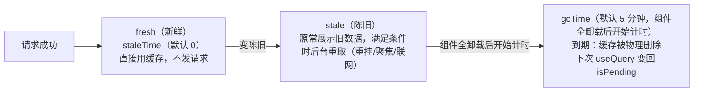

> 本文是《阶段 4：高频业务场景 ⭐实战核心（3 周）》按小节拆分后的续篇，上一部分见 [12-阶段-4-高频业务场景-实战核心-3-周.md](12-阶段-4-高频业务场景-实战核心-3-周.md)。

### 4.2 数据请求与服务器状态

四条是学习曲线：先手写（第 1 条）→ 再用标准库 TanStack Query（第 2 条）→ 对照生态另一极 SWR（第 3 条）→ 最后望向框架层新范式 Suspense/RSC（第 4 条）。

1. 手写 `useFetch`：loading / error / refetch / 竞态
2. **TanStack Query（React Query）**：缓存、失效重取、分页参数、无限加载、乐观更新、mutation 后刷新列表
3. SWR 对照使用
4. Suspense + 数据获取（配合 RSC 理解）

先立一个贯穿四条的认知：**服务器状态不是客户端状态**。列表数据、用户资料这些"住在服务器上的状态的快照"，与"弹窗开没开、输入框填了什么"有本质区别——前者会过期、会与他人并发冲突、需要缓存与重新验证；后者唯一真相就在内存里。把两者混在同一个 state 体系（Redux 里存接口返回值）是老项目复杂度失控的头号来源。本节主线就是把服务器状态交给专门的工具。

#### 4.2.1 手写 `useFetch`：loading / error / refetch / 竞态

**是什么与回顾要点。** `useFetch(url)` 是阶段 2 自定义 Hook 的收官作业，这里是战前点验，五个要点：① **三态完整建模**：loading/error/data 互斥推进；② **竞态守卫**：url 快速变化时（搜索框、Tab 切换）旧响应必须作废——用"请求序号"（或 AbortController）只认最后一次；③ **url 即依赖**：url 变化自动重取；④ **refetch 暴露**：错误态给用户"重试"出口；⑤ **错误归一**：HTTP 非 2xx 与网络异常统一抛成 Error。

**代码示例：序号守卫版完整实现。**

```tsx
// useFetch.ts
import { useCallback, useEffect, useRef, useState } from 'react';

type FetchState<T> = { data: T | null; loading: boolean; error: Error | null };

export function useFetch<T>(url: string): FetchState<T> & { refetch: () => void } {
  const [state, setState] = useState<FetchState<T>>({ data: null, loading: true, error: null });
  const seqRef = useRef(0);   // 递增请求序号：只有"当前最新一次请求"的响应才允许落进 state

  const load = useCallback(async () => {
    const seq = ++seqRef.current;                       // 发起请求前先占号
    setState(s => ({ ...s, loading: true, error: null }));
    try {
      const res = await fetch(url);
      if (!res.ok) throw new Error(`请求失败：HTTP ${res.status}`);   // HTTP 错误也走异常通道
      const data = (await res.json()) as T;
      if (seq !== seqRef.current) return;               // 过期响应：丢弃（期间已有新请求）
      setState({ data, loading: false, error: null });
    } catch (err) {
      if (seq !== seqRef.current) return;               // 过期错误同样丢弃
      setState({ data: null, loading: false, error: err as Error });
    }
  }, [url]);                                            // url 变化 → load 重建 → 下面 effect 重跑

  useEffect(() => { void load(); }, [load]);

  return { ...state, refetch: load };                   // refetch 与初次加载同一条路径
}

// 使用：const { data, loading, error, refetch } = useFetch<User[]>('/api/users');
```

**为什么写完还要学 TanStack Query。** 把 useFetch 的局限列出来，就是 RQ 的功能清单：同一个 url 在两个组件里用会发**两次**请求（无缓存去重）；组件卸载重挂，数据从头 loading（无缓存复用）；列表新增一条后想刷新只能自造 refetch 事件总线（无失效模型）；翻页回来要重新 loading（无旧数据垫底）；写操作后哪些缓存该失效全靠人脑记（无 key 体系）。手写把这些全补齐是不可能的——"服务器状态管理"本身就是一门完整的学科。

**常见坑。**

- **症状**：快速切换 Tab，列表偶尔闪现上一个 Tab 的数据。**根因**：无竞态守卫，旧响应后到覆盖新响应。**修法**：序号守卫或 AbortController（如上）。
- **症状**：404/500 时 `data` 为 null 但 `error` 也是 null，页面白屏。**根因**：`fetch` 对 HTTP 错误状态码**不抛异常**（只有断网才 reject），漏了 `res.ok` 检查。**修法**：`if (!res.ok) throw new Error(...)`，把 HTTP 错误并入 error 通道（本实现已含）。另外若页面莫名多请求，查 useCallback 依赖数组是否写漏（把动态对象当依赖会导致每次渲染重建 load、effect 重跑）——开 `eslint-plugin-react-hooks` 盯着。

#### 4.2.2 **TanStack Query（React Query）**：缓存、失效重取、分页参数、无限加载、乐观更新、mutation 后刷新列表

**是什么。** TanStack Query（下称 RQ）把服务器状态的缓存建模成**客户端数据库**：数据按 `queryKey` 寻址存进 `QueryClient`，组件用 `useQuery` "订阅"——命中新鲜缓存直接用，陈旧了后台补，没了就发请求。v5 是当前主版本（API 全面对象化、命名规范化：`isPending`、`gcTime`），本文严格按 v5 写。

**为什么需要。** 4.2.1 的局限清单逐条被 RQ 内建解决：缓存与请求去重（同 key 同屏只发一次）、组件重挂即时复用、结构化失效（`invalidateQueries` 按前缀批量作废）、翻页垫底（`placeholderData`）、无限加载（`useInfiniteQuery`）、写操作编排（`useMutation` + 乐观更新）。中大型项目引入 RQ 通常还能顺带删掉一半 Redux/Context 里的"接口数据状态"。

**接入。**

```bash
npm install @tanstack/react-query
npm install -D @tanstack/react-query-devtools   # 开发期强烈建议带上官方 DevTools
```

```tsx
// main.tsx —— 全局唯一的 QueryClient，挂在应用根部
import { StrictMode } from 'react';
import { createRoot } from 'react-dom/client';
import { QueryClient, QueryClientProvider } from '@tanstack/react-query';
import App from './App';

// 实例创建在组件外：保证全应用共享同一个缓存库
const queryClient = new QueryClient({
  defaultOptions: {
    queries: {
      staleTime: 60 * 1000,        // 数据 1 分钟内视为新鲜（默认 0 = 永远陈旧）
      gcTime: 5 * 60 * 1000,       // 缓存无人使用后保留 5 分钟（默认值相同，显式写出便于理解）
      refetchOnWindowFocus: false, // 后台项目常关掉"聚焦窗口即重取"；retry 默认 3 次可按需调低
    },
  },
});

createRoot(document.getElementById('root')!).render(
  <StrictMode>
    <QueryClientProvider client={queryClient}>
      <App />
    </QueryClientProvider>
  </StrictMode>,
);
```

**（一）useQuery 与缓存键设计。**

```tsx
// UserProfile.tsx
import { useQuery } from '@tanstack/react-query';

type User = { id: number; name: string; email: string };

async function fetchUser(userId: number): Promise<User> {
  const res = await fetch(`/api/users/${userId}`);
  if (!res.ok) throw new Error(`加载用户失败：HTTP ${res.status}`);   // RQ 需要"真异常"驱动 error 态
  return res.json();
}

export function UserProfile({ userId }: { userId: number }) {
  const { data, isPending, isError, error } = useQuery({
    queryKey: ['users', userId],     // 缓存键：数组、层级化、含全部请求入参
    queryFn: () => fetchUser(userId),
  });

  if (isPending) return <p>加载中…</p>;          // v5：尚无数据（含首次请求进行中）
  if (isError) return <p>出错了：{error.message}</p>;
  return (
    <div>
      <h2>{data.name}</h2>
      <p>{data.email}</p>
    </div>
  );
}
```

v5 状态命名：`status` 只有 `'pending' | 'error' | 'success'`，对应 `isPending/isError`；`isFetching` 表示"请求进行中"（含后台重取）；派生态 `isLoading = isPending && isFetching`（首次加载中）。

`queryKey` 设计四原则：① **数组化、层级化**：`['users']`（列表）、`['users', 'detail', userId]`（详情）、`['todos', { status: 'done', page: 2 }]`（带筛选）——key 即地址，层级即分类；② **入参必须全进 key**：queryFn 用到的每个变量都是 key 的一部分，漏一个就出现"参数变了不重取"的脏缓存；③ **可序列化**：数组/字符串/数字/普通对象都行（对象属性书写顺序不影响哈希），函数、类实例不行；④ **为失效而设计**：`['users', 'detail', 1]` 天然能被 `['users']` 前缀匹配批量失效——key 层级按"业务实体"组织，这是失效重取的前提。

**（二）staleTime 与 gcTime：一条缓存的时间线。** 这两个参数是 RQ 心智模型的地基：



- `staleTime`（默认 0）：数据"保鲜期"。期内组件挂载/重挂**不发请求**直接给缓存；过期后数据仍**可用**（先展示再后台换新）。字典、配置、用户资料这类低频变化接口设 30s–5min，能砍掉大量无谓请求。
- `gcTime`（默认 5 分钟，v4 前叫 `cacheTime`）：**没有任何组件观察该缓存后**的保留期——期间组件回来仍秒开（先给旧数据再后台补），到期物理回收。它从"变为无观察者"起算，与 staleTime 完全正交。
- 陈旧缓存的三个默认重取触发：组件重新挂载（`refetchOnMount`）、窗口重新聚焦（`refetchOnWindowFocus`）、网络恢复（`refetchOnReconnect`）。后台系统常关掉后两者，改为显式失效驱动。

**（三）失效重取 invalidateQueries。** 写操作改了服务器数据，相关缓存全部作废：

```tsx
// useDeleteTodo.ts —— 失效的两种粒度
import { useMutation, useQueryClient } from '@tanstack/react-query';

export function useDeleteTodo() {
  const queryClient = useQueryClient();

  return useMutation({
    mutationFn: async (todoId: number) => {
      const res = await fetch(`/api/todos/${todoId}`, { method: 'DELETE' });
      if (!res.ok) throw new Error(`删除失败：HTTP ${res.status}`);
    },
    onSuccess: async () => {
      // 前缀匹配：['todos']、['todos', {status:'done'}] 全部失效
      await queryClient.invalidateQueries({ queryKey: ['todos'] });
      // 默认 refetchType: 'active'：当前挂载中的查询立即重取；
      // 未挂载的（inactive）只标记失效，等下次挂载再取
    },
  });
}
// 精确命中单个 key 时加 exact: true，例如 invalidateQueries({ queryKey: ['todos', { status: 'done' }], exact: true })
```

`await` invalidateQueries 表示等所有触发的重取落定——下一步有跳转/提示时有用。粒度纪律：删了一条待办只失效 `['todos']`，别无参 `invalidateQueries()`（失效全部）——那是"不知道谁受影响"的逃生门，用多了缓存体系名存实亡。

**（四）分页与 placeholderData。** 翻页的经典痛点：第 2 页请求期间整块闪 loading。v5 用 `placeholderData: keepPreviousData`（从包里导入哨兵值，替代 v4 的 `keepPreviousData: true`）让上一页数据垫底：

```tsx
// PaginatedProjects.tsx
import { useState } from 'react';
import { keepPreviousData, useQuery } from '@tanstack/react-query';

type Project = { id: number; name: string };
type ProjectsRes = { items: Project[]; total: number };

async function fetchProjects(page: number): Promise<ProjectsRes> {
  const res = await fetch(`/api/projects?page=${page}&size=20`);
  if (!res.ok) throw new Error(`HTTP ${res.status}`);
  return res.json();
}

export function PaginatedProjects() {
  const [page, setPage] = useState(1);

  const { data, isPending, isPlaceholderData } = useQuery({
    queryKey: ['projects', page],        // page 进 key：换页 = 换缓存条目
    queryFn: () => fetchProjects(page),
    placeholderData: keepPreviousData,   // v5 写法：请求期间先展示上一份数据（垫底不闪屏）
  });

  if (isPending) return <p>首次加载中…</p>;   // 只有第一页才看得到

  return (
    <div>
      {/* isPlaceholderData 为 true = 当前展示的是垫底旧页，可据此降透明度提示 */}
      <ul style={{ opacity: isPlaceholderData ? 0.6 : 1 }}>
        {data.items.map(p => <li key={p.id}>{p.name}</li>)}
      </ul>
      <button disabled={page === 1} onClick={() => setPage(p => p - 1)}>上一页</button>
      <span>第 {page} 页</span>
      <button disabled={page * 20 >= data.total} onClick={() => setPage(p => p + 1)}>下一页</button>
    </div>
  );
}
```

**（五）useInfiniteQuery 无限加载。** 分页参数从"点按钮换页"变成"滚到底自动续"：

```tsx
// InfiniteProjects.tsx
import { useInfiniteQuery } from '@tanstack/react-query';

type Project = { id: number; name: string };
type ProjectsPage = { items: Project[]; nextPage: number | null };

async function fetchProjectsPage(page: number): Promise<ProjectsPage> {
  const res = await fetch(`/api/projects?page=${page}&size=20`);
  if (!res.ok) throw new Error(`HTTP ${res.status}`);
  return res.json();
}

export function InfiniteProjects() {
  const {
    data,                // InfiniteData：{ pages: ProjectsPage[]; pageParams: number[] }
    fetchNextPage,      // 取下一页（可重复调用）
    hasNextPage,        // getNextPageParam 返回 undefined 时为 false
    isFetchingNextPage, // 仅"追加页"请求进行中（区别于整表 isFetching）
    status,
  } = useInfiniteQuery({
    queryKey: ['projects', 'infinite'],
    queryFn: ({ pageParam }) => fetchProjectsPage(pageParam),  // pageParam 由框架传入（首次 = initialPageParam）
    initialPageParam: 1,                     // v5 必填：起始页参数
    getNextPageParam: (lastPage) => lastPage.nextPage,   // 返回下一页参数；返回 undefined 即到底
  });

  if (status === 'pending') return <p>加载中…</p>;

  const projects = data.pages.flatMap(p => p.items);   // pages 是已取到的所有页，渲染前拍平

  return (
    <>
      <ul>{projects.map(p => <li key={p.id}>{p.name}</li>)}</ul>
      <button onClick={() => fetchNextPage()} disabled={!hasNextPage || isFetchingNextPage}>
        {isFetchingNextPage ? '加载中…' : hasNextPage ? '加载更多' : '没有更多了'}
      </button>
    </>
  );
}
```

两个要点：`getNextPageParam` 兼任"算下一页参数"与"判定到底"（返回 `undefined` 即无下一页）——页码分页返回 `lastPage.nextPage`，**游标分页**返回 `lastPage.nextCursor`，两种后端模型同一套 API；把"加载更多"按钮换成 `IntersectionObserver` 哨兵元素自动触发就是完整信息流（哨兵实现见 4.3，此处不重复）。缓存层面注意：`invalidateQueries` 命中无限查询会**从第一页开始重建**，长列表慎用整表失效，局部 `setQueryData` 更合适。

**（六）乐观更新：完整 onMutate / onError / onSettled。** 乐观更新指"不等服务器确认，先把 UI 改成预期成功的样子"，失败再回滚——点赞、收藏、勾选待办这类高频轻写的标准体验。三段生命周期各司其职：

```tsx
// useToggleTodo.ts —— 乐观更新完整实现
import { useMutation, useQueryClient } from '@tanstack/react-query';

export type Todo = { id: number; title: string; done: boolean };

export function useToggleTodo() {
  const queryClient = useQueryClient();

  return useMutation({
    // ① 变更本体：与缓存无关的纯请求
    mutationFn: async (todo: Todo): Promise<Todo> => {
      const res = await fetch(`/api/todos/${todo.id}`, {
        method: 'PATCH',
        headers: { 'Content-Type': 'application/json' },
        body: JSON.stringify({ done: !todo.done }),
      });
      if (!res.ok) throw new Error(`更新待办失败：HTTP ${res.status}`);
      return res.json();
    },

    // ② onMutate：请求发出"之前"同步执行——先斩后奏，乐观写缓存
    onMutate: async (todo) => {
      await queryClient.cancelQueries({ queryKey: ['todos'] });   // 抢先取消在途查询：防旧响应覆盖乐观值
      const previousTodos = queryClient.getQueryData<Todo[]>(['todos']);   // 快照：失败回滚的唯一依据
      queryClient.setQueryData<Todo[]>(['todos'], (old) =>       // 写入乐观结果：UI 立即呈现"勾选成功"
        (old ?? []).map(t => (t.id === todo.id ? { ...t, done: !todo.done } : t)),
      );
      return { previousTodos };   // 返回值 → 成为 onError/onSettled 的 context 参数
    },

    // ③ onError：请求失败——用快照整体回滚，用户几乎无感
    onError: (err, _todo, context) => {
      queryClient.setQueryData(['todos'], context?.previousTodos);
      console.error('乐观更新失败，已回滚', err);
    },

    // ④ onSettled：无论成败最终执行——与服务器对账，消除一切可能的漂移
    onSettled: () => {
      queryClient.invalidateQueries({ queryKey: ['todos'] });
    },
  });
}

// 用法（组件里）：
// const toggleTodo = useToggleTodo();
// <input type="checkbox" checked={todo.done} onChange={() => toggleTodo.mutate(todo)} />
```

逐行理解：`onMutate` 返回的 context 是回滚通道；`cancelQueries` 防"旧响应晚到覆盖乐观值"（正是 4.2.1 的竞态，防守方换成写路径）；`onSettled` 的 invalidate 是安全网——哪怕乐观值就等于服务器终值，对账一次也无害。产品要求"服务器权威、不允许闪断"就去掉 onMutate 只留 onSuccess（退化为悲观更新，结构不变）。

**（七）mutation 后刷新列表的两种姿势。**

```tsx
// 姿势一：invalidateQueries —— 服务器是唯一事实源（默认推荐）
onSuccess: async () => {
  await queryClient.invalidateQueries({ queryKey: ['todos'] });
  // 一轮"标记失效 + 活动查询重取"换来绝对正确；代价是多一次往返
},

// 姿势二：setQueryData —— 用 mutation 的返回值直接改缓存（省一次往返）
onSuccess: (updatedTodo) => {
  queryClient.setQueryData<Todo[]>(['todos'], (old) =>
    (old ?? []).map(t => (t.id === updatedTodo.id ? updatedTodo : t)),
  );
  // 前提：后端返回完整实体；风险：本地推算与服务器实况可能漂移（别的端同时在改）
},
```

选型一句话：**写多、有一致性硬要求的列表用姿势一；高频轻写、接口返回完整实体、追求零延迟反馈用姿势二（常与乐观更新配合）；拿不准先一后二**。两者也可分层：乐观更新先 setQueryData 给即时反馈，onSettled 再 invalidate 对账——上面的 useToggleTodo 就是这个组合。另外，DevTools 值得第一天就装上：`<ReactQueryDevtools initialIsOpen={false} />` 放在 `QueryClientProvider` 内，能直接看到每个 key 的缓存内容、fresh/stale 状态与请求时间线。

**常见坑。**

- **症状**：请求明明成功，组件却显示 error 态。**根因**：v5 只认 `Error` 实例，queryFn 里 `throw '失败了'`（字符串）或 `throw { code: 500 }`（对象）不算数，`error.message` 读出 undefined。**修法**：所有失败路径 `throw new Error('可读文案')`（如各示例）。
- **症状**：改了查询参数（筛选条件），页面不刷新或仍展示旧条件数据。**根因**：参数没进 `queryKey`——key 相同就命中同一条缓存，queryFn 闭包换了也没用。**修法**：queryFn 用到的每个变量都写进 key：`queryKey: ['todos', { status, keyword }]`。
- **症状**：`staleTime` 设了 60 秒，每次进页面还是闪了一下 loading。**根因**：不是 staleTime 失效——是 gcTime 内缓存已被回收（组件离开超过 gcTime），或该 key 首次请求（isPending 是必经第一态）。**修法**：区分"首载"与"复访"：复访要免闪，确认 gcTime 覆盖离开时长，必要时配 `placeholderData`。
- **症状**：乐观更新偶发"勾选自动跳回去再跳回来"。**根因**：onMutate 漏了 `cancelQueries`——在途列表请求晚于乐观写入返回，把乐观值盖掉，随后 invalidate 又改回来。**修法**：onMutate 第一步必 `await cancelQueries`（示例已含），这是乐观更新的固定起手式。
- **症状**：v4 升 v5 后满屏 TS 报错（`isLoading` 不存在、`cacheTime` 不认识、`keepPreviousData` 报错）。**根因**：v5 破坏性改名——查询首载语义改 `isPending`（`isLoading` 变派生态、mutation 上改名 `isPending`）、`cacheTime` → `gcTime`、`keepPreviousData: true` → `placeholderData: keepPreviousData`、参数只能对象式传。**修法**：按本文 v5 写法逐项替换；官方迁移指南有完整对照表。

#### 4.2.3 SWR 对照使用

**是什么。** SWR（stale-while-revalidate）是 Vercel 出品的数据请求 Hooks 库，名字即策略：**先用缓存的旧数据（stale）渲染，同时后台重新验证（revalidate）**。它与 RQ 解决同一问题，哲学不同——SWR 追求最小 API 面积，RQ 追求完整的服务器状态管理模型。

**为什么需要对照。** 用过 RQ 再摸一遍 SWR，能看清哪些能力是这类库的本质（缓存 + 重验证），哪些是 RQ 的额外野心（变更、失效、乐观更新的体系化）；反过来写 SWR 时也不会把 RQ 的惯性带错地方。对照能力本身就是选型能力。

**代码示例：同一功能换 SWR 写一遍。**

```bash
npm install swr
```

```tsx
// SwrUserList.tsx
import useSWR from 'swr';

type User = { id: number; name: string };

// SWR 惯例：全局 fetcher，useSWR 只传 key（通常是 URL）
const fetcher = (url: string) =>
  fetch(url).then(res => {
    if (!res.ok) throw new Error(`HTTP ${res.status}`);
    return res.json() as Promise<User[]>;
  });

export function SwrUserList() {
  const { data, error, isLoading, mutate } = useSWR<User[]>('/api/users', fetcher, {
    revalidateOnFocus: false,   // 与 RQ 的 refetchOnWindowFocus 对应
  });

  if (isLoading) return <p>加载中…</p>;
  if (error) return <p>加载失败：{error.message}</p>;

  // mutate：本地改缓存 + 触发重验证（RQ setQueryData + invalidateQueries 的合体简化版）
  // const addAndRevalidate = () => mutate([...(data ?? []), { id: 0, name: '新用户' }], { revalidate: true });
  // 只想刷新不动数据：mutate() —— 与 RQ invalidateQueries(key) 的最小等价物

  return <ul>{data!.map(u => <li key={u.id}>{u.name}</li>)}</ul>;
}
```

**定位对照表。**

| 对照维度 | TanStack Query | SWR |
|---|---|---|
| 定位 | 全功能服务器状态管理：缓存 + 变更 + 失效模型 | 极简数据获取 Hooks（SWR 策略参考实现） |
| 心智模型 | "缓存是客户端数据库，key 寻址、按前缀失效" | "每个 key 一份缓存，UI 是缓存的投影" |
| 读请求 | `useQuery`（对象式，key 数组） | `useSWR`（key 字符串或数组） |
| 写请求 | `useMutation` 一等公民，`onMutate/onError/onSettled` 完整生命周期 | `useSWRMutation` 后补；多数场景手写 fetch + `mutate` |
| 失效重取 | `invalidateQueries` 前缀批量失效，体系完整 | 逐 key 手动 `mutate(key)`，无批量失效模型 |
| 乐观更新 | 内建生命周期 + 快照回滚套路 | `mutate(data, { revalidate })` 本地写 + 回滚自理 |
| 无限加载 | `useInfiniteQuery`（页码/游标双模型，`initialPageParam`） | `useSWRInfinite` |
| 分页垫底 | `placeholderData: keepPreviousData` | `keepPreviousData: true` 选项 |
| DevTools | 官方 DevTools | 社区 swr-devtools |
| 概念量 / 体积 | 概念多、体积较大 | 概念少、体积小 |
| 甜区 | 后台管理、写操作密集、失效关系复杂 | 内容站、读多写少、追求极简接入 |

选型一句话：**写操作和失效关系复杂 → RQ；以读为主、要的是"数据自动保持新鲜" → SWR 的一百行能顶 RQ 的一千行**。两者没有代差；团队已重度用其一就别混用，两套缓存模型并存的心智成本高于任何一家的全部概念。

**常见坑。**

- **症状**：从 RQ 迁到 SWR 后，写操作完成列表不刷新。**根因**：把 RQ 的"自动失效"当成这类库的默认能力——SWR 没有 invalidateQueries，写完必须显式 `mutate('/api/users')` 触发对应 key 重验证（`isValidating` 含后台重验证，判断首载用 `isLoading`）。**修法**：封装项目级 `useCreateUser` 之类 Hook，内部统一"写接口 + mutate 相关 key"，别把刷新逻辑散在组件里。

#### 4.2.4 Suspense + 数据获取（配合 RSC 理解）

**是什么。** Suspense 是 React 的"渲染等待"协议：子树抛出一个 Promise（挂起），React 找最近的 `<Suspense>` 边界显示 `fallback`，Promise 了结后自动恢复渲染。React 19 的 `use()` API 让"组件里读 Promise"成为官方原语：`use(promise)`——未完成就挂起，完成就直接返回结果。注意 `use` 按 Hook 规则约束（不能在普通函数里调用），但**允许在条件分支和循环里调用**，这是它与普通 Hook 的关键差异。

**为什么需要。** 4.2.1/4.2.2 的加载模型是命令式三态：组件自己判 `isPending` 渲染 loading。一页有五块数据、先后不一时，loading 分支组合爆炸、瀑布式串行请求都由每个组件自理。Suspense 把"等数据"下沉为声明式协议：**组件只声明"我要什么"，等待的呈现方式由外层边界统一编排**——边界放得近则逐块出、放得远则整块出，加载策略成了布局问题而非 if 分支问题。

**怎么做（机制分步）。** ① 取数动作独立于渲染产出 Promise，组件内 `use(promise)` 解包——**Promise 引用必须在多次渲染间稳定**（否则每次渲染都"新开一个等待"）；② 外层 `<Suspense fallback={...}>` 接住挂起；③ 出错路径配 ErrorBoundary（Promise reject 抛给最近的错误边界，React 至今的官方错误边界仍是 class 组件）；④ 边界位置即加载策略：紧贴数据组件 = 局部骨架，包住整页 = 整页 loading。

**代码示例：use() + Suspense 边界 + ErrorBoundary。**

```tsx
// user-cache.ts —— 客户端 Promise 缓存：保证"同一 id 的 Promise 引用稳定"
type User = { id: string; name: string; email: string };

const userPromiseCache = new Map<string, Promise<User>>();

function getUserPromise(id: string): Promise<User> {
  if (!userPromiseCache.has(id)) {
    userPromiseCache.set(
      id,
      fetch(`/api/users/${id}`).then(res => {
        if (!res.ok) throw new Error(`加载用户失败：HTTP ${res.status}`);
        return res.json() as Promise<User>;
      }),
    );
  }
  return userPromiseCache.get(id)!;   // 命中即复用同一 Promise——use 的硬前提
}
export { getUserPromise };
```

```tsx
// ErrorBoundary.tsx —— React 没有函数组件版错误边界，class 是标准写法
import { Component, type ReactNode } from 'react';

type Props = { children: ReactNode; fallback?: ReactNode };
type State = { error: Error | null };

export class ErrorBoundary extends Component<Props, State> {
  state: State = { error: null };

  static getDerivedStateFromError(error: Error): State {
    return { error };   // 渲染前切换到降级态
  }

  componentDidCatch(error: Error, info: unknown) {
    console.error('边界捕获：', error, info);   // 接 Sentry 等上报写在这里
  }

  render() {
    if (this.state.error) return this.props.fallback ?? <p>出错了，请稍后重试。</p>;
    return this.props.children;
  }
}
```

```tsx
// UserSuspenseDemo.tsx —— 组装：错误边界在外、Suspense 在内、数据组件最深处
import { use, Suspense } from 'react';
import { ErrorBoundary } from './ErrorBoundary';
import { getUserPromise } from './user-cache';

function UserProfile({ id }: { id: string }) {
  const user = use(getUserPromise(id));   // 未完成 → 挂起最近 Suspense；完成 → 直接拿到值
  return (
    <div>
      <h2>{user.name}</h2>
      <p>{user.email}</p>
    </div>
  );
}

function Dashboard({ userId }: { userId: string }) {
  return (
    <ErrorBoundary fallback={<p>用户模块挂了，其余照常。</p>}>
      {/* 边界位置 = 加载策略：这里紧贴 UserProfile，等待期间页面其他部分先渲染出来 */}
      <Suspense fallback={<p>用户信息加载中…</p>}>
        <UserProfile id={userId} />
      </Suspense>
      <p>这一段不依赖数据，立即渲染，不等上面那块。</p>
    </ErrorBoundary>
  );
}

export default Dashboard;
```

与 RQ 的关系：RQ v5 提供 `useSuspenseQuery`——同一套缓存/失效体系，但用挂起代替 `isPending` 分支（`const { data } = useSuspenseQuery({...})`，data 一定有值）。已全站 RQ 的项目优先用它而不是手写 Promise 缓存；本节手写的价值在于理解挂起协议本身。

**与 RSC 的关系（一段认知）。** Suspense 数据获取的"完全体"在服务端：React Server Components 里**取数回归最朴素的 async/await**——Server Component 本身就是异步函数，在服务端请求数据后把渲染好的 UI（流）发给浏览器，客户端组件不再承担首屏取数；Next.js App Router 更把加载态做成文件约定（`loading.tsx` 即 Suspense 边界），配合流式渲染"服务端边取数边推送、哪块好了先显示哪块"。`use()` 在这条链路里扮演桥：Server Component 可以把未完成的 Promise 作为 prop 传给客户端组件，客户端组件用 `use()` 解包——等待与恢复的协议跨越了服务端与客户端边界。落到实践三句话：其一，服务端取数（RSC async 组件）与客户端缓存（RQ/SWR）不是二选一——首屏数据走服务端，交互后的增量数据走客户端缓存库，两者共存是 Next.js 项目常态；其二，`use()` 主要服务"从服务端/父级接住 Promise"与"读取 Context"两类场景，**不要**在客户端为每个请求手搓 Promise（那是在重造没有缓存、没有去重的轮子）；其三，无论哪一层，"Suspense 边界的位置决定加载体验"这个心智不变。

**常见坑。**

- **症状**：组件里直接 `use(fetch(...))`，页面永远卡在 fallback（或反复闪 loading）。**根因**：每次渲染都创建**新的** Promise，`use` 每次都拿到"未完成的新等待"，永远挂起。**修法**：Promise 必须跨渲染引用稳定——模块级缓存（本例）、父组件创建后 props 传入、或 `useMemo` 暂存；这是 `use` 的第一铁律。
- **症状**：数据报错后整页白屏，Suspense 的 fallback 没接住。**根因**：Promise reject 抛给**错误边界**而不是 Suspense；没包 ErrorBoundary 时异常继续上传直至根组件。**修法**：每个会失败的数据组件都要有 ErrorBoundary 兜底（Suspense 只管"等"不管"错"），二者总是成对出现。
- **症状**：多个数据组件先后挂起，请求一个接一个串行发出，总耗时相加。**根因**：上游组件先 `use(A)` 再用 A 的结果决定 B——串行依赖天然串行；或各组件的 Promise 在各自 render 里才创建，形成瀑布。**修法**：无依赖的取数在入口处并行发起（Promise.all 或让 RQ/框架并行调度）；有真依赖的串行本来就该串行，别误诊。

#### 4.2.5 请求健壮性：超时、重试与降级

**为什么缺这三件。** 4.2.1 的 `useFetch` 处理了竞态，但三个现实问题它没管：其一，`fetch` 默认**没有超时**——弱网、代理黑洞、服务器 hold 住连接时 Promise 永远 pending，UI 卡死在 loading；其二，一次网络抖动就把错误抛给用户，对幂等的 GET 过于粗暴；其三，接口挂了不等于页面得白屏——很多场景有旧数据或静态兜底可用。WebSocket 重连的退避与抖动已在 [17-4-6-实时与异步](17-4-6-实时与异步.md) 展开，本节是同一族工程在 HTTP 请求侧的落法。

**超时：每个请求都该有死线。**

```ts
// fetchWithTimeout.ts —— 超时中断 + 保留外部取消（AbortController 二合一）
export async function fetchWithTimeout(
  url: string,
  init: RequestInit & { timeoutMs?: number } = {},
): Promise<Response> {
  const { timeoutMs = 10_000, signal: external, ...rest } = init;
  const controller = new AbortController();
  let timedOut = false;
  const timer = setTimeout(() => {
    timedOut = true;   // 先立旗再 abort：catch 里靠它区分"超时"与"外部取消"
    controller.abort();
  }, timeoutMs);
  // 外部 signal（来自 RQ、调用方）也要能取消这次请求
  if (external?.aborted) controller.abort();
  external?.addEventListener('abort', () => controller.abort(), { once: true });

  try {
    return await fetch(url, { ...rest, signal: controller.signal });
  } catch (err) {
    if (timedOut) throw new Error(`请求超时（${timeoutMs}ms）：${url}`);
    throw err;   // 外部取消原样上抛，调用方按 AbortError 处理
  } finally {
    clearTimeout(timer);   // 不摘定时器：成功请求也会挂着它，高并发页是真实泄漏
  }
}
```

**重试：只重试"值得重试"的失败。**

```ts
// fetchJson.ts —— 幂等 GET 的重试封装：4xx 不重试、指数退避加抖动
export class HttpError extends Error {
  constructor(public status: number, message: string) {
    super(message);
  }
}

function isRetryable(status: number): boolean {
  return status >= 500 || status === 429;   // 服务器抖动 / 限流：值得再来一次
}

export async function fetchJson<T>(url: string, timeoutMs = 10_000, retries = 2): Promise<T> {
  let lastErr: unknown;
  for (let attempt = 0; attempt <= retries; attempt++) {
    try {
      const res = await fetchWithTimeout(url, { timeoutMs });
      if (res.ok) return (await res.json()) as T;
      if (!isRetryable(res.status)) throw new HttpError(res.status, `HTTP ${res.status}`);   // 404 重试一百次也是 404
      lastErr = new HttpError(res.status, `HTTP ${res.status}`);
    } catch (err) {
      // 注意这行：上面 throw 的"不重试"错误会先被自己的 catch 接住，必须原样再抛，否则 4xx 也进重试
      if (err instanceof HttpError && !isRetryable(err.status)) throw err;
      lastErr = err;   // 网络错误/超时/5xx：可重试
    }
    if (attempt < retries) {
      const backoff = Math.min(8_000, 500 * 2 ** attempt);   // 500 → 1000 → 2000，封顶 8s
      const jitter = backoff * (0.8 + Math.random() * 0.4);  // ±20% 抖动，错开几千个客户端的同步重试
      await new Promise((r) => setTimeout(r, jitter));
    }
  }
  throw lastErr;
}
```

重试纪律三条：**只重试幂等请求**（GET 天然安全，PUT/DELETE 通常幂等；POST 默认不重试，除非后端有幂等键）；**只重试环境性失败**（网络错误、5xx、429——4xx 是逻辑错误，重试是浪费）；**退避必须带抖动**（原因与"雷群效应"见 4.6，那里有完整推导）。

**RQ 侧：超时进 queryFn，重试交给框架。** RQ 查询默认重试 3 次，不要与 fetchJson 的内部重试叠着开——总等待时间是相乘的。选一层负责：

```tsx
// ProductSearch.tsx —— 框架层负责重试的写法（queryFn 只管超时）
const { data } = useQuery({
  queryKey: ['products', keyword],
  // v5：queryFn 上下文里有框架传入的 signal——卸载/失效时 RQ 会 abort 它
  queryFn: ({ signal }) =>
    fetchWithTimeout(`/api/products?q=${keyword}`, { signal, timeoutMs: 8_000 }).then((res) => {
      if (!res.ok) throw new HttpError(res.status, `HTTP ${res.status}`);
      return res.json() as Promise<Products>;
    }),
  retry: (failureCount, error) => {
    if (error instanceof HttpError && !isRetryable(error.status)) return false;   // 4xx 不重试
    return failureCount < 3;
  },
  retryDelay: (attempt) => Math.min(1_000 * 2 ** attempt, 30_000),   // RQ 默认即指数退避，显式写出便于读
});
```

若 queryFn 用了自带重试的 `fetchJson`，就把上面的 `retry: false` 关掉一层。另注意 mutation 默认 `retry: 0`——写操作不自动重试是对的，重复提交比失败更难收拾。

**降级：失败 ≠ 白屏，两档兜底。**

```tsx
// 档一：后台重取失败 → 保留旧数据 + 警示条。
// RQ 的行为：已有成功数据的查询重取失败时，error 置位但 data 保留上次成功值——利用这一点
const { data, isPending, isError, error, refetch } = useQuery({
  queryKey: ['dashboard', range],
  queryFn: ({ signal }) => fetchDashboard(range, signal),
});

if (isPending) return <p>加载中…</p>;
if (isError && !data) {
  return <p>出错了：{error.message} <button onClick={() => refetch()}>重试</button></p>;   // 从没成功过：只能报错
}
return (
  <section>
    {isError && data && (   // 成功过、这次刷新失败：旧数据照常展示
      <div role="alert">
        数据可能已过期（{error.message}）
        <button onClick={() => refetch()}>重新加载</button>
      </div>
    )}
    {/* 图表组件省略：data 类型完备，直接喂给现有渲染 */}
  </section>
);
```

```tsx
// 档二：静态兜底——字典/配置类数据打包一份兜底值，接口挂了也能用
const FALLBACK_CITIES = [/* 打包进前端的常用城市 */];
const { data } = useQuery({
  queryKey: ['dict', 'cities'],
  queryFn: async () => {
    try {
      return await fetchJson<City[]>('/api/dict/cities');
    } catch (err) {
      reportError('cities-dict-fallback', err);   // 必须上报：吞错不报 = 永远不知道接口挂了
      return FALLBACK_CITIES;                     // query 以 success 落定，UI 无感降级
    }
  },
  staleTime: 10 * 60_000,
});
```

静态兜底的代价要认：错误被转成成功、缓存里存的是兜底值——只适合"有权威静态底"的字典场景，业务数据禁止这么写。

**常见坑。**

- **症状**：超时封装忘了 `clearTimeout`，页面用久了越来越卡。**根因**：每个请求挂一个 10s 定时器，成功路径也不摘。**修法**：finally 里清理（本实现）；较新浏览器可直接用 `AbortSignal.timeout(ms)`，与外部 signal 组合用 `AbortSignal.any`。
- **症状**：接口 500，前端 fetchJson 重试 2 次 × RQ 再重试 3 次，用户盯着 loading 半分钟。**根因**：两层重试相乘。**修法**：只开一层，框架层优先（retry 回调按状态码分流）。
- **症状**：断网时页面直接换成错误页，来网后也不恢复。**根因**：`if (isError) return` 一刀切，把"还有旧数据可用"的分支堵死了。**修法**：错误面板与数据区共存（档一写法），并保留 RQ 默认的 `refetchOnReconnect`。

#### 4.2.6 TanStack Query 坑位补遗

4.2.2 末尾已列五个基础坑，这里补五个 code review 里反复出现的进阶坑。

**坑 1：拿 `initialData` 当骨架，结果永远不发请求。**

```tsx
const { data } = useQuery({
  queryKey: ['todos'],
  queryFn: fetchTodos,
  initialData: [],      // ❌ 想垫个空列表
  staleTime: 60_000,
});
// 症状：isPending 恒为 false、60s 内挂载不发请求、页面一直空列表
```

根因：`initialData` 是**真数据**——写进缓存、`dataUpdatedAt` 记为写入时刻，staleTime 内视为新鲜所以不重取。修复：垫底语义用 `placeholderData`（不进缓存、`isPending` 仍 true、请求照发）；`initialData` 只用于"真的有一份可用数据"（路由预取、SSR 注水），且配 `initialDataUpdatedAt` 告诉 RQ 这份数据几岁了。

**坑 2：组件里提前 `return` 再调 `useQuery`，Hook 顺序炸了。**

```tsx
function UserPanel({ userId }: { userId?: number }) {
  if (!userId) return <p>请先选择用户</p>;   // ❌ 下面还有 Hook：条件 return 挡在 Hook 之前
  const { data } = useQuery({ queryKey: ['users', userId], queryFn: () => fetchUser(userId) });
  return <UserDetail data={data} />;
}
```

修复两选一。小面板用 `enabled`（Hook 照常调用，只是关闸）：

```tsx
const { data, isPending } = useQuery({
  queryKey: ['users', userId],
  queryFn: () => fetchUser(userId!),   // enabled=false 期间不会执行
  enabled: userId !== undefined,       // 关闸：不发请求，status 停在 pending
});
```

结构复杂时条件挂载子组件——条件的是"渲染"，不是"Hook 调用"。这正是阶段 2 Hook 规则在数据层的翻版。

**坑 3：直接改 `data`（缓存对象原地 mutate）。**

```tsx
const { data: todos } = useQuery({ queryKey: ['todos'], queryFn: fetchTodos });
// ❌ todos.push(newTodo) / todos[0].done = true
```

三宗罪：改的是**缓存本体**（同 key 的所有订阅者共享这个引用）；下游 `memo` 的行组件收到的 props 引用没变，**不重渲染**（界面不动了）；与服务器状态漂移，下次失效重取前没人对账。修复：一切缓存写入走 `setQueryData` 的不可变更新——`queryClient.setQueryData(['todos'], (old) => [...(old ?? []), newTodo])`（同 4.2.2 姿势二）。

**坑 4：`onSuccess` 闭包读到旧 state。**

```tsx
const [category, setCategory] = useState('a');
const save = useMutation({
  mutationFn: (input: SaveInput) => saveTodo(input),
  onSuccess: () => {
    // ❌ 读的是注册回调那次渲染闭包里的 category；请求在途时用户切了分类，失效的还是旧分类
    queryClient.invalidateQueries({ queryKey: ['todos', category] });
  },
});
```

修复：需要"跟这次提交相关"的值，用回调的第二参数 `variables`（即传给 `mutate` 的入参）：

```tsx
const save = useMutation({
  mutationFn: (input: SaveInput & { category: string }) => saveTodo(input),
  onSuccess: (_data, variables) => {
    queryClient.invalidateQueries({ queryKey: ['todos', variables.category] });   // 跟着提交走
  },
});
// save.mutate({ ...form, category })
```

根因与阶段 2 闭包陷阱同源：回调注册于某次渲染，闭住那次的 props/state；请求在途期间这些值变了，回调不知道。

**坑 5：`QueryClient` 创建在了组件函数体里。**

```tsx
function App() {
  const queryClient = new QueryClient();   // ❌ 从官方文档复制进组件：每次渲染一座新缓存库
  return (
    <QueryClientProvider client={queryClient}>
      <Routes />
    </QueryClientProvider>
  );
}
```

症状：缓存完全"不生效"——组件重挂就重新请求、DevTools 里缓存条目一闪即逝（StrictMode 下尤其明显）。根因：`new QueryClient()` 是渲染期副作用，每次渲染都产生空缓存替换 provider。修复：放模块顶层 `const queryClient = new QueryClient()`；必须按组件创建时用 `useState(() => new QueryClient())`（惰性初始化，只建一次）。

#### 4.2.7 自测题与面试题

**Q1：`staleTime` 和 `gcTime` 各管什么？分别从什么时刻起算？**
要点：staleTime 管"新鲜期"，从**每次成功请求**起算，期内挂载直接给缓存不发请求；gcTime 管"回收期"，从**最后一个观察者卸载**起算，期内重挂秒开（先给旧数据再后台补），到期物理删除、下次挂载回到 isPending。两者正交：可以既新鲜又被回收（无人观察超时），也可以一直陈旧但一直可用（始终有观察者）。

**Q2：`isPending` / `isFetching` / `isLoading` 的区别与典型误用？**
要点：isPending = 尚无缓存数据（status 维度）；isFetching = 请求进行中，含后台重取（fetchStatus 维度）；isLoading = isPending && isFetching（首次加载中）。误用高发：拿 isLoading 判断"后台刷新中"永远 false，该用 isFetching；拿 isPending 当"出错"处理则漏掉 error 态。

**Q3：queryKey 设计四原则？筛选参数为什么必须进 key？**
要点：数组化层级化；入参全进 key；可序列化；为失效而设计（前缀匹配）。参数不进 key → 参数变了仍命中同一条缓存 → 展示旧参数的数据且不重取（脏缓存），而且这种错误静默发生、极难排查。

**Q4：`initialData` 与 `placeholderData` 的本质区别？**
要点：initialData 是真数据——进缓存、算 success、受 staleTime 拘束（配 initialDataUpdatedAt 校正年龄），适合预取/注水；placeholderData 是垫底——不进缓存、isPending 仍 true、请求照发，适合骨架与翻页垫底（keepPreviousData）。用反了要么永远不请求，要么垫底变首屏。

**Q5：乐观更新里 `onMutate` 为什么必须 `await cancelQueries` 并返回快照？**
要点：cancelQueries 取消在途查询，防旧响应晚到覆盖乐观值（写路径的竞态，4.2.1 的翻版）；快照（修改前的缓存）经返回值成为 context，onError 拿它整体回滚——没有快照就没有回滚依据。onSettled 的 invalidate 是与服务器对账的安全网。

**Q6：`invalidateQueries` 与 `setQueryData` 怎么选、怎么组合？**
要点：invalidate 以服务器为唯一事实源，多一次往返，适合一致性硬要求的列表；setQueryData 用 mutation 返回值直接写缓存，零延迟但有漂移风险。常见组合：onMutate 里 setQueryData 给即时反馈，onSettled 里 invalidate 对账（4.2.2 的 useToggleTodo 即此）。

**Q7：`use(promise)` 为什么要求 Promise 引用跨渲染稳定？三种保证手段？**
要点：每次渲染新建 Promise，`use` 每次都当作"新的未完成等待"而挂起，永远出不了 fallback。手段：模块级缓存（4.2.4 的 user-cache）、父组件创建后经 props 传入、`useMemo` 暂存。另注意 use 允许在条件分支里调用——与普通 Hook 的关键差异。

**Q8：后台重取失败时 `data` 还在吗？UI 怎么设计？**
要点：在。已有成功数据的查询后台重取失败，error 置位、data 保留上次成功值。UI 三分支：isPending → 骨架；isError && !data → 错误面板（带重试）；isError && data → 旧数据照常渲染 + 顶部警示条 + 重试按钮（4.2.5 档一）。


---

## 附:ASCII 图替换清单

本文档图形化改版,原 ASCII 字符图与 Mermaid 图表对应关系如下:

| 原图位置 / 标题 | 处理结果 |
| --- | --- |
| (二) staleTime 与 gcTime · 缓存生命周期时间线 | 替换为 flowchart LR(阶段时间线) |
