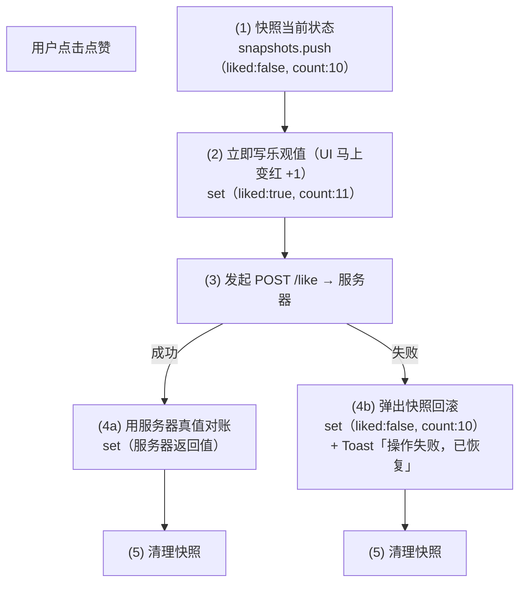

> 本文是《阶段 4：高频业务场景 ⭐实战核心（3 周）》按小节拆分后的续篇，上一部分见 [16-4-5-弹层体系.md](16-4-5-弹层体系.md)。

### 4.6 实时与异步

这一节解决三类"请求—响应模型覆盖不了"的场景：**服务端主动推**（WebSocket/SSE）和**用户不等服务器**（乐观更新）。它们共同的难点不在 API 本身，而在于：连接是有生命周期的（会断、要保活、要重连），数据是持续到达的（渲染要跟得上），而用户的操作永远比网络快（UI 要先动、错了再改）。

#### 1. WebSocket：重连、心跳、消息列表性能（增量渲染）

**是什么。** WebSocket 是一条建立在 HTTP 握手之上的**全双工 TCP 长连接**：握手完成后，客户端和服务器可以在任意时刻互相发消息，不再有"一问一答"的约束。浏览器端 API 是全局的 `WebSocket` 类，通过 `onopen` / `onmessage` / `onclose` / `onerror` 四个回调驱动。

**为什么需要。** 用 HTTP 模拟实时推送只有两条路：**短轮询**（每隔 N 秒问一次"有新消息吗"）——绝大多数请求是空转，浪费带宽与服务器连接数，且有轮询间隔上限的延迟；**长轮询**（服务器 hold 住请求直到有数据才返回）——延迟低了，但每次返回后都要重建请求，且服务器维持大量挂起连接的成本不低。WebSocket 一条连接双向复用，消息即发即到，是聊天室、协作编辑、实时看板的标配。

但长连接引入三个 HTTP 时代不存在的新问题，这正是本条要练的三件事：

1. **连接会断**——网络切换、服务器重启、代理超时都会断开连接，你必须自动重连，否则用户只能刷新页面；
2. **连接会"假活"**——更糟的情况是连接已经死了但 `onclose` 不触发（下面细讲），你必须用心跳主动探测；
3. **消息持续到达**——聊天记录从 0 涨到几千条时，每条新消息如果让整个列表重渲染，页面会越来越卡，你必须做增量渲染。

**怎么做（机制分步）。**

*第一步：理解 TCP 长连接为什么会"静默断开"（心跳存在的根本原因）。*
客户端与服务器之间隔着家用路由器（NAT）、运营商网关、公司防火墙。这些中间设备为每条连接维护一张映射表（"外部端口 53211 → 内网 192.168.1.5:54321"），而**表项有空闲超时**——常见 1~5 分钟（部分运营商级 NAT 更激进）。连接上如果长时间没有任何字节流动，映射就被回收；之后任何一方发包，包都会在中间设备被丢弃，**双方收不到任何错误信号**。这就是"半开连接"：你以为连着，其实路早没了。TCP 协议自带 keepalive，但默认 2 小时才发探测包，且参数不可由网页控制——所以必须在**应用层自己实现心跳**。

*第二步：心跳间隔与 ping/pong 消息设计。*
心跳周期要**小于链路上最短 NAT 超时的一半**（留安全余量），工程惯例是 25~30 秒。消息层面约定两个类型：

```text
客户端 → 服务端：{"type":"ping","ts":1699000000000}     每 30s 一次
服务端 → 客户端：{"type":"pong","ts":1699000000001}     收到即回
```

判定规则：**收到任何下行消息（不止 pong）都证明链路活着**，重置计数器；连续 `missLimit` 次（通常 2 次）心跳窗口内没有收到任何下行消息，判定链路已死，主动 `close()` 以触发统一的重连流程。注意必须"连续 N 次无响应"才判死，而不是一次超时——偶尔的网络抖动、服务端 GC 停顿都会造成单次延迟，立刻重连反而制造风暴。

*第三步：重连退避（立即 → 指数 → 封顶 → 抖动）。*
异常断开后第 1 次重连用短延迟（如 1 秒）——大多数断开是瞬时的（服务器滚动重启），立刻连上体验最好；失败后指数增长（1s → 2s → 4s → 8s…）——服务器真宕机时避免每秒被打一次；达到上限封顶（如 30s）——再长用户感知不到差别；每次延迟加 ±20% 随机抖动——防止几千个客户端在同一毫秒重连（"雷群效应"）压垮刚恢复的服务器。**重连成功后退避计数归零**。重连成功后还要做业务恢复：重新订阅频道、按消息序号补拉断线期间的数据（本 demo 简化为重新拉全量）。

*第四步：消息列表增量渲染。*
关键认知：`setMessages(prev => [...prev, msg])` 之后，数组引用变了、`MessageList` 会重渲染，**但数组里旧消息对象的引用一个都没变**。只要每个消息项组件用 `React.memo` 包裹，React 对旧项做浅比较后发现 props 相同，就会跳过它们的重渲染——真正重新渲染的只有新增的那一条。这就是"增量渲染而非全量替换"的本质：**不是减少 setState，而是让旧项的 props 引用保持稳定**。反例是把所有消息拼成一个字符串再 setState（整块文本节点重排），或渲染时现场生成 id/时间戳（旧项 props 每次都变，memo 全部失效）。

**代码示例。** 完整的 `useWebSocket` Hook：

```tsx
// hooks/useWebSocket.ts
import { useCallback, useEffect, useRef, useState } from 'react';

/** 连接状态机：connecting → open →（异常断开）→ reconnecting → open…；主动关闭后停在 closed */
export type WsStatus = 'connecting' | 'open' | 'reconnecting' | 'closed';

export interface UseWebSocketOptions {
  /** 心跳间隔，默认 30s：必须显著小于常见 NAT 空闲超时（1~5 分钟） */
  heartbeatIntervalMs?: number;
  /** 连续多少个心跳周期未收到下行消息即判死，默认 2 */
  missLimit?: number;
  /** 重连延迟封顶，默认 30s */
  maxRetryDelayMs?: number;
  /** 业务消息回调（心跳 pong 之外的所有消息都会进来，由业务自己分发类型） */
  onMessage?: (event: MessageEvent) => void;
  /** 连接建立（含重连成功）后的回调：用于重新订阅频道、补拉数据 */
  onOpen?: () => void;
}

export interface UseWebSocketReturn {
  status: WsStatus;
  send: (data: unknown) => void;
  close: () => void;
}

export function useWebSocket(
  url: string,
  options: UseWebSocketOptions = {},
): UseWebSocketReturn {
  const {
    heartbeatIntervalMs = 30_000,
    missLimit = 2,
    maxRetryDelayMs = 30_000,
    onMessage,
    onOpen,
  } = options;

  // 业务回调放 ref：业务层每次渲染传入新函数时，不需要（也不应该）重连 WebSocket
  const onMessageRef = useRef(onMessage);
  const onOpenRef = useRef(onOpen);
  onMessageRef.current = onMessage;
  onOpenRef.current = onOpen;

  // status 是要展示给 UI 的，放 state；其余全部放 ref——它们变化不应触发重渲染/重连
  const [status, setStatus] = useState<WsStatus>('connecting');
  const wsRef = useRef<WebSocket | null>(null);
  const heartbeatTimerRef = useRef<number | null>(null);
  const reconnectTimerRef = useRef<number | null>(null);
  const pongMissRef = useRef(0);        // 连续未收到下行消息的心跳周期数
  const retryCountRef = useRef(0);      // 已重试次数，驱动指数退避
  const manualCloseRef = useRef(false); // 区分"用户主动关闭"与"异常断开"，决定要不要重连

  const clearTimers = useCallback(() => {
    if (heartbeatTimerRef.current !== null) {
      window.clearInterval(heartbeatTimerRef.current);
      heartbeatTimerRef.current = null;
    }
    if (reconnectTimerRef.current !== null) {
      window.clearTimeout(reconnectTimerRef.current);
      reconnectTimerRef.current = null;
    }
  }, []);

  const connect = useCallback(() => {
    manualCloseRef.current = false;
    setStatus(retryCountRef.current > 0 ? 'reconnecting' : 'connecting');
    const ws = new WebSocket(url);
    wsRef.current = ws;

    ws.onopen = () => {
      setStatus('open');
      retryCountRef.current = 0; // 连接成功，退避序列归零
      pongMissRef.current = 0;
      onOpenRef.current?.();     // 业务恢复：重新订阅/补拉
      // 心跳保活：固定间隔发 ping
      heartbeatTimerRef.current = window.setInterval(() => {
        // readyState 为 OPEN 才能发送；CLOSING/CLOSED 状态下 send() 会直接抛异常
        if (ws.readyState === WebSocket.OPEN) {
          ws.send(JSON.stringify({ type: 'ping', ts: Date.now() }));
          pongMissRef.current += 1;
          if (pongMissRef.current >= missLimit) {
            // 连续 N 个周期没有任何下行消息：链路大概率已被中间设备静默丢弃。
            // 主动 close() → onclose 触发 → 走统一的重连流程
            ws.close();
          }
        }
      }, heartbeatIntervalMs);
    };

    ws.onmessage = (event) => {
      pongMissRef.current = 0; // 收到任何消息（含 pong）都证明链路活着
      onMessageRef.current?.(event);
    };

    ws.onclose = () => {
      clearTimers();
      if (manualCloseRef.current) {
        setStatus('closed'); // 用户主动关闭：不重连
        return;
      }
      // 异常断开：第 1 次 1s（立即档），之后指数增长，封顶 maxRetryDelayMs，加 ±20% 抖动
      const base = retryCountRef.current === 0 ? 1_000 : 1_000 * 2 ** retryCountRef.current;
      const delay = Math.min(base, maxRetryDelayMs);
      const jittered = delay * (0.8 + Math.random() * 0.4);
      retryCountRef.current += 1;
      setStatus('reconnecting');
      reconnectTimerRef.current = window.setTimeout(connect, jittered);
    };
    // 注意：onerror 之后浏览器必定会触发 onclose，统一在 onclose 里处理重连即可，
    // 在 onerror 里再连一次会导致双重连接
  }, [url, heartbeatIntervalMs, missLimit, maxRetryDelayMs, clearTimers]);

  useEffect(() => {
    connect();
    return () => {
      // 卸载清理：标记主动关闭、停掉所有定时器、断开连接。
      // 清理写对后，React 18 StrictMode 的"挂载→卸载→再挂载"也不会留下幽灵连接
      manualCloseRef.current = true;
      clearTimers();
      wsRef.current?.close();
      wsRef.current = null;
    };
  }, [connect, clearTimers]);

  const send = useCallback((data: unknown) => {
    if (wsRef.current?.readyState === WebSocket.OPEN) {
      wsRef.current.send(typeof data === 'string' ? data : JSON.stringify(data));
    } else {
      console.warn('[useWebSocket] 连接未就绪，消息已丢弃：', data);
    }
  }, []);

  const close = useCallback(() => {
    manualCloseRef.current = true;
    clearTimers();
    wsRef.current?.close();
    setStatus('closed');
  }, [clearTimers]);

  return { status, send, close };
}
```

使用它的聊天面板（含增量渲染消息列表）：

```tsx
// components/ChatPanel.tsx
import { memo, useEffect, useRef, useState } from 'react';
import { useWebSocket } from '../hooks/useWebSocket';

interface ChatMessage {
  id: string;
  from: 'me' | 'peer';
  content: string;
  at: number;
}

// 单条消息：memo 之后，props（消息对象）引用不变就完全跳过重渲染。
// 这是增量渲染的落点——列表再长，每条新消息也只渲染新增的一行
const MessageItem = memo(function MessageItem({ message }: { message: ChatMessage }) {
  return (
    <li className={message.from === 'me' ? 'msg msg-me' : 'msg msg-peer'}>
      {message.content}
    </li>
  );
});

export function ChatPanel({ url }: { url: string }) {
  const [messages, setMessages] = useState<ChatMessage[]>([]);
  const listRef = useRef<HTMLUListElement>(null);

  const { status, send } = useWebSocket(url, {
    onMessage: (event) => {
      const data = JSON.parse(event.data as string) as {
        type: string;
        payload?: ChatMessage;
      };
      if (data.type === 'chat' && data.payload) {
        // 追加而不是替换：旧消息对象引用全部保持不变，memo 才能生效
        setMessages((prev) => [...prev, data.payload!]);
      }
    },
  });

  // 新消息到达后滚动到底部
  useEffect(() => {
    const el = listRef.current;
    if (el) el.scrollTop = el.scrollHeight;
  }, [messages]);

  return (
    <div className="chat">
      <header>连接状态：{status}</header>
      <ul ref={listRef} className="msg-list">
        {messages.map((m) => (
          <MessageItem key={m.id} message={m} />
        ))}
      </ul>
      <button onClick={() => send({ type: 'chat', content: '你好' })}>发送</button>
    </div>
  );
}
```

配合调试用的本地回显服务器（Node 原生 `ws` 库）：

```bash
npm i ws
```

```ts
// server/chat-ws-server.ts（调试用：回显消息 + 响应心跳，30 秒静默后故意不发 pong 可验证判死逻辑）
import { WebSocketServer } from 'ws';

const wss = new WebSocketServer({ port: 8081 });
wss.on('connection', (ws) => {
  ws.on('message', (raw) => {
    const msg = JSON.parse(String(raw));
    if (msg.type === 'ping') {
      ws.send(JSON.stringify({ type: 'pong', ts: Date.now() }));
      return;
    }
    // 回显给所有人（含发送者自己），模拟服务端推送
    const echo = { type: 'chat', payload: { ...msg, id: crypto.randomUUID(), from: 'peer', at: Date.now() } };
    wss.clients.forEach((client) => client.send(JSON.stringify(echo)));
  });
});
```

**常见坑。**

- **症状**：挂着不动，消息再也收不到，`onclose` 也没触发。**根因**：半开连接——NAT 表项已回收，断开信号根本到不了你这里。**修法**：就是心跳判死（上面 `pongMissRef` 的逻辑），没有心跳的长连接在生产环境等于没有重连。
- **症状**：React 18 StrictMode 下 Network 面板出现两条 WebSocket 连接。**根因**：开发模式挂载-卸载-再挂载，effect 清理函数没写或没关连接。**修法**：像上面那样在 effect cleanup 中 `close()` 并清定时器；这不是 React 的 bug，是它替你提前暴露了清理缺失。
- **症状**：消息越收越卡，Profiler 里整条列表都在重渲染。**根因**：消息项没 `memo`，或渲染时现场生成 `key`/内容处理导致旧项 props 引用变化。**修法**：`React.memo(MessageItem)` + 追加时保持旧对象引用不变；上千条再上虚拟列表（见 4.3 列表场景）。
- **症状**：服务器短暂重启后客户端永远不再重连。**根因**：在 `onerror` 里做了重连但 `onclose` 里没做，或重连用了递增 delay 却忘了在 `onopen` 归零计数之外重置定时器句柄。**修法**：重连统一收敛到 `onclose` 一处。
- **症状**：`InvalidStateError: WebSocket is already in CLOSING/CLOSED state`。**根因**：心跳定时器在 `CLOSING` 状态仍调用 `send`。**修法**：发送前检查 `readyState === WebSocket.OPEN`（上面 `send` 与心跳里都有）。

#### 2. SSE 流式输出（AI 对话界面场景）

**是什么。** SSE（Server-Sent Events）是 HTTP 上的**服务端单向推送协议**：客户端发一个普通请求，服务端不一次性返回，而是保持连接、持续写入一个个"事件帧"。响应头为 `Content-Type: text/event-stream`，每帧的格式是纯文本约定：

```text
id: 42                ← 可选：事件序号，断线重连时浏览器自动带上 Last-Event-ID: 42
event: delta          ← 可选：事件名，默认 message
data: 你好            ← 数据行；一帧里可以有多行 data，最终以 \n 拼接

                      ← 空行（\n\n）表示一帧结束
```

**为什么需要。** AI 对话产品的回答是逐 token 生成的，一段回答要 5~20 秒才完整生成完。等全部生成再返回，用户盯 10 秒空白；SSE 让服务器生成一段就推一段，界面逐字打出——体感等待时间下降一个量级。相比 WebSocket，SSE 走的就是普通 HTTP：经过 CDN、网关、鉴权中间件都不需要特殊配置，而且**浏览器原生自动重连**（带 `Last-Event-ID` 续传）。对于"服务端推、客户端只需发一次请求"的场景，SSE 比 WebSocket 简单一个量级。

**怎么做（机制分步）。**

浏览器有两种接 SSE 的方式，先说清取舍再上代码：

| 维度 | `EventSource` | `fetch` + `ReadableStream` 手动解析 |
|---|---|---|
| 请求方式 | 只能 GET，无法带 body | 任意方法、任意 header、任意 body |
| 鉴权 | 无法设置 `Authorization` 头（只能靠 cookie / URL 参数） | 自由 |
| 自动重连 | 内置（断开后自动重连，自动带 `Last-Event-ID`） | 没有，需自己实现 |
| 中断 | `es.close()` | `AbortController`（还能精确中断请求本身） |
| 帧解析 | 浏览器帮你做好 | 自己按 `\n\n` 切帧 |

结论：**简单的 GET 推送流（行情、进度、通知）用 `EventSource`；AI 对话必须 POST + 鉴权头，用 `fetch` 手动解析**。这也是为什么主流 AI 产品的网页端几乎都是 fetch 流。

`EventSource` 版要点：`readyState` 三态（`CONNECTING=0 / OPEN=1 / CLOSED=2`）；触发 `onerror` 后若 `readyState` 回到 `CONNECTING`，说明浏览器在自动重连中；服务端发的 `id:` 行会被记录，重连时以 `Last-Event-ID` 请求头带回。

`fetch` 版解析要点（最容易写错的地方）：**TCP 分块与 SSE 帧不对齐**。一次 `read()` 拿到的可能只有半帧（中文 token 被劈成两半）、也可能好几帧挤在一起，所以必须维护一个 `buffer`：把新字节 append 进去，按 `\n\n` 切出所有**完整帧**，最后一段不完整的留在 buffer 里等下一轮。`TextDecoder` 要传 `{ stream: true }`，否则一个跨块的中文（3 字节 UTF-8）会被解码成乱码。

React 侧的写法要点：assistant 的回答作为一条"流式中的消息"存在于消息列表，状态为 `streaming`，每收到一个 chunk 就 `setMessages(prev => prev.map(...))` 把 `content` 追加——**必须用函数式更新**，因为同一轮渲染周期内可能连续到达多个 chunk，读旧 state 会丢字。

**代码示例。** 先是通用 SSE 解析器（fetch 版的核心）：

```ts
// lib/sseParser.ts
export interface SseEvent {
  id?: string;
  event: string;
  data: string;
}

/**
 * 把 fetch 返回的 ReadableStream 解析为 SSE 事件流（异步迭代器形式）。
 * 协议规则：每帧由若干行（id:/event:/data:/retry:）组成，帧间用空行（\n\n）分隔；
 * TCP 分块与帧边界没有对齐关系，必须用 buffer 攒够再切。
 */
export async function* parseSseStream(
  body: ReadableStream<Uint8Array>,
): AsyncGenerator<SseEvent> {
  const reader = body.getReader();
  const decoder = new TextDecoder('utf-8');
  let buffer = '';

  try {
    while (true) {
      const { done, value } = await reader.read();
      if (done) break;
      // stream:true 允许多字节字符跨 chunk 继续解码（不传会出乱码）
      buffer += decoder.decode(value, { stream: true });

      // 按 \n\n 切出所有完整帧；最后一段可能是半帧，留在 buffer 里
      const frames = buffer.split('\n\n');
      buffer = frames.pop() ?? '';
      for (const frame of frames) {
        const parsed = parseFrame(frame);
        if (parsed) yield parsed;
      }
    }
    // 流结束：处理服务端没以空行收尾的最后一帧
    const tail = parseFrame(buffer);
    if (tail) yield tail;
  } finally {
    reader.releaseLock(); // 无论正常结束还是中途抛错（abort），都释放流的锁
  }
}

/** 解析单帧：按行读取字段。data 可多行，最终以 \n join；冒号后允许一个可选空格 */
function parseFrame(frame: string): SseEvent | null {
  let id: string | undefined;
  let event = 'message'; // 不写 event: 行时，默认事件名就是 message
  const dataLines: string[] = [];

  for (const line of frame.split('\n')) {
    if (line === '' || line.startsWith(':')) continue; // 空行与注释行（: 开头，常被用作保活注释）
    const colon = line.indexOf(':');
    const field = colon === -1 ? line : line.slice(0, colon);
    let value = colon === -1 ? '' : line.slice(colon + 1);
    if (value.startsWith(' ')) value = value.slice(1);

    if (field === 'data') dataLines.push(value);
    else if (field === 'event') event = value;
    else if (field === 'id') id = value;
  }
  if (dataLines.length === 0) return null;
  return { id, event, data: dataLines.join('\n') };
}
```

`EventSource` 的最小 Hook（GET 场景）：

```tsx
// hooks/useEventSource.ts
import { useEffect, useState } from 'react';

/**
 * EventSource 版：浏览器自动重连、自动解析帧。
 * 代价：只能 GET、无法带自定义 header——鉴权只能靠 cookie 或把 token 拼在 URL 上。
 */
export function useEventSource(url: string) {
  const [lastEvent, setLastEvent] = useState<string | null>(null);
  const [state, setState] = useState<'connecting' | 'open' | 'closed'>('connecting');

  useEffect(() => {
    const es = new EventSource(url);

    const handleOpen = () => setState('open');
    const handleMessage = (e: MessageEvent<string>) => setLastEvent(e.data);
    const handleError = () => {
      if (es.readyState === EventSource.CLOSED) {
        setState('closed');            // 彻底失败（如 401/404），浏览器放弃重连
      } else {
        setState('connecting');        // readyState 回到 CONNECTING：浏览器在自动重连
      }
    };

    es.addEventListener('open', handleOpen);
    es.addEventListener('message', handleMessage); // 默认事件名 message
    es.addEventListener('error', handleError);

    return () => {
      es.close(); // 主动 close 后浏览器不再自动重连
      es.removeEventListener('open', handleOpen);
      es.removeEventListener('message', handleMessage);
      es.removeEventListener('error', handleError);
    };
  }, [url]);

  return { lastEvent, state };
}
```

AI 对话组件（fetch 流式 + 逐字追加 + AbortController 中断）：

```tsx
// components/AiChat.tsx
import { useEffect, useRef, useState } from 'react';
import { parseSseStream } from '../lib/sseParser';

interface ChatMessage {
  id: string;
  role: 'user' | 'assistant';
  content: string;
  status: 'streaming' | 'done' | 'error' | 'aborted';
}

export function AiChat() {
  const [messages, setMessages] = useState<ChatMessage[]>([]);
  const [input, setInput] = useState('');
  // 进行中请求的控制器：停止按钮与组件卸载都要用它中断
  const abortRef = useRef<AbortController | null>(null);

  async function ask(question: string) {
    const assistantId = crypto.randomUUID();
    // 1. 先插入用户消息，和一条空的 assistant 占位（status: streaming）
    setMessages((prev) => [
      ...prev,
      { id: crypto.randomUUID(), role: 'user', content: question, status: 'done' },
      { id: assistantId, role: 'assistant', content: '', status: 'streaming' },
    ]);

    const controller = new AbortController();
    abortRef.current = controller;

    try {
      // 2. 发起流式请求——EventSource 做不到的 POST + 鉴权头，fetch 轻松做到
      const res = await fetch('/api/chat', {
        method: 'POST',
        headers: {
          'Content-Type': 'application/json',
          Authorization: `Bearer ${getToken()}`,
        },
        body: JSON.stringify({ question }),
        signal: controller.signal, // 中断的开关挂在这里
      });
      if (!res.ok || !res.body) throw new Error(`HTTP ${res.status}`);

      // 3. 逐帧解析；abort() 会让 reader.read() 直接抛 AbortError，循环自然中断
      for await (const event of parseSseStream(res.body)) {
        const delta = (JSON.parse(event.data) as { delta: string }).delta;
        // 4. 函数式更新：同一轮可能连续多个 chunk，读外部变量会丢字
        setMessages((prev) =>
          prev.map((m) =>
            m.id === assistantId ? { ...m, content: m.content + delta } : m,
          ),
        );
      }
      setMessages((prev) =>
        prev.map((m) => (m.id === assistantId ? { ...m, status: 'done' } : m)),
      );
    } catch (err) {
      // 5. 区分"用户主动停止"与"真错误"：abort 抛的是 DOMException(name='AbortError')
      const aborted = err instanceof DOMException && err.name === 'AbortError';
      setMessages((prev) =>
        prev.map((m) =>
          m.id === assistantId ? { ...m, status: aborted ? 'aborted' : 'error' } : m,
        ),
      );
    } finally {
      abortRef.current = null;
    }
  }

  // 卸载时中断进行中的流，避免卸载后 setState 与后台继续下载
  useEffect(() => () => abortRef.current?.abort(), []);

  const streaming = messages.some((m) => m.status === 'streaming');

  return (
    <div className="ai-chat">
      <ul className="ai-msgs">
        {messages.map((m) => (
          <li key={m.id} className={`ai-msg ${m.role} ${m.status}`}>
            {m.content}
            {m.status === 'streaming' && <span className="cursor">▍</span>}
            {m.status === 'aborted' && <em>（已停止生成）</em>}
            {m.status === 'error' && <em>（生成失败，请重试）</em>}
          </li>
        ))}
      </ul>
      <div className="ai-input-row">
        <input
          value={input}
          onChange={(e) => setInput(e.target.value)}
          onKeyDown={(e) => {
            if (e.key === 'Enter' && input.trim() && !streaming) {
              const q = input.trim();
              setInput('');
              ask(q);
            }
          }}
          placeholder="输入问题，回车发送"
        />
        {streaming ? (
          <button onClick={() => abortRef.current?.abort()}>停止</button>
        ) : null}
      </div>
    </div>
  );
}

// 从localStorage 取演示用 token（真实项目在登录态模块里统一管理）
function getToken(): string {
  return localStorage.getItem('token') ?? '';
}
```

本地联调可用的最小 SSE 服务端（Node 原生，逐字推送）：

```ts
// server/chat-sse-server.ts
import http from 'node:http';

http
  .createServer((req, res) => {
    if (req.url !== '/api/chat') {
      res.statusCode = 404;
      res.end();
      return;
    }
    // SSE 响应头：不缓存、保持连接
    res.writeHead(200, {
      'Content-Type': 'text/event-stream',
      'Cache-Control': 'no-cache',
      Connection: 'keep-alive',
    });
    // 模拟逐 token 生成：每 100ms 推一个字
    const answer = '流式输出的价值在于把等待变成可见的进展。';
    let i = 0;
    const timer = setInterval(() => {
      if (i >= answer.length) {
        clearInterval(timer);
        res.end(); // 流结束，客户端 reader.read() 得到 done
        return;
      }
      res.write(`event: delta\ndata: {"delta":"${answer[i]}"}\n\n`); // 注意帧尾双换行
      i += 1;
    }, 100);
    // 客户端 abort 断开时停止推送
    res.on('close', () => clearInterval(timer));
  })
  .listen(8082);
```

**常见坑。**

- **症状**：用 `EventSource` 连 AI 接口，返回 405/404。**根因**：接口只接受 POST，`EventSource` 永远发 GET。**修法**：换 fetch 流式（上面的方案）；不要用"GET + URL 拼 token"凑合，token 进 URL 会进服务器日志。
- **症状**：输出的中文偶尔变乱码。**根因**：`decoder.decode(value)` 没传 `{ stream: true }`，一个多字节字符恰好被 TCP 分块劈开时被当成完整字符解码。**修法**：`decode(value, { stream: true })`。
- **症状**：偶发丢帧或界面"卡一下蹦好几个字"。**根因**：解析时假设"一次 read 等于一帧"，没有维护 buffer 处理半帧/多帧。**修法**：`buffer + split('\n\n') + pop()` 的攒帧模式（见 `parseSseStream`）。
- **症状**：点了"停止"后请求其实还在下载。**根因**：只改了 UI 状态（比如把按钮换掉），没有真正中断网络。**修法**：`AbortController` 从 fetch 一直传到读取循环，`abort()` 后 `read()` 会抛 `AbortError`。
- **症状**：组件卸载后控制台报 "setState on unmounted component" 或对话页面离开后仍在耗流量。**根因**：没有在 cleanup 里 abort。**修法**：`useEffect(() => () => abortRef.current?.abort(), [])`。

#### 3. 乐观更新 + 失败回滚（点赞/收藏）

**是什么。** 乐观更新（Optimistic Update）指：用户操作的瞬间**先改本地 UI，再发请求**；请求成功则用服务器返回的真实数据"对账"，失败则**回滚到操作前的快照**并提示用户。与之相对的是"悲观更新"：等服务器返回 200 才改 UI。完整时序如下：



**为什么需要。** 移动网络下一次请求 200~800ms。点赞后心形灰 500ms 才变红，用户会以为没点上、再点一次（造成取消点赞的误操作）。乐观更新把交互反馈压到 0ms，失败回滚保证最终正确——**绝大多数操作会成功的场景下，这是体验与正确性的最优折中**。反过来，成功率低或回滚代价大的操作（支付、删除）不适合乐观更新。

**怎么做（机制分步）。** 三个不变的要点：

1. **先快照再更新**：快照必须存在更新之前拿到的那份值（组件 state 之外的地方——局部变量或 ref，注意闭包里捕获的就是那一刻的值，恰好正确）；
2. **成功后对账而不是不管**：用服务器返回的 `count` 覆盖本地。因为并发存在（别人也在点赞），你本地的 +1 可能已经不是最新值；
3. **失败回滚 + 用户可见的提示**：静默回滚会让用户以为点赞成功了。

手写版本练完机制，再用 TanStack Query 的 `onMutate` 版本练工程化：`onMutate` 在请求发出**前**同步执行（取消进行中的相关 refetch → 快照缓存 → 写乐观值 → 把快照作为 context 返回），`onError` 用 context 回滚，`onSettled` 无条件 invalidate 保证与服务器最终一致。

**代码示例。** 先看手写版（不依赖任何库，理解时序）：

```tsx
// components/LikeButton.tsx（手写版，理解时序用）
import { useRef, useState } from 'react';

interface LikeState {
  count: number;
  liked: boolean;
}

export function LikeButton({ postId }: { postId: string }) {
  const [state, setState] = useState<LikeState>({ count: 10, liked: false });
  // 快照栈：快速连点时每个在途请求各存一份，失败时按序弹出回滚
  const snapshotsRef = useRef<LikeState[]>([]);

  async function toggle() {
    // (1) 快照：闭包捕获的 state 就是点击那一刻的值
    snapshotsRef.current.push(state);
    // (2) 乐观更新：函数式写法，叠加计算不依赖旧闭包
    setState((s) => ({ count: s.count + (s.liked ? -1 : 1), liked: !s.liked }));
    try {
      // (3) 真正的网络请求
      const res = await fetch(`/api/posts/${postId}/like`, {
        method: 'POST',
        headers: { 'Content-Type': 'application/json' },
        body: JSON.stringify({ liked: !state.liked }), // 目标值取快照的反面
      });
      if (!res.ok) throw new Error(`HTTP ${res.status}`);
      const serverState = (await res.json()) as LikeState;
      // (4a) 成功：用服务器真值对账（别人可能也点了赞，本地的数不准）
      setState(serverState);
    } catch {
      // (4b) 失败：弹出快照回滚（Toast 的实现见 4.5 弹层体系，这里用 alert 演示）
      const snapshot = snapshotsRef.current.pop();
      if (snapshot) setState(snapshot);
      alert('操作失败，已恢复');
    }
  }

  return (
    <button className={state.liked ? 'like liked' : 'like'} onClick={toggle}>
      ♥ {state.count}
    </button>
  );
}
```

TanStack Query 版（生产推荐，缓存、竞态、回滚都由 `onMutate` 钩子统一管理）：

```tsx
// features/post/useLikePost.ts
import { useMutation, useQuery, useQueryClient } from '@tanstack/react-query';

interface PostDetail {
  id: string;
  title: string;
  likeCount: number;
  liked: boolean;
}

async function fetchPost(postId: string): Promise<PostDetail> {
  const res = await fetch(`/api/posts/${postId}`);
  if (!res.ok) throw new Error('加载失败');
  return res.json();
}

async function toggleLike(postId: string, liked: boolean): Promise<PostDetail> {
  const res = await fetch(`/api/posts/${postId}/like`, {
    method: 'POST',
    headers: { 'Content-Type': 'application/json' },
    body: JSON.stringify({ liked }),
  });
  if (!res.ok) throw new Error(`HTTP ${res.status}`);
  return res.json();
}

export function useLikePost(postId: string) {
  const queryClient = useQueryClient();
  const queryKey = ['posts', 'detail', postId] as const;

  const { data } = useQuery({
    queryKey,
    queryFn: () => fetchPost(postId),
  });

  const likeMutation = useMutation({
    mutationFn: (liked: boolean) => toggleLike(postId, liked),

    // ① onMutate：请求发出前同步执行。在这里写乐观值
    onMutate: async (liked) => {
      // 取消这个 key 上进行中的 refetch：
      // 否则回滚刚写回旧值，一个迟到的 refetch 又把新值覆盖回来，界面"闪一下又变回去"
      await queryClient.cancelQueries({ queryKey });
      // 快照当前缓存
      const previous = queryClient.getQueryData<PostDetail>(queryKey);
      // 写入乐观值（likes/count 立即变化，UI 0ms 反馈）
      queryClient.setQueryData<PostDetail>(queryKey, (old) =>
        old ? { ...old, liked, likeCount: old.likeCount + (liked ? 1 : -1) } : old,
      );
      // 返回值会作为 onError / onSettled 的第三个参数 context 传下去
      return { previous };
    },

    // ② 失败：用快照回滚
    onError: (_error: Error, _variables: boolean, context: { previous?: PostDetail } | undefined) => {
      if (context?.previous) {
        queryClient.setQueryData(queryKey, context.previous);
      }
    },

    // ③ 无论成败都失效重取：乐观值只是猜测，最终以服务器为准
    onSettled: () => {
      queryClient.invalidateQueries({ queryKey });
    },
  });

  function toggleLikeNow() {
    if (!data) return;
    likeMutation.mutate(!data.liked); // 基于缓存当前值取反
  }

  return { post: data, toggleLike: toggleLikeNow, isPending: likeMutation.isPending };
}
```

使用侧只剩展示：

```tsx
// features/post/PostDetail.tsx
import { useLikePost } from './useLikePost';

export function PostDetail({ postId }: { postId: string }) {
  const { post, toggleLike } = useLikePost(postId);
  if (!post) return <p>加载中…</p>;
  return (
    <article>
      <h2>{post.title}</h2>
      <button className={post.liked ? 'like liked' : 'like'} onClick={toggleLike}>
        ♥ {post.likeCount}
      </button>
    </article>
  );
}
```

**常见坑。**

- **症状**：失败后回滚了一瞬间，界面又自己变回乐观值。**根因**：`onMutate` 里没 `cancelQueries`，一个在途的 refetch 携带旧数据晚到，把回滚结果覆盖了。**修法**：写乐观值之前先 `await queryClient.cancelQueries({ queryKey })`（上面步骤①）。
- **症状**：连点三次，第三次失败后回滚到了"第一次之前"的状态。**根因**：快照只存了一份（局部变量被后一次覆盖）。**修法**：快照用栈（手写版 `snapshotsRef`），或 TanStack Query 天然按 mutation 链传递 context。
- **症状**：明明失败了，计数却是 +2。**根因**：乐观更新写在 `onSuccess` 里——那已经晚了，而且失败分支没有回滚。**修法**：乐观值必须写进 `onMutate`（请求前），回滚写进 `onError`。
- **症状**：点赞成功后列表页的计数没同步。**根因**：只更新了详情缓存，列表缓存（`['posts','list']`）还是旧值。**修法**：`onSettled` 里把列表 key 一起 invalidate，或按前缀 `['posts']` 失效。
- **症状**：回滚后用户没有任何感知，以为点赞成功了。**根因**：只回滚不提示。**修法**：回滚的同时 Toast 提示（调用 4.5 里手写的命令式 Toast）。

#### 4. 边界与防御：断线期间的系统行为（在线状态、页面可见性、回前台补偿）

**是什么。** 生产环境的实时面板必须回答三类"用户不在场"时刻的系统行为：网卡断开（`online`/`offline` 事件）、切到别的标签页（`visibilitychange`）、合上笔记本盖子再打开。4.6.1 的 hook 在这些时刻行为正确但不够好：后台标签页还在傻傻发心跳、回前台后用户看到的可能是几分钟前的旧消息。

**机制分步。**

1. `navigator.onLine` 与 `online`/`offline` 事件只能回答"设备有没有连到某个网络"——连上了路由器但外网断了、公司内网 captive portal、DNS 挂了，`onLine` 依然是 `true`。所以它的正确用途只有一个：**UI 提示横幅**（"网络已断开，消息可能不是最新"）。永远不要拿它决定重连逻辑——判死的权威是心跳（4.6.1），两个信号冲突时以心跳为准。
2. `document.visibilityState` + `visibilitychange` 事件回答"页面是否可见"。后台标签页里浏览器会把 `setInterval` 强力节流（Chrome 对后台标签 5 分钟后可降到每分钟一次），30 秒级的心跳不受影响；但**依赖前端定时器的倒计时/自动刷新在后台必然不准**，回前台要用服务器时间校准。
3. 回前台补偿：连接可能在整个后台期间都活着（心跳维持着），但"活着"≠"消息没丢"——服务端广播只发给当时在线的连接，不会补发。稳妥做法是页面变为可见时无条件做一次增量对账：本地记录最后一条消息的服务端序号 `lastSeq`，`GET /api/messages?since=<lastSeq>` 把缺的拉回来。

**代码示例。** 两个感知 hook + 接入 4.6.1 的 ChatPanel（不改动 useWebSocket 本体）：

```tsx
// hooks/usePageVisibility.ts
import { useEffect, useState } from 'react';

export function usePageVisibility(): boolean {
  // 惰性初始化：页面可能在后台被打开（新标签页未切换过去），初始就是 hidden，别假设 visible
  const [visible, setVisible] = useState(
    () => typeof document === 'undefined' || document.visibilityState === 'visible',
  );
  useEffect(() => {
    const onChange = () => setVisible(document.visibilityState === 'visible');
    document.addEventListener('visibilitychange', onChange);
    return () => document.removeEventListener('visibilitychange', onChange);
  }, []);
  return visible;
}
```

```tsx
// hooks/useOnlineStatus.ts —— 只做 UI 提示，不参与重连决策
import { useEffect, useState } from 'react';

export function useOnlineStatus(): boolean {
  const [online, setOnline] = useState(
    () => typeof navigator === 'undefined' || navigator.onLine,
  );
  useEffect(() => {
    const up = () => setOnline(true);
    const down = () => setOnline(false);
    window.addEventListener('online', up);
    window.addEventListener('offline', down);
    return () => {
      window.removeEventListener('online', up);
      window.removeEventListener('offline', down);
    };
  }, []);
  return online;
}
```

```tsx
// components/ChatPanel.tsx（增强版：断线横幅 + 回前台对账）
import { useEffect, useRef, useState } from 'react';
import { useWebSocket } from '../hooks/useWebSocket';
import { usePageVisibility } from '../hooks/usePageVisibility';
import { useOnlineStatus } from '../hooks/useOnlineStatus';

interface ChatMessage {
  id: string;
  from: 'me' | 'peer';
  content: string;
  at: number;
}

export function ChatPanel({ url }: { url: string }) {
  const [messages, setMessages] = useState<ChatMessage[]>([]);
  const lastSeqRef = useRef(0); // 最后一条已入列消息的服务端序号
  const visible = usePageVisibility();
  const online = useOnlineStatus();

  // 增量对账：拉 since=lastSeq 之后的全部消息，按 id 去重合并
  async function resync() {
    const res = await fetch(`/api/messages?since=${lastSeqRef.current}`);
    if (!res.ok) return;
    const missed = (await res.json()) as (ChatMessage & { seq: number })[];
    if (missed.length === 0) return;
    lastSeqRef.current = missed[missed.length - 1].seq;
    setMessages((prev) => {
      const have = new Set(prev.map((m) => m.id));
      return [...prev, ...missed.filter((m) => !have.has(m.id))];
    });
  }

  const { status } = useWebSocket(url, {
    onMessage: (event) => {
      const data = JSON.parse(event.data as string) as {
        type: string;
        seq?: number;
        payload?: ChatMessage;
      };
      if (data.type === 'chat' && data.payload) {
        lastSeqRef.current = Math.max(lastSeqRef.current, data.seq ?? 0);
        setMessages((prev) => [...prev, data.payload!]);
      }
    },
    onOpen: () => void resync(), // 连接（含重连）建立后也补一次：断线期间的消息靠 REST 兜底
  });

  // 回前台：无条件对账一次——后台期间即便连接活着也可能漏了广播
  useEffect(() => {
    if (visible) void resync();
  }, [visible]);

  return (
    <div className="chat">
      <header>
        {!online && <span className="net-banner">网络已断开，消息可能不是最新</span>}
        连接状态：{status}
      </header>
      {/* 消息列表与输入区同 4.6.1 */}
    </div>
  );
}
```

**策略取舍：要不要在后台主动断开连接？** 纯推送型（通知、行情）可以断——省电、省服务器连接，回前台重连（4.6.1 的 hook 主动 `close()` 后不再自动重连，重连由外层用 `key` 重挂面板承载）；协作型（白板、共同编辑）不要断，断开意味着别人的修改你看不到，改为维持心跳 + 回前台对账。默认推荐"不断开 + 回前台对账"：实现成本最低、覆盖面最大（`visibilitychange` 的基础用法在 05 号 useEffect 场景篇轮询一节也用到过）。

**常见坑。**

- **症状**：拿 `navigator.onLine` 当重连开关，断网恢复后一切正常，某天用户连着公司 WiFi 但外网全断，客户端永远不再重连。**根因**：`online` 只代表连上了某个网络，假阳性（路由器通、外网断）时你据此停止了重连。**修法**：重连只信心跳判死；onLine 只画横幅。
- **症状**：回前台后执行了重连，用户还是看不到后台期间的消息。**根因**：重连成功 ≠ 后台消息补齐——服务端广播不补发，重连只保证"从现在起"能收到。**修法**：`onOpen` 与 visibility 两处都做 `since=lastSeq` 对账。
- **症状**：visibility 的初始值取错，后台打开的页面回到前台时不触发补偿。**根因**：`useState(true)` 写死了初始可见。**修法**：惰性初始化读 `document.visibilityState`（如上）。

#### 5. 性能量化：高频消息下的渲染预算与 rAF 批处理

**是什么。** 行情看板/密集聊天场景，服务端每秒推 50~200 条消息。4.6.1 的写法每条消息 `setMessages` 一次：每秒 200 次提交、每次提交列表组件都要渲染——60fps 的帧预算只有 16.6ms，单次渲染再快也架不住每秒 200 次调度。

**先测量再优化**（测量方法论见 28 号性能篇的"测量先行"）：

```tsx
// 用 Profiler 包住消息列表，把每次提交的成本打出来
import { Profiler } from 'react';

function MessageListWithProfiler({ messages }: { messages: ChatMessage[] }) {
  return (
    <Profiler
      id="message-list"
      onRender={(id, phase, actualDuration) => {
        if (phase === 'update') {
          // actualDuration：本次提交中这棵子树的实际渲染耗时
          // dev 模式有额外开销——看量级与趋势，别抠绝对值
          console.log(`[perf] ${id} 更新 ${actualDuration.toFixed(2)}ms，现存 ${messages.length} 条`);
        }
      }}
    >
      <MessageList messages={messages} />
    </Profiler>
  );
}
```

优化前的典型读数（500 条存量 + 每秒 200 条新消息）：每秒约 200 行 `[perf]` 日志，每行 1.5~4ms——单次不贵，但主线程 30%~80% 的时间在跑渲染，Performance 面板里 Long Task 连成片、明显掉帧。

**优化：rAF 合帧批处理。** 思路：消息先攒进 buffer，用 `requestAnimationFrame` 每帧只 flush 一次 `setState`——提交次数从"每条一次"降到"每帧一次"（60Hz 屏幕即每秒 60 次封顶，每次合并 3~4 条）。rAF 的机制细节（为什么它能保证一帧绘制）见 20 号动画篇，这里只用它"下一帧回调"的语义：

```tsx
// hooks/useBufferedMessages.ts
import { useCallback, useEffect, useRef, useState } from 'react';

export function useBufferedMessages() {
  const [messages, setMessages] = useState<ChatMessage[]>([]);
  const bufferRef = useRef<ChatMessage[]>([]);
  const rafRef = useRef<number | null>(null);

  const push = useCallback((msg: ChatMessage) => {
    bufferRef.current.push(msg);
    if (rafRef.current !== null) return; // 这一帧已经排上了：新消息搭下一班
    rafRef.current = requestAnimationFrame(() => {
      rafRef.current = null;
      const batch = bufferRef.current;
      bufferRef.current = [];
      // 一次提交整批：旧消息对象引用不变，memo 的行组件（4.6.1）全部跳过重渲染
      setMessages((prev) => [...prev, ...batch]);
    });
  }, []);

  // 卸载时取消挂起的帧，否则回调会在组件卸载后触发 setState
  useEffect(
    () => () => {
      if (rafRef.current !== null) cancelAnimationFrame(rafRef.current);
    },
    [],
  );

  return { messages, push };
}
```

ChatPanel 里把 `setMessages((prev) => [...prev, data.payload!])` 换成 `push(data.payload!)` 即可。

**优化前后对比**（同一数据源，示例数据、看量级）：

| 指标 | 逐条 setState | rAF 批处理 |
|---|---|---|
| 每秒提交次数 | ~200（随消息速率线性涨） | ~60（随屏幕帧率封顶） |
| 单次提交内容 | 1 条新消息 | 3~4 条合并 |
| Profiler 单次 actualDuration | 1.5~4ms | 2~5ms（合并后略贵） |
| 主线程渲染占比 | 30%~80%，Long Task 连片掉帧 | ~10%，稳定 60fps |

关键认知：优化不减少"要渲染的消息总量"，只减少"提交次数"——调度、协调、提交的固定开销才是高频小更新的大头。另注意 4.6.1 的 `MessageItem` memo 是前提：没有它，每次提交仍是全列表重渲染，合帧只是把 200 次全量渲染变成 60 次全量渲染。

**何时继续退化。** 存量到几千条时，即使 memo 生效，单次提交的 reconciliation 也要 diff 整个列表的孩子数组，10ms 级耗时开始出现——那时上虚拟列表（4.3.3，只渲染视口内 30 行）；若单条消息渲染本身重（Markdown 解析、代码高亮），给行组件内部加 `useMemo` 缓存解析结果。顺序永远是：Profiler 确认热点 → memo 边界 → 批处理 → 虚拟化，跳步优化是性能工作最大的浪费。

#### 6. 自测题与面试题

1. **什么是 NAT 半开连接？为什么 `onclose` 不会触发？**
   要点：中间设备（NAT/防火墙）的连接映射表有空闲超时（常见 1~5 分钟），表项回收后链路已断但双方收不到任何错误信号；TCP keepalive 默认 2 小时且网页不可控；唯一可靠探测是应用层心跳——25~30s 一次 ping，连续 missLimit 次无任何下行消息才判死并主动 close 走重连。
2. **心跳为什么"连续 N 次"无响应才判死，而不是一次？**
   要点：单次超时可能只是网络抖动或服务端 GC 停顿，立刻重连会制造连接风暴；"连续"把瞬时抖动与链路死亡区分开。
3. **重连退避为什么要有封顶和随机抖动？**
   要点：封顶（如 30s）之后更长延迟用户无感知差别；±20% 抖动防止几千个客户端在服务器恢复的同一毫秒集体重连（雷群效应）。
4. **`EventSource` 与 fetch 流式各适合什么场景？EventSource 的两大硬限制？**
   要点：简单 GET 推送（行情、进度）用 EventSource——浏览器自动重连并带 Last-Event-ID；AI 对话要 POST + Authorization 头，只能 fetch + ReadableStream 手动解析；限制：只能 GET、无法设置自定义请求头。
5. **乐观更新的快照为什么要用栈？`onMutate` 里的 `cancelQueries` 防的是什么？**
   要点：快速连点时每个在途请求各存一份快照，失败按序回滚（4.6.3）；不 cancel 的话，一个携带旧数据的在途 refetch 会迟到并把回滚结果重新覆盖，界面"闪一下又变回去"。
6. **每秒 200 条消息为什么 rAF 合帧能把主线程占用降一个量级？合帧后每秒提交次数由什么决定？**
   要点：提交次数从消息速率（200/s）降到屏幕刷新率（约 60/s），固定调度开销被摊薄；由显示器帧率决定，与消息速率解耦。
7. **`navigator.onLine` 为什么不能当重连依据？**
   要点：它只反映"设备连上了某个网络"，假阳性（路由器通、外网断）时会错误停止重连；链路判死的权威是心跳；onLine 只配做 UI 横幅。


---

## 附:ASCII 图替换清单

本文档图形化改版,原 ASCII 字符图与 Mermaid 图表对应关系如下:

| 原图位置 / 标题 | 处理结果 |
| --- | --- |
| 3. 乐观更新 + 失败回滚 · 完整时序(成功/失败分支) | 替换为 flowchart TD(分支流程) |
