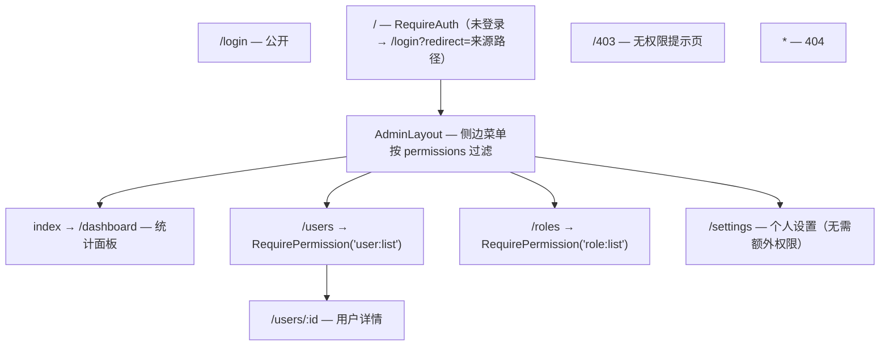

> 本文是《阶段 4：高频业务场景 ⭐实战核心（3 周）》按小节拆分后的续篇，上一部分见 [25-8-骨架屏-空态-错误态-加载态的统一设计.md](25-8-骨架屏-空态-错误态-加载态的统一设计.md)。

#### 9. 复制到剪贴板、全屏、通知等浏览器 API 在 React 中的封装

**是什么。** 浏览器有一批"能力型 API"（剪贴板、全屏、通知、地理、录像……），它们的共同特征：**有权限门槛、返回 Promise、报错是 DOMException、状态不归 React 管**。把这类 API 封装成 Hook 的通用范式是本条的练习目标：**特性检测 → 权限申请 → 错误分类处理 → 与 React 生命周期整合（卸载清理）**。

**为什么需要。** 直接在事件回调里裸调 `navigator.clipboard.writeText` 的代码，会在这些场景下炸掉：HTTP 环境部署（clipboard 是 undefined）、用户拒绝授权（NotAllowedError）、组件已卸载但回调还在跑。裸调的代码还必须每个组件重复一遍 try/catch 与权限判断。封装成 Hook 后：权限与可用性检测一次性做好、错误统一分类打日志、副作用（定时器/事件监听/退出全屏）在卸载时清理——**调用方只面对"状态 + 动作"两个概念**。

**怎么做（机制分步）。** 通用范式四步：

1. **特性检测**：`typeof Notification === 'undefined'` / `navigator.clipboard` 是否存在——iOS Safari、HTTP 环境、旧浏览器都可能没有这个 API，先判断再调用；
2. **权限**：能预申请的预申请（Notification 必须 `requestPermission`，且**必须由用户手势触发**）；不能预申请的（clipboard 写入一般默认授予）捕获 `NotAllowedError` 再引导；
3. **错误分类**：Promise 拒绝的都是 `DOMException`，按 `name` 分支——`NotAllowedError`（用户拒绝）、`NotFoundError`（目标不存在）、`SecurityError`（非安全上下文）……统一出口便于打点上报；
4. **生命周期整合**：监听全局事件的（fullscreenchange）要在卸载时移除；占用系统资源的（Notification 实例、定时器）要在卸载时释放；卸载后禁止 setState。

**代码示例。** 剪贴板：

```tsx
// hooks/useClipboard.ts
import { useCallback, useEffect, useRef, useState } from 'react';

/**
 * 复制到剪贴板。
 * 限制：Clipboard API 只在安全上下文（https 或 localhost）可用；
 * "已复制"状态在 resetAfterMs 后自动复位，按钮文案随之切换。
 */
export function useClipboard(resetAfterMs = 2000) {
  const [copied, setCopied] = useState(false);
  const timerRef = useRef<number | null>(null);

  const copy = useCallback(
    async (text: string): Promise<boolean> => {
      // ① 特性检测：HTTP 环境或老浏览器没有 clipboard 对象
      if (!navigator.clipboard?.writeText) {
        console.warn('当前环境不支持 Clipboard API（需 https 或 localhost）');
        return false;
      }
      try {
        // ② 调用并等待；用户拒绝/页面失焦可能抛 NotAllowedError
        await navigator.clipboard.writeText(text);
        setCopied(true);
        if (timerRef.current !== null) window.clearTimeout(timerRef.current);
        timerRef.current = window.setTimeout(() => setCopied(false), resetAfterMs);
        return true;
      } catch (err) {
        // ③ 错误分类：NotAllowedError=权限被拒；其余（如文档失焦）打日志即可
        const name = err instanceof DOMException ? err.name : 'Unknown';
        console.warn(`复制失败（${name}）`, err);
        setCopied(false);
        return false;
      }
    },
    [resetAfterMs],
  );

  // ④ 卸载清理：清掉复位定时器，避免卸载后 setState
  useEffect(() => {
    return () => {
      if (timerRef.current !== null) window.clearTimeout(timerRef.current);
    };
  }, []);

  return { copied, copy };
}
```

全屏：

```tsx
// hooks/useFullscreen.ts
import { useCallback, useEffect, useRef, useState, type RefObject } from 'react';

/**
 * 全屏控制。
 * 关键认知：用户按 ESC 退出全屏不会经过你的代码——
 * 所以必须监听 fullscreenchange 事件同步状态，而不是只在 enter/exit 里 setState。
 */
export function useFullscreen(target?: RefObject<HTMLElement | null>) {
  // 初始值读真实状态：mount 时可能已处于全屏（用户从前一页带过来）
  const [isFullscreen, setIsFullscreen] = useState(
    () => typeof document !== 'undefined' && document.fullscreenElement !== null,
  );
  const exitedRef = useRef(false); // 标记是否由本 hook 进入的全屏（决定卸载时要不要退出）

  useEffect(() => {
    function onChange() {
      // fullscreenElement 指向当前全屏元素（null 表示已退出）——唯一可信来源
      setIsFullscreen(document.fullscreenElement !== null);
    }
    document.addEventListener('fullscreenchange', onChange);
    return () => {
      document.removeEventListener('fullscreenchange', onChange);
      // ④ 卸载清理：本 hook 进入的全屏在组件卸载时退出，别把用户困在全屏里
      if (exitedRef.current === false && document.fullscreenElement) {
        void document.exitFullscreen().catch(() => undefined);
      }
    };
  }, []);

  const enter = useCallback(async () => {
    try {
      const el = target?.current ?? document.documentElement;
      // ② requestFullscreen 必须在用户手势（点击等）的调用栈里执行，返回 Promise
      await el.requestFullscreen();
      exitedRef.current = false;
    } catch (err) {
      const name = err instanceof DOMException ? err.name : 'Unknown';
      console.warn(`进入全屏失败（${name}）`, err); // 常见：NotAllowedError（无手势）、TypeError（不支持）
    }
  }, [target]);

  const exit = useCallback(async () => {
    if (document.fullscreenElement) {
      try {
        await document.exitFullscreen();
        exitedRef.current = true;
      } catch (err) {
        console.warn('退出全屏失败', err);
      }
    }
  }, []);

  return { isFullscreen, enter, exit };
}
```

通知：

```tsx
// hooks/useNotification.ts
import { useCallback, useEffect, useRef, useState } from 'react';

type NotificationPermissionState = 'default' | 'granted' | 'denied' | 'unsupported';

/**
 * 桌面通知。两条硬约束：
 * 1. requestPermission 必须由用户手势触发（页面加载时直接弹会被浏览器忽略/拒绝）；
 * 2. 只有 granted 状态下 new Notification 才会真正展示。
 */
export function useNotification() {
  // ① 特性检测：iOS Safari 对 Web Notification 长期不支持
  const [permission, setPermission] = useState<NotificationPermissionState>(() =>
    typeof Notification === 'undefined' ? 'unsupported' : Notification.permission,
  );
  // 记录本 hook 创建的通知实例，卸载时统一关闭，避免系统通知堆积
  const notificationsRef = useRef<Notification[]>([]);

  useEffect(() => {
    const list = notificationsRef.current;
    return () => list.forEach((n) => n.close()); // ④ 卸载清理
  }, []);

  /** 权限申请：绑定在按钮 onClick 上调用；重复调用直接返回当前状态，不会反复弹窗 */
  const request = useCallback(async (): Promise<NotificationPermissionState> => {
    if (typeof Notification === 'undefined') return 'unsupported';
    const result = await Notification.requestPermission(); // 'granted' | 'denied' | 'default'
    setPermission(result);
    return result;
  }, []);

  /** 发送通知：仅在 granted 状态下有效，返回实例便于调用方继续绑定 onclick 等事件 */
  const notify = useCallback(
    (title: string, options?: NotificationOptions): Notification | null => {
      if (typeof Notification === 'undefined' || Notification.permission !== 'granted') {
        console.warn('通知未授权或不支持，无法发送');
        return null;
      }
      const n = new Notification(title, options); // options: body / icon / tag 等
      notificationsRef.current.push(n);
      n.onclose = () => {
        notificationsRef.current = notificationsRef.current.filter((item) => item !== n);
      };
      return n;
    },
    [],
  );

  return { permission, request, notify };
}
```

三个 Hook 的整合使用（一个"分享面板"）：

```tsx
// components/SharePanel.tsx
import { useRef, useState } from 'react';
import { useClipboard } from '../hooks/useClipboard';
import { useFullscreen } from '../hooks/useFullscreen';
import { useNotification } from '../hooks/useNotification';

export function SharePanel({ link }: { link: string }) {
  const { copied, copy } = useClipboard();
  const { isFullscreen, enter, exit } = useFullscreen();
  const videoRef = useRef<HTMLDivElement>(null); // 全屏目标：只让播放器区域全屏，而不是整页
  const { permission, request, notify } = useNotification();
  const [subscribed, setSubscribed] = useState(false);

  return (
    <div className="share-panel">
      {/* 剪贴板 */}
      <button onClick={() => copy(link)}>
        {copied ? '已复制 ✓' : '复制链接'}
      </button>

      {/* 全屏：状态由 fullscreenchange 事件同步，ESC 退出也能正确回显 */}
      <div ref={videoRef} className="player-region">
        <p>播放器区域（可单独全屏）</p>
      </div>
      <button onClick={() => (isFullscreen ? exit() : enter())}>
        {isFullscreen ? '退出全屏' : '全屏播放'}
      </button>

      {/* 通知：先由用户点击申请权限，再订阅提醒 */}
      {permission === 'default' && <button onClick={request}>开启更新通知</button>}
      {permission === 'granted' && (
        <button
          onClick={() => {
            notify('已开启更新提醒', { body: '有新内容时会通知你', tag: 'subscribe' });
            setSubscribed(true);
          }}
        >
          {subscribed ? '已订阅' : '订阅更新'}
        </button>
      )}
      {permission === 'denied' && <span>通知权限被拒，可在浏览器设置中开启</span>}
    </div>
  );
}
```

**常见坑。**

- **症状**：`navigator.clipboard` 是 undefined，`TypeError: Cannot read properties of undefined`。**根因**：非安全上下文（http 部署到线上、局域网 IP 访问）。**修法**：特性检测 + 提示"需 https"；本地开发用 localhost（属于安全上下文）。
- **症状**：全屏后按 ESC 退出，按钮文字还显示"退出全屏"。**根因**：只在 enter/exit 里 setState，没监听 `fullscreenchange`；ESC 是浏览器行为，不经过你的 exit。**修法**：事件监听 + 以 `document.fullscreenElement` 为唯一可信状态源（上面实现）。
- **症状**：`requestPermission()` 返回的还是 `default`，从没弹过询问框。**根因**：在页面加载/`useEffect` 里调用——没有用户手势，浏览器直接忽略。**修法**：权限申请必须绑在用户点击上（SharePanel 的"开启更新通知"按钮）。
- **症状**：组件卸载后控制台仍报 warning / 通知一直挂着。**根因**：Hook 里创建的定时器、事件监听、Notification 实例没在卸载时清理。**修法**：每个 Hook 的 cleanup 分支（四个示例里都有标记 ④ 的位置）。
- **症状**：`requestFullscreen` 报 `NotAllowedError`。**根因**：调用不在用户手势栈里（比如先 `await` 了别的操作再调用，手势上下文已失效）。**修法**：全屏调用放在 onClick 的第一层同步执行，不要隔着 await。

✅ 产出：**后台管理系统**（登录鉴权 + 动态表格 + 增删改查弹窗 + 权限 + 主题），可参考 antd Pro 的结构自己从零实现。

这是阶段 4 的毕业项目：把 4.1–4.7 的所有场景整合进**一个真实工程形态**的应用。它不是"再学新知识"，而是检验你能否在多需求并存的约束下做取舍——这正是业务开发的日常。

**功能清单。**

| 模块 | 功能点 | 用到的本篇知识 |
|---|---|---|
| 登录鉴权 | 账号密码登录、token 存取与注入、401 统一拦截跳登录、登录后跳回来源页 | 4.4 路由守卫、4.2 数据请求 |
| 动态表格 | 列配置（columns）驱动渲染、服务端分页、筛选排序、分页/筛选参数同步到 URL | 4.3 列表场景、4.7-8 四态容器 |
| 增删改查弹窗 | 新建/编辑共用一个表单弹窗、zod 校验、提交 loading、成功后刷新列表 | 4.1 表单、4.5 弹层、4.2 mutation |
| 权限 | 路由级守卫 + 菜单按权限过滤 + 按钮级 `<Can>` | 4.7-6 权限系统 |
| 主题 | 亮/暗切换、localStorage 持久化、首屏无闪烁 | 4.7-4 主题切换 |
| 通用质量 | 全局错误边界 + 上报函数、四态、Toast 反馈 | 4.7-7、4.7-8、4.5 |

**页面结构树。** 推荐的工程目录（按功能聚合，而非按类型堆放）：

```mermaid
flowchart TD
    src["src/"]
    main["main.tsx — 入口：Provider 组合（Permission / Theme / I18n / QueryClient）"]
    app["App.tsx — 全局 ErrorBoundary + RouterProvider"]
    api["api/"]
    req["request.ts — fetch 封装：baseURL、token 注入、401 统一跳登录"]
    apiusers["users.ts — 用户资源的 list/create/update/remove"]
    router["router/"]
    ridx["index.tsx — 路由配置数组（含 meta.permission）"]
    guards["guards.tsx — RequireAuth / RequirePermission / 403 / 404"]
    layouts["layouts/"]
    admin["AdminLayout.tsx — 侧边菜单（按权限过滤）+ 顶栏（主题切换/退出）+ Outlet"]
    stores["stores/"]
    auth["auth.ts — 登录态：token + 用户信息 + permissions（阶段 5 换 Zustand）"]
    comp["components/"]
    async["AsyncContainer/ — 四态容器（4.7-8）"]
    can["Can/ — 按钮级权限（4.7-6）"]
    eb["ErrorBoundary/ — 错误边界（4.7-7）"]
    toast["Toast/ — 命令式 Toast（4.5）"]
    crud["CrudModal/ — 新建/编辑共用表单弹窗（4.1 + 4.5）"]
    pages["pages/"]
    pl["login/ — 登录页"]
    pd["dashboard/ — 首页：统计卡片 + 图表占位"]
    pu["users/"]
    pul["UserListPage.tsx — 动态表格主页"]
    puc["userColumns.tsx — 列配置（『动态表格』的动态所在）"]
    puf["UserFormModal.tsx — 新建/编辑共用弹窗"]
    pro["roles/ — 角色与权限码配置页"]
    ps["settings/ — 个人设置（主题切换入口）"]
    p403["403.tsx"]
    p404["404.tsx"]
    hooks["hooks/ — useTheme / useClipboard / useWebSocket…（本篇产物沉淀）"]
    styles["styles/"]
    theme["theme.css — CSS 变量两套主题（4.7-4）"]
    src --> main
    src --> app
    src --> api
    api --> req
    api --> apiusers
    src --> router
    router --> ridx
    router --> guards
    src --> layouts
    layouts --> admin
    src --> stores
    stores --> auth
    src --> comp
    comp --> async
    comp --> can
    comp --> eb
    comp --> toast
    comp --> crud
    src --> pages
    pages --> pl
    pages --> pd
    pages --> pu
    pu --> pul
    pu --> puc
    pu --> puf
    pages --> pro
    pages --> ps
    pages --> p403
    pages --> p404
    src --> hooks
    src --> styles
    styles --> theme
```



路由结构树（与上面目录对应）：



**与 antd Pro 的对照学习法。** 项目要求"自己从零实现，可参考 antd Pro 的结构"——正确姿势是**先自实现、后对照源码**，顺序不能反：

1. **从零实现**：组件层可用 antd 基础组件（Button/Table/Form/Modal），但**禁用 Pro 系列组件**（ProLayout/ProTable/PageContainer），逼自己把 4.x 各场景亲手拼装一遍；
2. **跑通官方演示**：clone [ant-design/ant-design-pro](https://github.com/ant-design/ant-design-pro) 本地跑起来，作为"标准答案"体验完整功能面；
3. **逐项对照**：按下表把你的手写实现与 Pro 的对应机制比对源码，思考"它多做了什么、为什么"：

| antd Pro 里的概念 | 你手写的对应物 | 对照看点 |
|---|---|---|
| ProLayout | AdminLayout | 菜单数据驱动生成、折叠态、面包屑与路由联动 |
| PageContainer | 页头区（标题+操作按钮） | 插槽设计：标题/额外内容/页脚怎么留扩展点 |
| ProTable | UserListPage + userColumns | columns 配置化的边界：搜索表单怎么从 columns 推导、request 协议怎么约定 |
| useRequest（ahooks） | 自写 useFetch / useAsync | 手动触发 vs 自动、缓存、防抖、轮询的取舍 |
| Access / useAccess | `<Can>` / usePermission | 权限数据从哪注入、 inaccessible 的渲染策略（隐藏 vs 禁用） |
| getInitialState（app.tsx） | auth store + Provider | 首屏"先拿登录态再渲染"的阻塞方案 |
| ProConfigProvider 暗色 | CSS 变量 + data-theme | 换肤作用在哪一层：token 系统对比 CSS 变量 |

4. **回填差距**：把对照中发现的机制（比如 ProTable 的 request 协议、ProLayout 的菜单渲染函数）回填到自己的项目里再实现一遍——这一步的收获远大于第一次实现。

**逐条验收标准。**

- [ ] **登录鉴权**：未登录访问任意受保护路由 → 跳 `/login` 且 URL 带 `redirect` 参数；登录成功跳回原页面；token 过期后任意请求收到 401 → 自动清除登录态并跳登录页。
- [ ] **动态表格**：列由 `userColumns.tsx` 配置驱动，增删一列不改组件代码；服务端分页正确（页码/每页条数变化触发请求）；分页与筛选条件同步在 URL 查询参数中——复制 URL 到新标签页能还原相同视图，浏览器后退能回到上一组条件。
- [ ] **四态齐备**：首次进入显示骨架屏；接口 500 显示错误态且点"重试"能恢复；空数据显示空态并带"新建用户"入口；表格 loading 时操作按钮禁用。
- [ ] **CRUD 弹窗**：新建与编辑共用 `UserFormModal`（编辑回填数据）；zod 校验不通过时提交按钮不触发请求；提交期间按钮 loading 且弹窗不可关；成功后 Toast 提示、弹窗关闭、列表自动刷新。
- [ ] **权限（路由级）**：用只有 `user:list` 权限的测试账号登录——菜单里不出现"角色管理"；手敲 `/roles` 跳转 403 页。
- [ ] **权限（按钮级）**：无 `user:delete` 权限的账号，用户行内删除按钮渲染为禁用态（title 提示无权限）；有权限则可删除且删除后有确认弹窗与 Toast。
- [ ] **主题**：亮/暗切换立即生效；刷新页面**无白屏闪烁**（暗色用户首帧即暗色）；新开标签页打开应用主题一致；两个标签页切换主题互相同步。
- [ ] **错误边界**：在某个图表组件里故意 `throw new Error('test')`——只有该区域显示降级 UI（含重试按钮），页面其余部分可用；控制台的 reportError 函数被调用且带 componentStack。
- [ ] **工程质量**：StrictMode 打开无控制台警告；`tsc --noEmit` 零错误；ESLint（含 react-hooks 插件）零 error；`npm run build` 产物可直接部署预览。

全部勾完，阶段 4 结业。这个项目会继续作为阶段 5（状态管理重构）、阶段 6（性能优化 Profiler 实录）、阶段 8（测试）的宿主项目，一路演进到毕业。

##### 补充：useOnlineStatus——online/offline 事件与它的语义边界

**是什么。** `navigator.onLine` 加 `online`/`offline` 两个事件的 Hook 封装，用于断网提示条、恢复后自动重拉数据这类"连接状态 UI"。

**语义边界（这条 API 最大的坑）。** `onLine` 反映的只是**有没有网络接口连接**（WiFi/网卡是否 up）：连上了路由器但路由器断网，它仍是 `true`；某些 VPN 场景还可能误报 `false`。所以它只配做"快速提示"，不能做"是否允许提交"的决策依据——真决策要么靠真实请求的失败，要么靠主动探测（心跳 HEAD 请求）。

```tsx
// hooks/useOnlineStatus.ts —— 事件层：反映网络接口状态
import { useEffect, useState } from 'react';

export function useOnlineStatus(): boolean {
  // 初始值读真实状态：mount 时可能已经离线
  const [online, setOnline] = useState(() => navigator.onLine);

  useEffect(() => {
    const up = () => setOnline(true);
    const down = () => setOnline(false);
    window.addEventListener('online', up);
    window.addEventListener('offline', down);
    return () => {
      window.removeEventListener('online', up);
      window.removeEventListener('offline', down);
    };
  }, []);

  return online;
}
```

探测层（把"接口在线"升级为"真的能访问服务"）：

```tsx
// hooks/useReachability.ts —— 心跳探测：网络接口在线 ≠ 服务可达
import { useEffect, useState } from 'react';
import { useOnlineStatus } from './useOnlineStatus';

export function useReachability(probeUrl = '/api/healthz', intervalMs = 15_000): boolean {
  const [reachable, setReachable] = useState(true);
  const online = useOnlineStatus();

  useEffect(() => {
    if (!online) return; // 离线时不必探测，等 online 事件回来后重跑本 effect 自会探测
    let cancelled = false;
    const timer = window.setInterval(async () => {
      if (document.hidden) return; // 页面不可见跳过本轮；可见性的完整处理见 05-useEffect-场景
      try {
        const res = await fetch(probeUrl, { method: 'HEAD', cache: 'no-store' });
        if (!cancelled) setReachable(res.ok);
      } catch {
        if (!cancelled) setReachable(false);
      }
    }, intervalMs);
    return () => {
      cancelled = true; // 卸载后迟到的心跳响应不允许再 setState
      window.clearInterval(timer);
    };
  }, [online, probeUrl, intervalMs]);

  return reachable;
}
```

**使用建议。** UI 提示条用 `useOnlineStatus`（零成本、即时）；"断网期间暂停自动保存/轮询"这类决策用 `useReachability`（准确但有定时器成本）。恢复在线后的数据重拉参考《05-useEffect-场景.md》轮询一节——那里展开了 `visibilitychange` 与 AbortController 的完整组合。

##### 补充：usePermissionQuery——用 Permissions API 查询并监听权限状态

**是什么。** `navigator.permissions.query({ name })` 返回当前权限状态（`granted`/`denied`/`prompt`），并且**可订阅变化**——用户跑到浏览器设置里把之前拒绝的通知权限改回允许，回到页面时 UI 能实时从"去设置开启"切回"开启通知"，不需要刷新。

**为什么需要。** 原文 `useNotification` 的 `permission` 只在 mount 与 `request` 时更新：用户手动改浏览器设置这条路完全感知不到。Permissions API 补上"查询 + 监听"两块，注意它返回的是 `'prompt'` 而 `Notification.permission` 用的是 `'default'`——两套词表，封装时必须统一映射。

```tsx
// hooks/usePermissionQuery.ts
import { useEffect, useState } from 'react';

export type PermissionQueryState = 'granted' | 'denied' | 'prompt' | 'unsupported';

export function usePermissionQuery(name: string): PermissionQueryState {
  const [state, setState] = useState<PermissionQueryState>('prompt');

  useEffect(() => {
    let status: PermissionStatus | null = null;
    let cancelled = false;

    function onChange() {
      if (status) setState(status.state as PermissionQueryState); // 用户改设置的瞬间触发
    }

    // 特性检测照旧：没有 permissions 对象（旧浏览器）直接走 unsupported 分支
    if (!navigator.permissions?.query) {
      setState('unsupported');
      return;
    }
    navigator.permissions
      .query({ name: name as PermissionDescriptor['name'] })
      .then((s) => {
        if (cancelled) return;
        status = s;
        setState(s.state as PermissionQueryState);
        s.addEventListener('change', onChange);
      })
      .catch(() => {
        if (!cancelled) setState('unsupported'); // Safari 对部分 name（如 clipboard-read）直接 reject：调用方回退到"直接调用再处理异常"策略
      });

    return () => {
      cancelled = true;
      status?.removeEventListener('change', onChange); // 卸载清理：监听器挂在返回的 status 对象上
    };
  }, [name]);

  return state;
}
```

与 `useNotification` 的整合——按钮文案随权限实时变化：

```tsx
const perm = usePermissionQuery('notifications');
// perm === 'prompt'   → 显示"开启更新通知"（点击触发 request）
// perm === 'denied'   → 显示"权限被拒，去浏览器设置开启"（给指引，不再弹 request）
// perm === 'granted'  → 显示"已开启"
// perm === 'unsupported' → 隐藏入口或走轮询兜底
```

##### 补充：高频坑位补遗

- **症状**：应用作为 iframe 嵌在客户门户里，点全屏没反应，控制台 `NotAllowedError`。**根因**：iframe 全屏需要宿主页面在 iframe 标签上声明 `allow="fullscreen"`，否则浏览器直接拒绝——这不是代码问题。**修法**：接入文档里写明宿主要求；报错文案区分"被策略拒绝"并提示联系宿主页管理员，而不是笼统的"全屏失败"。
- **症状**：公司内网工具走 `http://intranet` 部署，复制功能整体不可用。**根因**：Clipboard API 只在安全上下文存在，内网 IP 访问不算。**修法**：`useClipboard` 里加 `execCommand` 降级链（已废弃但全兼容）——动态插一个藏起来的 `textarea`、`select()` 后执行 `document.execCommand('copy')`、立刻移除节点；对外保持同一个 `copy(): Promise<boolean>` 接口，调用方无感。离线/极端环境的浏览器 API 兜底策略另见《react-高阶场景全景图/08-E-极端性能与离线.md》。
- **症状**：消息类应用每来一条通知就堆一条，通知中心被刷爆。**根因**：`new Notification` 没传 `tag`。**修法**：同类通知共用一个 `tag`，新的会**替换**旧的而不是追加——会话类应用用会话 id 当 tag，通知中心永远每个会话只显示最新一条：

  ```ts
  notify(`新消息：${content}`, { tag: `chat-${conversationId}` });
  ```

- **症状**：用户点系统通知，页面"没反应"——路由明明跳了。**根因**：通知的 `onclick` 触发时页面多半不在前台，`onclick` 里只改了路由，窗口没被带回前台。**修法**：`onclick` 第一行先 `window.focus()`：

  ```ts
  const n = notify('订单已发货', { tag: `order-${id}` });
  if (n) n.onclick = () => { window.focus(); navigate(`/orders/${id}`); };
  ```

- **症状**：用户第一次拒绝了通知权限，之后再点"开启通知"按钮毫无反应（连询问框都不弹）。**根因**：`denied` 状态下浏览器记住了拒绝，`requestPermission()` 直接返回 `denied`、不再弹窗——按钮成了死按钮。**修法**：denied 态下不渲染申请按钮，改为指引文案（SharePanel 已有）；配合 `usePermissionQuery('notifications')` 监听用户从设置改回 `prompt`/`granted` 的时刻，自动恢复申请入口。


---

## 附:ASCII 图替换清单

本文档图形化改版,原 ASCII 字符图与 Mermaid 图表对应关系如下:

| 原图位置 / 标题 | 处理结果 |
| --- | --- |
| 阶段 4 毕业项目 · 页面结构树(工程目录) | 替换为 flowchart TD(目录树) |
| 阶段 4 毕业项目 · 路由结构树 | 替换为 flowchart TD(路由层级树) |
