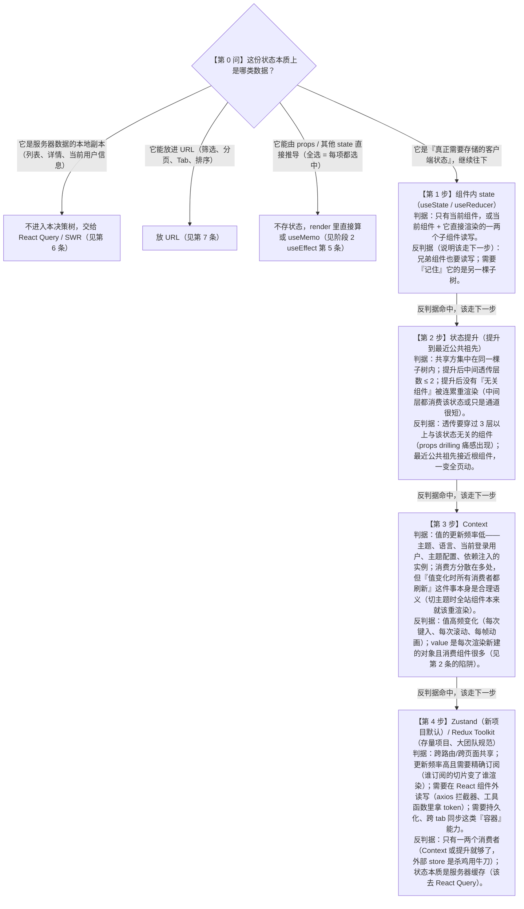
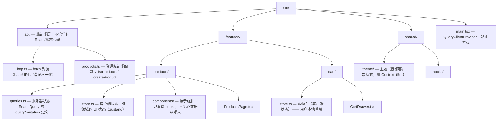

## 阶段 5：状态管理（1 周）

> 本阶段回答一个工程问题：**一份状态到底应该住在哪**。学完之后，你应当能对项目里的每一条状态说出它的"户口"——组件内、最近公共祖先、Context、外部 store、React Query 缓存，还是 URL。状态放错地方的代价不是立即报错，而是两种慢性病：要么 props 层层透传把代码拧成麻花，要么一处 setState 引发全页重渲染。本阶段七条就是一套完整的"分房"方案。

### 1. **选型决策树**：组件内 state → 状态提升 → Context → Zustand/Redux

**是什么**：一条"状态归属"的判断流程。按顺序自上而下询问，命中即停——绝大多数状态在前两步就该结束旅程，真正需要全局 store 的状态比直觉少得多。

**为什么需要**：初学者最常见的两个极端是"全塞 App 根组件"和"全塞全局 store"。前者让任何一次输入都触发整树重渲染，后者让一个弹窗开关都要走一套全局订阅。决策树的价值是给出**判断顺序**而不是工具偏好：先问作用域，再问更新频率，最后才问工具。

**怎么做（机制分步）**：完整文字版决策树如下。



把每一步的判据与反判据整理成速查表：

| 方案 | 适用判据 | 反判据（出现即降级/升级） | 典型例子 |
|---|---|---|---|
| 组件内 state | 单组件或浅层父子使用 | 兄弟也要用 | 输入框草稿、弹窗开关 |
| 状态提升 | 同一子树共享、透传 ≤ 2 层 | 透传 ≥ 3 层、祖先逼近根组件 | 表单整体与提交按钮 |
| Context | 低频变化、全量刷新语义合理 | 高频变化、value 引用不稳定 | 主题、语言、当前用户 |
| Zustand/Redux | 高频、跨路由、组件外读写、精确订阅 | 消费者极少、实为服务器缓存 | 购物车、编辑器画布状态 |

**代码示例**：用同一个"商品筛选"需求走完这条升级路，体会每一步什么时候"该走了"。

```tsx
import { useState } from 'react';

interface Product {
  id: string;
  name: string;
  category: string;
}

const products: Product[] = [
  { id: 'p1', name: '机械键盘', category: '外设' },
  { id: 'p2', name: '显示器', category: '外设' },
  { id: 'p3', name: '咖啡豆', category: '食品' },
];

// 【第 1 步】筛选词只有 FilterPanel 自己用 → 就地 useState，到此为止
function FilterPanel({ onFilter }: { onFilter: (keyword: string) => void }) {
  const [draft, setDraft] = useState(''); // 输入草稿：只有本组件关心
  return (
    <div>
      <input
        value={draft}
        onChange={(e) => {
          setDraft(e.target.value);
          onFilter(e.target.value); // 提交给父级的是"筛选生效值"
        }}
      />
    </div>
  );
}

// 【第 2 步】FilterPanel 与 ProductList 是兄弟 → 提升到最近公共祖先 ProductsPage
function ProductList({ keyword }: { keyword: string }) {
  const visible = products.filter((p) => p.name.includes(keyword));
  return (
    <ul>
      {visible.map((p) => (
        <li key={p.id}>{p.name}（{p.category}）</li>
      ))}
    </ul>
  );
}

export function ProductsPage() {
  const [keyword, setKeyword] = useState(''); // 住在兄弟俩的公共父级，透传只有 1 层
  return (
    <section>
      <FilterPanel onFilter={setKeyword} />
      <ProductList keyword={keyword} />
    </section>
  );
}

// 【第 3 步的临界点】当"订单页"也要读这份 keyword、公共祖先变成 App 根组件、
// 且中间隔了 Layout/Sidebar 等不关心筛选的组件时 —— 提升/wiki props drilling 到头了。
// 此时若 keyword 是低频的页面级配置可考虑 Context；
// 若像"购物车"那样高频变更且多处精确订阅 → 第 4 步，Zustand（见第 3 条）。
```

**常见坑**：
- 症状：项目里建了一个"全局大 store"，连某个弹窗的开关都放进去了。
  根因：跳过决策树前三步，把"全局"当默认选项；没有先问作用域。
  修法：逐条盘点 store 里的字段，凡是只有一棵子树使用的就下放回组件/祖先（参考阶段 2 "状态放哪"）。
- 症状：用 Context 传"当前输入值"，每敲一个字全页重渲染。
  根因：Context 的更新语义是"所有消费者无差别刷新"，与高频变化天然冲突。
  修法：状态下放到真正消费它的子树；确需全局高频共享则换 Zustand 精确订阅。

---

### 2. Context 的性能陷阱（value 引用变化导致全量重渲染）与拆分方案

**是什么**：Context 的更新机制不是"谁用了哪个字段谁刷新"，而是——Provider 的 `value` 身份变化（`Object.is` 比较）时，**所有调用了 `useContext` 的组件全部重渲染**，哪怕它只用了一个没变的字段；同时这次重渲染**不经过 `React.memo` 的拦截**（memo 只能拦 props 驱动的重渲染，context 驱动的更新直接穿透）。

**为什么需要先懂机制**：因为陷阱几乎必现——只要 Provider 所在组件自己还有别的 state，每次渲染都会重新执行 `value={ { ... } }` 这个对象字面量，产生一个**全新的对象引用**，于是"Provider 侧无关的重渲染"也会广播给全部消费者。你看到的症状是：改了个八竿子打不着的计数器，主题相关组件全亮了。

**怎么做（机制分步）**：
1. Provider 组件因任何 state 变化而重渲染；
2. JSX 里的 `value={{ theme, toggle }}` 是普通对象字面量，**每次渲染都新建**；
3. React 用 `Object.is(新 value, 旧 value)` 判断是否通知，对象字面量永远不相等 → 判定"变了"；
4. 所有 `useContext(ThemeContext)` 的组件被调度重渲染，与它们各自是否 `memo`、是否用了变化的字段**无关**。

**代码示例（复现）**：

```tsx
import { createContext, useContext, useRef, useState } from 'react';

interface ThemeValue {
  theme: 'light' | 'dark';
  toggle: () => void;
}

const ThemeContext = createContext<ThemeValue | null>(null);

// 渲染计数器：用最直白的方式把"重渲染"变成肉眼可见的日志
function useRenderCount(label: string): number {
  const ref = useRef(0);
  ref.current += 1; // ref 改变不触发渲染，只做计数
  console.log(`[${label}] 第 ${ref.current} 次渲染`);
  return ref.current;
}

function Navbar() {
  const ctx = useContext(ThemeContext)!;
  const count = useRenderCount('Navbar');
  return (
    <header>
      Navbar（渲染 {count} 次）当前主题：{ctx.theme}
    </header>
  );
}

function Sidebar() {
  const ctx = useContext(ThemeContext)!; // 只用了 theme，没用到 toggle
  const count = useRenderCount('Sidebar');
  return <aside>Sidebar（渲染 {count} 次）主题：{ctx.theme}</aside>;
}

function Footer() {
  const ctx = useContext(ThemeContext)!;
  const count = useRenderCount('Footer');
  return <footer>Footer（渲染 {count} 次）主题：{ctx.theme}</footer>;
}

export function App() {
  const [theme, setTheme] = useState<'light' | 'dark'>('light');
  const [unrelated, setUnrelated] = useState(0); // 关键道具：与主题毫无关系的计数器

  // ❌ 陷阱核心：对象字面量写在 JSX 里，App 每次渲染 value 都是新引用
  const value: ThemeValue = {
    theme,
    toggle: () => setTheme((t) => (t === 'light' ? 'dark' : 'light')),
  };

  return (
    <ThemeContext.Provider value={value}>
      <button onClick={() => setUnrelated((n) => n + 1)}>
        无关计数器：{unrelated}
      </button>
      <Navbar />
      <Sidebar />
      <Footer />
    </ThemeContext.Provider>
  );
}
```

运行后点"无关计数器"：`theme` 一字未动，控制台里 Navbar/Sidebar/Footer 的渲染计数照样 +1。**Profiler 证据**（React DevTools Profiler，操作见阶段 6 第 1 条）：录制一次点击，commit 火焰图里三个消费组件全部变色；选中 Navbar，右侧 "Why did this render?" 面板给出的原因是 **"The context value changed"**——这就是 value 引用变化全量广播的直接证据（若是 props 连带，原因会显示 "Its parent component rendered"）。

**怎么做（拆分方案，三选一或组合）**：

**方案 A：state 与 dispatch 分成两个 Context**。原理：`useState` 返回的 setter 引用在组件生命周期内**永远稳定**，把"会变的部分"（theme）和"不变的部分"（toggle）拆开后，dispatch Context 的 value 永不触发更新；只读 dispatch 的组件彻底免疫。

```tsx
import { createContext, useContext, useState, type ReactNode } from 'react';

// 拆成两个 context：一个装"会变的值"，一个装"稳定的操作"
const ThemeStateContext = createContext<'light' | 'dark'>('light');
const ThemeDispatchContext = createContext<() => void>(() => {});

export function ThemeProvider({ children }: { children: ReactNode }) {
  const [theme, setTheme] = useState<'light' | 'dark'>('light');
  const toggle = () => setTheme((t) => (t === 'light' ? 'dark' : 'light')); // setState 的函数式更新保证不依赖闭包里的旧值

  return (
    <ThemeStateContext.Provider value={theme}>
      <ThemeDispatchContext.Provider value={toggle}>
        {children}
      </ThemeDispatchContext.Provider>
    </ThemeStateContext.Provider>
  );
}

// 配套自定义 Hook：把"判空 + 断言"集中在一处，消费方写起来干净
export function useThemeState() {
  return useContext(ThemeStateContext); // 基本类型值：Object.is 比较内容，theme 不变就不广播
}
export function useThemeDispatch() {
  return useContext(ThemeDispatchContext); // 只取 toggle 的组件：value 稳定，永不因主题切换重渲染
}
```

代价：Context 数量翻倍；读取"值 + 操作"的组件要调两个 Hook；文件里多了样板。

**方案 B：children 提前（状态住进 Provider 内部）**。原理：`children` 是**在 Provider 的父组件渲染时**就创建好的 element 对象，引用固定；Provider 自己因内部 state 重渲染时，`children` prop 引用不变，React 对"相同引用的 element"直接复用上一次的渲染结果（跳过整棵子树的协调）。于是 Provider 内部 state 变化只重渲染 Provider 自身这层薄壳，再单独广播给真正 `useContext` 的组件——中间那大片子树纹丝不动。这也正是阶段 3 "组合优于配置"的同一原理。

```tsx
import { createContext, useContext, useMemo, useState, type ReactNode } from 'react';

const ThemeContext = createContext<{ theme: 'light' | 'dark'; toggle: () => void } | null>(null);

export function ThemeProvider({ children }: { children: ReactNode }) {
  const [theme, setTheme] = useState<'light' | 'dark'>('light');

  // 状态住在 Provider 组件内部（而不是 App 根组件）：
  // 切主题只重渲染 ThemeProvider 这一薄层；children 是父级 JSX 传进来的同一引用，子树直接跳过
  const value = useMemo(
    () => ({ theme, toggle: () => setTheme((t) => (t === 'light' ? 'dark' : 'light')) }),
    [theme] // useMemo 保证 theme 不变时 value 引用稳定，堵住"无关渲染触发广播"的口子
  );

  return <ThemeContext.Provider value={value}>{children}</ThemeContext.Provider>;
}

export const useTheme = () => useContext(ThemeContext)!;
```

```tsx
import { ThemeProvider, useTheme } from './ThemeProvider';

function ThemeButton() {
  const { theme, toggle } = useTheme(); // 真正的消费者：主题变了照常重渲染
  return <button onClick={toggle}>当前 {theme}，点击切换</button>;
}

export function App() {
  return (
    <ThemeProvider>
      <main>
        <h1>标题与正文不因主题切换重渲染</h1>
        <ThemeButton />
      </main>
    </ThemeProvider>
  );
}
```

代价：要求状态必须收敛到自制的 Provider 组件里；Provider 内一旦混入其他高频 state，`useMemo` 也救不了（依赖没变仍会复用，但如果依赖变了照样广播），所以一个 Provider 只管一件事。

**方案 C：memo 消费者**。原理：`React.memo` 让组件跳过 **props 驱动**的重渲染。它拦不住 context 更新（context 变化必须刷新，这是语义正确的），但能拦住"消费组件的父组件重渲染时把它连带下去"的那一半无谓渲染。

```tsx
import { memo, useContext } from 'react';
import { ThemeStateContext } from './ThemeProvider';

// memo 生效前提：传进来的 props 引用稳定（这里是基本类型，天然稳定）
const ThemeBadge = memo(function ThemeBadge({ size }: { size: number }) {
  const theme = useContext(ThemeStateContext);
  return <span className={`badge badge-${theme}`} style={{ fontSize: size }}>●</span>;
});
```

代价：只解决一半问题（props 连带），context 广播依旧全量；每个消费组件都要包一层，props 一旦不稳定（内联函数/对象）memo 立即失效。

三个方案的选择：**默认组合 A + B**（Provider 自制 + 值/操作分离），这是 react.dev 推崇的结构；C 作为局部补丁。若拆完仍嫌重——比如 value 高频变化（光标位置、滚动进度）——说明 Context 本身选型错了，回决策树第 4 步换外部 store。

**常见坑**：
- 症状：明明 `useMemo` 了 value，消费组件还是无缘无故重渲染。
  根因：`useMemo` 的依赖里有每次渲染都变的值（例如依赖了对象/数组 state 的引用，或依赖列表里混入了内联函数）。
  修法：检查依赖数组；让 value 只依赖真正影响它的最小集合；setter 类函数从依赖里拿掉（方案 A 直接把 dispatch 拆走）。
- 症状：value 是基本类型（`"dark"`），还是全量刷新。
  根因：刷新来自**props 连带**而不是 context——消费组件的父组件重渲染了。
  修法：这不是 Context 的锅；用 Profiler 的 "Why did this render?" 区分 "Context changed" 与 "parent rendered"，后者用阶段 6 第 2 条的四招处理。
- 症状：把受控输入的 value 放进全局 Context，表格页每敲一个字整页卡。
  根因：高频值 + 全量广播，双重命中反判据。
  修法：输入草稿下放到字段组件；提交后的"生效筛选值"进 URL（第 7 条）或 store（第 3 条）。

---

### 3. **Zustand**：store 设计、selector 精确订阅、persist 持久化、immer 中间件

**是什么**：一个约 1KB 的状态库。核心机制：状态放在组件树之外的普通对象里，组件通过 `useSyncExternalStore` 订阅 store 的**某个切片**——切片不变（`Object.is` 比较），组件不渲染。没有 Provider、没有 reducer 样板。

**为什么需要**：它一次性解决前面两条的痛点——比 Context 精确（订阅粒度到字段而非整个 value），比 Redux 轻（一个 `create` 函数出全套）。React 18+ 项目里它已是新项目默认的全局方案。本条用**一个购物车**贯穿四个知识点。

**怎么做（机制分步）**：
1. `create` 创建 store：一个带 `set`/`get` 的初始化函数返回"数据 + 操作"；
2. 组件里 `useCartStore(selector)` 订阅切片，selector 返回值不变则跳过渲染；
3. `persist` 中间件把 store（或其中一部分）自动同步到 localStorage；
4. `immer` 中间件让你在 `set` 里写"突变风格"代码，它负责转成不可变更新。

安装（v5 要求 React 18+）：

```bash
npm install zustand immer
```

**代码示例（第一步：create + store 设计）**。设计原则：一个领域一个 store（cart 一个、ui 一个），store 内"数据与操作同住"，操作全部用函数式更新避免闭包旧值：

```ts
// src/features/cart/store.ts
import { create } from 'zustand';
import { persist, createJSONStorage } from 'zustand/middleware';
import { immer } from 'zustand/middleware/immer';

export interface CartItem {
  id: string;
  name: string;
  price: number;
  quantity: number;
}

interface CartState {
  items: CartItem[];
  isDrawerOpen: boolean; // 纯 UI 状态：购物车抽屉的开合
  addItem: (item: Omit<CartItem, 'quantity'>, quantity?: number) => void;
  removeItem: (id: string) => void;
  setQuantity: (id: string, quantity: number) => void;
  toggleDrawer: (open?: boolean) => void;
  clear: () => void;
}

export const useCartStore = create<CartState>()(
  persist(
    immer((set) => ({
      items: [],
      isDrawerOpen: false,
      addItem: (item, quantity = 1) =>
        set((state) => {
          const existing = state.items.find((i) => i.id === item.id);
          if (existing) {
            existing.quantity += quantity; // immer 草稿上直接改，最终生成新的 items 数组
          } else {
            state.items.push({ ...item, quantity });
          }
        }),
      removeItem: (id) =>
        set((state) => {
          const index = state.items.findIndex((i) => i.id === id);
          if (index >= 0) state.items.splice(index, 1);
        }),
      setQuantity: (id, quantity) =>
        set((state) => {
          const hit = state.items.find((i) => i.id === id);
          if (hit) hit.quantity = Math.max(1, quantity); // immer 生效的前提：只改草稿、不返回值
        }),
      toggleDrawer: (open) =>
        set((state) => {
          state.isDrawerOpen = open ?? !state.isDrawerOpen;
        }),
      clear: () =>
        set((state) => {
          state.items = [];
        }),
    })),
    {
      name: 'app-cart',                                   // localStorage 的 key
      storage: createJSONStorage(() => localStorage),     // 也可换 sessionStorage
      version: 1,
      // partialize：只持久化 items。抽屉开合是瞬态 UI 状态，没资格进硬盘
      partialize: (state) => ({ items: state.items }),
    }
  )
);
```

三个工程细节：TypeScript 下同时用中间件必须写**柯里化形式** `create<CartState>()(...)`；中间件顺序 `persist(immer(...))` 表示"先让 immer 产出不可变新状态，再交给 persist 落盘"；`partialize` 防止 UI 瞬态（弹窗、悬停）污染持久化数据。

**第二步：selector 精确订阅**。

```tsx
import { useCartStore, type CartItem } from './store';
import { useShallow } from 'zustand/react/shallow';

function CartTotal() {
  // ✅ selector 返回基本类型：Object.is 比较，数字不变就不渲染——这是最理想的订阅
  const total = useCartStore(
    (s) => s.items.reduce((sum, i) => sum + i.price * i.quantity, 0)
  );
  return <strong>合计：¥{total.toFixed(2)}</strong>;
}

function CartCount() {
  const count = useCartStore((s) => s.items.length); // 同上：基本类型，精确
  return <span>购物车（{count}）</span>;
}

function AddToCartButton({ product }: { product: Omit<CartItem, 'quantity'> }) {
  // 操作函数引用稳定（store 创建时就固定），订阅它永远不会引发渲染
  const addItem = useCartStore((s) => s.addItem);
  return <button onClick={() => addItem(product)}>加入购物车</button>;
}

function CartDebugList() {
  // ❌ 反面写法：selector 里返回新数组，引用每次都不同 → 每次任何字段变化都重渲染
  // const ids = useCartStore((s) => s.items.map((i) => i.id));
  // ✅ 要订阅"多个字段/由字段组成的新结构"时用 useShallow：浅比较结果内容而不是引用
  const ids = useCartStore(useShallow((s) => s.items.map((i) => i.id)));
  return <code>[{ids.join(', ')}]</code>;
}
```

`useShallow` 的机制：把 selector 的返回值与上次做**浅比较**（数组比每一项、对象比每个 key 的第一层），内容没变就不触发渲染。Zustand v5 默认就是 `Object.is`，没有旧版本的隐式浅比较——所以"selector 里 map/filter/拼对象"在 v5 必须显式包 `useShallow`（从 `zustand/react/shallow` 导入），否则等于订阅了整个 store 的所有变化。

**第三步：组件外读写 store**（Context 做不到的能力）：

```ts
import { useCartStore } from './store';

// 在 axios 拦截器、路由守卫、工具函数里直接读写，不需要任何 Hook 上下文
function reportCartOnExit() {
  const { items } = useCartStore.getState(); // 同步快照
  navigator.sendBeacon('/analytics/cart', JSON.stringify({ count: items.length }));
}

// 外部直接派发更新（同样走订阅广播，UI 会正常刷新）
function clearCartOnLogout() {
  useCartStore.getState().clear();
}

// 订阅变化（不渲染，只监听）：签名 (state, prevState)
useCartStore.subscribe((state, prev) => {
  if (state.items.length !== prev.items.length) {
    document.title = `购物车(${state.items.length})`;
  }
});
```

**第四步：persist 的水合与版本迁移**。刷新页面时 persist 会异步从 localStorage 恢复，首帧先渲染初始值再切换。SSR 或对首帧一致性敏感的场景，关掉自动水合、自己挑时机：

```tsx
import { useEffect } from 'react';
import { useCartStore } from './store';

export function useCartRehydrate() {
  useEffect(() => {
    // skipHydration: true 时 persist 不在启动时恢复，改由这里手动触发
    void useCartStore.persist.rehydrate();
  }, []);
}
```

```ts
// src/features/cart/persistOptions.ts —— 结构升级时的版本迁移配置
// 场景：v1 版本存的是 { cart: [...] }，v2 代码把字段改名成了 items
import type { CartItem } from './store';

export const cartPersistOptions = {
  name: 'app-cart',
  version: 2,
  migrate: (persisted: unknown, version: number) => {
    const old = persisted as { cart: CartItem[] } | undefined;
    if (version === 1 && old?.cart) {
      return { items: old.cart }; // 把 v1 数据搬进 v2 结构，用户刷新后购物车不丢
    }
    return undefined; // 无法识别的版本：放弃恢复，使用初始 state
  },
};

// 使用：create<CartState>()(persist(immer(...), cartPersistOptions))
// 机制：localStorage 里记录的版本号 < 配置的 version 时，persist 自动调用 migrate
```

**购物车收尾：把前面三块拼成一个抽屉组件**：

```tsx
import { useCartStore } from './store';

export function CartDrawer() {
  const items = useCartStore((s) => s.items);      // 订阅数组引用：immer 保证"没变就是同一个引用"
  const isOpen = useCartStore((s) => s.isDrawerOpen);
  const toggleDrawer = useCartStore((s) => s.toggleDrawer);
  const setQuantity = useCartStore((s) => s.setQuantity);

  if (!isOpen) return null;
  return (
    <div className="drawer">
      <button onClick={() => toggleDrawer(false)}>关闭</button>
      {items.map((item) => (
        <div key={item.id}>
          {item.name} ×
          <input
            type="number"
            value={item.quantity}
            onChange={(e) => setQuantity(item.id, Number(e.target.value))}
          />
        </div>
      ))}
    </div>
  );
}
```

**常见坑**：
- 症状：组件"订阅了 total"却在 isDrawerOpen 变化时也重渲染。
  根因：selector 写成了 `(s) => s`（拿整个 store）或 selector 返回了每次新建的对象/数组。
  修法：selector 只取真正需要的最小切片；返回组合结构时包 `useShallow`。
- 症状：persist 恢复后一闪而过显示空购物车（或 SSR 水合警告）。
  根因：persist 默认异步水合，首帧是初始值。
  修法：`skipHydration: true` + 手动 `persist.rehydrate()`，并在水合完成前渲染骨架。
- 症状：忘了配 immer，却在 `set` 回调里 `state.items.push(...)`。
  根因：没有 immer 时这会**直接突变** store 的现有对象，订阅方拿到同一个引用，可能不触发渲染，还破坏了"不变性"假设。
  修法：要么加 immer 中间件（突变写法），要么老老实实展开（`set({ items: [...state.items, item] })`），两套风格不要混。
- 症状：同一个 store 塞了 cart + 用户 + 主题 + 全部弹窗，一个字段动全站订阅者都检查一遍。
  根因：store 领域划分过粗 + selector 退化成 `(s) => s`。
  修法：按领域拆 store（cartStore / uiStore / userStore），订阅永远落到字段级。

---

### 4. Redux Toolkit：slice、createAsyncThunk（旧项目维护必备）

**是什么**：Redux 的官方标准写法包。`configureStore` 一步配好 DevTools/中间件，`createSlice` 用"突变风格"写 reducer（内部 Immer 转不可变），`createAsyncThunk` 声明异步 action 并自动派发 pending/fulfilled/rejected 三部曲。

**为什么还要学**：新建项目你可以选 Zustand，但**存量项目大概率是 Redux/RTK**——据各类企业代码调查，Redux 系仍是存量占比最高的方案。读懂 slice、能顺着 `dispatch → thunk → extraReducers` 的链路改代码，是维护旧仓库的硬需求。另外大团队有时刻意选它：单一数据流、强约束、时间旅行调试、成熟的中间件生态（saga、listener）。

**怎么做（机制分步）**：完整走一遍"定义 slice → 异步 thunk → 接线 → 组件消费"：

```bash
npm install @reduxjs/toolkit react-redux
```

```ts
// src/store/productsSlice.ts
import { createAsyncThunk, createSlice, type PayloadAction } from '@reduxjs/toolkit';

export interface Product {
  id: string;
  name: string;
  price: number;
}

interface ProductsState {
  items: Product[];
  status: 'idle' | 'loading' | 'succeeded' | 'failed';
  error: string | null;
}

// 模拟请求层（真实项目放在 src/api/products.ts）
async function fetchProducts(): Promise<Product[]> {
  const res = await fetch('/api/products');
  if (!res.ok) throw new Error(`请求失败：${res.status}`);
  return res.json();
}

// 异步 thunk：第一个参数是 action 类型前缀，第二个是执行函数
export const loadProducts = createAsyncThunk(
  'products/load',
  async (_, { rejectWithValue }) => {
    try {
      return await fetchProducts();
    } catch (err) {
      // rejectWithValue 让 rejected 分支拿到结构化错误，而不是只有 error.message
      return rejectWithValue(err instanceof Error ? err.message : '加载失败');
    }
  }
);

const productsSlice = createSlice({
  name: 'products',
  initialState: { items: [], status: 'idle', error: null } as ProductsState,
  reducers: {
    // 同步操作：Immer 让你写"突变"，实际生成新 state
    priceUpdated(state, action: PayloadAction<{ id: string; price: number }>) {
      const hit = state.items.find((p) => p.id === action.payload.id);
      if (hit) hit.price = action.payload.price;
    },
  },
  extraReducers: (builder) => {
    builder
      .addCase(loadProducts.pending, (state) => {
        state.status = 'loading';
        state.error = null;
      })
      .addCase(loadProducts.fulfilled, (state, action) => {
        state.status = 'succeeded';
        state.items = action.payload; // thunk resolve 的返回值在这里落地
      })
      .addCase(loadProducts.rejected, (state, action) => {
        state.status = 'failed';
        state.error = (action.payload as string) ?? action.error.message ?? '未知错误';
      });
  },
});

export const { priceUpdated } = productsSlice.actions;
export default productsSlice.reducer;
```

```ts
// src/store/index.ts
import { configureStore } from '@reduxjs/toolkit';
import { useDispatch, useSelector } from 'react-redux';
import productsReducer from './productsSlice';

export const store = configureStore({
  reducer: { products: productsReducer },
});

export type RootState = ReturnType<typeof store.getState>;
export type AppDispatch = typeof store.dispatch;

// 官方推荐的类型化 Hook（react-redux 9.1+ 写法）：
// 旧版本等价写法是 TypedUseSelectorHook<RootState>
export const useAppDispatch = useDispatch.withTypes<AppDispatch>();
export const useAppSelector = useSelector.withTypes<RootState>();
```

```tsx
// src/main.tsx —— Provider 接线
import { Provider } from 'react-redux';
import { store } from './store';
import { App } from './App';

export default function Root() {
  return (
    <Provider store={store}>
      <App />
    </Provider>
  );
}
```

```tsx
// src/features/products/ProductList.tsx —— 组件消费
import { useEffect } from 'react';
import { loadProducts } from './store/productsSlice';
import { useAppDispatch, useAppSelector } from './store';

export function ProductList() {
  const dispatch = useAppDispatch();
  // useSelector 天然是"精确订阅"：只选 status 与 items，别的 slice 变化不渲染本组件
  const status = useAppSelector((s) => s.products.status);
  const items = useAppSelector((s) => s.products.items);
  const error = useAppSelector((s) => s.products.error);

  useEffect(() => {
    if (status === 'idle') void dispatch(loadProducts()); // 惰性加载：仅首次触发
  }, [status, dispatch]);

  if (status === 'loading') return <p>加载中…</p>;
  if (status === 'failed') return <p>出错了：{error}</p>;
  return (
    <ul>
      {items.map((p) => (
        <li key={p.id}>{p.name} - ¥{p.price}</li>
      ))}
    </ul>
  );
}
```

**什么场景仍会遇见它**：接手存量中后台（大概率 RTK 或更老的 `connect` 写法）；团队已有 Redux 规范与 DevTools 调试流程；需要 saga 级别的复杂副作用编排；用 RTK Query 做缓存（RTK 家族的服务器状态方案，与 React Query 同类）。新项目评估时，"Zustand + React Query"组合的样板量显著更低，RTK 的不可替代性主要剩存量与团队约束。

**常见坑**：
- 症状：控制台刷屏 `A non-serializable value was detected in the state`。
  根因：往 state 里塞了函数、Promise、Date、Class 实例（Redux 要求 state 可序列化，时间旅行/持久化才成立）。
  修法：state 只放纯数据（时间戳用 number）；确有不可序列化需求时在 `configureStore({ serializableCheck: false })` 局部关闭并写注释说明。
- 症状：reducer 里既修改 `state.xxx` 又 `return {...state, ...}`，结果 state 诡异错乱。
  根因：Immer 规则二选一——**要么全程突变草稿不返回，要么返回全新对象不突变**；混用会得到不可预期结果。
  修法：统一风格，createSlice 内推荐全程突变写法。
- 症状：thunk 的组件里拿不到最新 dispatch 结果。
  根因：`dispatch(loadProducts())` 返回的 promise 未 await；或 fulfilled 后又立刻读了缓存旧值的闭包。
  修法：`await dispatch(loadProducts()).unwrap()`（unwrap 会把 fulfilled 的 payload / rejected 的错误抛出来）。

---

### 5. Jotai 原子化状态（细粒场景）

**是什么**：与"store 树"相反的自底向上模型——状态被拆成一个个**原子（atom）**，每个 atom 是独立的最小状态单元；组件订阅的是 atom 而不是 store；派生 atom 声明自己对其他 atom 的依赖，依赖图自动追踪。

**为什么需要**：Zustand 是"一棵树，向下查询"（top-down），Jotai 是"一张图，按需组合"（bottom-up）。当状态之间**依赖关系复杂但彼此独立**时——典型如表单字段级联动——Jotai 的粒度天然合身，而且 atom 可以只在组件树某个 `<Provider>` 作用域内存在（局部状态也能享受原子模型）。

**怎么做（机制分步）+ 最小示例**：
1. `atom(初始值)` 定义可写原子；
2. `atom((get) => ...)` 定义只读派生原子——依赖谁就 `get` 谁，依赖变化自动重算；
3. `atom(null, (get, set, ...args) => ...)` 定义可写派生原子——把一组原子更新封装成一个动作；
4. 组件用 `useAtom`（读+写）、`useAtomValue`（只读）、`useSetAtom`（只写）消费。

```tsx
import { atom, useAtom, useAtomValue, useSetAtom } from 'jotai';

// ① 基础原子：状态的最小单元
const quantityAtom = atom(1);
const unitPriceAtom = atom(99);

// ② 只读派生原子：声明依赖，自动追踪，quantity 变了只有订阅它的组件更新
const subtotalAtom = atom((get) => get(quantityAtom) * get(unitPriceAtom));

// ③ 可写派生原子：把"一组原子更新"封装成一个语义动作
const addToCartAtom = atom(null, (get, set, step: number) => {
  set(quantityAtom, get(quantityAtom) + step);
});

function QuantityStepper() {
  const [quantity, setQuantity] = useAtom(quantityAtom); // 只有这里因 quantity 重渲染
  return (
    <>
      <button onClick={() => setQuantity((q) => Math.max(1, q - 1))}>-</button>
      <span>{quantity}</span>
      <button onClick={() => setQuantity((q) => q + 1)}>+</button>
    </>
  );
}

function Subtotal() {
  const subtotal = useAtomValue(subtotalAtom); // 派生值：依赖变化才渲染
  return <strong>小计：¥{subtotal}</strong>;
}

function QuickAddButton() {
  const addToCart = useSetAtom(addToCartAtom); // 只写不读：永不因任何状态变化重渲染
  return <button onClick={() => addToCart(5)}>一次加 5 件</button>;
}
```

**与 Zustand 互补的场景**：
- 选 Jotai：表单字段级状态与联动（每个字段一个 atom，联动用派生 atom，改 A 只有依赖 A 的渲染）；组件树局部作用域状态（Provider 包住局部，不同实例互不干扰）；依赖关系是图不是树。
- 选 Zustand：领域级聚合状态（购物车、播放器、画布）——一棵结构化 store + 少量 action 更直观；需要组件外 `getState()` 读写；需要 persist/immer 这类中间件生态。
- 实战完全可以共存：领域用 Zustand，页面内细粒度联动用 Jotai。

**常见坑**：
- 症状：atom 定义写在组件函数体里，状态每渲染必丢。
  根因：atom 的**身份（引用）就是订阅键**，组件内每次渲染 `atom(0)` 都造了个"新原子"，等于每次重新开始。
  修法：atom 提到模块顶层；按 key 参数化时用工厂函数 + 稳定的调用位置（如 `useMemo(() => makeAtom(id), [id])` 或集中注册）。

---

### 6. **客户端状态 vs 服务器状态分离**：React Query 管服务器状态，状态库只管 UI 状态

**是什么**：把状态分成两类治理——**服务器状态**（来自接口、本质是"服务端数据的本地缓存"：列表、详情、用户信息）与**客户端状态**（只存在于浏览器：主题、购物车草稿、弹窗开关、向导步骤）。前者交给 React Query 这类缓存库，后者才轮到 Zustand/Context。

**为什么需要**：服务器状态有一堆"客户端状态没有"的天然属性——会过期要重新验证、同一数据多处引用要去重、写操作后要失效重取、要重试要缓存分页。把这些塞进 Redux 的结果是每个接口手写一遍 loading/error/success/缓存键/失效 的样板，这正是"Redux 项目 action 文件爆炸"的根源。分离之后，状态库的职责收缩到纯 UI 状态，代码量骤降、语义清晰。

**怎么做（机制分步）**：
1. 请求层（api/）只管"怎么发请求"；
2. `queryKey` 声明"这份缓存对应什么数据"（含参数），缓存、去重、后台刷新由 React Query 接管；
3. 变更走 `useMutation`，成功后 `invalidateQueries` 让相关缓存自动重取；
4. Zustand store 里只留 UI 状态，凡是"接口数据的副本"一律删除。

**分层目录结构示例**：



**代码示例（两侧各一层）**：

```tsx
// src/features/products/queries.ts —— 服务器状态全部住这里
import { useMutation, useQuery, useQueryClient } from '@tanstack/react-query';
import { listProducts, createProduct, type ProductInput } from '../../api/products';

export function useProducts(keyword: string) {
  return useQuery({
    // queryKey 含参数：不同关键词是不同缓存；切回旧关键词时命中缓存秒开
    queryKey: ['products', { keyword }],
    queryFn: () => listProducts(keyword),
    staleTime: 30_000, // 30 秒内视为新鲜，不长蹭请求
  });
}

export function useCreateProduct() {
  const queryClient = useQueryClient();
  return useMutation({
    mutationFn: (input: ProductInput) => createProduct(input),
    onSuccess: () => {
      // 写后失效：所有 ['products', ...] 缓存标记过期，正在挂载的列表自动重取
      void queryClient.invalidateQueries({ queryKey: ['products'] });
    },
  });
}
```

```ts
// src/features/cart/store.ts —— 客户端状态：购物车在本地怎么改就怎么存
import { create } from 'zustand';

interface CartUiState {
  selectedIds: string[];      // 本地勾选
  isCheckoutOpen: boolean;    // 结算弹窗
  toggleSelected: (id: string) => void;
  setCheckoutOpen: (open: boolean) => void;
}

export const useCartUiStore = create<CartUiState>()((set) => ({
  selectedIds: [],
  isCheckoutOpen: false,
  toggleSelected: (id) =>
    set((s) => ({
      selectedIds: s.selectedIds.includes(id)
        ? s.selectedIds.filter((x) => x !== id)
        : [...s.selectedIds, id],
    })),
  setCheckoutOpen: (open) => set({ isCheckoutOpen: open }),
}));
```

```tsx
// src/features/products/ProductsPage.tsx —— 组合两侧
import { useState } from 'react';
import { useProducts, useCreateProduct } from './queries';

export function ProductsPage() {
  const [keyword, setKeyword] = useState('');
  const { data, isPending, isError, error } = useProducts(keyword);
  const createProduct = useCreateProduct();

  if (isPending) return <p>加载中…</p>;
  if (isError) return <p>加载失败：{error.message}</p>;

  return (
    <div>
      <input value={keyword} onChange={(e) => setKeyword(e.target.value)} placeholder="搜索" />
      <button onClick={() => createProduct.mutate({ name: '新商品', price: 10 })}>新增</button>
      <ul>
        {data.map((p) => (
          <li key={p.id}>{p.name}</li>
        ))}
      </ul>
    </div>
  );
}
```

注意组件里已经**没有一行** loading state 管理、缓存判断、竞态处理——`isPending/isError` 是 React Query 给的，切换关键词的竞态由 queryKey 的缓存模型天然解决（每个 key 的请求各自归属，不会互相覆盖）。对照阶段 4.2 手写 `useFetch` 的完整链路，能直观看到职责迁移了多少。

**常见坑**：
- 症状：把 query 的 `data` 又 `useEffect` 同步进 Zustand，两份数据打架（展示旧值、刷新不齐）。
  根因：把"单一状态容器"的旧习惯带到了缓存模型上；缓存 + 副本 = 双写不一致。
  修法：服务器数据只存在 query 缓存里，需要转换就在派生层做（`useMemo`/`select` 选项）；UI 状态只存"用户在本地的动作"。
- 症状：所有查询 `staleTime: 0`、`refetchOnWindowFocus` 全开，接口量爆炸。
  根因：没按业务为不同资源设置新鲜度。
  修法：在 `QueryClient` 默认值 + 个别 query 覆盖，两级配置。

---

### 7. URL 也是状态：筛选/分页/Tab 放查询参数，可分享可回退

**是什么**：把"能描述当前视图的状态"写进查询参数（`?tab=done&page=3&keyword=react`），URL 本身就是持久化介质、分享介质与历史记录介质。

**为什么需要**：放进组件 state 的筛选条件有三个天然缺陷——刷新丢失、没法把"第 3 页 + 已完成 + 关键词 react"这个视图发给同事、浏览器后退键行为错误（后退的是页面而不是筛选）。URL 是浏览器免费送你的状态容器。

**三个判据**（满足任意一条就该考虑放 URL）：
1. **可分享**：用户可能把这个视图发给别人的（筛选结果、报表条件、详情定位）；
2. **可回退**：用户期望浏览器后退能撤销的（关闭筛选弹窗、Tab 切换）；
3. **刷新保持**：用户按 F5 期望还在原地的（分页、搜索词、排序）。

反之，不该进 URL 的：敏感信息（token）、高频中间态（输入框每一个字符——可以只提交防抖后的"生效值"）、纯视觉瞬态（动画进度）。

**怎么做（机制分步）+ 实现模式**：
1. 读：`useSearchParams().get(key)` 拿到字符串，做类型转换与默认值兜底；
2. 写：`setSearchParams(updater)`，**在旧参数基础上合并**（updater 收到当前实例），避免清掉兄弟参数；
3. `replace: true` 避免每次键入都塞一条历史记录（筛选类用 replace，翻页/切 Tab 可留历史）。

```tsx
// src/shared/hooks/useQueryParam.ts —— 单参数读写 Hook：类型转换 + 合并写入
import { useCallback } from 'react';
import { useSearchParams } from 'react-router-dom';

export function useStringParam(key: string, defaultValue: string) {
  const [searchParams, setSearchParams] = useSearchParams();
  const value = searchParams.get(key) ?? defaultValue; // 缺参时兜底，组件永远拿到有效值

  const setValue = useCallback(
    (next: string) => {
      setSearchParams(
        (prev) => {
          const params = new URLSearchParams(prev); // 关键：基于当前参数复制，保留兄弟参数
          if (next === defaultValue) {
            params.delete(key); // 等于默认值就删掉，保持 URL 干净
          } else {
            params.set(key, next);
          }
          return params;
        },
        { replace: true } // 筛选输入用 replace：不往历史里塞垃圾
      );
    },
    [key, defaultValue, setSearchParams]
  );

  return [value, setValue] as const;
}

// 数字参数（分页）在字符串 Hook 上薄薄包一层转换
export function useNumberParam(key: string, defaultValue: number) {
  const [raw, setRaw] = useStringParam(key, String(defaultValue));
  const parsed = Number.parseInt(raw, 10);
  const value = Number.isNaN(parsed) ? defaultValue : parsed;
  return [value, (next: number) => setRaw(String(next))] as const;
}
```

```tsx
// src/features/products/ProductsView.tsx —— 筛选 + Tab + 分页 全部状态化到 URL
import { useStringParam, useNumberParam } from '../../shared/hooks/useQueryParam';
import { useProducts } from './queries';

export function ProductsView() {
  const [tab, setTab] = useStringParam('tab', 'all');           // ?tab=done
  const [page, setPage] = useNumberParam('page', 1);             // ?page=3
  const [keyword, setKeyword] = useStringParam('keyword', '');   // ?keyword=react

  // 服务器状态部分与 URL 自然衔接：URL 变化 → queryKey 变化 → 自动请求对应数据
  const { data, isPending } = useProducts(`${tab}:${keyword}`);

  return (
    <div>
      <div role="tablist">
        {(['all', 'todo', 'done'] as const).map((t) => (
          <button key={t} role="tab" aria-selected={tab === t} onClick={() => setTab(t)}>
            {t}
          </button>
        ))}
      </div>
      <input
        value={keyword}
        onChange={(e) => setKeyword(e.target.value)} // 每次键入即写 URL（replace 模式不污染历史）
        placeholder="搜索"
      />
      {isPending ? <p>加载中…</p> : (
        <ul>{data.map((p) => <li key={p.id}>{p.name}</li>)}</ul>
      )}
      <button disabled={page <= 1} onClick={() => setPage(page - 1)}>上一页</button>
      <span>第 {page} 页</span>
      <button onClick={() => setPage(page + 1)}>下一页</button>
    </div>
  );
}
```

现在这个页面：把地址栏复制给同事能还原一模一样的视图；F5 不丢；后退键撤销上一次 Tab 切换。这正是阶段 4.3"分页（页码 + 查询参数同步到 URL）"与"搜索 + 筛选 + 排序组合（条件放 URL）"两节的通用实现模式。

**常见坑**：
- 症状：设置 keyword 后 page（或其他参数）神秘消失。
  根因：`setSearchParams({ keyword: next })` 传对象是**整体替换**，兄弟参数被清空。
  修法：永远用 updater 形式 `setSearchParams(prev => ...)` 在旧参数上合并（见上方 Hook）。
- 症状：URL 又长又脏，充满 `a=1&b=2&tab=all&page=1` 这类默认值。
  根因：默认值也序列化进去了。
  修法：等于默认值时 `delete` 参数（见 Hook 里的分支）；组件侧永远读"兜底后的值"而不是假设参数存在。
- 症状：受控输入直接绑 URL，每敲一个字符发起一次请求。
  根因：URL 变化立刻传导到 queryKey。
  修法：输入草稿留组件内，防抖后的"生效值"再写 URL（阶段 2 的 `useDebounce` 在这里接上）；或用 `useTransition` 让列表更新降级（阶段 6 第 5 条）。

---

### ✅ 产出：把阶段 4 的项目重构出 Zustand + React Query 分层。

**作业说明**：这不是"再写一个新项目"，而是给阶段 4 的后台管理系统做一次状态治理手术。按以下四步交付。

**第一步：状态盘点（先诊断，后动刀）**。建一张 `state-inventory.md`，把项目里所有 state/useContext/store 字段逐条填表：

| 状态名 | 当前住所 | 读方（谁用） | 写方（谁改） | 变化频率 | 是服务器数据副本？ | 能进 URL？ | 目标住所 |
|---|---|---|---|---|---|---|---|
| 商品列表 items | `useProducts` 组件 state | 表格、统计卡 | 请求回调 | 中 | ✅ | ❌ | React Query |
| 分页 page | 组件 state | 列表 | 翻页按钮 | 低 | ❌ | ✅（可分享可回退） | URL |
| 编辑弹窗开关 | App 根 state | Modal | 按钮 | 低 | ❌ | ❌ | 下放至列表组件 |
| 主题 theme | Context | 全站 | 设置页 | 极低 | ❌ | ❌ | 保留 Context（拆值/操作） |
| 购物车草稿 | — | 抽屉、结算 | 用户操作 | 高 | ❌ | ❌ | Zustand（persist 只存 items） |

填表规则：第 6 列为 ✅ 的一律去 React Query；第 7 列为 ✅ 的一律去 URL；两者都 ❌ 再走阶段 5 第 1 条的决策树决定"组件内 / 提升 / Context / Zustand"。

**第二步：分层落地**。
1. 抽 `src/api/`：把散在组件里的 fetch 收敛成资源函数（纯 TS，无 React）；
2. 每个领域建 `queries.ts`（`useQuery`/`useMutation` + `queryKey` 约定）与 `store.ts`（Zustand UI 状态），目录结构对照第 6 条的分层示例；
3. 删除组件里所有手写的 loading/error/竞态处理代码（那是 React Query 的活）；删除所有"接口数据的本地副本" state；
4. 筛选、分页、Tab 迁入 URL（用第 7 条的 `useStringParam`/`useNumberParam`）；
5. Context 只保留主题/语言这类低频值，并按第 2 条的方案 A+B 拆分。

**第三步：验收清单**（逐项打勾）：
- [ ] 所有原有交互行为不变（登录、增删改查、权限、主题切换回归一遍）；
- [ ] Network 面板：相同操作序列下请求数**不增**（缓存生效，重复进入页面不重请求）；
- [ ] React DevTools 高亮渲染：修改"编辑弹窗开关"后只有弹窗相关组件渲染，页面其他部分不变色；
- [ ] 刷新页面：列表页的分页与筛选从 URL 还原；购物车从 localStorage 还原；
- [ ] `state-inventory.md` 里没有一条的"目标住所"是空的。

**第四步：复盘**。回答三个问题写进笔记：重构前哪个状态放得最离谱、症状是什么？React Query 接管后删掉了多少行手写异步代码（git diff 统计）？还有哪些状态你在"Zustand 还是 Context"之间犹豫过，最终依据决策树哪条判据定的？

---

### 8. 实战变体：多标签页同步的购物车（persist + BroadcastChannel 双通道）

**是什么**：一个完整需求——用户在 A 标签页的商品列表加购，B 标签页停留在购物车页，角标与合计金额要**不刷新地**即时更新；笔记本合盖再打开（标签页被系统挂起过）回到前台时，B 页还要能自动对账一次。

**为什么需要**：第 3 条把"跨 tab 同步"列为选 Zustand 的判据之一，但 persist 默认只做"写盘 + 启动恢复"——B 标签页对 A 页的修改一无所知，直到自己刷新。storage 事件能做轻量同步（阶段 4 场景 4 主题切换、阶段 2 TodoMVC 产出就是这么用的），但它是纯字符串通道，且浏览器约定**本页的写入不通知本页**，接到 store 上还要自己处理序列化与合并。工程上更稳的结构是**双通道**：BroadcastChannel 负责实时消息，localStorage 负责兜底对账——实时通道会丢（休眠的标签页收不到 postMessage），盘上的数据不会。

**怎么做（机制分步）**：
1. 本页任何 `set` → persist 中间件把切片写进 localStorage（第 3 条已有能力）；
2. 一个独立订阅层再把**持久化切片**通过 `BroadcastChannel` 广播出去；
3. 其他标签页收到消息 → `setState` 应用 → **回写抑制**：应用远端数据触发的订阅回调不再广播，防 A→B→A 回环；
4. 标签页回到前台（`visibilitychange`）→ 手动 `persist.rehydrate()` 从盘上对账，补上休眠期间漏掉的消息。

**代码示例**。先写通用同步层——它对任何配了 persist 的 store 都适用：

```ts
// src/shared/store/syncAcrossTabs.ts
import type { StoreApi } from 'zustand';

interface SyncMessage<S> {
  tabId: string; // 发消息的标签页身份：双保险防回环
  state: S;      // 已按 partialize 裁剪的持久化切片
}

// 可对账的 store：带 persist 中间件注入的 API（没配 persist 的 store 传进来只是跳过对账）
type Persistable<S> = StoreApi<S> & {
  persist?: { rehydrate: () => Promise<unknown> };
};

export function syncAcrossTabs<S extends object>(
  channelName: string,
  store: Persistable<S>,
  pick: (state: S) => Partial<S>, // 与 persist 的 partialize 保持同一切片，广播与落盘才是同一份数据
): () => void {
  const channel = new BroadcastChannel(channelName);
  const tabId = crypto.randomUUID();
  let applyingRemote = false; // 回写抑制开关
  // 用字符串对比判断"持久化切片是否真的变了"：
  // store.subscribe 对任何字段变化都触发（包括 isDrawerOpen 这类瞬态），全广播是浪费
  let lastSent = JSON.stringify(pick(store.getState()));

  const unsubscribe = store.subscribe((state) => {
    if (applyingRemote) return;
    const slice = pick(state);
    const payload = JSON.stringify(slice);
    if (payload === lastSent) return; // 变的是非持久化字段：不广播
    lastSent = payload;
    channel.postMessage({ tabId, state: slice } satisfies SyncMessage<Partial<S>>);
  });

  channel.onmessage = (event: MessageEvent<SyncMessage<Partial<S>>>) => {
    const msg = event.data;
    if (!msg || msg.tabId === tabId) return; // BroadcastChannel 本就不回投本页，这行防多 store 共用通道等边角
    applyingRemote = true;
    try {
      store.setState(msg.state); // 冲突策略：last-write-wins（后到达的广播覆盖本地）
      lastSent = JSON.stringify(msg.state); // 同步水位，避免本次应用又被当作新变化广播出去
    } finally {
      applyingRemote = false;
    }
  };

  // 休眠标签页会漏消息（系统挂起时不保证投递）→ 回到前台从 localStorage 对一次账
  const onVisibility = () => {
    if (document.visibilityState === 'visible') {
      void store.persist?.rehydrate(); // 重新读盘并合并进当前 state
    }
  };
  document.addEventListener('visibilitychange', onVisibility);

  // 返回清理函数：测试或微前端卸载时用
  return () => {
    unsubscribe();
    document.removeEventListener('visibilitychange', onVisibility);
    channel.close();
  };
}
```

```ts
// src/features/cart/sync.ts —— 模块级调用一次（ESM 只执行一次，天然单例）。
// 不要放进组件的 useEffect：StrictMode 的挂载→卸载→挂载会注册两次；清理函数留给测试用
import { useCartStore } from './store';
import { syncAcrossTabs } from '../../shared/store/syncAcrossTabs';

export const stopCartSync = syncAcrossTabs(
  'app-cart-sync',
  useCartStore,
  (s) => ({ items: s.items }), // 与 store 里 partialize 的切片保持一致（见下方坑 1）
);
```

B 标签页的组件**不需要任何改动**——`useCartStore((s) => s.items)` 的订阅照常工作，远端 `setState` 同样走订阅广播，UI 自动刷新。这正是"状态住在组件外"的复利：同步逻辑与渲染层完全解耦。

**关键取舍**：

| 决策点 | 选项 A | 选项 B | 建议 |
|---|---|---|---|
| 广播内容 | 全量切片（如上） | 增量 action（`{type:'addItem', ...}`） | 切片简单幂等、乱序不敏感；增量省流量但要处理重放与顺序。购物车量级选全量 |
| 通道 | BroadcastChannel | storage 事件 | BC 传结构化数据、不触发磁盘写；storage 胜在零新概念，轻量场景（主题切换）够用 |
| 冲突 | last-write-wins | 服务器权威对账 | 本地多开一般是同一用户顺序操作，LWW 足够；结算等关键动作以服务器为准（第 9 条的幂等键） |
| 实时性要求高（多人协同） | 上述方案 | WebSocket 推送 | 多人协同必须服务器参与，方案见阶段 4.6 实时与异步 |

**常见坑**：
- 症状：A 改、B 变，但 B 改、A 不变（或两个标签页数据互相打架来回跳）。
  根因：`pick` 的切片与 persist 的 `partialize` 不一致——广播的是 `{items}`，落盘恢复的是 `{items, selectedIds}`，对账时把对方没广播的字段冲掉了。
  修法：把切片函数提成共享常量，`partialize` 与 `syncAcrossTabs` 引用同一个。
- 症状：广播风暴，控制台 Network/消息面板刷屏。
  根因：回写抑制失效（`applyingRemote` 分支漏了或异步 setState 绕过了同步 try/finally 窗口）。
  修法：应用远端数据的所有路径都必须在 `applyingRemote = true` 的同步窗口内完成；store 里若有异步 action 自己再 setState，改用消息里带的版本号/时间戳丢弃旧消息。
- 症状：`JSON.stringify` 对比在超大 items（几千行）时有可感知耗时。
  根因：全量序列化的成本随数据线性涨。
  修法：广播前先比较 items 引用（immer 保证没变就是同一引用），序列化对比只留给对账路径；或转增量 action 方案。

---

### 9. store 的并发写防御：过期快照、重复提交与轮询覆盖

**是什么**：状态从组件搬到模块级后，"谁在什么时候写入"的作用域从组件生命周期放大到了应用生命周期，四类并发写问题开始出现。Zustand 只保证**单次 set 原子生效**，不保证**写入的值基于最新状态**——后者是你自己的责任。

**为什么需要**：组件内的 state 竞态（第 6 条已交给 React Query 的查询竞态）有现成套路，但 **store 的写竞态**发生在"事件回调 + 异步响应 + 轮询"同时往一个 store 写的场合，React Query 管不到纯客户端状态，必须有本地防御。

**四个高频形态**（每个都是最小复现 + 修复）。

**形态一：异步读改写（过期快照，丢更新）**。秒杀场景：库存 1 件，用户双开两个标签页各点一次"下单"，或一次点击内并发两个请求。

```ts
// ❌ 读 → 慢操作 → 写：写的时候"读"已经过期了
reserveStock: async (id: string) => {
  const current = get().stockById[id];     // ① 读：此刻是 1
  const serverStock = await api.reserve(id); // ② 慢：期间另一个写入已把本地改成 0
  set({ stockById: { ...get().stockById, [id]: current - 1 } }); // ③ 用过期的 current 算出 0，把正确值覆盖掉
},

// ✅ 修复：写时重读。异步段只产出"服务器权威值"，折算/合并推迟到 set 回调里基于最新 state 进行
reserveStock: async (id: string) => {
  const serverStock = await api.reserve(id); // 服务器算完的终值，本地不再自己加减
  set((s) => ({ stockById: { ...s.stockById, [id]: serverStock } }));
},
// 原则：await 之前 get() 到的一切都是"历史"，不许带着它进 set；
// 确需本地折算（如 totalQuantity++），也写成 set((s) => ...) 在回调里读最新值
```

**形态二：重复提交（双击/连点）**。结算按钮双击 = 两次扣款请求。

```ts
// ✅ in-flight 守卫：对"一轮流程只该发生一次"的动作，用状态机挡住重入
interface CheckoutState { checkoutStatus: 'idle' | 'submitting' | 'done' }
checkout: async () => {
  const { checkoutStatus, items, idempotencyKey } = get(); // 幂等键在用户发起本轮结算时已生成并存进 store
  if (checkoutStatus === 'submitting') return; // 重入直接忽略：幂等的第一道闸
  if (items.length === 0) return;
  set({ checkoutStatus: 'submitting' });
  try {
    await api.checkout({ items, idempotencyKey }); // 第二道闸：同一轮重试复用同一个键
    set({ checkoutStatus: 'done' });
  } catch (err) {
    set({ checkoutStatus: 'idle' }); // 失败解锁，允许用户重试（新一轮会生成新键）
    throw err;
  }
},
```

守卫挡 UI 层连点，幂等键挡网络层重发（超时重试、代理重放）——两道闸缺一不可，因为请求可能在守卫释放后才到达服务器。幂等键应在"用户发起一轮结算"时生成一次并存进 store，整轮重试复用同一个键。

**形态三：过期回调覆盖新结果（竞态的 store 版）**。快速切换筛选，旧响应后到。

```ts
// ❌ 组件里发起、写进全局 store：切换后旧响应照样写入，污染的是全局
useEffect(() => {
  fetch(`/api/search?q=${keyword}`)
    .then((r) => r.json())
    .then((rows) => useSearchStore.setState({ rows })); // 无守卫
}, [keyword]);

// ✅ cleanup 挂过期标志——与阶段 6 调试方法论"竞态"同构，只是写入目标是 store
useEffect(() => {
  let ignore = false;
  fetch(`/api/search?q=${keyword}`)
    .then((r) => r.json())
    .then((rows) => {
      if (!ignore) useSearchStore.setState({ rows });
    });
  return () => { ignore = true; };
}, [keyword]);
// 若这份"rows"本质是服务器数据，更好的归宿是 React Query（第 6 条）——
// queryKey 竞态免疫是天生的，这里演示的是纯客户端 store 不得不自己发请求时的防御
```

**形态四：轮询覆盖用户编辑**。详情页每 5 秒轮询同步，用户正在填的备注被无脑冲掉。

```ts
// ❌ 轮询回来全量覆盖：用户输入到一半，被上一秒的快照清空
const id = setInterval(async () => {
  const task = await api.getTask(taskId);
  useTaskStore.setState({ task });
}, 5000);

// ✅ 写入前检查"本地是否有未保存编辑"：有则暂缓合并，等编辑落定
const id = setInterval(async () => {
  const serverTask = await api.getTask(taskId);
  useTaskStore.setState((s) => {
    if (s.draftNote !== undefined) return s; // 本地有未保存草稿：跳过本轮，不覆盖
    return { task: serverTask };
  });
}, 5000);
```

**防御速查表**：

| 竞态来源 | 症状 | 防御 |
|---|---|---|
| 并发请求各自带旧值写回 | 丢更新/数值跳变 | 写时重读：`set((s) => ...)`，await 前的 get() 不进 set |
| 用户重复触发 | 重复下单/重复扣款 | in-flight 守卫 + 请求幂等键（双闸） |
| 过期响应晚到 | 显示旧数据、来回闪 | cleanup 过期标志 / AbortController；服务器数据直接用 React Query |
| 轮询 vs 用户编辑 | 输入被清空 | 覆盖前查 dirty 标志；或轮询只写服务器权威字段 |

---

### 10. 工程落地：状态管理 code review 检查清单 + store 单测模板

**是什么**：把前九条的判据压缩成团队可执行的两样东西——PR 检查清单（人审时的对照表）与 store 单测模板（CI 里的回归网）。

**为什么需要**：状态放错位置的症状是慢性的（第 1 条开篇语），code review 是最后一道人工闸门；而 store 是模块级单例，一个 action 的回归会影响所有页面——它比组件更需要单测，又因为不依赖渲染而**格外好测**（纯 TS 函数调用，不需要渲染组件）。

**Code review 检查清单**（按严重度分组，审 PR 时逐条过）：

选型与归属（对应第 1、6 条）：
- [ ] 新增字段先过决策树：是服务器数据副本 → React Query；能进 URL → URL；两者都不是才进 store/Context；
- [ ] 只有一棵子树使用的状态没有进全局 store（下放）；
- [ ] 没有把 query 的 `data` 再同步进 store 的"双写"代码。

订阅与渲染（对应第 2、3 条）：
- [ ] selector 落到字段级；组合结构（map/filter/拼对象）包了 `useShallow`；
- [ ] 没有裸调用 `useCartStore()`（无 selector = 订阅整个 store，任何字段变化都重渲染）；可在 CI 用 ESLint 拦截（见下）；
- [ ] Context 的 value 引用稳定（useMemo 或值/操作拆分）。

写入与并发（对应第 9 条）：
- [ ] 异步 action 的 set 回调里没有引用 await 之前的 `get()` 结果（写时重读）；
- [ ] "只该发生一次"的动作有 in-flight 守卫，请求带幂等键；
- [ ] 组件发起、写 store 的异步请求有过期标志或 AbortController。

持久化（对应第 3 条）：
- [ ] persist 配了 `version` 且结构变更提交里带 `migrate`；
- [ ] `partialize` 只含需要跨会话的字段，UI 瞬态（弹窗、悬停）没有落盘。

**store 单测模板**（Vitest；测试方法论与"测行为不测实现"原则见阶段 8）：

```ts
// src/features/cart/store.test.ts
import { beforeEach, describe, expect, it, vi } from 'vitest';
import { useCartStore } from './store';

const initial = { items: [], isDrawerOpen: false };
const keyboard = { id: 'p1', name: '机械键盘', price: 399 };

// store 是模块级单例：每个用例前整表重置（setState 第二参 true = 替换而非合并），
// 否则用例之间通过残留状态互相污染——这是 store 测试最常见的假红/假绿来源
beforeEach(() => {
  useCartStore.setState(initial, true);
});

describe('addItem', () => {
  it('新商品入车，默认数量 1', () => {
    useCartStore.getState().addItem(keyboard);
    const { items } = useCartStore.getState();
    expect(items).toEqual([{ ...keyboard, quantity: 1 }]);
  });

  it('已存在则合并数量', () => {
    useCartStore.getState().addItem(keyboard);
    useCartStore.getState().addItem(keyboard, 2);
    const { items } = useCartStore.getState();
    expect(items).toHaveLength(1);
    expect(items[0].quantity).toBe(3);
  });
});

describe('checkout 防重复提交', () => {
  it('submitting 期间的重入调用被忽略', async () => {
    const checkout = vi.fn(() => new Promise((resolve) => setTimeout(resolve, 50)));
    vi.stubGlobal('api', { checkout }); // 或用依赖注入把 api 传进 store
    const store = useCartStore.getState();
    void store.checkout();
    void store.checkout(); // 双击：第二次应被守卫挡下
    expect(checkout).toHaveBeenCalledTimes(1);
    await vi.waitFor(() => {
      expect(useCartStore.getState().checkoutStatus).toBe('done');
    });
  });
});
```

测 persist 的 `migrate` 时把它当**纯函数**单测（输入旧版本持久化数据，断言输出新结构），不要去真的读写 localStorage——那是序列化层的事，zustand 自己测过：

```ts
import { cartPersistOptions } from './persistOptions';

it('v1 数据迁移：cart 字段改名 items', () => {
  const migrated = cartPersistOptions.migrate({ cart: [{ id: 'p1', quantity: 1 }] }, 1);
  expect(migrated).toEqual({ items: [{ id: 'p1', quantity: 1 }] });
});

it('无法识别的版本放弃恢复', () => {
  expect(cartPersistOptions.migrate({ whatever: 1 }, 99)).toBeUndefined();
});
```

**CI 检查项**（机器能拦的交给机器）：

```jsonc
// .eslintrc：禁止无 selector 的全量订阅（违反即 error）
{
  "no-restricted-syntax": ["error", {
    "selector": "CallExpression[callee.name=/^use[A-Z]\\w*Store$/][arguments.length=0]",
    "message": "store Hook 必须传 selector；确需全量订阅请显式写 (s) => s 并在注释说明"
  }]
}
```

配套两个流程项：PR 模板里贴"状态盘点表"新增行（对照第 1 条四问）；`store.ts` 的 diff 超过 ±150 行时要求拆 PR——store 改动影响全局，大 diff 等于不可审。调试期给 store 挂 `devtools` 中间件（Redux DevTools 可直接时间旅行查看每次 set 前后快照），生产构建不引入。

---

## 附:ASCII 图替换清单

本文档图形化改版,原 ASCII 字符图与 Mermaid 图表对应关系如下:

| 原图位置 / 标题 | 处理结果 |
| --- | --- |
| 1. 选型决策树(第 0 问 + 第 1-4 步) | 替换为 flowchart TD(决策问答流) |
| 6. 客户端状态 vs 服务器状态分离 · 分层目录结构示例 | 替换为 flowchart TD(目录树) |
