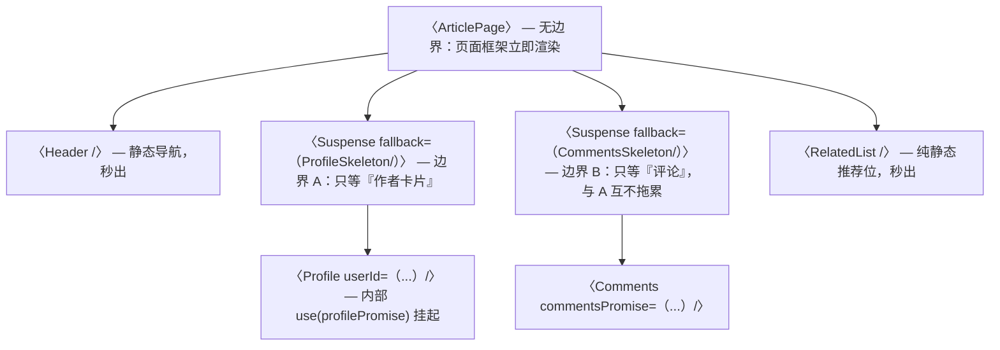
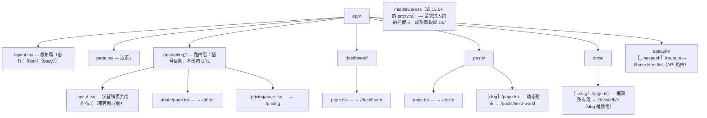

## 阶段 9：React 19 与服务端（2 周）

React 19 于 2024 年 12 月正式发布，这一阶段的前半周（约 5 天）在纯客户端环境（你阶段 0 的 Vite 项目）把六个新特性逐个 demo 一遍——它们不依赖任何框架；后半周（约 9 天）进入 Next.js 的 App Router。要建立一个正确认知：**RSC（React Server Components）不是 Next.js 的私有功能，而是 React 本身的渲染能力**；Next.js 只是当前最成熟的宿主（提供了路由、构建、缓存策略的完整工程化）。先在裸 React 里理解机制，再到 Next.js 里看工程化封装，顺序不要反。学习方式：每条新特性都写"最小 demo + 故意写错看报错"；Next.js 部分直接开新项目边读边搭，最后一节的全栈应用作业就是这个项目的验收形态。

### React 19 新特性

原大纲条目（骨架）：

1. `use()` 读取 Promise / Context
2. Actions + `useActionState`（表单提交状态）
3. `useOptimistic` 乐观 UI
4. ref 直接作为 prop（`forwardRef` 逐步退场）
5. 文档元数据（`<title>` 直接写组件里）
6. Suspense 进阶：占位、边界组合

---

#### 1. `use()` 读取 Promise / Context

**是什么。** `use` 是一个新 API，能读两类东西：**Promise**（结果未就绪时挂起组件，交给最近的 Suspense 边界显示 fallback）和 **Context**（作用与 `useContext` 相同）。它是"组件异步化"的基础原语：让"等待数据"从命令式的 loading state 变成声明式的"挂起"。

**为什么需要。** 阶段 4 你手写的 `useFetch` 要自己维护 loading/error/success 三态；`use` 配合 Suspense 后，loading 态由 Suspense 统一显示、error 态由 ErrorBoundary 统一捕获，组件函数体里**只剩下成功态的代码**——异步 UI 的样板代码被砍掉一大半。这也是阶段 4.2"Suspense + 数据获取"的正式答案。

**怎么做（机制与规则分步）。** 先看用法，规则放后面：

```tsx
import { Suspense, use, useMemo } from 'react';

/** 子组件：只写成功态。use() 在 promise 未完成时把整个组件挂起 */
function Comments({ commentsPromise }: { commentsPromise: Promise<string[]> }) {
  const comments = use(commentsPromise); // 未完成 → 挂起；完成 → 直接拿到结果
  return (
    <ul>
      {comments.map((c) => (
        <li key={c}>{c}</li>
      ))}
    </ul>
  );
}

export function ArticlePage() {
  // 关键：promise 必须跨渲染稳定（同一次数据请求只创建一次实例）
  // useMemo 保证组件重渲染时不会重新发请求
  const commentsPromise = useMemo(() => fetchComments(), []);
  return (
    <Suspense fallback={<p>评论加载中…</p>}>
      <Comments commentsPromise={commentsPromise} />
    </Suspense>
  );
}

async function fetchComments(): Promise<string[]> {
  const res = await fetch('https://jsonplaceholder.typicode.com/comments?postId=1');
  const list = (await res.json()) as { id: number; body: string }[];
  return list.map((c) => c.body);
}
```

执行机制分步：1) `ArticlePage` 渲染时创建（并缓存）promise；2) `Comments` 里 `use(promise)` 发现未完成，**抛出这个 promise 本身**（React 内部机制，你 catch 不到）；3) 最近的 Suspense 边界接住，渲染 fallback；4) promise 完成后 React 重试 `Comments`，`use` 返回结果；5) promise 拒绝时，错误交给最近的 ErrorBoundary——所以完整形态是 Suspense 与 ErrorBoundary 双边界包住异步组件。

**调用规则——哪些依旧、哪些放开了。** 这组规则最容易以讹传讹，逐条对齐官方文档：

| 规则 | 状态 | 说明 |
|---|---|---|
| 只能在组件或自定义 Hook 的函数体内调用 | **依旧** | 不能在事件处理器、类组件、普通函数、事件回调里 `use()` |
| 不能在 try/catch 里读 Promise | **依旧** | 挂起用的 promise 是内部抛出机制，try/catch 接不住；错误应交给 ErrorBoundary |
| 传入的 Promise 必须跨渲染缓存同一实例 | **依旧** | 每次渲染新建 promise 会导致无限挂起（见坑 1） |
| 不要读 `promise.status` 手动绕过 `use` | **依旧** | 绕过会让 React 失去对挂起状态的跟踪 |
| 与其他 Hook 不同，**允许在条件与循环里调用** | **放开** | 这是 `use` 与 `useContext` 的核心差异，官方明确支持 |

条件调用 Context 的官方示例形态：

```tsx
import { use } from 'react';

function HorizontalRule({ show }: { show: boolean }) {
  if (show) {
    const theme = use(ThemeContext); // ✅ 合法：use 允许条件调用
    return <hr className={theme} />;
  }
  return false;
}
```

这条放宽是有代价换来的：正因为 `use` 每次调用都要"现场读"，React 才允许它出现在分支里。但习惯上仍建议：**Context 用 useContext（顶层声明更清晰），`use` 主要用来读 Promise**——让两个 API 各司其职。

**常见坑（症状 → 根因 → 修法）。**

1. 症状：组件永远停在 fallback，网络面板却显示请求早就完成了。根因：promise 在组件体内直接创建（`use(fetchComments())`），每次渲染都是**新实例**，React 挂起等待的永远是"上一帧的 promise"。修法：`useMemo` 缓存创建动作；更好的形态是像示例那样**由父组件（或服务端组件）创建、作为 prop 传入**。
2. 症状：`try { const d = use(p) } catch` 捕获不到错误。根因：挂起与错误都走"抛出到边界"的内部机制。修法：删掉 try/catch，在组件外层放 ErrorBoundary（阶段 8 手写的那棵树可以直接复用）。
3. 症状：把 `use` 写进了事件处理器，报 "use() cannot be called from an event handler"。根因：`use` 只在渲染期间有意义。修法：事件处理器里直接 `await promise` 即可——那里本来就是异步上下文。

---

#### 2. Actions + `useActionState`（表单提交状态）

**是什么。** React 19 把"表单提交后执行异步函数"升级为一等公民：`<form action={fn}>` 的 `fn` 可以是任意（同步或）异步函数，称为 **Action**；`useActionState` 则包住 Action，给你三个回报：提交后的返回值 `state`、可直接绑给 form 的 `formAction`、提交是否进行中 `isPending`。

**为什么需要。** 对比阶段 4.1 你手写过的提交逻辑：onSubmit 里 preventDefault、手动 setLoading、手动 try/catch 收集错误信息、完成后手动清表单——这套样板在每个表单里重复一遍。Actions 把"提交 → 异步处理 → pending 态 → 结果回填"变成框架职责；而且 Action 被自动包在 transition 里（阶段 10 第 6 条），提交期间**界面不会卡死**，isPending 也不需要你额外造 state。

**怎么做（机制分步）。** 完整示例：

```tsx
import { useActionState } from 'react';

/** Action：签名固定为 (上一次的 state, 本次提交的 FormData) => 新 state */
type FormState = { ok: boolean; message: string };

async function addTodoAction(prev: FormState, formData: FormData): Promise<FormState> {
  // 表单数据靠 name 属性收集：input 没有 name，这里就取不到值
  const title = formData.get('title');
  if (typeof title !== 'string' || title.trim() === '') {
    return { ok: false, message: '标题不能为空' };
  }
  await new Promise((resolve) => setTimeout(resolve, 500)); // 模拟网络延迟
  return { ok: true, message: `已添加：${title}` };
}

export function AddTodo() {
  // 初始 state 是第一条提交前的值
  const [state, formAction, isPending] = useActionState(addTodoAction, {
    ok: false,
    message: '',
  });

  return (
    <form action={formAction}>
      {/* 不写 onSubmit、不写 e.preventDefault()：框架全包了 */}
      <input name="title" placeholder="待办标题" />
      <button type="submit" disabled={isPending}>
        {isPending ? '提交中…' : '添加'}
      </button>
      {state.message && (
        <p role="status" style={{ color: state.ok ? 'green' : 'red' }}>
          {state.message}
        </p>
      )}
    </form>
  );
}
```

执行机制分步：1) 用户点提交，React 收集表单字段为 `FormData`（按 name 属性）；2) 调用 `addTodoAction(上次返回值, formData)`，整个过程包在 transition 中，`isPending` 变 true；3) Action 返回值成为新的 `state`，组件重渲染，按钮恢复、消息显示；4) 连续快速提交时，多次提交**排队顺序执行**，每次 Action 拿到的 prev 是上一次的结果；5) Action 内 `throw` 的错误不会被 useActionState 变成 state，而是直接炸给最近的 ErrorBoundary，并取消后续排队的提交——**错误要么 return 成消息，要么 throw 成边界，别混用**。

不需要 state、只要"提交即执行"的轻量场景，可以不用 useActionState，直接给 action 传一个普通异步函数（这就是"裸 Action"，React 同样自动包 transition）：

```tsx
<form action={(formData) => saveDraft(formData.get('content') as string)}>
  <textarea name="content" />
  <button type="submit">保存草稿</button>
</form>
```

**常见坑（症状 → 根因 → 修法）。**

1. 症状：`formData.get('xxx')` 拿到 null。根因：对应的 input 没写 `name` 属性（id/placeholder 都不算）。修法：表单控件必须带 name；TS 侧 `formData.get` 返回 `FormDataEntryValue | null`，永远先判空再用。
2. 症状：提交期间按钮没变化、页面还能乱点。根因：忘了用 `isPending` 禁用提交按钮。修法：`disabled={isPending}`，同时可加 `aria-busy={isPending}`（测试与可访问性双收益，阶段 8 的查询能直接用）。
3. 症状：在 Action 外面 `try { await formAction() } catch` 想捕获错误，捕不到。根因：formAction 是给 form 的 action 属性用的，不是普通函数；错误走 ErrorBoundary。修法：把可预期的失败做成返回值（如示例的 `{ ok: false, message }`），不可预期的异常交给边界。
4. 症状：用了 `useFormState` 报 "not exported from react"。根因：那是 React 19 RC 期的名字，正式版更名为 `useActionState`。修法：统一用 `useActionState`。

---

#### 3. `useOptimistic` 乐观 UI

**是什么。** 乐观 UI（阶段 4.6 手写过：点赞先加一、失败回滚）指"不等服务端确认就先按成功更新界面"。`useOptimistic` 把这个手写模式收编为 API：返回一个"乐观值"与一个"追加乐观更新"的函数，**在 transition 进行期间**渲染乐观值，transition 结束（无论成败）自动回到真实值。

**为什么需要。** 手写乐观更新要维护三份东西：真实数据、本地乐观副本、回滚逻辑，且失败回滚分支极易写漏。`useOptimistic` 的关键洞察是：乐观值只在"Action 进行中"有意义——那就把它的生命周期绑定到 transition 上，Action 一结束，乐观值自然失效，回滚代码一行都不用写。

**怎么做（完整点赞示例）。**

```tsx
import { useState, useTransition, useOptimistic } from 'react';

interface LikeButtonProps {
  /** 服务端确认后的真实点赞数（由父组件在请求成功后更新） */
  count: number;
  /** 切换点赞的请求，失败时 reject */
  onToggle: (liked: boolean) => Promise<void>;
}

export function LikeButton({ count, onToggle }: LikeButtonProps) {
  const [liked, setLiked] = useState(false);
  const [isPending, startTransition] = useTransition();

  // 乐观副本：base 是真实 count；reducer 描述"一次乐观更新如何叠加"
  const [optimisticCount, addOptimisticCount] = useOptimistic(
    count,
    (current: number, delta: number) => current + delta,
  );

  async function handleClick(): Promise<void> {
    startTransition(async () => {
      const next = !liked;
      addOptimisticCount(next ? 1 : -1); // 立刻反映到界面（乐观 +1 / -1）
      setLiked(next);
      await onToggle(next); // 服务端确认；失败时这里的异常会让 transition 以失败结束
    });
  }

  return (
    <button onClick={handleClick} disabled={isPending} aria-busy={isPending}>
      {liked ? '♥' : '♡'} {optimisticCount}
    </button>
  );
}
```

机制分步：1) 点击后 `startTransition` 开启一个带乐观上下文的 transition；2) `addOptimisticCount(+1)` 把增量交给 React，下一次渲染中 `optimisticCount` = 真实 count + 1（用户瞬间看到效果）；3) `await onToggle(next)` 期间界面持续显示乐观值；4) transition 结束：成功——父组件更新了真实 `count`，乐观值被丢弃，二者无缝衔接（可能恰好相等，视觉无跳变）；失败——`onToggle` 抛错，`count` 从未变过，乐观值被丢弃后界面**自动回到 +0**，且回滚与"保持旧 UI"发生在同一次渲染里，没有中间闪烁。若要失败提示，在 `onToggle` 内部 catch 后 toast 即可（别在组件里再包一层 try/catch 抢异常）。

两条官方红线：`addOptimistic` **必须在 Action（transition）内调用**，在外面调用会收到警告且乐观值闪现即回退；reducer 必须是**纯函数**（不得在里面发请求、改外部状态）。

**常见坑（症状 → 根因 → 修法）。**

1. 症状：乐观效果闪一下就消失，随后才是真实结果。根因：把 `addOptimisticCount` 写在了 `startTransition` 外面（乐观值没有 transition 可"依附"，立刻回滚）。修法：把所有"乐观更新 + 异步请求"整体放进 `startTransition(async () => {...})`。
2. 症状：失败了界面却停在 +1。根因：失败路径上父组件也把 count 更新了（catch 里误调了成功回调）。修法：约定清楚——`count` 只代表服务端确认过的值；失败时父组件不动它。
3. 症状：乐观列表新增项时 key 冲突或渲染错乱。根因：乐观项还没拿到服务端 id，用了 `key={undefined}` 或复用旧 id。修法：乐观项用带标记的临时 key（如 `` `optimistic-${Date.now()}` `` 或自增 ref），服务端结果回来后由真实 id 替换。

---

#### 4. ref 直接作为 prop（`forwardRef` 逐步退场）

**是什么。** React 19 之前，函数组件拿不到 `ref`（它被 React 截留，必须用 `forwardRef` 转发）；React 19 起 `ref` 成为**普通 prop**——函数组件直接在参数里解构它，`forwardRef` 进入废弃流程（仍可用，但新代码不再需要）。

**为什么需要。** `forwardRef` 有两宗罪：一是样板（每个需要暴露 DOM 的组件都多一层包装）；二是它让**泛型组件**的类型签名变成灾难（`forwardRef<HTMLInputElement, Props<T>>` 里外三层泛型，阶段 7 第 3 条的泛型 Select 在 18 时代几乎没法优雅地同时支持泛型与 ref）。`ref` 变普通 prop 后，这两个问题同时消失。

**怎么做（迁移对照）。**

React 18 及之前的写法：

```tsx
// 旧写法（18）：forwardRef 包装，ref 作为第二个参数
import { forwardRef } from 'react';

type InputProps = React.ComponentProps<'input'> & { label: string };

const OldInput = forwardRef<HTMLInputElement, InputProps>(function OldInput(
  { label, ...rest },
  ref, // ref 不在 props 里，靠第二个参数注入
) {
  return (
    <label>
      {label}
      <input ref={ref} {...rest} />
    </label>
  );
});
```

React 19 的写法：

```tsx
// 新写法（19）：ref 是普通 prop，直接解构
import type { ComponentProps, Ref } from 'react';

type InputProps = ComponentProps<'input'> & {
  label: string;
  ref?: Ref<HTMLInputElement>; // 显式声明（保持与 forwardRef 时代一致的对外 API）
};

function NewInput({ label, ref, ...rest }: InputProps) {
  return (
    <label>
      {label}
      <input ref={ref} {...rest} />
    </label>
  );
}
```

调用方完全不变：`<NewInput ref={inputRef} label="邮箱" />`。迁移建议：升级 React 19 后，官方升级指南与 codemod（`npx codemod react/19/...` 系列，见 react.dev 的 Upgrade Guide）能自动完成大部分机械改写；`eslint-plugin-react-hooks` 的新规则集也会指出残留的 forwardRef。老库里的 forwardRef 不必急着清——废弃不等于删除，按机会成本逐步迁移即可。

**常见坑（症状 → 根因 → 修法）。**

1. 症状：升级 19 后控制台出现 "Unexpected return value from a callback ref"。根因：React 19 允许 ref 回调**返回清理函数**（节点卸载/换绑时自动调用），因此对返回值严格校验；旧代码的 ref 回调碰巧隐式返回了非函数值（如 `node.play()` 的返回值），旧版忽略、19 版报错。修法：ref 回调体用花括号包起来不隐式返回，或返回真正的清理函数。
2. 症状：泛型组件同时要 ref，类型怎么写都报错（旧版残留写法）。根因：还在用 `forwardRef` 包泛型组件。修法：迁移到新写法——泛型声明在函数上，`ref` 作为普通 prop 的类型 `Ref<HTMLDivElement>`，问题直接消失。
3. 症状：类组件的 ref 行为变了吗？没有——`ref` 作普通 prop 只针对**函数组件**；类组件的 ref 仍然指向实例。修法：无需处理，知道边界即可。

---

#### 5. 文档元数据（`<title>` 直接写组件里）

**是什么。** React 19 之前，`<title>`、`<meta>` 写在组件里会被渲染进 body 而不生效（head 只有 index.html 能写），SPA 改标题要靠 `useEffect` 手动 `document.title = ...` 或引入 react-helmet。React 19 起，这些标签无论写在组件树多深的位置，都会被**自动提升（hoist）到 `document.head`**。

**为什么需要。** SPA 的每个"页面"都是组件，页面的标题、描述、canonical 链接理应跟着组件走、随路由切换自动更新。框架内置后：不用 effect、不用第三方库、服务端渲染时直接输出在 head 里（SEO 与首屏分享卡片都正确）。

**怎么做。**

```tsx
function ProfilePage({ userId }: { userId: string }) {
  return (
    <main>
      {/* 元数据与使用它的组件写在一起，React 负责提升到 head 并处理去重 */}
      <title>用户 {userId} 的主页</title>
      <meta name="description" content={`用户 ${userId} 的公开资料与动态`} />
      <link rel="canonical" href={`https://example.com/users/${userId}`} />

      <h1>个人主页</h1>
      {/* ...页面内容 */}
    </main>
  );
}
```

机制要点：提升是渲染期的自动行为，标题会随组件卸载恢复；同名标签 React 做去重处理；`<link rel="stylesheet">` 还支持 `precedence` 属性控制样式插入顺序（组件库按需注入样式的底层支持）。注意两点边界：其一，纯 CSR 应用改 title 对部分爬虫无效（它们可能不执行 JS），SEO 严肃场景要服务端渲染——这正是下一半 Next.js 的主场；其二，在 Next.js App Router 中应优先用它的 Metadata API（第 6 条讲），直写 `<title>` 适合快速场景与组件库内部。

**常见坑（症状 → 根因 → 修法）。**

1. 症状：组件里写了 `<title>` 但浏览器标签没变。根因：React 版本低于 19，标签被渲染进了 body 无效。修法：升级，或退回 `useEffect` + `document.title` 的旧写法。另外多个 `<title>` 并存时 React 保留后渲染的那个——title 的归属规划成"每路由一个"，深层组件只放 `<meta>`。

---

#### 6. Suspense 进阶：占位、边界组合

**是什么。** Suspense（React 18 起用于数据挂起、19 与 `use`/Actions 配合更紧密）你已经会基本用法了；"进阶"指两件事：**fallback 怎么设计**（占位）与**边界放在哪**（组合）。这两件事决定用户对异步页面的"体感"，是纯 API 之外的 UX 功夫。

**为什么需要。** 同样四个异步区块的页面，边界放得对不对，体验天差地别：整页一个边界 = 任何一处慢全部白屏（最差）；每个小图标一个边界 = 满屏 spinner 齐闪（"spinner 风暴"）；按数据区块划分 = 静态框架立即出现、各区块陆续就位（流式体验，最优）。这不是玄学，是边界划分的机械结果。

**怎么做。** 先看目标形态的树：



边界放置的四条原则，逐条展开：

1. **静态内容不包边界**。Header、侧栏、页脚这些不依赖异步数据的部分放在任何 Suspense 之外，请求再慢它们也立即出现——这就是"页面外壳（shell）秒开"的来源。反面：整页包一个边界，等于宣布"我全部是骨架"。
2. **边界对齐"数据区块"而不是"组件"**。一个区块（作者卡、评论区）一个边界；不要给区块内部的小零件单独加边界（标题一个、头像一个、签名一个——三个 spinner 交替闪，就是风暴本暴）。
3. **平级边界互相独立**。边界 A 挂起不影响边界 B 的内容出现；渲染时已就位的区块先流入 HTML（服务端流式的分块单位就是边界）。
4. **更新优先用 startTransition 而不是新边界**。已在屏上的内容切换数据时（点 Tab 换列表），`startTransition` 会让 React 保留旧 UI 直到新数据就绪（不闪 fallback）；而新增一个边界只会显示又一片骨架。原则：**加载用 Suspense，切换用 transition**。

fallback 设计两条：优先**骨架屏**（Skeleton）而非 spinner——骨架模拟最终布局，不引起内容跳动（CLS 友好），且和边界原则天然配合（每个区块的骨架形状对应区块本身）；fallback 的尺寸尽量接近最终内容，避免"补齐瞬间页面跳一大截"。

**代码示例：一个符合上述原则的页面骨架。**

```tsx
import { Suspense, use, useMemo, useState, useTransition } from 'react';

interface Profile {
  name: string;
  bio: string;
}

function ProfileSkeleton() {
  return <div className="h-24 animate-pulse rounded bg-slate-200" aria-hidden />; // 骨架与成品同尺寸
}

export function ArticlePage({ fetchProfile }: { fetchProfile: () => Promise<Profile> }) {
  const [isPending, startTransition] = useTransition();
  const [profilePromise, setProfilePromise] = useState(() => fetchProfile());

  function switchTab() {
    // 切换数据：保留旧 UI（transition），而不是闪烁新的 fallback
    startTransition(() => {
      setProfilePromise(fetchProfile());
    });
  }

  return (
    <main>
      <Header />
      <button onClick={switchTab} disabled={isPending}>换个作者</button>
      <Suspense fallback={<ProfileSkeleton />}>
        <ProfileBlock profilePromise={profilePromise} />
      </Suspense>
      <RelatedList />
    </main>
  );
}

function ProfileBlock({ profilePromise }: { profilePromise: Promise<Profile> }) {
  const profile = use(profilePromise); // 未完成则挂起，由最近的 Suspense 边界接管
  return <div>{profile.name} / {profile.bio}</div>;
}
```

这个例子同时示范了原则 2（边界只包 ProfileBlock）、原则 3（RelatedList 秒出）与原则 4（切换走 transition）。

**常见坑（症状 → 根因 → 修法）。**

1. 症状：页面一打开满屏小 spinner 齐闪。根因：边界切得太碎，每个小组件一个 Suspense。修法：按"数据区块"合并边界；把 fetch 的 promise 提升到区块级（多个组件共用同一个 promise，`use` 天然支持）。
2. 症状：切换 Tab 时内容闪回骨架。根因：切换数据源时组件因 key 变化或边界重新挂起，fallback 又出现了。修法：切换包进 `startTransition`（如上例），React 会保持旧内容直到新数据就绪。
3. 症状：fallback 消失瞬间页面布局大跳。根因：fallback（如一行小字）与最终内容（如 600px 高的列表）尺寸差距过大。修法：骨架屏与成品同构同尺寸；最小限度也用一个固定高度的占位容器。

---

### Next.js（App Router）

原大纲条目（骨架）：

1. **RSC vs 客户端组件**边界划分（`'use client'` 放哪）
2. SSR / SSG / ISR / 流式渲染的取舍
3. Server Actions（表单不写 API 也能提交）
4. 缓存与重验证（revalidate / revalidateTag）
5. 水合错误（hydration mismatch）的成因与排查
6. Metadata、路由组、中间件、动态路由

---

#### 1. **RSC vs 客户端组件**边界划分（`'use client'` 放哪）

**是什么。** App Router 里所有组件默认是**服务端组件（RSC）**：只在服务器执行，代码不进浏览器包，可以直接 `async/await` 访问数据库与密钥。文件顶部写 `'use client'` 后，该文件（及其 import 的一切）成为**客户端组件**：打进浏览器包，拥有 state、effect、事件、浏览器 API。

**为什么需要。** 划这条边界解决两个问题：包体积（不需要交互的页面不该把逻辑发到浏览器）与安全（密钥、直连数据库的代码不该有进浏览器的可能）。边界划在哪，直接决定产品三件事：首屏 JS 多大、数据在哪取、密钥暴露风险。

**执行模型（机制分步）。** 先把混合渲染的流程搞对，后面所有条目都建立在这上面：

```text
浏览器请求 /posts
   ↓
Next 服务器执行 RSC 树（page.tsx、无 'use client' 的组件，可 async、可查库）
   ↓ 产出两样东西：
   ① HTML（首屏可见内容 + 客户端组件的占位）
   ② RSC Payload（组件树的序列化数据——后续导航就靠它，不再要 HTML）
   ↓ 浏览器收 HTML 立即渲染，同时下载 JS
   ↓ 客户端组件 hydrate（接管交互；RSC 部分仍是"纯产物"，浏览器不执行其代码）
   ↓ 点链接导航到 /posts/1
   ↓ 服务器只返回该路由的 RSC Payload，客户端就地更新（无整页刷新）
```

**`'use client'` 的正确位置——叶子优先决策法。** 关键认知：`'use client'` 标记的是**边界入口**——该文件是边界，它 import 的所有模块（除非那些模块自己再被服务端以 children 方式喂进来）都会被拉进客户端。所以决策法只有一条：**从"谁需要交互"出发，把 'use client' 尽量推向树的叶子**。

判定清单，按顺序过：

| 组件需要什么 | 应该放哪 |
|---|---|
| useState / useEffect / 事件处理 / 浏览器 API（window、localStorage） | 客户端（叶子） |
| 只展示数据、格式化、map 渲染 | 服务端 |
| 直接 fetch/查数据库、读密钥、调内部服务 | **只能**服务端 |
| 大依赖库（图表、编辑器）且仅交互时用 | 客户端叶子 + 动态 import |

反模式对照：

```tsx
// ❌ 反模式：页面因为要一个搜索框就整页 'use client'
'use client';
export default async function Page() {        // 还顺带报错：client 组件不能 async
  const posts = await db.post.findMany();      // db 客户端（含密钥）打进浏览器！
  return <PostsPageClient posts={posts} />;    // 整树进客户端 bundle
}

// ✅ 正确：页面保持服务端，交互下沉成叶子
import { db } from '@/lib/db';
import { SearchBox } from './SearchBox'; // 内部 'use client'，只有它是客户端

export default async function Page() {
  const posts = await db.post.findMany(); // 服务端查库，密钥不出服务器
  return (
    <main>
      <h1>文章</h1>
      <SearchBox />                        {/* 交互叶子：很小一片客户端 */}
      <PostList posts={posts} />            {/* 其余全是 RSC，零客户端 JS */}
    </main>
  );
}
```

**children 模式：让"客户端壳"包住"服务端内容"。** 有时布局壳必须交互（主题切换的 header），但下面的内容不必跟着进客户端。利用 children：children 是**服务端渲染好再传进来**的，不算 client 组件的 import 依赖——

```tsx
// app/layout.tsx（服务端）
import { ThemeShell } from './ThemeShell'; // 'use client'：只管主题切换

export default function RootLayout({ children }: { children: React.ReactNode }) {
  return (
    <html lang="zh-CN">
      <body>
        <ThemeShell>{children}</ThemeShell> {/* children 在服务端渲染，不进客户端包 */}
      </body>
    </html>
  );
}
```

**常见坑（症状 → 根因 → 修法）。**

1. 症状：客户端组件里 import 了含数据库连接的模块，构建报错或密钥进了 bundle。根因：`'use client'` 的 import 闭包整体进客户端。修法：依赖倒置——数据在服务端组件取好，作为**可序列化 props** 传下来。
2. 症状：给客户端组件传了函数/类实例 prop，报 "Functions cannot be passed directly to Client Components"。根因：跨边界的 props 要经过序列化。修法：传数据；确要传行为，把行为做成服务端 action 传引用（下一节）。
3. 症状：'use client' 写在了被服务端导入的文件的**子文件**里没生效。根因：'use client' 只认"模块文件顶部第一行"（注释除外）。修法：检查位置——必须在文件最顶、任何 import 之前。

---

#### 2. SSR / SSG / ISR / 流式渲染的取舍

**是什么。** 这是"页面的 HTML 在什么时机、由谁生成"的四种策略。App Router 的一大简化：**不再是 Pages Router 那样三选一函数（getStaticProps/getServerSideProps）**，而是由"页面里用了什么"自动推导，必要时用段配置（segment config）显式声明。

**对比表与逐行展开。**

| 渲染方式 | HTML 生成时机 | 首字节速度 | 数据新鲜度 | 典型场景 | App Router 写法 |
|---|---|---|---|---|---|
| SSG（静态） | 构建时一次 | 最快（CDN 直出） | 构建时快照 | 文档、博客、落地页 | 默认：不用动态 API 就是静态 |
| ISR（增量静态） | 构建时 + 之后按周期/按需再生 | 快（命中 CDN） | 秒级延迟可接受 | 商品页、榜单、热门文章 | `export const revalidate = 60` 或 fetch 配 tags |
| SSR（动态） | 每次请求时 | 取决于服务端耗时 | 实时 | 仪表盘、搜索结果、个性化页 | 页面里用了 `cookies()`/`headers()`/`searchParams`，或 `export const dynamic = 'force-dynamic'` |
| 流式 | 请求即推首字节，之后分块到达 | 首字节快 | 静态壳 + 各块各自新鲜 | 慢区块多的大页面 | RSC 默认支持，按上一节的边界切分块 |

选型决策清单（从上往下过，第一条命中即停）：

1. 内容对所有人一样且构建时可知 → **SSG**。
2. 对所有人一样但会变（分钟级容忍）→ **ISR**（配合下一节的 `revalidateTag` 做到"发布即更新"）。
3. 因人而异（登录态）或必须实时（搜索）→ **SSR 动态**。
4. 页面一部分慢（重查询、第三方接口）→ 保持前三种之一的同时，把慢块装进 Suspense 边界 → **流式**（流式不是独立选项，是叠加能力）。

注意一个高频误解：**用了 SSR（动态）不等于放弃 SEO**，动态页同样输出完整 HTML；同理 **SSG 页面里也可以有客户端交互叶子**（静态的是首屏 HTML，水合后照样交互）。四种方式说的是"HTML 何时生成"，与"组件在哪运行"（上一节）是两个正交维度。

**常见坑（症状 → 根因 → 修法）。**

1. 症状：本想静态化的页面每次请求都重新渲染（构建输出里它是 ƒ Dynamic）。根因：页面里（哪怕在深层组件里）用了 `cookies()`/`headers()`/`searchParams` 之一——它们天然把路由拉成动态。修法：审视是否真需要；确实需要就接受动态，或把用动态 API 的部分拆成 Suspense 子块让其余部分保持静态。
2. 症状：`export const revalidate = 60` 没生效，数据永远不更新。根因：Next 15 起 fetch 默认不缓存（下一节详述），页面虽标记 ISR，数据本身每次 fetch 都新拉——页面 shell 再生但内容即时，让人误判。修法：明确数据缓存意图：`fetch(url, { cache: 'force-cache' })` 或 `next: { revalidate: 60 }`。
3. 症状：以为选了流式就解决了"慢"，页面还是整体很慢。根因：流式只是把"等待"分块并提前交付首字节，总工作量没少。修法：慢的根源（慢查询、慢接口）该优化优化，流式解决的是"体感"不是"算力"。

---

#### 3. Server Actions（表单不写 API 也能提交）

**是什么。** Server Action 是**在服务端执行的函数**，却能直接被客户端（表单、按钮、事件处理器）调用——Next.js 在构建期为它生成一个 RPC 端点，你不用手写 API 路由、不用手写 fetch 封装。定义方式：文件顶部 `'use server'`（文件内所有导出都是 action），或函数体第一行内联 `'use server'`。

**为什么需要。** 传统表单链路：客户端 onSubmit → fetch('/api/xxx') → 路由处理器 → 校验 → 写库 → 返回 → 客户端处理消息。六步里有四步是搬运样板。Server Actions 把链路压成：表单 `action={createPost}` → 完事。校验在服务端、数据库访问在服务端、返回值直接回到表单 state（配合阶段 9 前半的 `useActionState`），两端代码写在同一个函数里。

**怎么做（完整示例：发布文章）。**

```ts
// app/posts/actions.ts
'use server'; // 本文件所有导出都成为 Server Action：只在服务端执行

import { revalidatePath } from 'next/cache';
import { z } from 'zod';
import { auth } from '@/auth';       // NextAuth（见本阶段产出作业）
import { db } from '@/lib/db';       // 数据库客户端（密钥只在服务端）

const CreatePostSchema = z.object({
  title: z.string().min(1, '标题不能为空').max(80, '标题最长 80 字'),
  content: z.string().min(1, '正文不能为空'),
});

export type CreatePostResult = { ok: boolean; message: string };

export async function createPost(formData: FormData): Promise<CreatePostResult> {
  // 第一道闸：权限。Server Action 是暴露在公网的 POST 端点，任何人不带表单也能直接调
  const session = await auth();
  if (!session?.user) {
    return { ok: false, message: '请先登录' };
  }

  // 第二道闸：输入校验。永远不要相信 FormData
  const parsed = CreatePostSchema.safeParse({
    title: formData.get('title'),
    content: formData.get('content'),
  });
  if (!parsed.success) {
    return { ok: false, message: parsed.error.issues[0].message };
  }

  await db.post.create({
    data: { ...parsed.data, authorId: session.user.id },
  });

  // 第三件事：让缓存知道数据变了（下一节展开）
  await revalidatePath('/posts'); // Next 15 起 revalidatePath 是异步的，必须 await

  return { ok: true, message: '发布成功' };
}
```

客户端用法：用阶段 9 前半学的 `useActionState` 直接包服务端 action，两端 API 无缝咬合——这正是 React 19 Actions 与 Server Actions 的设计意图。附带一个渐进增强红利：`action` 表单在禁用 JS 的浏览器里退化为原生表单提交（POST 到当前路由），依然工作。

```tsx
// app/posts/NewPostFormClient.tsx
'use client';

import { useActionState } from 'react';
import { createPost, type CreatePostResult } from './actions';

export function NewPostForm() {
  const [state, formAction, isPending] = useActionState<CreatePostResult, FormData>(
    createPost,
    { ok: false, message: '' },
  );

  return (
    <form action={formAction}>
      <input name="title" placeholder="标题" required />
      <textarea name="content" placeholder="正文" required />
      <button type="submit" disabled={isPending}>
        {isPending ? '发布中…' : '发布'}
      </button>
      {state.message && <p role="status">{state.message}</p>}
    </form>
  );
}
```

**常见坑（症状 → 根因 → 修法）。**

1. 症状：action 里的代码在浏览器里执行了/构建报 "Server Actions must be async"。根因：`'use server'` 的函数必须是 async 且不能被客户端代码直接 import 执行体（调用会变成 RPC）。修法：确保 action 文件顶部声明、函数 async；客户端只能"引用"它（传给 action 或调用后 await 返回值）。
2. 症状：action 处理器没带任何参数，却被恶意直接 POST 调用成功写库。根因：Server Action 是公网端点，`<form>` 只是众多调用方式之一。修法：**每个 action 内部第一行做鉴权**（如上例），输入一律 zod 校验；中间件只是分流器，不是安全边界。
3. 症状：提交成功后列表没更新。根因：页面/数据被缓存（下一节的 Full Route Cache / Data Cache 命中旧值）。修法：在写操作后调用 `await revalidatePath('/posts')` 或按 tag 失效。

---

#### 4. 缓存与重验证（revalidate / revalidateTag）

**是什么。** Next.js 的缓存是**分层**的，理解分层才能解释"为什么改了数据页面不变"这类玄学。四层速览：

| 层 | 存在哪 | 缓存什么 | 失效手段 |
|---|---|---|---|
| 请求去重（Request Memoization） | 单次渲染内 | 同一 render 里相同的 fetch | 自动（仅当次渲染有效） |
| 数据缓存（Data Cache） | 服务端、跨请求 | fetch 的响应 | `revalidate` 时间 / `revalidateTag` / `revalidatePath` |
| 全路由缓存（Full Route Cache） | 服务端 | 静态页的 HTML + RSC Payload | 同上（连带失效） |
| 路由器缓存（Router Cache） | **浏览器** | 已访问路由的 Payload | 受 `staleTimes` 影响；`router.refresh()` 强刷 |

**先记一个版本关键点**：**Next.js 15 起，`fetch` 默认不缓存**（Next 14 及以前默认缓存，是一次著名的语义反转）。所以"缓存"在新项目里是**显式 opt-in** 的行为：

```ts
// 显式缓存（进入 Data Cache，跨请求复用）
await fetch('https://api.example.com/posts', { cache: 'force-cache' });

// 时间驱动：缓存 60 秒，到期后下次请求再生（ISR 的数据侧）
await fetch('https://api.example.com/hot', { next: { revalidate: 60 } });

// 默认：不缓存（Next 15 行为，每次都新拉）
await fetch('https://api.example.com/user/meal');
```

**revalidateTag 的心智模型：给缓存起组名，写操作后按组作废。** 时间驱动的 `revalidate: 60` 有个天然缺陷——发布文章后最多要等 60 秒才可见，运营无法接受。标签失效把时机交给你：

```ts
// 数据侧：缓存的同时打标签（标签是任意的组名）
const res = await fetch('https://api.example.com/posts', {
  cache: 'force-cache',
  next: { tags: ['posts'] }, // 所有命中此 URL 的缓存都归入 posts 组
});
```

```ts
// 写侧：在 Server Action 里按标签作废（Next 15：必须 await）
import { revalidateTag, revalidatePath } from 'next/cache';

export async function publishPost(formData: FormData) {
  await db.post.create({ data: { /* ... */ } });
  await revalidateTag('posts');          // 所有打 posts 标签的缓存全部作废，下次请求重拉
  await revalidatePath('/posts/[slug]', 'page'); // 或按路径作废整个路由的静态产物
}
```

**常见坑（症状 → 根因 → 修法）。**

1. 症状：调了 `revalidateTag` 但没生效，甚至构建/运行报错。根因：Next 15 起 `revalidateTag`/`revalidatePath` 返回 Promise，不 await 就调用会在请求结束时被取消。修法：一律 `await revalidateTag('posts')`。
2. 症状：数据明明 revalidate 了，客户端点导航看到的还是旧列表。根因：命中的是**浏览器里的 Router Cache**（第四层），服务端失效管不到它。修法：调用后 `router.refresh()`（强制重取当前路由的 Payload）；或依赖默认的 staleTimes 在短时间后自然过期。
3. 症状：从 Next 14 迁移来的代码处处依赖"fetch 默认缓存"，升级 15 后所有页面悄悄变成每次实时拉取、服务端压力大增。根因：默认值反转。修法：迁移期用 `next.config.js` 的 `experimental.fetchCache = 'default-cache'` 暂时恢复旧行为，然后逐个 fetch 明确意图后摘掉开关。

---

#### 5. 水合错误（hydration mismatch）的成因与排查

**是什么。** 水合（hydration）= 浏览器把服务端渲染的 HTML 与客户端 JS 连接起来（挂事件、赋状态）。前提是**两端渲染结果一致**；不一致时就报 hydration mismatch，React 19 的报错会直接 diff 出不一致的节点与属性，然后丢弃服务端 HTML 用客户端结果重渲染（白闪 + 性能损耗 + SEO 抖动）。

**为什么需要（成因表）。** 服务端与客户端是两台"机器"、两个时刻，一切依赖"哪台机器/哪个时刻"的值都可能两端不一致：

| 成因 | 例子 | 为什么两端不同 |
|---|---|---|
| 时间 | `new Date().toLocaleTimeString()` | 服务端与浏览器执行时刻不同 |
| 随机 | `Math.random()`、`crypto.randomUUID()` | 两次执行结果天然不同 |
| 浏览器环境 | `window.innerWidth`、`navigator.language` | 服务端没有 window/navigator（是 undefined） |
| 持久化 | `localStorage.getItem('theme')` | 服务端没有 localStorage |
| 第三方注入 | 浏览器插件往 DOM 塞属性（语法高亮、翻译） | 服务端渲染时不存在 |
| 非法 HTML 嵌套 | `<p>` 里放了 `<div>` | 浏览器解析 HTML 时"纠错"移动了节点，与 React 认知的结构不符 |

**排查法（操作步骤）。** 1) 读报错——React 19 会打印出两棵树的 diff（哪个标签、哪个属性不一致），从它指的组件下手；2) 检查该组件渲染路径上所有"非确定"来源（对照上表）；3) 仍然定位不到就二分：从页面顶层开始注释子组件，缩小到再注释就不再报错的最小子树；4) 修复时按下面的模式选。

**修复模式库。** 标准解法是"两端渲染一致的占位，挂载后再换成真实值"：

```tsx
'use client';

import { useEffect, useState } from 'react';

export function Clock() {
  // 首帧渲染 '--:--:--'（两端一致）；useEffect 只在客户端执行，绝不参与水合对比
  const [time, setTime] = useState('--:--:--');

  useEffect(() => {
    const update = () => setTime(new Date().toLocaleTimeString('zh-CN'));
    update(); // 挂载后立刻给真值
    const timer = setInterval(update, 1000);
    return () => clearInterval(timer);
  }, []);

  return <time>{time}</time>;
}
```

模式速查：

- 时间/随机/window/localStorage → 上面的"稳定占位 + useEffect"。
- 动态生成的 `id`（表单与 label 关联）→ 用 `useId()`，它保证两端生成一致的 id。
- 确有少量文本级双端差异（如时间戳组件想服务端也出值）→ 该元素的文本加 `suppressHydrationWarning`——**只作用于当前元素的文本，且是最后手段**，滥用会把真 mismatch 也压下去。
- 纯浏览器组件（图表、地图）→ `next/dynamic` + `ssr: false`（注意：只能在客户端组件里用）。

**常见坑（症状 → 根因 → 修法）。**

1. 症状：整页报 mismatch 但报错指向一个很深的 `<span>`。根因：非法 HTML 嵌套被浏览器纠错（如 `<p><div/></p>`），位移从嵌套点开始波及后续。修法：检查报错位置之前的兄弟节点是否用了不能嵌套该子元素的标签（p、ul 的直接子元素等）。
2. 症状：本地开发一直正常，某用户浏览器必报。根因：浏览器插件注入（翻译、密码管理器高亮）。修法：给该容器加 `suppressHydrationWarning` 只针对注入点（这类 mismatch 无害）；注意 suppress 只该用于"确认无害的双端差异"，限定到最小文本节点，否则会把真正的 bug 一并掩盖。

---

#### 6. Metadata、路由组、中间件、动态路由

这一条是 App Router 文件约定与页面配套能力的"快速地图"——每项给最小可用写法与何时使用。

**Metadata：页面元数据。** 静态直接导出对象；动态（依赖路由参数）用 `generateMetadata`：

```tsx
// app/posts/[slug]/page.tsx
import type { Metadata } from 'next';
import { db } from '@/lib/db';

// 静态：export const metadata: Metadata = { title: '关于我们' };
export async function generateMetadata(
  { params }: { params: Promise<{ slug: string }> }, // Next 15：params 是 Promise
): Promise<Metadata> {
  const { slug } = await params;
  const post = await db.post.findUnique({ where: { slug } });
  return {
    title: post?.title ?? '文章',
    description: post?.summary, // 分享卡片与搜索摘要都用它
  };
}
```

约定式文件也属于这一族：`app/sitemap.ts`、`app/robots.ts`、`app/icon.png`，按文件名自动生效。

**文件树总览（其余三项的地图）。**



逐项展开：

- **路由组 `(name)`**：唯一作用是"共享布局而不污染 URL"。典型用法：营销区与产品区分开两套 layout；后台的 `(admin)` 组强制鉴权布局。坑：两个组里不能有会撞成同一路径的 page（`/(a)/x/page.tsx` 与 `/(b)/x/page.tsx` 同时存在会构建报错）。
- **动态路由 `[slug]`**：一个方括号一段；Next 15 起 `params` 是 Promise，页面组件要 `await`：

```tsx
// app/posts/[slug]/page.tsx
export default async function PostPage({
  params,
}: {
  params: Promise<{ slug: string }>;
}) {
  const { slug } = await params; // Next 15：必须 await
  const post = await db.post.findUnique({ where: { slug } });
  if (!post) notFound(); // 触发 not-found.tsx
  return <article><h1>{post.title}</h1></article>;
}

// 纯静态内容想预渲染多个 slug：
export async function generateStaticParams() {
  const posts = await db.post.findMany();
  return posts.map((p) => ({ slug: p.slug })); // 构建时把这些 slug 全部 SSG
}
```

- **中间件（middleware.ts → proxy.ts）**：在请求进入路由前运行，做重定向/改写/加头，最典型是未登录拦截。**版本注意**：Next.js 15.5 起该约定更名为 `proxy.ts`（导出函数 `proxy`），16.0 起 `middleware.ts` 正式废弃——新项目直接用 proxy，老项目可用官方 codemod 迁移（`npx @next/codemod@canary middleware-to-proxy .`）。以 proxy 形态写的鉴权拦截：

```ts
// proxy.ts（项目根，与 app 同级；旧版本叫 middleware.ts、函数名 middleware）
import { NextResponse } from 'next/server';
import type { NextRequest } from 'next/server';

export function proxy(request: NextRequest) {
  // 简化示例：检查会话 cookie（NextAuth 的会话校验实际用 auth 包装，见产出作业）
  const hasSession = request.cookies.has('authjs.session-token');
  if (!hasSession && request.nextUrl.pathname.startsWith('/dashboard')) {
    const loginUrl = new URL('/login', request.url);
    loginUrl.searchParams.set('from', request.nextUrl.pathname); // 登录后回跳
    return NextResponse.redirect(loginUrl);
  }
  return NextResponse.next(); // 放行
}

export const config = {
  // matcher：只拦截需要的路径，务必排除静态资源（否则 CSS/图片都被拦）
  matcher: ['/dashboard/:path*'],
};
```

**常见坑（症状 → 根因 → 修法）。**

1. 症状：页面组件里直接 `params.slug` 用出 undefined。根因：Next 15 起 params/searchParams 是 Promise。修法：`const { slug } = await params;`（类型也是 `Promise<{...}>`）。
2. 症状：路由组里新建页面后构建报 "You cannot have two parallel pages that resolve to the same path"。根因：两个路由组里的 page 撞了同一路径。修法：路径错开，或合并到一个组。
3. 症状：middleware/proxy 写完后所有请求（含 `_next/static` 的 JS/CSS）都被重定向，页面裸奔无样式。根因：没配 matcher，拦截器跑了全量请求。修法：如上配 matcher 精确圈定，或用负向正则排除 `_next`。

---

### ✅ 产出：全栈小应用（Next.js + 数据库 + NextAuth 鉴权 + Vercel 部署），如博客、记账本。

这是基础篇的毕业作业。二选一（也允许自定主题，但技术验收项不变）：**博客** 或 **记账本**。

**功能清单（博客版）。**

| 模块 | 功能点 | 技术落点 |
|---|---|---|
| 文章 | 列表（分页）、详情（Markdown 渲染）、创建/编辑/删除 | RSC 数据页 + Server Actions |
| 标签 | 打标签、按标签筛选 | 动态路由 `[tag]` + URL 查询参数 |
| 鉴权 | 仅登录用户可写；游客只读 | NextAuth + proxy/middleware 拦截 |
| 体验 | 发布中状态、失败提示、乐观发布（可选加分） | useActionState / useOptimistic |
| 元数据 | 每篇文章独立的 title/description | generateMetadata |

**功能清单（记账本版）。**

| 模块 | 功能点 | 技术落点 |
|---|---|---|
| 记录 | 收入/支出录入（金额、分类、备注、日期） | Server Action 表单 + zod 校验 |
| 分类 | 分类管理（增删） | ISR + revalidateTag |
| 统计 | 月度汇总、分类占比图表 | RSC 聚合查询 + 客户端图表叶子 |
| 筛选 | 按月份/分类筛选，条件同步 URL | searchParams（记得 await） |
| 鉴权 | 数据按用户隔离 | NextAuth session.user.id 作数据属主 |

**技术验收清单（两版通用，逐项打勾）。**

1. 至少 1 个纯 RSC 数据页（无 'use client' 的页面级取数）与至少 1 个客户端交互叶子（图表/搜索框）。
2. 至少 2 个 Server Action 表单走通 `useActionState`（含 isPending 与错误消息）。
3. 至少 1 处 `revalidateTag`（或 `revalidatePath`）在写操作后正确刷新缓存。
4. NextAuth 登录可用，受保护路由未登录被重定向。
5. 无 hydration mismatch（构建 `next build` 通过且浏览器控制台干净）。
6. 阶段 8 的 Playwright 登录主流程（登录→操作→断言）在本应用上跑通。
7. 部署到 Vercel，线上可用。

**NextAuth 要点（Auth.js v5 形态）。** 四件套记牢：

```ts
// src/auth.ts —— 唯一的配置源
import NextAuth from 'next-auth';
import GitHub from 'next-auth/providers/github';

export const { handlers, signIn, signOut, auth } = NextAuth({
  providers: [GitHub], // 本地开发可先配 Credentials 演示，GitHub 登录最省事
});
```

```ts
// src/app/api/auth/[...nextauth]/route.ts —— 把 handlers 挂到 API 路由
import { handlers } from '@/auth';

export const { GET, POST } = handlers; // 登录/登出/回调全部由它处理
```

```tsx
// 服务端组件读会话（RSC 的常规姿势）
import { auth } from '@/auth';
import { redirect } from 'next/navigation';

export default async function DashboardPage() {
  const session = await auth();
  if (!session?.user) redirect('/login'); // 服务端守卫，比纯前端守卫可靠
  return <h1>你好，{session.user.name}</h1>;
}
```

客户端登录/退出按钮：在 `'use client'` 组件里 `import { signIn, signOut } from '@/auth'`，按钮的 onClick 分别调 `signIn('github')` 与 `signOut()`——注意 signIn/signOut 也是从你自己的 `@/auth` 导出的，不来自 next-auth 包本体。

环境变量三件套（`.env.local`，部署时同样配进 Vercel）：`AUTH_SECRET`（`openssl rand -base64 32` 生成）、`AUTH_GITHUB_ID`、`AUTH_GITHUB_SECRET`（GitHub OAuth App 里创建，回调地址 `http://localhost:3000/api/auth/callback/github`，线上加一条生产地址）。

**部署 Vercel 步骤概要。** 1) 代码推到 GitHub；2) vercel.com 上 Add New Project → 导入仓库（框架自动识别为 Next.js，构建零配置）；3) Environment Variables 里配 `AUTH_SECRET`/`AUTH_GITHUB_ID`/`AUTH_GITHUB_SECRET` 与数据库连接串；4) Deploy——此后每次 push 到 main 自动部署生产，每个 PR 自动生成 preview URL；5) 数据库用云 PG（Neon / Supabase 免费档即可），连接串入环境变量，`AUTH_TRUST_HOST=true` 让 NextAuth 在非 localhost 域名下正常工作；6) Settings → Domains 绑定自定义域名（自动签 HTTPS）。也可以全程 CLI：`npx vercel` 预览、`npx vercel --prod` 上生产。

### 补充：RSC 取数组织学——并行发起、请求级去重与瀑布治理

**是什么。** RSC 页面的取数没有框架强制约束，写法自由度的代价是"请求怎么组织"全靠自己：同一页三块数据，写法不同，关键路径耗时能差三倍。这一节给三个层次的写法与一个去重工具（`React.cache`），以及"什么时候允许串行"的判定规则。客户端 Suspense 场景的瀑布问题在《[13-4-2-数据请求与服务器状态](13-4-2-数据请求与服务器状态.md)》讲过，机制同源，此处专讲服务端。

**场景。** 博客首页要三块数据：作者信息（约 300ms）、文章列表（约 400ms）、标签云（约 200ms），三者互不依赖。

**写法一（反面）：平铺 await 的隐式串行。**

```tsx
// ❌ 每个 await 都是一道路障：不依赖它的取数也被挡在后面
export default async function Page() {
  const author = await getAuthor('u1'); // 300ms
  const posts = await getPosts();        // 400ms ← 本不必等 author
  const tags = await getTags();          // 200ms ← 本不必等任何东西
  return <Home author={author} posts={posts} tags={tags} />;
}
// 关键路径 ≈ 300 + 400 + 200 = 900ms
```

这段代码"看起来是平铺的"，串行完全藏在 await 的语义里，是最难在 review 中发现的性能问题。判定口诀：**逐行问"下一行用到上一行的结果了吗"——没用到，上一行的 await 就是白等**。

**写法二：`Promise.all` 整页并行。** 三块数据同生共死（整页一个语义，要么都好要么都等）时用它：

```tsx
export default async function Page() {
  const [author, posts, tags] = await Promise.all([
    getAuthor('u1'),
    getPosts(),
    getTags(),
  ]);
  return <Home author={author} posts={posts} tags={tags} />;
}
// 关键路径 ≈ max(300, 400, 200) = 400ms
```

**写法三：只发起、不等待——promise 下传 + 各自边界，流式交付。** 各块可独立展示时（呼应本篇 Suspense 边界原则），把 promise 作为 prop 传给子组件，快的那块先流入 HTML：

```tsx
import { Suspense } from 'react';

export default function Page() {
  const authorPromise = getAuthor('u1'); // 只发起，不 await
  const postsPromise = getPosts();
  const tagsPromise = getTags();

  return (
    <main>
      <h1>博客首页</h1> {/* 静态外壳立即流出 */}
      <Suspense fallback={<AuthorSkeleton />}>
        <AuthorBlock p={authorPromise} />   {/* 内部 use(authorPromise) */}
      </Suspense>
      <Suspense fallback={<ListSkeleton />}>
        <PostListBlock p={postsPromise} />
      </Suspense>
      <Suspense fallback={<TagsSkeleton />}>
        <TagsBlock p={tagsPromise} />       {/* 200ms 最先就绪，最先显示 */}
      </Suspense>
    </main>
  );
}
```

三个写法的取舍一句话：**无依赖取数全部提到最外层并行发起（写法二或三）；真依赖（用 A 的结果去查 B，如"先查作者拿部门 id，再按部门查同事"）才允许串行**——真依赖的串行是业务本质，别误诊成性能问题去"优化"它。

**`React.cache`：同一次请求内的去重。** 多个组件都要"当前用户"（layout 里渲染头像、page 里查权限、某叶子组件显示名字），每个都查一遍库就浪费了三倍。`cache` 包住的函数在**单次请求内**按参数 memoize：

```ts
// src/lib/current-user.ts
import { cache } from 'react';
import { auth } from '@/auth';
import { db } from '@/lib/db';

// 同一个 HTTP 请求内只真正执行一次；不同请求之间互不共享
export const getCurrentUser = cache(async () => {
  const session = await auth();
  return db.user.findUnique({ where: { id: session.user.id } });
});

// layout、page、叶子组件各自 `await getCurrentUser()` —— 只有第一次查库
```

两条边界必须刻牢：其一，`cache` 是**请求级** memo，请求结束即丢弃——跨请求复用是 fetch Data Cache（`cache: 'force-cache'` / `next.revalidate`）与 ISR 的职责（本篇第 4 节），别拿它当缓存用；其二，参数按引用比较，传对象/数组字面量每次都是新引用会 miss——参数只用基本类型。

**性能怎么量化。** dev 模式下每个服务端 fetch 的时间戳会打印在终端日志里，串行写法能直观看到"前一个结束后一个才开始"；进阶用 Next 的 `server-timing` 响应头或接入 OTel。结论要写成数字："写法一 900ms → 写法二 400ms（-56%）"，而不是"感觉快了"。

**常见坑（症状 → 根因 → 修法）。**

1. 症状：某页面 TTFB 一直比单次最慢接口还高。根因：平铺 await 的隐式串行（写法一）。修法：按"下一行用不用上一行"逐行审，无依赖改 `Promise.all` 或 promise 下传。
2. 症状：把 promise 传给客户端组件后，又在客户端 `.then` 它并 setState。根因：绕过了 `use()` 的挂起协议，退化回手写三态（本篇 use() 一节的规则 3）。修法：客户端组件内用 `use(promise)` 消费；promise 的创建永远留在服务端。
3. 症状：用户已导航离开，服务端慢查询还在跑。根因：RSC 里 promise 的发起没有"页面卸载即中止"的约定，慢的是服务端资源而非用户界面。修法：给慢查询本身加超时（db 层超时或 `Promise.race([query, timeout]）`），别依赖用户行为兜底。

### 补充：App Router 的文件族——error.tsx / global-error.tsx / loading.tsx / not-found.tsx

**是什么。** 四个约定文件把阶段 8 手写的 ErrorBoundary 与 Suspense 边界变成框架内置接线：放进某个路由段目录，Next 自动把它包在该段的渲染树外层。

| 文件 | 等价的手写物 | 接管的范围 |
|---|---|---|
| `error.tsx` | 包住该段子树的 ErrorBoundary | 本段及子段渲染期错误（含 RSC 与客户端组件） |
| `global-error.tsx` | 包住 root layout 的最后一道边界 | 连 root layout 都炸时（此时它是唯一活着的 UI） |
| `loading.tsx` | 该段的自动 Suspense fallback | 导航到该段与段内取数挂起期间 |
| `not-found.tsx` | 404 兜底页 | `notFound()` 调用、无匹配路由 |

**error.tsx 完整实现（注意它必须是客户端组件）。**

```tsx
// app/posts/error.tsx
'use client'; // reset 是交互（按钮点击），错误页天然是客户端组件

import { useEffect } from 'react';
import * as Sentry from '@sentry/react';

export default function PostsError({
  error, // 序列化后的错误；digest 是与服务端日志关联的键
  reset, // 重试：重渲染出错的那段子树（等价阶段 8 手写边界的 reset）
}: {
  error: Error & { digest?: string };
  reset: () => void;
}) {
  useEffect(() => {
    // 上报走阶段 8 第 7 条的通道；带上 digest 才能与服务端日志对上
    Sentry.captureException(error, { tags: { digest: error.digest ?? 'none' } });
  }, [error]);

  return (
    <section>
      <h2>文章区加载失败</h2>
      <button onClick={() => reset()}>重试</button>
    </section>
  );
}
```

**global-error.tsx：必须自己渲染 html 与 body。** root layout 挂掉时没有任何东西替你输出文档结构：

```tsx
// app/global-error.tsx
'use client';

export default function GlobalError({
  error,
  reset,
}: {
  error: Error & { digest?: string };
  reset: () => void;
}) {
  return (
    <html lang="zh-CN">
      <body>
        <h1>应用发生严重错误</h1>
        <button onClick={reset}>重试</button>
      </body>
    </html>
  );
}
```

**放置原则与手写边界完全一致：越深越细。** `app/posts/error.tsx` 接文章区、`app/dashboard/error.tsx` 接整个后台区——侧栏挂了不该连累正文（阶段 8 的分区降级原则原样适用）。两条结构规则：layout 自身的错误只能被**更外层**段的 error 文件接住（父接子，兄弟互不影响）；`error.tsx` 与 `loading.tsx` 是同一位置的两个角色，一个管"炸了"，一个管"没好"。

**error.tsx 接不住的（指路阶段 8 三层防线）。** 事件处理器里的 throw；Server Action 里 throw 且客户端没 catch 的（会沿调用链 reject 回客户端，配合 `useActionState` 时按本篇第 2 节"错误要么 return 要么 throw"处理）；Route Handler 内部错误（有自己的 try/catch 与 500 响应）。这些仍归全局监听与 Sentry 管。

**常见坑（症状 → 根因 → 修法）。**

1. 症状：点"重试"页面又立刻回到错误态，循环往复。根因：`reset` 只重渲染组件树，不刷新数据缓存——若坏数据被 Data Cache 或 Router Cache 持有，重渲染读到的还是同一份。修法：重试按钮里补 `router.refresh()`（`import { useRouter } from 'next/navigation'`）强制重取当前路由（本篇第 4 节第四层缓存）。
2. 症状：global-error 生效时整页纯白。根因：忘了渲染 `<html>/<body>`，React 要求根必须有它们，而此时 root layout 已死，没人替你写。修法：如上补全文档结构。
3. 症状：开发环境根本看不到自己的降级 UI。根因：dev 模式 Next 的错误 overlay 优先展示（与阶段 8 手写 ErrorBoundary 在 dev 下被红色浮层遮挡同理）。修法：验收降级 UI 一律用 `next build && next start` 的生产模式。
4. 症状：error.tsx 忘写 `'use client'` 构建报错。根因：`reset` 是交互回调，该文件必须进客户端。修法：补上；纯展示的错误页也建议保持 `'use client'`，统一形态防止后续加交互时踩坑。

### 补充：React 18 → 19（与 Next 14 → 15）迁移清单

**是什么。** 一次真实的升级要动四类东西：运行时包、类型包、lint 插件、codemod 批量改写。顺序错了会陷入"两边版本互相不认"的死循环。这一节给确定的顺序、两类 breaking 的集中索引、以及升级 PR 的回归门槛。

**升级顺序（为什么是这个序）。** 先 React 19 全家（react + react-dom + @types 两个，版本必须齐），跑 codemod 清机械改动，确认应用可跑；再升 Next 15（它要求 React 19）。反过来先升 Next 会因 peer dependency 装不上或装出混搭版本。

```bash
# 第一步：React 19 全家（版本必须一致）
npm install react@19 react-dom@19
npm install -D @types/react@19 @types/react-dom@19

# 第二步：官方 codemod 批量改写机械部分（改完跑 npx tsc --noEmit 清剩余红灯）
npx codemod@latest react/19/migrate-rc-to-stable

# 第三步：再升 Next
npm install next@15
```

**React 19 的 breaking checklist（症状 → 动作）。**

| 变化 | 症状 | 动作 |
|---|---|---|
| 函数组件 `defaultProps` 移除 | 某些 prop 静默变 undefined | 改解构默认值 `function B({ size = 'md' }: Props)` |
| ref 回调返回值被严格校验（支持清理函数） | "Unexpected return value from a callback ref" | 回调体用花括号包住不隐式返回（本篇第 4 节坑 1） |
| `react-dom/test-utils` 移除，`act` 从 react 导入 | `import { act } from 'react-dom/test-utils'` 报不存在 | 改 `from 'react'`（阶段 8 示例本就如此） |
| `useFormState` 更名 | not exported | 改 `useActionState`（本篇第 2 节） |
| `ReactElement.props` 类型由 any 变 unknown | cloneElement 相关代码类型报错 | 给 props 显式类型，或改 render props（阶段 7 第 4 节坑 3） |
| 隐含 children / FC 语义（18 起的变化延续） | 升类型包后一批组件红 | 按阶段 7 第 4 节补 `PropsWithChildren` |

**Next 14 → 15 的 breaking（全部已在本篇展开，此处集中索引）。** `fetch` 默认不缓存（第 4 节）；`params`/`searchParams` 变 Promise 必须 await（第 6 节）；`revalidatePath`/`revalidateTag` 必须 await（第 4 节）；`middleware.ts` → `proxy.ts`（第 6 节）。

**升级 PR 的回归门槛。** 两条硬性：其一，阶段 8 的 Playwright 登录主流程 CI 必绿才可合并（升级最怕"能构建但关键路径断了"）；其二，`tsc --noEmit`（阶段 7 第 9 条的 typecheck job）红灯在升级 PR 内一次清零——带着类型红灯前进，等于把这次升级的所有未知问题都延后成生产问题。

**常见坑（症状 → 根因 → 修法）。**

1. 症状：升级后运行时报 react/react-dom 版本不兼容（"incompatible" 系列错误）。根因：只升了 react 没升 react-dom，或 @types 两包版本不齐（类型包落后会在编译期报一堆怪错）。修法：四个包同版本号，锁文件里 `npm ls react react-dom` 确认无第二份拷贝（某个老依赖里嵌着旧 react 也会导致此错）。
2. 症状：codemod 跑完合并，CI 仍红。根因：codemod 覆盖机械改写，覆盖不了语义调整（如 defaultProps 改解构时与 TS 类型的配合）。修法：本地 `npx tsc --noEmit` 清完再推，不要把红灯推给 CI。
3. 症状：新 API（`useActionState` 等）被 ESLint 报 "unknown API"。根因：eslint-plugin-react-hooks 停在旧版本。修法：升级到支持 React 19 的版本，`use` 的条件调用等新规则也靠它兜底。

---

## 附:ASCII 图替换清单

本文档图形化改版,原 ASCII 字符图与 Mermaid 图表对应关系如下:

| 原图位置 / 标题 | 处理结果 |
| --- | --- |
| 5-6 Suspense 进阶 · 目标形态的树(ArticlePage 边界划分) | 替换为 flowchart TD(组件层级树) |
| 5-6 Metadata/路由/中间件 · app/ 文件树总览 | 替换为 flowchart TD(目录树) |
