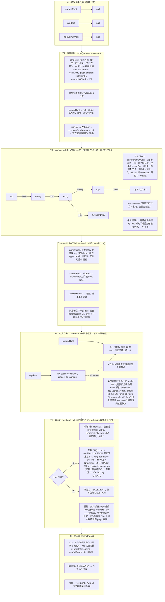

## 1. 前置：真实 React 的架构地图（1 天，先有地图再上路）

为什么第一步不是写代码而是看地图：复刻的路线是"自底向上"（先 `createElement` 后 Fiber），但理解需要"自顶向下"——你得先知道真实 React 被拆成了哪几块、每块负责什么，后面每写一个函数时才能立刻对号入座"我在写哪个包的哪部分"。这一天不是读源码，是读**目录结构和模块边界**。

### monorepo 分包

| 包 | 职责 | 复刻对应 |
|---|---|---|
| `react` | 入口 API（createElement/hooks 导出） | 我们的 `Didact.createElement` |
| `react-reconciler` | **调和器**：Fiber、diff、hooks（核心中的核心） | M3–M9 主体 |
| `scheduler` | 调度器：优先级、时间切片 | M3 的简化版 |
| `react-dom` | 渲染器：DOM 操作、合成事件 | M2 的 dom 操作 + M9 事件 |

这四行表格是整份地图的骨架。下面逐行拆开：每个包**内部有什么**、**为什么值得单独成为一个包**、以及它在我们复刻路线里的落点。

#### 第一行：`react` —— 你 import 的那个包，其实是个"API 外壳"

从 `import React from 'react'` 拿到的东西，可能比你以为的少得多。这个包内部大致是：

- **元素工厂与工具**：`createElement`、`cloneElement`、`isValidElement`、`Children.map/forEach/count/toArray`；
- **组件类与包装器**：`Component` 基类、`memo`、`forwardRef`、`lazy`、`Suspense`；
- **hooks 的"转发口"**：`useState`、`useEffect` 等全部从这里导出，但**它们的实现不在本包**——`react` 包内部只持有一个可替换的 `ReactCurrentDispatcher`（调度分发器）对象，渲染期间由 `react-reconciler` 把它换成真正挂载在 fiber 上的实现（`ReactFiberHooks.js` 里的 mount/update 两套函数表）。这也是为什么 hooks 只能在组件渲染中调用：分发器只在那个窗口被装上；
- **并发 API**：`startTransition`、`useDeferredValue` 等导出口。

为什么单独成包：`react` 不依赖任何宿主环境（浏览器 DOM、Node、Native 一概不碰），它是**唯一一个所有渲染目标共用的包**。React Native 项目和 Web 项目 import 的是同一个 `react`，差异全在渲染层。API 声明与实现解耦，也让 `react` 与 `react-dom` 能以不同节奏发版（你 `npm i react@18 react-dom@18` 时它们是两个独立版本号）。

复刻落点：我们的 `didact.js` 对应它——一个纯 JS 模块，导出 `createElement`（M1）、`render`（M2）、后续的 `useState`/`useEffect`（M7/M8）。区别是我们把 reconciler 也写进同一个文件，教学代码不为分包而分包，但你要清楚边界在哪。

#### 第二行：`react-reconciler` —— 核心中的核心，React 的"大脑"

这是 30 万行里最重的一块，也是复刻路线 M3–M9 的主体。内部按职责再分几个子系统（对照源码文件名，后文"路径 A：对照真实源码"会精确到文件）：

- **Fiber 构造**：`ReactFiber.js` 定义节点结构（对应我们 M3 的 fiber 对象）；`ReactFiberBeginWork.js` 自顶向下处理每个节点（对应 `performUnitOfWork` 的"向下"半段）、`ReactFiberCompleteWork.js` 自底向上收尾（对应"回溯找叔叔"半段）；
- **工作循环**：`ReactFiberWorkLoop.js`——时间切片、中断、恢复、以及"什么时候开始 commit"（对应我们 M3/M4 的 `workLoop`）；
- **diff/调和**：`ReactChildFiber.js` 对比新旧 children 决定复用还是新建（对应 M5）；
- **hooks 实现**：`ReactFiberHooks.js`，以链表挂在 fiber 上（对应 M7/M8 的 `fiber.memoizedState`）；
- **优先级模型**：lane 模型（`ReactFiberLane.js`），决定谁先谁后（我们只在 M10 用最简方式摸一下）。

它最关键的设计是**完全不认识 DOM**。`react-reconciler` 通过一个注入的 hostConfig 对象与外界交互——"给我创建一个宿主节点""把这个节点挂到那个节点下"。谁注入 hostConfig，React 就渲染到谁：`react-dom` 注入 DOM 版，react-native 注入原生视图版，社区的 react-three-fiber 注入 Three.js 场景对象版。这就是"React 与渲染器分离"不是口号而是代码结构。

为什么单独成包：调和逻辑与渲染目标无关，一份代码服务所有宿主；`react-reconciler` 单独发包，任何人都能拿它写自定义渲染器（本篇末尾的深化路径 C）。

复刻落点：M3 的 fiber 结构与 `workLoop`、M4 的两阶段、M5 的 diff、M7/M8 的 hooks，全部是它的简化版。我们文件里除了 `createDom`/`updateDom` 这两个"DOM 专属"函数之外的部分，都属于 reconciler 的地盘。

#### 第三行：`scheduler` —— 通用调度器，甚至不叫 "react-scheduler"

注意包名：它不叫 react-scheduler，因为它不含任何 React 概念，是一个**通用任务调度库**——任何"长任务想切成小片、还想分优先级"的场景都能用。内部有：

- **五级优先级**：`Immediate`（同步，如离散输入的直系更新）、`UserBlocking`（用户交互）、`Normal`（默认）、`Low`、`Idle`；
- **任务队列**：按"过期时刻"组织的小顶堆，越紧急的任务越早出队；
- **时间切片**：默认每片 5ms（会按实际帧率自适应），干不完就让出主线程、预约下一个宏任务继续；
- **消息循环**：用 `MessageChannel` 制造宏任务（M3 会专门讲为什么是它）。

它解决的两个问题："**何时开始**"（高优先级任务可以插队到低优先级前面）与"**可否中断**"（时间片耗尽就停，浏览器先去渲染、处理输入，下一片再回来）。

为什么单独成包：调度是通用问题，与 React 概念解耦后别的库也能用，React 自己也便于独立测试与演进（它确实经历过从 requestIdleCallback 到自制时间切片的大转向，M3 讲这段历史）。

复刻落点：M3 的简化版——我们只有 `requestIdleCallback` 一档优先级、一个工作单元指针，没有堆、没有 lane。但"时间片 + 让出 + 恢复"的骨架一模一样。

#### 第四行：`react-dom` —— 唯一一个会碰 DOM 的包

浏览器专属代码全部集中在这里：

- **入口**：`createRoot(...).render(...)`（React 18 起，旧的 `ReactDOM.render` 已进入废弃流程）；
- **hostConfig 的 DOM 实现**：怎么 `document.createElement`、怎么 diff 属性、怎么 append/remove——对应我们 M2 的 `createDom`/`updateDom`；
- **事件系统**：React 17 起把事件委托从 document 收回到 root 容器上，合成事件、批处理入口都在这里（React 18 源码里又拆出一个 `react-dom-bindings` 目录承载事件绑定，对外仍从 `react-dom` 导出）——对应 M9；
- **服务端渲染**：`react-dom/server` 的 `renderToString`/`renderToPipeableStream`（本篇不涉及）。

为什么单独成包：平台代码高内聚——换宿主时只换这一层；同时它是四个包里体积最大、最不值得打进非 DOM 环境的，独立发包利于按需加载。

复刻落点：M2 的 `createDom`/`updateDom`/`appendChild` 就是它的雏形。复刻时你会体会到一个微妙的边界感：`didact.js` 里凡是出现 `document.` 的行，都属于"react-dom 的地盘"。

#### 分包的总原则：一句话版本

四个包回答四个问题：`react`——"开发者调用什么 API"；`react-reconciler`——"如何把描述变成操作计划"；`scheduler`——"什么时候干活、干多久"；`react-dom`——"如何在浏览器里执行计划"。API 与实现解耦（react 包）、计算与执行解耦（reconciler 与 renderer）、策略与机制解耦（scheduler 与 reconciler）——这三个解耦就是 React 架构的全部灵魂，也是我们这份 mini 复刻要在 2000 行内重现的东西。

### 核心分层与三个阶段

```
setState ──► Scheduler(调度: 何时开始、可否中断)
              └► Reconciler(调和: 构造 Fiber 树、打 effectTag)   ← 可中断
                    └► Renderer(commit: 一次性操作 DOM)            ← 不可中断
```

这张三层图是一次更新的完整旅程：`setState` 只是把"我有更新需求"登记给调度器；调度器决定何时开工；调和器构造一棵新树并计算差异；渲染器一次性执行差异。下面逐层拆解，重点是每层的"**为什么这样设计**"——三层图上每一个设计决策，都对应一种你不这样做就会亲身踩到的坑。

#### Scheduler：何时开始、可否中断

它管两件事：

- **何时开始**。如果 `setState` 一调用就立刻开始渲染，会出两个问题：一是同一次事件回调里往往有多个 `setState`（改三个状态），逐个渲染就是三次浪费——所以调度器把真正的渲染推迟到当前同步代码（微任务之后）再开始，多次 setState 就合并成一次工作（React 18 automatic batching 的入口，对应我们 M9）；二是不同来源的更新紧急程度不同——用户输入引发的更新必须先于数据刷新的更新，调度器让高优先级任务插队。
- **可否中断**。调度器对"正在干的活"实行时间片制：一片（约 5ms）干不完就让出主线程，把控制权还给浏览器去渲染、去响应输入，然后预约下一片继续。同时，如果干活期间来了更高优先级的任务，当前工作可以被整个丢弃重排。

为什么需要独立调度层——因为**主线程是独木桥**。JS 执行、样式计算、布局、绘制、输入响应全在同一条线程上排队。React 的工作（diff 一棵大树）天然是长任务，不给它装上"红绿灯"，它就会把浏览器堵死。调度器就是红绿灯：它不干活，它只决定"现在能不能干、干到几点必须停"。

#### Reconciler：可中断构造

它干的活：拿着新的 ReactElement 树和现有的 Fiber 树，自顶向下逐节点对比、构造一棵新的工作树（workInProgress），在这个过程中给每个发生变化的节点打上 `effectTag`（新增 PLACEMENT / 更新 UPDATE / 删除 DELETION），最后产出一条"带副作用的节点链"交给渲染器。

**为什么它敢可中断、可丢弃、可重来？** 因为整个阶段只操作内存中的 JS 对象（fiber 节点），一个真实 DOM 都不碰。中断 = 记住"我干到哪个节点了"（`nextUnitOfWork`）；恢复 = 从那个节点继续；作废 = 把工作树扔掉重建，最多浪费一些 CPU，屏幕上什么都不会发生错误。**无副作用，是可中断的前提**——这句话是理解整个 Fiber 架构的钥匙，M4 我们会用代码证明它。

#### Renderer：不可中断提交

它干的活：接过完整的工作树和副作用链，把 DOM 操作一口气执行完——appendChild、removeChild、改属性，以及同步执行 `useLayoutEffect`、异步调度 `useEffect`（这些时机细节属于 M8/M10，此处只需知道"提交阶段里还有收尾工作"）。

**为什么不可中断？** 三个原因叠加：

1. **DOM 是共享状态**。改了一半的 DOM 在下一帧 paint 时会被浏览器如实画出来——半个新 UI 夹着半个旧 UI，就是"撕裂"（M4 会亲手复现）；
2. **同步代码段是原子的**。JS 引擎在一段同步代码执行完之前不会把控制权交还浏览器，所以"一口气跑完"天然获得原子性——这是浏览器送的机会，不用白不用；
3. **提交阶段没有计算**。diff 都在 render 阶段做完了，这里只是机械执行一串已算好的操作，耗时可控，原子跑完不会造成新的长任务灾难。

于是整个架构形成一个漂亮的分工：**计算（重、可中断、可丢弃）与执行（轻、原子、不可分割）分离**。这与显卡的双缓冲、数据库"先写日志再落盘"是同构的思想：把昂贵的、不确定的准备工作放在幕后慢慢做，幕布拉开的一瞬间必须是一次完整的切换。

#### 三阶段的历史包袱：Stack Reconciler

顺带补一块背景：React 15 及之前用的是"Stack Reconciler"——递归遍历组件树、同步一次性完成 diff + DOM 更新，**没有这三层分工**。它的全部工作相当于我们的 M2（递归直渲）：一旦开始跑完为止，大更新会卡死主线程。Fiber 架构（React 16，2017）就是为了把这条同步递归链拆成"调度 + 可中断调和 + 原子提交"三段。所以复刻路线故意让你先写 M2 的递归版本——**你写的每一个 M2 缺陷，都是 React 16 重写的动机**。

#### Fiber 双缓冲：current / workInProgress / alternate

- **Fiber 双缓冲**：current（屏幕上）与 workInProgress（构造中）两棵树，靠 `alternate` 指针一一对应——可中断而不撕裂的关键

这行 bullet 是 §1 里密度最高的一句话，值得用一整节把它拆到分子级。先定义三个词：

- **current 树**：与屏幕上当前 UI 一一对应的 fiber 树。它的每个 fiber 的 `dom` 字段都指着文档里活生生的 DOM 节点。整棵树的持有者叫 `currentRoot`；
- **workInProgress 树（wip 树）**：正在内存中构造的下一版 UI，持有者叫 `wipRoot`。构造期间它**不拥有任何一个已插入文档的 DOM 节点**（M4 之后如此）；
- **alternate**：同一个逻辑位置在新旧两棵树上的两个 fiber 之间的对应指针。真实 React 双向维护（互指）；我们的 mini 版只在新建 wip fiber 时设单向指针 `newFiber.alternate = oldFiber`——diff、hooks 对齐只需"新找旧"，单向就够。

"双缓冲"这个词借自显卡：显卡渲染一帧画面时，front buffer 正在屏幕上显示，back buffer 在幕后被逐像素填充；填满后硬件 flip 一次，两块 buffer 角色互换——**观众永远看不到画了一半的帧**。Fiber 架构完全同构：current 树是 front buffer，workInProgress 树是 back buffer，commitRoot 就是那次 flip。

下面按时间线推演一次完整更新中三者的演化。例子：首次渲染 `<div><h1>标题</h1><p>正文</p></div>`，然后一次点击把 `p` 的文字改掉。这就是后面 M3/M4 代码运行时的真实内存状态，建议对照着读。



把这套时序提炼成三条不变量，任何时刻问"会不会出问题"，都用这三条检验：

1. **屏幕只认 current 树**：render 阶段从头到尾不碰任何已插入文档的节点，所以无论怎么中断，屏幕上的画面始终是上一轮 commit 的完整结果；
2. **wip 树活在堆内存**：中断只是遍历暂停，已构造的 fiber 节点全部健在，`nextUnitOfWork` 指到哪，恢复就从哪继续——**中断恢复不会撕裂，因为"撕裂"的前提是屏幕看到了中间态，而不变量 1 保证屏幕永远看不到**；
3. **commit 是同步原子段**：一旦 `commitRoot()` 开始，它在同一段同步代码里跑完所有 DOM 操作，浏览器不可能 paint 到中间态。

反过来说，撕裂只会在同时违反不变量 1 和 3 时发生。M3 我们会故意写一个违反不变量的版本（边构造边把 DOM 挂上去），M4 再亲手修复——"为什么会撕裂"这个问题，你会先用手制造出来，再用架构消灭它。

最后强调 alternate 的第二个身份：它不只是"中断恢复"的一部分，更是**复用的桥梁**。M5 的 diff、M7 的 hooks 对齐（新旧 fiber 各自的 `memoizedState` 链表靠 alternate 找到彼此），全部建立在这根指针上。设计数据结构时"让新旧两版可以互相找到对方"，是增量计算系统的通用手法。

#### JSX 链路：从语法糖到普通对象

- JSX 链路：`jsx-runtime` → `createElement` → `ReactElement` 普通对象 `{ type, props }`

三个环节逐个说清。

**环节一：JSX 不是 JavaScript。** 浏览器不认识 `<div className="box">{list}</div>`，它必须先被编译器翻译成函数调用。历史上有两种翻译目标，也就是两种 runtime 模式：

| | classic（React 16 及之前） | automatic（React 17+ 默认） |
|---|---|---|
| `<div a=1/>` 编译产物 | `React.createElement('div', {a: 1})` | `import { jsx as _jsx } from 'react/jsx-runtime'` + `_jsx('div', {a: 1})` |
| 需要手动 `import React` | 需要（否则 ReferenceError） | 不需要（编译器自动注入 jsx-runtime 的 import） |
| 函数名可定制 | 可（pragma 配置，指向任何人） | 可（importSource 配置） |
| key 的位置 | 作为 createElement 第二参数的属性混入 | 独立参数，不进 props |

我们复刻走 classic 模式并把 pragma 指到自己的 `Didact.createElement`——因为 classic 的语义最直白（一行函数调用），最适合看穿 JSX 的本质；automatic 只是"编译器替你 import 了另一个工厂函数"，环节三末尾会给一个 8 行的 jsx-runtime 适配，两种模式都能玩。

**环节二：`createElement` 是个纯函数。** 输入 type、属性对象、若干孩子，输出一个普通对象。它不做任何 DOM 操作、不做任何递归渲染——这一步只负责"把 JSX 的嵌套语法翻译成对象字面量的嵌套"。我们的 M1 就写它，全文约 20 行。

**环节三：ReactElement 就是普通对象。** 这是最该破除的神秘感：element 树上没有任何魔法，`console.log` 打出来就是 `{ type, props }` 的嵌套 JSON（真实 React 多几个字段，M1 的对比实验会逐个看）。它**只描述"要什么"**（一个 div、class 是 box、里面三行文本），**不描述"怎么做"**（怎么建 DOM、何时更新、如何 diff——那是 fiber 和 reconciler 的事）。描述与执行分离，才使得同一份 element 树可以渲染到 DOM、canvas、终端、甚至转成字符串做 SSR。

真实 React 的 element 对象比我们的多一个 `$$typeof: Symbol.for('react.element')` 字段，值得单独解释：它是个**防伪标记**。如果用户输入被拼进某种存储再作为对象反序列化回来（典型 XSS 场景：攻击者向你的接口里塞一段 JSON，内容是 `{type: 'script', props: {...}}`，某个漏洞让它流进了 render），React 渲染前检查 `$$typeof`——而 JSON 里造不出 `Symbol`，伪造的 element 过不了安检。我们的教学版不加这个字段（没有攻击面），但你要知道生产库为什么加。

最后一个链路细节：**文本节点**。真实 React 的编译产物里，字符串孩子就是字符串，直到 reconciler 里才被包装成 HostText fiber；我们的 didact 在 `createElement` 阶段就提前包成 `TEXT_ELEMENT`。为什么提前？为了让下游（`createDom`/`updateDom`）只面对一种"有 type 有 props"的统一节点，省掉到处写 `typeof child === 'string'` 的分支——20 行代码的教学库，统一性比逐像素还原真实实现更重要。M1 实现时再看这段话会更清楚。

✍️ 练习：用 `@babel/plugin-transform-react-jsx` 的 classic 模式把 JSX 指向自己的 `createElement`，打印 element 树看个明白。

这个练习的目标：在写 M1 之前，先让你亲眼看到"JSX 编译 → 函数调用 → 对象树"的完整链路。下面给三套由轻到重的可抄配置，任选其一。

**方案一：零工程，单个 HTML 文件（5 分钟见效）**

```html
<!DOCTYPE html>
<html>
<head>
  <meta charset="utf-8" />
  <title>JSX 链路观察</title>
</head>
<body>
  <div id="root"></div>
  <!-- babel-standalone：浏览器里直接跑 Babel，仅限实验，勿上生产 -->
  <script src="https://unpkg.com/@babel/standalone@7/babel.min.js"></script>
  <script type="text/babel" data-presets="react">
    /* @jsx Didact.createElement */
    // ↑ classic 模式下，这行注释的优先级高于一切配置：
    //   本文件所有 JSX 都会编译成 Didact.createElement(...) 调用

    // M1 之前先用一个最小替身占位（M1 写好后整体替换）
    const Didact = {
      createElement(type, config, ...children) {
        console.log('createElement 被调用：', type)
        return { type, props: { ...config, children } }
      },
    }

    const element = (
      <div id="box" className="card">
        <h1>标题</h1>
        hello
        <button onClick={() => {}}>点我</button>
      </div>
    )

    console.log(JSON.stringify(element, null, 2))
  </script>
</body>
</html>
```

直接双击打开这个文件即可（无模块加载，不需要本地服务器）。打开 DevTools 控制台，你会先看到 4 次 `createElement 被调用`（div、h1、文本 hello 走不了 JSX 所以没有、button——顺序是 div 先被调用？不，**子先于父**：JSX 表达式求值天然自内向外，h1 和 button 的调用先发生，div 的调用最后收到已构造好的孩子）。这个求值顺序本身就值得看一眼：**element 树是自底向上构造的**。

**方案二：Vite + esbuild，改一行工厂函数（推荐作为后续里程碑的常驻环境）**

```js
// vite.config.js
import { defineConfig } from 'vite'

export default defineConfig({
  esbuild: {
    // classic 语义：JSX → Didact.createElement(type, props, ...children)
    jsx: 'transform',
    jsxFactory: 'Didact.createElement',
    jsxFragment: 'Didact.Fragment',
  },
})
```

```js
// src/index.jsx —— 注意：classic 模式不自动注入 import，必须自己引入
import * as Didact from './didact.js'

const element = (
  <div id="box">
    <h1>标题</h1>
  </div>
)

console.log(element)
```

**方案三：标准 Babel 工程（.babelrc，可迁移到 webpack/jest 等任何 babel 生态）**

先装依赖：

```bash
npm init -y
npm i -D @babel/core @babel/cli @babel/preset-env @babel/plugin-transform-react-jsx
```

```json
{
  "presets": [["@babel/preset-env", { "targets": "defaults" }]],
  "plugins": [
    [
      "@babel/plugin-transform-react-jsx",
      {
        "runtime": "classic",
        "pragma": "Didact.createElement",
        "pragmaFrag": "Didact.Fragment"
      }
    ]
  ]
}
```

```bash
npx babel src --out-dir lib --watch
# 之后任何 .js/.jsx 里的 JSX 都会编译成 Didact.createElement(...)
```

**automatic 模式的选修适配**（想对齐 React 17+ 的默认行为时用）：把上面的 plugin 配置换成 `{ "runtime": "automatic", "importSource": "./didact" }`，Babel 产物会 `import { jsx } from './didact/jsx-runtime'`，所以需要把目录组织成 `src/didact/index.js` + `src/didact/jsx-runtime.js`，后者只有几行：

```js
// src/didact/jsx-runtime.js —— automatic 模式的入口适配
import { createElement } from './index.js'

// Babel 约定：jsx 单孩子 / jsxs 多孩子 / jsxDEV 为开发版入口
export function jsx(type, config) {
  const { key = null, ...rest } = config
  return createElement(type, { ...rest, key }, ...(rest.children ?? []))
}
export const jsxs = jsx
export const jsxDEV = jsx
export const Fragment = Symbol.for('didact.fragment')
```

（此适配依赖 config.children 已经是数组的约定，属于选读内容；主线教学用 classic 模式即可。）

**观察任务**：配好任意一套环境后，写一段三、四层嵌套的 JSX（含文本、含属性、含布尔值与 `style`），打印整棵树；再打开 Babel 的[在线 REPL](https://babeljs.io/repl)（preset 选 react），左右对照"你写的 JSX"与"编译出的函数调用"。确认自己能回答：文本在哪一步变成了 TEXT_ELEMENT？key 出现在对象的哪一层？`onClick` 在 props 里的形态是什么？——三个问题都有答案，JSX 链路就通了，可以进 M1。

---

## 附:ASCII 图替换清单

本文档图形化改版,原 ASCII 字符图与 Mermaid 图表对应关系如下:

| 原图位置 / 标题 | 处理结果 |
| --- | --- |
| §1「Fiber 双缓冲:current / workInProgress / alternate」的 T0–T6 时间线推演图 | 替换为 flowchart TD(subgraph T0–T6 按时间步串联) |
