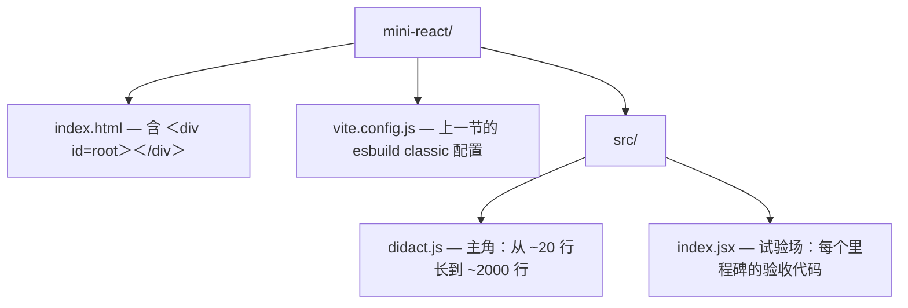

## 2. 复刻路线：十个里程碑（每步可运行，命名沿用经典 didact）

十个里程碑的顺序不是知识点的堆砌，而是一条严格的因果链：M1 造数据（element），M2 用递归消费它并暴露"卡死"问题，M3 用 Fiber 与调度解决卡死却引入"撕裂"，M4 分离 render/commit 消灭撕裂并搭出 React 架构的完整骨架，M5 之后（diff、函数组件、hooks）全都是在这个骨架上长肉。**每步的代码都完整可运行**，本片段展开 M1；M2–M10 由后续文件逐一展开，命名约定全书统一。

先搭好常驻工程（方案二 Vite 环境）：

```bash
mkdir mini-react && cd mini-react
npm create vite@latest . -- --template vanilla
# 覆盖生成的模板文件，最终目录结构：
```



一个说明：教学主线里，里程碑代码大量直接手写 `createElement(...)` 调用而不写 JSX——少一层编译转译，日志和报错都直指本源；JSX 管线已在 §1 练习打通，你想用随时可以换（两者产物完全一致，这本身就是本篇要建立的认知）。

### M1：createElement 与虚拟 DOM（0.5 天）

- 手写 `createElement(type, config, ...children)`：children 扁平化、文本包成 TEXT_ELEMENT、props 合并
- 验证：`console.log(element)` 与真实 React 的 element 对比

目标清单先读一遍：children 扁平化、文本包 TEXT_ELEMENT、props 合并——三条分别对应三个真实的编译期现实：`map` 会产生嵌套数组、文本没有 type/props 结构、key 不能混进业务属性。带着这三个问题看实现。

完整实现（这是 `didact.js` 的第一版，全文如下）：

```js
// src/didact.js —— M1 版本：JSX/手写调用 → element 树
export const TEXT_ELEMENT = 'TEXT_ELEMENT'

// 文本没有 type/props 结构，统一包一层，
// 让下游 createDom / updateDom 永远只面对"有 type 有 props"这一种节点
export function createTextElement(text) {
  return {
    type: TEXT_ELEMENT,
    props: {
      nodeValue: text, // 属性名借用真实 DOM 文本节点的原生属性名，后面 diff 直接复用
      children: [],    // 文本没有孩子，但保持 props.children 恒为数组的不变量
    },
  }
}

export function createElement(type, config, ...children) {
  const props = {}
  let key = null

  // ① 处理 config：无属性的 JSX（<div>...</div>）编译后 config 是 null，必须判空
  //    key 从 config 摘出去放对象顶层：key 是给 M5 的 diff 用的"身份标识"，
  //    不属于业务属性，绝不能留在 props 里被当成 DOM 属性设置
  if (config != null) {
    key = config.key != null ? String(config.key) : null
    for (const name in config) {
      if (name !== 'key') {
        props[name] = config[name]
      }
    }
  }

  // ② 处理 children：rest 参数天然是数组，但要过三道工序
  props.children = children
    .flat(Infinity) // 工序一：折平嵌套数组——{list.map(item => <li/>)} 产物是数组的数组
    .filter(child => child !== false && child !== true && child != null) // 工序二：对齐真实 React 的行为——
    //   false / true / null / undefined 一律"不渲染"（条件渲染 {isOpen && <Panel/>} 的基础）
    //   注意 true 也要排除：{flag && <A/>} 写反成 {!flag || true} 之类的表达式可能产出 true
    .map(child =>
      typeof child === 'object' ? child : createTextElement(child)
    ) // 工序三：字符串/数字包装成 TEXT_ELEMENT；对象（element）原样保留
  //   注意工序二先执行：typeof null === 'object' 这个坑已被 filter 提前排掉

  // ③ 产出：一个彻头彻尾的普通对象。没有 $$typeof、没有 Symbol，够用
  return { type, key, props }
}
```

逐个要点深挖：

**为什么 `key` 要上提到顶层而不是留在 props？** `key` 的消费者是 M5 的 children diff——它需要在不碰任何业务属性的情况下拿到身份标识；且如果 key 留在 props 里，M2 的 `updateDom` 会尝试 `dom.key = 'root'` 这种无意义赋值。真实 React 同样把 `key`/`ref` 从 config 摘出放在 element 顶层。我们 M1 就保留 key（尽管 M5 之前没人消费它），是为了让你在对比真实 React 时看到完全同构的对象形状。

**为什么文本要包装、而且借名 `nodeValue`？** 两个收益：其一，下游全链路只处理一种节点形态（`type` + `props`），`createDom` 不需要 `if (typeof child === 'string')` 分支；其二，`nodeValue` 恰好是真实 DOM 文本节点（`Text` 实例）的原生属性——`textNode.nodeValue = '新文本'` 就是更新文本的标准 API，于是在 M2 的 `updateDom` 里，文本更新和普通属性更新走同一条赋值通道，零特判。

**`flat(Infinity)` 防的是什么？** `{[1,2].map(i => <li/>)}` 中 map 返回数组，编译产物里 children 会出现 `[[li, li]]` 这种嵌套；不折平的话，M2 递归渲染会把内层数组当成一个"孩子"去 `createDom`——直接崩溃。真实 React 在 createElement 内部同样有一步 normalize（折平 + 去掉无效值），行为与本实现一致。

**为什么 filter 掉布尔值？** `{count > 0 && <Badge text={count}/>}`：条件为假时表达式的值是 `false`。如果不滤掉，屏幕上会渲染出字符串 "false"（你大概在某个框架里见过这个经典 bug）。React 的约定是：布尔、null、undefined 都渲染为"无"。注意 `child !== false && child !== true && child != null` 同时排除了 `false`、`true`、`null`、`undefined`，而 `0` 和 `''` 会保留——React 同样会渲染数字 0，这是 infamous 的坑，行为对齐。

**与真实 React element 对比观察点。** 验收实验里跑这段代码：

```js
// src/index.jsx
import * as Didact from './didact.js'
import * as React from 'react' // npm i react

// 同一棵小树，分别用两家的 createElement 生成
const tree = (h) =>
  h(
    'div',
    { id: 'box', className: 'card', key: 'root' },
    h('h1', null, '标题'),
    'hello',
    h('button', { onClick: () => {} }, '点我')
  )

const mine = tree(Didact.createElement)
const theirs = tree(React.createElement)

console.log('Didact：', mine)
console.log('React ：', theirs)
```

两个对象并排看，五个观察点：

1. **`$$typeof: Symbol(react.element)`**：真实 element 的防伪标记（§1 环节三讲过），我们没有——生产库的安全设计；
2. **`key` 与 `ref` 的位置**：两者都在对象顶层、都不在 props 里——与我们的 `key` 处理完全同构；
3. **文本孩子的形态**：真实 React 的 children 里 `'hello'` 就是个字符串，直到 reconciler 才处理；我们提前包成了 `TEXT_ELEMENT`——位置不同、动机相同（下游统一处理）；
4. **`_owner`、`_store`、`_source`**：真实 React 在开发模式附加的调试字段（谁创建的、能否冻结、源码位置——`_source` 由 babel 插件注入行列号，DevTools 的组件跳转就靠它）；生产构建全部剔除；
5. **props 对象被冻结**：真实 React dev 模式 `Object.freeze(props)`，改它会报错——element 从诞生的那一刻起就是不可变的"快照"，之后所有的"变"都体现为新的 element 树，这是 React 数据模型的第一性原理。

**验收方式（M1）**：跑上面的对比代码，控制台两个对象都能展开，且你能向别人解释观察点 1–5 每一条"真实 React 有而我们没有/位置不同"的原因；再补一个小实验——`console.log(createElement('ul', null, ...[1, 2, 3].map(i => createElement('li', { key: String(i) }, i))))`，确认 children 已被折平成 3 个 li、数字 1/2/3 已被包成 TEXT_ELEMENT、key 出现在顶层。两个现象都对，M1 通过。

---

## 附:ASCII 图替换清单

本文档图形化改版,原 ASCII 字符图与 Mermaid 图表对应关系如下:

| 原图位置 / 标题 | 处理结果 |
| --- | --- |
| §2 常驻工程「覆盖生成的模板文件,最终目录结构」(mini-react/ 目录树) | 替换为 flowchart TD |
