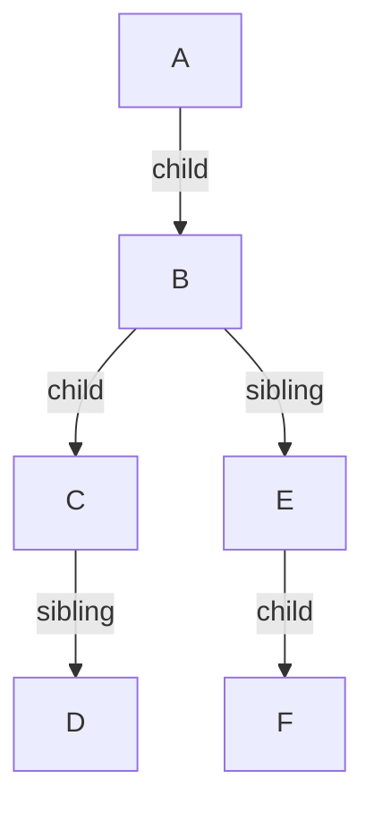
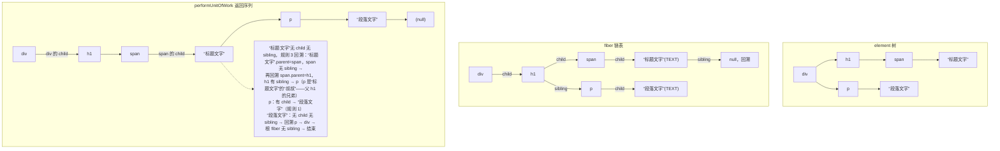

> 本文是《2. 复刻路线：十个里程碑（每步可运行，命名沿用经典 didact）》按小节拆分后的续篇，上一部分见 [03-M2-render-v1-递归直渲-0-5-天.md](03-M2-render-v1-递归直渲-0-5-天.md)。

### M3：并发思路与 Fiber 数据结构（1 天）

- 为什么不用 `requestIdleCallback`（浏览器实现不稳定）/ rAF（节奏不对）/ `setTimeout`（最小间隔 & 优先级）：真实 scheduler 用 **MessageChannel 宏任务** 宏观讲解
- Fiber 节点：`{ type, props, dom, parent, child, sibling, alternate, stateNode, effectTag }`
- **链表化遍历**：`performUnitOfWork`——先 child、无 child 走 sibling、都无走 return（叔叔），单元工作可暂停
- workLoop：`while (nextUnitOfWork && deadline.timeRemaining() > 1)`

M2 证明了"一口气干完"不行，M3 的任务是把一口气拆成许多小口气：**把整棵树的渲染工作切成一个个可暂停的"工作单元"**。这需要三样东西：一个能反复"借时间"的调度机制；一个能暂停/恢复的遍历结构；一个把两者粘起来的工作循环。依次来。

#### 3.1 调度机制：三个候选的落选理由与 MessageChannel 的当选理由

（先说明：本节教学主线最终用 `requestIdleCallback` 落地——它浏览器原生、自带 deadline 对象，代码最短；但必须先讲清楚**真实 React 为什么不敢用它**，否则你以为自己在学 React，其实只是在学 polyfill。）

**候选一：`requestIdleCallback`——为什么真实 React 不敢用。**

它的 API 形态最理想：`requestIdleCallback(deadline => ...)`，回调里 `deadline.timeRemaining()` 告诉你这一帧还剩多少毫秒可挥霍，完美匹配"把空闲时间借给 React"的构想。React 团队 2017 年 Fiber 刚落地时内部确实用过它。落选的硬伤：

- **兼容性**：Chromium 系早早支持，Firefox 跟进得晚，Safari 长期不实现——一个前端框架不能把心脏架在"Safari 某天可能支持"上；
- **语义太"谦让"**：它的约定是"浏览器空闲了才叫你"。像 Facebook 这种常年忙碌的页面，"空闲"是稀缺资源，回调触发频率极不稳定、不可依赖；
- **后台标签页大幅节流**：切走标签页后回调可能几十秒才来一次，React 希望后台还能低速率干活，rIC 给不了；
- **无优先级**：所有 rIC 回调一视同仁，表达不了"用户输入比数据刷新急"。

**候选二：`requestAnimationFrame`——节奏不对。**

rAF 的回调在"下一次 paint 之前"执行，跟帧率绑定。它的问题是**性质错位**：它是"画"的时机，不是"算"的时机。

- 回调跑在 paint 前的窗口里，你在里面塞重活，直接吃掉这一帧的 paint 预算——越用它越掉帧；
- 一帧只回调一次，无法表达"一帧内让出多次"；它不能帮你把长任务切片，它只负责告诉你"要画了"；
- 与显示器刷新率耦合（60Hz 屏 16.7ms/帧、120Hz 屏 8.3ms/帧，预算飘忽），且页面不可见时完全停止——React 的低优先级工作在后台就全停了；
- 它没有任何优先级语义。

**候选三：`setTimeout(fn, 0)`——最小间隔与优先级都不行。**

- **4ms 钳制**：HTML 规范规定，嵌套层级超过 5 层的 `setTimeout` 最小间隔被钳到 4ms——意味着每秒最多约 250 次调度。听起来不少，但 React 要的是"每个宏任务都借一小片"，4ms 的固定损耗在 16.7ms 的帧预算里占比过高，且调度吞吐被上限锁死；
- **后台节流到 1000ms****起**：后台标签页里 setTimeout 直接退化成秒级，低优先级工作全断；
- **任务源地位不可控**：setTimeout 的回调排在定时器任务源里，浏览器对各种任务源的执行顺序没有保证你优先的义务，输入事件、其他宏任务可能持续插到你前面——你表达不了"我想尽快但不堵塞别人"。

**当选者：`MessageChannel` 宏任务。**

真实 `scheduler` 包的核心循环（简化自 `performWorkUntilDeadline`）：

```js
// scheduler.js —— 真实 React scheduler 的最小示意（教学版，~30 行）
const channel = new MessageChannel()
const tickPort = channel.port2                        // 发消息的端口
channel.port1.onmessage = performWorkUntilDeadline   // 收消息：宏任务里干活

let deadline = 0               // 当前时间片的截止时刻（performance.now() 时间戳）
let scheduledCallback = null   // 待执行的工作循环（真实 React 这里是按优先级排的小顶堆）

export function scheduleCallback(callback) {
  scheduledCallback = callback
  tickPort.postMessage(null)   // 投递一个宏任务，立即返回，不堵塞当前代码
}

function performWorkUntilDeadline() {
  if (scheduledCallback == null) {
    return
  }
  deadline = performance.now() + 5  // 时间片：真实 React 默认 5ms，并按帧率自适应
  // 把"还剩多少时间"包装成与 rIC 同形的 deadline 对象传给工作循环
  const hasMoreWork = scheduledCallback({
    timeRemaining: () => Math.max(0, deadline - performance.now()),
  })
  if (hasMoreWork) {
    tickPort.postMessage(null) // 没干完：再约下一个宏任务，主线程先还给浏览器
  } else {
    scheduledCallback = null   // 干完了：进入待命，下次 scheduleCallback 再唤醒
  }
}
```

它凭什么赢？逐条对照三个落选者的伤疤：

- `port.postMessage` 触发 `onmessage` 是**宏任务**：浏览器事件循环保证每一帧都会处理宏任务（渲染间隙也在跑宏任务），所以"每帧都有机会干活"由事件循环模型本身背书——不依赖浏览器的"空闲施舍"，**从被动等空闲改为主动时间切片**；
- **没有 4ms 钳制**：postMessage 不属于定时器任务源，不受 setTimeout 那套嵌套钳制约束，连续投递畅通；
- **不与帧率耦合**：时间片自己用 `performance.now()` 算，5ms 就是 5ms，60Hz 屏和 120Hz 屏一视同仁，后台标签页也只是整体降速而非停摆；
- 为什么不用 `window.postMessage`？那是全页广播——页面上任何第三方脚本都可能监听 message 事件甚至干扰；MessageChannel 的两个端口是**私有点对点通道**，与外部世界零干扰。（补充：真实 scheduler 按环境择优选 `setImmediate`（Node/旧 IE）→ `MessageChannel`（现代浏览器）→ `setTimeout`（兜底），现代浏览器实际走的就是 MessageChannel。）

顺带划重点：M3 用 `requestIdleCallback` 与真实 React 用 MessageChannel，**形态不同、骨架相同**——都是"干一片、还主线程、预约下一片"，连传给工作循环的 deadline 对象形状都一样。学的是骨架，不是皮。

#### 3.2 Fiber 节点：数据结构逐字段精讲

先看契约中的完整结构（本篇全书统一使用）：

```js
// 一个 fiber 节点 = 工作树上的一个工作单元
{
  type: 'div' | TEXT_ELEMENT | 函数, // 元素类型：宿主标签字符串 / 文本标记 / 组件函数(M6)
  props: {...},                      // 属性与 children（承袭自 element）
  dom: HTMLElement | Text | null,    // 对应的真实节点；根 fiber 是容器；组件 fiber 没有(M6)
  parent: Fiber | null,              // 父 fiber（真实 React 叫 return——因为它指向回溯方向）
  child: Fiber | null,               // 第一个孩子（其余孩子靠 sibling 串起来）
  sibling: Fiber | null,             // 右侧兄弟
  alternate: Fiber | null,           // 上一轮的同一位置（双缓冲的另一半，§1/M5/M7 反复用）
  effectTag: 'PLACEMENT' | 'UPDATE' | 'DELETION' | null, // 提交阶段的操作指令(M4 起打标)
}
```

逐字段的设计动机：

- **`type` + `props`**：与 element 完全同形——fiber 是 element 的超集，element 只描述"要什么"，fiber 额外携带"干到什么程度了"（`dom` 建了没）和"身在何处"（parent/child/sibling）。M2 的 `createDom` 因此能原封不动接收 fiber；
- **`dom`**：fiber 与真实世界的锚点。`null` 表示"还没轮到我创建"；根 fiber 的 dom 是容器；将来函数组件的 fiber 干脆没有 dom（M6）。真实 React 这里叫 `stateNode`，语义更广（还可能是组件实例/class 实例）；
- **`parent` / `child` / `sibling` 三件套**：本节主角，见下文"为什么是链表不是数组"；
- **`alternate`**：§1 双缓冲时序图里那根贯穿始终的指针。M3 先把它放进结构里（构造时置 null），M5 的 diff 和 M7 的 hooks 对齐才会真正用起来；
- **`effectTag`**：render 阶段的"便签"——这个节点相对旧树是新增、更新还是删除？commit 阶段照单执行。真实 React 18 已把该字段改名为 `flags`，且用位标志支持多操作叠加，我们保持字符串最直白。

对照表（给将来走"路径 A 读真源码"的你）：

| 我们的字段 | 真实 React | 备注 |
|---|---|---|
| `type` | `type` | 同名 |
| `props` | `pendingProps` / `memoizedProps` | 真实版拆成"工作用/上次提交用"两个 |
| `dom` | `stateNode` | 语义更广 |
| `parent` | `return` | 名字即语义：回溯方向 |
| `child` / `sibling` | `child` / `sibling` | 同名 |
| `alternate` | `alternate` | 同名 |
| `effectTag` | `flags` | 18 起改名并位标志化 |
| （M7 加入 `memoizedState`） | `memoizedState` | hooks 链表头 |

**为什么用 child/sibling 链表而不是 children 数组？** 这是 M3 最核心的一个设计决策，理由要说到根上：

- 数组遍历依赖递归（或显式栈），遍历状态在**调用栈**里——M2 已经证明调用栈不可暂停；
- 链表把"下一步去哪"写进每个节点自身（child、sibling、parent 三个指针），遍历状态只需要**一个变量**（`nextUnitOfWork`）。暂停 = 把当前节点记进变量；恢复 = 读出来继续。状态从栈搬到了堆，从隐式变成了显式可序列化；
- 代价：随机访问第 i 个孩子要沿 sibling 走 i 步（O(n)）。React 甘愿付出这个代价，因为并发遍历的收益远大于按索引访问的需求——事实上 reconciler 从不需要随机访问孩子。

#### 3.3 链表化遍历：performUnitOfWork 的 child → sibling → return（叔叔）规则

先建直觉。一棵普通树：

```text
        A
       / \
      B   E
     / \   \
    C   D   F
```

转成链表视图（child 用竖线、sibling 用横向箭头）：



字段值：`A.child=B`；`B.sibling=E`；`B.child=C`；`C.sibling=D`；`E.child=F`。

`performUnitOfWork` 每次返回"下一个该处理的节点"，规则只有三条，按序判断：

1. **有 child 就下**：`return fiber.child`（深度优先）；
2. **没 child 有 sibling 就右**：`return fiber.sibling`（继续处理同一父的下一个孩子）；
3. **都没有就"回 return"**：沿 `parent` 一路上溯，遇到的第一个**有 sibling 的祖先**，返回它的 sibling——那个节点俗称"**叔叔**"（父的兄弟）。上溯到根还没有，遍历结束（返回 undefined，`nextUnitOfWork` 变 null）。

对上图按规则推演，完整遍历序列：

```text
A → B → C → D → E → F → (null，结束)

A：有 child → B
B：有 child → C
C：无 child、有 sibling → D        （规则 2）
D：无 child、无 sibling → 规则 3 回溯：
   D.parent=C，C 无 sibling → 再回溯 C.parent=B，B 有 sibling → E
   （E 是 D 的"叔叔"——父 B 的兄弟，这正是"叔叔"这个称呼的由来）
E：有 child → F                    （规则 1）
F：无 child、无 sibling → 回溯 F.parent=E，E 无 sibling → 再回溯 E.parent=A，
   A 无 sibling → 再回溯 A.parent=null → 遍历结束
```

再拿一个贴近页面的例子练手，这是后面验收时要对照的：



上面这个序列请务必亲手在纸上演一遍——M3 验收实验里 `console.log` 打出来的顺序必须和你手推的一模一样，这是"我真的懂链表遍历了"的检验。

#### 3.4 render v2、workLoop 与带缺陷的 performUnitOfWork

万事俱备，写 M3 主体。对 M2 的改动：`render` 不再递归（它退化成"立项"），递归遍历被 `performUnitOfWork` + `workLoop` 取代。

```js
// —— M3 追加/替换：didact.js（createElement/createDom/updateDom 均沿用 M1/M2）——

let nextUnitOfWork = null // 下一个工作单元；null = 本轮工作全部完成
let wipRoot = null        // work-in-progress 根：正在构造的 fiber 树（§1 双缓冲的主角）

export function render(element, container) {
  // render 不渲染，只立项：
  // 造一个"容器包装 fiber"，dom 直接指向容器本身，element 作为它唯一的孩子
  // （alternate 字段此刻置 null，M5 起会指向旧树根——§1 时序图 T4）
  wipRoot = {
    type: null,
    props: {
      children: [element],
    },
    dom: container,
    parent: null,
    child: null,
    sibling: null,
    alternate: null,
    effectTag: null,
  }
  nextUnitOfWork = wipRoot
}

// 工作循环：调度器每次"借"来一段时间，就尽量多干几个单元
function workLoop(deadline) {
  let shouldYield = false
  while (nextUnitOfWork && !shouldYield) {
    nextUnitOfWork = performUnitOfWork(nextUnitOfWork) // 干一个单元
    shouldYield = deadline.timeRemaining() < 1         // 没时间了：标记让出
  }
  // 干完 or 让出之后，都预约下一轮（没活时循环条件直接不进，空转一次判断，代价为零）
  requestIdleCallback(workLoop)
}
requestIdleCallback(workLoop) // 启动常驻调度（真实 React：Scheduler 用 MessageChannel 投宏任务）

function performUnitOfWork(fiber) {
  // ① 为当前 fiber 创建真实 DOM
  //    根 fiber 的 dom 是容器（render 时已赋值），跳过创建
  if (!fiber.dom) {
    fiber.dom = createDom(fiber)
  }

  // ② 【M3 缺陷】边构造边把 DOM 挂进文档：
  //    时间片在这里耗尽时，浏览器下一帧 paint 出来的就是"半棵树"。
  //    这行故意留着——它是 M4 的靶子
  if (fiber.parent) {
    fiber.parent.dom.appendChild(fiber.dom)
  }

  // ③ 把 children（element 数组）转成 child/sibling 链表
  const elements = fiber.props.children
  let index = 0
  let prevSibling = null

  while (index < elements.length) {
    const element = elements[index]

    const newFiber = {
      type: element.type,
      props: element.props,
      parent: fiber, // 指回父节点：规则 3 的"回 return"全靠它
      dom: null,     // DOM 延迟到这个 fiber 被轮到时再创建
      child: null,
      sibling: null,
      alternate: null, // M5 起指向旧树同位置
      effectTag: null,
    }

    if (index === 0) {
      fiber.child = newFiber         // 长子：挂到父的 child
    } else {
      prevSibling.sibling = newFiber // 其余：挂到左邻兄弟的 sibling
    }
    prevSibling = newFiber
    index++
  }

  // ④ 返回下一个工作单元：child → sibling → return（叔叔），3.3 节的三条规则
  if (fiber.child) {
    return fiber.child // 规则 1
  }
  let nextFiber = fiber
  while (nextFiber) {
    if (nextFiber.sibling) {
      return nextFiber.sibling // 规则 2（也覆盖"自己就有兄弟"的情况）
    }
    nextFiber = nextFiber.parent // 规则 3：一路回溯找"叔叔"
  }
  // 回溯到根的 parent(null) 也没找到兄弟 → 整棵树完成，返回 undefined
}
```

对照大纲那行 `while (nextUnitOfWork && deadline.timeRemaining() > 1)`：它与上面 `shouldYield = deadline.timeRemaining() < 1` 的写法完全等价（一个在 while 条件里查余额，一个在循环体里记让出标志；didact 采用后者，因为干完一个单元才有资格查余额）。

几个读代码的关键点：

- **`workLoop` 是"时间片消费者"**：一个片内能干几个单元干几个（每个单元约等于"一个节点建 DOM + 为孩子建链表"），干到 `timeRemaining() < 1` 立刻收手——哪怕下一单元只剩半步，也不抢浏览器的渲染窗口。之后 `requestIdleCallback(workLoop)` 把自己再挂回去，形成一个永续循环：**有活干活、没活待命、干活必让**；
- **中断点只可能出现在两个单元之间**——每个 `performUnitOfWork` 是原子的（一次同步调用），单元内部不存在被切断的可能。这就是"工作单元"的含义：**粒度是设计出来的安全边界**；
- **`render` 的身份变了**：M2 里它是"执行者"，现在它是"立项者"——只准备 wipRoot 与 nextUnitOfWork，实际工作由调度循环异步推进。调用 `render` 立刻返回，主线程立刻还给调用方。这个身份转变就是 §1 里 Scheduler 层"何时开始"的雏形；
- **M3 版仍然没有 commitRoot**：DOM 是在 ② 里被逐个挂进文档的。换句话说，M3 解决了"卡死"（M2 的债），却违反了 §1 双缓冲的不变量 1（"屏幕只认 current 树"）——**撕裂**，M4 的靶子已经立在代码里了。

**验收方式（M3）**：① 把 M2 的万节点 benchmark 原样重跑（`render` 接口没变）——现象质变：clock 全程稳定跳动，列表"逐帧生长"（每个时间片长一截），Performance 面板里原来的整条 Long Task 被切成一串 5ms 级的小任务，任务之间是浏览器正常的渲染帧；② 在 `performUnitOfWork` 开头加 `console.log(fiber.type === TEXT_ELEMENT ? 'TEXT:' + fiber.props.nodeValue : fiber.type)`，渲染 3.3 节那个 div/h1/span/p 的例子，核对输出序列与你手推的 `div → h1 → span → 标题文字 → p → 段落文字` 完全一致（链表遍历过关的凭证）；③ 观察撕裂预告：用 MutationObserver 统计 root 下插入操作的批次（代码见 M4 验收，可先抄去跑），会看到插入分散在多个批次——也就是说屏幕在多个时间片里被反复 paint 出"半成品"，这就是 M4 要消灭的现象；④ 回到 §1 的分层图自问自答：M3 版的 render+workLoop+performUnitOfWork 分别站在哪一层（答：render 是 Scheduler 与 Reconciler 的接口，workLoop 是 Scheduler 的消费端，performUnitOfWork 是 Reconciler）。四项全过，M3 完成。

---

## 附:ASCII 图替换清单

本文档图形化改版,原 ASCII 字符图与 Mermaid 图表对应关系如下:

| 原图位置 / 标题 | 处理结果 |
| --- | --- |
| §3.3 链表化遍历:普通树 A–F 的链表视图(child/sibling) | 替换为 flowchart TD |
| §3.3 链表化遍历:div/h1/span/p 的 fiber 链表与 performUnitOfWork 返回序列 | 替换为 flowchart TD(三个 subgraph:element 树 / fiber 链表 / 返回序列) |
