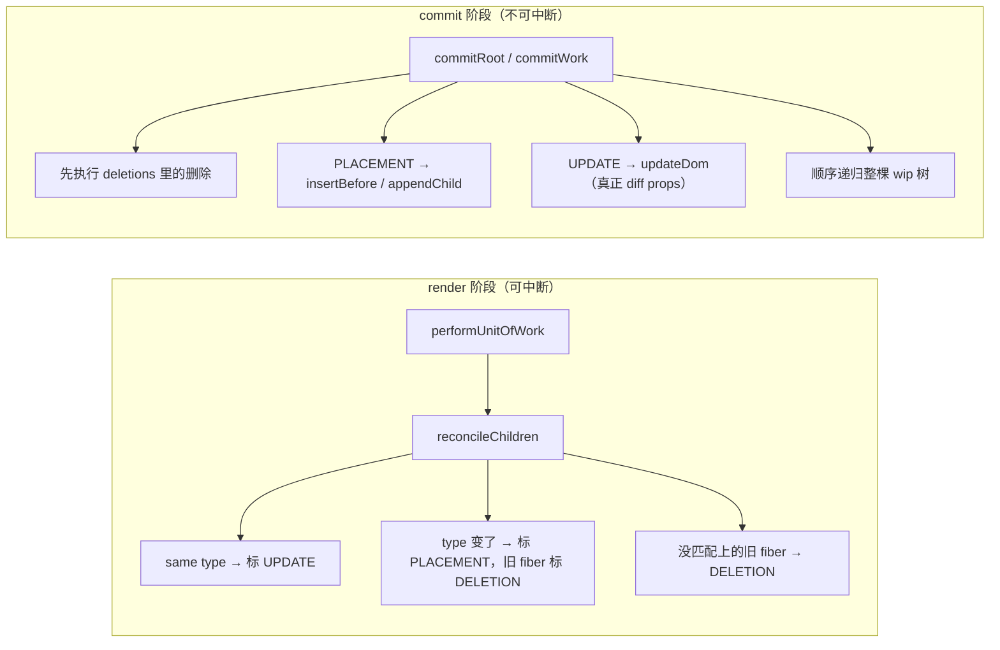

> 本文是《2. 复刻路线：十个里程碑（每步可运行，命名沿用经典 didact）》按小节拆分后的续篇，上一部分见 [05-M4-render-与-commit-分离-1-天.md](05-M4-render-与-commit-分离-1-天.md)。

### M5：Reconciliation —— diff 与复用（2 天）⭐核心

从这一章开始，我们的 mini React 才真正开始"像 React"。M1 到 M4 解决的是"怎么把一棵 element 树变成页面"：递归改链表（Fiber）、边算边让出主线程（并发）、算完一次性提交（两阶段）。但到目前为止有一个致命缺陷：**每次更新都是推倒重来**——第二次调用 `render` 时，旧的那棵 fiber 树被整个丢弃，所有 DOM 节点新建、旧节点全部扔掉。这一章要补上 React 的心脏：**Reconciliation（调和）**——拿新 element 树和旧 fiber 树逐个对比，能复用的复用（UPDATE），该新建的新建（PLACEMENT），该删的删（DELETION），把"更新页面"的成本从"整棵树"降到"真正变化的那几个节点"。

先给这一章的心智模型，后面所有代码都围绕它展开：



记住一条铁律：**render 阶段只"打标记"，commit 阶段才"动 DOM"**。这是 M4 确立的分离原则，diff 属于 render 阶段，所以 reconcileChildren 里你看到的只是往 fiber 上写 `effectTag`，一行 DOM 操作都没有。

---

#### 0. 基线回顾：M4 末我们手里有什么

为了让你不用翻回 M4，先把基线代码摆出来（做了微缩，完整版见 M4 章）。此刻 `performUnitOfWork` 对 children 的处理是"无脑新建"：

```js
// ---------- M4 末的基线（节选） ----------
let nextUnitOfWork = null; // 下一个工作单元
let wipRoot = null;        // 正在构造的 fiber 树（workInProgress 树）的根
let deletions = [];        // 待删除的 fiber 列表（M4 里恒为空，本章开始真正使用）

function workLoop(deadline) {
  let shouldYield = false;
  while (nextUnitOfWork && !shouldYield) {
    nextUnitOfWork = performUnitOfWork(nextUnitOfWork); // 做一个单元的工作
    shouldYield = deadline.timeRemaining() < 1;         // 没时间了就让出主线程
  }
  if (!nextUnitOfWork && wipRoot) {
    commitRoot(); // 整棵 wip 树构造完，一次性提交
  }
  requestIdleCallback(workLoop); // 自我续期（M3 的调度循环）
}
requestIdleCallback(workLoop);

function render(element, container) {
  wipRoot = {
    dom: container,
    props: { children: [element] },
    alternate: null, // M4 还没把新旧树连起来
  };
  deletions = [];
  nextUnitOfWork = wipRoot;
}

function performUnitOfWork(fiber) {
  if (!fiber.dom) {
    fiber.dom = createDom(fiber); // 每个 fiber 都造一个真实 DOM 节点
  }
  // M4：不对比。children 一律新建 fiber、一律打 PLACEMENT
  const elements = fiber.props.children;
  let index = 0;
  let prevSibling = null;
  while (index < elements.length) {
    const element = elements[index];
    const newFiber = {
      type: element.type,
      props: element.props,
      parent: fiber,
      dom: null,
      alternate: null,
      effectTag: 'PLACEMENT', // 全部当作"新增"
    };
    if (index === 0) {
      fiber.child = newFiber;
    } else {
      prevSibling.sibling = newFiber;
    }
    prevSibling = newFiber;
    index++;
  }
  // 下一个工作单元：优先 child，其次 sibling，都没有就顺着 parent 找"叔叔"
  if (fiber.child) return fiber.child;
  let next = fiber;
  while (next) {
    if (next.sibling) return next.sibling;
    next = next.parent;
  }
  return null; // 整棵树遍历完毕
}

function commitRoot() {
  deletions.forEach(commitWork); // M4 时恒为空数组
  commitWork(wipRoot.child);
  wipRoot = null;
}

function commitWork(fiber) {
  if (fiber == null) return;
  const domParent = fiber.parent.dom;
  if (fiber.effectTag === 'PLACEMENT' && fiber.dom != null) {
    domParent.appendChild(fiber.dom); // M4 只会走这一支
  }
  commitWork(fiber.child);
  commitWork(fiber.sibling);
}
```

这个基线跑个时钟没问题，但只要"更新"就会露馅。做一个 10 秒就能复现的实验：

```js
// 每秒重新 render 一次：结构完全相同，只有文本在变
function tick() {
  const time = new Date().toLocaleTimeString();
  Didact.render(
    Didact.createElement('div', null,
      Didact.createElement('input', { placeholder: '在这里打几个字' }),
      Didact.createElement('h1', null, time)
    ),
    document.getElementById('root')
  );
}
tick();
setInterval(tick, 1000);
```

运行它，然后在输入框里打字：**每过一秒，焦点消失、你打的字也没了**。原因就在上面的代码里——第二次 `render` 建了一棵全新的 wip 树，所有 fiber 都是 `PLACEMENT`，commit 时把全新的 `<input>` append 进去；而 commit 完成后，旧的那棵树连同旧 DOM 一起被丢弃（没人再引用它们，浏览器随后回收）。用户看到的效果就是"整个界面每秒被替换一次"。一万节点的树每秒全部重建，Fiber 的可中断调度再精巧也救不了。

破局思路只有一个：**更新时不要从零建树，而是把旧树"抄"一遍——抄的过程中逐个位置对比，能复用的旧 fiber 与旧 DOM 直接沿用，只对变化的部分打特殊标记**。这就是 reconcileChildren 要做的事。

---

#### 1. `alternate` 指向旧 fiber，逐个对比 —— reconcileChildren 完整实现

##### 1.1 第一步：把新旧两棵树连起来

diff 需要同时拿到"新的"和"旧的"。新树是本轮正在构造的 wip 树；旧树是**上一轮已经 commit 的那棵**——它此刻就挂在页面上。我们用一个新全局变量 `currentRoot` 记住它，并让新树的根通过 `alternate` 指回去：

```js
let currentRoot = null; // 上一轮已提交的 fiber 树（"屏幕上"的那棵）

function render(element, container) {
  wipRoot = {
    dom: container,
    props: { children: [element] },
    alternate: currentRoot, // ★ 新树的根指回旧树的根，diff 的"旧"从这来
  };
  deletions = []; // 每轮 render 开始，清空上一轮的删除清单
  nextUnitOfWork = wipRoot;
}

function commitRoot() {
  deletions.forEach(commitWork); // ★ 先提交删除（见第 3 节）
  commitWork(wipRoot.child);
  currentRoot = wipRoot; // ★ 提交完成后，这棵树成为"屏幕上的树"
  wipRoot = null;        // wipRoot 置空，本轮结束
}
```

两行 `★` 就是 M1 里讲过的**Fiber 双缓冲**在代码里的样子：`currentRoot` 是 current 树（已上屏），`wipRoot` 是 workInProgress 树（构造中），根节点靠 `alternate` 互指。子节点层面的 `alternate` 由下面的 reconcileChildren 逐个建立。中断再多次也没关系——只要没走到 `commitRoot`，`currentRoot` 指向的旧树和它对应的 DOM 完好无损，页面永远不会出现改了一半的中间态。

##### 1.2 reconcileChildren：完整代码

现在把 `performUnitOfWork` 里那段"无脑新建"替换成真正的调和逻辑。函数签名按命名契约：`reconcileChildren(wipFiber, elements)`——`wipFiber` 是新树里正在处理的 fiber，`elements` 是它本次的 children（element 数组，来自 `wipFiber.props.children` 或函数组件的返回值）。

```js
function reconcileChildren(wipFiber, elements) {
  let index = 0;
  // 旧 children 的链表头：从 wipFiber 的旧身（alternate）的 child 开始
  let oldFiber = wipFiber.alternate && wipFiber.alternate.child;
  let prevSibling = null;

  // v1：新旧两条链并肩前进，按"位置"对齐对比
  while (index < elements.length || oldFiber != null) {
    const element = index < elements.length ? elements[index] : null;
    const sameType =
      element != null && oldFiber != null && element.type === oldFiber.type;

    let newFiber = null;

    if (sameType) {
      // ① 同位置、同类型 → 复用：dom 沿用旧的，props 换成新的，打 UPDATE
      newFiber = {
        type: oldFiber.type,
        props: element.props,   // props 用新的
        dom: oldFiber.dom,      // ★ dom 用旧的——这一行就是"复用 DOM"
        parent: wipFiber,
        alternate: oldFiber,    // ★ 指回旧 fiber，commit 时 diff props 要用
        effectTag: 'UPDATE',
      };
    }

    if (element != null && !sameType) {
      // ② 这个位置要的是"另一个类型"，或者旧链已尽还有新增 → 新建，打 PLACEMENT
      newFiber = {
        type: element.type,
        props: element.props,
        dom: null,             // 新建：DOM 在 performUnitOfWork/createDom 阶段创建
        parent: wipFiber,
        alternate: null,       // 没有旧身
        effectTag: 'PLACEMENT',
      };
    }

    if (oldFiber != null && !sameType) {
      // ③ 这个位置上的旧 fiber 不再被复用 → 标 DELETION，收进 deletions 等待 commit
      oldFiber.effectTag = 'DELETION';
      deletions.push(oldFiber);
    }

    // 挂链：第一个孩子接到 wipFiber.child，其余接到前一个兄弟的 sibling
    if (index === 0) {
      wipFiber.child = newFiber;
    } else if (element != null) {
      prevSibling.sibling = newFiber;
    }
    if (element != null) {
      prevSibling = newFiber;
    }

    index++;
    if (oldFiber != null) {
      oldFiber = oldFiber.sibling; // 旧链也前进一格
    }
  }
}
```

`performUnitOfWork` 里对宿主元素的处理相应变成：

```js
function updateHostComponent(fiber) {
  if (!fiber.dom) {
    fiber.dom = createDom(fiber); // 只有 dom 为 null（新建/换类型）时才创建 DOM
  }
  reconcileChildren(fiber, fiber.props.children); // ★ 对比代替无脑新建
}

function performUnitOfWork(fiber) {
  updateHostComponent(fiber);
  // 下一个工作单元的遍历逻辑与 M4 相同：child → sibling → 叔叔
  if (fiber.child) return fiber.child;
  let next = fiber;
  while (next) {
    if (next.sibling) return next.sibling;
    next = next.parent;
  }
  return null;
}
```

（`updateHostComponent` 这个名字是为 M6 预留的——那时它会和 `updateFunctionComponent` 并列成两个分支，见下一章。）

##### 1.3 逐段拆解：三个判定分支各自意味着什么

**第一段：旧链从哪来。** `wipFiber.alternate && wipFiber.alternate.child`——新 fiber 的旧身的第一个孩子。如果这是首次渲染，`alternate` 是 null，旧链为空，循环里 `sameType` 恒为 false，所有 element 都走分支②（PLACEMENT），行为退化到 M4——所以这一版代码天然兼容首屏。如果 `wipFiber` 是被复用的（UPDATE），它的 `alternate` 就是上一轮同一个位置的旧 fiber，新旧两条链从这里开始"并肩走"。

**第二段：`sameType` 的判定。** 只比较 `element.type === oldFiber.type`，props 完全不参与。这背后是 React 的核心取舍：**type 是一个节点"是什么"的最小标识**——`div` 变 `div`，无论 props 差多少，都只是"同一个节点的属性变了"，DOM 可以留；`div` 变 `span`，哪怕内容一模一样，也是"换了种东西"，旧 DOM 必须拆掉（浏览器里不同标签的语义、默认样式、内部结构都不同，改造不如重建）。text 节点同理：`TEXT_ELEMENT` 对 `TEXT_ELEMENT`，即使文字不同也算 same type，文字变化属于 props（`nodeValue`）变化。

**第三段：分支①（UPDATE，复用）。** 注意 `newFiber` 是**新对象**——我们从不修改旧 fiber 来当新节点用，而是每轮 render 建一棵全新的 wip 树，只是把旧 fiber 的两个东西"抄"过来：`dom`（真实 DOM 节点直接沿用，这就是复用的本体）和 `alternate`（指回旧 fiber，commit 阶段 `updateDom` 要拿 `fiber.alternate.props` 和 `fiber.props` 做属性 diff）。为什么新建对象而不是复用旧对象？因为旧树必须保持完整、稳定地挂在 `currentRoot` 上，直到新树 commit 成功——如果直接在旧 fiber 上改，一旦 render 中断、下一轮从头再来，旧树就被污染了，双缓冲就失去了意义。

**第四段：分支②（PLACEMENT，新建）。** 触发条件有两个：这个位置上 element 的 type 和旧 fiber 不同（换类型），或者旧链已经走完但新 elements 还有剩余（纯新增）。新建 fiber 的 `dom` 是 null，`alternate` 是 null——它没有历史。

**第五段：分支③（DELETION，删除）。** 旧 fiber 存在但不被复用。关键问题来了：**被删的旧 fiber 不在新 wip 树上**，`commitWork(wipRoot.child)` 这条从新树根出发的递归天然走不到它，那 commit 阶段怎么知道要删它？答案就是那个贯穿全局的 `deletions` 数组——render 阶段把所有要删的旧 fiber 集中收进来，`commitRoot` 开头统一处理。这是"收集—延迟执行"模式在删除场景的又一次应用。

**第六段：挂链。** 新 fiber 们组成新的 child/sibling 链。注意条件 `else if (element != null)`——当新 children 比旧的短、循环纯粹在处理尾部旧 fiber 的删除时，不碰 `prevSibling`，此时也没有新 fiber 可挂。

##### 1.4 一次更新在 render 阶段的完整时序

用一个具体例子把流程走一遍。页面当前是 `<div><span>Hi</span></div>`（旧树已提交），下一轮 render 的 element 是 `<div><span>Hi!</span><button>点我</button></div>`：

```text
performUnitOfWork(根fiber)
  alternate=currentRoot(旧根) → 旧 child = 旧div fiber
  reconcileChildren(根fiber, [divElement])
    index0: div === div → UPDATE，新divFiber{dom:旧div的DOM, alternate:旧divFiber}
  下一个单元 = 新divFiber

performUnitOfWork(新divFiber)
  dom 已有（沿用的旧 DOM），不再创建
  reconcileChildren(新divFiber, [spanElement, buttonElement])
    旧链（旧divFiber.alternate.child 起）：旧spanFiber → null
    index0: span === span → UPDATE（文本变化留给 commit 阶段的 updateDom）
    index1: element=button，旧链已尽 → PLACEMENT
  下一个单元 = 新spanFiber …… buttonFiber ……
全部单元做完 → workLoop 发现 nextUnitOfWork 为 null 且 wipRoot 存在 → commitRoot()
```

到这里，render 阶段产出了三样东西：一棵带标记的新 wip 树（fiber 们通过 `effectTag` 声明自己是 UPDATE 还是 PLACEMENT）、一张 `deletions` 删除清单、以及沿 `alternate` 串起来的新旧对照关系。剩下的都是 commit 阶段的事。

---

#### 2. props diff：删除变 undefined 的、更新变化的 —— updateDom 完整实现

分支①只是宣布"这个节点可以复用"，但 props 从 `{style: 'a', onClick: f1}` 变成 `{className: 'b'}` 时，沿用 DOM 还不够，还得把属性差异落到 DOM 上。这件事发生在 commit 阶段的 `commitWork` 里（见第 3 节的调用点），执行者就是 `updateDom(dom, prevProps, nextProps)`。

四个判定用的谓词先写好，后面四段处理各取所需：

```js
const isEvent = name => name.startsWith('on');                    // onClick、onInput 等
const isProperty = name => name !== 'children' && !isEvent(name); // 普通属性（排除 children 和事件）
const isNew = (prev, next) => name => prev[name] !== next[name];   // 新旧值不同才算"变"
const isGone = (prev, next) => name => !(name in next);            // 新 props 里没有 = 被删除
```

完整实现，四段处理**按固定顺序**执行：

```js
function updateDom(dom, prevProps, nextProps) {
  // ── 第一段：移除旧的事件监听 ──
  // 覆盖两种情况：新 props 里没有这个事件了（删掉了），或处理函数变了（要重绑）
  Object.keys(prevProps)
    .filter(isEvent)
    .filter(name => !(name in nextProps) || isNew(prevProps, nextProps)(name))
    .forEach(name => {
      const eventType = name.toLowerCase().substring(2); // onClick → click
      dom.removeEventListener(eventType, prevProps[name]);
    });

  // ── 第二段：删除消失的普通属性 ──
  // 旧有、新无 → 视为"显式删除"。didact 的简化处理是赋空字符串
  Object.keys(prevProps)
    .filter(isProperty)
    .filter(isGone(prevProps, nextProps))
    .forEach(name => {
      dom[name] = '';
    });

  // ── 第三段：设置新增或变化的普通属性 ──
  Object.keys(nextProps)
    .filter(isProperty)
    .filter(isNew(prevProps, nextProps))
    .forEach(name => {
      dom[name] = nextProps[name];
    });

  // ── 第四段：绑定新的事件监听 ──
  // 只绑"新增的或换过函数的"；没变的事件不动，避免无谓的 remove/add
  Object.keys(nextProps)
    .filter(isEvent)
    .filter(isNew(prevProps, nextProps))
    .forEach(name => {
      const eventType = name.toLowerCase().substring(2);
      dom.addEventListener(eventType, nextProps[name]);
    });
}
```

逐段说明设计原因。

**为什么事件要单独对待（第一、四段）？** 因为 DOM 的事件监听**不能靠赋值覆盖**。`dom.title = 'x'` 是属性赋值，赋两次就是覆盖；但 `addEventListener('click', f)` 调两次会注册两个监听器，同一个事件挂两个函数，点一次按钮触发两次。所以对事件必须走"先 `removeEventListener` 旧的，再 `addEventListener` 新的"的完整流程，而且判断标准是**函数引用是否相同**（`isNew` 用 `!==` 比较）。这也解释了一个使用层现象：如果组件每次 render 都生成一个全新的内联箭头函数 `onClick={() => ...}`，引用每次都变，每次更新都要拆一次监听再绑一次；真实 React 用事件委托规避了这一点（M9 的合成事件会展开，我们的 mini 版每次重绑，功能等价、性能不同）。

**为什么事件处理要放在最前和最后？** 把"移除旧事件"放第一段、"绑定新事件"放最后一段，中间隔开属性处理，是为了逻辑清晰：一个"处理函数变了"的事件会先被第一段摘掉旧函数，再被第四段绑上新函数，两个动作一先一后，互不干扰。顺序本身不是正确性关键（换成一、四相邻也对），关键的是"移除必须在绑定之前完成"。

**为什么删除属性是赋 `''` 而不是 `removeAttribute`？** didact 的简化选择：我们的属性是直接赋值到 DOM 对象上的（`dom[name] = value`），那么对称的"撤销"就是赋一个空值。真实 React 对不同属性类型有更精细的处理（attribute、property、style 对象逐项 diff 等），思想一致：**旧有新无的必须显式清理，否则上一个版本设置的属性会残留在复用的 DOM 上**——比如上一轮 `title='提示'`，这一轮 props 里没有 title，不清掉的话鼠标悬停还会冒出旧提示。

**`children` 被排除在外。** children 的"diff"不是在这里做的——子 element 的对比是 reconcileChildren 的事，它们会变成子 fiber 的 UPDATE/PLACEMENT/DELETION，各自由各自己的 commit 处理。updateDom 只负责**当前节点自身的属性**。这是一个非常清晰的责任划分：**attributes 归 updateDom，children 归 reconcile**。

**初建也走 updateDom。** `createDom` 创建完节点后调用 `updateDom(dom, {}, props)`——旧的属性集合是空对象，于是第二段无事可做、第三段全量设置、第四段全量绑定。一套代码同时服务"初建"和"更新"，这是把 updateDom 抽出来的原因：

```js
function createDom(fiber) {
  const dom =
    fiber.type === 'TEXT_ELEMENT'
      ? document.createTextNode('')
      : document.createElement(fiber.type);
  updateDom(dom, {}, fiber.props); // 初建 = "从空 props 到有 props"的 diff
  return dom;
}
```

**性能小账。** 注意所有 filter 都带 `isNew`/`isGone`——值没变的属性一个都不碰。这就是 React "props diff" 的粒度：**属性级、浅比较**。对象属性（比如 style）是引用比较，引用变了就整体重设，不做深层递归——真实 React 对 style 有特殊处理，我们的 mini 版保持简单。

---

#### 3. commit 阶段如何处理 DELETION

render 阶段收集了 `deletions`，现在兑现。`commitRoot` 与 `commitWork` 的完整版本：

```js
function commitRoot() {
  deletions.forEach(commitWork); // ★ 第一件事：统一执行删除
  commitWork(wipRoot.child);     // 然后从新树根递归处理 UPDATE / PLACEMENT
  currentRoot = wipRoot;         // 新树上位
  wipRoot = null;
}

function commitWork(fiber) {
  if (fiber == null) return;

  // 宿主父节点：M5 阶段每个 fiber 的 parent 都有 dom；
  // M6 引入函数组件后这里要升级成"沿 parent 链向上找"，下一章展开
  const domParent = fiber.parent.dom;

  if (fiber.effectTag === 'PLACEMENT' && fiber.dom != null) {
    // 新增：找右侧第一个已在文档里的宿主节点做锚点，保证插入位置正确
    const anchor = getNextHostDom(fiber);
    if (anchor != null) {
      domParent.insertBefore(fiber.dom, anchor);
    } else {
      domParent.appendChild(fiber.dom);
    }
  } else if (fiber.effectTag === 'UPDATE' && fiber.dom != null) {
    // 更新：真正执行第 2 节的 props diff
    updateDom(fiber.dom, fiber.alternate.props, fiber.props);
  } else if (fiber.effectTag === 'DELETION') {
    // 删除：把旧 DOM 从父节点摘下来，子树 DOM 随之整体脱离
    domParent.removeChild(fiber.dom);
    return; // ★ 删除到此为止，不递归 fiber.child / fiber.sibling（原因见下）
  }

  commitWork(fiber.child);
  commitWork(fiber.sibling);
}

// 找 fiber 右侧第一个可以当 insertBefore 锚点的宿主节点。
// 两个排除条件缺一不可：
//   1. 标了 PLACEMENT 的兄弟自己马上要被插入/移动，此刻的位置不算数，跳过；
//   2. 找到的 dom 必须已经挂在文档里（isConnected），游离节点不能当锚点。
function getNextHostDom(fiber) {
  let sibling = fiber.sibling;
  while (sibling != null) {
    if (sibling.effectTag !== 'PLACEMENT') {
      const dom = getSelfOrDescendantDom(sibling);
      if (dom != null && dom.isConnected) return dom;
    }
    sibling = sibling.sibling;
  }
  return null; // 右侧没有可用锚点 → 应该插到末尾
}

// 函数组件/类组件的 fiber 没有 dom，要下钻到子树里找第一个宿主节点（M6 后生效）
function getSelfOrDescendantDom(fiber) {
  let node = fiber;
  while (node != null && node.dom == null) {
    node = node.child;
  }
  return node != null ? node.dom : null;
}
```

四个要点。

**为什么删除要放在 commitRoot 的最前面？** 两个原因。其一，删除的是**旧树**上的 fiber，与新树的遍历无关，必须在从 `wipRoot.child` 出发的递归之外、用 `deletions` 数组单独驱动——这正是 deletions 数组存在的意义。其二，先删后插让"同位置换内容"的场景天然正确：`<span>a</span>` 换成 `<button>b</button>`（type 变了，span 标 DELETION、button 标 PLACEMENT），先摘掉旧 span 再插入新 button，不会出现两个节点短暂并存的错乱。

**为什么删除分支要 `return`、不递归 child 和 sibling？** 这是个容易踩的坑，值得单独讲。`deletions` 数组里**已经包含了所有**要删的旧 fiber——reconcileChildren 在处理每个父节点时，会把所有不被复用的旧 child（连同各自子树里后续 reconcile 出的删除项）逐个 push 进去。所以从任何一个被删 fiber 出发继续递归旧树都是多余的。更糟的是它有实际危害：旧 fiber 上的 `effectTag` 是它**上一次** render 时打的标记，commit 之后从不清除——一个上次是 PLACEMENT 的旧 fiber 如果在这里被再次访问，`PLACEMENT` 分支会把它的 dom `appendChild` 回文档，**已经删掉的子树被"复活"**；一个残留 UPDATE 标记的则会对着过时的 alternate 做一次无意义的 updateDom。经典 didact 教程的最终代码在这里是无条件递归的，复刻时把它收紧成"删除即返回"是这个教程修正的隐藏 bug 之一。原则一句话：**commitWork 的递归只服务新树，删除只认 deletions 数组**。

**为什么 PLACEMENT 要找锚点 insertBefore，而不是无脑 appendChild？** 考虑头部插入：列表 `[B, C]` 变 `[A, B, C]`（A 新增）。如果一律 appendChild，A 会排在 B、C 后面，DOM 顺序和新 element 顺序不一致——**fiber 树说 A 是老大，DOM 里 A 却是老三**，用户看到的项目顺序错乱。正确做法是找到 A 右侧第一个可作参照的宿主节点（这里是 B 的 DOM），`insertBefore(A的DOM, B的DOM)`。而"可作参照"有两个排除条件，缺一不可：其一，**标了 PLACEMENT 的兄弟不能当锚点**——它们自己也马上要被插入或移动，此刻的位置不算数（拿它们当参照，等于往一个"即将搬家"的邻居旁边安家）；其二，找到的 dom 必须已经挂在文档里（`isConnected`）——游离节点当锚点会把节点插进脱离文档的 DOM 片段里造成丢失。真实 React 的 `getHostSibling` 用的正是这套双重排除（源码注释原话："We skip host siblings marked with Placement because their host nodes are not inserted yet"），第 5 节的"移动"会大量依赖这条规则。

**UPDATE 分支为什么同时需要 alternate 和自身 props？** `updateDom(fiber.dom, fiber.alternate.props, fiber.props)`——prevProps 来自旧身、nextProps 来自新 fiber。这也解释了为什么 reconcileChildren 在复用时必须把 `alternate` 抄进新 fiber：props diff 的"旧值"全靠它。如果 alternate 是 null 还打了 UPDATE，这里就会炸——而按第 1 节的实现，UPDATE 必然伴随非空 alternate，不变式成立。

现在回头跑第 0 节的那个时钟 demo：每秒的 render 走的是 UPDATE 路径，`<input>` 的 DOM 被复用（fiber.dom 是旧节点），props diff 只改 h1 的 nodeValue——**焦点不丢、打字不丢**，这就是 diff 存在的全部意义。

---

#### 4. index 作 key 的灾难现场：v1 的隐藏假设

到目前为止的 reconcileChildren（称为 **v1**）看起来已经完备：能复用、能新增、能删除。但它有一个**悄悄做出的假设**：`index < elements.length || oldFiber != null` 这条并肩前进的循环，等价于宣称"**新 children 的第 i 个，对应旧 children 的第 i 个**"——位置就是身份。这个假设在"只往末尾加东西"的场景下无懈可击，而一旦列表发生**删除中间项、头部插入、排序**这类"位置重排"，它就会安静地生产 bug。下面把灾难现场完整推演一遍，这也是 React 面试最经典的问题：**index 作 key，删除中间项，到底错在哪一步？**

##### 4.1 现场：三行列表，每行一个带输入框的行

```js
// 数据：三个待办，每行 = 文本 + 一个输入框
let todos = [
  { id: 'a', text: '学习 M4' },
  { id: 'b', text: '学习 M5' },
  { id: 'c', text: '学习 M6' },
];

function TodoList() {
  return Didact.createElement('ul', null,
    ...todos.map(todo =>
      Didact.createElement('li', null, // 注意：v1 阶段我们还没有 key，先看无 key 的行为
        Didact.createElement('span', null, todo.text),
        Didact.createElement('input', { placeholder: todo.text + ' 的备注' })
      )
    )
  );
}
```

（组件写法 M6 才支持，这里只是用它表达 element 结构；实际 demo 用 `render` 直接渲染同一结构的 element 数组即可。）

首次渲染后，fiber 树和 DOM 的对照关系如下。注意每个 `<li>` 的 children 是两个：一个文本 span、一个 input，各自有自己的 fiber 与自己的 DOM：

```text
旧 fiber（ul 的 children，按位置）           页面上的 DOM                        input 中的用户输入
────────────────────────────────────────────────────────────────────────────────────────────
oldFiber-0  li  children:[span'M4', input]  <li><span>学习 M4</span><input></li>   "甲"
oldFiber-1  li  children:[span'M5', input]  <li><span>学习 M5</span><input></li>   "乙"
oldFiber-2  li  children:[span'M6', input]  <li><span>学习 M6</span><input></li>   "丙"
```
<!-- 保留原 ASCII 图：此处本质是旧 fiber / 页面 DOM / 用户输入三列按行对齐的对照表，Mermaid 无等价图表类型（转图表会丢失逐行逐列对齐查询的语义），故不做替换 -->

现在删除中间项：`todos = todos.filter(t => t.id !== 'b')`，重新 render。新的 elements 只有两个 li：`[学习 M4, 学习 M6]`。

##### 4.2 v1 逐位置判定：每个位置发生了什么

循环从 index=0 开始，新旧两条链并肩前进：

| 位置 | 新 element | 对位的旧 fiber | type 对比 | 判定 | 实际后果 |
|---|---|---|---|---|---|
| 0 | `li`（学习 M4） | oldFiber-0（li，M4） | li === li | **复用，UPDATE** | 沿用 oldFiber-0 的 DOM；span 文本 M4→M4 无变化；input 复用，**"甲"保留** |
| 1 | `li`（学习 M6） | oldFiber-1（li，M5） | li === li | **复用，UPDATE** | 沿用 oldFiber-1 的 DOM；它子树 reconcile：span 文本 'M5'→'M6'（props diff 改 nodeValue）；input 同 type 复用——**B 行那个写着"乙"的 input 被原样保留** |
| 2 | （已无） | oldFiber-2（li，M6） | 无 element | **DELETION** | oldFiber-2 连同它的 DOM 整个 removeChild——**C 行那个写着"丙"的 input 被销毁** |

看到了吗：**没有任何一步"错"**——每个位置都严格按规则判定，type 相同就复用。错的是规则本身的前提：位置 1 上，新来的是"C"这个身份的元素，我们却把"B 的旧 fiber"复用给了它。复用的粒度是"整个旧 fiber + 它的 DOM + 它的全部内部状态"，于是发生了**状态的错误迁移**：

- B 的 DOM（内含用户打的"乙"）被保留下来，从这一刻起**冒充 C 的 DOM**；
- C 真正的 DOM（内含"丙"）被当作多余项删除，"丙"永久丢失。

用户视角的最终画面：

```text
期望                          实际（index 对比）
<li>学习 M4 [甲]</li>          <li>学习 M4 [甲]</li>        ✓ 碰巧对
<li>学习 M6 [丙]</li>          <li>学习 M6 [乙]</li>        ✗ C 的行里躺着 B 的输入内容
                              （"丙"已随 C 的 DOM 被删除，找不回来了）
```

**为什么肉眼很难发现？** 因为 props 的 diff 会把"显示层"改对——span 里的文本确实从"学习 M5"更新成了"学习 M6"。如果每行只有纯展示文本，这个 bug 永远不会显形（这更危险：你以为没问题，直到某天加了输入框/勾选框/展开态）。**props 是 diff 的、会被改对；身份是复用的、一旦错配就无人纠正**——非受控 input 的 value 不在 props 里，它住在 DOM 节点自己身上，diff 根本看不见它。

补充一个 M7 之后才能复现、但原理此刻就能讲清的变体：如果每行是一个带 `useState` 的 `Row` 组件（比如记录"是否展开"），状态挂在 fiber 的 `memoizedState` 上——fiber 被错误复用，B 的"展开=true"就会原样迁移到 C 身上：**你明明从没展开过 C，它却自己展开了**。这是同一颗子弹的另一个弹孔。

##### 4.3 使用层结论

这正是基础大纲（react-学习大纲.md）阶段 1 里"为什么不能用 index 当 key"那条规则的出处，现在你已经能从实现层推出它了：

1. **index 作 key 在"位置稳定"时完全正确**（纯尾部追加、只读列表），React 内部处理无 key 子项的方式就是退化为按 index 对比——所以它不报错，只在重排时悄悄出错。
2. **只要列表可能发生删除非末尾项、头部插入、排序，key 就必须来自数据本身的稳定身份**（id、业务主键），而不是位置。
3. key 的作用范围是**兄弟之间**——同一父节点的 children 里唯一即可，不需要全局唯一。
4. 反过来的错误同样存在：用 `Math.random()` 当 key，每次 render 身份全变，所有旧 fiber 进 deletions、全部重建——性能比 index 还差，还丢状态。

问题诊断清楚了，修复方案也就唯一了：**对比时不能按位置对，要按身份对**。这就是 v2。

---

#### 5. v2：按 key 建映射对比 —— key 是身份标识，不是优化

##### 5.1 v2 的完整实现

先明确 key 从哪来。M1 的 `createElement` 就把 `key` 从 config 中剥离、放在 element 顶层（`element.key`），不进 props——和真实 React 同构，也避免了 updateDom 把 `key` 当普通属性赋到 DOM 对象上的副作用。reconcile 时读 `element.key`：element 有 key 用 key，没 key 退化用 index——**这个退化正好复现 4.2 节的行为**，也让你能在一个 demo 里随时切换两种命运。

```js
function reconcileChildren(wipFiber, elements) {
  let index = 0;
  let prevSibling = null;

  // ── 第一步：把旧 children 从 sibling 链上摘进 Map，建立"身份 → 旧 fiber"索引 ──
  // 有 key 用 key，没 key 用它上一轮的 index（等价于 v1 的按位置对齐）
  const existingFibers = new Map();
  let oldFiber = wipFiber.alternate && wipFiber.alternate.child;
  while (oldFiber != null) {
    const oldKey = oldFiber.key != null ? oldFiber.key : oldFiber.index;
    existingFibers.set(oldKey, oldFiber);
    oldFiber = oldFiber.sibling;
  }

  // ── 第二步：逐个处理新 elements，用 Map 做 O(1) 的身份匹配 ──
  // lastPlacedIndex：到目前为止"保持相对顺序不变"的旧 fiber 里最大的旧位置。
  // 它是判断"要不要移动"的水位线——真实 React 的 ChildReconciler 用的同名变量
  let lastPlacedIndex = 0;

  while (index < elements.length) {
    const element = elements[index];
    const newKey = element.key != null ? element.key : index;
    const oldFiberForKey = existingFibers.get(newKey); // ★ 身份匹配：不再看位置

    const sameType =
      oldFiberForKey != null && oldFiberForKey.type === element.type;

    let newFiber;
    if (sameType && oldFiberForKey.index >= lastPlacedIndex) {
      // 身份命中、类型相同、且旧位置不低于水位线 → 顺序没乱，原地复用，UPDATE
      newFiber = {
        type: element.type,
        key: element.key != null ? element.key : null,
        props: element.props,
        dom: oldFiberForKey.dom,        // 复用 DOM
        parent: wipFiber,
        alternate: oldFiberForKey,      // 指回旧 fiber，供 updateDom diff props
        effectTag: 'UPDATE',
        index,
      };
      lastPlacedIndex = oldFiberForKey.index; // 推进水位线
    } else if (sameType) {
      // 身份命中，但旧位置已经落在水位线之前 → 相对顺序变了：按"移动"处理。
      // 复用 dom（不重建），却打 PLACEMENT——commit 的 insertBefore 对"已挂载的节点"
      // 天然是移动语义，正好把旧节点挪到新位置
      newFiber = {
        type: element.type,
        key: element.key != null ? element.key : null,
        props: element.props,
        dom: oldFiberForKey.dom,        // 还是复用 DOM——移动的是同一个节点
        parent: wipFiber,
        alternate: oldFiberForKey,      // 记下旧身：移动的同时 props 也可能变了
        effectTag: 'PLACEMENT',        // 用 PLACEMENT 驱动 insertBefore 完成移动
        index,
      };
    } else {
      // 身份没命中（全新增），或命中了但 type 变了（同一身份换了种节点）→ 新建
      newFiber = {
        type: element.type,
        key: element.key != null ? element.key : null,
        props: element.props,
        dom: null,
        parent: wipFiber,
        alternate: null,
        effectTag: 'PLACEMENT',
        index,
      };
      if (oldFiberForKey != null) {
        // key 相同但 type 不同：这个身份的旧实现作废，整棵旧子树删除
        oldFiberForKey.effectTag = 'DELETION';
        deletions.push(oldFiberForKey);
      }
    }

    existingFibers.delete(newKey); // ★ 用掉一个删一个，剩下的就是"新列表中不再存在"的

    if (index === 0) {
      wipFiber.child = newFiber;
    } else {
      prevSibling.sibling = newFiber;
    }
    prevSibling = newFiber;
    index++;
  }

  // ── 第三步：Map 里剩下的旧 fiber，新列表中一个都不要了 → 全部标 DELETION ──
  existingFibers.forEach(remainingFiber => {
    remainingFiber.effectTag = 'DELETION';
    deletions.push(remainingFiber);
  });
}
```

相对 v1，fiber 结构多了两个字段：`key`（身份，可 null）和 `index`（本轮所在位置，供下一轮无 key 匹配退化使用）。其余字段与命名契约一致。

##### 5.2 逐段拆解：为什么这样设计

**第一步为什么要把旧 fiber 建成 Map？** v2 的核心问题是问 n 遍："**这个 element 的旧身是谁？**"如果保持 v1 的链表结构、对每个 element 都去 sibling 链上线性扫描找 key，是 O(n²)——1000 项的列表要做一百万次比较。而"身份 → 旧 fiber"的 Map 让每次询问变成 O(1) 查表，建表 O(n) + n 次查询 = 总共 O(n)。真实 React 的 ChildReconciler（`ReactFiberBeginWork` 里处理多子节点 diff 的部分）遇到非纯追加的场景时，同样是先把旧 children 建 Map 再匹配——我们的 v2 是它的最小同构版本。这也是"key 是身份标识不是优化"这句话的另一半含义：key 首先决定**对与错**（4.2 节），其次才顺带决定**快与慢**（O(n) vs O(n²)）。

**第二步：匹配规则是"key 优先、type 把关"。** 先按身份查 Map；查到了还要验 type——`key='row-1'` 上轮是 `<li>`、这轮是 `<div>`，身份虽然延续但宿主类型变了，旧 DOM 依然不能复用（同 1.3 节的取舍：type 是复用的底线）。此时旧 fiber 标 DELETION、新 fiber 标 PLACEMENT，"换种"处理。没查到就是纯新增。

**`lastPlacedIndex`：身份对了还不够，顺序也得对。** 只按 key 匹配、全部标 UPDATE 的话，"排序"类更新会静默失败——fiber 链已经把新顺序串好了，但每个 fiber 的 UPDATE 都不挪 DOM，页面顺序纹丝不动。所以匹配成功后还要检查**相对顺序**：维护一条水位线 `lastPlacedIndex`（目前保持原位的旧 fiber 中最靠后的旧位置），逐个 element 前进时，命中身份的旧 fiber 若旧位置低于水位线，说明它在新序列里"排到了某个后辈前面"——相对顺序变了，按移动处理：**复用 dom 但打 PLACEMENT**。这里利用了 DOM 的一个特性：`insertBefore`/`appendChild` 作用于**已挂载的节点**时是移动语义（节点从原位置脱离、插入新位置），于是"移动"复用了"新增"的 commit 通道，一行额外代码都不需要。拿 `[A, B, C]` 整体倒序成 `[C, B, A]` 走一遍：C 命中旧位置 2 ≥ 水位线 0 → 原位 UPDATE，水位线推到 2；B 命中旧位置 1 < 2 → 移动（PLACEMENT）；A 命中旧位置 0 < 2 → 移动。commit 按 fiber 顺序执行：DOM 初始 `[A, B, C]`；轮到 B 时，右侧兄弟 A 也标着 PLACEMENT——**不能当锚点**（它自己马上要被挪），再往右没有别人 → `appendChild(B)` 得 `[A, C, B]`；轮到 A 时右侧无兄弟 → `appendChild(A)` 得 `[C, B, A]`——最终顺序正确。注意这里的微妙之处：**跳过 PLACEMENT 兄弟的锚点规则是移动正确性的前提**，少了它 B 会以 A 的旧位置为参照 `insertBefore(B, A)`，最终得到 `[B, C, A]`——顺序错乱（第 3 节排除条件的用武之地）。真实 React 的 `ReactChildFiber` 处理多子节点 diff 用的正是这个同名水位线算法，我们这是它的最小同构。

**移动与更新可能同时发生，commit 侧要配合两行。** 移动复用的 fiber 带着 `alternate`（旧身）与沿用的新 props——位置挪了，props 若也变了得一并 diff。commitWork 的 PLACEMENT 分支补一个伴随处理（完整代码见第 5 节末与 M7 的最终汇总）：

```js
if (fiber.effectTag === 'PLACEMENT' && fiber.dom != null) {
  const anchor = getNextHostDom(fiber);
  if (anchor != null) {
    domParent.insertBefore(fiber.dom, anchor); // 对已挂载节点 = 移动
  } else {
    domParent.appendChild(fiber.dom);
  }
  if (fiber.alternate != null) {
    // 有旧身的 PLACEMENT = 移动：位置已挪好，把 props 的变化也补上
    updateDom(fiber.dom, fiber.alternate.props, fiber.props);
  }
}
```

（真正的新增 fiber 没有 alternate，这个 if 对它直接跳过，行为与第 3 节的版本完全一致。）

**`existingFibers.delete(newKey)` 这一行为什么要"用掉即删"？** 它让第三步变得极其干净：循环跑完后 Map 里**天然剩下的**就是新列表中再也没有出现的旧 fiber——不用额外的集合、不用二次过滤，删除清单自动浮出水面。同时它还防了一种重复：如果新列表里（错误地）出现了两个相同 key，第二个 element 查 Map 会 miss，按新增处理，而不会把同一个旧 fiber 复用两次。

**第三步：剩下的全删。** 对每个剩余旧 fiber 打 DELETION、push 进 deletions，等 commitRoot 统一执行。注意被删 fiber 的**整棵子树**不需要在这里递归标记——4.3 节的 commitWork 删除分支直接 removeChild 宿主节点，子树 DOM 随宿主节点一起脱离文档；至于旧 fiber 的子 fiber 们，它们根本不会被 commit 阶段的任何遍历触达（新树遍历走不到、deletions 数组里没有它们），随旧树一起被丢弃即可。

##### 5.3 同一场灾难在 v2 下的推演（key = id）

还是 4.1 节的数据，这回 li 都带上 `key: todo.id`。删除 B 前后：

```text
旧 children 的 Map:                      新 elements（带 key）:
  'a' → oldFiber-A(li, M4, input"甲")      [ {li, key:'a', '学习 M4'},
  'b' → oldFiber-B(li, M5, input"乙")        {li, key:'c', '学习 M6'} ]
  'c' → oldFiber-C(li, M6, input"丙")
```

逐个 element 判定：

| 新 element | 身份查询 | type 验证 | 判定 | 实际后果 |
|---|---|---|---|---|
| `li key='a'`（M4） | 命中 oldFiber-A | li === li | 复用，UPDATE | A 的 DOM 沿用，**"甲"保留** ✓ |
| `li key='c'`（M6） | 命中 oldFiber-C | li === li | 复用，UPDATE | **C 的 DOM 沿用**，props 无变化，**"丙"保留** ✓ |
| （循环结束，Map 剩余） | `'b' → oldFiber-B` | — | **DELETION** | B 的 DOM 连同"乙"整个移除 ✓ |

最终 DOM 与期望完全一致：两行，M4 带着甲、M6 带着丙，B 和乙干净消失。**注意最妙的一点：C 的 fiber 完全没有经历任何 props 变化，一次 updateDom 都不会跑**——身份对了，连"把 M5 改成 M6"那次多余的文本更新都省了。对比 v1 那次"位置 1 的错配复用 + 文本改写"，v2 不仅正确，还更省。

##### 5.4 key 的语义边界与常见误区

- **兄弟内唯一即可**。`key` 只在 reconcileChildren 的这张 Map 里生效，作用域是"同一个父节点的 children"，跨层级、跨组件互不干扰。
- **key 必须跨渲染稳定**。"稳定"的意思是：同一个数据项在这轮和下轮必须产生同一个 key。`Math.random()` 每轮都变，全部判为"新增+删除"，状态全丢、DOM 全重建，比 index 还糟。
- **混用有 key 与无 key 是隐性重排**。v2 的退化规则是"无 key 用 index"，如果上一轮 children 有 key、这一轮没写（或反过来），Map 的键空间都对着不上，结果是一次全删全建。真实 React 对"同一个列表一会儿传 key 一会儿不传"会给出告警，原因就在这里。
- **key 相同、type 不同 → 不复用**。身份只是入场券，type 是硬门槛（5.2 第二点）。
- **v2 的行为可以精确预测**，这也是写验收测试的依据：给每项一个稳定 key，任何"删、插、排序、原地改"组合都能按"身份命中即复用，否则增删"推理出来。

##### 5.5 汇总：v1 → v2 变了什么、没变什么

| 维度 | v1（按 index） | v2（按 key 建 Map） |
|---|---|---|
| 匹配依据 | 位置 i ↔ 位置 i | 身份（key，缺省退化为 index） |
| 复用判定 | type 相同即复用 | key 命中且 type 相同才复用 |
| 复杂度 | O(n) | O(n)（建 Map O(n) + n 次 O(1) 查询） |
| 尾部追加 | 正确 | 正确 |
| 删中间/头插/排序 | **身份错配，状态错乱**（4.2 节） | 正确 |
| 与真实 React | — | 同构（ChildReconciler 的 existingChildren Map） |

没变的：三分支标记体系（UPDATE/PLACEMENT/DELETION）、deletions 数组、commit 阶段的执行逻辑——v2 只换了"谁和谁比"，"比完之后干什么"原封不动。

---

#### 6. 验收方式

本章验收跑三个 demo，全部只依赖本章及之前的 API（`Didact.createElement`、`Didact.render`），不涉及函数组件。

**验收一：diff 生效——复用而非重建。**

```js
let count = 0;
function renderApp() {
  count += 1;
  Didact.render(
    Didact.createElement('div', null,
      Didact.createElement('input', { placeholder: '在这里打字，不许丢' }),
      Didact.createElement('h1', { title: `已更新 ${count} 次` }, `第 ${count} 次渲染`),
      Didact.createElement('button', {
        onClick: () => renderApp(), // 每次点击都生成新函数引用 → 验证事件重绑
      }, '更新')
    ),
    document.getElementById('root')
  );
}
renderApp();
```

验证行为：点击"更新"按钮 10 次，h1 的数字递增；**input 始终保有焦点和已输入内容**（证明 UPDATE 复用了 DOM）；鼠标悬停 h1，tooltip 文本随次数变化（证明普通属性 diff：title 被更新）；按钮每次点击仍然触发（证明事件被正确地"移除旧的、绑定新的"）。再加一个断言级检查：在浏览器控制台执行 `window.__probe = document.querySelector('input')`，点几次更新后再执行 `document.querySelector('input') === window.__probe`，应返回 `true`——DOM 节点是同一个对象，这就是"复用"的直接证据。

**验收二：key 的正确性——带输入框的三行列表删中间项。**

```js
let todos = [
  { id: 'a', text: '学习 M4' },
  { id: 'b', text: '学习 M5' },
  { id: 'c', text: '学习 M6' },
];

function renderTodos(useKey) {
  Didact.render(
    Didact.createElement('div', null,
      Didact.createElement('ul', null,
        ...todos.map(todo =>
          Didact.createElement('li',
            useKey ? { key: todo.id } : null, // 切换两种命运
            Didact.createElement('span', null, todo.text),
            Didact.createElement('input', { placeholder: todo.text + ' 备注' })
          )
        )
      ),
      Didact.createElement('button', {
        onClick: () => {
          todos = todos.filter(t => t.id !== 'b');
          renderTodos(useKey);
        },
      }, '删除中间项 B')
    ),
    document.getElementById('root')
  );
}
renderTodos(true); // 先验正确版本；再改成 renderTodos(false) 复现 4.2 节的错乱
```

验证行为：在三个 input 里分别打"甲、乙、丙"，点删除。`useKey=true` 时剩两行：M4/甲、M6/丙——正确。`useKey=false` 时剩两行：M4/甲、**M6 但 input 里是"乙"**，"丙"永久消失——亲手复现 4.2 节的推演，这个画面看一次，"为什么不能用 index"这辈子不用再背。

**验收三：插入位置正确——头部插入。**

```js
let names = ['B', 'C'];
function renderHead() {
  Didact.render(
    Didact.createElement('ul', null,
      ...names.map(n => Didact.createElement('li', { key: n }, n))
    ),
    document.getElementById('root')
  );
}
renderHead();
// 控制台执行：names = ['A', 'B', 'C']; renderHead();
```

验证行为：追加 A 到头部后，页面顺序必须是 A、B、C 而不是 B、C、A——这验证的是第 3 节 `getNextHostDom` + `insertBefore` 的锚点插入逻辑。可以再试 `names = ['C', 'B', 'A']`（整体倒序）验证 B、C 各自的 insertBefore 都落位正确。

三个 demo 全绿，M5 通过。此时你的 mini React 已经具备"可用的更新能力"——但也仅限原生标签，因为 `createDom` 里 `document.createElement(fiber.type)` 一旦遇到 `fiber.type` 是函数就会当场爆炸。怎么让组件函数跑起来，是 M6 的事。

---

## 附:ASCII 图替换清单

本文档图形化改版,原 ASCII 字符图与 Mermaid 图表对应关系如下:

| 原图位置 / 标题 | 处理结果 |
| --- | --- |
| M5 开篇心智模型:render 阶段(可中断)/ commit 阶段(不可中断)两栏对照 | 替换为 flowchart LR(render/commit 双 subgraph 并列) |
| §4.1 首次渲染后旧 fiber / 页面 DOM / 用户输入三列对照(三行列表) | 保留原图(本质是三列按行对齐的对照表,转图表会丢失逐行逐列对齐查询的语义) |
