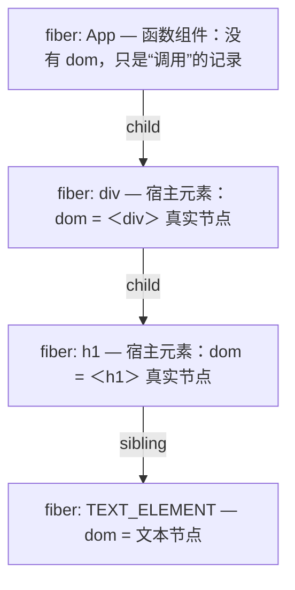

> 本文是《2. 复刻路线：十个里程碑（每步可运行，命名沿用经典 didact）》按小节拆分后的续篇，上一部分见 [06-M5-Reconciliation-diff-与复用-2-天-核心.md](06-M5-Reconciliation-diff-与复用-2-天-核心.md)。

### M6：函数组件（1 天）

M5 结束时，我们的 mini React 有了完整的 diff 能力：复用、更新、删除、按 key 对身份。但它只能渲染**原生标签**——`div`、`span`、`h1`、`input`。这一章把 React 世界的第一公民"函数组件"接进来。改动量不大（不到 30 行），但这一章会逼你回答一个此前被绕开的问题：**一个既不是 DOM 节点、又没有实例的对象，在 Fiber 树里到底算什么？** 答案将直接引出 M7 的 useState。

---

#### 1. 函数组件的 fiber 没有 dom；children = fiber.type(props)

##### 1.1 崩溃现场

拿 M5 的成品直接渲染一个组件函数，会发生什么：

```js
function App(props) {
  return Didact.createElement('h1', null, `你好，${props.name}`);
}

Didact.render(
  Didact.createElement(App, { name: 'Didact' }), // 注意：type 是函数 App，不是字符串
  document.getElementById('root')
);
```

reconcileChildren 不会觉得有任何异常——`element.type` 是 `App`，旧树为空（首次渲染），走 PLACEMENT 分支，生成 `fiber { type: App, dom: null }`。炸点在下一个工作单元：`performUnitOfWork` → `updateHostComponent` → `fiber.dom` 为 null → `createDom(fiber)` → `document.createElement(fiber.type)`，也就是 `document.createElement(App)`——浏览器抛出 `Uncaught DOMException: Failed to execute 'createElement' on 'Document': The tag name provided is not a valid name`。标签名得是字符串，你塞给它一个函数。

##### 1.2 为什么函数组件的 fiber 没有 dom

修复之前先把概念掰清楚，因为"没有 dom"不是实现技巧，而是本质属性。

React 世界里有两类东西：**宿主元素**（host element，浏览器世界里就是标签）和**组件**。宿主元素在宿主环境里有一个一一对应的实例——`<h1>` 对应一个真实的 `<h1>` DOM 节点，fiber 的 `dom` 字段指向它。而函数组件是"**描述的描述**"：`App` 本身不对应页面上的任何东西，它只是一个**产出描述的函数**——调用 `App(props)`，得到一棵 element 树，那棵树里的宿主元素才有对应实例。所以函数组件的 fiber 天然**没有 `dom`**，它存在的意义是：占住树上的一个位置（让 diff 有"身份"可对齐），并承载这个组件自己的信息（props、以及 M7 将加上的 `memoizedState`）。



两类 fiber 的对照表（这张表 M7 还会回来）：

| | type 是字符串（'div'） | type 是函数（App） |
|---|---|---|
| fiber 对应什么 | 一个宿主实例的"席位" | 一次组件调用 |
| 有 dom 吗 | 有 | **没有** |
| children 从哪来 | `fiber.props.children`（写 JSX 时塞进去的） | **执行 `fiber.type(fiber.props)` 的返回值** |
| 更新时做什么 | diff 自身 props + diff children | **重新执行函数**，再 diff 它返回的 children |

顺带一个使用层推论（真实 React 同样成立）：`sameType` 比较的是 `type` 引用，所以组件函数必须**稳定声明**——如果在别的组件体里定义组件（每次 render 都创建新函数引用），每轮 diff 的 type 都"变了"，整棵子树每轮全删全建。把组件声明在模块顶层。

##### 1.3 reconcile 侧：执行函数拿 children

`performUnitOfWork` 按"type 是不是函数"分派，两个更新函数各管一摊：

```js
let wipFiber = null; // 当前正在执行的函数组件的 fiber（M7 的 useState 靠它定位组件）
let hookIndex = 0;   // 本次执行中 hook 的调用序号（M7 的对齐依据，本章先立变量）

function performUnitOfWork(fiber) {
  const isFunctionComponent = fiber.type instanceof Function;
  if (isFunctionComponent) {
    updateFunctionComponent(fiber); // 分支：函数组件
  } else {
    updateHostComponent(fiber);     // 分支：宿主元素（M5 写好的那个）
  }
  // 下一个工作单元的推导不变：child → sibling → 叔叔
  if (fiber.child) return fiber.child;
  let next = fiber;
  while (next) {
    if (next.sibling) return next.sibling;
    next = next.parent;
  }
  return null;
}

function updateFunctionComponent(fiber) {
  wipFiber = fiber; // 登记目标：接下来执行的这个函数里如果调用了 useState，就往这个 fiber 上挂
  hookIndex = 0;    // 函数每次重新执行，hook 计数都从零开始
  const children = [fiber.type(fiber.props)]; // ★ 执行函数组件，返回值就是它的 children
  reconcileChildren(fiber, children);
}

function updateHostComponent(fiber) {
  if (!fiber.dom) {
    fiber.dom = createDom(fiber); // 只有宿主元素的 fiber 才创建 dom
  }
  reconcileChildren(fiber, fiber.props.children);
}
```

三个要点。

**children = `[fiber.type(fiber.props)]`。** 函数组件只能返回一个根节点（和真实 React 一致），所以 children 是"包着一个 element 的数组"。执行时机在这个函数体里、workLoop 的调度之内——也就是说**组件函数的执行是可中断渲染流程的一部分**，一万行 render 逻辑的大组件同样受益于时间切片（这是真实 React "render 阶段执行组件函数"的同构）。

**`wipFiber` / `hookIndex` 两个全局变量是本章埋下的伏笔。** 函数组件正在执行的瞬间，它内部可能调用 `useState`——而 `useState` 是导出给用户代码的全局函数，它怎么知道"我是谁的状态、我是第几个"？答案就是这两个全局变量：`wipFiber` 告诉 useState 状态挂在哪个 fiber 上，`hookIndex` 告诉它对齐链表上的第几个节点。M6 阶段它们被赋值但没有消费者，M7 的 useState 是唯一读者。

**嵌套组件为什么不会把 `wipFiber` 弄乱？** 这是初学者最常见的疑问，值得说透。`App` 返回的 element 树里含着 `<Child />` 时，执行 `App(props)` **并不会执行 Child**——`createElement(Child, ...)` 只是造了一个 `{ type: Child }` 的普通对象，Child 的函数体要到 workLoop 稍后走到 `ChildFiber` 这个工作单元、`updateFunctionComponent(ChildFiber)` 时才执行，而那之前 `wipFiber` 已经被赋成 `ChildFiber`。也就是说：**组件函数的执行是严格串行的、由 workLoop 逐个驱动的**，任意时刻最多只有一个组件在执行，全局变量因此是安全的。函数式组件没有"调用栈里嵌套执行"这回事——嵌套关系被 Fiber 树的 child/sibling 链摊平成了工作单元队列。

##### 1.4 reconcile 的其余部分一行不用改

reconcileChildren 拿到 children 之后走的还是 M5 的三分支：App 这个 fiber 的 type 引用没变 → 复用（UPDATE）；变了 → 删旧建新。函数组件 fiber 复用时同样带着 `alternate`，M5 建立的整套 diff 对它照常生效。**这就是 M5 的投资在回收：调和逻辑对"fiber 是什么"完全无感，它只关心 type 与 children。**

---

#### 2. commit 的连锁修复：没有 dom 的 fiber 如何挂载与删除

reconcile 侧顺畅了，commit 侧立刻出现两个连锁问题，都源于同一个事实：**函数组件的 fiber 没有 dom**。

**问题一：新节点挂到哪？** `commitWork` 里 `domParent = fiber.parent.dom`——如果 fiber 的 parent 是函数组件（比如 `App` 的子 `div` 要挂载，`div.parent` 是 AppFiber，`AppFiber.dom` 是 null），`appendChild` 直接对着 undefined 报错。修复：**沿 parent 链向上找最近的有 dom 的祖先**。App 的子树最终都物理挂在这个祖先的 dom 下面——函数组件是"逻辑层"的包裹，不产生物理层。

**问题二：删函数组件删什么？** 删除分支原来写 `domParent.removeChild(fiber.dom)`，对函数组件 fiber 来说 `fiber.dom` 是 null，同样是空引用。修复：**没有 dom 就下钻，找到子树里第一个有 dom 的后代，删它**——宿主节点一摘，整个输出子树（包括更深处的所有 dom）随之脱离文档。

完整代码：

```js
function commitWork(fiber) {
  if (fiber == null) return;

  // ① 宿主父节点：parent 可能是函数组件（无 dom），向上找到最近的有 dom 的祖先
  let domParentFiber = fiber.parent;
  while (domParentFiber != null && domParentFiber.dom == null) {
    domParentFiber = domParentFiber.parent;
  }
  const domParent = domParentFiber.dom;

  if (fiber.effectTag === 'PLACEMENT' && fiber.dom != null) {
    // 宿主元素的新增 / 相对顺序变化时的"移动"：M5 的锚点插入逻辑原样保留
    const anchor = getNextHostDom(fiber);
    if (anchor != null) {
      domParent.insertBefore(fiber.dom, anchor);
    } else {
      domParent.appendChild(fiber.dom);
    }
    if (fiber.alternate != null) {
      // 有旧身的 PLACEMENT = 移动：位置挪好了，props 的变化也要补上（M5 第 5 节）
      updateDom(fiber.dom, fiber.alternate.props, fiber.props);
    }
  } else if (fiber.effectTag === 'UPDATE' && fiber.dom != null) {
    // 宿主元素的更新：props diff。函数组件 fiber 走不到这里（dom 为 null）
    updateDom(fiber.dom, fiber.alternate.props, fiber.props);
  } else if (fiber.effectTag === 'DELETION') {
    commitDeletion(fiber, domParent); // ② 删除交给专门函数处理无 dom 的情况
    return;                           // 删除不递归（M5 第 3 节的结论）
  }

  commitWork(fiber.child); // 函数组件 fiber 自身无操作，靠这两行继续深入子树
  commitWork(fiber.sibling);
}

function commitDeletion(fiber, domParent) {
  if (fiber.dom != null) {
    domParent.removeChild(fiber.dom); // 自己就是宿主节点：直接摘，子树 DOM 随之脱离
  } else {
    commitDeletion(fiber.child, domParent); // 函数组件没有 dom：删它子树里第一个宿主后代
  }
}
```

注意 UPDATE 分支的守卫 `fiber.dom != null` 天然把函数组件 fiber 排除在 props diff 之外——函数组件的"props 变化"不需要在 commit 阶段做任何事，它的意义在 render 阶段就已经兑现了（props 变 → 重新执行函数 → 返回不同的 children）。这也再次印证两类的分工：**宿主元素的变更在 commit 落到 dom 上，函数组件的变更在 render 落到 children 上**。

---

#### 3. 三分支全景：函数组件 / 类组件 / 原生元素

顺着"fiber.type 是什么"把第三类也补齐：类组件。React 判别类组件的依据是原型链上有没有 `isReactComponent` 标记（而不是 `typeof === 'function'`，因为函数组件的 type 同样是 function）；我们镜像这个设计，提供 `Didact.Component` 基类：

```js
class Component {
  constructor(props) {
    this.props = props;
    this.state = {};
  }
  setState(partialState) {
    // 合并出新 state，然后以当前树为旧树、新开一轮调度（与 M7 的 setState 同一个模式）
    this.state = { ...this.state, ...partialState };
    wipRoot = {
      dom: currentRoot.dom,
      props: currentRoot.props,
      alternate: currentRoot,
    };
    nextUnitOfWork = wipRoot;
    deletions = [];
  }
}
Component.prototype.isDidactComponent = true; // 对应真实 React 的 isReactComponent 判据

const isClassComponent = type =>
  type != null &&
  type.prototype != null &&
  type.prototype.isDidactComponent === true;
```

类组件与函数组件的关键差异只有一个：**它有实例**。实例只创建一次、跨渲染存活，children 从 `instance.render()` 拿。实例挂在 fiber 的 `stateNode` 上（真实 React 的字段名，M3 的 Fiber 字段表里出现过），复用方式与 dom 如出一辙——从旧身的 `stateNode` 上"偷"：

```js
function updateClassComponent(fiber) {
  // 实例只创建一次；后续渲染从旧身（alternate）的 stateNode 复用
  let instance = fiber.alternate && fiber.alternate.stateNode;
  if (instance == null) {
    instance = new fiber.type(fiber.props); // 首次：构造实例
  }
  instance.props = fiber.props; // props 每轮刷新到实例上
  fiber.stateNode = instance;   // 记回 fiber，下一轮从 alternate.stateNode 找回
  const children = [instance.render()]; // ★ children 由实例的 render() 返回值提供
  reconcileChildren(fiber, children);
}
```

`performUnitOfWork` 的分派最终成形为三分支：

```js
function performUnitOfWork(fiber) {
  if (isClassComponent(fiber.type)) {
    updateClassComponent(fiber);      // 分支一：类组件（有实例，无 dom）
  } else if (fiber.type instanceof Function) {
    updateFunctionComponent(fiber);   // 分支二：函数组件（无实例，无 dom）
  } else {
    updateHostComponent(fiber);       // 分支三：宿主元素（有 dom）
  }
  if (fiber.child) return fiber.child;
  let next = fiber;
  while (next) {
    if (next.sibling) return next.sibling;
    next = next.parent;
  }
  return null;
}
```

三分支全景表（本章的核心产出，值得抄在笔记本上）：

| | 原生元素 | 函数组件 | 类组件 |
|---|---|---|---|
| 判定 | type 是字符串 | type 是函数且非类 | `prototype.isDidactComponent` |
| fiber.dom | 有 | 无 | 无 |
| 跨渲染存活的东西 | dom（DOM 节点） | **只有 fiber 自己（经 alternate 传递）** | stateNode（实例，state 在实例上） |
| children 来源 | `fiber.props.children` | `fiber.type(fiber.props)` | `instance.render()` |
| 更新意味着 | diff props / children | **重新执行函数** | 复用实例，重调 render |
| commit 时自身要做的事 | UPDATE→updateDom / PLACEMENT→插入 | 无（子树挂上方宿主祖先） | 无（同左） |

看表中最关键的一行——"跨渲染存活的东西"：类组件的 state 活在实例上，天然跨渲染；**函数组件没有实例，它的 state 只能活在 fiber 上**。这个悬而未决的问题就是 M7 的全部内容。

---

#### 4. 更新 = 重新执行函数：状态存在哪？（引出 M7）

把这一章的更新机制用一句话说尽：**函数组件的更新 = 重新执行函数**。props 变了、父级重渲了、状态变了——不管因为什么，都是把 `fiber.type(props)` 再调用一遍，拿新的返回值去 reconcile。

现在写一个计数组件，用"最直觉"的写法：

```js
function Counter() {
  let count = 0; // ← 每次执行函数，这行都会重新跑一遍
  return Didact.createElement('button', {
    onClick: () => { count = count + 1; }, // 改的只是这次函数调用的局部变量
  }, `count: ${count}`);
}
```

点击按钮：`count` 确实变成了 1——但没有任何人知道要重新渲染，页面停在 `count: 0`；就算人为触发一次重渲，函数重新执行，`let count = 0` 又把它清零。**局部变量活不过一次函数调用**，这条路从原理上就是死的。那状态必须同时满足三个条件：活在函数体**外**（跨调用存活）、和**这个组件这一处调用**绑定（不能是全局变量——页面上有三个 Counter 就完了）、更新它能触发重新渲染。三个条件共同指向唯一的宿主：**fiber**。fiber 通过 `alternate` 链代代相传（M5 建立），是函数组件在 Fiber 架构里唯一的"化身"——类组件的实例对应函数组件的什么？答案就是 fiber。

剩下的问题是：状态挂在 fiber 的哪个字段、以什么为身份标识？函数每次重新执行，没有"实例字段名"可用，React 的答案是：**以 useState 的调用顺序为身份**——第 1 次调用的 useState 对应状态链上的第 1 个节点，第 2 次对应第 2 个。这个设计极其简单，也极其脆弱（它就是"hooks 不能写在 if 里"的根源），M7 会亲手把这个脆弱性推演给你看。

---

#### 5. 验收方式（M6）

**验收一：函数组件跑起来 + "更新 = 重新执行"的直接证据。**

```js
function App(props) {
  console.log('App 执行了一次，props.step =', props.step); // 每次 render 都会打印
  return Didact.createElement('div', null,
    Didact.createElement('input', { placeholder: '打字试试，更新时不许丢焦点' }),
    Didact.createElement('h1', null, `step: ${props.step}`)
  );
}

let step = 0;
function rerender() {
  step += 1;
  Didact.render(
    Didact.createElement(App, { step }),
    document.getElementById('root')
  );
}
Didact.render(Didact.createElement(App, { step }), document.getElementById('root'));
// 页面再放一个原生 <button id="btn">，用原生 addEventListener 触发 rerender：
document.getElementById('btn').addEventListener('click', rerender);
```

验证行为：每点一次按钮，控制台打印一条"App 执行了一次"（重新执行函数的直接证据，没有实例缓存渲染结果这回事）；input 的焦点和已输入内容在更新后保留（函数组件 fiber 走 UPDATE，其下的 div/h1/input 被复用）；h1 的 step 递增。再验证 M5 的验收一在这个 demo 里依然成立（`document.querySelector('input')` 的引用跨更新不变）——函数组件包了一层，diff 穿透了它。

**验收二：类组件三分支。**

```js
class Counter extends Didact.Component {
  constructor(props) {
    super(props);
    this.state = { count: 0 };
  }
  render() {
    return Didact.createElement('button', {
      onClick: () => this.setState({ count: this.state.count + 1 }),
    }, `类组件计数：${this.state.count}`);
  }
}

Didact.render(
  Didact.createElement('main', null, Didact.createElement(Counter)),
  document.getElementById('root')
);
```

验证行为：点击按钮计数递增（实例的 state 跨渲染存活、`setState` 触发新一轮 render→commit）；在 `updateClassComponent` 里打印 `instance` 可以确认多轮更新始终是同一个实例（从 `alternate.stateNode` 复用）。这个 demo 顺便告诉你：类组件的 state 方案（实例）与函数组件的 state 方案（fiber，M7）解决的是同一个问题，只是宿主不同。

---

## 附:ASCII 图替换清单

本文档图形化改版,原 ASCII 字符图与 Mermaid 图表对应关系如下:

| 原图位置 / 标题 | 处理结果 |
| --- | --- |
| §1.2 函数组件的 fiber 结构树(fiber: App / div / h1 / TEXT_ELEMENT) | 替换为 flowchart TD(child/sibling 边标注) |
