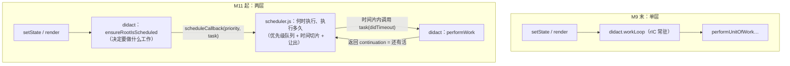

> 本文是《2. 复刻路线：十个里程碑（每步可运行，命名沿用经典 didact）》按小节拆分后的续篇，上一部分见 [11-M10-选修-各-1-天.md](11-M10-选修-各-1-天.md)。本文与随后的 M12/M13 是并发三部曲：M11 造调度器（何时干活），M12 造优先级模型（谁先谁后），M13 让渲染真的可被丢弃与打断（transition 落地）。

### M11：迷你 Scheduler —— 优先级队列与时间切片（2 天）

- 把 `workLoop` 从 didact 里剥离，独立成 `src/scheduler.js`——第一次拆文件，对应真实架构里 `scheduler` 独立成包
- 五级优先级 + 每级超时（过期时间排序）、**两个小顶堆**任务队列、5ms 时间切片、`MessageChannel` 宏任务让出主线程
- 回调续期协议（continuation）：回调**返回函数**表示"没干完"，这是与 M3 版最大的差异，也是最容易踩的坑
- 替换 M9 末的 `requestIdleCallback` 常驻循环：`performWork` 成为被 scheduler 调度的任务

M3 的教学主线用 `requestIdleCallback` 落地时间切片，M9 结束时你的 `didact.js` 里跑着一个常驻的 `workLoop`：它在 rIC 回调里空转等活。这个结构有两个真实 React 不能接受的问题：其一，**没有优先级**——所有工作一视同仁，M10.3 已经用思路代码摸过这个缺口；其二，**调度与渲染搅在一个文件里**——"什么时候干活"和"干什么活"是两个正交的问题，真实 React 把前者整个拆进了独立的 `scheduler` 包（§1 架构地图第三行）。M11 补上这两刀：从此你的 mini React 也是两层结构——didact 问 scheduler"帮我安排"，scheduler 决定"什么时候、先干谁"。

先立本里程碑的边界：M11 的 scheduler 是**通用的**——它不知道 fiber、不知道 lane、不知道 React。输入是"一个优先级 + 一个回调"，输出是"在合适的时间片里执行回调"。lane 与 scheduler 的对接是 M13 的事。

#### 11.1 为什么需要一个独立模块：两层调度

把 M9 末的结构和目标结构摆在一起：



两层各自的职责，对着真实 React 的包看：

| 问题 | 谁负责 | 真实对应 |
|---|---|---|
| 要渲染什么、从哪个 fiber 开始、哪些 lane | reconciler | `ReactFiberWorkLoop.js` 的 `ensureRootIsScheduled`（M13 实现） |
| 什么时候开始、一片干多久、多个任务谁先 | scheduler | `packages/scheduler` 的 `unstable_scheduleCallback` |

scheduler 甚至不叫 react-scheduler——它是个通用任务调度库（任何"长任务想切片、还想分优先级"的场景都能用）。这个解耦在 §1 讲过分包动机，现在你要亲手写出这条边界。

#### 11.2 scheduler.js 完整实现

先给全量代码（约 250 行，`src/scheduler.js`），然后逐块拆解。所有常量与行为都对照真实 `packages/scheduler` 核对过（截至 React 19.3.x / 2026 年 main 分支，文末有版本说明）：

```js
// src/scheduler.js —— M11：迷你 Scheduler（对应真实 packages/scheduler）
// 优先级队列（两个小顶堆）+ 时间切片 + MessageChannel 宏任务让出主线程。
// 教学版保留：五级优先级与超时、按过期时间排序的堆、continuation 续期协议；
// 略去：profiling、暂停/恢复（unstable_pauseExecution）、needsPaint。

// ── 优先级与超时（与真实 SchedulerPriorities.js / SchedulerFeatureFlags.js 对齐）──
export const NoPriority = 0
export const ImmediatePriority = 1 // 已过期：排在一切之前
export const UserBlockingPriority = 2 // 用户交互，250ms 内必跑
export const NormalPriority = 3 // 默认，5s 内必跑
export const LowPriority = 4 // 10s
export const IdlePriority = 5 // 永不过期（MaxSigned31BitInt）

const immediatePriorityTimeout = -1
const userBlockingPriorityTimeout = 250
const normalPriorityTimeout = 5000
const lowPriorityTimeout = 10000
const maxSigned31BitInt = 1073741823

// 时间片：每片 5ms（真实 frameYieldMs = 5，可用 unstable_setFrameRate 调整）
let frameInterval = 5

const getCurrentTime = () => performance.now()

// ── 小顶堆：数组实现，比较器 (sortIndex, id) ──
// 真实实现在 SchedulerMinHeap.js：sortIndex 相同时用自增 id 保序（FIFO）
function compare(a, b) {
  const diff = a.sortIndex - b.sortIndex
  return diff !== 0 ? diff : a.id - b.id
}
function push(heap, task) {
  heap.push(task)
  let i = heap.length - 1
  while (i > 0) {
    const parent = (i - 1) >> 1
    if (compare(heap[i], heap[parent]) < 0) {
      ;[heap[i], heap[parent]] = [heap[parent], heap[i]]
      i = parent
    } else break
  }
}
function pop(heap) {
  if (heap.length === 1) return heap.pop()
  const top = heap[0]
  heap[0] = heap.pop()
  let i = 0
  for (;;) {
    const l = 2 * i + 1
    const r = l + 1
    let smallest = i
    if (l < heap.length && compare(heap[l], heap[smallest]) < 0) smallest = l
    if (r < heap.length && compare(heap[r], heap[smallest]) < 0) smallest = r
    if (smallest === i) break
    ;[heap[i], heap[smallest]] = [heap[smallest], heap[i]]
    i = smallest
  }
  return top
}
const peek = heap => (heap.length > 0 ? heap[0] : null)

// ── 两个任务队列 ──
// taskQueue：已到期的任务，按 expirationTime 排序（越早过期越先出队）
// timerQueue：延迟任务（options.delay），按 startTime 排序，到期后搬进 taskQueue
const taskQueue = []
const timerQueue = []
let taskIdCounter = 1

let currentTask = null
let isHostCallbackScheduled = false
let isPerformingWork = false
let isHostTimeoutScheduled = false
let isMessageLoopRunning = false
let startTime = -1 // 当前这一"片"的起点，shouldYield 用它算已占用时长

// ── 宏任务通道：Node 用 setImmediate，浏览器 MessageChannel，兜底 setTimeout ──
let schedulePerformWorkUntilDeadline
if (typeof setImmediate === 'function') {
  schedulePerformWorkUntilDeadline = () => setImmediate(performWorkUntilDeadline)
} else if (typeof MessageChannel !== 'undefined') {
  const channel = new MessageChannel()
  channel.port1.onmessage = performWorkUntilDeadline
  schedulePerformWorkUntilDeadline = () => channel.port2.postMessage(null)
} else {
  schedulePerformWorkUntilDeadline = () => setTimeout(performWorkUntilDeadline, 0)
}

// ── 入口：登记一个任务 ──
export function unstable_scheduleCallback(priorityLevel, callback, options) {
  const currentTime = getCurrentTime()
  const startTime =
    options != null && typeof options.delay === 'number' && options.delay > 0
      ? currentTime + options.delay
      : currentTime

  let timeout
  switch (priorityLevel) {
    case ImmediatePriority: timeout = immediatePriorityTimeout; break // -1：立即过期
    case UserBlockingPriority: timeout = userBlockingPriorityTimeout; break
    case IdlePriority: timeout = maxSigned31BitInt; break // 永不过期
    case LowPriority: timeout = lowPriorityTimeout; break
    default: timeout = normalPriorityTimeout
  }
  const expirationTime = startTime + timeout

  const newTask = {
    id: taskIdCounter++,
    callback, // 回调可返回函数 = continuation（未干完的活）
    priorityLevel,
    startTime,
    expirationTime,
    sortIndex: -1,
  }

  if (startTime > currentTime) {
    // 延迟任务：进 timerQueue，按开始时间排序；到点由 handleTimeout 搬运
    newTask.sortIndex = startTime
    push(timerQueue, newTask)
    if (peek(taskQueue) === null && newTask === peek(timerQueue)) {
      if (isHostTimeoutScheduled) clearTimeout(hostTimeoutID)
      else isHostTimeoutScheduled = true
      hostTimeoutID = setTimeout(handleTimeout, startTime - currentTime)
    }
  } else {
    // 即时任务：进 taskQueue，按过期时间排序
    newTask.sortIndex = expirationTime
    push(taskQueue, newTask)
    if (!isHostCallbackScheduled && !isPerformingWork) {
      isHostCallbackScheduled = true
      isMessageLoopRunning = true
      schedulePerformWorkUntilDeadline() // 投一个宏任务
    }
  }
  return newTask
}

// 取消：把 callback 置空，轮到它时会被当作空任务丢弃
export function unstable_cancelCallback(task) {
  task.callback = null
}

// ── 时间片判断：这一片已占用 ≥ frameInterval 就让出 ──
export function unstable_shouldYield() {
  const timeElapsed = getCurrentTime() - startTime
  return timeElapsed >= frameInterval
}

export function unstable_setFrameRate(fps) {
  frameInterval = Math.floor(1000 / fps)
}

// ── 延迟任务搬运 ──
let hostTimeoutID = -1
function handleTimeout() {
  isHostTimeoutScheduled = false
  advanceTimers(getCurrentTime())
  if (peek(taskQueue) !== null) {
    isHostCallbackScheduled = true
    isMessageLoopRunning = true
    schedulePerformWorkUntilDeadline()
  } else {
    const firstTimer = peek(timerQueue)
    if (firstTimer !== null) {
      isHostTimeoutScheduled = true
      hostTimeoutID = setTimeout(handleTimeout, firstTimer.startTime - getCurrentTime())
    }
  }
}
function advanceTimers(currentTime) {
  let timer = peek(timerQueue)
  while (timer !== null) {
    if (timer.callback === null) {
      pop(timerQueue) // 已取消：直接弹出
    } else if (timer.startTime <= currentTime) {
      pop(timerQueue) // 到点：搬进 taskQueue，改按过期时间排序
      timer.sortIndex = timer.expirationTime
      push(taskQueue, timer)
    } else break
    timer = peek(timerQueue)
  }
}

// ── 宏任务入口：开一片 ──
function performWorkUntilDeadline() {
  if (isMessageLoopRunning) {
    startTime = getCurrentTime() // 本片起点
    let hasMoreWork = true
    try {
      hasMoreWork = flushWork(getCurrentTime())
    } finally {
      if (hasMoreWork) {
        schedulePerformWorkUntilDeadline() // 没干完：再约一个宏任务，先还主线程
      } else {
        isMessageLoopRunning = false
      }
    }
  }
}

function flushWork(initialTime) {
  isHostCallbackScheduled = false
  isPerformingWork = true
  try {
    return workLoop(initialTime)
  } finally {
    currentTask = null
    isPerformingWork = false
  }
}

// ── 工作循环：一片之内尽量多干，过期任务无视时间片 ──
function workLoop(initialTime) {
  let currentTime = initialTime
  advanceTimers(currentTime)
  currentTask = peek(taskQueue)
  while (currentTask !== null) {
    if (
      currentTask.callback !== null &&
      currentTask.expirationTime > currentTime &&
      unstable_shouldYield()
    ) {
      // 当前任务没过期，但时间片用完 → 让出，下个宏任务继续
      break
    }
    const callback = currentTask.callback
    if (typeof callback === 'function') {
      currentTask.callback = null
      const didTimeout = currentTask.expirationTime <= currentTime
      const continuation = callback(didTimeout) // 执行；返回函数 = 还有后续
      currentTime = getCurrentTime()
      if (typeof continuation === 'function') {
        // continuation：立刻让出主线程（不管这一片还剩多少时间）
        currentTask.callback = continuation
        return true
      } else {
        if (currentTask === peek(taskQueue)) pop(taskQueue)
        advanceTimers(currentTime)
      }
    } else {
      pop(taskQueue) // 空任务（被取消的）
    }
    currentTask = peek(taskQueue)
  }
  if (currentTask !== null) return true
  const firstTimer = peek(timerQueue)
  if (firstTimer !== null) {
    if (!isHostTimeoutScheduled) {
      isHostTimeoutScheduled = true
      hostTimeoutID = setTimeout(handleTimeout, firstTimer.startTime - currentTime)
    }
  }
  return false
}
```

##### 优先级与超时：五级、各配一个"最后期限"

真实 scheduler 的五个优先级不是抽象的"高中低"，每一级绑一个**超时时间**，超时直接换算成任务的**过期时刻**（`expirationTime = startTime + timeout`）：

| 优先级 | 数值 | 超时 | 语义 |
|---|---|---|---|
| ImmediatePriority | 1 | -1 | 已经过期：排在一切之前（离散输入的兜底通道） |
| UserBlockingPriority | 2 | 250ms | 用户交互，等太久会被用户感知 |
| NormalPriority | 3 | 5000ms | 默认 |
| LowPriority | 4 | 10000ms | 不急 |
| IdlePriority | 5 | 1073741823（2³⁰-1） | 永不过期（MaxSigned31BitInt，V8 32 位系统安全上限） |

**超时是给"饥饿防护"用的**：低优先级任务不会永远等——一个 IdlePriority 任务前面哪怕排满了 Normal 任务，它本身永不过期但会让 Normal 任务在 5 秒后过期，**过期任务无视 `shouldYield` 继续执行**（workLoop 循环顶部的判断：`currentTask.expirationTime > currentTime && unstable_shouldYield()`——两个条件都满足才让出，过期任务第一个条件为 false，直接绕过时间片检查）。这就是"时间片"与"优先级"咬合的地方：时间片管"一片干多久"，过期管"忍到什么时候就不让了"。

##### 双队列与小顶堆：为什么不用数组 sort

每个任务进队时按 `sortIndex` 排序：**即时任务的 sortIndex 就是它的过期时刻，延迟任务的 sortIndex 是开始时刻**。数据结构是小顶堆（`SchedulerMinHeap.js` 的手写实现，不到 40 行）：

- **入队 O(log n)、取最紧任务 O(1)**。调度是高频操作（React 一次交互可能入队好几个任务），排序数组每次入队 O(n log n) 且插入要挪位；
- 堆顶永远是最紧的任务，`peek` 一下就知道"该不该现在就开消息循环"；
- `sortIndex` 相同时比较自增的 `id`——保证同优先级任务 FIFO（先来先服务），否则堆的顺序不稳定，同优先级任务会被随机重排。

两个队列的分工：`taskQueue` 是"现在能干的"（已到期），`timerQueue` 是"还没到的"（`delay` 选项，React 内部用于 `setTimeout` 类延时回调）。`advanceTimers` 负责把到点的 timer 搬进 taskQueue——注意搬运时 **sortIndex 从 startTime 换成 expirationTime**，任务一旦"到岗"，排序依据就从"什么时候来"变成"什么时候必须走"。

##### performWorkUntilDeadline：一片的生命周期

```text
postMessage(null)                     ← 上一片结束时预约的宏任务
  └ onmessage = performWorkUntilDeadline
      startTime = now()               ← 本片起点（shouldYield 的参照物）
      hasMoreWork = flushWork(now())
        └ workLoop：
            while 堆顶任务存在：
              没过期 && shouldYield() → break（让出）
              callback(didTimeout) 执行
                ├ 返回 null → 任务完成，pop，继续下一个
                └ 返回函数 → continuation：任务留在堆里，立刻 return true
      hasMoreWork ?
        ├ true  → 再 postMessage（把主线程还给浏览器，下一个宏任务继续）
        └ false → isMessageLoopRunning = false（消息循环停转，等下次 scheduleCallback）
```

三个设计点必须吃透：

**第一，`shouldYield` 问的是"已占用多久"，不是"还剩多久"。** M3 的 rIC 版用 `deadline.timeRemaining() < 1`——那是浏览器借给你的视角；真实 scheduler 用自己记录的 `startTime` 算 `getCurrentTime() - startTime >= frameInterval`。差别不只是写法：rIC 的余额由浏览器说了算（它觉得你没空你就没空），scheduler 的占用时长由自己说了算——**从被动等空闲变成主动计时切片**，这正是 M3 讲过的那条主线。

**第二，continuation 协议：回调返回"函数"表示没干完。** 这是最容易写错的地方（下一节的坑一就是它）。回调不是一次性跑完的：干完一片还想继续，就**返回一个函数**，scheduler 把它存回任务的 `callback` 字段、立刻让出主线程——注释里写得很明白："If a continuation is returned, immediately yield to the main thread regardless of how much time is left in the current time slice"（真实源码原话）。为什么续期必须立刻让出、哪怕这一片还剩 3ms？因为**任务自己说"我没干完"意味着它内部已经到了一个安全的暂停点，此时让出成本最低；而下一个宏任务什么时候来由浏览器决定，任务无法假设"稍后还能在同一片里继续"**。

**第三，消息循环按需启停。** `isMessageLoopRunning` 保证任意时刻最多挂一个待处理的宏任务（不是每个任务一个 postMessage）；`scheduleCallback` 只在"消息循环没转起来"时才投第一个宏任务。省掉无谓的宏任务排队，也避免任务之间的空转。

##### 环境择优：setImmediate → MessageChannel → setTimeout

真实 scheduler 的顺序：Node 环境（测试/SSR）用 `setImmediate`——它是 Node 的宏任务，且不像 MessageChannel 会阻止进程退出；浏览器用 `MessageChannel`——私有点对点通道（M3 讲过为什么不用 `window.postMessage`：全页广播会被第三方脚本干扰），也没有 `setTimeout` 的 4ms 嵌套钳制；两者都没有才退到 `setTimeout(0)` 兜底。我们照抄这个顺序，Node 15+ 也有全局 `MessageChannel`，但测试环境走 `setImmediate` 分支与真实行为一致。

#### 11.3 didact 侧接线：从常驻 workLoop 到被调度的 performWork

scheduler 就位，didact 侧做一次"结构反转"：原来是 didact 的 workLoop 常驻空转（rIC 喂时间），现在 **didact 的渲染函数变成 scheduler 的任务**。删掉 M9 末的这段：

```js
// —— 删除：M3/M9 的常驻调度循环 ——
function workLoop(deadline) { /* … */ }
requestIdleCallback(workLoop)
```

替换为（这是 M11 的临时形态，M13 会再加抢占逻辑；先让渲染作为一个任务跑起来）：

```js
import {
  unstable_scheduleCallback,
  unstable_shouldYield,
  NormalPriority,
} from './scheduler.js'

// render 立项后，把"渲染"作为 NormalPriority 任务交给 scheduler
export function render(element, container) {
  wipRoot = { /* …与 M9 相同… */ }
  deletions = []
  nextUnitOfWork = wipRoot
  unstable_scheduleCallback(NormalPriority, performRender)
}

function performRender() {
  while (nextUnitOfWork && !unstable_shouldYield()) { // 时间片判断换了数据来源
    nextUnitOfWork = performUnitOfWork(nextUnitOfWork)
  }
  if (!nextUnitOfWork && wipRoot) {
    commitRoot()
    return null // 干完了
  }
  return performRender // ★ 没干完：返回函数续期（continuation 协议）
}
```

对照表——同一个问题在 M3 与 M11 两版里的答案：

| 问题 | M3（rIC 版） | M11（scheduler 版） |
|---|---|---|
| 谁驱动循环 | rIC 回调常驻空转 | scheduler 的消息循环，按需启停 |
| 让出判断 | `deadline.timeRemaining() < 1` | `unstable_shouldYield()`（自记起点，`≥5ms`） |
| 多任务次序 | 无（单一工作指针） | 按过期时刻的小顶堆 |
| 没干完怎么续 | rIC 再排一次回调 | 回调**返回函数**，scheduler 原任务续期 |
| 优先级 | 无 | 五级，每级一个超时 |
| 饥饿防护 | 无 | 过期任务无视时间片 |

#### 11.4 分步推演：两个任务抢时间片

用上面 scheduler 的真实行为推演一遍（`frameInterval = 5`，假设每毫秒刻度可见）。t=0 时登记任务 A（NormalPriority，回调是 4 个工作单元、每单元约 3ms 的协作式任务）；t=1 时登记任务 B（UserBlockingPriority，1 个单元）：

```text
t=0   scheduleCallback(Normal, A)
        A = {id:1, expiration: 5001, sortIndex: 5001} → taskQueue=[A]
        消息循环未转 → postMessage ①
t=1   scheduleCallback(UserBlocking, B)
        B = {id:2, expiration: 251, sortIndex: 251} → taskQueue=[B(堆顶), A]
        isHostCallbackScheduled 已置位 → 不再 postMessage（②已经在路上了）
t≈1   宏任务①到达：performWorkUntilDeadline
        startTime = 1；workLoop：堆顶是 B（sortIndex 251 < 5001）
        B 未过期、shouldYield?（elapsed 0 < 5）否 → 执行 B(didTimeout=false)
        B 干完返回 null → pop B → 堆顶变 A → A 未过期、未到 5ms → 执行 A
        A 干完单元 1（t≈4），返回 continuation → 立刻让出，hasMoreWork=true
        → postMessage ②
t≈4-5 浏览器渲染一帧（这段主线程属于浏览器——切片的意义）
t≈5   宏任务②：startTime = 5 → 执行 A 单元 2、3（t≈11 > 5+5，shouldYield）
        循环条件在单元边界发现该让 → break，hasMoreWork=true → postMessage ③
t≈11… 依此类推，A 在第 ④ 个宏任务里完成
```

三个观察点：**B 后到先执行**（堆按过期时刻排，UserBlocking 的 251ms 比 Normal 的 5001ms 紧）；**A 的每次续期都先还主线程**（浏览器在 t≈4-5 有一帧渲染窗口）；**打断只能发生在单元边界**（A 自己说"一个单元干完了"才让出——粒度是任务协作出来的）。

#### 11.5 常见坑（三个都在复刻路上真实踩过）

**坑一：continuation 返回布尔值。** 回调写 `return hasMoreWork`（true/false）而不是返回函数——症状：多阶段任务第一阶段之后就**静默消失**，后续阶段永远不执行。根因：workLoop 只认 `typeof continuation === 'function'`，布尔值被当作"任务完成"，pop 出堆。真实 scheduler 的类型签名就是 `Callback = boolean => ?Callback`——参数是"你是否过期"，返回值是"续期函数或 null"。M3 版 workLoop 返回布尔没问题，因为那时没有 scheduler、rIC 回调每次全量重排；接上 scheduler 就必须遵守它的协议。

**坑二：shouldYield 用"剩余时间"的旧直觉。** 想当然写 `deadline - getCurrentTime() < 1` 之类的余额判断。scheduler 没有"deadline 对象"——它是**计时型**不是**余额型**。记住对应关系：M3 的 `timeRemaining()` ≈ M11 的 `frameInterval - (now() - startTime)`。

**坑三：忘记过期任务可以无视时间片。** 把 workLoop 写成无条件的 `while (task && !shouldYield()) break`——功能上"看起来对"，但饥饿防护没了：一串高优先级任务持续到达时，Normal 任务永远拿不到完整的一片。真实实现的循环顶判断是"**未过期** && 该让了"才 break，过期的任务连轴干。

#### 11.6 与真实 scheduler 的对照与差异声明

对照（已逐项核对 `packages/scheduler/src/forks/Scheduler.js`，React 19.3.1 与 2026-11 main 分支一致）：

| 迷你版 | 真实版 | 备注 |
|---|---|---|
| 五级优先级 + 超时表 | `SchedulerPriorities.js` + `SchedulerFeatureFlags.js` | 数值与超时逐项相同（-1/250/5000/10000/MaxSigned31BitInt） |
| 手写小顶堆 `push/pop/peek` | `SchedulerMinHeap.js` | 同为 (sortIndex, id) 双关键字 |
| `taskQueue`/`timerQueue` + `advanceTimers` | 同名 | 延迟任务搬运逻辑同构 |
| `frameInterval = 5`、`unstable_setFrameRate` | `frameYieldMs = 5`、`unstable_setFrameRate` | 真实版还支持按 fps 自适应 |
| `unstable_shouldYield`（自记起点） | `shouldYieldToHost` | 真实版多一个 `needsPaint` 让出条件（浏览器通知"有绘制需求"时提前让出），略 |
| continuation 协议 | 同 | "返回函数立即让出"注释为源码原话 |
| setImmediate → MessageChannel → setTimeout | 同 | 选择顺序一致 |

诚实声明的简化：略去 profiling 事件（markTaskRun/markTaskYield 等）、`unstable_pauseExecution`/`unstable_continueExecution`（Suspense 用它暂停调度，M10.2 的简化版没接）、`unstable_wrapCallback`（优先级上下文的包装器，M12 的 withLane 是它的思想近亲）、`unstable_runWithPriority`。这些不影响本篇主线。

**版本说明**：以上对照以 React 19.3.1 与 main 分支（2026-11）源码为准。scheduler 包自 18 以来非常稳定，18.x 读者可放心按此对照。

#### 11.7 验收方式（M11）

1. **跑通四个行为实验**（node 直接可跑，无浏览器依赖；测试脚本百行左右，四个断言要点如下）：
   - 顺序：先 `scheduleCallback(Normal, taskA)` 再 `scheduleCallback(Immediate, taskB)`，断言 B 先执行（堆按过期时刻排序，Immediate 的 -1 永远最早）；
   - 切片：一个 4 单元、每单元 3ms 的 Normal 任务（`frameInterval=5` 时一片约容 1 个单元），断言回调被调用 ≥3 次（跨了多个宏任务）；
   - 插队：LowPriority 长任务跑到一半登记 UserBlockingPriority 短任务，断言短任务在长任务完成**之前**执行（切片边界抢占）；
   - 延迟：`scheduleCallback(Normal, fn, {delay: 12})` 与一个即时任务并排，断言执行顺序"即时 → 延迟"且延迟确实等了 ≥12ms。
2. **didact 回归**：用 M11 版跑 M5 的万节点 benchmark——现象应与 M3 版一致（clock 稳定跳动、列表逐帧生长），但 Performance 面板里每个小任务的触发源从 `requestIdleCallback` 变成 `MessagePort.onmessage`（浏览器）。
3. **口头检验**：不看资料回答——过期任务为什么可以无视时间片？continuation 为什么要立即让出而不是把这片用完？sortIndex 为什么在搬运时要换字段？

四项全过，M11 完成。此刻你的调度器已经"快而有序"，但它还不知道 React 的优先级——didact 只会喊 `scheduleCallback(NormalPriority, …)`。谁该是 Immediate、谁该是 Low，这个判断权在 lane 模型，M12 造它。
