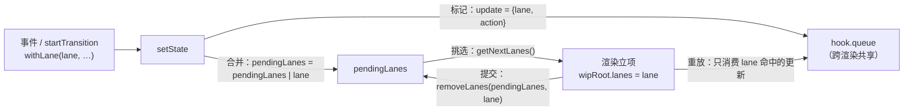

> 本文是《2. 复刻路线：十个里程碑（每步可运行，命名沿用经典 didact）》按小节拆分后的续篇，上一部分见 [12-M11-迷你Scheduler-优先级队列与时间切片-2-天.md](12-M11-迷你Scheduler-优先级队列与时间切片-2-天.md)。

### M12：Lane 优先级模型 —— 更新的标记、合并与挑选（2 天）

- lane 位掩码：5 个优先级位、`mergeLanes`/`getHighestPriorityLane`/`removeLanes` 三件套（对应真实 `ReactFiberLane.js`）
- 更新的**标记**：`setState` 入队时读取"当前更新优先级"（`withLane`，对应真实 `getCurrentUpdatePriority`/`setCurrentUpdatePriority`）
- 更新的**合并与挑选**：`pendingLanes` 位或累积，渲染立项时 `getNextLanes` 挑最高优先级
- 重放的 lane 过滤：高优先级渲染**只消费自己的更新**，低优先级更新"随身带走"——为此 useState 的队列必须改为**跨渲染共享**

M10.3 的那段思路代码（`pendingLanes |= lane`）在本章转正为完整实现。M11 之后你有了一个"快而有序"的调度器，但 didact 对它只有一个请求：`scheduleCallback(NormalPriority, performRender)`——所有更新都是 Normal。这意味着用户正在敲键盘时，一次大列表刷新和输入框更新**仍然平起平坐**（scheduler 的堆里两个任务按先来后到排序）。要回答"谁的更新先渲染"，React 需要一个比 scheduler 优先级更细的模型——因为优先级的真正主体不是"任务"，而是**更新**：一次 setState 是一个更新，一次渲染携带一批更新，树里可能同时躺着几十个不同来源的更新。这就是 lane。

#### 12.1 为什么是位掩码：从 expirationTime 到 lanes

React 17 及之前用**过期时间戳**表达优先级（SyncExpirationTime / AsyncExpirationTime…），18 重写为 lanes。为什么？四个理由，前两个是核心（M10.3 从概念讲过，这里从实现层补全）：

**一、一次渲染携带"一批"优先级，掩码天然是集合。** "这一轮渲染要处理 lane 集合 S 里的所有更新"——用位掩码表达就是几个位运算：`lanes |= lane` 登记、`lanes & ~doneLane` 剔除、`lanes & InputLane` 一问便知有没有。时间戳表达集合要排序、区间、遍历。

**二、位的位置直接编码优先级高低。** 约定：**越靠右的位优先级越高**。于是"lane A 是否比 lane B 高"就是 `A < B`（数值比较），"取集合里最高优先级"就是取最右边的 1——`lanes & -lanes`，一个巧妙的位运算（补码性质：`-x` 把最右 1 右侧的 0 变 1、最右 1 保持、左侧取反，与原数相与恰好只剩最右那个 1）。

**三、饥饿提升（starvation）在位上做时间衰减。** 低优先级等太久会被升级到高位，掩码上挪一个位就完成。

**四、跨层对接。** 事件系统判定事件类型给 lane、reconciler 挑 lane、scheduler 收到 lane 对应的优先级——一个 32 位整数贯穿三层。

迷你版用 5 个位（真实 31 个位，见 12.6 的对照表）：

```js
// —— M12：lane 常量（didact.js 顶部新增）——
export const NoLanes = 0b00000
export const SyncLane = 0b00001 // 离散输入（click/keydown）：最高
export const InputContinuousLane = 0b00010 // 连续输入（input 拖动）
export const DefaultLane = 0b00100 // 默认（render 入口、无明确来源的更新）
export const TransitionLane = 0b01000 // startTransition / useDeferredValue
export const IdleLane = 0b10000 // 空闲渲染

// 位运算三件套（对应真实 ReactFiberLane.js 的同名导出）
const mergeLanes = (a, b) => a | b // 合并：位或
const getHighestPriorityLane = lanes => lanes & -lanes // 挑选：取最右边的 1
const removeLanes = (set, subset) => set & ~subset // 剔除：从集合中移走
const includesSyncLane = lanes => (lanes & SyncLane) !== NoLanes
```

真实版的三件套在 `ReactFiberLane.js` 里就是这三行（`mergeLanes(a, b) { return a | b }`，源码注释写着"This works because the bit ranges decrease in priority as you go left"——位越靠左优先级越低）。整套模型没有一个复杂算法，**全是 O(1) 位运算**——这是它被选中的根本原因。

#### 12.2 更新怎样被标记：入队时刻读取"当前优先级"

关键问题：`setState` 被调用的那一瞬间，它怎么知道自己该是什么优先级？答案：**优先级来自触发它的上下文**——用户敲键盘（discrete 事件）触发的 setState 是高优先级，`startTransition` 里的是低优先级。真实 React 用一对模块级函数存取"当前更新优先级"（`getCurrentUpdatePriority`/`setCurrentUpdatePriority`，19.3.1 的 `ReactFiberLane.js` 与 hooks 里都有），事件系统在调用用户回调前后切换它（M13 第 5 节接线）。迷你版同构：

```js
// —— M12：当前更新优先级（didact.js）——
let currentLane = DefaultLane

// 以 lane 优先级执行 scope：scope 里发起的所有 setState 都被标记为该 lane。
// 事件系统与 startTransition 是它的两个调用方
export function withLane(lane, fn) {
  const prev = currentLane
  currentLane = lane
  try {
    fn()
  } finally {
    currentLane = prev
  }
}
const requestUpdateLane = () => currentLane // setState 入队时读取
```

然后是 useState 的改动。M7/M8 的更新对象是裸 action（`hook.queue.push(action)`），现在每个更新**入队时被标记**：

```js
// —— M12：useState（对 M8 版的两处改动）——
export function useState(initial) {
  const oldHook = getOldHook(hookIndex)
  // 改动一（本节）：队列对象跨渲染共享 —— newHook 复用 oldHook.queue
  const hook = {
    tag: 'state',
    state: oldHook ? oldHook.state : initial,
    queue: oldHook ? oldHook.queue : [],
  }
  if (oldHook) {
    const lanes = wipRoot.lanes // 本轮渲染的 lanes：只有落在其中的更新才被重放
    for (let i = 0; i < hook.queue.length; ) {
      const update = hook.queue[i]
      if (update.lane & lanes) {
        // 轮到了：重放并从队列移除——已消费的更新绝不重放第二次
        hook.state =
          typeof update.action === 'function' ? update.action(hook.state) : update.action
        hook.queue.splice(i, 1)
      } else {
        i++ // 没轮到：留在队列里 = 随身带走，留给之后的一轮
      }
    }
  }
  const setState = action => {
    const lane = requestUpdateLane()
    hook.queue.push({ lane, action }) // ★ 更新在此刻被标记优先级
    pendingLanes = mergeLanes(pendingLanes, lane) // ★ 合并进根的 pending 集合
    scheduleRender() // 挑选入口（12.4）
  }
  pushHook(hook)
  hookIndex++
  return [hook.state, setState]
}
```

两处改动，每处都对应真实源码的一个决定：

**标记**：`{lane, action}` 对象对应真实 update 对象的 `lane` 字段（`ReactUpdateQueue.js` 的 `Update<Lanes, …>` 第一个类型参数就是 lanes）。真实的 `dispatchSetState` 在入队时调用 `requestUpdateLane(fiber, lane)` 拿优先级——同一个思想：优先级是入队时刻的快照，之后不再变。

**队列共享**：`queue: oldHook ? oldHook.queue : []`——新 hook 复用旧 hook 的**同一个队列对象**。为什么必须共享，见 12.5 坑一；这里先记住事实：真实 React 正是这么做的（`ReactFiberHooks.js` 的 `updateWorkInProgressHook` 克隆 hook 时写 `queue: currentHook.queue`），M7 第 9 节的对照表里那句"新旧两棵树上同位置的 hook 共享同一个 queue 对象"埋的伏笔在此兑现。

#### 12.3 重放的 lane 过滤：一次渲染只消费自己的更新

看 replay 那段循环——它是本章的心脏。场景：hook 队列里躺着两条更新 `[{lane: SyncLane, 'a1'}, {lane: TransitionLane, 'b1'}]`（一个来自键盘、一个来自 transition），现在发起一轮 `lanes = SyncLane` 的渲染：

```text
重放（lanes = SyncLane = 0b01）：
  update {lane: 0b01, 'a1'} → 0b01 & 0b01 ≠ 0 → 命中：应用并移除
  update {lane: 0b10...    → 0b1000 & 0b0001 = 0 → 不属于本轮：留在队列里
结果：本轮渲染后的 state 只包含 a1 的贡献；b1 原封不动地等着下一轮
```

这回答了一个根本问题：**高优先级渲染提交时，会不会把还没轮到的低优先级更新顺手丢掉？** 不会——因为新 hook 的 `state` 从旧 hook 继承（低优更新还没应用过，base 还是老的），队列里没消费的更新**留在共享队列上**，随新 hook 一起进入 current 树。等低优先级 lane 轮到自己的渲染时，重放自然读到它。这就是"随身带走"的实现——它不是一个显式的搬运动作，而是"没消费的就留在原地"这个朴素事实。

对照真实源码：`updateReducer` 处理共享队列时，对不属于本轮 lane 的更新会做 `markSkippedUpdate`（记到 `laneToSkip`，循环结束后放回队列），处理过的更新则在并发模式下克隆进 `baseQueue` 并把 lane 清零——语义同样是"本轮消费的不再重放、没轮到的留在队列"。

#### 12.4 合并与挑选：pendingLanes 与 getNextLanes

`pendingLanes` 是根级状态（真实版挂在 `FiberRoot` 上；迷你版一个模块变量，因为单根应用）：

```js
let pendingLanes = NoLanes // 排队中的更新都落在哪些 lane 上

// 迷你版 getNextLanes：总是挑最高优先级的那条 lane
function getNextLanes() {
  return getHighestPriorityLane(pendingLanes)
}

// lane → scheduler 优先级的映射（真实版在 ReactFiberWorkLoop 的优先级换算一带）
function laneToSchedulerPriority(lane) {
  switch (lane) {
    case SyncLane: return ImmediatePriority
    case InputContinuousLane: return UserBlockingPriority
    case TransitionLane: return NormalPriority
    case IdleLane: return IdlePriority
    default: return NormalPriority
  }
}

// M11 的直接 scheduleCallback 升级为按 lane 挑选（M13 还会再升级为 ensureRootIsScheduled）
function scheduleRender() {
  const lanes = getNextLanes()
  if (lanes === NoLanes) return
  unstable_scheduleCallback(laneToSchedulerPriority(lanes), performRender)
}
```

commit 阶段配套一行——提交完成后从 pendingLanes 里**剔除已渲染的 lane**：

```js
function commitRoot() {
  // …M8 的提交流程不变…
  const committedLanes = wipRoot.lanes
  pendingLanes = removeLanes(pendingLanes, committedLanes) // ★ 本轮的 lane 清账
  scheduleRender() // pendingLanes 里可能还有低优先级 lane 排着 → 再挑一轮
}
```

至此"标记 → 合并 → 挑选"的环闭合了：



#### 12.5 分步推演与常见坑

**完整推演一遍**（两个 state，`a` 被 SyncLane 更新、`b` 被 TransitionLane 更新；这是 12.7 验收二的场景）：

| 时刻 | 动作 | a 的队列 | b 的队列 | pendingLanes | 屏幕 |
|---|---|---|---|---|---|
| T1 | `withLane(Transition, () => setB('b1'))` | — | `[{8,'b1'}]` | `0b1000` | a0 b0 |
| T2 | `withLane(Sync, () => setA('a1'))` | `[{1,'a1'}]` | `[{8,'b1'}]` | `0b1001` | a0 b0 |
| T3 | scheduleRender → 挑出 `SyncLane`；渲染 lanes=1：a 队列命中 → a1；b 队列的 `8&1=0` → 留守 | `[]` | `[{8,'b1'}]` | 提交后 `removeLanes(0b1001, 0b001) = 0b1000` | **a1 b0** |
| T4 | commitRoot 里 scheduleRender → 挑出 `TransitionLane`；渲染 lanes=8：b 命中 → b1 | `[]` | `[]` | `0` | **a1 b1** |

T3 那格是全部要义：**高优先级提交后，b 仍是旧值**——不是 bug，是"低优先级更新尚未被消费"的正确表现。用户看到输入立即生效（a1）、重计算结果稍后跟上（b1）——这正是 `useTransition` 要制造的体验，M13 把它做出来。

**坑一（最重要）：queue 每轮新建——并发场景下会丢更新。** M7 的版本是 `queue: []`（每轮新建），当时的理由是"代际隔离"防重复重放（M7 坑二）。但每轮新建有个隐含假设：**发起 setState 的闭包引用的 hook 永远属于"已提交"的树**。M13 引入可丢弃的渲染后这个假设破裂：如果一轮渲染被高优先级打断丢弃，这轮渲染期间执行过的组件函数里创建的 setState 闭包引用的是**即将被丢弃的 hook**——更新 push 进孤儿队列，随树一起消失，**静默丢失**（复刻时真实踩到：一次 sync 更新在 transition 提交后被"时光倒流"回旧值，排查到就是这个）。共享队列从机制上根治：不管哪个年代的闭包，push 的都是同一条队列。真实 React 同款设计（12.2 的源码引用）。M7 坑二（重复重放）怎么防？靠"消费即移除"（splice），而不是队列隔离——防重复的职责从"数据结构"挪到了"消费纪律"。

**坑二：重放时不过滤 lane。** 把 M7 的 `pendingActions.forEach` 原样保留——高优先级渲染会把队列里**所有**更新一口气消费掉，低优先级更新"提前插队生效"，优先级模型名存实亡。症状：transition 更新总能跟输入同步上屏，M13 的打断演示永远做不出来。过滤条件 `update.lane & lanes` 必须写在重放里。

**坑三：忘了 commit 时 removeLanes。** 提交后 pendingLanes 不清账——症状：`getNextLanes` 永远挑出同一条 lane，同一轮渲染反复立项（配合 M13 的调度入口会表现为"提交后幽灵渲染"）。对称纪律：**立项时挑走、提交时清账**，`|= `与 `&= ~` 成对出现。

#### 12.6 与真实 ReactFiberLane 的对照（版本：React 19.3.1 / main 2026-11）

真实常量表（`packages/react-reconciler/src/ReactFiberLane.js`，19.3.1 的实际值，`TotalLanes = 31`）：

```text
SyncHydrationLane          = 0b0000000000000000000000000000001
SyncLane                   = 0b0000000000000000000000000000010
InputContinuousHydrationLane = 0b…0100      InputContinuousLane = 0b…1000
DefaultHydrationLane       = 0b…10000        DefaultLane        = 0b…100000（bit 6）
GestureLane                = 0b…1000000（bit 7，手势过渡专用）
TransitionLanes            = 0b0000000001111111111111100000000（bit 8–21，共 12 条）
RetryLanes                 = 0b0000011110000000000000000000000（bit 22–25，Suspense 重试）
SelectiveHydrationLane / IdleHydrationLane / IdleLane / OffscreenLane / DeferredLane …
```

对照与差异，按重要度排：

1. **真实有 Hydration 配对 lane**（每种 lane 一个水合孪生位）与 **12 条 TransitionLane**（并发 transition 各占一位，可分别打断、分别完成）——迷你版各一条，语义足够演示。
2. **真实的 `getNextLanes(root, …)` 远比"取最右 1"复杂**：要绕开 `suspendedLanes`（被 Suspense 挂起的工作）、检查 `pingedLanes`（数据到位被唤醒的工作）、还有 main 分支新出现的 `warmLanes`（预热兄弟节点的投机渲染）——迷你版一句 `lanes & -lanes` 是把"没有任何东西被挂起"作为前提的简化。
3. **`markRootUpdated`**（真实的"登记更新到根"）除了 `pendingLanes |= lane` 还会顺手清空 suspended/pinged——一次新更新可能唤醒被挂起的渲染，迷你版没有 Suspense 联动，略。
4. **纠缠（entanglement）**：真实的两条 lane 可以被标记为"必须一起渲染"（`markRootEntangled`），transition 里发起新 transition 时用——迷你版略，M13 的 transition 每次都是独立的一轮。

#### 12.7 验收方式（M12）

1. **位运算代数自测**（控制台 30 秒）：验证 `mergeLanes(TransitionLane, InputContinuousLane) === 0b1010`、`getHighestPriorityLane(0b1010) === InputContinuousLane`、`removeLanes(0b1010, InputContinuousLane) === TransitionLane`、以及偏序 `SyncLane < InputContinuousLane < DefaultLane < TransitionLane < IdleLane`（数值小的优先级高）。
2. **随身带走实验**（12.5 推演的代码化）：两个 state 分别被 SyncLane/TransitionLane 更新，**只让微任务跑完**（`await Promise.resolve()` 两次）后断言：屏幕 a1 b0、`pendingLanes === TransitionLane`；再等宏任务跑完断言 a1 b1、队列清空。再补一条：同一批里 `setA('x'); setA(prev => prev + '+y')`，断言终值 `x+y`（函数式更新在 lane 过滤下仍然按序重放）。
3. **回归**：M7 的三个验收（计数器、if 里的 useState、延迟闭包）在 M12 版上原样通过——lane 是叠加在重放机制上的过滤层，不该破坏既有语义（注意验收一现在每次点击是一次渲染，批处理行为不变）。
4. **口头检验**：为什么"低优先级更新不会被高优先级提交顺手丢掉"？`queue: oldHook.queue` 这行共享改动了 M7 的哪个设计、为什么不再需要那个设计？

node 侧的验收二、验收一都可直接跑（本文所有代码在 node 24 下验证过，无需浏览器 API；测试脚本 12 项断言全绿）。此刻你有了优先级正确的更新流，但渲染本身仍是"一口气干完再 commit"——高优先级更新到来时，进行中的低优先级渲染还在傻跑。让它学会"让位与被丢弃"，是 M13 的事。
