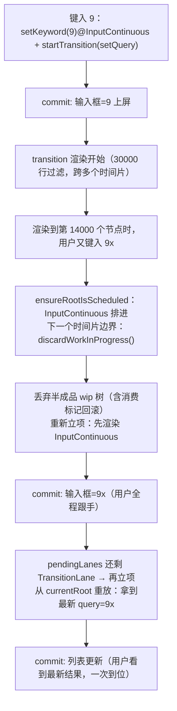

> 本文是《2. 复刻路线：十个里程碑（每步可运行，命名沿用经典 didact）》按小节拆分后的续篇，上一部分见 [13-M12-Lane-优先级模型-更新的标记合并与挑选-2-天.md](13-M12-Lane-优先级模型-更新的标记合并与挑选-2-天.md)。

### M13：可中断渲染与 transition —— 亲眼看到高优先级打断低优先级（2 天）⭐核心

- 统一调度入口 `ensureRootIsScheduled`：SyncLane 走微任务同步冲刷、其余 lane 交给 M11 的 scheduler
- 可中断工作循环 `performWork`：切片让出只是下限，**更高优先级 lane 到来时直接丢弃进行中的渲染**（`discardWorkInProgress`）
- 核心纪律：**被打断的渲染无权消费更新**——重放从"消费即删除"升级为"打标记、提交才生效、打断即回滚"
- 在这一切之上实现 `startTransition` / `useTransition`：输入框立即跟手，大列表在后台渲染、随时让位、打断后重放
- 本章结束时，M10.3 那句"低优先级更新记录在 lane 上，高优完成后重放"从注释变成你亲手写的代码

M12 结束时更新已经有了优先级，但渲染本身还是"一立项就跑到底"：低优先级渲染进行到一半，来了个高优先级更新，它不会让位——最多在时间片边界歇口气，然后继续按旧 lane 干完、提交。这章补上并发 React 最后三块：**插队**（更高 lane 到来，丢弃进行中的树）、**插队的善后**（被打断的更新一条不丢）、**产品层的封装**（transition）。先给这章完成后一次典型交互的完整时间线，建立全局图景，再逐块实现：



#### 13.1 统一调度入口：ensureRootIsScheduled

M12 的 `scheduleRender` 只做一件事（挑 lane、排 scheduler）。真实 React 的调度入口还要回答一个问题：**这条 lane 的工作该以什么方式执行？** 答案分两路——同步 lane（离散输入直系更新）必须以最快速度落地，走**微任务同步冲刷**；其余 lane 交给 scheduler 排队。迷你版同构（取代 M12 的 `scheduleRender`，也取代 M9.5 的 `scheduleUpdateFromCurrentRoot`）：

```js
// —— M13：统一调度入口 ——
let isSyncFlushScheduled = false // SyncLane 的微任务是否已排
let renderTask = null // 当前排到 scheduler 的渲染任务
let renderTaskToken = null // 任务身份令牌（防止被取消的任务复活续期）

function ensureRootIsScheduled() {
  // ① SyncLane：微任务里同步冲刷（对齐真实版"同步 lanes 走微任务、其余走 scheduler"）
  if (includesSyncLane(pendingLanes)) {
    if (!isSyncFlushScheduled) {
      isSyncFlushScheduled = true
      queueMicrotask(flushSyncLane)
    }
    return
  }
  // ② 其余 lanes：交给 scheduler，按 lane 对应的优先级
  const lanes = getNextLanes()
  if (lanes === NoLanes) return
  const priority = laneToSchedulerPriority(lanes)
  if (renderTask) {
    if (renderTask.priorityLevel <= priority) return // 已排任务够高：不重排
    unstable_cancelCallback(renderTask) // 有更高优先级：取消旧的
  }
  const token = {}
  renderTaskToken = token
  // scheduler 的续期协议：回调返回"函数"表示还有后续（M11 坑一）。
  // selfContinuing 对应真实 React performConcurrentWorkOnRoot 的"返回自己续期"
  const selfContinuing = didTimeout => {
    const hasMore = performWork(token, didTimeout)
    return hasMore ? selfContinuing : null
  }
  renderTask = unstable_scheduleCallback(priority, selfContinuing)
}
```

四个设计点：

**SyncLane 为什么走微任务？** 离散输入（click/keydown）的用户期待是"点了立刻有反应"，不能再等一个宏任务排队。微任务在当前事件回调结束的瞬间执行——这是 JS 里最早的插队时机。真实 React 同款（同步 lane 由微任务驱动，19.3.1 起拆成了专职的 `ReactFiberRootScheduler.js`，`scheduleMicrotask(processRootScheduleInMicrotask)`）。

**M9.5 的批处理去哪了？** 没有丢，换了个更结实的载体。M9.5 用"微任务收集窗口"合并一次事件里的多次 setState；现在 `pendingLanes` 的位或累积天然就是收集——同一事件里 N 次 setState 合并进位图，渲染立项发生在**下一个**微任务/宏任务，到时一起挑走。M9.5 的 `isRenderScheduled` 标志位对应的两个防重排判断，就是上面 ① 的 `isSyncFlushScheduled` 和 ② 的 `renderTask.priorityLevel <= priority`。

**token 是干什么的？** 防止"被取消的任务复活"。场景：NormalPriority 的渲染任务 T 正在执行（M11 说过，取消一个执行中的任务拦不住它返回 continuation，workLoop 会把 continuation 存回去）；此刻高优先级更新到来，我们 cancel T 并排了新任务 T'。T 的 continuation 在下一个宏任务被调用时，靠 `token !== renderTaskToken` 识别自己已被取代，立即返回 false 自行退场。真实 React 对同一问题用"任务身份比较"：18.x 在 `performConcurrentWorkOnRoot` 的续期路径上比较 `root.callbackNode` 与本次任务节点，不一致即放弃续期；19.x 起这套判断收进了专职的 `ReactFiberRootScheduler`（任务节点记在 root 上，微任务统一冲刷时核对身份）。

**冲刷函数本体：**

```js
// 同步冲刷：不看时间片、不可中断；期间进行中的低优先级树整体作废
function flushSyncLane() {
  isSyncFlushScheduled = false
  const lanes = pendingLanes & SyncLane
  if (lanes === NoLanes) return
  if (wipRoot) {
    log('interrupt(sync-flush)', wipRoot.lanes, SyncLane)
    discardWorkInProgress() // 未提交的低优树丢弃（13.3）
  }
  wipRoot = {
    dom: currentRoot.dom,
    props: currentRoot.props,
    alternate: currentRoot,
    lanes,
    effects: [],
    renderSeq: ++renderSeqCounter,
  }
  deletions = []
  nextUnitOfWork = wipRoot
  while (nextUnitOfWork) {
    nextUnitOfWork = performUnitOfWork(nextUnitOfWork) // 同步一口气：无时间片检查
  }
  commitRoot()
}
```

注意 `while (nextUnitOfWork)` 没有任何 `shouldYield`——同步路径是不可中断的（真实 React 的 `workLoopSync` 同款，源码注释："Perform work without checking if we need to yield between fiber"）。它也理直气壮地丢弃进行中的低优树：SyncLane 是最高优先级，低优树的半成品在它面前不值钱——丢了重来（M13.3 保证"重来不丢更新"）。

#### 13.2 可中断的 performWork：切片让出只是下限

scheduler 路径的工作循环。M11 版的 `performRender` 只会看时间片；M13 版在开头多了一个**抢占检查**：

```js
// —— M13：可中断工作循环（scheduler 回调）——
function performWork(token, didTimeout) {
  if (token !== renderTaskToken) return false // 已被更高优先级的调度取代：不续期

  // ① 抢占检查：进行中的渲染之外，排进了更高优先级的更新 → 丢弃进行中的树
  if (wipRoot) {
    const nextLanes = getNextLanes()
    if (nextLanes !== wipRoot.lanes && nextLanes < wipRoot.lanes) {
      log('interrupt', wipRoot.lanes, nextLanes)
      discardWorkInProgress()
    }
  }

  // ② 没有进行中的渲染 → 立项（挑当前最高优先级的 lane）
  if (!nextUnitOfWork && !wipRoot) prepareRender()
  if (!wipRoot) {
    if (renderTaskToken === token) renderTask = null
    return getNextLanes() !== NoLanes
  }

  // ③ 时间片循环：didTimeout（任务已过期）时无视时间片一口气干（M11 的饥饿防护）
  while (nextUnitOfWork && (didTimeout || !unstable_shouldYield())) {
    nextUnitOfWork = performUnitOfWork(nextUnitOfWork)
  }

  if (!nextUnitOfWork && wipRoot) commitRoot()

  const stillWorking = nextUnitOfWork != null
  if (!stillWorking) {
    if (renderTaskToken === token) renderTask = null
    // re-arm：commitRoot 里的 ensureRootIsScheduled 可能因"旧任务优先级更高"
    // 跳过了重排，而那个旧任务（本任务）马上就要结束——此刻按剩余 lanes 重新排一次
    ensureRootIsScheduled()
  }
  return stillWorking || getNextLanes() !== NoLanes // 续期：scheduler 下个宏任务接着来
}

function prepareRender() {
  const lanes = getNextLanes()
  if (lanes === NoLanes) return
  wipRoot = {
    dom: currentRoot.dom,
    props: currentRoot.props,
    alternate: currentRoot,
    lanes,
    effects: [],
    renderSeq: ++renderSeqCounter, // 渲染代号：13.3 的消费标记要用
  }
  deletions = []
  nextUnitOfWork = wipRoot
}
```

抢占检查只有一行核心：`nextLanes < wipRoot.lanes`（位偏右数值小 = 优先级高，M12 的偏序）。真实 React 把这个检查放在更根本的位置——`renderRootConcurrent` 的开头有一段源码注释（19.3.1）："If the root or lanes have changed, throw out the existing stack and prepare a fresh one. Otherwise we'll continue where we left off."——root 或 lanes 变了就丢弃现有工作栈重来，我们每个月了它的语义。

注意"丢弃"只发生在**时间片边界**（performWork 被调用的时刻）：进行中的一个 `performUnitOfWork` 是原子的（M3 的结论），打断点只可能在单元之间。所以"高优先级打断"的延迟上界是一个时间片 + 一个宏任务间隔——用户完全无感，但你要知道这个边界在哪。

**时间片让出（shouldYield）与优先级抢占（discard）是两件不同的事**，这张表务必分清：

| | 时间片让出 | 优先级抢占 |
|---|---|---|
| 触发条件 | 本片占用 ≥5ms | pendingLanes 出现比 wipRoot.lanes 更高的 lane |
| 树的命运 | **保留**，nextUnitOfWork 记住进度 | **丢弃**，整棵 wip 作废 |
| 恢复方式 | 下个宏任务从断点继续 | 高优渲染提交后，从 currentRoot 重新立项重放 |
| 存在的原因 | 别把主线程堵死（M2 的债） | 别让用户输入等重活（M10.3 的债） |

#### 13.3 discardWorkInProgress：被打断的渲染无权消费更新

丢弃一棵树很容易（`wipRoot = null`），难的是善后。M12 的重放是"消费即 splice"——在**渲染不被打断**的前提下没问题。但 M13 的渲染随时可能被丢弃，推演一个翻车现场（复刻时真实踩到）：

```text
T1  current 树 C2 的 count 队列：[{lane:Sync, +1}]
T2  transition 渲染立项（lanes=TransitionLane），执行 App：
      重放 count 队列 —— 等等，count 更新是 SyncLane，8&1=0，不会消费 ✓
    （换一个：pending 队列里恰好有一条 TransitionLane 的更新，被本轮消费并 splice）
T3  用户点击：SyncLane 到来 → discardWorkInProgress，transition 树作废
T4  sync 提交后 transition 重新立项 → 重放 pending 队列：
      那条更新在 T2 已被 splice —— 但 T2 的渲染被丢弃了！
      它的消费成果（新 state）随树一起消失 → 更新凭空蒸发，isPending 永远卡在 true
```

病根：**渲染是推测性的（可能被丢弃），但 splice 是立即生效的（不可撤销）**。解法是把"消费"改造成两段式——**打标记，提交才算数，打断就回滚**：

```js
// —— M13：useState 重放的消费升级（对 M12 版的一处改动）——
if (oldHook) {
  const lanes = wipRoot.lanes
  for (let i = 0; i < hook.queue.length; ) {
    const update = hook.queue[i]
    if (update.doneSeq != null) {
      hook.queue.splice(i, 1) // 已被某次"提交成功"的渲染消费：清掉墓碑，绝不重放第二次
      continue
    }
    if (update.lane & lanes) {
      // 轮到了：重放，并打上"本轮已消费"标记——注意不是删除：
      // 本轮若被打断，discardWorkInProgress 会回滚标记；提交成功则标记永驻
      hook.state =
        typeof update.action === 'function' ? update.action(hook.state) : update.action
      update.doneSeq = wipRoot.renderSeq
      i++
    } else {
      i++ // 没轮到：留在共享队列里 = 随身带走
    }
  }
}

// —— M13：丢弃进行中的渲染 ——
// 核心纪律：被打断的渲染"无权消费更新"。本轮重放时打的 doneSeq 标记全部回滚
// （共享队列上还有效的更新一条不丢），然后整树作废交给 GC。
// renderSeq 是每次立项自增的"渲染代号"：提交成功后 currentRoot.renderSeq 随之生效，
// 于是"doneSeq ≤ currentRoot.renderSeq"意味着"消费它的渲染已提交"。
function discardWorkInProgress() {
  if (wipRoot == null) return
  let cur = wipRoot.child
  while (cur) {
    revertConsumedMarks(cur)
    discardSubtree(cur.child)
    cur = cur.sibling
  }
  wipRoot = null
  nextUnitOfWork = null
}
function revertConsumedMarks(fiber) {
  let hook = fiber.memoizedState
  while (hook) {
    if (hook.tag === 'state' && hook.queue) {
      for (const update of hook.queue) {
        if (update.doneSeq === wipRoot.renderSeq) update.doneSeq = null // 回滚
      }
    }
    hook = hook.next
  }
}
function discardSubtree(fiber) {
  let cur = fiber
  while (cur) {
    revertConsumedMarks(cur)
    discardSubtree(cur.child)
    cur = cur.sibling
  }
}
```

对照真实 React：它没有 renderSeq 这个变量，而是用 `baseQueue`/`baseState` 表达同一件事——`updateReducer` 在并发模式下把处理过的更新**克隆**进 baseQueue 并把克隆的 lane 清零（"processed updates are cloned with NoLane so they're not re-processed"），渲染被丢弃时 wip hook 整体作废、克隆自然作废，共享的 pending 环不受影响。我们的 doneSeq 是同一语义的最直白版本：**消费是带条件的，只有提交成功的渲染才有权真正消费**。

另一个丢弃点藏在 setState 里——**交错更新（interleaved update）**：一条更新到达时，如果它属于**正在进行中的渲染的 lane 集合**（`lane & wipRoot.lanes`），麻烦来了——发起它的组件可能已经执行过（重放读不到它），也可能还没执行（重放能读到）——取决于渲染进度，而 setState 无法知道。迷你版选最保守的答案：作废重来：

```js
const setState = action => {
  const lane = requestUpdateLane()
  hook.queue.push({ lane, action })
  pendingLanes = mergeLanes(pendingLanes, lane)
  if (wipRoot && lane & wipRoot.lanes) {
    log('restart', wipRoot.lanes, lane)
    discardWorkInProgress() // 交错更新：本轮可能已读过这个 hook，作废重来最稳
  }
  ensureRootIsScheduled()
}
```

真实 React 在这里精致得多：共享的环形更新队列让"渲染途中到达"的更新挂在队列上，`updateReducer` 读完 pending 后还会检查有没有新挂进来的（源码里的 interleaved 注释），多数情况**不用整树重来**——这是迷你版明确接受的性能简化（正确性相同：重来一定读得到）。

#### 13.4 commitRoot 的收尾：清账与再调度

```js
function commitRoot() {
  if (wipRoot == null) return
  const committedLanes = wipRoot.lanes
  deletions.forEach(commitDeletionRoot) // 删除项只处理自己：不牵连兄弟（M5 的纪律）
  commitWork(wipRoot.child)
  currentRoot = wipRoot // renderSeq 随之"生效"——本轮消费的更新从此算数
  const effects = wipRoot.effects
  wipRoot = null
  pendingLanes = removeLanes(pendingLanes, committedLanes) // 清账（M12）
  log('commit', committedLanes)
  schedulePassiveEffects(effects)
  ensureRootIsScheduled() // ★ 还排着低优先级 lane（如被打断的 transition）→ 再排
}
```

最后那行 `ensureRootIsScheduled()` 就是 M10.3 承诺的"重放"的实现——**没有显式的重放队列，pendingLanes 里没清账的 lane 就是重放清单**：高优先级提交后这里立刻把低优先级 lane 再排上，下一轮渲染从 currentRoot（已含高优结果）重放，低优更新自然叠加在最新状态之上。

commitWork 有一处必要的手术（与并发无直接关系，但万级列表必须做）：M8 版对 child 和 sibling 都递归——兄弟链 30000 个 li 就是 30000 层递归，直接爆栈（复刻时真实踩到：`RangeError: Maximum call stack size exceeded`）。深度方向组件层级有限可以递归，兄弟方向必须循环；顺带把删除从 commitWork 里拆出来（`commitDeletionRoot`），因为 deletions 数组里的每个旧 fiber 是独立入口，迭代版 commitWork 若顺链走它的兄弟，就变成 O(n²) 的灾难：

```js
// 删除入口：deletions 里的每个 fiber 独立处理，绝不碰它的 child/sibling——
// 子树随宿主节点一起脱离文档，兄弟属于"别人家的删除项"（M5 第 3 节的纪律在循环版里延续）
function commitDeletionRoot(fiber) {
  let domParentFiber = fiber.parent
  while (!domParentFiber.dom) domParentFiber = domParentFiber.parent
  commitDeletion(fiber, domParentFiber.dom)
}

// 新树的提交：child 方向深度有限，递归无妨；sibling 方向可能上万，必须循环
function commitWork(fiber) {
  let cur = fiber
  while (cur) {
    let domParentFiber = cur.parent
    while (!domParentFiber.dom) domParentFiber = domParentFiber.parent
    const domParent = domParentFiber.dom
    if (cur.effectTag === 'PLACEMENT' && cur.dom != null) {
      domParent.appendChild(cur.dom)
    } else if (cur.effectTag === 'UPDATE' && cur.dom != null) {
      updateDom(cur.dom, cur.alternate.props, cur.props)
    }
    commitWork(cur.child)
    cur = cur.sibling
  }
}
```

#### 13.5 startTransition 与 useTransition：三层积木的第一次合龙

所有底层能力就位：lane 标记（M12）、丢弃与重放（M13.3/13.4）、调度插队（M13.1/13.2）。transition 是它们的产品化封装——两行核心 + 一个搭便车的 isPending：

```js
// —— M13：transition ——
// 包一层低优先级执行 scope：scope 里的 setState 全部落进 TransitionLane
//（真实 startTransition 的核心动作同样是切换"当前更新优先级"，见 13.7 的源码对照）
export function startTransition(scope) {
  withLane(TransitionLane, scope)
}

export function useTransition() {
  const [isPending, setPending] = useState(false)
  const start = scope => {
    setPending(true) // 高优先级（当前 lane）：先把"进行中"标记提交上屏
    withLane(TransitionLane, () => {
      setPending(false) // 低优先级：随 transition 一起提交时才翻回 false
      scope() // 用户的更新也落在 TransitionLane
    })
  }
  return [isPending, start]
}
```

`useTransition` 的实现没有任何新机制——就是**两个普通 state 更新搭 lane 的便车**：`setPending(true)` 用当前（高）优先级，下一次渲染立刻提交，屏幕出现"筛选中…"；`setPending(false)` 被包进 transition lane，只有当 transition 真正完成渲染并提交时才生效。打断发生时 false 的更新随身带走，isPending 保持 true——"进行中"的语义严丝合缝。

还差最后一根线：**lane 从哪来**。真实 React 里事件系统是优先级的入口（`createEventListenerWrapperWithPriority` 按事件离散/连续决定派发优先级）。给 M9.6 的合成事件补上这一刀：

```js
// —— M13：事件系统接线（对 M9.6 dispatchSyntheticEvent 的包装）——
const discreteEvents = new Set(['click', 'keydown']) // 离散：一次性、用户在等结果
// input / mousemove / drag 等：连续流，优先级略低于离散事件

function dispatchSyntheticEvent(nativeEvent) {
  const lane = discreteEvents.has(nativeEvent.type) ? SyncLane : InputContinuousLane
  withLane(lane, () => {
    // …M9.6 的冒泡循环原样搬进来：处理器里发起的 setState 全部带上 lane…
  })
}
```

至此闭环：**事件类型 → lane → 更新标记 → pendingLanes → ensureRootIsScheduled →（微任务冲刷 | scheduler 插队）→ 可中断渲染 → 打断/重放 → commit 清账**。用户视角只剩一句话：输入框永远跟手，列表晚一点没关系。

#### 13.6 完整推演：一次打断的时间线

验收场景的逐帧推演（`filterBy('9')` 是一次重过滤，渲染耗时跨多个时间片）。每一行的"树"列是当时的内存状态，值得用纸走一遍：

| # | 时刻 | 发生什么 | wip 树 | current 树 | pendingLanes | 屏幕 |
|---|---|---|---|---|---|---|
| 1 | t0 | `type('9')`：keyword@2、pending=true@2 入队；pending=false@8、items@8 入队（transition） | — | C1 | `2\|8` | 旧列表 |
| 2 | t1 | scheduler 冲刷：挑 Sync?否（2=InputContinuous 非 sync）→ UserBlocking 任务；prepareRender(lanes=2)；渲染只消费 lane2：keyword=9、pending=true；items/pending-false 留守 | C2 提交 | **C2** | `8` | **输入框=9，列表仍旧，pending** |
| 3 | t2 | ensureRootIsScheduled → Normal 任务；prepareRender(lanes=8)；重放消费 items@8（打标记 doneSeq=本轮）、pending=false@8 | wip8（跨片构造中） | C2 | `8` | 同上 |
| 4 | t3 | 用户再键入 `press('9x')`：keyword@2 入队 → pendingLanes=`8\|2`；抢占路径：ensureRootIsScheduled 取消 Normal 任务、排 UserBlocking；`restart` 检查：2&8=0 不触发 | wip8 继续到片尾 | C2 | `8\|2` | 同上 |
| 5 | t4 | 下个宏任务 performWork：抢占检查 `2 < 8` 命中 → **discardWorkInProgress**（回滚 doneSeq、丢树）→ prepareRender(lanes=2)：keyword=9x 提交 | — | **C3** | `8` | **输入框=9x（跟手）**，列表仍旧 |
| 6 | t5 | re-arm → Normal 任务；prepareRender(lanes=8)：**重放** items@8（标记重新打上）、pending=false@8 | wip8' | C3 | `8` | 同上 |
| 7 | t6 | wip8' 完成 → commitRoot：清账 lane8；pendingLanes=0 | — | **C4** | `0` | **列表更新为 9 的过滤结果，ready** |

三个看点：第 4 行高优先级到达**不立即**打断（要等下一个时间片边界——13.2 的边界说明）；第 5 行丢弃的树里 items 的消费标记被回滚（13.3 的纪律）；第 6 行"重放"= 从 C3 重新立项，若期间又键入，这一轮同样会被打断重来——**用户连续输入时 transition 可能多次作废，这是特性**（宁可晚到也要最新）。

#### 13.7 与真实 React 的对照（版本：React 19.3.1，兼注 main 分支 2026-11 的演进）

| 迷你版 | 真实版 | 差异要点 |
|---|---|---|
| `ensureRootIsScheduled`（微任务 + scheduler 双路） | `ReactFiberWorkLoop.js` 的同名函数；19.3.1 起逻辑大部分迁入专职的 `ReactFiberRootScheduler.js`（`scheduleMicrotask(processRootScheduleInMicrotask)` 驱动同步 lane） | 真实版多 root 调度、任务去重、Suspense 联动 |
| `performWork` 的抢占检查 | `renderRootConcurrent` 开头："If the root or lanes have changed, throw out the existing stack and prepare a fresh one"；丢弃动作即 `prepareFreshStack` | 真实版在多处（微任务、提交后、时间片边界）都会重新评估 |
| 时间片循环 `while (wip && !shouldYield())` | `workLoopConcurrentByScheduler`（19.3.1）：`while (workInProgress !== null && !shouldYield())` | 同款；19.3.1 另有 `workLoopConcurrent(nonIdle)` 变体按墙钟 25ms/5ms 让出（transition 渲染故意降到 ~30fps 以免饿死动画），调度器不再参与——主线之外的演进，知道即可 |
| `flushSyncLane` 的同步一口气 | `workLoopSync`（"without checking if we need to yield"）+ `flushSyncWork` | 同语义 |
| doneSeq 标记/回滚 | `updateReducer` 克隆已处理更新进 baseQueue、lane 清零；丢弃的 wip hook 整体作废 | 同语义不同表达；真实版交错更新**不**整树重来（共享环形队列 + interleaved 处理） |
| `startTransition` = `withLane(TransitionLane, scope)` | 19.3.1 `startTransition`：`setCurrentUpdatePriority(higherEventPriority(prev, ContinuousEventPriority))` + `ReactSharedInternals.T = transition` + `dispatchOptimisticSetState`（async action 支持） | 真实版还有 async transition（Actions）、entanglement、name 追踪；我们的两层简化保留"切优先级 + scope 内更新低优"的骨架 |
| `useTransition` 的 isPending 搭便车 | `mountTransition`：`mountState(false)` + start 里先 setPending(true) 再在 transition 内 setPending(false)（18.2 的结构与迷你版几乎逐行一致；19.x 支持 async scope 的 thenable pending） | — |
| 事件系统 `withLane(Sync/InputContinuous)` | `DOMPluginEventSystem` 的 `createEventListenerWrapperWithPriority`：discrete → DiscreteEventPriority（对应 SyncLane），continuous → ContinuousEventPriority | 同构 |

版本提醒：上表左列函数名在 18.x 里多为 `performSyncWorkOnRoot`/`performConcurrentWorkOnRoot`/`flushMicrotaskQueue`，19.x 起陆续改名重组（`flushSyncWork`、`ReactFiberRootScheduler`）——**对照源码时先确认你的 React 版本**。核心语义（同步 lane 微任务冲刷、并发 lane 调度器切片、lanes 变化即弃栈）从 18 到 19.3 一贯。

#### 13.8 常见坑（全部来自本次复刻的真实调试）

**坑一：commit 之后忘了 re-arm，transition 永远不再开始。** 症状：输入更新正常提交（commit:2），列表的 transition 渲染永远不会跑（pendingLanes 卡在 TransitionLane）。根因：commitRoot 里调用了 `ensureRootIsScheduled`，但它看到旧 renderTask 优先级更高（比如上一轮的 UserBlocking）就"不重排"提前返回——而那个旧任务马上要结束了，结束后没人再排。修法就是 performWork 尾部的 re-arm：任务真正排空时再按剩余 lanes 排一次。教训：**"已有任务就不用排"的守卫必须考虑那个任务是否还活着**。

**坑二：被打断的渲染把更新"带走"了。** 症状：sync 更新的结果在随后的 transition 提交后被回滚成旧值（13.3 开头的推演）。根因：消费即 splice + 树被丢弃 = 更新蒸发。修法：doneSeq 两段式消费。这也是为什么 M12 的坑一（队列共享）必须先修——两个坑是同一个问题的两面：**更新必须挂在比任何一次渲染都长寿的结构上**（共享队列），而**消费必须挂在渲染的提交上**（标记生效制）。

**坑三：同 lane 的更新在渲染途中到达，本轮读不到。** 症状：连续快速键入时偶尔丢最后一次输入。根因：更新 push 进共享队列时，本轮渲染可能已经执行过发起它的组件（重放发生在组件执行时）。修法：setState 里的交错更新检查（作废重来）。真实 React 用共享环形队列让新更新"挂"在队尾、`updateReducer` 检测 interleaved——**不打断也能读到的优雅解法**，代价是实现复杂度。

**坑四：万级列表爆栈 / 提交卡死。** 症状一：`Maximum call stack size exceeded`——commitWork 对 sibling 递归。症状二：提交慢到像死循环——迭代版 commitWork 处理 deletions 时顺链走了旧树兄弟（O(n²)）。修法：13.4 的三段式（删除独立入口 + child 递归 + sibling 循环）。真实 React 的 commit 遍历走 effect 标记（17 的 effectList 链、18+ 的 subtreeFlags 位标记），从结构上就不会踩这两个坑。

#### 13.9 验收方式（M13）

**node 侧（本章所有代码在 node 24 实测，15 项断言全绿；假 DOM 用约 40 行 shim 替代浏览器）**：

1. **打断可见**：30000 行列表 + transition 过滤进行中（以 `wipRoot.lanes === TransitionLane` 为"进行中"的确定信号），发起一次仅输入框的高优更新——断言日志出现 `interrupt:8:2`、输入框立即拿到新值、列表随后才更新为**旧 query** 的过滤结果（打断后 transition 用被打断前入队的 query 完成——最新键入的下轮 transition 才生效）。
2. **sync 插队**：transition 进行中触发 click（SyncLane）——断言 `interrupt(sync-flush)`、`commit:1`（sync）先于最后的 `commit:8`（transition）、且 sync 的结果**不**被 transition 提交回滚（坑二的回归测试）。
3. **isPending 生命周期**：transition 进行期间轮询 DOM，断言"pending"文本上过屏；settle 后回到"ready"。
4. **多轮 transition 不丢不串**：连续两轮 `type('9')`/`type('99')`，终态列表 = `filterBy('99')` 且输入框 = '99'。
5. **随身带走**（M12 验收在 M13 版重跑）：sync 提交后另一 state 仍旧值，settle 后双双到位。

**浏览器 demo**（`src/index.jsx`，直接可用）：

```jsx
/** @jsx createElement */
import * as Didact from './didact.js'

const N = 30000
const DATA = Array.from({ length: N }, (_, i) => 'item-' + i)

// 探针：把打断/提交打到控制台，肉眼观察并发行为（didact 导出的调试钩子）
Didact.setDebugLogger((...args) => console.log('[didact]', ...args.join(':')))

function SearchApp() {
  const [keyword, setKeyword] = Didact.useState('')
  const [items, setItems] = Didact.useState(DATA)
  const [count, setCount] = Didact.useState(0)
  const [isPending, start] = Didact.useTransition()

  return (
    <div>
      <input
        value={keyword}
        onInput={(e) => {
          const v = e.value
          setKeyword(v) // 高优先级：输入框立即跟手
          start(() => setItems(DATA.filter((s) => s.includes(v)))) // 低优先级：可被打断
        }}
      />
      <button onClick={() => setCount((c) => c + 1)}>点了立刻 +1：{count}</button>
      <span>{isPending ? '筛选中…' : '就绪'}</span>
      <ul>
        {items.map((s) => (
          <li key={s}>{s}</li>
        ))}
      </ul>
    </div>
  )
}

Didact.render(<SearchApp />, document.getElementById('root'))
```

验收操作与预期：① 快速连续输入 `9`、`9x`——输入框全程跟手（每次键入即刻上屏），列表最后一步到位，控制台出现多条 `interrupt:8:2`（transition 被输入打断）；期间 Performance 面板能看到大任务被切成 5ms 片。② transition 进行中（列表还在慢慢长）点按钮——数字立刻 +1（`interrupt(sync-flush)` 后 `commit:1`），列表随后完成且**数字不被回滚**（坑二的现场验证）。③ 输入过程中"筛选中…"可见、结束后消失。④ 对照实验：把 `start(() => …)` 换成直接 `setItems(...)`（不用 transition）——连续输入时输入框每隔上百毫秒才蹦一个字符——M2 卡死体验的温和版，看过才知道 transition 卖的是什么。

四项全过，M13 完成——**至此 React 并发三层（Scheduler / lane / 可中断渲染 + transition）你都亲手写过并亲眼看过它打断**。回头看 §1 的架构地图：当初的三行分层图，现在每一层都在你的 `src/` 里有对应的文件与变量。接下来第 3 章的验收（TodoMVC）与第 4 章的深化路径（读真实源码）会将这套骨架对到工业实现上。
