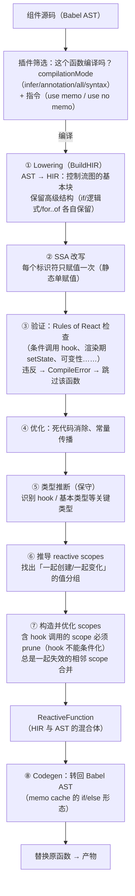

## 8. React Compiler 专题：从源码到自动 memo（构建期的另一半）

- 定位：构建期自动 memo 化——把手写的 `memo`/`useMemo`/`useCallback` 交给编译器；本章讲清它**怎么做到的**（编译流程、中间表示、分析、产物），以及**接入时怎么不踩坑**
- 前五章你复刻的是 React 的**运行时**（Fiber、调度、lane、可中断渲染）；React Compiler 是**构建期**的另一半——同一个 monorepo 里的 `compiler/` 工作区
- 使用层的接入清单在《react-学习大纲》阶段 6 第 10 条（Profiler 对比、CI、删手写 memo 的节奏）；本章是它的原理篇，两章配合读
- 事实基准：React Compiler 1.0（npm `babel-plugin-react-compiler@1.0.0`，react.dev 文档与 `compiler/docs/DESIGN_GOALS.md`，2026-11 核对）；本章所有编译产物均由该版本**实际编译生成**，非手写示意

先摆一个最常见的误解：React Compiler 不是"更聪明的 memo"。手写 memo 化的真正成本从来不是写那几行代码，而是**维护"引用稳定性"这个隐形契约**——你在阶段 6（学习大纲）背过的口诀"props 引用必须稳定"意味着：一个 `useCallback` 漏写，整棵子树的 memo 全部失效；一次重构把对象字面量挪进 render，下游全部重渲染。这个契约是**全局的、跨文件的、随重构漂移的**。Compiler 的价值在于把契约的执行从"人肉保持"变成"编译器保证"：它静态分析每个组件与 hook，自动插入缓存，让"值没变就复用引用"成为机器不变量。

本章按"问题 → 流程 → 规则 → 产物 → 诊断 → 接入"展开，读完你应该能：拿着任何一段编译产物读出"哪些输入变了会重算哪些值"；判断一个组件为什么没被编译；为存量项目设计一条可回滚的接入路径。

### 8.1 它解决什么问题，与手写 memo 是什么关系

**问题的精确形态。** React 的更新粒度是"组件函数整棵重执行 + 子树连坐"。优化的两个抓手（学习大纲阶段 6 第 2 条）：跳过组件重渲染（`memo`，需要 props 浅比较全过——即所有 props 引用稳定）、缓存计算与引用（`useMemo`/`useCallback`）。两个抓手都要求**人**在每个组件里手动列出"哪些值要保持引用稳定"，而依赖数组写错不报错、只变慢，于是全靠纪律与 lint。Compiler 的解法：让编译器从代码本身推导出"哪些值被谁依赖、何时失效"，自动生成缓存——开发者写"朴素"的代码（inline 箭头函数、render 里建对象、直接调用昂贵函数），产物里全是稳定的引用。

一个对照（react.dev 文档的同款例子，浓缩）：

```js
// 手写版：useCallback 想稳住 handleClick，但传给 Item 的内联箭头每次都是新引用
// → Item 的 memo 形同虚设。这类 bug 的特点是：lint 不报、Profiler 里才能看到
const handleClick = useCallback((item) => { onClick(item.id); }, [onClick]);
return processedData.map(item => <Item key={item.id} onClick={() => handleClick(item)} />);

// 编译器版：什么都不写。编译器会给 map 回调、内联箭头都建缓存，
// Item 的 props 引用稳定，memo 判定（如果有）全部命中
return processedData.map(item => <Item key={item.id} onClick={() => handleClick(item)} />);
```

**与手写 memo 的关系，三条边界必须清楚**（来自 react.dev 文档的明确说法）：

1. **不是取代所有 memo。** `useMemo`/`useCallback` 仍然是 escape hatch——最典型的保留理由是 **effect 依赖**：你希望"依赖没实质变化时 effect 不重跑"，这是语义要求，编译器不替你做这个决定。
2. **缓存的粒度与共享范围。** Compiler 只 memo **组件和 hook**（不是任意函数），且**缓存不跨组件共享**——同一个昂贵纯函数在十个组件里被调用，每个组件各算各的。真正昂贵的共享计算仍应提出去（或 memo 化在模块层）。文档同时说清了它聚焦的是**更新性能（re-rendering）**，两个用例：跳过级联重渲染、缓存组件内昂贵计算。
3. **手写的 memo 不必立刻删。** 编译器与手写兼容；但**删除手写 memo 会改变编译产物**（分析看到的输入不同了），要删就删后回归测试。学习大纲阶段 6 第 10 条的清单给了"逐步删"的节奏。

还有一个容易忽略的认知校正：Compiler 的目标**不是**"最优的零浪费更新"（DESIGN_GOALS 的 Non-Goals 第一条原文）——完美追踪的运行时开销可能超过重算本身，且代码体积会伤启动性能。它的目标是"有界且可预测的好"，产物保持高级形态（体积增量小、可调试）。

### 8.2 编译流程：从源码到 IR，再到产物

React Compiler 以 Babel 插件形态接入（Babel plugin 是薄壳，核心编译器与 Babel 解耦；swc/oxc 等原生后端在推进中，Next.js ≥15.3.1 已可走 SWC 调用）。管线的权威描述在 `compiler/docs/DESIGN_GOALS.md`，逐步对照：



每一站的要点：

**① Lowering（BuildHIR）。** 把 Babel AST 降成编译器自己的中间表示 **HIR（High-level Intermediate Representation，名字借自 Rust 编译器）**。两个特征：它是**控制流图**——一串基本块（block），每块是"若干指令 + 一个终结指令"，块按反后序排布；同时它**保留高级结构**——`if` 不与 `&&`/三元互换、各种 for 不折叠成 while。为什么保留？产物要"长得像你写的代码"（可调试、体积小），IR 必须先保住这些信息。

**② SSA（静态单赋值）。** 每个标识符只绑定一次赋值，后续引用变成新名字。这是所有数据流分析的地基——"这个值从哪来、被谁读"在 SSA 形态下是显式的。

**③ 验证。** 检查输入是否遵守 Rules of React：条件调用 hook、渲染期无条件 setState、修改不可变值……（8.3 展开违反的后果）。**验证失败 = 跳过这个函数**，不阻断构建（默认行为）。

**⑤ 类型推断。** 保守推断，只为后续分析服务：哪些调用是 hook、哪些值是基本类型——hook 的"不能条件化、不能重排"约束全靠这一步识别。

**⑥⑦ reactive scopes——本章最核心的概念。** 编译器把"**一起创建、一起变化的值**"分成组，每组就是一个 reactive scope：scope 有自己的输入（被外层读的变量）与输出（产出的值/JSX）。两个优化规则直接来自源码文档：**包含 hook 调用的 scope 必须 prune（剪掉）**——因为编译器不能把 hook 挪进条件分支（Rules of Hooks），这类 scope 只能放弃缓存；**总是一起失效的相邻 scope 会被合并**——两个 scope 的输入完全相同，分开缓存是两倍比较开销，合成一个。你将在 8.4 的产物里看到 scope 的物化形态：嵌套的 `if ($[n] !== …)` 块。

**⑧ Codegen。** ReactiveFunction（HIR/AST 混合）转回普通 Babel AST——就是你将读到的 `if/else + $` 数组形态。

一个容易问的问题：**为什么不用 TypeScript 类型做更强的分析？** DESIGN_GOALS 明确：不要求注解、不依赖类型信息（"should work well without type information"）——类型是可选的加分项，不是入场券。这保证了纯 JS 项目的完整支持。

### 8.3 React 规则与违反时的处理

编译器的合法性完全建立在 Rules of React 之上（react.dev 的规则页 + `eslint-plugin-react-hooks` 的 enforced 规则）：组件与 hook 必须纯（同输入同输出、无副作用）；渲染期创建的值不可变（props/state/渲染期局部量都不能改）；副作用只属于 effect；hook 按规则调用。**为什么编译器对违规零容忍**：它要做的是"输入没变就跳过重算"——如果代码在渲染期偷偷改了 props（`props.items.push(...)`），跳过重算就跳过了那次副作用，行为直接改变。规则是安全变换的前提，不是风格建议。

**违反时的处理链**（实测 `babel-plugin-react-compiler@1.0.0`）：

```js
// 例一：修改渲染期创建的值（useState 的返回值直接改）
function BadList({ items }) {
  items.push('render-time push');        // 改 props
  const [state, setState] = useState(() => ({ n: 0 }));
  state.n += 1;                           // 改 state 返回的对象
  return <ul>{items.map(i => <li key={i}>{i}</li>)}</ul>;
}

// 例二：渲染期读写 ref
function useBad(page) {
  const ref = useRef(null);
  ref.current = page;                     // ref 不属于渲染数据
  return page;
}
```

logger 收到的事件（真实输出，格式略压缩）：

```text
CompileError  BadList  category: Immutability
  "Modifying a value returned from 'useState()', which should not be modified directly"
CompileError  useBad    category: Refs
  "React refs are values that are not needed for rendering. Refs should only be accessed ..."
```

后续动作：**该函数跳过编译、原样输出**（产物里它一根毛都没变），同一文件的其他函数照常编译。也就是说默认策略是"降级而非失败"——这与编译器的渐进接入哲学一致：违规组件失去优化，但不失去功能。是否要让违规**阻断构建**由 `panicThreshold` 控制（可选值 `none`/`none_errors`/`critical_errors`/`all_errors`；react.dev 推荐**生产**用 `'none'`——跳过而不阻断，本地开发可以调严以尽早暴露）。logger 事件还有 `CompileSkip`（指令跳过，reason 里写明）与 `CompileDiagnostic`、`PipelineError` 等。

**静态防线在 ESLint。** 2025 年起 compiler 的诊断规则并入了 `eslint-plugin-react-hooks`（v6+/v7 的 `recommended-latest` 预置），不再需要单独装 `eslint-plugin-react-compiler`。它和编译器共用同一套核心逻辑（DESIGN_GOALS：两者调同一个编译器核心，ESLint 侧过滤出 React 相关错误）——所以"lint 报的"和"编译器跳过的"高度一致，PR 里先清零 lint，编译器侧基本就不会再有意外跳过。

**显式指令。** `"use memo"`（函数体首行：选择加入）与 `"use no memo"`（选择退出），也可放在模块顶部（作用于全文件、函数级可覆盖）。三个用途：`annotation` 模式下的逐组件 opt-in；临时隔离可疑组件（调试的二分法）；显式标记"我知道这个组件不适用"。

### 8.4 编译产物长什么样、怎么读

这是全章最实的部分。输入（一个"朴素"组件——没有一行手写 memo）：

```jsx
function TodoList({ todos, onClick }) {
  const [count, setCount] = useState(0);
  const visible = todos.filter(t => !t.done);
  const label = `共 ${visible.length} 项 · 点击 ${count} 次`;
  return (
    <div className="list">
      <h1>{label}</h1>
      <ul>
        {visible.map(t => (
          <li key={t.id} onClick={() => onClick(t.id)}>{t.text}</li>
        ))}
      </ul>
      <button onClick={() => setCount(c => c + 1)}>refresh {count}</button>
    </div>
  );
}
```

产物（babel-plugin-react-compiler@1.0.0 实际输出，注释是后加的解读；格式略缩进）：

```js
import { c as _c } from "react/compiler-runtime";

function TodoList(t0) {
  const $ = _c(20);                       // ① 缓存数组：20 个槽位（useMemoCache）
  const { todos, onClick } = t0;          // ② props 解构：t0 是 props 本身
  const [count, setCount] = useState(0);
  let t1; let t2; let t3;
  if ($[0] !== count || $[1] !== onClick || $[2] !== todos) {   // ③ 外层 scope
    const visible = todos.filter(_temp);  // ④ 便宜的一步在 scope 内重算（不单独缓存）
    const label = `共 ${visible.length} 项 · 点击 ${count} 次`;
    t2 = "list";                          // ⑤ 字符串常量：不缓存，重算比比较还便宜
    if ($[6] !== label) {                 // ⑥ 内层 scope：只依赖 label
      t3 = React.createElement("h1", null, label);
      $[6] = label;
      $[7] = t3;
    } else {
      t3 = $[7];                          // ⑦ label 没变 → h1 元素整个复用
    }
    let t4;
    if ($[8] !== onClick) {               // ⑧ map 回调只依赖 onClick
      t4 = t_0 => React.createElement("li", {
        key: t_0.id,
        onClick: () => onClick(t_0.id),   // ⑨ 内联箭头跟着回调一起缓存 → 引用稳定
      }, t_0.text);
      $[8] = onClick;
      $[9] = t4;
    } else {
      t4 = $[9];
    }
    t1 = visible.map(t4);                 // ⑩ map 结果缓存进外层 scope 的输出
    $[0] = count; $[1] = onClick; $[2] = todos;   // ⑪ 写回输入槽
    $[3] = t1; $[4] = t2; $[5] = t3;              // ⑫ 写回输出槽
  } else {
    t1 = $[3]; t2 = $[4]; t3 = $[5];      // ⑬ 全部输入没变：三连命中，整块跳过
  }
  let t4;
  if ($[10] !== t1) {
    t4 = React.createElement("ul", null, t1);
    $[10] = t1; $[11] = t4;
  } else {
    t4 = $[11];
  }
  let t5;
  if ($[12] === Symbol.for("react.memo_cache_sentinel")) {   // ⑭ 哨兵：只建一次
    t5 = () => setCount(_temp2);
    $[12] = t5;
  } else {
    t5 = $[12];
  }
  let t6;
  if ($[13] !== count) {
    t6 = React.createElement("button", { onClick: t5 }, "refresh ", count);
    $[13] = count; $[14] = t6;
  } else {
    t6 = $[14];
  }
  let t7;
  if ($[15] !== t2 || $[16] !== t3 || $[17] !== t4 || $[18] !== t6) {  // ⑮ 根元素
    t7 = React.createElement("div", { className: t2 }, t3, t4, t6);
    // …（写回 $[15..19]，return t7）
  } else {
    t7 = $[19];
  }
  return t7;
}
```

**读产物的六条语法规则**：

1. **`_c(n)` 开一个 n 槽缓存数组**——`c` 来自 `react/compiler-runtime`，是 `useMemoCache` 的导出别名（React 19 内部实现；17/18 走 polyfill，见下）。n 是编译器数出来的槽位总数，`CompileSuccess` 事件的 `memoSlots` 字段就是它。
2. **槽位成对出现：输入槽 + 输出槽**。`if ($[k] !== 输入) { 重算; $[k] = 输入; $[k+1] = 产物 } else { 产物 = $[k+1] }`——比较输入、命中则复用输出，一个 memo block 就这么大。
3. **嵌套的 if 块 = reactive scope 的物化**。外层 scope 的输入（count/onClick/todos）罩住内层（label、onClick）——"一起失效的值"被分组与嵌套，失效范围最小化。
4. **比较用 `!==`（Object.is 语义的宽进版）**，与 React 自己的浅比较口径一致。
5. **`Symbol.for("react.memo_cache_sentinel")` 是"从没写过"的哨兵**：捕获了 `setCount` 的闭包没有"输入"，用哨兵保证只构造一次（每次 render 新建闭包正是手写时代的经典浪费）。
6. **不缓存便宜的东西**（⑤ 的字符串、④ 的 filter 调用留在 scope 内重算）——缓存有比较成本，Compiler 的非目标里写着不追求零重算。

**产物的效果链要顺着 React 运行时读**（这正是它与本分册前几章的接缝）：`<h1>`/`<ul>`/`<li>` 的 element 被缓存 → 如果 `TodoList` 被外层 `memo` 包裹，浅比较全过 → 整个子树跳过重渲染；即使没有 `memo`，父组件重渲染时 `TodoList` 重执行，但函数体几乎全走 `else` 分支（几次数组读），计算成本接近零，且 `visible.map(t4)` 的 `t1` 引用不变 → `<ul>` 的 props 没变 → React 的 reconciliation（你 M5 写过的 sameType+props diff）在 `t4` 子树上几乎无事可做。**编译器的产物优化的是"render 的输入"，真正跳过工作的是你前几章复刻的运行时**——这就是"构建期的另一半"的确切含义。

**`react/compiler-runtime` 是什么。** `c` 在 React 19 里是内部 `useMemoCache` 的转发（`React.__COMPILER_RUNTIME.c`），17/18 由 runtime 包的 polyfill 实现——本质是 `useMemo(() => Array(n).fill(sentinel), [])`，一个跨渲染存活的槽位数组（runtime 源码节选）：

```js
// react-compiler-runtime（1.0.0）源码节选
const $empty = Symbol.for('react.memo_cache_sentinel');
export const c =
  typeof React.__COMPILER_RUNTIME?.c === 'function'
    ? React.__COMPILER_RUNTIME.c          // React 19：内部 useMemoCache
    : function c(size) {
        return React.useMemo(() => {
          const $ = new Array(size);
          for (let ii = 0; ii < size; ii++) $[ii] = $empty;
          return $;
        }, []);                           // React 17/18：useMemo 仿制
      };
```

**怎么确认组件被编译了**：① 产物里有 `react/compiler-runtime` 的 import；② React DevTools 组件显示 "Memo ✨" 徽章；③ logger 的 `CompileSuccess` 事件（带 `memoSlots/memoBlocks/memoValues/prunedMemoBlocks/prunedMemoValues`——pruned 字段告诉你有多少 scope 因含 hook 被剪掉，是"这个组件还有多少优化空间"的量化指标）；④ [playground.react.dev](https://playground.react.dev) 粘贴即看产物（被跳过 = 输入侧有违规或该语法暂不支持）。

### 8.5 哪些代码会被跳过、怎么诊断

跳过的四类来源与对应诊断：

| 跳过原因 | 日志/现象 | 诊断动作 |
|---|---|---|
| 违反 Rules of React | `CompileError`（category: Immutability/Refs/…） | ESLint `recommended-latest` 同步报出；修代码（这类违规本来就是 bug 温床——渲染期改值在并发渲染下即使没有编译器也不安全） |
| 不支持的语法/特性 | `CompileError` 或静默跳过 | 查 DESIGN_GOALS 的 Non-Goals：`eval`、捕获闭包的嵌套 class、部分冷门语法；**class 组件一概不支持**（可变实例状态与多生命周期共享，明确 non-goal） |
| 指令退出 | `CompileSkip`（reason 写明 directive） | 确认 `"use no memo"` 是有意为之还是排障遗留 |
| 编译器内部错误 | `CompileError`/`PipelineError` | 罕见；按 react.dev 排障指南先验证非 Rules 违规，再最小复现提 issue |

**排障的标准流程**（react.dev debugging 页）：行为异常的组件先加 `"use no memo"` 二分确认（问题消失 → 基本是规则违规）；再删掉手写 memo 化验证（没有任何 memo 时仍异常 = 代码本身违反规则）；修一处测一处，摘掉指令确认拿到 ✨ 徽章。**最常见的破坏模式**（值得整段背诵）：**把 memo 当正确性保证的代码**——effect 依赖"引用恰好稳定"才不重跑、靠 `===` 判断"是不是同一批数据"的手写缓存。编译器的缓存策略与你的手写版本失效时机可能不同，这类代码在编译后出现 effect 多跑/少跑、界面不更新。修法不是调编译器，是把"正确性"从引用巧合上解耦（effect 依赖写语义相关的值；身份判断用 id 不用引用）。

### 8.6 在既有项目中渐进接入：策略与注意事项

接入的完整工程清单（安装、各构建工具配置、CI）在《react-学习大纲》阶段 6 第 10 条与 react.dev 的 installation/incremental-adoption 两页，这里讲**决策层**：三条渐进路线、一个前提、四个注意。

**一个前提：先把 lint 清零。** `eslint-plugin-react-hooks@latest` 的 `recommended-latest` 预置已含 compiler 规则。违规清零之前不开编译插件——lint 阶段修掉的问题，不会变成"上线后某组件静默失去优化"的悬案。（这些违规本来也是并发渲染下的隐患，修了只赚不亏。）

**三条渐进路线**（按侵入性从低到高，可组合）：

```js
// 路线一：按目录（Babel overrides）——先开一个目录，验证后扩大
// babel.config.js
module.exports = {
  plugins: [/* 全局插件 */],
  overrides: [
    { test: './src/features/new-module/**/*.{js,jsx,ts,tsx}',
      plugins: ['babel-plugin-react-compiler'] },
  ],
}

// 路线二：按注解（compilationMode: 'annotation'）——新代码逐组件 opt-in
['babel-plugin-react-compiler', { compilationMode: 'annotation' }]
// 组件里：function Foo() { "use memo"; … }

// 路线三：运行时开关（gating）——同一构建里按 feature flag 切换优化版/原版，A/B 度量
['babel-plugin-react-compiler', {
  gating: { source: 'ReactCompilerFeatureFlags', importSpecifierName: 'isCompilerEnabled' },
}]
```

gating 的产物会在优化代码外裹一层运行时判断（flag 开 → 优化版，关 → 原始代码），适合灰度与真实用户性能对比。另有 `sources` 选项（`Array<string> | (filename) => boolean`）可直接在插件配置里筛文件——与 overrides 等效，选顺手的。

**四个注意**：

1. **管线顺序：编译器必须是 Babel 管线的第一个插件**（react.dev 明确要求）——它需要原始源码信息（指令注释、精确的求值顺序），排在别的转换后面会拿到被改写过的 AST。
2. **React 17/18 项目**：支持，但要配 `target`（`'17'`/`'18'`，缺 `React.__COMPILER_RUNTIME` 的版本由 `react-compiler-runtime` 包的 polyfill 兜底）；19 无需额外配置。生产 `panicThreshold` 用 `'none'`（跳过不阻断）。
3. **删手写 memo 是第二步，不是第一步**：先让编译器与手写共存跑一阵（行为对齐），再逐模块删除并回归——删依赖数组会改变编译器看到的输入，产物随之变化。
4. **测量先行不变**（阶段 6 第 1 条的纪律在编译器时代同样成立）：Profiler 前后对比、`CompileSuccess` 的 pruned 指标、DevTools ✨ 覆盖率，比"感觉变快了"可信。Compiler 不修复架构问题（Context 放高频值、状态全提升），只消除"引用稳定性的维护成本"这一类。

**框架支持速查**（react.dev installation，2026-11）：Vite（`@vitejs/plugin-react@6` + `@rolldown/plugin-babel` 的 `reactCompilerPreset()`；旧版 plugin-react 走 `babel.plugins` 内联选项）、Next.js ≥15.3.1（经 SWC 调用编译器，配置方式以 Next.js 官方文档为准）、React Native/Metro、Expo、React Router（Vite 插件）、Rspack/Rsbuild、webpack（社区 loader `react-compiler-webpack`）。

### 8.7 与本分册的关系：React 的两条优化轴

把本章放回全书地图：前五个里程碑群（M1–M13）复刻的是**运行时轴**——Fiber 让渲染可中断，lane 让更新有优先级，双缓冲让丢弃无代价；本章的编译器是**构建期轴**——让"render 的输入"尽量不变，从而让运行时**无事可做**。两轴互补：编译器产物的缓存命中靠的是"引用没变"，而"哪些更新值得立刻提交、哪些可以打断"仍然只有运行时的 lane/transition 能回答（Compiler 不改变更新优先级——`startTransition` 照写）。读懂产物那节的"效果链"你就能向别人讲清这句话：**Compiler 负责让重渲染变便宜，你复刻的并发运行时负责让重渲染让路**。

进真实源码的阅读地图（`facebook/react` 仓库 `compiler/` 工作区）：`compiler/packages/babel-plugin-react-compiler`（插件壳与选项解析）、`compiler/packages/react-compiler-core`（HIR、SSA、scope 分析、codegen——DESIGN_GOALS 里每个 pass 都能在这里找到对应实现）、`compiler/packages/react-compiler-errors`（错误目录：诊断码与文案，即 CompileError 的 category 来源）、`compiler/packages/react-compiler-runtime`（8.4 节的 c/哨兵/polyfill）。建议路径：先把本章的输入/产物对贴进 playground 反复看，再去读 core 的 pass 列表——每个 pass 名字都能和 8.2 的管线对上。

**自测**（能脱口而出再合上本章）：

1. 编译产物里 `if ($[n] !== x)` 与 `$[n+1]` 的配对是什么机制？哨兵 Symbol 解决什么问题？
2. 含 hook 调用的 reactive scope 为什么必须 prune？pruned 数在哪个事件里看？
3. 编译器遇到违反规则的组件，默认行为是什么？哪个选项改变它？为什么生产推荐不阻断？
4. 一段 effect 依赖"引用稳定"的存量代码，接入编译器后最可能出现什么症状？修法是什么？
5. 为什么编译器必须是 Babel 管线的第一个插件？它需要源码的什么信息？

（1：memo block 的输入/输出对，命中跳过重算；哨兵标记"从未写过"，让无输入的闭包只构造一次。2：hook 不能条件化/重排，Rules of Hooks 是硬约束；CompileSuccess 的 prunedMemoBlocks/prunedMemoValues。3：跳过该函数、原样输出；panicThreshold；违规组件失去优化但不失功能，且违规多属"本来就该修"的问题，阻断构建成本过高。4：effect 重跑或不跑（缓存失效时机与手写不同）；把正确性从引用巧合解耦。5：指令注释与求值顺序等原始信息，前面的插件可能改写 AST。）
