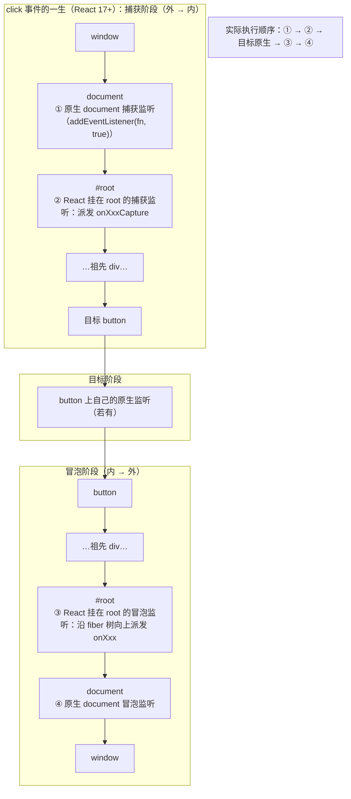

## A6. 事件边界

- React 17+ 事件委托在 root；原生监听 document 时与 React 事件的执行顺序
- capture 阶段拦截技巧（编辑器画布、弹层互斥都靠它）
- passive listener（wheel/touch 性能）

### A6.1 React 17+ 事件委托机制图解

React 不把 `onClick` 直接绑在你的元素上。它在 **root 容器**（`createRoot(el)` 的那个 el）上为每种事件各挂一个原生监听，事件冒泡/捕获到 root 时，React 沿 fiber 树模拟派发合成事件（`SyntheticEvent`）。React 17 之前监听挂在 `document` 上，17 起迁到 root——解决多应用共存（微前端）与事件到达顺序两大问题。



### A6.2 原生 document 监听与 React 事件的执行顺序

从上图直接读出三条结论（面试高频）：

1. **React 冒泡处理器（③）先于原生 document 冒泡监听（④）**——因为 root 在 document 的内层，事件先到 root；
2. **原生 document 捕获监听（①）先于一切 React 处理器**——捕获方向上 document 最外层；
3. **目标元素上的原生监听先于 React 冒泡处理器**，但晚于 React 捕获处理器（②在 root 捕获，早于目标阶段）。

可运行验证：

```tsx
// EventOrderDemo.tsx —— 打印 React 与原生监听的真实顺序
import * as React from 'react';

export function EventOrderDemo() {
  React.useEffect(() => {
    const onDocCapture = () => console.log('1) 原生 document 捕获');
    const onDocBubble = () => console.log('5) 原生 document 冒泡');
    document.addEventListener('click', onDocCapture, true);  // true：捕获
    document.addEventListener('click', onDocBubble);          // 默认：冒泡
    return () => {
      document.removeEventListener('click', onDocCapture, true);
      document.removeEventListener('click', onDocBubble);
    };
  }, []);

  return (
    <div
      onClickCapture={() => console.log('2) React onClickCapture（root 捕获派发）')}
      onClick={() => console.log('4) 外层 div 的 React onClick')}
    >
      <button onClick={() => console.log('3) button 的 React onClick')}>
        点我，看控制台顺序 1→2→3→4→5
      </button>
    </div>
  );
}
```

工程含义：**想在所有 React 处理器之前拦截事件（互斥、画布锁），必须用 document/window 的捕获监听**；想"事后"观察事件，用 document 冒泡监听。另外注意：合成事件上调用 `e.stopPropagation()` 会同时停掉原生事件继续传播——④ 也将收不到；这是双刃剑（能挡住别的库的 document 监听，也会挡住合理的全局行为）。

### A6.3 capture 阶段拦截：编辑器画布与弹层互斥

**编辑器画布场景**：画布进入"框选/连线"模式时，画布内组件的一切指针交互（拖拽、点选、resize 手柄）都该失效。逐个组件加 `if (mode === 'select') return` 是散弹枪修改；正确做法是在 document 捕获阶段统一吃掉：

```tsx
// useCanvasSelection.ts —— 框选模式：捕获阶段吃掉画布内的一切指针交互
import * as React from 'react';

export function useCanvasSelection(
  active: boolean,
  canvasRef: React.RefObject<HTMLElement | null>,
  onFinish: (rect: { x: number; y: number; w: number; h: number }) => void
) {
  // 回调最新化：effect 只随 active 重建，别把 onFinish 拉进依赖导致监听反复拆装
  const onFinishRef = React.useRef(onFinish);
  React.useEffect(() => {
    onFinishRef.current = onFinish;
  }, [onFinish]);

  React.useEffect(() => {
    if (!active) return;
    let startX = 0, startY = 0, endX = 0, endY = 0;
    let dragging = false;

    const onPointerDown = (e: PointerEvent) => {
      const canvas = canvasRef.current;
      if (!canvas || !canvas.contains(e.target as Node)) return; // 画布外的事件不管
      dragging = true;
      startX = endX = e.clientX;
      startY = endY = e.clientY;
      // 捕获阶段最先执行（A6.2 的 ①）：stopPropagation 之后，
      // 画布里组件的 React onPointerDown/onClick（②③）根本不会触发
      e.stopPropagation();
      e.preventDefault(); // 顺便吃掉默认行为（文本选中等）
    };

    const onPointerMove = (e: PointerEvent) => {
      if (!dragging) return;
      endX = e.clientX;
      endY = e.clientY;
      // 这里可同步更新"选框预览"元素的几何（画一个跟随指针的虚线框即可）
    };

    const onPointerUp = () => {
      if (!dragging) return;
      dragging = false;
      onFinishRef.current({
        x: Math.min(startX, endX),
        y: Math.min(startY, endY),
        w: Math.abs(endX - startX),
        h: Math.abs(endY - startY),
      });
    };

    document.addEventListener('pointerdown', onPointerDown, true); // true：捕获
    window.addEventListener('pointermove', onPointerMove);
    window.addEventListener('pointerup', onPointerUp);
    return () => {
      document.removeEventListener('pointerdown', onPointerDown, true);
      window.removeEventListener('pointermove', onPointerMove);
      window.removeEventListener('pointerup', onPointerUp);
    };
  }, [active, canvasRef]);
}
```

**弹层互斥场景**：打开弹层 A 时要关掉弹层 B——"关闭 B"必须发生在"B 的触发器把 B 打开/保持"逻辑之前，所以同样走捕获。与 A2.9 的弹层集合联动：

```tsx
// 互斥逻辑节选：任何弹层打开时，先关掉链路之外的弹层
import { openLayers, closeLayer } from './layerStore'; // A2.6/A2.9 的弹层注册表

document.addEventListener(
  'mousedown',
  (e) => {
    for (const layer of openLayers) {
      if (layer.contains(e.target as Node)) continue; // 自己/子弹层：豁免（A2.9 规则②）
      closeLayer(layer);                              // 其余弹层：抢在一切打开逻辑之前关闭
    }
  },
  true // 捕获：保证先于所有 React onClick 执行
);
```

### A6.4 passive listener：wheel/touch 的性能约定

浏览器要保证滚动流畅（合成器线程直接滚），前提是事件监听**不调用 preventDefault**（一旦可能取消滚动，浏览器就得等 JS 执行完）。于是有了约定：**window/document/body 上的 `wheel`、`touchstart`、`touchmove` 默认按 passive 挂载**（Chrome 56 起）——passive 监听里 `preventDefault()` 无效，控制台报警 `Unable to preventDefault inside passive event listener`。

React 侧的连带影响：React 17 起 root 上的 `touchstart`、`touchmove`、`wheel` 也是 passive 挂载的——所以 **`onWheel` 里 `preventDefault()` 不起作用**。需要"滚轮缩放画布而不是滚动页面"这类需求，必须用原生 `addEventListener` 并显式声明 `{ passive: false }`：

```tsx
// ZoomableCanvas.tsx —— 滚轮缩放画布（preventDefault 必须生效的场景）
import * as React from 'react';

export function ZoomableCanvas() {
  const canvasRef = React.useRef<HTMLCanvasElement>(null);
  const scaleRef = React.useRef(1);

  React.useEffect(() => {
    const canvas = canvasRef.current;
    if (!canvas) return;
    const ctx = canvas.getContext('2d');
    if (!ctx) return;

    const draw = () => {
      ctx.setTransform(1, 0, 0, 1, 0, 0); // 复位变换矩阵再重画，避免累积
      ctx.clearRect(0, 0, canvas.width, canvas.height);
      ctx.scale(scaleRef.current, scaleRef.current);
      ctx.strokeRect(40, 30, 80, 60); // 示意图形：随缩放变大变小
    };

    const onWheel = (e: WheelEvent) => {
      e.preventDefault(); // 阻止页面滚动，改走缩放 —— 必须在 non-passive 监听里才有效
      scaleRef.current = Math.min(4, Math.max(0.5, scaleRef.current * (e.deltaY > 0 ? 0.9 : 1.1)));
      draw();
    };

    canvas.addEventListener('wheel', onWheel, { passive: false }); // 显式关掉 passive
    draw();
    return () => canvas.removeEventListener('wheel', onWheel); // remove 时无须再传 passive
  }, []);

  return (
    <canvas
      ref={canvasRef}
      width={400}
      height={300}
      style={{ border: '1px solid #ccc', touchAction: 'none' }} /* touchAction 配套禁掉触摸滚动 */}
    />
  );
}
```

顺带：触摸场景还有一个纯 CSS 出口——`touch-action: none` 声明"这个元素上的触摸手势不产生滚动"，等于在浏览器层面免掉 preventDefault 纠缠，优先用它。

### A6.5 常见坑

1. **`onWheel` 里 preventDefault 没效果**。症状：页面照样滚/缩放和滚动同时发生，控制台 passive 警告。根因：A6.4——React 的 wheel 是 root 上 passive 挂载。修法：ref + 原生 `addEventListener('wheel', fn, { passive: false })`。
2. **click-outside 用 click 导致误关**。症状：在弹层里拖选文本、松手在弹层外，弹层关了。根因：click 的目标是 down/up 的共同祖先（A2.9）。修法：mousedown 阶段判定。
3. **document 捕获监听泄漏**。症状：组件卸载后某些事件"失灵"（被幽灵监听 stopPropagation 了）。根因：捕获监听忘了清理，或 cleanup 时 `removeEventListener` 没带相同的 capture 标志（`removeEventListener(type, fn, true)` 与 `removeEventListener(type, fn)` 不等价）。修法：add/remove 严格成对，capture 标志一致。

### A6.6 outside-press 的边界：iframe、拖出窗口与长按菜单

**是什么**：A2.9 的 `useClickOutside`（mousedown 判定 + 多弹层豁免）覆盖了主文档内的点击，但三类真实交互会让它**静默失效**：① 点击发生在 **iframe** 里（事件派发在 iframe 的独立 document，永不冒泡到主 document）；② 指针在弹层内按下、**拖出浏览器窗口**松手（主 document 收不到 pointerup，click 不合成）；③ 触屏**长按/右键菜单**（系统接管后事件序列是 touchcancel/contextmenu，不是常规 down/up）。

**为什么难**：三个失效的共同根因是"事件根本到不了你的监听器"——往 document 上加更多 listener 没用，必须换信号源（window blur、documentElement 的 pointerleave、pointercancel）。而每个替代信号都有自己的误报源（alt-tab 也触发 blur、hover 出窗口也触发 pointerleave），要逐个甄别。

**机制（逐场景）**：

1. **iframe**：焦点进入 iframe 时主窗口 `blur`，且此后 `document.activeElement` 变为 `<iframe>` 元素——用"blur + 延迟一拍查 activeElement"判定"点击进了 iframe"；编辑器类 iframe（富文本嵌入）应视为内部，配置开关不关；
2. **拖出窗口**：跟踪"按下起点"（down 在弹层内则 `pressedInside = true`）；`documentElement` 的 `pointerleave`（指针物理离开视口）时若 `pressedInside`，up 不会再来——按 outside 结算（或按产品语义留给业务）；
 3. **长按菜单**：`contextmenu` 打开的浮层，打开它的那次右键 `pointerdown` 发生在打开**之前**（不会误关）；但触屏长按可能被系统接管（放大镜/选择）→ 后续是 `touchcancel`，收到即关。另外右键菜单的"锚"是 `contextmenu` 事件的 target，outside 判定要把锚纳入豁免。
4. **弹层自己的滚动条**：用户拖弹层内列表的滚动条，部分平台（Windows Chrome、旧 WebKit）上这个 `pointerdown` 的 target 是 `<html>` 而非弹层元素——按 contains 判定成了 outside，用户刚碰滚动条菜单就关了（floating-ui 历史上真实的 issue）。豁免规则：target 是 `document.documentElement` 一律视为"滚动条/浏览器边框"点击。

```tsx
// useOutsidePress.ts —— 加固版：三边界的统一入口
import * as React from 'react';

export interface OutsidePressOptions {
  enabled: boolean;
  /** 锚元素（触发器 / contextmenu 的目标）：按下在锚上不算 outside */
  anchorRef?: React.RefObject<HTMLElement | null>;
  /** 焦点进入 iframe 是否算 outside；编辑器类 iframe 场景传 false */
  iframeIsOutside?: boolean;
  onOutside: () => void;
}

export function useOutsidePress(
  ref: React.RefObject<HTMLElement | null>,
  { enabled, anchorRef, iframeIsOutside = true, onOutside }: OutsidePressOptions
) {
  const onOutsideRef = React.useRef(onOutside);
  React.useEffect(() => { onOutsideRef.current = onOutside; }, [onOutside]);

  React.useEffect(() => {
    if (!enabled) return;
    const el = ref.current;
    if (!el) return;

    let pressedInside = false; // 按下起点跟踪：拖出去松手的判定基础
    const isInside = (target: Node | null) =>
      el.contains(target as Node) || anchorRef?.current?.contains(target as Node) === true;

    // ① 常规路径：down 阶段判定（A2.9 的纪律，指针版）
    const onPointerDown = (e: PointerEvent) => {
      // 滚动条/浏览器边框：部分平台上 target 是 <html>（机制 4），统一豁免
      if (e.target === document.documentElement) return;
      pressedInside = isInside(e.target as Node);
      if (!pressedInside) onOutsideRef.current();
    };

    // ② 拖出窗口：up 不会再来，pointerleave（指针离开视口）+ 按下起点在内 → 结算
    const onPointerLeave = () => {
      if (pressedInside) {
        pressedInside = false;
        onOutsideRef.current();
        // 若产品语义是"拖出去松手 = 提交"，这里改为调业务回调而不是 close——库给钩子，策略归业务
      }
    };

    // ③ iframe：blur 后 activeElement 变成 <iframe> 元素，延迟一拍读取
    const onBlur = () => {
      window.setTimeout(() => {
        if (!iframeIsOutside) return;
        const active = document.activeElement;
        if (active && active.tagName === 'IFRAME') onOutsideRef.current();
      }, 0);
    };

    // ④ 长按被系统接管：touchcancel 即交互已终止
    const onTouchCancel = () => onOutsideRef.current();

    document.addEventListener('pointerdown', onPointerDown, true);
    document.addEventListener('touchcancel', onTouchCancel, true);
    document.documentElement.addEventListener('pointerleave', onPointerLeave);
    window.addEventListener('blur', onBlur);
    return () => {
      document.removeEventListener('pointerdown', onPointerDown, true);
      document.removeEventListener('touchcancel', onTouchCancel, true);
      document.documentElement.removeEventListener('pointerleave', onPointerLeave);
      window.removeEventListener('blur', onBlur);
    };
  }, [enabled, ref, anchorRef, iframeIsOutside]);
}
```

右键菜单的接线示例（长按菜单场景的完整用法：contextmenu 打开 + 锚豁免 + outside 关闭）：

```tsx
// ContextMenu.tsx —— 右键菜单：open 由 contextmenu 驱动，锚是事件 target
import * as React from 'react';
import { useOutsidePress } from './useOutsidePress';

export function ContextMenu({ items }: { items: Array<{ label: string; onClick: () => void }> }) {
  const [state, setState] = React.useState<{ open: boolean; x: number; y: number }>({
    open: false, x: 0, y: 0,
  });
  const anchorRef = React.useRef<HTMLElement | null>(null); // 右键命中的元素
  const menuRef = React.useRef<HTMLDivElement>(null);

  useOutsidePress(menuRef, {
    enabled: state.open,
    anchorRef, // 锚豁免：再右键同元素是"换位置"，不是 outside
    onOutside: () => setState((s) => ({ ...s, open: false })),
  });

  return (
    <div
      onContextMenu={(e) => {
        e.preventDefault(); // 抢掉浏览器默认菜单
        anchorRef.current = e.currentTarget;
        setState({ open: true, x: e.clientX, y: e.clientY });
      }}
      style={{ height: 300 }}
    >
      在这里右键
      {state.open && (
        <div
          ref={menuRef}
          role="menu"
          style={{ position: 'fixed', left: state.x, top: state.y, background: '#fff' }}
        >
          {items.map((item) => (
            <div key={item.label} role="menuitem" onClick={item.onClick}>
              {item.label}
            </div>
          ))}
        </div>
      )}
    </div>
  );
}
```

对照学习：floating-ui 的 `useDismiss` 把这套边界做成了声明式配置（`outsidePressEvent` 可换 'pointerdown'/'mousedown'，dismiss 时区分"焦点原因"）。手写版的价值在于知道每个监听器**为什么存在**——出问题时能定位是哪条信号源缺席。

坑：

1. **blur 的误报面**。症状：切 devtools、alt-tab 也关菜单（或不关，看产品）。根因：window blur 的触发源不止 iframe。修法：上面代码用 activeElement 判定收窄到"焦点进 iframe"；"窗口失焦就关"是产品决策（floating-ui 同类配置 `dismissOnBlur`），默认别开。
2. **pointerleave 与普通 hover 混淆**。症状：鼠标划出视口弹层就关。根因：没判 `pressedInside`。修法：只有"按下中 + 离开视口"才结算（代码已带）；另外 Safari 触屏对 documentElement 的 pointerleave 有怪癖，触摸场景以 pointercancel 为主信号。
3. **N 个弹层 N 份 blur 监听**。症状：嵌套链（A2.13）里内层关了外层也被 blur 误关。修法：blur/leave 信号也走层栈——只让栈顶弹层响应（把 A2.13 的 Esc 栈模式复制到 outside 信号上）；每层各挂一份的写法在嵌套场景必错。
4. **碰滚动条即关闭**。症状：Windows/旧 WebKit 上用户拖弹层内列表的滚动条，弹层立刻关。根因：这些平台的 scrollbar `pointerdown` target 是 `<html>`（机制 4）。修法：`e.target === document.documentElement` 豁免（代码已带）；注意这同时豁免了"点浏览器视口边框"——那本来也没有可靠语义，损失可忽略。

### A6.7 自定义指针交互的测试方法：从 dispatchEvent 到 Playwright

**是什么**：手写指针交互（A6.3 的框选、拖拽手柄）之后，"怎么测"是两层体系：**jsdom 单测**测逻辑（状态机转移、回调参数、豁免判定），**Playwright e2e** 测手势（真实轨迹、命中测试、窗口外松手）。jsdom 没有布局与命中测试（`getBoundingClientRect` 全 0、事件不会沿真实路径传播），任何依赖"指针在哪个元素上"的逻辑在单测层都是假的——认清边界，两层各测各的。

**为什么难**：

1. jsdom 长期没有 `PointerEvent` 构造器（新版才有），`new PointerEvent(...)` 直接抛错；`setPointerCapture`/`releasePointerCapture` 未实现，组件里调用即炸；
2. 合成事件 `isTrusted` 恒为 false——组件逻辑若依赖它（防自动化脚本）测试全挂，这也是"不要在组件里检查 isTrusted"的工程理由；
3. 派发目标容易错：真实浏览器的 up 落在"指针下方的元素"（或捕获者），测试里随手派发到 down 的同元素，监听在 window 的代码路径就走不到。

**机制**：

1. **测试工具层**：`firePointer` 兼容"有/没有 PointerEvent"两种 jsdom，缺字段手工 defineProperty 补齐（pointerId/pointerType/isPrimary）；`dragSequence` 封装 down→moves→up 序列，up/move 派发到 document（模拟冒泡到 window 的路径）；
2. **单测层**：stub 指针捕获为 noop；只断言回调参数与状态（如框选矩形的归一化），不断言视觉；
3. **e2e 层**：`page.mouse` 带 `steps` 的 move（验证采样累积）、拖出视口松手（A6.6 边界的断言）、touchscreen API。

```ts
// testUtils/pointer.ts —— jsdom 指针事件合成工具（Vitest 单测用）
type PointerType = 'pointerdown' | 'pointermove' | 'pointerup' | 'pointercancel';

export function firePointer(
  el: Element,
  type: PointerType,
  init: {
    pointerId?: number;
    clientX?: number;
    clientY?: number;
    buttons?: number;
    shiftKey?: boolean;
  } = {}
): void {
  const Ctor = typeof PointerEvent !== 'undefined' ? PointerEvent : MouseEvent;
  const event = new Ctor(type, {
    bubbles: true,
    cancelable: true,
    composed: true,
    clientX: init.clientX ?? 0,
    clientY: init.clientY ?? 0,
    shiftKey: init.shiftKey ?? false,
    ...(Ctor === MouseEvent ? { buttons: init.buttons ?? 1 } : {}),
  } as PointerEventInit);

  // MouseEvent 回退时手工补 PointerEvent 独有字段（组件只读字段值，不查原型链）
  if (Ctor === MouseEvent) {
    Object.defineProperty(event, 'pointerId', { value: init.pointerId ?? 1 });
    Object.defineProperty(event, 'pointerType', { value: 'mouse' });
    Object.defineProperty(event, 'isPrimary', { value: true });
  }
  el.dispatchEvent(event);
}

/** 拖拽序列：down 在起点元素，move/up 派发到 document（真实路径：冒泡到 window 监听） */
export function dragSequence(
  el: Element,
  points: ReadonlyArray<readonly [number, number]>,
  opts: { pointerId?: number } = {}
): void {
  const [start, ...rest] = points;
  firePointer(el, 'pointerdown', {
    clientX: start[0], clientY: start[1], pointerId: opts.pointerId,
  });
  rest.forEach(([x, y]) =>
    firePointer(document, 'pointermove', {
      clientX: x, clientY: y, pointerId: opts.pointerId,
    })
  );
  const end = points[points.length - 1];
  firePointer(document, 'pointerup', {
    clientX: end[0], clientY: end[1], pointerId: opts.pointerId,
  });
}
```

```tsx
// useCanvasSelection.test.tsx —— 单测层：只测逻辑（A6.3 的框选 hook）
import { act, render } from '@testing-library/react';
import { beforeAll, describe, expect, it, vi } from 'vitest';
import { useCanvasSelection } from './useCanvasSelection';
import { dragSequence } from '../testUtils/pointer';

function Harness({
  onFinish,
}: {
  onFinish: (rect: { x: number; y: number; w: number; h: number }) => void;
}) {
  const canvasRef = React.useRef<HTMLDivElement | null>(null);
  useCanvasSelection(true, canvasRef, onFinish);
  return (
    <div ref={canvasRef}>
      <button>画布内的按钮</button>
    </div>
  );
}

describe('useCanvasSelection', () => {
  beforeAll(() => {
    // jsdom 未实现指针捕获 API：组件里的"好实践"调用会炸，stub 成 noop
    Element.prototype.setPointerCapture ??= vi.fn();
    Element.prototype.releasePointerCapture ??= vi.fn();
  });

  it('框选：down(10,10) → move(30,50) → up，回调矩形归一化', () => {
    const onFinish = vi.fn();
    const { container } = render(<Harness onFinish={onFinish} />);
    act(() => {
      dragSequence(container.firstElementChild!, [[10, 10], [30, 50]]);
    });
    expect(onFinish).toHaveBeenCalledWith({ x: 10, y: 10, w: 20, h: 40 });
  });

  it('画布外的 down 不启动框选（豁免判定）', () => {
    const onFinish = vi.fn();
    render(<Harness onFinish={onFinish} />);
    const outside = document.createElement('div');
    document.body.appendChild(outside);
    act(() => {
      dragSequence(outside, [[0, 0], [40, 40]]);
    });
    expect(onFinish).not.toHaveBeenCalled();
    outside.remove();
  });
});
```

```ts
// e2e/canvas-selection.spec.ts —— e2e 层：真实输入（轨迹采样/窗口外/命中测试）
import { expect, test } from '@playwright/test';

test('真实鼠标框选：多步 move 采样的轨迹累积正确', async ({ page }) => {
  await page.goto('/canvas');
  const canvas = page.getByRole('application');
  await canvas.hover(); // 命中测试：元素被遮挡时 hover 会失败——这正是 e2e 的价值
  await page.mouse.down();
  await page.mouse.move(300, 200, { steps: 10 }); // steps：中途采样点，验证增量逻辑
  await page.mouse.up();
  await expect(page.getByTestId('selection-rect')).toHaveAttribute('data-w', '290');
});

test('拖出视口松手（A6.6 边界）：框选仍结算', async ({ page }) => {
  await page.goto('/canvas');
  await page.mouse.move(100, 100);
  await page.mouse.down();
  await page.mouse.move(-50, 100); // 出视口
  await page.mouse.up();           // Playwright 会带窗口外坐标派发 up
  await expect(page.getByTestId('selection-rect')).toHaveCount(1);
});
```

坑：

1. **up 派发到起点元素**。症状：监听在 window 的 move/up 收不到事件，测试偶发挂。根因：真实浏览器的 up 目标是"指针下元素或捕获者"，jsdom 不会替你算。修法：move/up 统一派发到 document（dragSequence 的做法）；若组件用了 setPointerCapture，真实浏览器里 up 会重定向到捕获元素——e2e 层覆盖这条，单测层 stub 掉。
2. **move 的 buttons 忘传**。症状："只有按下才生效"的守卫逻辑在测试里失效（buttons=0 也当按住处理），测试绿了、真机挂。根因：MouseEvent 回退分支漏了 buttons。修法：helper 默认补 `buttons: 1`（上面代码已带），并加一条 buttons=0 的反例用例。
3. **单测里断言视觉/布局**。症状：jsdom 里 `getBoundingClientRect` 全 0，断言坐标的用例必然随机挂。修法：单测只断言回调与状态；坐标转换逻辑抽成纯函数单独测（输入输出都是数字，不需要 DOM）；布局相关的（drop 位置命中）全部下放 e2e。

### A6.8 copy/paste 与拖放的事件边界

**是什么**：组件库的"数据进出"除指针体系外还有两条独立事件通道：**剪贴板族**（copy/cut/paste，`ClipboardEvent + clipboardData`）与**原生拖放族**（dragstart/dragover/drop/dragend，`DragEvent + dataTransfer`）。它们的边界规则与指针完全不同：preventDefault 是**义务**而非可选、数据读取有**同步窗口期**、子元素会制造**成对的 enter/leave 抖动**。

**为什么难**：

1. `paste` 的 `clipboardData` 只在事件处理器**同步执行期间**可读——`await` 之后再读 items 全空（浏览器安全模型，与异步 Clipboard API（学习大纲 26-9 讲的是那个 `navigator.clipboard`）是两套体系，别混）；
2. `dragover` 必须 `preventDefault()`，否则浏览器按默认行为（打开文件/跳转链接）处理，**drop 根本不会派发**——"drop 不触发"排査的第一嫌疑；
3. `dragleave` 在进出**每个子元素**时都会触发（enter/leave 成对），朴素实现的高亮态疯狂闪烁；
4. 拖拽途中处于**保护模式**：`dragover` 里读不到数据内容，只能读 `types` 判"能不能接"，真实数据到 `drop` 才可读。

**机制**：

1. **粘贴区**：onPaste 里同步遍历 `clipboardData.items`（kind=file 走上传，kind=string 走文本插入），有消费就 `preventDefault` 抢掉默认粘贴；
2. **投放区**：计数法治抖动——`dragenter` +1 / `dragleave` -1，归零才是真离开；`dragover` 里 preventDefault + 按 types 设 `dropEffect`；`drop` 取 files；计数在 drop 时强制归零（跨窗口取消拖拽时只有源收到 dragend，目标区靠 leave 归零兜底）。

```tsx
// usePasteZone.ts —— 粘贴上传/粘贴文本（文件优先，文本兜底）
import * as React from 'react';

export interface PasteZoneOptions {
  onFiles?: (files: File[]) => void;
  onText?: (text: string) => void;
}

export function usePasteZone({ onFiles, onText }: PasteZoneOptions) {
  const handlersRef = React.useRef({ onFiles, onText });
  handlersRef.current = { onFiles, onText };

  return React.useMemo(() => ({
    onPaste: (e: React.ClipboardEvent) => {
      const dt = e.clipboardData;
      if (!dt) return;

      // items 必须同步遍历：事件返回后 DataTransferItemList 即失效（安全模型）
      const files: File[] = [];
      for (const item of Array.from(dt.items)) {
        if (item.kind === 'file') {
          const file = item.getAsFile();
          if (file) files.push(file);
        }
      }
      if (files.length > 0) {
        e.preventDefault(); // 抢掉默认（把文件名当文本粘进来）
        handlersRef.current.onFiles?.(files);
        return;
      }
      const text = dt.getData('text/plain');
      if (text !== '' && handlersRef.current.onText) {
        e.preventDefault();
        handlersRef.current.onText(text);
      }
    },
  }), []);
}
```

```tsx
// useDropZone.ts —— 原生拖放投放区：计数法 + dropEffect 契约
import * as React from 'react';

export function useDropZone(onDrop: (files: File[]) => void) {
  const depthRef = React.useRef(0);          // enter/leave 计数：治子元素抖动
  const [isOver, setIsOver] = React.useState(false);
  const onDropRef = React.useRef(onDrop);
  onDropRef.current = onDrop;

  const handlers = React.useMemo(() => ({
    onDragEnter: (e: React.DragEvent) => {
      e.preventDefault(); // enter/over 都必须 preventDefault，drop 才可能派发
      depthRef.current += 1;
      setIsOver(true);
    },
    onDragOver: (e: React.DragEvent) => {
      e.preventDefault();
      // 保护模式：读不到数据内容，只能按 types 声明"接不接"；dropEffect 同时决定光标样式
      e.dataTransfer.dropEffect = e.dataTransfer.types.includes('Files') ? 'copy' : 'none';
    },
    onDragLeave: () => {
      depthRef.current -= 1;
      if (depthRef.current <= 0) {
        depthRef.current = 0;
        setIsOver(false); // 归零才是真离开：进出子元素的成对 enter/leave 不影响
      }
    },
    onDrop: (e: React.DragEvent) => {
      e.preventDefault();
      depthRef.current = 0; // 强制归零：drop 后不会有配对的 dragleave
      setIsOver(false);
      onDropRef.current(Array.from(e.dataTransfer.files));
    },
  }), []);

  return { handlers, isOver };
}
```

最小测试（计数法与 preventDefault 义务的回归；DataTransfer 在 jsdom 无构造器，用 stub 对象）：

```tsx
// useDropZone.test.tsx
import { fireEvent, render } from '@testing-library/react';
import { describe, expect, it, vi } from 'vitest';
import { useDropZone } from './useDropZone';

function Target({ onDrop }: { onDrop: (f: File[]) => void }) {
  const { handlers, isOver } = useDropZone(onDrop);
  return (
    <div data-testid="zone" data-over={String(isOver)} {...handlers}>
      <span>子元素</span>
    </div>
  );
}

const dt = (types: string[]) =>
  ({ types, files: [], dropEffect: 'none' }) as unknown as DataTransfer;

describe('useDropZone', () => {
  it('dragover 被 preventDefault 后 drop 能收到（义务回归）', () => {
    const onDrop = vi.fn();
    const { getByTestId } = render(<Target onDrop={onDrop} />);
    const zone = getByTestId('zone');
    fireEvent.dragEnter(zone, { dataTransfer: dt(['Files']) });
    fireEvent.dragOver(zone, { dataTransfer: dt(['Files']) });
    fireEvent.drop(zone, { dataTransfer: dt(['Files']) });
    expect(onDrop).toHaveBeenCalledTimes(1);
  });

  it('进出子元素不退出悬停态，真正离开才退出', () => {
    const onDrop = vi.fn();
    const { getByTestId, getByText } = render(<Target onDrop={onDrop} />);
    const zone = getByTestId('zone');
    const child = getByText('子元素');
    fireEvent.dragEnter(zone, { dataTransfer: dt(['Files']) });   // 进 zone：+1
    fireEvent.dragEnter(child, { dataTransfer: dt(['Files']) });  // 冒泡到 zone：+1
    fireEvent.dragLeave(child, { dataTransfer: dt(['Files']) });  // 出子元素：-1
    expect(zone.getAttribute('data-over')).toBe('true');
    fireEvent.dragLeave(zone, { dataTransfer: dt(['Files']) });   // 真离开：归零
    expect(zone.getAttribute('data-over')).toBe('false');
  });
});
```

与 dnd-kit 的关系（体系选型）：进阶大纲 08-1-6 精讲的 dnd-kit 走的是**指针事件合成**路线（A6.3 的体系），不是原生拖放——因为原生 DnD 在移动端不可用、拖影（drag image）不可定制、拖拽期间指针事件被浏览器吞掉（无法实现拖拽中悬停预览）。但原生 DnD 有两件事不可替代：**从桌面拖文件进浏览器**（文件拖放只有原生通道，本节 DropZone 的主场景）与跨应用/跨窗口拖拽。真实库里两者共存：上传区用原生 DropZone 收文件，列表排序用 dnd-kit。

坑：

1. **paste 处理器里 await 后读 items**。症状：`files` 永远是空数组，console 里看 items 长度又是 2。根因：安全模型——事件返回后 items 清空。修法：进入处理器第一件事同步把 `Array.from(dt.items)` 固化成局部数组，异步逻辑消费局部数组。
2. **Safari 的 items 顺序**。症状：同一段粘贴代码 Chrome 正常、Safari 偶发漏文件。根因：Safari 的 items 顺序不保证文件在前，且 string/file 混排。修法：遍历不 break、按 kind 分拣（本节代码的写法），别假设"第一个是文件"。
3. **drop 后计数残留**。症状：一次拖放后高亮态卡住，下次拖拽 isOver 直接 true。根因：drop 之后浏览器不再派发配对的 dragleave，计数停在 1。修法：onDrop 里强制归零（代码已带）；跨窗口取消（拖到窗口外按 Esc）时目标区收不到任何事件——dragleave 兜底 + 拖拽源侧的 dragend 里广播清场。
4. **copy 事件的顺带能力**。`onCopy` 里 `e.clipboardData.setData()` + `preventDefault()` 可以**改写用户复制的内容**（富文本编辑器"复制时附加来源链接"用它；水印组件的"复制带水印内容"同思路，对照 22 号文档）。注意它同样受同步窗口期约束。

---

## 附:ASCII 图替换清单

本文档图形化改版,原 ASCII 字符图与 Mermaid 图表对应关系如下:

| 原图位置 / 标题 | 处理结果 |
| --- | --- |
| A6.1 click 事件的一生(React 17+,捕获/目标/冒泡三阶段与 ①–④ 执行顺序) | 替换为 flowchart(三阶段 subgraph 传播链路图) |
