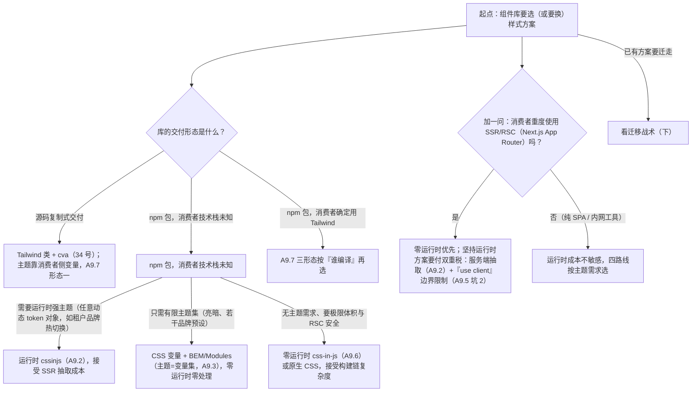

## A9. 样式与主题方案选型

- 四条路线对比：CSS Variables+BEM / CSS-in-JS（antd v5 cssinjs）/ Tailwind preset（shadcn 路线）/ CSS Modules
- ConfigProvider 注入 token；暗色主题（变量切换）；**样式按需加载**（cssinjs 天然按需 vs css 文件要 sideEffects 处理）

### A9.1 四条路线对比

| 维度 | CSS Variables + BEM | CSS-in-JS（antd v5 @ant-design/cssinjs） | Tailwind preset（shadcn 路线） | CSS Modules |
|---|---|---|---|---|
| 按需加载 | 按组件拆 css 文件，依赖打包器与 sideEffects 声明 | **天然按需**：组件渲染时才注入对应样式，无独立 css 产物 | **原子级按需**：源码里出现过的类才会被生成 | 按组件文件拆分，同 BEM 路线的打包问题 |
| 主题能力 | 运行时换变量，零成本、支持多主题共存 | token 系统（seed/map/component 三层）驱动，hash 缓存；主题即对象 | preset 定义 token；运行时主题靠 CSS 变量承接 | 主题只能走 CSS 变量，类名本身编译期固定 |
| 运行时成本 | 零 | 有：token 序列化、样式生成与插入（有 hash 缓存，同主题只付一次） | 近零：编译期完成，运行时只有变量 | 零 |
| SSR | 零处理 | 要抽关键 CSS（createCache + extractStyle）防首帧裸奔 | 零处理 | 零处理 |
| 样式隔离 | 靠 BEM 命名纪律 | hash 类名 + `:where()` 零特异性 | 类名组合 + 前缀约束 | 编译期 hash 类名，天然强隔离 |
| 消费者覆盖成本 | 直接写覆盖类，特异性可控 | `:where()` 让覆盖容易，但要懂 token 体系 | 源码都在自己仓库（shadcn），随便改 | hash 类名对外不可读，覆盖需库方开出口子（prefix/className API） |
| 代表 | Arco Design（less 变量 + CSS 变量主题）、Element Plus（Vue 侧经典） | antd v5、MUI（emotion 底座） | shadcn/ui + Radix | 大量团队内部库与中后台项目 |

选型速记：**要运行时强主题（设计系统级）→ cssinjs 或 CSS 变量；要零运行时与最小体积 → BEM/Modules；要把最终形态交给业务方 → Tailwind preset（shadcn 形态，Part B Lv4 展开）**。四条路线的代码形态各看一眼：

```css
/* 路线一：CSS Variables + BEM —— button.css */
:root {
  --ui-color-primary: #1677ff;
}
.ui-btn {
  /* 命名即模块：块__元素--修饰符 */
  background: var(--ui-color-primary);
  border-radius: var(--ui-radius, 4px);
}
.ui-btn--large { padding: 8px 16px; }
.ui-btn__icon { margin-right: 4px; }
/* 主题 = 换变量集（见 A9.3），类名零改动 */
```

```tsx
// 路线二：CSS-in-JS —— 机制示意（antd v5 内部即 @ant-design/cssinjs）
// 样式是"token 的函数"，运行时生成 <style> 插入 <head>，见 A9.2 的机制分解
```

```ts
// 路线三：Tailwind preset —— my-ui/tailwind.preset.ts
import type { Config } from 'tailwindcss';

export default {
  theme: {
    extend: {
      colors: {
        ui: {
          primary: 'var(--ui-color-primary)', // token 指到 CSS 变量：编译期定类名，运行时换值
        },
      },
    },
  },
} satisfies Config;

// 业务侧 tailwind.config.js：
// module.exports = { presets: [require('my-ui/tailwind.preset.js')] };
```

```css
/* 路线四：CSS Modules —— Button.module.css */
.btn { /* 编译后类名形如 Button_btn__x7f2q，天然隔离 */
  composes: base from './base.module.css'; /* composes：模块内组合复用 */
  background: var(--ui-color-primary);
}
```

### A9.2 ConfigProvider 注入 token 的机制

antd v5 的主题系统机制分步（理解了机制，换任何 cssinjs 库都能举一反三）：

1. **ConfigProvider 收 ThemeConfig**（`token`/`algorithm`/继承合并），通过 context 下发；
2. **token 分三层**：种子 token（`colorPrimary` 等 ~30 个）→ 映射 token（派生色板 `colorPrimaryBg`、悬浮色等）→ 组件 token（`Button.paddingInline` 这类单组件粒度）；
3. **cssinjs 引擎**把整棵 token 对象序列化算 hash：**同 token 必同 hash**，组件样式模板（CSS 模板字符串函数，入参是 token）执行结果挂上 `.css-{hash}` 类名插进 `<head>`，命中过的 hash 走缓存不再生成；
4. 组件根元素挂 hash 类；选择器包 `:where()`（零特异性）——消费者的覆盖样式天然赢，不需要 `!important`；
5. `theme.cssVar: true` 时改为先生成一轮 CSS 变量、样式引用变量：切主题从"重生成全部样式"变成"换变量值"。

```tsx
// antd v5 主题接入：种子 token + 暗色算法 + CSS 变量模式
import * as React from 'react';
import { ConfigProvider, theme } from 'antd';

export function ThemedApp({ children }: { children: React.ReactNode }) {
  return (
    <ConfigProvider
      theme={{
        token: { colorPrimary: '#00b96b', borderRadius: 4 }, // 改种子：派生色板全跟着动
        algorithm: theme.darkAlgorithm,                        // 暗色算法（A9.3）
        cssVar: true,                                          // CSS 变量模式（antd 5.12+）：切换更便宜
      }}
    >
      {children}
    </ConfigProvider>
  );
}
```

SSR 配套（呼应 A7）：cssinjs 的样式在客户端是运行时注入的，服务端渲染的 HTML 里没有样式——首帧会"裸奔"，需要在服务端把样式抽出来塞进 `<head>`：

```tsx
// server-entry.tsx —— @ant-design/cssinjs 的服务端抽取
import * as React from 'react';
import { renderToString } from 'react-dom/server';
import { StyleProvider, createCache, extractStyle } from '@ant-design/cssinjs';

const cache = createCache(); // 用同一个 cache 承接渲染过程中的样式注册
const html = renderToString(
  <StyleProvider cache={cache}>{/* <App /> */}</StyleProvider>
);
const styleText = extractStyle(cache); // 汇总为 <style>…</style> 字符串，拼进 <head> 返回
```

### A9.3 暗色主题：变量切换与防白闪

自建库的标准暗色方案：**主题 = 一组 CSS 变量**，切换 = 换 `data-theme` 属性。难点不在切换，在**首帧**——`localStorage` 里存了 dark，但 HTML 生成时（SSR/首屏 JS 执行前）谁都不知道，等 React 挂载再切类名就是一次白闪（FOUC）。解法是 body 脚本抢在首帧之前：

```html
<!-- index.html —— 内联脚本：在任何渲染发生前把主题挂到 <html> 上 -->
<script>
  (function () {
    try {
      var saved = localStorage.getItem('theme');
      var theme =
        saved === 'dark' || saved === 'light'
          ? saved
          : matchMedia('(prefers-color-scheme: dark)').matches
            ? 'dark'
            : 'light';
      document.documentElement.dataset.theme = theme; // 与 CSS 的 [data-theme='dark'] 对应
    } catch (e) {
      /* localStorage 被禁用（隐私模式）等：走默认亮色 */
    }
  })();
</script>
```

```css
/* tokens.css —— 主题即变量集合 */
:root {
  --color-bg: #ffffff;
  --color-text: #1f2329;
  --color-primary: #1677ff;
}
:root[data-theme='dark'] {
  --color-bg: #141414;
  --color-text: rgba(255, 255, 255, 0.88);
  --color-primary: #3c89ff; /* 暗色品牌色是重新调亮的，不是简单反色 */
}
```

```tsx
// useTheme.ts —— React 侧的读写与持久化
import * as React from 'react';

type Theme = 'light' | 'dark';

export function useTheme() {
  // 首帧值由内联脚本提前挂好，这里只是"读现状"：与 SSR 输出一致，无 mismatch（A7.3）
  const [theme, setTheme] = React.useState<Theme>(() => {
    if (typeof document === 'undefined') return 'light';
    return (document.documentElement.dataset.theme as Theme | undefined) ?? 'light';
  });

  React.useEffect(() => {
    document.documentElement.dataset.theme = theme; // 切变量集：所有组件瞬间换肤
    window.localStorage.setItem('theme', theme);
  }, [theme]);

  return { theme, setTheme };
}
```

antd v5 侧的暗色就是 A9.2 里的 `algorithm: theme.darkAlgorithm`（对色板做暗色反演而非逐值手写）；要"页面框架自己一套 + antd 一套"双轨并行时，让自建变量的切换与 ConfigProvider 的 algorithm 同源于同一个 `useTheme`，避免两套暗色不同步。

### A9.4 样式按需加载与 sideEffects

**机制分步**（以打包器视角）：

1. 业务 `import { Button } from 'my-ui'`，入口文件 re-export 了全部 50 个组件；
2. 打包器做 tree-shaking 的前提是"未用到的模块没有副作用"——`package.json` 里 `"sideEffects": false` 就是这个承诺。没有它，打包器**不敢删**任何模块（删除可能改变行为），全量 50 个组件的 JS 全进包；
3. css 文件路线下，样式必须与组件**同目录同文件级联**（`button/index.tsx` 里 `import './style.css'`）：Button 活下来它的 css 跟着活，Button 被摇掉 css 也跟着摇掉——按需自动成立；
4. 若库里存在"必须无条件生效"的样式（reset、字体声明），`sideEffects: false` 会连它们一起摇掉——此时用数组形式把例外声明出来。

```json
// package.json —— 样式与组件同目录级联时的标准声明
{
  "name": "my-ui",
  "module": "es/index.js",
  "sideEffects": false
}
```

```json
// package.json —— 带全局样式的库：数组形式，"这些路径有副作用，别摇"
{
  "name": "my-ui",
  "module": "es/index.js",
  "sideEffects": ["**/*.css", "./es/global.js"]
}
```

**cssinjs 为什么"天然按需"**：它没有独立 css 产物——样式是组件 JS 的一部分，渲染哪个组件才生成哪段样式、挂到 `<head>`；没渲染的组件既不进 bundle 以外的任何地方，也不产生 CSS。代价就是 A9.2 的运行时成本与 SSR 抽取步骤。**css 文件路线则是"构建期全量产物 + 靠 tree-shaking 按需"**：`sideEffects` 声明是命门——antd v4 时代全量 less 与 `babel-plugin-import`（把 `import { Button }` 改写成 `import Button from 'antd/es/button'` + 样式引入）就是没有 cssinjs 之前的工程答案；v5 换 cssinjs 后插件退役，是两种路线兴衰的最佳注脚。

验证按需是否真的生效（别信文档，信产物）：

```bash
# 业务项目构建后，检查产物中是否存在"未被引用组件"的样式痕迹
npx vite build
grep -l "ui-pagination" dist/assets/*.css || echo "Pagination 未被引用，样式已按需剔除"

# 再对照：把 sideEffects 改成不声明，重复构建，看产物体积差（通常差数倍）
```

### A9.5 常见坑

1. **暗色主题白闪一瞬**。症状：刷新暗色站先白后黑。根因：主题在 React 挂载后才切类名。修法：A9.3 的内联脚本抢首帧；`<html>` 上加 `suppressHydrationWarning`（若走 SSR，dataset 属性双端可能不同——见 A7.4 表格第 3 行的取舍）。
2. **cssinjs 在 RSC（Server Components）里报错**。症状：Next.js App Router 服务端组件直接渲染 antd 组件报 `window is not defined` 或样式失效。根因：cssinjs 与浏览器/客户端渲染耦合。修法：组件库组件标注 `"use client"` 边界，antd 官方在 Next.js 集成文档里同因——这也是 2023 年后社区重新偏爱"零运行时样式"的现实推动力。
3. **tailwind-merge 对不了自定义类**。症状：消费者传的 `p-6` 没能覆盖库里的 `p-3`。根因：库里混用了非 Tailwind 类（`panel-pad-md`）与原子类，twMerge 只认 Tailwind 类组。修法：库内样式统一走原子类（可封装成语义别名），或自定义 `extendTailwindMerge` 注册自己的类组。
4. **`sideEffects: false` 后全局样式丢了**。症状：升级库后 reset 样式消失、页面错乱。根因：A9.4 第 4 步——全局样式被当副作用摇掉。修法：改成数组声明；或把 reset 拆成独立入口（`import 'my-ui/reset.css'`）让业务显式引入。

### A9.6 零运行时 CSS-in-JS：vanilla-extract / PandaCSS / linaria

A9.1 的对比表里"CSS-in-JS"以 antd v5 的运行时形态出现（@ant-design/cssinjs）；这一节补上它的另一条支线——**零运行时 CSS-in-JS**：写法保留（在 TS 里写样式、类型安全、变体函数），**求值移到构建期**，产物是真实的 .css 文件，运行时只剩类名字符串。

**为什么这条支线在 2023 年后崛起**：运行时 cssinjs 的两个代价正好踩中时代痛点——运行时成本（A9.2 第 3 步的序列化与样式生成）与 RSC 不兼容（A9.5 坑 2：App Router 服务端组件里直接炸）。零运行时把"样式是 token 的函数"这个模型原样保留，只是把函数求值从渲染期挪到构建期——函数没变，求值时机变了。

| | vanilla-extract | PandaCSS | linaria |
|---|---|---|---|
| 提取机制 | 构建器插件执行 `.css.ts` 文件，产出 .css | 静态扫描源码 + 代码生成（`panda codegen`） | babel/swc 插件在编译期求值标签模板 |
| 写法 | `style()`/`createTheme()`，样式即 TS 对象 | recipes/sva（cva 风格变体表）+ token 配置 | `styled.xxx` 标签模板 + `css` |
| 类型安全 | 强：token、主题契约都是 TS 类型 | 强：config 生成类型与工具类 | 中：模板串内属性名靠插件检查 |
| 主题机制 | `createTheme` 产出类名 + 契约校验 | config 定义 token → 生成 CSS 变量与条件类 | 无内建主题，靠 CSS 变量自建（A9.3 通用） |
| RSC | `.css.ts` 不含 React，Server Components 可直接消费 | recipes 是纯对象，RSC 安全 | 构建期已提取，RSC 安全 |
| 生态位 | seek 设计系统底座 | Chakra v3 底座 | 最早的零运行时方案，影响了前两者 |

调试体验上零运行时还有一项隐性收益：产物 CSS 的类名与顺序在构建期就固定（可开 sourcemap/标识定位到 `.css.ts` 源位置），而运行时方案的类名取决于**运行时的插入顺序**——多主题/多 Provider 嵌套时"谁覆盖谁"要靠 hash 缓存时序推演。排查"覆盖样式不生效"类工单，前者的心智负担明显更低。

先用同一个 Button 把"运行时 vs 零运行时"的写法差异拍在眼前（求值时机的差别在代码形态上就可见）：

```ts
// 运行时写法（emotion 风格）：样式是函数，token 是运行时对象，渲染期求值
const button = (token: { colorPrimary: string }) => css({ background: token.colorPrimary });

// 零运行时写法（vanilla-extract）：样式是构建期对象，token 是变量引用，编译期求值
export const button = style({ background: vars.color.primary });
```

三家的代码形态各看一段（真实 API，非伪代码）：

```ts
// Button.css.ts —— vanilla-extract：主题契约 + 样式
import { createThemeContract, createTheme, style } from '@vanilla-extract/css';

// 契约：规定"一个主题必须提供哪些变量"，缺一个编译期就报错
export const vars = createThemeContract({
  color: { primary: null, surface: null },
  space: { control: null },
});

// 主题 = 一个类名：挂上它，vars.* 全部有值（与 A9.3 的 data-theme 换变量集同构）
export const lightTheme = createTheme(vars, {
  color: { primary: '#1677ff', surface: '#ffffff' },
  space: { control: '8px' },
});
export const darkTheme = createTheme(vars, {
  color: { primary: '#3c89ff', surface: '#141414' },
});

export const button = style({
  background: vars.color.primary,
  padding: `${vars.space.control} 16px`,
});
// 消费侧：<div className={lightTheme}><button className={button}>…</button></div>
```

```ts
// panda.config.ts —— PandaCSS：token 进配置，类型与 CSS 变量由 codegen 产出
import { defineConfig } from '@pandacss/dev';

export default defineConfig({
  theme: {
    tokens: {
      colors: { primary: { value: '#1677ff' } },
    },
    semanticTokens: {
      colors: { action: { value: '{colors.primary}' } }, // 语义层引用基础层
    },
  },
});
```

```tsx
// Button.tsx —— linaria：styled 标签模板，构建期求值
import { styled } from '@linaria/react';

export const Button = styled.button`
  background: var(--color-primary); /* 动态主题仍靠 CSS 变量（A9.3 方案通用） */
  padding: 8px 16px;
`;
```

**一个必须先说破的认知：零运行时 ≠ 零 CSS 产物**。这条路线产出真实的 .css 文件，于是 A9.4 的按需加载问题原样回来了——css 要么与组件文件级联（靠 sideEffects 摇树），要么整包引入。它与运行时 cssinjs 的本质互换是：**用构建链复杂度换运行时成本**。

库构建侧的接入形态（以 vanilla-extract + Vite 为例，产出结构是三家的共同形态）：

```ts
// vite.config.ts —— 库构建侧：插件执行 .css.ts，产出 .css 与 JS 同目录
import { defineConfig } from 'vite';
import { vanillaExtractPlugin } from '@vanilla-extract/vite-plugin';
import dts from 'vite-plugin-dts';

export default defineConfig({
  plugins: [vanillaExtractPlugin(), dts({ rollupTypes: true })],
  build: {
    lib: { entry: 'src/index.ts', formats: ['es'] },
    // 产物：dist/index.js（内含 import './styles.css'）+ dist/styles.css
    // —— "样式与组件级联"（A9.4 第 3 步）在零运行时路线的具体形态
  },
});
```

主题能力也随之收窄：运行时 cssinjs 能"渲染期拿到任意 token 对象现算样式"（antd 的 ConfigProvider 动态算法），零运行时方案的主题只能是"预生成好的变量集/类名集合里挑一个"——租户级任意动态品牌的场景仍是运行时方案的主场。

与 A9.2 的 hash 机制对照一下，能看清"差异全部集中在求值时机"：A9.2 说运行时 cssinjs"同 token 必同 hash，命中缓存不再生成"；零运行时方案同样有类名指纹（按文件/样式内容在构建期生成），区别只是缓存命中发生在**构建期**（同一段样式编译一次）而非**运行期**（同一主题只插入一次）。两者的"重复样式消除"能力等价，分水岭只在一处：运行朷新出现的 token 对象（租户改色、用户自定义主题），运行时方案能现算，零运行时方案只能引导到 CSS 变量注入。

token 三层架构（基础/语义/组件）、热切换与视觉回归的工程化展开在《高阶场景第二辑》20-9，本节不重复。

选型速记：**要 RSC 安全 + 类型安全 + 预设主题集 → 零运行时；要任意动态主题 → 留在运行时方案**。

顺带理清它和 A9.1 路线四（CSS Modules）的亲缘：`.css.ts` 本质上是"带类型推导与主题契约的 CSS Modules"——同样是构建期产物、同样是局部作用域类名，多出来的两样（样式对象的类型检查、createTheme 的契约校验）正是组件库相对业务样式最需要的东西。团队已熟悉 CSS Modules 时，零运行时 css-in-js 的学习曲线主要就是这两样增量。

最后一个常见追问："零运行时方案能否复刻 antd 那种主题体验？"——不能，也不必：当你开始认真评估"复刻动态算法"的可行性时，这个需求本身就是选型信号，带着它回到 A9.8 的决策树重新走一遍，比在零运行时方案里硬造主题引擎便宜得多。

常见坑：

1. **想给样式传运行时值**。症状：`style({ color: props.color })` 这类写法无处落笔。根因：构建期没有 props——所有零运行时方案的共同边界。修法：动态值走 CSS 变量（`style({ color: var(--x) })` + 运行时 `setProperty`），静态变体走 variants/recipes。
2. **`.css.ts` 的构建产物在业务侧被摇掉**。症状：接入方升级打包配置后组件裸奔。根因：vanilla-extract 编译后的 JS 模块内含 `import './styles.css'`，若库声明 `sideEffects: false` 会被连根摇掉（A9.4 同款问题换了件衣服）。修法：`"sideEffects": ["**/*.css"]`。
3. **linaria 撞上 SWC 构建链**。症状：Next.js（默认 SWC）里插件不生效或构建报错。根因：linaria 的成熟路径是 babel preset，SWC 支持依赖实验性插件。修法：选型第一件事是核对自己的构建链（vite/webpack/esbuild/swc）在该方案的支持矩阵里。
4. **主题契约与运行时换肤的预期落差**。症状：接入方提需求"运营后台改个品牌色，前端立即换肤"，而 createTheme 只能切换预生成的那几个主题类。根因：主题类是构建产物，新主题 = 重新构建发版。修法：把需求拆开——连续可变的品牌值（色值）走 CSS 变量运行时注入（`setProperty`，A9.3 的机制）；createTheme 只负责结构性的主题差异（暗色算法级别）。需求真是"任意租户任意主题对象"时，这本身就是运行时方案的选型信号（回到决策树）。

### A9.7 Tailwind 与组件库的融合：三种形态与三个命门

A9.1 路线三只给了 preset 的一行示意；当"库以 Tailwind 类为样式载体"时，真正要回答的是**类名住在哪里、由谁编译**。三种融合形态：

| 形态 | 类名住哪 | 谁编译 | 代表 |
|---|---|---|---|
| 源码复制（copy-in） | 消费者仓库 | 消费者 | shadcn/ui（Lv4 与 34 号展开，本节不重复） |
| npm 库 + 消费者编译 | 库的 dist（JS 里含类名字符串） | 消费者（扫描范围必须覆盖库文件） | headless 库 + 类名约定的组合 |
| 库自编译 css | 库的 `dist/*.css` | 库自己 | preset + 预编译产物，消费者不需要 Tailwind |

Tailwind 的机制是"**扫描到什么类才生成什么类**"，由此派生三个命门：

**命门一：扫描覆盖**。库 dist 里的类名字符串默认不在消费者的扫描范围里，必须显式纳入——v3 与 v4 的配置语言不同：

```js
// tailwind.config.js —— v3：content 显式纳入库产物
module.exports = {
  content: [
    './src/**/*.{ts,tsx}',
    './node_modules/@my-ui/dist/**/*.{js,cjs,mjs}', // 关键行：库的类字符串默认不被扫描
  ],
  presets: [require('@my-ui/tailwind.preset')],
};
```

```css
/* app.css —— v4（CSS-first 配置）：@source 显式纳入，token 用 @theme 定义 */
@import "tailwindcss";
@source "../node_modules/@my-ui/dist";
@theme {
  --color-primary: #1677ff; /* 取代 v3 config 的 theme.extend.colors */
}
```

**命门二：运行时拼类必死**。Tailwind 只生成"构建期在源码里出现过的完整类名字符串"，任何运行时拼接都注定落空：

```ts
// size.ts —— 动态值 → 完整类名映射表（每个分支都是源码里出现过的字面量）
export const paddingBySize = {
  sm: 'px-2 py-1',
  md: 'px-3 py-1.5',
  lg: 'px-4 py-2',
} as const;
// 用法：paddingBySize[size]
// 反例：`px-${n}` —— 这个类在任何模式下都不会被生成，样式"随机"失效
```

**命门三：版本耦合**。Tailwind v4 重命名了一批类（`shadow` → `shadow-sm`、`rounded` → `rounded-sm`、`ring` 默认 3px 等），库输出的原始类字符串跨 Tailwind 大版本会**静默变义**（类名还在、值变了）。对策三选一：peerDependencies 锁版本区间并在 changelog 顶部声明；改走"库自编译 css"形态；或干脆选"源码复制"形态把版本决定权交给消费者。

命门之外，两种进阶形态值得展开。**其一：v3 与 v4 的"preset"发布物不同**。先看两代对库作者的关键差异：

| | Tailwind v3 | Tailwind v4 |
|---|---|---|
| 配置载体 | `tailwind.config.js`（JS 对象） | CSS 文件（`@theme` / `@source` 指令） |
| preset 形态 | JS 配置对象（`presets: [require(...)]`） | 一段可 `@import` 的 CSS |
| node_modules 扫描 | content 数组显式纳入 | 默认忽略，`@source` 显式纳入 |
| 类名集 | 稳定多年 | v4 重命名 shadow/rounded/ring 等（命门三的来源） |
| 引擎 | PostCSS 插件 | 独立 CLI（Oxide/Rust 内核），也可继续当 PostCSS 用 |

库自身要从 v3 跨到 v4 时，检查单三行：content 配置改写为 `@source`（或双发）；preset 同时维护 JS 与 CSS 两种形态（下文）；被 v4 重命名的类在 changelog 里逐条列出（shadow/rounded/ring 三族最常踩）。双发期一般持续到消费者的 v3 依赖清零——在库的 issue 里挂一个"v3 支持退场"追踪贴，给迁移一个明确的终点。

v3 的 preset 是 JS 配置对象（A9.1 路线三的 `tailwind.preset.ts`）；v4 转向 CSS-first 后，库要发布的"preset"变成一段可 `@import` 的 CSS：

```css
/* @my-ui/theme.css —— v4 形态的 preset：@theme 定义 token */
@theme {
  --color-ui-primary: #1677ff;
  --radius-ui-card: 8px;
}
/* 消费侧：@import "@my-ui/theme.css";（v3/v4 双支持的库要同时发两种形态） */
```

**其二：自编译形态的产物与"覆盖通道"的分野**。库自己编译好 css 后，产物结构回到传统形态：

```text
dist/
  index.js      # 组件 JS（类名字符串已在构建期落进 CSS）
  index.css     # 全部组件样式（消费者不需要装 Tailwind）
  preset.js     # 可选：给仍想扩展的消费者保留 v3 preset
```

消费者接入只剩一行 `import 'my-ui/dist/index.css'`；代价是消费者无法用 Tailwind 工具类覆盖库样式——覆盖通道退回 A9.1 路线一的世界（写覆盖类，赌库的类名稳定）。**三形态的真正分野就在覆盖通道**：源码复制可改一切、消费者编译可被 Tailwind 工具类自然覆盖、自编译只剩特异性覆盖。

还有第四种轻形态：**headless + 类名注入口**（Radix + Tailwind 的生态惯例，行为实现见 32 号）。库不含任何样式，只暴露行为与注入口，样式方案彻底让渡给消费者——A9.7 的三个命门全部消失：

```tsx
// headless Dialog 的消费形态：类名完全来自消费者侧（cva / tailwind 均可）
<Dialog.Root>
  <Dialog.Trigger className={triggerRecipe({ size })} />
  <Dialog.Content className={contentRecipe()} />
</Dialog.Root>
```

代价转嫁也很明显：每个消费者自己维护一套样式与视觉一致性——这正是 Lv4（25 号）"范式之争"要权衡的取舍，此处指路。

命门一（扫描覆盖）不能靠文档自觉，要给**可执行的验收**——库的示例工程构建后检查关键类是否存在：

```bash
# examples/tailwind-check.sh —— 接入自检：示例工程按文档接入后，产物里必须能找到库的类
npx tailwindcss -i app.css -o dist.css --content "./src/**/*.{ts,tsx},./node_modules/@my-ui/dist/**/*.{js,cjs,mjs}"
grep -q "btn-lg" dist.css || {
  echo "扫描未覆盖 @my-ui：请检查 content/@source 配置" && exit 1
}
```

三形态的选择判据收拢成一句：**谁来承担 Tailwind 的存在性**。源码复制把 Tailwind 交给消费者并连同源码一起给；消费者编译形态要求消费者装好并配好 Tailwind（库要付文档与支持成本）；自编译形态由库独占 Tailwind（消费者零负担、覆盖通道收窄）；headless 干脆不选边。没有最优形态，只有"库的定位"——给内部团队提速选消费者编译，给外部用户交付选自编译，给极致定制人群选源码复制或 headless。

变体表的组织（variants 一张表同时产出类型与类名）用 cva，34 号有完整展开，此处指路。消费者覆盖库样式走 tailwind-merge 的类组消解——`cn` 工具见 A8.3，自定义类组注册的问题见 A9.5 坑 3。

常见坑：

1. **动态拼类在开发环境"看起来正常"**。症状：本地好好的，CI 构建/生产包里样式缺失。根因：恰好有别处源码里出现过同名完整类（如示例代码、文档站），拼出来的类搭了便车。修法：全量排查 `className={`...${...}`}` 模式，换成映射表。
2. **库升级 Tailwind 大版本，接入方视觉整体漂移**。症状：圆角/阴影/环宽悄悄变了，无报错。根因：命门三。修法：版本耦合要么显式声明（peerDep），要么物理隔离（自编译 css），不能默认"大家都会一起升"。
3. **preset 只同步了 token，没同步 content/source**。症状：接入方反馈"按文档配了 preset，类还是没生成"。根因：preset 只管 theme 扩展，扫描范围是消费者侧的构建配置。修法：接入文档把 v3 的 content / v4 的 @source 写成"必须复制的一节"，并附一个"样式自检"最小用例。
4. **safelist 滥用**。症状：为图省事把 `p-*`、`text-*` 整段 safelist，CSS 产物体积暴涨数倍。根因：safelist 是"无条件全量生成"，等于退回全量 CSS 时代，命门二的修法被绕过了。修法：映射表优先（显式枚举用到的类）；safelist 只给"确有运行时拼类又短期无法重构"的遗留代码兜底，且逐条注释原因、限期消除：

```js
// tailwind.config.js —— safelist 的正确姿势：逐条列出 + 注释原因 + 限期
module.exports = {
  safelist: [
    // 遗留代码运行时拼类（映射表改造排期 Q3），届时删除
    'bg-red-50',
    'bg-red-100',
  ],
};
```

### A9.8 样式方案的迁移决策树

A9.1 给了静态选型对比，A9.6/A9.7 又补全了选项面；这一节回答落地问题——"从现状到目标方案怎么走"。先决策树（选型），再迁移战术（换型）。



**迁移战术（绞杀者模式，五步）**——核心思想是"新旧共存、逐组件绞杀"，反对大爆炸重写：

1. **先立中立地基：CSS 变量层**。把颜色/间距/圆角全部落到一组 CSS 变量上，新旧两套样式系统都只消费这组变量。变量是跨方案恒定的契约（BEM 能用、cssinjs 能用、Tailwind preset 也能指过去——A9.1 路线三的写法），地基立住后换样式引擎就不再动设计值。三层 token 的铁律见《高阶场景第二辑》20-9。
2. **新组件新方案，老组件冻结**。新写的组件全部用目标方案；老组件除非有功能需求否则不动——每迁一个组件都要单独付视觉回归的钱，别批发。
3. **兼容层**：迁移期内同名组件可能出现"旧类名 + 新类名"并存，用 A8.3 的 `cn` 合并（tailwind-merge 或自写合并器），对外 API 不变。
4. **视觉回归护栏**：每批迁移跑截图 diff（28-C3 的 Chromatic 线，第二辑 20-9 的视觉回归线），把"看起来一样"变成可断言的契约。
5. **大版本收尾**：全部组件迁完、旧样式依赖清零后，发 major 移除兼容层——版本纪律走 C5 的 changesets/semver 流程。

第 3 步的兼容层给一个可落地的实现（"旧类保留 + 新类叠加"的映射表，保住消费者的旧覆盖样式）：

```ts
// legacyClassName.ts —— 迁移期兼容层：旧类名 → 新类名，叠加输出 + 开发期弃用告警
const LEGACY_MAP: Record<string, string> = {
  'ui-btn': 'btn',        // BEM 旧类 → 新规范类
  'ui-btn--large': 'btn-lg',
};

export function bridgeLegacy(className?: string): string | undefined {
  if (!className) return className;
  return className
    .split(/\s+/)
    .map((cls) => {
      const next = LEGACY_MAP[cls];
      if (!next) return cls;
      if (import.meta.env.DEV) {
        console.warn(`[my-ui] 类名 "${cls}" 已弃用，请改用 "${next}"（下个 major 移除映射）`);
      }
      return `${cls} ${next}`; // 叠加而非替换：旧类保住消费者的覆盖样式，新类接管基础样式
    })
    .join(' ');
}
// 接入位置：库的 cn 入口统一过一遍 bridgeLegacy，组件代码与消费者代码都不用改
```

一条真实的迁移时间线（BEM → CSS 变量层，二阶段再评估是否继续迁）：

- **第 1–2 周**：只做第 1 步——旧 less 里的颜色/间距字面量全部替换为 `var()`，视觉零变化（截图 diff 全绿作为验收）。这步没有任何功能收益，却是后面一切的前提；
- **第 3 周起**：新组件直接用目标方案；老组件"有功能改动时顺手迁"，每批不超过 5 个组件、一批一个 PR，视觉回归逐批跑；
- **第 2 个月**：主题需求明朗化——若止步于亮暗预设，迁移到此为止（CSS 变量已够用）；若真出现"租户动态品牌"需求，带着已建好的变量层回到决策树做第二轮选型，成本同样可控。

节奏的要义：**迁移是常态而不是项目**。中立地基立好之后，每一批都是小步，随时可以停下来——"停得住"本身是方案健康度的指标。

每批迁移还要配**灰度与回滚**：批内组件的样式引擎切换通过构建开关（如环境变量控制 exports map 指向新旧两套产物目录），先在文档站/内部应用灰度一周再对全量发包；视觉回归（第 4 步）与灰度期监控（样式相关工单/控制台报错）双通道确认后才算迁完一批。回滚单位是"批"而不是"版本"——这是"每批 ≤5 个组件"的另一半理由：批越小，回滚越无痛。

一个两难场景的走读，训练用决策树的方式思考：**库已是运行时 cssinjs，接入方重度使用 RSC，但租户动态主题也是真需求**。三选：

- 留在运行时方案 + 全组件 `"use client"`——RSC 页面里组件全变成客户端岛，首屏直出优势折损（A9.5 坑 2 的完整代价）；
- 迁零运行 + 主题降级——用 CSS 变量承接租户品牌色（连续值可注入），只有结构性主题差异（暗色算法）需要发版，多数租户需求其实落在前者（A9.6 坑 4 的拆解）；
- 双轨——新组件零运行时、老组件保留 cssinjs，用 A9.8 第 1 步的变量层统一观感。

走读结论：多数真实项目选第三条过渡、第二条收尾。决策树不替你做决定，它保证你把选项摆全、代价说清——这正是"样式方案选型"作为架构题而非偏好题的意思。

迁移期比平时多一层**类名契约测试**（三层护栏的第一层，视觉回归与产物检查是另两层）：

```ts
// button.classNames.test.tsx —— 迁移期：旧类名兼容输出（bridgeLegacy 的叠加契约）
import { render } from '@testing-library/react';
import { Button } from './Button';

it('迁移期新旧类名同时在场', () => {
  const { container } = render(<Button size="large">保存</Button>);
  const cls = container.firstElementChild?.className ?? '';
  expect(cls).toContain('ui-btn--large'); // 旧类：消费者的覆盖样式继续生效
  expect(cls).toContain('btn-lg');        // 新类：新方案样式就位
});
```

第二层是视觉回归（第 4 步的截图 diff，28-C3）；第三层是示例工程产物检查（A9.7 的自检脚本同样适用于迁移验收——新类进了产物、旧类对应的样式段也还在）。三层齐了，"看起来一样"才从口头承诺变成可回归的契约。

最后，每轮迁移前写五行**决策记录**（ADR），防止半年后没人记得当初为什么这么选：

1. 背景：现状方案的具体痛点，用数字说话（包体、LCP、样式相关工单量）；
2. 决策：目标方案，指回决策树的具体分支；
3. 代价：新增的构建依赖与失去的能力，指回动机核对表；
4. 灰度与回滚：批次大小、验收通道（本节上文）；
5. 复评时点：什么信号出现时重开决策（例如"租户动态主题需求正式落地"）。

决策树、五步战术、三层护栏、五行 ADR——四件套齐了，样式迁移就从"勇敢者的项目"变成有流程的常规工程。

常见"从 X 迁 Y"的动机核对表（迁移前先确认动机成立）：

| 迁移 | 成立的动机 | 要付出的代价 |
|---|---|---|
| BEM/Modules → 运行时 cssinjs | 需要任意动态 token 的强主题 | 运行时成本 + SSR 抽取步骤（A9.2） |
| 运行时 cssinjs → 零运行时 | RSC 兼容、去掉运行时开销 | 动态主题收窄为变量集切换；构建链复杂化 |
| 运行时 cssinjs → CSS 变量 | 主题需求其实只有亮暗/预设 | 失去 token 算法（如 antd 暗色算法）这类派生能力 |
| 任意 → Tailwind 形态 | 组织统一技术栈、消费者要改样式 | 版本耦合（A9.7 命门三）与按需加载命门回归 |

常见坑：

1. **大爆炸重写**。症状：迁移分支数月合不上，视觉回归问题堆积到无法triage。根因：全部组件一次性换方案，回归面 = 全部组件 × 全部状态。修法：五步战术，每批迁移的回归面可控。
2. **迁移期两套主题源不同步**。症状：旧 less 变量改了一处、新 CSS 变量漏改，暗色主题局部错色。根因：设计值存在两份。修法：第 1 步的"中立地基"就是解药——设计值只有变量层一份，新旧引擎都读它。
3. **把样式迁移当纯样式活**。症状：迁完才发现消费者的覆盖样式全失效（特异性关系变了：`:where()` 零特性 vs BEM 单类特性）。根因：迁移面不止"库内样式"，还包括"消费者覆盖库样式的通道"（className 合并语义、特异性、优先级）。修法：迁移清单里加一栏"消费者覆盖通道前后对照"，并在 major 的 changelog 里给出覆盖样式的迁移指引。
4. **兼容层"叠加"出双写特异性事故**。症状：迁移期同一元素背着一旧一新两个类，消费者的覆盖样式时而赢时而输，不稳定。根因：新旧两套类的特异性不同——从 BEM（单类，0-1-0）迁往 `:where()` 方案（零特异性）是顺风：旧类保覆盖、新类零特性，天然分层；**反方向迁移是逆风**：新方案特异性更高时消费者的旧覆盖必输。修法：迁移方向与特异性方向不一致时，兼容层从"叠加"改为"替换 + changelog 给覆盖类迁移表"；设计迁移顺序时优先做顺风方向。

---

## 附:ASCII 图替换清单

本文档图形化改版,原 ASCII 字符图与 Mermaid 图表对应关系如下:

| 原图位置 / 标题 | 处理结果 |
| --- | --- |
| A9.8 样式方案的迁移决策树(交付形态分支 + SSR/RSC 加一问) | 替换为 flowchart(决策树) |
